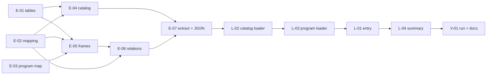

# DUT Legacy Curriculum Seed — Backend Implementation Plan

This plan builds a separate, re-runnable seed that loads the Khoa CNTT curricula (every `1024*` frame) from the DUT legacy system into the app's catalog, program and curriculum tables. It has two parts: a TypeScript extractor that reads six non-personal legacy tables and writes PII-free JSON into `source/backend/prisma/seed-data/dut/`, and a loader (`pnpm prisma:seed:dut`) that writes that JSON into the database. It does **not** touch the base seed (`prisma/seed.ts`) or the demo seed (`prisma/seed-demo.ts`), import lecturers or students, create syllabi, or replace the `1024034` / `DEMO*` placeholders. Replacing those is a separate step after this one.

> **Companion documents**
> - Requirement: `docs/requirement/REQUIREMENTS.md` (Q-04 HT/TQ đồ án stored as-is, Q-11 the Khoa's real frames)
> - Data dictionary: `docs/design/data-dictionary.md` (CurriculumItem `htDa`/`tqDa` :318-319)
> - Release behaviour this seed imitates: `docs/implementation/f-15-release-version-snapshots-implementation-plan.md`
> - Handoff debt this plan begins to pay: `docs/progress/handoff.md` §3.3 ("Thay dữ liệu giữ chỗ từ Excel của Khoa")
> - Sensitive-data rule: the legacy dumps under `source/current-data-dut/pbl6-data/` hold real student and staff data. Only the six tables named in §2a are read.

**Status**: Complete (2026-10-23) — E-01…L-04 built; caller verified V-01 seed/database results on throwaway PostgreSQL 18 ICU `vi-VN`, not `ctdt-dev-pg`; V-01 documentation synchronized. Second DUT seed run created 0 everywhere; typecheck exit 0, prisma tests 52 passed, extractor deterministic and JSON sensitive-pattern check clean. The user's own database remains untouched; defaults still need confirmation. See implement report §V-01.

---

## 0. Plan at a glance

Everything below in one table. Read this; the rest is detail for whoever builds it.

| What | Why | How and where |
|---|---|---|
| **24 real IT programs with 46 curriculum versions** loaded from the legacy system | The app holds only placeholder frames (`1024034`, `DEMO*`). The Khoa's real frames are needed for review and demos (Q-11) | Each program is one major or specialization, and each legacy frame (`MaKhung`) becomes one `ProgramVersion`. The mapping is a hand-written constant in the extractor (E-03) |
| **Older intakes show as history, the newest as current** | A program's K2021→K2025 frames are successive releases of one program | Versions are numbered 1.0, 2.0, … in intake order. A version whose start semester has begun is ACTIVE, older ones HISTORICAL, later ones PENDING. Written directly, not through the release service (L-03) |
| **173 legacy courses in the catalog**, with owning unit and type | Every frame row needs a `Course`. 8 codes used by K2026 frames are missing from both legacy catalogs | Courses are upserted by code. Owners come from `KhoaPC`: `102` maps to the existing `KHOA_CNTT`, other units become new org units, and an empty owner goes to a placeholder unit (E-04, L-02) |
| **3,295 curriculum rows, ~156 elective groups, 3,135 row requisites** | The frame, its electives and its prerequisites are what reviewers check | Rows keep the legacy semester, order, HT/TQ flags and note. "Chọn N trong M" notes become groups. LoaiDK codes map through one constant (E-05, L-03) |
| **224 retained catalog prerequisite pairs, 2 conflicting** built from all frames | F-05 checks and the course screens read `CourseRelation`, not the per-frame copy | One edge per retained course pair, using the type that most frames give it. The raw input has 236 pairs; 12 are excluded by the frame/catalog filters. An edge that would close a PRIOR/PREREQUISITE cycle is skipped and reported (E-06, L-02) |
| **Legacy semesters and cohorts K2021–K2025** | A released version needs an effective semester with a start date, and a cohort mapping | From `tmKehoach`. A semester that already exists keeps its dates, and the difference is reported (E-04, L-02) |
| **PII-free JSON committed under `prisma/seed-data/dut/`** | A machine without the legacy dump must still be able to seed. The dump must never be needed at seed time | `pnpm dut:extract` reads the dump once and writes the JSON plus `report.json`. Only six non-personal tables are opened (E-01…E-07) |
| **One command, safe to run twice** | Mirrors `prisma:seed:demo` | `pnpm prisma:seed:dut` checks that the base seed ran. A program that already exists is skipped whole, and every other row is upserted with `update: {}` (L-01…L-04) |

### Key behaviours worth knowing

| Behaviour | Why it is this way |
|---|---|
| Released legacy versions have `syllabusId = null` on every row | The legacy data has no syllabi, and `VersionPublisher.promote()` throws `MISSING_SYLLABUS` (`version.publisher.ts:137`). Readers fall back to the course's current syllabus (`revision-for-items.ts:38-50`), so a legacy version shows whatever syllabus the course has today, not a frozen one |
| A change request or correction on a legacy version cannot be released until every course in it has a syllabus | This is the existing release rule, not something the seed adds. The consistency check reports `MISSING_SYLLABUS` (ERROR) on every legacy frame |
| 14 frames fail the credit check (`CREDIT_MISMATCH`, HIGH) | Their compulsory rows include track-labelled courses (KTMT / HTTT / Công nghệ PM / ATTT) that the legacy system treats as "pick your track". Our model has no tracks. The rows are imported as-is, with the label kept in `note` |
| Elective rows whose note is only a track label or empty are electives **without a group** (`ELECTIVE_WITHOUT_GROUP`) | `ElectiveGroup_has_minimum` requires `minCredits` or `minCourses`, and these notes carry neither |
| `publishedAt` and `createdAt` of a released version are set to its effective semester's start date | The version history is ordered by `createdAt desc` (`program.dto.ts:107`). If all versions were inserted in one run they would tie, and the order would fall to random cuid2 ids |
| A status is decided at seed time against `todayDate()` | Same rule as the publisher. Re-running the seed later never changes the status of an existing version, because existing programs are skipped |
| The 5 K2026 frames become 5 programs, each holding only a DRAFT | They have no start semester and no elective minimums, and they hold 13–16 rows each. They are incomplete drafts in the legacy system too |
| `1024011`, `1024012` and `1024013` (InUse = 0) are released but have no cohort mapping | They are K2021 frames the legacy system marks unused. They stay in history so the version chain is complete |

### Not included

| Excluded | Why |
|---|---|
| Lecturers, students, grades, fees (`tmHosoGV`, `tmHoSoSV`, `HocPhi*`, `tmHocvu*`, `tmDiemMien`) | Personal data. The made-up users of the base and demo seeds stay |
| Syllabi, CLOs, PLOs | Not in the legacy data |
| Knowledge blocks (`blockSymbol`) | Not in the legacy frame rows. Left null |
| Track / specialization rules inside a frame | No model concept. Labels are kept in `note` |
| `tmHocPhan_PT` (replacement courses), `MaHPTT`, `LoaiKT`, `MaHPxoa`, `ktra1` | No consumer yet. Only 4 `tmHocPhan_PT` rows touch used courses |
| Replacing the `1024034` / `DEMO*` placeholders and their e2e assertions | `test/programs.e2e-spec.ts:730-765` asserts them. This is a later step with its own plan |
| Running the extractor in CI | It needs the legacy dump, which must not be on CI |
| An "undo DUT seed" command | Every FK is `Restrict`. Throw away the dev database instead (§8) |

### Open questions

| Question | Resolved when | Default if unanswered |
|---|---|---|
| What do `LoaiDK` 0 / 1 / 2 mean? | The Phòng Đào tạo confirms | 0 → PRIOR, 1 → PREREQUISITE, 2 → COREQUISITE, held in one constant `LEGACY_REQUISITE_TYPES` (D6) |
| Degree level of the K2026 frames | The Khoa confirms | BACHELOR, except `1024046` "Kỹ sư tài năng" → ENGINEER |
| Should legacy semester start dates replace the base seed's placeholder dates (e.g. 2025-2026-1: legacy 2025-08-04, base 2025-09-08)? | The user decides | No. Existing semester rows are never overwritten, and the difference is listed in `report.json` |
| Should `courseType` follow the proposed mapping (D5)? | The Khoa confirms | Use D5 |
| Program codes are synthetic (`CNTT-CN-CNPM`, …) because the legacy codes are per frame, not per program | The Khoa supplies official program codes | Use the codes in D3. They are kept in one constant, so renaming them later is a one-file change before the first run |

---

## 1. Scope

| In scope | Why |
|---|---|
| Extractor: legacy markdown dump → JSON (`dut:extract`) | Keeps the dump out of the seed path and keeps PII out of the repo |
| Org units for owning departments, plus one placeholder unit | `Course.ownerFacultyId` is required |
| Courses used by the 46 frames | Required by every curriculum row |
| Catalog `CourseRelation` rows derived from the frames | F-05 screens and cycle checks read the catalog |
| Semesters referenced by `KyBDau`, cohorts K2021–K2025 | Release fields and cohort mapping |
| 24 programs, 46 versions, curriculum rows, elective groups, row requisites | The point of the plan |
| `report.json`: every skipped or reshaped record, as counts and codes | Reviewers must see what was dropped without opening the dump |
| Unit tests for every mapping function | Rule 10 / nestjs §10 |

| Out of scope | Deferred until |
|---|---|
| Replacing the placeholders `1024034` / `DEMO*` | A follow-up plan once this data is reviewed |
| Knowledge blocks, elective minimums not in the notes | The Khoa's Excel files (F-09) |
| Syllabi for legacy courses | F-10 data entry |
| Meanings of `LoaiDK`, `LoaiKT`, `CapDT`, `MaHPTT` | The Phòng Đào tạo answers |

This plan has no user stories. These requirements are its acceptance criteria:

| AC | Covered by |
|---|---|
| R1: every `1024*` frame except the `1024` header appears as one version of the right program | E-03, L-03, V-01 |
| R2: legacy names stay verbatim on each version (including "K2022") | E-03 (`programName = TenNganh`) |
| R3: no row from a personal table, and no credential, reaches the repo | E-01 (file allow-list), E-07 (column allow-list), V-01 (grep check) |
| R4: running the seed twice changes nothing the second time | L-01…L-04, V-01 |
| R5: base and demo seeds keep working unchanged | §5 touches neither file. V-01 runs all three seeds in order |
| R6: every skipped record is reported | E-07 `report.json`, L-04 console summary |

---

## 2. Contract verification

### 2a. Legacy source tables (read-only inputs)

The files are markdown tables. Row 1 is the header, row 2 is the separator, and each later line is `| v1 | v2 | … |`. Snapshots: `DHBK_CDS/*_202610221351.md` and `Data_SV1/*_202610221359.md`. Data_SV1 file names are partly lower-case (`tmKhungCT_…`, `tmNganh_…`), so matching is case-insensitive on the prefix. The figures come from the merged profile (`dut_profile4.py`…`dut_profile6.py` in the session scratchpad; aggregates only).

| Table | Present in | Merge key (DHBK wins) | Columns read | Columns never read | Notes |
|---|---|---|---|---|---|
| `TmNganh` | both | `MaNganh` | `MaNganh, TenNganh, Kyhieu, SoTinChi, SoHK, Sotuchon, InUse, CapDT, TenNganh1, KyBDau` | the rest | 47 `1024*` rows. `1024` is the major header (gives `majorName`). Every frame has `Kyhieu = 7480201`, `CapDT = CD01`. K2026 frames have empty `KyBDau` and `Sotuchon = 0` |
| `tmKhungCT` | both | (`MaKhung`, `MaHP`) | `MaKhung, MaHP, Hocky, Tuchon, STT, Note, TQDA, HTDA` | `MaHPTT, LoaiKT, MaHPxoa, MaHPTTxoa, NhomKT, Kyhoc, DATN, MaKhung_MaHP, ID` | 3,316 merged rows in 46 frames. `Hocky` 1–10, always ≤ `SoHK`. `STT` is unique per frame. `Tuchon` 0 = 2,412, 1 = 904. `HTDA`/`TQDA` ∈ {1, 0, empty} |
| `tmHocPhan` | both | `MaHP` | `MaHP, TenHP, TenHP1, SoTC, LyThuyet, ThucHanh, DoAn, ThucTap, LoaiHP, DATN, KhoaPC` | `Mota, Decuong, TaiLieuTK, CapDT`, the rest | 181 codes used, 8 missing from both (all in K2026 frames, 21 rows). Used-course conflicts between snapshots: `TenHP` 19, `KhoaPC` 12, `TenHP1` 2. Names ≤ 50 chars, English ≤ 67, code length 7. Credits 0–15, including 2.5 |
| `tmHocphanDK` | both | (`MaKhung`, `MaHP`, `MaHPdk`, `LoaiDK`) | `MaKhung, MaHP, MaHPdk, LoaiDK` | `Ghichu, Hoac, ktra1, ID` | 3,389 raw rows in `1024*` frames. `LoaiDK` 0 = 2,595, 2 = 723, 1 = 71. 253 have a target not in the frame; 28 have a source not in the frame before filtering, but only 1 among kept requisites (26 fail the target filter, 1 the extracted-catalog source filter). Every source is in the legacy catalog, not necessarily the extracted catalog. 3,135 retained rows yield 224 pairs / 2 conflicts; raw pairs are 236 / 3, with 12 pairs excluded. No self-references |
| `tmKehoach` | DHBK only | `IDCode` | `IDCode, NgayDau` | the rest | Code `YYTT`: `10` = term 1, `20` = term 2, `21` = summer. Dates are listed in D9 |
| `DonVi` | DHBK only | `MaDV` | `MaDV, TenDV` | the rest | `KhoaPC` matches `MaDV` |

Tables **never opened**: everything else, in particular `tmHoSoSV`, `tmHosoGV`, `HocPhi*`, `tmHocvu*`, `tmDiemMien` and `source/ddut-app-api/*`.

### 2b. Target models (field by field)

Source paths are `source/backend/prisma/schema.prisma` unless a file is named. "Seed value" is what this plan writes.

**OrgUnit** (`:168`)

| Field | Type | Nullable | Source | Seed value | Note |
|---|---|---|---|---|---|
| `unitCode` | String unique | no | `:170` | `DUT-<MaDV>`, or `DUT-UNASSIGNED` | `102` is not created; it maps to `KHOA_CNTT` (`ORG_UNIT_CODES.FACULTY_IT`, `seed-data/org-units.ts:6`) |
| `unitName` | String | no | `:171` | `DonVi.TenDV` verbatim, or "Chưa xác định khoa phụ trách" | |
| `unitType` | `UNIVERSITY \| FACULTY \| OFFICE` | no | `:16`, `:172` | `FACULTY` | D4 |
| `parentUnitId` | String | yes | `:173` | id of `DHBK` | D4 |
| `status` | `ACTIVE \| INACTIVE` | no | `:22`, `:176` | default | |

**Course** (`:241`)

| Field | Type | Nullable | Source | Seed value | Note |
|---|---|---|---|---|---|
| `courseCode` | String unique | no | `:243` | `MaHP` | `COURSE_FIELD_LIMITS.CODE_MAX = 20` (`create-course.dto.ts:24`). Legacy codes are 7 digits, so none collide with `DEMO*` or the demo catalog |
| `courseName` | String | no | `:244` | `TenHP` | `NAME_MAX = 200` (`:25`) |
| `englishName` | String | yes | `:245` | `TenHP1`, or null if empty | |
| `credits` | Decimal(5,2) | no | `:246` | `SoTC` as a string | |
| `courseType` | `THEORY \| PRACTICE \| LAB \| PROJECT \| CAPSTONE \| INTERNSHIP \| CONDITIONAL` | no | `:37`, `:247` | D5 | |
| `status` | `ACTIVE \| DISCONTINUED \| CANCELLED` | no | `:47`, `:248` | default `ACTIVE` | |
| `ownerFacultyId` | String | **no** | `:249` | D4 | required, so the placeholder unit exists |
| `ownerGroupId` | String | yes | `:251` | null | no subject groups in the legacy data |
| `equivalenceGroupId` | String | yes | `:253` | null | **not modeled** |

**CourseRelation** (`:279`)

| Field | Type | Nullable | Source | Seed value | Note |
|---|---|---|---|---|---|
| `sourceCourseId` / `targetCourseId` | String | no | `:281`, `:283` | `MaHPdk` → `MaHP` | CHECK `CourseRelation_not_self` (`20261019075207_course_relations/migration.sql:53`) |
| `relationType` | `PRIOR \| PREREQUISITE \| COREQUISITE \| REPLACEMENT` | no | `:270`, `:285` | D7 | unique (source, target, type) `:290` |
| `minScore` | Decimal(4,2) | yes | `:286` | null | CHECK prerequisite-only (`…:54`) |

**Semester** (`:403`) and **Cohort** (`:418`)

| Field | Type | Nullable | Source | Seed value | Note |
|---|---|---|---|---|---|
| `semesterCode` | String unique | no | `:405` | `YYYY-YYYY-T` from `IDCode` (D9) | same pattern as `seed-data/semesters.ts` |
| `academicYear`, `termInYear` | String, Int | no | `:406-407` | D9 | unique pair `:414`. CHECK `Semester_term_positive` (`20261019131021_release_versions/migration.sql:134`) |
| `startDate` | Date | **yes** | `:408` | `NgayDau` | releases need it (`requireSemesterStart`) |
| `cohortCode`, `intakeYear` | String unique, Int | no | `:420-421` | `K20YY`, `20YY` from `KyBDau` | base seed has K2023–K2026 (`semesters.ts`) |

**Program** (`:324`)

| Field | Type | Nullable | Source | Seed value | Note |
|---|---|---|---|---|---|
| `programCode` | String unique | no | `:326` | D3 | `PROGRAM_LIMITS.CODE_MAX = 20` (`create-program.dto.ts:21`) |
| `facultyId` | String | no | `:327` | `KHOA_CNTT` | |
| `degreeLevel` | `ENGINEER \| BACHELOR` | no | `:53`, `:329` | D3 | |
| `status` | `ACTIVE \| INACTIVE` | no | `:58`, `:330` | default `ACTIVE` | |
| `clonedFromId` | String | yes | `:331` | null | |

**ProgramVersion** (`:346`)

| Field | Type | Nullable | Source | Seed value | Note |
|---|---|---|---|---|---|
| `versionNumber` | String | yes | `:350` | `'1.0'`, `'2.0'`, … in intake order; null on a DRAFT | `VERSION_NUMBER_PATTERN /^\d{1,3}\.\d{1,3}$/` (`src/shared/releases/version-number.ts:9`). Unique (programId, versionNumber) |
| `status` | `DRAFT \| PENDING \| ACTIVE \| HISTORICAL` | no | `:63`, `:351` | D8 | partial unique `ProgramVersion_one_active`, `ProgramVersion_one_draft` (`20261019082727_programs/migration.sql:100`, `20261019131021_release_versions/migration.sql:127`) |
| `programName` | String | no | `:352` | `TenNganh` verbatim | the list shows the current version's name (`program.dto.ts:168-176`) |
| `majorCode` | String | no | `:353` | `Kyhieu` (`7480201`) | |
| `majorName` | String | no | `:354` | `TenNganh` of row `1024` | |
| `semesterCount` | Int | no | `:355` | `SoHK` | `SEMESTERS_MAX = 12` (`create-program.dto.ts:25`). Legacy max 10 |
| `totalCredits` | Decimal(5,2) | no | `:356` | `SoTinChi` | |
| `compulsoryCredits` | Decimal(5,2) | no | `:357` | `SoTinChi − Sotuchon` | declared, not summed. F-08 compares |
| `electiveCredits` | Decimal(5,2) | no | `:358` | `Sotuchon` | |
| `creditMismatch*` (5 fields) | various | yes | `:359-364` | all null | CHECK all-or-none (`20261019092846_credit_mismatch_acceptance/migration.sql:13`) |
| `sourceRequestId`, `baseVersionId`, `originRequestId`, `correctionOfId`, `correctionReason` | String | yes | `:369-390` | null | |
| `decisionNumber` | String | yes | `:375` | null | `corrections.service.ts:129-130` passes the null through with `!`. No crash |
| `signedDate` | Date | yes | `:376` | null | `version-detail.dto.ts:28-30` types it nullable |
| `effectiveSemesterId` | String | yes | `:377` | the `KyBDau` semester; null on a DRAFT | |
| `publishedById` | String | yes | `:379` | D10 | |
| `publishedAt` | DateTime | yes | `:381` | effective semester's `startDate` (D11); null on a DRAFT | CHECK `ProgramVersion_published_has_time`: `(status = DRAFT) = (publishedAt IS NULL)` (`20261019131021_release_versions/migration.sql:132-133`) |
| `previousVersionId` | String | yes | `:382` | the previous released version of the same program | |
| `createdAt` | DateTime | no | `:393` | same as `publishedAt` (D11); default `now()` on a DRAFT | |

**CohortVersion** (`:428`)

| Field | Type | Nullable | Source | Seed value | Note |
|---|---|---|---|---|---|
| `cohortId` | String | no | `:430` | `K20YY` of `KyBDau` | unique (cohort, version) `:438` |
| `programVersionId` | String | no | `:432` | the released version | not created for InUse = 0 frames or DRAFTs |
| `fromSemesterId` | String | no | `:434` | the version's effective semester | |

**ElectiveGroup** (`:548`)

| Field | Type | Nullable | Source | Seed value | Note |
|---|---|---|---|---|---|
| `groupCode` | String | no | `:552` | `HK<semester>-<ordinal>` | unique per version `:560` |
| `groupName` | String | no | `:553` | the note verbatim (trimmed) | |
| `minCredits` | Decimal(5,2) | yes | `:554` | N from "chọn N TC" | D12 |
| `minCourses` | Int | yes | `:555` | N from "chọn N trong M" | D12. CHECK `ElectiveGroup_has_minimum` (`20261019085325_curriculum/migration.sql:107`) |

**CurriculumItem** (`:565`)

| Field | Type | Nullable | Source | Seed value | Note |
|---|---|---|---|---|---|
| `plannedSemester` | Int | no | `:568` | `Hocky` | CHECK ≥ 1 (`…curriculum/migration.sql:105`) |
| `sortOrder` | Int | no | `:569` | rank of `STT` inside (frame, semester), from 1 | CHECK ≥ 1 (`:106`) |
| `courseId` | String | no | `:570` | course by `MaHP` | unique (version, course) `:589` |
| `blockSymbol` | String | yes | `:572` | null | not in the data |
| `isElective` | Boolean | no | `:573` | `Tuchon = '1'` | |
| `electiveGroupId` | String | yes | `:574` | the group, if the note parsed | CHECK group needs elective (`:104`) |
| `htDa`, `tqDa` | Boolean | no | `:576-577` | `HTDA = '1'`, `TQDA = '1'` | stored as-is (Q-04) |
| `minStudiedScore`, `minTransferScore` | Decimal(4,2) | yes | `:578-579` | null | |
| `note` | String | yes | `:580` | `Note` trimmed, or null if empty | keeps track labels and "x" |
| `courseNameSnapshot`, `creditsSnapshot`, `syllabusId` | | yes | `:581-583` | **null, also on released versions** | D2 |

**CurriculumRequisite** (`:601`)

| Field | Type | Nullable | Source | Seed value | Note |
|---|---|---|---|---|---|
| `itemId` | String | no | `:603` | row of `MaHP` in the frame | a target outside the frame is skipped |
| `sourceCourseId` | String | no | `:605` | course `MaHPdk` | may be outside the frame (`REQUISITE_OUTSIDE` warning) |
| `relationType` | enum | no | `:607` | D6 | CHECK not REPLACEMENT (`…curriculum/migration.sql:108`). Unique (item, source, type) `:611` |
| `minScore` | Decimal(4,2) | yes | `:608` | null | |

**Behaviour the loader relies on (verified)**

| Fact | Where |
|---|---|
| Version history and "current version" order: `createdAt desc, id desc` | `src/features/programs/program.dto.ts:107` |
| Readers tolerate `syllabusId = null` and fall back to the course's syllabus | `src/shared/syllabi/revision-for-items.ts:38-50` |
| The release path refuses a course without a syllabus | `src/shared/releases/version.publisher.ts:137` (`publishDraftForFirstPin`) |
| Only PRIOR and PREREQUISITE are cycle-checked, by the pure `findRequisiteCycle` | `src/shared/courses/requisite-graph.ts:15-58` |
| Writers of requisite edges take `lockRequisiteGraph(tx)` first | `src/shared/courses/requisite-graph.ts:20, 61-65` |
| `todayDate()` is the app's notion of today (Asia/Ho_Chi_Minh) | `src/shared/time/today.ts:4` |
| Consistency warnings the seeded data will raise | `src/shared/curriculum/curriculum-warnings.ts:5-17` |

### 2c. Mismatch log

| Deliverable | What the plan assumed | What the source does | Found at |
|---|---|---|---|
| L-03 | Released versions can go through `VersionPublisher.promote()` | It requires a syllabus for every course and throws `MISSING_SYLLABUS` | `version.publisher.ts:137` |
| L-03 | Insertion order gives the history order | History orders by `createdAt`. One run inserts within milliseconds, so ties fall to random ids | `program.dto.ts:107` |
| E-05 | Any elective note can become a group | `ElectiveGroup_has_minimum` rejects a group with no minimum | `20261019085325_curriculum/migration.sql:107` |
| E-04 | Legacy semester dates can be written | The base seed already holds those codes with other dates, and `update: {}` keeps them | `prisma/seed-data/semesters.ts` |
| E-05 | 3,136 requisites survive the target filter and catalog filter | 3,389 input rows minus 253 target skips leaves 3,136; one more row has source `1023940` outside the extracted course set, leaving 3,135. The affected frame is `1024006` | Real-data extraction, 2026-10-23; `extract-frames.ts` catalog filter |
| E-06 / E-07 | Counting pairs from retained version requisites gives 236 pairs and 3 conflicts | 236 / 3 describes raw requisites. After the required target/catalog filters there are 224 pairs and 2 conflicts; 12 pairs disappear, including `1023940` → `1024120`. No cycle edges are skipped. Execution stopped rather than changing the approved relation input rule or assertion | Real-data extraction, 2026-10-23; `extract-relations.ts` |
| E-07 continuation | The original pair assertion used pre-filter totals | Caller approved 224 retained pairs / 2 conflicts and 3,135 requisites; `report.json.excludedRelationPairs` records 12. `FrameReport.requisitesSourceOutside` counts kept requisites only (1), not the 28 raw rows. Decisions D1–D14 are unchanged | Caller approval and allow-listed data analysis, 2026-10-23 |

---

## 3. Decisions

**D1 — Extract once to JSON, seed from JSON.**
- *Decision*: `dut:extract` reads the dump and writes committed JSON. `prisma:seed:dut` reads only that JSON.
- *Why*: the dump is sensitive and is not on every machine. The JSON is small, reviewable and PII-free.
- *Rejected*: parsing the dump at seed time. That would make every machine that seeds hold the personal data.

**D2 — Write released versions directly, with no snapshots.**
- *Decision*: the loader inserts ACTIVE/HISTORICAL/PENDING versions itself. `courseNameSnapshot`, `creditsSnapshot` and `syllabusId` stay null.
- *Why*: `promote()` cannot run without syllabi (§2c). Snapshots copied from today's catalog would claim a freeze that never happened.
- *Rejected*: (a) creating empty Draft syllabi so `promote()` passes. That invents 173 syllabi, and F-10 would show them as real work. (b) Filling the snapshots from the catalog. That fakes history.

**D3 — Program mapping and synthetic codes.**
- *Decision*: 24 programs, held in `DUT_PROGRAMS` in `prisma/seed-data/dut/program-map.ts`. Format `CNTT-<CN|KS|K26>-<track>`:

| programCode | degreeLevel | Frames (intake order) |
|---|---|---|
| `CNTT-CN-DT` | BACHELOR | 1024007 |
| `CNTT-CN-NHAT` | BACHELOR | 1024009 |
| `CNTT-CN-KHDL` | BACHELOR | 1024008 |
| `CNTT-CN-CNPM` | BACHELOR | 1024010, 1024023, 1024034 |
| `CNTT-CN-ATTT` | BACHELOR | 1024011, 1024024, 1024035 |
| `CNTT-CN-HTTT` | BACHELOR | 1024012, 1024025, 1024036 |
| `CNTT-CN-KTMT` | BACHELOR | 1024013, 1024026, 1024037 |
| `CNTT-CN-CLC-CNPM` | BACHELOR | 1024014 |
| `CNTT-CN-CLC-ATTT` | BACHELOR | 1024015 |
| `CNTT-CN-CLC-HTTT` | BACHELOR | 1024016 |
| `CNTT-CN-CLC-KTMT` | BACHELOR | 1024017 |
| `CNTT-KS-DT` | ENGINEER | 1024001, 1024004, 1024020, 1024031 |
| `CNTT-KS-KHDL` | ENGINEER | 1024002, 1024005, 1024021, 1024032 |
| `CNTT-KS-NHAT` | ENGINEER | 1024003, 1024006, 1024022, 1024033 |
| `CNTT-KS-CNPM` | ENGINEER | 1024018, 1024027, 1024038 |
| `CNTT-KS-ATTT` | ENGINEER | 1024028, 1024039 |
| `CNTT-KS-HTTT` | ENGINEER | 1024029, 1024040 |
| `CNTT-KS-KTMT` | ENGINEER | 1024030, 1024041 |
| `CNTT-KS-CLC-CNPM` | ENGINEER | 1024019 |
| `CNTT-K26-CNTT` | BACHELOR | 1024042 (DRAFT) |
| `CNTT-K26-NHAT` | BACHELOR | 1024043 (DRAFT) |
| `CNTT-K26-KHDL` | BACHELOR | 1024044 (DRAFT) |
| `CNTT-K26-ATKGS` | BACHELOR | 1024045 (DRAFT) |
| `CNTT-K26-KSTN` | ENGINEER | 1024046 (DRAFT) |

- *Why*: one program per major or specialization (Model B, user decision). The legacy `MaNganh` is per frame, so reusing it as a program code would name a program after one of its versions. `CNTT-` cannot collide with the placeholders `1024034` / `1024035`.
- *Rejected*: using the newest frame's `MaNganh` as the program code. That collides with `1024034` (base seed) and `1024035` (demo seed).
- The extractor fails if a `1024*` frame other than `1024` is in no program, or if a frame is in two programs.

**D4 — Course owners.**
- *Decision*: `KhoaPC = 102` → existing `KHOA_CNTT`. Each other `KhoaPC` → new `OrgUnit` `DUT-<MaDV>`, `FACULTY`, parent `DHBK`, name from `DonVi`. Empty `KhoaPC` (22 courses) → `DUT-UNASSIGNED`, "Chưa xác định khoa phụ trách", same type and parent.
- *Why*: `ownerFacultyId` is required. `FACULTY` is the only type meaning "teaches courses".
- *Rejected*: owning everything by `KHOA_CNTT`. That would let Khoa roles edit other units' courses, against the F-04 scope rule.

**D5 — Course type** (an assumption, first match wins), in `courseTypeFor()`:

| Condition | `courseType` |
|---|---|
| `LoaiHP = 1` | CONDITIONAL |
| `LoaiHP = 3` | LAB |
| `DATN = 1` | CAPSTONE |
| `ThucTap > 0` and `LyThuyet = 0` | INTERNSHIP |
| `DoAn > 0` and `LyThuyet = 0` | PROJECT |
| otherwise | THEORY |

- *Why*: these are the only hour and flag columns that separate kinds of course. The counts are 1, 3, 5, 11 and 27 candidates.
- *Rejected*: all THEORY. That would lose the project and internship distinction the F-04 filters use.

**D6 — Row requisite type** from `LEGACY_REQUISITE_TYPES = { '0': PRIOR, '1': PREREQUISITE, '2': COREQUISITE }`. An unknown code fails the extractor.
- *Why*: the meanings are unconfirmed, so they live in one place.
- *Rejected*: guessing per row from `Ghichu`, which is unused.

**D7 — Catalog relation per course pair.**
- *Decision*: one `CourseRelation` per (source, target), with the type most frames give it. A tie goes to the stronger type (PREREQUISITE > PRIOR > COREQUISITE). Edges are added in a fixed order (by type strength, then codes). A PRIOR/PREREQUISITE edge that `findRequisiteCycle` says would close a loop is skipped and reported.
- *Why*: 3 of 236 pairs disagree across frames. The catalog needs one answer, and the per-frame type survives in `CurriculumRequisite`.
- *Rejected*: one relation per (pair, type) seen. That would put PRIOR and COREQUISITE on the same pair in the catalog.

**D8 — Version status and numbering.**
- *Decision*: per program, released frames are sorted by effective semester start. Let `A` = the last one whose start ≤ `todayDate()`. `A` is ACTIVE, the ones before it are HISTORICAL, and the ones after it are PENDING. Versions are numbered `${i + 1}.0`, with `previousVersionId` chained. Frames without `KyBDau` are DRAFT. The extractor fails if a program has more than one DRAFT, or both released and DRAFT frames.
- *Why*: this is the publisher's own rule (`version.publisher.ts:57-69`), applied at seed time.
- *Rejected*: everything HISTORICAL except the newest. That would show a K2025 frame as current before its semester began.

**D9 — Semester codes**: `IDCode = YYTT` → `y = 2000 + YY`, `academicYear = "${y}-${y + 1}"`, `termInYear = { '10': 1, '20': 2, '21': 3 }[TT]`, `semesterCode = "${academicYear}-${termInYear}"`. Only semesters referenced by a frame's `KyBDau` are written. Known dates: 2110 = 2021-08-02, 2210 = 2022-08-01, 2310 = 2023-07-31, 2410 = 2024-07-29, 2510 = 2025-08-04.
- *Why*: this matches the base seed's `2025-2026-1` pattern, so the same semester resolves to the same row.
- *Rejected*: legacy codes (`2510`) as `semesterCode`. That would create a second row for a semester the base seed already has, and break the `(academicYear, termInYear)` unique.

**D10 — Publisher**: the earliest-created user with an active `R1` assignment of scope `SYSTEM`. The seed fails if there is none.
- *Why*: the base seed creates exactly this admin (`prisma/seed.ts`). The admin username is a constant private to `seed.ts`, and importing `seed.ts` would run it.
- *Rejected*: editing `seed.ts` to export its username constant. The base seed stays untouched.

**D11 — `publishedAt = createdAt =` effective semester start (UTC midnight)** for released versions.
- *Why*: it gives the history a real order (§2c) and a time that means something.
- *Rejected*: the run time. Every version would tie.

**D12 — Elective groups.**
- *Decision*: key = (frame, semester, lower-cased trimmed note), for `Tuchon = 1` rows only. `/ch[oọ]n\s*(\d+)\s*trong\s*(\d+)/i` → `minCourses = N`. `/ch[oọ]n\s*(\d+(?:[.,]\d+)?)\s*tc/i` → `minCredits = N`. Neither → no group, and the rows stay elective. `groupCode = HK<semester>-<k>`, with `k` counting groups in that semester in first-row order.
- *Why*: the same note in another semester is another group, since each semester lists its own M rows (profiled).
- *Rejected*: a group with a made-up minimum of 1. It would pass the CHECK and state a rule nobody wrote.

**D13 — Merge rule.** Rows are united by key across both snapshots, and DHBK wins on a key that is in both.
- *Why*: this is what the profile measured (3,316 rows) and what the user chose ("merge both, DHBK wins").
- *Rejected*: taking a frame whole from DHBK when it exists there. That would drop rows present only in Data_SV1. Risk noted in §8.

**D14 — Idempotency.** Org units, courses, relations, semesters and cohorts are upserted with `update: {}`. A program whose `programCode` already exists is skipped whole, with its versions untouched. Each new program is written in one interactive transaction.
- *Why*: this mirrors `seed-data/programs.ts` and `seed-demo.ts` ("an existing row is never overwritten"). A half-written program cannot survive a crash.
- *Rejected*: diffing and updating existing programs. A user may have edited them.

---

## 5. Deliverables

All paths are under `source/backend/`. `E-*` = extractor (runs once, needs the dump), `L-*` = loader (runs on any machine), `V-*` = verification and docs.

### E-01 — Markdown table reader with a file allow-list

Reads the six legacy tables and nothing else.

**Files**
- `prisma/seed-data/dut/legacy-tables.ts` — NEW
- `prisma/seed-data/dut/legacy-tables.spec.ts` — NEW

**Shape**
```ts
import { readdirSync, readFileSync } from 'node:fs';
import { join } from 'node:path';

export const LEGACY_SNAPSHOTS = { DHBK: 'DHBK_CDS', SV1: 'Data_SV1' } as const;
export type LegacySnapshot =
  (typeof LEGACY_SNAPSHOTS)[keyof typeof LEGACY_SNAPSHOTS];

// The only legacy tables this importer may open. The dump also holds student and staff records; never widen this list
// to a table with personal data.
export const LEGACY_TABLES = {
  MAJORS: 'TmNganh',
  FRAME_ROWS: 'tmKhungCT',
  COURSES: 'tmHocPhan',
  REQUISITES: 'tmHocphanDK',
  TERMS: 'tmKehoach',
  UNITS: 'DonVi',
} as const;
export type LegacyTable = (typeof LEGACY_TABLES)[keyof typeof LEGACY_TABLES];

export type LegacyRow = Readonly<Record<string, string>>;

export interface ParsedTable {
  rows: LegacyRow[];
  malformedLines: number;
}

export function parseMarkdownTable(text: string): ParsedTable;

// `<table>_<timestamp>.md`, prefix matched case-insensitively; `tmHocPhan` must not match `tmHocPhan_PT_…`.
export function findTableFile(
  dir: string,
  table: LegacyTable,
): string | null;

export function readTable(
  root: string,
  snapshot: LegacySnapshot,
  table: LegacyTable,
): ParsedTable; // empty rows when the snapshot has no such file (tmKehoach, DonVi exist only in DHBK)

// Data_SV1 first, DHBK second, so DHBK wins on a shared key.
export function mergeSnapshots(
  root: string,
  table: LegacyTable,
  key: (row: LegacyRow) => string,
): { rows: Map<string, LegacyRow>; malformedLines: number };
```
`parseMarkdownTable`: the header is line 0 split on `|` after trimming the outer pipes, and line 1 is skipped. Each later non-empty line drops its first and last character, is split on `|`, and has each cell trimmed. A line whose cell count differs from the header is counted in `malformedLines`, not returned.

`findTableFile` matches `^<table>_\d+\.md$` case-insensitively. This is the exact form, so `tmHocPhan` never picks `tmHocPhan_PT_202610221351.md`.

**Rationale**: mirrors the loader used for the profile (`dut_profile5.py:11-24`), which produced the figures in §2a. It is written in TypeScript so the extractor lives in the backend project and can import `findRequisiteCycle`.

**Gotchas**
- The prefix match in the profile scripts (`startswith(prefix + '_2')`) would also match `tmHocPhan_PT_2…`. Here the regex has to be anchored.
- Never log a row. Error messages carry only the file name, the line number and the cell count.
- Files are UTF-8. Read them with `'utf8'` and strip a BOM if one is present.

**Verify**: `pnpm exec vitest run prisma/seed-data/dut/legacy-tables.spec.ts`. Cases: header and separator are skipped; a short line is counted as malformed; `findTableFile` picks `tmHocPhan_…` over `tmHocPhan_PT_…`; `findTableFile` finds lower-case `tmNganh_…` for `TmNganh`; with `mergeSnapshots`, DHBK wins on a shared key. The spec builds its fixtures inline and never reads the dump.

**Depends on**: —

---

### E-02 — Pure mapping functions

All value rules from §3 in one testable file.

**Files**
- `prisma/seed-data/dut/legacy-mapping.ts` — NEW
- `prisma/seed-data/dut/legacy-mapping.spec.ts` — NEW

**Shape**
```ts
import {
  CourseRelationType,
  CourseType,
} from '../../../src/generated/prisma/client.js';

export const LEGACY_REQUISITE_TYPES: Readonly<Record<string, CourseRelationType>> = {
  '0': CourseRelationType.PRIOR,
  '1': CourseRelationType.PREREQUISITE,
  '2': CourseRelationType.COREQUISITE,
};

// Higher wins a tie between frames that disagree on a pair's type.
export const REQUISITE_TYPE_STRENGTH: Readonly<Record<CourseRelationType, number>> = {
  [CourseRelationType.PREREQUISITE]: 3,
  [CourseRelationType.PRIOR]: 2,
  [CourseRelationType.COREQUISITE]: 1,
  [CourseRelationType.REPLACEMENT]: 0,
};

export const LEGACY_FLAG_ON = '1';
export const HOME_FACULTY_LEGACY_CODE = '102';
export const LEGACY_UNIT_CODE_PREFIX = 'DUT-';
export const UNASSIGNED_UNIT = {
  unitCode: 'DUT-UNASSIGNED',
  unitName: 'Chưa xác định khoa phụ trách',
} as const;
export const LEGACY_TERM_SUFFIX: Readonly<Record<string, number>> = { '10': 1, '20': 2, '21': 3 };
export const LEGACY_CENTURY = 2000;

export interface LegacyCourseFlags {
  loaiHp: string; datn: string; lyThuyet: string; thucTap: string; doAn: string;
}
export function courseTypeFor(flags: LegacyCourseFlags): CourseType;           // D5
export function requisiteTypeFor(loaiDk: string): CourseRelationType;          // D6, throws on unknown
export function semesterFromLegacyCode(code: string): {
  semesterCode: string; academicYear: string; termInYear: number;
};                                                                             // D9, throws on bad code
export function cohortFromLegacyCode(code: string): { cohortCode: string; intakeYear: number };
export interface ElectiveMinimum { minCourses?: number; minCredits?: string }
export function parseElectiveNote(note: string): ElectiveMinimum | null;       // D12
export function sortOrders(stts: readonly string[]): number[];                 // rank, numeric, from 1
export function pickRelationType(
  counts: ReadonlyMap<CourseRelationType, number>,
): CourseRelationType;                                                         // D7
export type ReleasedStatus = 'ACTIVE' | 'HISTORICAL' | 'PENDING';
export function releasedStatuses(
  starts: readonly Date[],   // ascending
  today: Date,
): ReleasedStatus[];                                                           // D8
export function legacyDecimal(value: string): string; // '' → '0', '2,5' → '2.5', rejects non-numeric
```

**Rationale**: the same split as `src/shared/courses/requisite-graph.ts`: pure functions next to the I/O that uses them, unit-tested without a database. The constant style follows `seed-data/org-units.ts` (`as const` objects, `SCREAMING_SNAKE_CASE`).

**Gotchas**
- `releasedStatuses` with no start ≤ today returns all PENDING and no ACTIVE. That is valid, and the one-active index allows zero.
- `sortOrders` ranks by numeric `STT`, not by string, so '10' comes after '9'.
- `semesterFromLegacyCode('2121')` → `2021-2022-3`, a summer term, which needs `termInYear` 3. `Semester_term_positive` allows it.
- `requisiteTypeFor` must throw on an unknown code, not default. A new code means the data changed meaning.

**Verify**: `pnpm exec vitest run prisma/seed-data/dut/legacy-mapping.spec.ts`. One case per branch: every row of the D5 table; LoaiDK 0, 1 and 2 plus an unknown code; `2110`, `2120`, `2121` and a bad code; "Chọn 2 trong 5", "chọn 6 TC", "KTMT" and empty; a tie and a majority in `pickRelationType`; statuses for all-past, mixed and all-future; `sortOrders(['3','10','9'])` → `[1,3,2]`.

**Depends on**: —

---

### E-03 — Program map

**Files**
- `prisma/seed-data/dut/program-map.ts` — NEW

**Shape**
```ts
import { DegreeLevel } from '../../../src/generated/prisma/client.js';

export const LEGACY_MAJOR_HEADER = '1024';
export const LEGACY_FRAME_PREFIX = '1024';

export interface DutProgramDefinition {
  programCode: string;
  degreeLevel: DegreeLevel;
  frames: readonly string[];
}

// Model B: one program per major or specialization, one version per legacy frame. Codes are ours: the legacy MaNganh
// names a frame, not a program.
export const DUT_PROGRAMS: readonly DutProgramDefinition[] = [
  { programCode: 'CNTT-CN-DT', degreeLevel: DegreeLevel.BACHELOR, frames: ['1024007'] },
  // …the 24 rows of D3, frames listed in any order (the extractor sorts by KyBDau)
];
```

**Rationale**: a constant table, like `SEED_PROGRAMS` in `prisma/seed-data/programs.ts`. Every value in it is a decision (D3), so it belongs in source and not in the JSON.

**Gotchas**
- Every `programCode` must be ≤ `PROGRAM_LIMITS.CODE_MAX` (20). `CNTT-KS-CLC-CNPM` is 16 characters.
- Import `PROGRAM_LIMITS` in the extractor and assert the length. Don't copy the number.

**Verify**: covered by E-07's assertions (each `1024*` frame except the header appears exactly once) and `pnpm exec tsc --noEmit -p tsconfig.json`.

**Depends on**: —

---

### E-04 — Catalog extraction: units, courses, semesters, cohorts

**Files**
- `prisma/seed-data/dut/extract-catalog.ts` — NEW

**Shape**
```ts
import type { CourseType } from '../../../src/generated/prisma/client.js';

export interface DutUnit { unitCode: string; unitName: string }
export interface DutCourse {
  courseCode: string;
  courseName: string;
  englishName: string | null;
  credits: string;
  courseType: CourseType;
  ownerUnitCode: string;        // HOME_FACULTY_CODE, `DUT-<MaDV>` or UNASSIGNED_UNIT.unitCode
}
export interface DutSemester {
  semesterCode: string; academicYear: string; termInYear: number; startDate: string; // ISO day
}
export interface DutCohort { cohortCode: string; intakeYear: number }

export interface CatalogExtract {
  units: DutUnit[];
  courses: DutCourse[];
  semesters: DutSemester[];
  cohorts: DutCohort[];
  missingCourseCodes: string[];          // used by a frame, absent from both catalogs
  snapshotConflicts: Record<'TenHP' | 'TenHP1' | 'SoTC' | 'KhoaPC' | 'LoaiHP', number>;
}

export function extractCatalog(input: {
  courses: Map<string, LegacyRow>;       // merged tmHocPhan
  units: Map<string, LegacyRow>;         // DonVi (DHBK)
  terms: Map<string, LegacyRow>;         // tmKehoach (DHBK)
  usedCourseCodes: ReadonlySet<string>;
  startTermCodes: ReadonlySet<string>;   // KyBDau of released frames
}): CatalogExtract;
```
- Units: one per distinct `KhoaPC` of a used course, except `102` and empty, plus `UNASSIGNED_UNIT` when any course has an empty owner. A `KhoaPC` not in `DonVi` fails the extraction (the profile found none).
- Courses: only codes in `usedCourseCodes` and present in the catalog.
- Semesters: one per `startTermCodes` entry. A code not in `tmKehoach` fails, and so does an empty `NgayDau`.
- Cohorts: one per distinct start year.

**Rationale**: the projection follows `DEMO_COURSES` in `prisma/seed-data/demo/catalog.ts` (code, name, English name, credits as string, type, owner key). Only the fields in the §2b Course table are emitted.

**Gotchas**
- `snapshotConflicts` holds counts only. Never put the two differing values into the report.
- `credits` goes through `legacyDecimal`. Some cells may use a comma.
- Use `HOME_FACULTY_CODE` from `src/shared/org-units/home-faculty.ts`. Don't use the literal.

**Verify**: E-07's assertions: 173 courses, 8 missing codes, 8 new `DUT-<MaDV>` units (507, 209, 413, 319, 305, 118, 210, 013) plus `DUT-UNASSIGNED`.

**Depends on**: E-01, E-02

---

### E-05 — Frame extraction: versions, rows, groups, row requisites

**Files**
- `prisma/seed-data/dut/extract-frames.ts` — NEW

**Shape**
```ts
export interface DutGroup {
  groupCode: string; groupName: string; minCourses: number | null; minCredits: string | null;
}
export interface DutItem {
  courseCode: string; plannedSemester: number; sortOrder: number; isElective: boolean;
  groupCode: string | null; htDa: boolean; tqDa: boolean; note: string | null;
}
export interface DutRequisite { targetCourseCode: string; sourceCourseCode: string; relationType: CourseRelationType }
export interface DutVersion {
  frameCode: string;                     // legacy MaNganh, kept for traceability
  programName: string; majorCode: string; majorName: string;
  semesterCount: number; totalCredits: string; compulsoryCredits: string; electiveCredits: string;
  startSemesterCode: string | null;      // null → DRAFT
  cohortCode: string | null;             // null for DRAFT and InUse = 0
  groups: DutGroup[]; items: DutItem[]; requisites: DutRequisite[];
}
export interface DutProgram { programCode: string; degreeLevel: DegreeLevel; versions: DutVersion[] } // versions in intake order

export interface FrameReport {
  frameCode: string;
  rowsSkippedMissingCourse: number;
  requisitesSkippedTargetOutside: number;
  requisitesSourceOutside: number;
  electiveRowsWithoutGroup: number;
  groupsCountMismatch: number;           // "trong M" ≠ rows in the group
  declaredCompulsory: string;
  summedCompulsory: string;
}

export function extractFrames(input: {
  majors: Map<string, LegacyRow>; frameRows: Map<string, LegacyRow>; requisites: Map<string, LegacyRow>;
  catalogCodes: ReadonlySet<string>;
}): { programs: DutProgram[]; reports: FrameReport[] };
```
- `programName = TenNganh` and `majorCode = Kyhieu`. `majorName = TenNganh` of `LEGACY_MAJOR_HEADER`.
- `totalCredits = SoTinChi`, `electiveCredits = Sotuchon`, and `compulsoryCredits = SoTinChi − Sotuchon`, computed with `Prisma.Decimal`, not floats.
- `cohortCode` is null when `InUse ≠ '1'`.
- Row requisites: keep a row only if both its target and its source are in the catalog, and its target is a row of this frame. The source may be outside the frame. Dedupe on (target, source, type).

**Rationale**: the row and group shape follows `DemoRow` / `writeFrame` in `prisma/seed-data/demo/programs.ts`, keyed by course code so the loader resolves ids. The skip rules are the user's defaults: skip what is missing and report it.

**Gotchas**
- `sortOrder` is ranked after the missing-course rows are removed. A gap would still pass `≥ 1`, but it would look odd in MH-07.
- A frame row whose `Hocky > SoHK` fails the extraction (the profile found none, so this guards against a changed dump).
- `note` keeps the original casing. Only the group key is lower-cased.
- K2026 frames: `Sotuchon = 0`, so `electiveCredits = '0'`, `compulsoryCredits = SoTinChi`.

**Verify**: E-07's assertions, per frame and in total: 46 versions, 3,295 items, 21 rows skipped, 253 target-outside requisites skipped, one additional source-catalog skip, 3,135 requisites kept.

**Depends on**: E-01, E-02, E-03

---

### E-06 — Catalog relations

**Files**
- `prisma/seed-data/dut/extract-relations.ts` — NEW

**Shape**
```ts
export interface DutRelation { sourceCourseCode: string; targetCourseCode: string; relationType: CourseRelationType }

export function extractRelations(programs: readonly DutProgram[]): {
  relations: DutRelation[];
  conflictingPairs: number;
  cycleSkipped: DutRelation[];           // codes only
};
```
1. Count types per (source, target) over every version's `requisites`.
2. `pickRelationType` for each pair.
3. Sort by strength desc, then by `sourceCourseCode`, then by `targetCourseCode`.
4. Add the edges one by one. For PRIOR/PREREQUISITE, call `findRequisiteCycle(acceptedOrderEdges, edge)` with course codes as ids, and skip the edge on a hit.

**Rationale**: reuses `findRequisiteCycle` (`src/shared/courses/requisite-graph.ts:25`), the function the app's own writers use, so the seed and the app agree on what a cycle is.

**Gotchas**
- `findRequisiteCycle` is id-agnostic (it compares strings), so course codes work as ids.
- The loader checks again against the edges already in the database (L-02). The extractor sees only legacy edges.

**Verify**: E-07's assertion: `relations.length + cycleSkipped.length` = number of retained distinct pairs (224), `conflictingPairs = 2`; 12 raw-input pairs were excluded by the required filters.

**Depends on**: E-02, E-05

---

### E-07 — Extractor entry point, JSON output and report

**Files**
- `prisma/seed-data/dut/extract.ts` — NEW
- `prisma/seed-data/dut/dut-data.ts` — NEW (the JSON types, re-exported from E-04…E-06, plus the file names)
- `prisma/seed-data/dut/catalog.json` — NEW (generated)
- `prisma/seed-data/dut/programs.json` — NEW (generated)
- `prisma/seed-data/dut/report.json` — NEW (generated)
- `package.json` — MODIFY (one script)

**Shape**
```ts
// dut-data.ts
export const DUT_DATA_FILES = {
  CATALOG: 'catalog.json',
  PROGRAMS: 'programs.json',
  REPORT: 'report.json',
} as const;
export const DEFAULT_LEGACY_ROOT = '../current-data-dut/pbl6-data';   // relative to source/backend

export interface DutCatalogFile {
  units: DutUnit[]; courses: DutCourse[]; semesters: DutSemester[]; cohorts: DutCohort[]; relations: DutRelation[];
}
export interface DutProgramsFile { programs: DutProgram[] }
export interface DutReportFile {
  malformedLines: Record<string, number>;          // per table and snapshot
  missingCourseCodes: string[];
  snapshotConflicts: CatalogExtract['snapshotConflicts'];
  conflictingRelationPairs: number;
  excludedRelationPairs: number;                  // raw pairs absent from retained requisites
  cycleSkippedRelations: DutRelation[];
  frames: FrameReport[];
}
```
```ts
// extract.ts — `tsx prisma/seed-data/dut/extract.ts [legacyRoot]`
const root = resolve(process.argv[2] ?? DEFAULT_LEGACY_ROOT);
// 1. mergeSnapshots for the six tables (E-01)
// 2. frames = majors with LEGACY_FRAME_PREFIX, minus LEGACY_MAJOR_HEADER
// 3. assert every frame is in exactly one DUT_PROGRAMS entry and every mapped frame exists
// 4. extractFrames → extractCatalog → extractRelations
// 5. assert programCode.length ≤ PROGRAM_LIMITS.CODE_MAX, courseName ≤ COURSE_FIELD_LIMITS.NAME_MAX
// 6. write the three files, 2-space JSON, trailing newline, keys in a fixed order
// 7. print counts only
```
`package.json`, next to `prisma:seed:demo` (`package.json:23`):
```json
"dut:extract": "tsx prisma/seed-data/dut/extract.ts",
```

**Rationale**: the entry point follows `prisma/seed-demo.ts` (a top-level script run with `tsx`). The output is deterministic, so a re-extract from an unchanged dump gives an empty git diff.

**Gotchas**
- **No personal data may reach the output.** The output types (E-04/E-05) carry no free-text column other than course, unit, program and group names and the row `note`. Course `Mota`, `Decuong` and `TaiLieuTK` are never projected.
- Sort every array (courses by code, programs by code, items by semester then sort order) so the files are stable.
- Don't print rows, and don't print the dump path's contents.
- `report.json` is committed. It is the reviewer's view of what was dropped.

**Verify**
1. `pnpm dut:extract`. Expected console totals: 46 frames, 24 programs, 173 courses, 8 missing, 3,295 items, 3,135 row requisites, 224 retained pairs (2 conflicting), 12 excluded pairs, 0 malformed lines (or a reported count, investigated before going on).
2. Run it twice. `git diff --stat prisma/seed-data/dut/` shows no change on the second run.
3. Personal-data check: `rg -c "tmHoSoSV|tmHosoGV|HocPhi|tmHocvu|tmDiemMien|Bearer|x-api-key" prisma/seed-data/dut` prints nothing.

**Depends on**: E-01…E-06

---

### L-01 — Loader entry point and base-seed guard

**Files**
- `prisma/seed-dut.ts` — NEW
- `package.json` — MODIFY (one script)

**Shape**
```ts
import 'dotenv/config';
import { PrismaPg } from '@prisma/adapter-pg';
import { PrismaClient, ScopeType } from '../src/generated/prisma/client.js';
import { ORG_UNIT_CODES } from './seed-data/org-units.js';
import { ROLE_CODES } from './seed-data/roles.js';
import { readDutData } from './seed-data/dut/read-dut-data.js';
import { seedDutCatalog } from './seed-data/dut/seed-catalog.js';
import { seedDutPrograms } from './seed-data/dut/seed-programs.js';

// Legacy DUT curricula (prisma/seed-data/dut/*.json, produced by `pnpm dut:extract`). Run after `pnpm prisma:seed`;
// safe to run again: an existing program is skipped whole and every other row is keyed on its natural code.
const prisma = new PrismaClient({
  adapter: new PrismaPg({ connectionString: process.env.DATABASE_URL }),
});

async function findPublisherId(): Promise<string> {
  const assignment = await prisma.roleAssignment.findFirst({
    where: { role: { roleCode: ROLE_CODES.R1 }, scopeType: ScopeType.SYSTEM, revokedAt: null },
    orderBy: { user: { createdAt: 'asc' } },
    select: { userId: true },
  });
  if (!assignment) {
    throw new Error('The base seed has not run: run `pnpm prisma:seed` first, then `pnpm prisma:seed:dut`');
  }
  return assignment.userId;
}

try {
  const [university, faculty] = await Promise.all([
    prisma.orgUnit.findUnique({ where: { unitCode: ORG_UNIT_CODES.UNIVERSITY } }),
    prisma.orgUnit.findUnique({ where: { unitCode: ORG_UNIT_CODES.FACULTY_IT } }),
  ]);
  if (!university || !faculty) {
    throw new Error('The base seed has not run: run `pnpm prisma:seed` first, then `pnpm prisma:seed:dut`');
  }
  const publisherId = await findPublisherId();
  const data = readDutData();
  const catalog = await seedDutCatalog(prisma, data.catalog, { universityId: university.id, facultyId: faculty.id });
  const programs = await seedDutPrograms(prisma, data.programs, { facultyId: faculty.id, publisherId });
  console.log(/* summary: created / skipped counts from both steps, plus semester date differences */);
} finally {
  await prisma.$disconnect();
}
```
`package.json`, after `prisma:seed:demo`:
```json
"prisma:seed:dut": "tsx prisma/seed-dut.ts",
```

**Rationale**: mirrors `prisma/seed-demo.ts:33-68` (client construction, `assertBaseSeedRan` guard, `try/finally` disconnect). It needs no password env var, because it creates no users.

**Gotchas**
- No `.env` path in any command or doc line. `dotenv/config` loads it implicitly, as in the other seeds.
- `ROLE_CODES.R1` comes from `prisma/seed-data/roles.ts`. Check the exact key name there before writing the code.

**Verify**: on a database without the base seed, `pnpm prisma:seed:dut` fails with the guard message and writes nothing.

**Depends on**: L-02, L-03, L-04

---

### L-02 — Catalog loader

**Files**
- `prisma/seed-data/dut/read-dut-data.ts` — NEW
- `prisma/seed-data/dut/seed-catalog.ts` — NEW

**Shape**
```ts
// read-dut-data.ts
export function readDutData(): { catalog: DutCatalogFile; programs: DutProgramsFile } {
  const read = <T>(file: string): T =>
    JSON.parse(readFileSync(new URL(`./${file}`, import.meta.url), 'utf8')) as T;
  return { catalog: read(DUT_DATA_FILES.CATALOG), programs: read(DUT_DATA_FILES.PROGRAMS) };
}
```
```ts
// seed-catalog.ts
export interface CatalogSeedResult {
  courseIds: Map<string, string>;           // courseCode → id, for every course in catalog.json
  semesterIds: Map<string, { id: string; startDate: Date | null }>;
  cohortIds: Map<string, string>;
  semesterDateDifferences: { semesterCode: string; existing: string | null; legacy: string }[];
  relationsCreated: number;
  relationsSkippedCycle: number;
}

export async function seedDutCatalog(
  prisma: PrismaClient,
  catalog: DutCatalogFile,
  ids: { universityId: string; facultyId: string },
): Promise<CatalogSeedResult>;
```
Order:
1. Units: `orgUnit.upsert({ where: { unitCode }, create: { unitCode, unitName, unitType: OrgUnitType.FACULTY, parentUnitId: ids.universityId }, update: {} })`.
2. Courses: `course.upsert({ where: { courseCode }, create: { …, credits, ownerFacultyId }, update: {} })`. `ownerUnitCode === HOME_FACULTY_CODE` → `ids.facultyId`.
3. Semesters: `semester.findUnique` by code. If the row is missing, create it. If it exists with a different `startDate`, record the difference and leave the row unchanged.
4. Cohorts: upsert with `update: {}`.
5. Relations, in one `$transaction(async (tx) => …)`:
   - call `lockRequisiteGraph(tx)`;
   - load the existing PRIOR/PREREQUISITE edges;
   - for each relation, skip it if `findRequisiteCycle` finds a loop;
   - otherwise `courseRelation.upsert` on `sourceCourseId_targetCourseId_relationType`, with `update: {}`.

**Rationale**: the upsert-by-code with `update: {}` mirrors `seedSemesters` (`prisma/seed-data/semesters.ts`) and `seedDemoCatalog` (`prisma/seed-data/demo/catalog.ts`). The lock and cycle check mirror `createRelation` in `src/shared/courses/course-relation.writer.ts:37-90`.

**Gotchas**
- A semester can collide on `(academicYear, termInYear)` with a different code. The base seed uses the same pattern, so this shouldn't happen; if it does, fail with the code named.
- JSON dates are ISO days. Convert them with `fromIsoDay` (`src/shared/time/today.ts`).
- The loader trusts `catalog.json` for the course set. A course code that already exists keeps its existing row, and its id is still returned.

**Verify**: after the run, these counts match `catalog.json` (`courses.length`, `relations.length − cycle skips`):
- `SELECT count(*) FROM "Course" WHERE "courseCode" ~ '^\d{7}$'`
- `SELECT count(*) FROM "CourseRelation"` joined to those courses

A second run reports 0 created.

**Depends on**: E-07

---

### L-03 — Program loader

**Files**
- `prisma/seed-data/dut/seed-programs.ts` — NEW

**Shape**
```ts
export const DUT_PROGRAM_TX_TIMEOUT_MS = 60_000;

export interface ProgramsSeedResult { created: string[]; skippedExisting: string[] }

export async function seedDutPrograms(
  prisma: PrismaClient,
  file: DutProgramsFile,
  ctx: { facultyId: string; publisherId: string; catalog: CatalogSeedResult },
): Promise<ProgramsSeedResult>;

// One program, all its versions, in one transaction.
async function writeProgram(
  tx: Prisma.TransactionClient,
  program: DutProgram,
  ctx: { facultyId: string; publisherId: string; catalog: CatalogSeedResult; today: Date },
): Promise<void>;

async function writeVersionContent(
  tx: Prisma.TransactionClient,
  versionId: string,
  version: DutVersion,
  courseIds: ReadonlyMap<string, string>,
): Promise<void>;
```
`writeProgram`:
1. `program.create({ programCode, facultyId, degreeLevel })`.
2. `released = versions.filter(v => v.startSemesterCode)`. Their starts come from `ctx.catalog.semesterIds` and use the database `startDate` (the row the app will read). Then `statuses = releasedStatuses(starts, today)`.
3. For each released version `i`, create the version with:
   - `versionNumber: `${i + 1}.0``, `status: statuses[i]`;
   - the description fields;
   - `effectiveSemesterId`, `publishedById: ctx.publisherId`, `publishedAt: start`, `createdAt: start`;
   - `previousVersionId` = the version created at `i − 1`.
   Then `writeVersionContent`. If `cohortCode` is set, `cohortVersion.create({ cohortId, programVersionId, fromSemesterId: effectiveSemesterId })`.
4. For each DRAFT version: `programVersion.create` with the description fields only (status default DRAFT, `versionNumber` null, `publishedAt` null), then `writeVersionContent`.

`writeVersionContent`:
1. `electiveGroup.createManyAndReturn({ data: groups.map(g => ({ versionId, ...g })) })`, giving a map from code to id.
2. `curriculumItem.createManyAndReturn({ data: items.map(...) , select: { id: true, courseId: true } })`, giving a map from course id to item id.
3. `curriculumRequisite.createMany({ data: requisites.map(...) })`.

Per program: `prisma.program.findUnique({ where: { programCode } })`. If the program exists, push it to `skippedExisting` and continue. Otherwise run `prisma.$transaction((tx) => writeProgram(tx, …), { timeout: DUT_PROGRAM_TX_TIMEOUT_MS })`.

**Rationale**: the field set and order follow `promote()` in `src/shared/releases/version.publisher.ts:57-140`: status rule, version number, effective semester, publisher, published time, previous version, cohort rows. It leaves out the snapshot and syllabus pin (D2). Row writing follows `writeFrame` in `prisma/seed-data/demo/programs.ts`, batched with `createManyAndReturn` because a frame holds about 70 rows, against 16 in the demo.

**Gotchas**
- Create versions in ascending order inside the transaction. `ProgramVersion_one_active` allows only one ACTIVE, and D8 guarantees at most one.
- `createdAt` is set explicitly. Prisma accepts a value for a `@default(now())` field.
- Never use `VersionPublisher` here. It would throw `MISSING_SYLLABUS` (§2c).
- `syllabusId`, `courseNameSnapshot` and `creditsSnapshot` are left out (null) on purpose. Don't "complete" them.
- A course code in `programs.json` but missing from `courseIds` is a broken extract. Throw, so the transaction rolls back.
- No requisite skips happen here. E-05 already filtered them.

**Verify** (on the dev database after the run):
- `SELECT count(*) FROM "Program" WHERE "programCode" LIKE 'CNTT-%'` → 24
- versions → 46 (41 released + 5 DRAFT)
- items → 3,295; requisites → 3,135
- `SELECT "programId", count(*) FROM "ProgramVersion" WHERE status = 'ACTIVE' GROUP BY 1 HAVING count(*) > 1` → no rows
- `GET /api/programs` lists the 24 programs, each showing the current version's legacy name

**Depends on**: L-02, E-07

---

### L-04 — Run summary

**Files**
- `prisma/seed-dut.ts` — MODIFY (inside L-01: the `console.log` block)

**Shape**: print the counts of created and skipped units, courses, relations (including cycle skips), semesters, cohorts and programs, then each `semesterDateDifferences` entry as `semesterCode: existing → legacy`. It prints no names.

**Rationale**: the same one-line "done" style as `seed-demo.ts:65`, extended because this seed skips things the user must know about (requirement R6).

**Gotchas**: `console.log` is acceptable in seed scripts (the existing seeds use it). It never belongs in `src/`.

**Verify**: the first run prints non-zero created counts. The second run prints `created 0` for every kind and `skipped 24` programs.

**Depends on**: L-01

---

### V-01 — End-to-end check on a throwaway database, and docs

**Files**
- `docs/architecture/database_and_models.md` — MODIFY (a "Seed dữ liệu DUT" note: no schema change, which tables the seed fills)
- `docs/technical/technical_reference.md` — MODIFY (the `dut:extract` / `prisma:seed:dut` commands, and the rule that the dump is read only by the extractor)
- `docs/progress/handoff.md` — MODIFY §3.3 (real frames are now available, and the placeholders are still to replace)
- `docs/progress/todo.md`, `docs/progress/current_work.md`, `docs/progress/progress_log.md` — MODIFY
- `docs/implement-report/dut-legacy-seed-implement-report.md` — NEW (Rule 14)

**Shape**: the run order on a fresh dev database, one line each:
```
pnpm prisma:migrate
pnpm prisma:seed
pnpm prisma:seed:demo
pnpm prisma:seed:dut
pnpm prisma:seed:dut
```
Then check the app:
- MH program list: 24 new programs.
- Open `CNTT-KS-DT`: four versions, 4.0 ACTIVE (K2025), the others HISTORICAL in order.
- Open its curriculum: 10 semesters. The consistency panel shows `CREDIT_MISMATCH` and `MISSING_SYLLABUS`.
- Open `CNTT-K26-CNTT`: one DRAFT.

**Rationale**: R4 (second run is a no-op) and R5 (the base and demo seeds still pass) can only be shown by running all three seeds in order.

**Gotchas**
- **Don't run this on the database the Playwright suite uses.** 24 extra programs change list counts and pagination that the specs may assert. Use a separate database, or reset the dev database afterwards (§8).
- Don't run Vitest or Codex while Playwright runs.

**Verify**: both runs succeed; the second run creates nothing; `pnpm exec tsc --noEmit -p tsconfig.json`, `pnpm lint` and `pnpm test` pass (through the build-verifier subagent).

**Depends on**: L-04

---

## 6. Sequencing



Build order: E-01 → E-02 → E-03 → E-04 → E-05 → E-06 → E-07 → **pause 1** → L-02 → L-03 → L-01 → L-04 → **pause 2** → V-01.

| Pause | After | What the user checks |
|---|---|---|
| **1** | E-07 | `report.json` and the totals. Are the 8 missing courses, 14 credit mismatches, group parses and cycle skips acceptable? Are the program codes and K2026 degree levels right? Nothing has touched a database yet, so a wrong mapping costs one re-extract |
| **2** | L-04 | The first seed run on a throwaway database, and the second run as a no-op. Nothing user-visible ships until this passes |

---

## 7. Verification

| Layer | How | Where |
|---|---|---|
| Table reading, merge rule | Vitest, inline fixtures | `prisma/seed-data/dut/legacy-tables.spec.ts` (E-01) |
| Every mapping rule in §3 | Vitest, one case per branch | `prisma/seed-data/dut/legacy-mapping.spec.ts` (E-02) |
| Extract totals | Assertions inside `extract.ts` plus the console totals | E-07 |
| No personal data in output | `rg` check | E-07 Verify step 3 |
| Database shape | SQL counts and the one-active check | L-02, L-03 Verify |
| Idempotency | Second run prints `created 0` | L-04, V-01 |
| Base and demo seeds unaffected | All three seeds in order on a fresh database; existing e2e (`test/programs.e2e-spec.ts`) untouched and still green | V-01 |
| Screens | Manual walk of the program list, version history, curriculum and consistency panel | V-01 |
| Build gate | `pnpm exec tsc --noEmit -p tsconfig.json` (covers `prisma/`), `pnpm lint`, `pnpm test`, through build-verifier | V-01 |

Vitest already includes `prisma/**/*.spec.ts` (`vitest.config.ts`), so the new specs run with `pnpm test`. No test reads the dump or a database.

---

## 8. Risks and open items

| Risk | Impact | Mitigation |
|---|---|---|
| `LoaiDK` / `LoaiHP` / `KhoaPC` meanings are wrong | Requisite types or course types are wrong across every frame | Each meaning sits in one constant (D5, D6). Fix it and re-extract before the first seed. After seeding, fixing means a database reset (no update path, D14) |
| Union merge (D13) keeps a row that DHBK deleted but Data_SV1 still has | A course appears in a frame it left | `report.json` could list per-frame rows that come only from Data_SV1. Reviewed at pause 1. Switch to frame-level replacement if the user prefers |
| Markdown cells containing `\|` are miscounted | Rows are silently dropped | `malformedLines` is reported per table. A non-zero count blocks pause 1 until explained |
| Seeding the Playwright database | Spec counts and pagination break | V-01 gotcha: use a separate database |
| Legacy versions have no frozen syllabus | Viewing a 2021 version shows today's syllabus | Accepted (D2). Stated in the Key behaviours table |
| No undo command | A bad seed run must be cleared by hand | Only run on a throwaway or dev database until pause 2 passes. `prisma migrate reset` is allowed **only** on a local throwaway database (nestjs-rules §3) |
| Semester dates differ from the base seed | Version statuses depend on the base seed's placeholder dates, not the legacy ones | Reported in the summary. The open question in §0 decides whether legacy dates replace them |
| The dump itself is tracked in git | Personal data in history | Out of scope. The user handles it separately. This plan only guarantees the new files carry none |
| A cycle in the catalog relations | An edge is skipped | Reported (`cycleSkippedRelations`). The per-frame copy still holds it, and F-08 shows `REQUISITE_CYCLE` for that frame |
