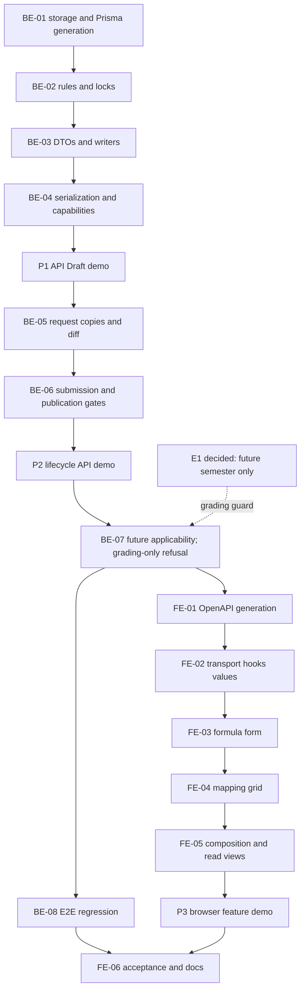

# F-12 Grade Formulas and Assessment–CLO Mapping — Backend + Frontend Implementation Plan

This plan builds EP-12, US-049..US-052, CV-126..CV-135, and FR-49..FR-54: declarative assessment components, exact percentage totals, conditional thresholds, optional failing scores, assessment–CLO mappings and coverage gates. It closes B3's remaining academic-content work while integrating with the already-built B4 request and release lifecycle. It excludes student grade calculation/entry, inferred pass/fail, Excel, attainment reporting, version comparison and cohort reassignment.

> **Companion documents**
> - Decisions: `docs/planning/feature-questions.md:195` (F12-01..03; blank answers use A).
> - Requirements: `docs/requirement/REQUIREMENTS.md:505`, `:926`, `:1255`; acceptance: `docs/planning/epics.md:122`, `docs/planning/user-stories.md:610`; tasks: `docs/planning/task-breakdown.md:279`.
> - Design: `docs/design/data-dictionary.md:466`, `:511`, `:528`; `docs/design/erd.md:98`; `docs/design/state-diagrams.md:210` (DC-02..05); `docs/design/sequence-diagrams.md:206`; `docs/design/screen-inventory.md:107` (MH-36/37).
> - Architecture: all three documents in `docs/architecture/`; UI: `source/frontend/src/shared/design-system/DESIGN_SYSTEM.md`.
> - Built dependencies: implement reports F-10, F-11, F-13, F-14 and F-15 in `docs/implement-report/`; especially F-11's CLO-usage/tab handoff and F-15's DC-03 assessment handoff.
> - Exemplars: `docs/implementation/f-15-release-version-snapshots-implementation-plan.md` and `docs/implementation/f-09-excel-import-export-implementation-plan.md`. Their older unbuilt-dependency statements are not current facts.
> - Tests: `docs/planning/test-plan.md` KB-027..030, NT-B3-06..08, NT-B4-01 and T-1; exclusions: `docs/planning/deferred-scope.md`.

**Status**: Not started. Plan accepted 2026-10-26 (user); E1 decided, E2 builds with default and Faculty input owed.

## 0. Plan at a glance

Everything below in one table. Read this; the rest is detail for whoever builds it.

| What | Why | How and where |
|---|---|---|
| **Save a complete formula, not intermediate 90% totals** | US-049; F12-03 A; BR-12/13 | Decimal strings, positive weights, normalized unique codes, atomic replacement preserving retained IDs; BE-01..03, FE-02/03 |
| **Declare conditions and failing scores, not student grades** | US-050; F12-01 A; T-1 | Nullable syllabus/component cutoffs, required conditional threshold, Vietnamese explanation; BE-01..03, FE-03/05 |
| **Map assessment rows to this revision's CLO columns** | US-051 | Sparse cells, optional percentage weights, whole-grid PUT; no invented weight-sum rule; BE-03, FE-04 |
| **Warn in Draft, block submission/publication** | US-052; BR-14; DC-03 | Shared checker in serialization, request preview/submit and release preview/commit; BE-02/04/06, FE-04/05 |
| **Use the existing review lifecycle for released formulas** | F12-02 A; H-4 | Enable GRADING_FORMULA, copy/remap children, natural-key diff, existing fan-out; BE-05..07, FE-05 |
| **Preserve historical and pinned content** | BR-16; DEC-01/02 | Additive storage, no synthetic legacy formulas; future versions pin new revision; BE-01/05..08 |
| **Respect grading-specific permissions** | SRS permission matrix | New grading capability/edit-path fields; keep content permission semantics; BE-04, FE-01/05 |
| **Close B3 with regression evidence** | CV-134/135 | Real-API release fixtures, unit/E2E/UI gates and documentation handoff; BE-08, FE-06 |

| Key behaviours worth knowing | Why it is this way |
|---|---|
| A new syllabus may have no formula; text/CLO saves still work | FR-50 blocks invalid formula saves, not every unfinished syllabus write |
| Formula save requires 100%; coverage gaps do not block Draft saves | BR-12 and US-052 have different gates |
| Component/CLO deletion can reopen coverage warnings | Derive coverage from persisted links, not a stored flag |
| PUBLISHED does not mean applicable to every program | Pinned reads use CurriculumItem.syllabusId at `source/backend/src/features/syllabi/syllabi.service.ts:181` |
| Approval can publish a revision before its effective semester | Applicability remains version-based; do not reinterpret imported pass/fail |
| Formula and grid have separate explicit saves | Persisted component IDs are needed before mapping |

| Not included | Why |
|---|---|
| Student component scores, weighted-grade evaluation, automatic failure deduction | F12-01 A/T-1 exclude them |
| PI/attainment, minimum two measurements per CLO, public website | Deferred R-1/R-6/R-7, not FR-49..54 |
| Excel, reporting, comparison/reassignment | F-09/F-23/F-16 are unbuilt; not prerequisites |
| Backfilling plausible 100% formulas into released revisions | Fabricates policy and mutates history |

| Open questions | Resolved when | Default if unanswered |
|---|---|---|
| E1: Historical-import exception for a newly edited formula? | Decided 2026-10-26 (user) | No started-semester exception for grading edits; user chooses a future semester; unrelated requests retain F-15 rules |
| E2: Threshold units and academic ranges? | Faculty supplies examples | Unit-neutral non-negative declarations, no inferred scale/evaluation |

## 1. Scope

| In scope | Why |
|---|---|
| AssessmentComponent, AssessmentCLOMapping, nullable Syllabus.failingScore | CV-126/129/131; additive revision-owned storage |
| Exact total/difference, positive weights, unique codes, required conditional threshold | CV-127/129; BR-12/13/15; EC-39 |
| MH-37 formula/mapping tabs; MH-36 read-only sections | CV-128/130/132; same syllabus route/context |
| Coverage warnings and submission/release enforcement | CV-133; US-052; DC-03/04 |
| Copy, diff, discard/rebase, fan-out and pinned-read integration | Built B4 must not lose or bypass new data |
| Regression coverage and implementation-time documentation handoff | CV-134/135 |

| Out of scope | Deferred until |
|---|---|
| Score entry or recalculation of imported result status | Not F-12; F-17 consumes result status independently |
| Excel formula/mapping import/export | Explicit future F-09 extension |
| Attainment/report endpoint | F-23; pinned revision is the assumed read boundary |
| Version comparison or cohort reassignment UI | F-16 |
| Audit-log infrastructure or unrelated permission cleanup | Deferred audit scope |

| AC / task | Covered by |
|---|---|
| US-049 AC1: 90% rejected with missing 10%; AC2: 100% accepted | BE-02/03/08; FE-02/03/06 |
| US-049 AC3: zero/>100 rejected; AC4: duplicate codes rejected | BE-01..03/08; FE-03/06 |
| US-050 AC1: condition needs threshold; AC2: explanation visible | BE-01..03/08; FE-03/05/06 |
| US-050 AC3: optional failing scores persist; AC4: no score entry | BE-01/03/08; FE-03/05/06 |
| US-051 AC1: map midterm to CLO1/CLO2; AC2: optional weight | BE-01/03/08; FE-04/06 |
| US-051 AC3: assessment rows, CLO columns | FE-04/05/06 |
| US-052 AC1: Draft saves with named CLO warning | BE-02..04/08; FE-03..06 |
| US-052 AC2: initial release/submission blocked until covered | BE-05/06/08; FE-05/06 |
| US-052 AC3: complete coverage clears warnings | BE-02/03/08; FE-04/06 |
| B3 acceptance 6/7/8; CV-126..135 | All steps; BE-08 and FE-06 close acceptance |
| F12-02/BR-16: future version, no retroactive formula application | BE-05/07/08; FE-05; E1 decided 2026-10-26: no started-semester grading exception |

## 2. Contract verification

All paths are repository-relative. Existing claims cite source, not earlier plans. Proposed endpoints/fields are explicitly NEW. No external API or unbuilt feature is required.

### 2a. Endpoints and extension seams

| Endpoint / seam | Verified at | Request | Response / behaviour | Notes |
|---|---|---|---|---|
| GET /api/courses/:courseId/syllabus | `source/backend/src/features/syllabi/syllabi.controller.ts:72`; mapper `source/backend/src/features/syllabi/syllabus.dto.ts:157`; service `source/backend/src/features/syllabi/syllabi.service.ts:76` | Optional requestId/versionId | Direct CourseSyllabusDto, no envelope | requestId selects copy; version branch takes precedence and follows pins |
| POST /api/courses/:courseId/syllabus | `source/backend/src/features/syllabi/syllabi.controller.ts:88`; `source/backend/src/features/syllabi/syllabi.service.ts:209` | No body | 201 CourseSyllabusDto | First ordinary Draft; preserve syllabus.edit creation permission |
| PATCH /api/syllabi/:syllabusId | `source/backend/src/features/syllabi/syllabi.controller.ts:99`; `source/backend/src/features/syllabi/syllabi.service.ts:253` | Text sections | SyllabusDto | Do not add formula to the text-only DTO |
| POST /api/syllabi/:syllabusId/clos; PATCH/DELETE /api/clos/:cloId; PUT /api/syllabi/:syllabusId/clos/order | `source/backend/src/features/syllabi/syllabi.controller.ts:157`; `source/backend/src/features/syllabi/clos.service.ts:33`, `:74`, `:117`, `:139` | Existing CLO DTOs | CloDto / CloDto[]; delete 204 | Retain clo.edit; add assessment usage count |
| POST /api/change-requests | `source/backend/src/features/change-requests/change-request.dto.ts:92`; `source/backend/src/features/change-requests/change-request.constants.ts:20` | Existing request header | Existing detail | GRADING_FORMULA currently excluded; BE-05 enables it |
| GET /api/change-requests/:id/diff | `source/backend/src/features/change-requests/change-requests.controller.ts:149`; `source/backend/src/features/change-requests/request-items.service.ts:68` | Request id | Existing grouped diff | Add natural-key snapshot entries, not a second diff API |
| GET /api/change-requests/:id/submit-preview; POST /api/change-requests/:id/submit | `source/backend/src/features/change-requests/change-requests.controller.ts:155`; `source/backend/src/features/change-requests/submission.service.ts:68`, `:113` | Request id | Preview blockingIssues / existing detail | Repeat assessment checks inside claimed submit transaction |
| Release preview/commit | `source/backend/src/shared/releases/syllabus-release-issues.ts:36`; `source/backend/src/shared/releases/syllabus.publisher.ts:21`, `:51`; `source/backend/src/features/change-requests/final-approval.preview.ts:111` | Existing release input | Existing issue containers | DC-03 currently checks text only at syllabus-release-issues.ts:20 |
| Request copier | `source/backend/src/shared/syllabi/syllabus-revision.copier.ts:8`; caller `source/backend/src/features/change-requests/working-copy.service.ts:101` | Base id/sourceRequestId | New revision id | Add formula/remapped links; attachments stay with original revision |
| Draft-write policy | `source/backend/src/features/syllabi/syllabus-access.ts:100`; `source/backend/src/shared/change-requests/request-draft.ts:56` | Access/row/permission | Writable Draft or exception | Reuse with GRADING_FORMULA_EDIT; creator and request-Draft rules remain |
| Existing grading permission | `source/backend/src/shared/authz/permission-codes.ts:26`; `source/backend/prisma/seed-data/permission-catalog.ts:208` | gradingFormula.edit | Seeded scoped-edit cell | No new role/seed permission/runtime package |

| NEW endpoint | Guard | Request | Response | Semantics |
|---|---|---|---|---|
| PUT /api/syllabi/:syllabusId/grading-formula | GRADING_FORMULA_EDIT | ReplaceGradeFormulaDto | 200 GradeFormulaDto | Non-empty complete formula; retain owned IDs/mappings, create new IDs, delete omitted rows and links; exact 100 required |
| PUT /api/syllabi/:syllabusId/assessment-clo-mappings | GRADING_FORMULA_EDIT | ReplaceAssessmentMappingsDto | 200 GradeFormulaDto | Replace sparse grid for this revision; empty mappings allowed in Draft; no formula rewrite |

Both mutation responses are fragments, not a SyllabusDto/CourseSyllabusDto. Re-fetch the course query for timestamps, capabilities and usage counts. No new GET: BE-04 adds SyllabusDto.gradingFormula to the existing revision-specific response.

### 2b. DTO field verification

FE transport types are generated aliases (`source/frontend/src/features/syllabi/api/syllabi.ts:10`), not new handwritten models. Fields marked not remodeled retain their current readers without introducing a formula-specific projection. Sources below are declarations/serializers, not schema-only guesses.

**CourseSyllabusDto** — current assembly at `source/backend/src/features/syllabi/syllabi.service.ts:124`, pinned branch at `:189`.

| Field | Wire type | Nullable | Source | Modeled as | Note |
|---|---|---|---|---|---|
| course | SyllabusCourseDto | no | `source/backend/src/features/syllabi/syllabus.dto.ts:99` | Generated alias | Existing header |
| programsUsing | CourseUsageDto[] | no | `source/backend/src/features/syllabi/syllabus.dto.ts:100` | Not remodeled | Existing ProgramsUsingList |
| published | SyllabusDto | yes | `source/backend/src/features/syllabi/syllabus.dto.ts:102` | Generated alias, extended | Can be historical pinned revision |
| draft | SyllabusDto | yes | `source/backend/src/features/syllabi/syllabus.dto.ts:104` | Generated alias, extended | Request copy when selected |
| canCreate | boolean | no | `source/backend/src/features/syllabi/syllabus.dto.ts:105` | Generated alias | Preserve creation policy |
| canEditClos | boolean | no | `source/backend/src/features/syllabi/syllabus.dto.ts:109` | Generated alias | Not grading permission |
| editPath | 'DIRECT' or 'VIA_REQUEST' | yes | `source/backend/src/features/syllabi/syllabus.dto.ts:111`; `source/backend/src/shared/authz/edit-path.ts:9` | Generated alias | Keep content-edit meaning |
| attachmentRules | AttachmentRulesDto | no | `source/backend/src/features/syllabi/syllabus.dto.ts:113` | Not remodeled | Existing upload UI |
| canAttachToPublished | boolean | no | `source/backend/src/features/syllabi/syllabus.dto.ts:118` | Generated alias | Never grants grading writes |
| version | SyllabusVersionRefDto | yes | `source/backend/src/features/syllabi/syllabus.dto.ts:124` | Generated alias | Pinned-view banner |

**SyllabusCourseDto** — mapper at `source/backend/src/features/syllabi/syllabus.dto.ts:146`.

| Field | Wire type | Nullable | Source | Modeled as | Note |
|---|---|---|---|---|---|
| id | string | no | `source/backend/src/features/syllabi/syllabus.dto.ts:148` | Generated alias | Course key |
| courseCode | string | no | `source/backend/src/features/syllabi/syllabus.dto.ts:149` | Generated alias | Header |
| courseName | string | no | `source/backend/src/features/syllabi/syllabus.dto.ts:150` | Generated alias | Vietnamese |
| englishName | string | yes | `source/backend/src/features/syllabi/syllabus.dto.ts:151` | Generated alias | Language fallback |
| credits | decimal string | no | `source/backend/src/features/syllabi/syllabus.dto.ts:152` | Not remodeled | Existing header |
| status | 'ACTIVE', 'DISCONTINUED', 'CANCELLED' | no | `source/backend/src/features/syllabi/syllabus.dto.ts:153`; `source/backend/src/generated/prisma/enums.ts:66` | Generated alias | Literal enum, not translated |

**SyllabusDto** — mapper at `source/backend/src/features/syllabi/syllabus.dto.ts:157`.

| Field | Wire type | Nullable | Source | Modeled as | Note |
|---|---|---|---|---|---|
| id | string | no | `source/backend/src/features/syllabi/syllabus.dto.ts:162` | Generated alias | Owns formula/CLOs |
| revisionNumber | number | yes | `source/backend/src/features/syllabi/syllabus.dto.ts:163` | Generated alias | Null on copy; not zero |
| status | 'DRAFT', 'PUBLISHED', 'HISTORICAL' | no | `source/backend/src/features/syllabi/syllabus.dto.ts:164`; `source/backend/src/generated/prisma/enums.ts:248` | Generated alias | Preserve historical read |
| sourceRequest | RequestRefDto | yes | `source/backend/src/features/syllabi/syllabus.dto.ts:165` | Generated alias | Preserve requestId |
| courseDescription | HTML string | yes | `source/backend/src/features/syllabi/syllabus.dto.ts:166` | Not remodeled | Existing reader |
| englishDescription | HTML string | yes | `source/backend/src/features/syllabi/syllabus.dto.ts:167` | Not remodeled | Existing reader |
| objectives | HTML string | yes | `source/backend/src/features/syllabi/syllabus.dto.ts:168` | Not remodeled | Existing reader |
| teachingMethods | HTML string | yes | `source/backend/src/features/syllabi/syllabus.dto.ts:169` | Not remodeled | Existing reader |
| assessmentMethods | HTML string | yes | `source/backend/src/features/syllabi/syllabus.dto.ts:170` | Not remodeled | Narrative, not formula |
| references | HTML string | yes | `source/backend/src/features/syllabi/syllabus.dto.ts:171` | Not remodeled | Existing reader |
| publishedAt | ISO timestamp string | yes | `source/backend/src/features/syllabi/syllabus.dto.ts:172` | Generated alias | Not formula effective date |
| updatedAt | ISO timestamp string | no | `source/backend/src/features/syllabi/syllabus.dto.ts:173` | Generated alias | Optimistic-write token |
| weeklyContents | WeeklyContentDto[] | no | `source/backend/src/features/syllabi/syllabus.dto.ts:174` | Not remodeled | Keep all current fields |
| clos | CloDto[] | no | `source/backend/src/features/syllabi/syllabus.dto.ts:175` | Generated alias, extended | Column order |
| attachments | SyllabusAttachmentDto[] | no | `source/backend/src/features/syllabi/syllabus.dto.ts:176` | Not remodeled | Signed files stay revision-specific |

**CloDto** — mapper at `source/backend/src/features/syllabi/clo.dto.ts:96`.

| Field | Wire type | Nullable | Source | Modeled as | Note |
|---|---|---|---|---|---|
| id | string | no | `source/backend/src/features/syllabi/clo.dto.ts:62` | Generated alias | Mapping FK |
| cloCode | string | no | `source/backend/src/features/syllabi/clo.dto.ts:63` | Generated alias | Label/natural-key diff |
| description | string | no | `source/backend/src/features/syllabi/clo.dto.ts:64` | Generated alias | Column tooltip |
| englishDescription | string | yes | `source/backend/src/features/syllabi/clo.dto.ts:65` | Generated alias | Existing language fallback |
| cognitiveLevel | string | yes | `source/backend/src/features/syllabi/clo.dto.ts:67` | Not remodeled | Existing CLO editor |
| sortOrder | number | no | `source/backend/src/features/syllabi/clo.dto.ts:68` | Generated alias | 1-based |
| linkedPrograms | string[] | no | `source/backend/src/features/syllabi/clo.dto.ts:73` | Generated alias | Keep PLO-delete consequences |

**SyllabusVersionRefDto** — existing banner fields retained, not projected into a new model.

| Field | Wire type | Nullable | Source | Modeled as | Note |
|---|---|---|---|---|---|
| id | string | no | `source/backend/src/features/syllabi/syllabus.dto.ts:75` | Existing alias | Version link |
| programId | string | no | `source/backend/src/features/syllabi/syllabus.dto.ts:76` | Existing alias | Program link |
| programCode | string | no | `source/backend/src/features/syllabi/syllabus.dto.ts:77` | Existing alias | Banner |
| versionNumber | string | yes | `source/backend/src/features/syllabi/syllabus.dto.ts:78` | Existing alias | Not numeric grade |

**RequestRefDto** — existing request-banner fields retained; no Vietnamese wire values.

| Field | Wire type | Nullable | Source | Modeled as | Note |
|---|---|---|---|---|---|
| id | string | no | `source/backend/src/shared/change-requests/request-ref.dto.ts:6` | Existing alias | requestId link |
| requestCode | string | no | `source/backend/src/shared/change-requests/request-ref.dto.ts:7` | Existing alias | Banner |
| status | 'DRAFT', 'PENDING_COORDINATOR', 'PENDING_DIRECTOR', 'PENDING_ACADEMIC_OFFICE', 'APPROVED', 'EFFECTIVE', 'REJECTED', 'WITHDRAWN' | no | `source/backend/src/shared/change-requests/request-ref.dto.ts:9`; `source/backend/src/generated/prisma/enums.ts:174` | Existing alias | Creator/status policy BE-owned |

Not remodeled nested DTOs, with every field accounted for: WeeklyContentDto has id/string, weekLabel/string, sortOrder/number, content/string, teachingActivities/nullable string, cloIds/string[] (`source/backend/src/features/syllabi/weekly-content.dto.ts:61`). AttachmentRulesDto has maxBytes/number and fileTypes/enum[]; SyllabusAttachmentDto has id/string, fileName/string, fileType/enum, sizeBytes/number, uploadedBy/UserRefDto, recordedAt/ISO string, canDelete/boolean, all non-null (`source/backend/src/features/syllabi/syllabus-attachment.dto.ts:9`). File literals are 'PDF', 'DOCX', 'DOC' (`source/backend/src/generated/prisma/enums.ts:257`). UserRefDto retains id/string and fullName/string, non-null (`source/backend/src/shared/dtos/ref.dto.ts:10`). CourseUsageDto retains programId/string, programCode/string, programName/string, nullable versionLabel/string, plannedSemester/number (`source/backend/src/shared/courses/course-usage.dto.ts:4`). Existing readers keep these generated DTOs wholesale; F-12 introduces no model mapping for them.

**NEW fields and DTOs** — unbuilt; Source identifies the owning deliverable, not an invented source citation. All decimal values serialize through toWireDecimal, never JSON numbers.

| DTO.field | Wire type | Nullable | Source | Modeled as | Note |
|---|---|---|---|---|---|
| CourseSyllabusDto.gradingEditPath | 'DIRECT' or 'VIA_REQUEST' | yes | NEW BE-04 | Generated alias | Null in pinned read |
| CourseSyllabusDto.canEditGradingFormula | boolean | no | NEW BE-04 | Generated alias | Draft and grading DIRECT |
| SyllabusDto.gradingFormula | GradeFormulaDto | no | NEW BE-03/04 | Generated alias | Empty aggregate for absent formula |
| CloDto.assessmentLinkCount | number | no | NEW BE-04 | Generated alias | This revision only |
| GradeFormulaDto.failingScore | decimal string | yes | NEW BE-03 | Generated alias | Syllabus cutoff |
| GradeFormulaDto.totalWeight | decimal string | no | NEW BE-03 | Generated alias | Derived; '0' when empty |
| GradeFormulaDto.components | AssessmentComponentDto[] | no | NEW BE-03 | Generated alias | Code then id |
| GradeFormulaDto.warnings | AssessmentWarningDto[] | no | NEW BE-03 | Generated alias | CLO order |
| AssessmentComponentDto.id | string | no | NEW BE-03 | Generated alias | Stable retained row |
| AssessmentComponentDto.componentCode | string | no | NEW BE-03 | Generated alias | Uppercase/trim |
| AssessmentComponentDto.componentName | string | no | NEW BE-03 | Generated alias | Plain text |
| AssessmentComponentDto.weight | decimal string | no | NEW BE-03 | Generated alias | Percent (0,100] |
| AssessmentComponentDto.assessmentForm | string | yes | NEW BE-03 | Generated alias | Plain text |
| AssessmentComponentDto.isConditional | boolean | no | NEW BE-03 | Generated alias | Not a result status |
| AssessmentComponentDto.conditionThreshold | decimal string | yes | NEW BE-03 | Generated alias | Required when conditional |
| AssessmentComponentDto.failingScore | decimal string | yes | NEW BE-03 | Generated alias | Optional component cutoff |
| AssessmentComponentDto.mappings | AssessmentCloMappingDto[] | no | NEW BE-03 | Generated alias | Sparse, CLO order |
| AssessmentCloMappingDto.cloId | string | no | NEW BE-03 | Generated alias | Same revision |
| AssessmentCloMappingDto.cloWeight | decimal string | yes | NEW BE-03 | Generated alias | Optional percent; no sum rule |
| AssessmentWarningDto.code | 'ASSESSMENT_CLO_UNCOVERED' | no | NEW BE-03 | Generated alias | Swagger literal enum |
| AssessmentWarningDto.cloId | string | no | NEW BE-03 | Generated alias | Column key |
| AssessmentWarningDto.cloCode | string | no | NEW BE-03 | Generated alias | Human identifier |
| AssessmentWarningDto.message | string | no | NEW BE-03 | Generated alias | Vietnamese actionable warning |

### 2c. Mismatch log

| Deliverable | Earlier plan / expectation | Actual source | Found at |
|---|---|---|---|
| BE-01/04 | Revision numbers always non-null | Request copies have nullable revisionNumber | `source/backend/prisma/schema.prisma:635`; `source/backend/src/features/syllabi/syllabus.dto.ts:163` |
| BE-05 | GRADING_FORMULA enum means workflow support | Creation excluded, workspace absent, permissions empty | `source/backend/src/features/change-requests/change-request.constants.ts:20`; `source/backend/src/shared/change-requests/request-kinds.ts:31`, `:88` |
| BE-06 | DC-03 already checks assessment data | Built checker deliberately checks text only | `source/backend/src/shared/releases/syllabus-release-issues.ts:12`; `docs/implement-report/f-15-release-version-snapshots-implement-report.md:29` |
| BE-05 | Rejected/withdrawn copies remain read-only | Copies deleted; stored ChangeItems preserve diff | `source/backend/src/features/change-requests/working-copy.service.ts:46`; accepted decision `docs/implement-report/f-14-three-level-approval-notifications-implement-report.md:62` |
| BE-07 | Grading edits must not use a started semester | Decided 2026-10-26 (user): grading-specific refusal before the existing academic-office exception; unrelated requests unchanged | `source/backend/src/features/change-requests/final-approval.service.ts:145`; existing SEMESTER_ALREADY_STARTED |

## 3. Decisions

| ID | Decision | Why | Rejected alternative |
|---|---|---|---|
| D1 | Formula children belong to Syllabus; only nullable failingScore added to parent | Dictionary/revision ownership; no result changes | Mutable Course formula or independent formula versions |
| D2 | Exact decimal strings, precision two; Prisma Decimal BE, integer hundredths FE | Existing wire pattern `source/backend/src/shared/decimal/decimal.ts:9`; no epsilon | Floating sums or new runtime decimal package |
| D3 | One non-empty formula PUT; separate sparse mapping PUT | No persistable intermediate invalid total; mapping edit must not recreate components | Per-row formula CRUD/autosave |
| D4 | Preserve owned component IDs; reject foreign/duplicate IDs | Rename/reweight retains links | Delete/recreate everything |
| D5 | Uppercase trimmed codes; order by code then id | CLO normalization mirror `source/backend/src/features/syllabi/clo.dto.ts:21`; dictionary has no sortOrder | Extra ordering column/drag-and-drop |
| D6 | Optional cloWeight is percent (0,100], precision two, no total requirement | US-051 does not define an attainment equation | Invented row/column normalization |
| D7 | Threshold/cutoff is a unit-neutral non-negative declaration | F12-01 A/T-1; Faculty scale unknown, E2 | Impose thang-4/thang-10 or evaluate results |
| D8 | Compute coverage at read and every lifecycle gate | Deletions must immediately reopen warnings | Stored covered flag or blocking Draft saves |
| D9 | Dedicated grading editPath/capability; content editPath keeps its meaning | Existing seed separates permission cells | Widen syllabus.edit globally |
| D10 | GRADING_FORMULA uses syllabus workspace, copier, differ and publisher | Reuse built lifecycle/fan-out | New request table/queue/release path |
| D11 | Coordinate request/revision row locks; whole PUTs require expectedUpdatedAt | Avoid stale aggregate replacement and submit/release races | FE-only save disabling |
| D12 | No legacy backfill; enforce new Draft publication/new submissions | Immutable history and honest missing data | Fabricated 100% defaults or permanent bypass |
| D13 | Grading changes produce a minor version for any future semester explicitly selected by the user; no started-semester exception | Decided 2026-10-26 (user), F12-02/BR-16 | Removing F-15 exceptions for unrelated requests or guessing the next semester |
| D14 | One BE+FE plan; no new package/menu/formula screen | Requested scope and MH-36/37 | Gradebook or new feature package |

## 4. Deliberate divergences

No shipped sibling implements FR-49..54. Extend built syllabus/request/release code. B3's original no-review description (`docs/planning/epics.md:143`) describes delivery order, not permission to bypass now-built B4; retain the source policy at `source/backend/src/features/syllabi/syllabus-access.ts:100`.

Complete F-15's intentional DC-03 handoff without changing text checks, status ordering, attachment policy, fan-out selection or old pins. Existing parent-field semantics do not change. Any need to alter a built table's existing behaviour is an escalation, not authorization in this plan.

## 5. Deliverables

File tables use repository-relative paths. New files identify a verified mirror in Rationale. No deletion is planned. Snippets define production shapes; imports come from the cited mirrors and every transport DTO field needs Swagger metadata. There are eight backend steps and six frontend steps.

### BE-01 — Additive assessment storage and Prisma generation

**What/Why**: Add the missing revision-owned data without rewriting any shipped academic content.

**Files**

| Action | Path |
|---|---|
| MODIFY | `source/backend/prisma/schema.prisma` |
| NEW | `source/backend/prisma/migrations/20261025000000_grade_formula_assessment_clo/migration.sql` |
| MODIFY (generated) | `source/backend/src/generated/prisma/client.ts` |
| MODIFY (generated) | `source/backend/src/generated/prisma/models.ts` |
| MODIFY (generated) | `source/backend/src/generated/prisma/models/Syllabus.ts` |
| MODIFY (generated) | `source/backend/src/generated/prisma/models/CLO.ts` |
| NEW (generated) | `source/backend/src/generated/prisma/models/AssessmentComponent.ts` |
| NEW (generated) | `source/backend/src/generated/prisma/models/AssessmentCLOMapping.ts` |

**Shape**

Add `failingScore Decimal? @db.Decimal(9, 2)` and `assessmentComponents AssessmentComponent[]` to Syllabus; add `assessmentLinks AssessmentCLOMapping[]` to CLO. Leave their existing columns, uniqueness predicates, ownership, status and deletion policies untouched (`source/backend/prisma/schema.prisma:631`, `:712`).

```prisma
model AssessmentComponent {
  id                 String                 @id @default(cuid(2))
  syllabusId         String
  syllabus           Syllabus               @relation(fields: [syllabusId], references: [id], onDelete: Cascade)
  componentCode      String
  componentName      String
  weight             Decimal                @db.Decimal(5, 2)
  assessmentForm     String?
  isConditional      Boolean                @default(false)
  conditionThreshold Decimal?               @db.Decimal(9, 2)
  failingScore       Decimal?               @db.Decimal(9, 2)
  mappings           AssessmentCLOMapping[]

  @@unique([syllabusId, componentCode])
}

model AssessmentCLOMapping {
  id                    String              @id @default(cuid(2))
  assessmentComponentId String
  assessmentComponent   AssessmentComponent @relation(fields: [assessmentComponentId], references: [id], onDelete: Cascade)
  cloId                 String
  clo                   CLO                 @relation(fields: [cloId], references: [id], onDelete: Cascade)
  cloWeight             Decimal?            @db.Decimal(5, 2)

  @@unique([assessmentComponentId, cloId])
  @@index([cloId])
}
```

Migration creates these two tables, primary/unique indexes and the three foreign keys above, plus nullable parent column. Use PostgreSQL identifiers matching Prisma's quoted model/column names. Client-side cuid generation means the SQL id columns have no server-generated UUID default. Append named checks:

```sql
ALTER TABLE "Syllabus" ADD COLUMN "failingScore" DECIMAL(9,2);
ALTER TABLE "Syllabus" ADD CONSTRAINT "Syllabus_failingScore_nonnegative"
  CHECK ("failingScore" IS NULL OR "failingScore" >= 0);
ALTER TABLE "AssessmentComponent" ADD CONSTRAINT "AssessmentComponent_weight_range"
  CHECK ("weight" > 0 AND "weight" <= 100);
ALTER TABLE "AssessmentComponent" ADD CONSTRAINT "AssessmentComponent_threshold_shape"
  CHECK (("isConditional" AND "conditionThreshold" IS NOT NULL AND "conditionThreshold" >= 0)
      OR (NOT "isConditional" AND "conditionThreshold" IS NULL));
ALTER TABLE "AssessmentComponent" ADD CONSTRAINT "AssessmentComponent_failingScore_nonnegative"
  CHECK ("failingScore" IS NULL OR "failingScore" >= 0);
ALTER TABLE "AssessmentCLOMapping" ADD CONSTRAINT "AssessmentCLOMapping_weight_range"
  CHECK ("cloWeight" IS NULL OR ("cloWeight" > 0 AND "cloWeight" <= 100));
```

The ADD COLUMN appears once, not both in generated SQL and the appended checks. Aggregate sum and same-syllabus mapping validation live in locked application writes, not an invalid cross-row CHECK. New mappings require both owned component and owned CLO. Restrict direct SQL writes to normal operational administration; readiness also detects corrupt cross-revision mappings rather than counting them as coverage.

Reserve the exact migration path above; if another migration already occupies it at implementation time, stop and record the collision rather than overwriting it. Run Prisma generation as this step's explicit codegen gate; let it produce its complete output set, including internal barrel/runtime files not manually edited. The generated-directory parent is the schema generator output, not an independent package.

**Rationale**: Mirror the additive syllabus migration `source/backend/prisma/migrations/20261019095730_syllabi/migration.sql` and child/FK shape `source/backend/prisma/schema.prisma:665`; decimal-string serializer mirror `source/backend/src/shared/decimal/decimal.ts:9`. No existing field is repurposed, no legacy formula invented, and no result/status migration introduced.

**Gotchas**: Empty legacy child sets are legitimate reads but not new publication-ready formulas. Ordinary Draft creation defaults failingScore to null. Do not drop/recreate Syllabus/CLO, change nullable revisionNumber, copy attachments or modify released rows. Numerical precision is a technical transport choice, not an approved academic grading scale (E2).

**Verify**: From backend: `pnpm exec prisma validate`; apply migration to a disposable development/test database with `pnpm exec prisma migrate deploy`; `pnpm prisma:generate`; `pnpm exec tsc --noEmit -p tsconfig.json`. BE-08 supplies database constraint/cascade tests and verifies migration preserves existing released rows. Do not run against real Faculty data.

**Depends on**: Built F-10/F-11/F-13/F-15 schema; no unbuilt feature.

### BE-02 — Shared exact validation, coverage and locking primitives

**What/Why**: Make draft warnings and lifecycle refusal use the same assessment rules.

**Files**

| Action | Path |
|---|---|
| NEW | `source/backend/src/shared/syllabi/grade-formula.rules.ts` |
| NEW | `source/backend/src/shared/syllabi/grade-formula.rules.spec.ts` |
| NEW | `source/backend/src/shared/syllabi/grade-formula.errors.ts` |
| NEW | `source/backend/src/shared/syllabi/syllabus-assessment-lock.ts` |
| NEW | `source/backend/src/shared/syllabi/syllabus-assessment-lock.spec.ts` |

**Shape**

```ts
export const GRADE_FORMULA_LIMITS = {
  TOTAL_PERCENT: 100,
  DECIMAL_PLACES: 2,
  COMPONENTS_MAX: 100,
  CODE_MAX: 20,
  NAME_MAX: 200,
  FORM_MAX: 2000,
  THRESHOLD_INTEGER_DIGITS: 7,
} as const;
export const PERCENT_PATTERN = /^(?:\d{1,3})(?:\.\d{1,2})?$/;
export const THRESHOLD_PATTERN = /^\d{1,7}(?:\.\d{1,2})?$/;
export const ASSESSMENT_CONDITION = {
  FORMULA_EMPTY: 'ASSESSMENT_FORMULA_EMPTY',
  WEIGHT_TOTAL: 'ASSESSMENT_WEIGHT_TOTAL_INVALID',
  COMPONENT_INVALID: 'ASSESSMENT_COMPONENT_INVALID',
  CONDITIONAL_THRESHOLD: 'ASSESSMENT_CONDITION_THRESHOLD_REQUIRED',
  CLO_UNCOVERED: 'ASSESSMENT_CLO_UNCOVERED',
  MAPPING_INVALID: 'ASSESSMENT_MAPPING_INVALID',
} as const;

export interface AssessmentRuleClo {
  id: string;
  cloCode: string;
  sortOrder: number;
}
export interface AssessmentRuleComponent {
  id?: string;
  componentCode: string;
  weight: string | Prisma.Decimal;
  isConditional: boolean;
  conditionThreshold: string | Prisma.Decimal | null;
  failingScore: string | Prisma.Decimal | null;
  mappings: readonly { cloId: string; cloWeight: string | Prisma.Decimal | null }[];
}
export interface AssessmentRuleInput {
  failingScore: string | Prisma.Decimal | null;
  clos: readonly AssessmentRuleClo[];
  assessmentComponents: readonly AssessmentRuleComponent[];
}
export interface AssessmentRuleIssue {
  code: (typeof ASSESSMENT_CONDITION)[keyof typeof ASSESSMENT_CONDITION];
  field: string;
  message: string;
}
export declare function assessmentIssues(input: AssessmentRuleInput): AssessmentRuleIssue[];
export declare function uncoveredClos(input: AssessmentRuleInput): AssessmentRuleClo[];
export declare function totalAssessmentWeight(components: readonly AssessmentRuleComponent[]): Prisma.Decimal;
export declare function loadAssessmentRules(db: PrismaService | Prisma.TransactionClient, syllabusId: string): Promise<AssessmentRuleInput>;
export declare function lockSyllabusAssessment(tx: Prisma.TransactionClient, syllabusId: string): Promise<void>;
```

Declarations specify public signatures; implement functions, not ambient stubs. `loadAssessmentRules` selects failingScore, ordered CLOs and ordered components with mappings in one revision query. Use the same selector for release and response readers. Pure checker returns deterministic issues: non-empty formula, each weight `(0,100]`, exact Decimal sum 100, duplicate canonical component codes, threshold/cutoff shape, foreign or duplicate mapping pairs, optional weight bounds, then every uncovered CLO in CLO order. Zero CLOs do not invent a new minimum-CLO requirement; empty formula still fails. Coverage only counts mappings to listed CLO IDs. Parse/validate non-finite or malformed decimals before arithmetic; never silently coerce blanks, commas, exponents, NaN or Infinity on BE.

`grade-formula.errors.ts` follows ErrorDefinition/AppException. Define status-400 input errors `ASSESSMENT_WEIGHT_TOTAL_INVALID`, `ASSESSMENT_COMPONENT_INVALID`, `ASSESSMENT_CODE_DUPLICATE`, `ASSESSMENT_ID_INVALID`, `ASSESSMENT_CONDITION_THRESHOLD_REQUIRED`, `ASSESSMENT_MAPPING_INVALID`; status-409 `ASSESSMENT_STALE` and `ASSESSMENT_NOT_READY`. Exact total error formats missing/excess through Decimal: `Tổng trọng số là 90%, còn thiếu 10%. Điều chỉnh để tổng bằng 100%.`; excess similarly `vượt 10%`. Include field details such as `components.1.weight`, `components.1.conditionThreshold`, `mappings.2.cloId`, with actionable Vietnamese messages. The FE will convert dotted numeric segments into AntD NamePath arrays rather than treating them as flat keys.

Lock order: if the revision has sourceRequestId, lock its ChangeRequest row first, then Syllabus row; ordinary Draft locks only Syllabus. Use tagged parameterized `$queryRaw` SELECT FOR UPDATE as in the release-lock mirror; never interpolate IDs as SQL text. Caller re-reads access/status/updatedAt **after** lock. Submission already claims the request row (`source/backend/src/features/change-requests/submission.service.ts:121`); then it locks the copy revision before assessment/diff checks. Release locks retain their existing program/course ordering and take revision lock immediately before final read/publish. Do not acquire program/course locks from a grading edit. A missing/discarded copy yields the normal not-found/refusal, not a recreated Draft.

**Rationale**: Pure rule/test mirror `source/backend/src/shared/releases/syllabus-release-issues.ts:20` and `source/backend/src/shared/releases/syllabus-release-issues.spec.ts:28`; error mirror `source/backend/src/features/syllabi/syllabus.errors.ts:16`; lock mirror `source/backend/src/shared/releases/release-locks.ts:5`. Keep shared functions dependency-light; no feature-to-feature imports or new Nest module required.

**Gotchas**: Do not reuse prerequisite GRADE_POINT_PATTERN (thang 4) for declarative thresholds. Use integer/Decimal equality, never tolerance. A nullable CLO weight is a mapped cell, not an unmapped one. COMPONENTS_MAX and precision are named technical limits; no hidden UI-only limits. Existing child writers remain responsible for touching the revision.

**Verify**: Backend `pnpm exec vitest run src/shared/syllabi/grade-formula.rules.spec.ts src/shared/syllabi/syllabus-assessment-lock.spec.ts`. Cover 33.33+33.33+33.34, 90/110, zero, >100, precision, code normalization, threshold zero versus null, false condition normalization, nullable mapping weight, cross-revision mapping, deletion gaps and deterministic ordering; lock tests assert request-before-revision order.

**Depends on**: BE-01.

### BE-03 — Formula/mapping DTOs, atomic service and controller routes

**What/Why**: Persist valid whole aggregates and return explicit coverage warnings.

**Files**

| Action | Path |
|---|---|
| NEW | `source/backend/src/features/syllabi/grade-formula.dto.ts` |
| NEW | `source/backend/src/features/syllabi/grade-formula.service.ts` |
| NEW | `source/backend/src/features/syllabi/grade-formula.service.spec.ts` |
| MODIFY | `source/backend/src/features/syllabi/syllabi.controller.ts` |
| MODIFY | `source/backend/src/features/syllabi/syllabi.module.ts` |

**Shape**

```ts
export class AssessmentComponentInputDto {
  @ApiPropertyOptional() @ValidateIf((_object, value) => value !== undefined)
  @IsString() @IsNotEmpty() id?: string;
  @ApiProperty() @Transform(trimUpperCase) @IsString()
  @Length(1, GRADE_FORMULA_LIMITS.CODE_MAX) componentCode!: string;
  @ApiProperty() @Transform(trimString) @IsString()
  @Length(1, GRADE_FORMULA_LIMITS.NAME_MAX) componentName!: string;
  @ApiProperty() @IsString() @Matches(PERCENT_PATTERN) weight!: string;
  @ApiPropertyOptional({ nullable: true, type: String }) @IsOptional()
  @Transform(emptyToNull) @IsString()
  @MaxLength(GRADE_FORMULA_LIMITS.FORM_MAX) assessmentForm?: string | null;
  @ApiProperty() @IsBoolean() isConditional!: boolean;
  @ApiPropertyOptional({ nullable: true, type: String }) @IsOptional()
  @IsString() @Matches(THRESHOLD_PATTERN) conditionThreshold?: string | null;
  @ApiPropertyOptional({ nullable: true, type: String }) @IsOptional()
  @IsString() @Matches(THRESHOLD_PATTERN) failingScore?: string | null;
}
export class ReplaceGradeFormulaDto {
  @ApiProperty() @IsISO8601() expectedUpdatedAt!: string;
  @ApiProperty({ nullable: true, type: String })
  @ValidateIf((_object, value) => value !== null)
  @IsString() @Matches(THRESHOLD_PATTERN) failingScore!: string | null;
  @ApiProperty({ type: [AssessmentComponentInputDto] }) @IsArray()
  @ArrayMinSize(1) @ArrayMaxSize(GRADE_FORMULA_LIMITS.COMPONENTS_MAX)
  @ValidateNested({ each: true }) @Type(() => AssessmentComponentInputDto)
  components!: AssessmentComponentInputDto[];
}
export class AssessmentMappingInputDto {
  @ApiProperty() @IsString() @IsNotEmpty() assessmentComponentId!: string;
  @ApiProperty() @IsString() @IsNotEmpty() cloId!: string;
  @ApiPropertyOptional({ nullable: true, type: String }) @IsOptional()
  @IsString() @Matches(PERCENT_PATTERN) cloWeight?: string | null;
}
export class ReplaceAssessmentMappingsDto {
  @ApiProperty() @IsISO8601() expectedUpdatedAt!: string;
  @ApiProperty({ type: [AssessmentMappingInputDto] }) @IsArray()
  @ArrayMaxSize(GRADE_FORMULA_LIMITS.COMPONENTS_MAX * SYLLABUS_LIMITS.CLOS_MAX)
  @ValidateNested({ each: true }) @Type(() => AssessmentMappingInputDto)
  mappings!: AssessmentMappingInputDto[];
}
```

Response classes are exactly the NEW field table in §2b, with `@ApiProperty({ nullable: true, type: String })` for nullable decimals, typed nested arrays, and literal warning code enum. Export `ASSESSMENT_INCLUDE`, `AssessmentComponentRow`, `toAssessmentComponentDto` and `toGradeFormulaDto`; decimal mapping uses `toWireDecimal` at `source/backend/src/shared/decimal/decimal.ts:9`. Mapper inputs include ordered CLOs so warnings and cell order agree. Do not put failingScore into UpdateSyllabusDto/SYLLABUS_SECTION_FIELDS.

```ts
export interface GradeFormulaWriter {
  replaceFormula(syllabusId: string, dto: ReplaceGradeFormulaDto, access: AccessContext): Promise<GradeFormulaDto>;
  replaceMappings(syllabusId: string, dto: ReplaceAssessmentMappingsDto, access: AccessContext): Promise<GradeFormulaDto>;
}
```

Implement `@Injectable() GradeFormulaService implements GradeFormulaWriter`, constructor-inject PrismaService. Each method opens one transaction: lock, re-read SYLLABUS_ACCESS_SELECT, `assertDraftWrite(tx, access, row, PERMISSIONS.GRADING_FORMULA_EDIT)`, compare expectedUpdatedAt to persisted ISO timestamp, validate the entire request/ownership, write, touch once, reload and map. Stale mismatch returns 409 ASSESSMENT_STALE without partial writes. Write updatedAt strictly later than the locked previous timestamp using `new Date(Math.max(Date.now(), previousUpdatedAt.getTime() + 1))`; name the one-millisecond increment `UPDATED_AT_STEP_MS` in the service. This prevents two new aggregate saves sharing a token.

Formula algorithm: normalize fields; false isConditional forces conditionThreshold null; true requires non-null threshold including allowing zero. Validate IDs/codes/weights before SQL. Supplied component IDs must be unique and owned, never upserted across revisions. Preserve mappings for retained IDs; delete omitted components; insert new ones without trusting client IDs. Handle code swaps without transient unique conflicts: within the transaction delete omitted rows, give retained rows collision-free temporary codes in a reserved namespace, then apply final normalized codes and new inserts. Reserve prefix `__F12_TMP__` in GRADE_FORMULA_LIMITS and reject user codes with that prefix; temporary code uses owned ID, never committed intermediate state. Persist syllabus failingScore in the same transaction. No formula-empty PUT is allowed.

Mapping algorithm: load owned component/CLO IDs under the same revision lock, reject foreign IDs and duplicate pairs, validate optional `(0,100]` cloWeight without a sum constraint, delete only links whose component belongs to this syllabus, insert the requested sparse list, touch/reload. Empty list is valid Draft work and returns warnings. It cannot bypass formula validation by inserting components or editing weights. There is no component score field.

Add controller methods using existing `@Put`, `@RequirePermission`, `@CurrentAccess`, `@ApiOkResponse({ type: GradeFormulaDto })`, and the exact paths in §2a. Add GradeFormulaService to the existing SyllabiModule providers; do not import the whole feature into requests/releases.

**Rationale**: DTO transforms mirror `source/backend/src/features/syllabi/clo.dto.ts:21`; whole-set writer mirrors `source/backend/src/features/syllabi/clos.service.ts:139`; route/provider wiring mirrors `source/backend/src/features/syllabi/syllabi.controller.ts:122` and `source/backend/src/features/syllabi/syllabi.module.ts:36`. New service spec mirrors `source/backend/src/features/syllabi/clos.service.spec.ts`.

**Gotchas**: `@IsOptional` alone cannot enforce conditional thresholds; domain check must. Null required failingScore is valid, omitted required failingScore is not. Duplicate normalized codes must be reported before DB P2002; map the constraint violation too. No partial row CRUD, broad deleteMany, untyped raw model response or hidden formula reset. Preserve both old mappings and null semantics across code swaps.

**Verify**: `pnpm exec vitest run src/features/syllabi/grade-formula.service.spec.ts`; `pnpm exec tsc --noEmit -p tsconfig.json`. Assert complete rollback on invalid total/threshold/ID, stale writes, request creator/status refusal, foreign scope, retained-link survival, code swaps, deletion cascade, nullable cutoffs and empty-grid warning response.

**Depends on**: BE-01/02.

### BE-04 — Revision serialization, grading capabilities and CLO-delete handoff

**What/Why**: Expose the formula in every correct revision context and keep permission cells independent.

**Files**

| Action | Path |
|---|---|
| MODIFY | `source/backend/src/features/syllabi/syllabus.dto.ts` |
| MODIFY | `source/backend/src/features/syllabi/syllabi.service.ts` |
| MODIFY | `source/backend/src/features/syllabi/syllabi.service.spec.ts` |
| MODIFY | `source/backend/src/features/syllabi/clo.dto.ts` |
| MODIFY | `source/backend/src/features/syllabi/clos.service.ts` |
| MODIFY | `source/backend/src/features/syllabi/clos.service.spec.ts` |

**Shape**

```ts
export class GradingAccessDto {
  @ApiProperty({ enum: EDIT_PATHS, enumName: 'EditPath', nullable: true })
  gradingEditPath!: EditPath | null;
  @ApiProperty() canEditGradingFormula!: boolean;
}
```

Add those fields to CourseSyllabusDto rather than changing its inheritance solely for this snippet. Add `@ApiProperty({ type: GradeFormulaDto }) gradingFormula!: GradeFormulaDto` to SyllabusDto, and `@ApiProperty() assessmentLinkCount!: number` to CloDto. Extend SYLLABUS_INCLUDE with assessment components/mappings and CLO_INCLUDE with `_count: { select: { assessmentLinks: true } }`. `toCloDto` maps the count; `toSyllabusDto` maps the aggregate and warnings from the **row's** CLOs/components. No current-revision lookup inside this mapper.

In SyllabiService.forCourse compute gradingEditPath using the same course target and edit state as content, but the grading permission. Request-copy branch uses `canEditCopy(access, GRADING_FORMULA_EDIT, target, copy.sourceRequest)`; canEditGradingFormula is true only with a visible Draft and grading DIRECT. Keep existing editPath, canCreate, canEditClos and attachment flags unchanged. Set gradingEditPath null/canEditGradingFormula false in forVersion, even if caller is R1. Missing formula returns `{ failingScore: null, totalWeight: '0', components: [], warnings }`, not an omitted field; warning list still names all existing uncovered CLOs.

CLO mutations that can change coverage (create/update/delete; reorder for deterministic warning order) take the shared request/revision lock and re-check assertDraftWrite inside their transaction, keeping clo.edit. Delete continues cascading PLO/week links and now assessment links through BE-01's FK. Touch the parent after mutation; return existing response type. No hard block on deleting a mapped Draft CLO: confirmation plus immediate refetch gives current warning state.

**Rationale**: Extend `source/backend/src/features/syllabi/syllabus.dto.ts:127`, `:157`, `source/backend/src/features/syllabi/syllabi.service.ts:98`, `:189`, and `source/backend/src/features/syllabi/clo.dto.ts:77` instead of a second reader. These are also the exact mirrors for selection/count/mapping tests. F-11 explicitly left the assessment usage hook in clo.dto.ts:77.

**Gotchas**: Add fields in ordinary, request-copy and pinned return branches and all typed fixtures; null revisionNumber stays null. Do not report grading writable based on global `access.has` alone. A formula-only custom role may enter grading tabs but must not gain text/week/file writes. Changing a CLO code must not break ID-based mappings. Existing gradebook/result statuses are not touched.

**Verify**: `pnpm exec vitest run src/features/syllabi/syllabi.service.spec.ts src/features/syllabi/clos.service.spec.ts`; check published and request copies differ appropriately, pinned historical content stays pinned, counts reflect cascades, grading-only/content-only roles have distinct capabilities, and all ordinary/pinned mapper fixtures include the new fields.

**Depends on**: BE-01..03.

### BE-05 — Enable grading requests, copy assessment data and produce stable diffs

**What/Why**: A released formula is edited in a reviewable working copy, never live.

**Files**

| Action | Path |
|---|---|
| MODIFY | `source/backend/src/shared/change-requests/request-kinds.ts` |
| MODIFY | `source/backend/src/features/change-requests/change-request.constants.ts` |
| MODIFY | `source/backend/src/features/change-requests/change-request.dto.ts` |
| MODIFY | `source/backend/src/shared/syllabi/syllabus-revision.copier.ts` |
| MODIFY | `source/backend/src/shared/syllabi/syllabus-revision.copier.spec.ts` |
| MODIFY | `source/backend/src/shared/change-requests/diff/snapshot-entry.ts` |
| MODIFY | `source/backend/src/shared/change-requests/diff/syllabus-snapshot.reader.ts` |
| MODIFY | `source/backend/src/shared/change-requests/diff/diff-labels.ts` |
| MODIFY | `source/backend/src/features/change-requests/working-copy.service.spec.ts` |
| MODIFY | `source/backend/src/features/change-requests/change-requests.service.spec.ts` |
| NEW | `source/backend/src/shared/change-requests/diff/syllabus-snapshot.reader.spec.ts` |

**Shape**

```ts
export const CREATABLE_TYPES: readonly ChangeRequestType[] = Object.values(ChangeRequestType);
```

In workspaceKindFor add GRADING_FORMULA to SYLLABUS, and in editPermissionsFor return `[PERMISSIONS.GRADING_FORMULA_EDIT]`. Remove the obsolete refusal description from CreateChangeRequestDto. TYPE_TARGETS already restricts GRADING_FORMULA to COURSE (`source/backend/src/shared/change-requests/request-kinds.ts:20`); preserve it.

Extend copySyllabusRevision's existing include with components/mappings; copy parent failingScore when creating the working revision. After existing CLO ID remapping, create components with all declaration fields, collect old-component→new-component IDs, then insert mappings using both ID maps. A missing target CLO map is an integrity failure; do not silently drop assessment mappings. Attachments remain un-copied. Preserve the public function signature and return value.

Add scalar snapshot entities:

```ts
export const ASSESSMENT_SNAPSHOT_ENTITY = {
  FORMULA: 'GRADE_FORMULA',
  COMPONENT: 'ASSESSMENT_COMPONENT',
  CLO_MAPPING: 'ASSESSMENT_CLO_MAPPING',
} as const;
```

Merge these members into the existing SNAPSHOT_ENTITY constant. Snapshot rows: one FORMULA entry keyed `formula` with failingScore; one COMPONENT keyed canonical componentCode with componentName, weight, assessmentForm, isConditional, conditionThreshold and failingScore; one CLO_MAPPING keyed `JSON.stringify([componentCode, cloCode])` with cloWeight. Each mapping's existence is represented by an entry even if cloWeight is null. Use `scalar` to canonicalize Decimal and boolean values. Code/name/mapping display labels are Vietnamese; add the three entities to DIFF_SECTION_ORDER and DIFF_SECTION_TITLES, field labels for all added scalar fields, and isConditional to BOOLEAN_FIELDS. No HTML is required for structured assessments.

Keep stable sorting and natural keys: copying an untouched formula must yield zero diff despite all new child IDs. Decimal '20.00' equals '20'. Changing a component code is naturally remove/add in the diff, while preserving its database ID still preserves mapping ownership. No request type-based filtering that hides unauthorized changes: mutating endpoints enforce permissions; the diff must show the entire actual copy.

**Shared-function call-site disposition**

| Shared function | Current caller | Disposition |
|---|---|---|
| copySyllabusRevision | `source/backend/src/features/change-requests/working-copy.service.ts:101` | Same signature; create/rebase now copy assessments; discard cascades them through Syllabus |
| copySyllabusRevision tests | `source/backend/src/shared/syllabi/syllabus-revision.copier.spec.ts:83`; mock in `source/backend/src/features/change-requests/working-copy.service.spec.ts:12` | Extend expected includes/data and remap assertions; keep mock signature |
| readSyllabusSnapshot | `source/backend/src/features/change-requests/request-items.service.ts:74`, `:75` | Same signature; both base/copy gain new entries; existing persistence/presenter unchanged |

**Rationale**: Copier mirror is `source/backend/src/shared/syllabi/syllabus-revision.copier.ts:40`; new snapshot reader test mirrors `source/backend/src/shared/change-requests/diff/snapshot-differ.spec.ts`. Existing natural-key/value contract is `source/backend/src/shared/change-requests/diff/snapshot-entry.ts:7`; canonical scalar helper is `source/backend/src/shared/change-requests/diff/snapshot-scalar.ts:7`.

**Gotchas**: New links must point to copied CLOs, not base IDs. Request close/discard deletes copy rows, but stored ChangeItems must keep readable rejected/withdrawn diffs; do not add restrict FKs from ChangeItem to assessment rows. Rebase intentionally discards unsent edits and recreates a complete copy. Do not extend program cloning to duplicate course-owned syllabi.

**Verify**: `pnpm exec vitest run src/shared/syllabi/syllabus-revision.copier.spec.ts src/shared/change-requests/diff/syllabus-snapshot.reader.spec.ts src/shared/change-requests/diff/snapshot-differ.spec.ts src/features/change-requests/working-copy.service.spec.ts src/features/change-requests/change-requests.service.spec.ts`. Cover grading request permission/target, full copy/remap, zero untouched diff, optional-null cell presence, scalar cutoff changes, mapping removal, rebase and discard.

**Depends on**: BE-01..04.

### BE-06 — Coverage at submission and all publication entry points

**What/Why**: Fulfil US-052 and add the assessment conditions deliberately deferred from DC-03.

**Files**

| Action | Path |
|---|---|
| MODIFY | `source/backend/src/shared/releases/syllabus-release-issues.ts` |
| MODIFY | `source/backend/src/shared/releases/syllabus-release-issues.spec.ts` |
| MODIFY | `source/backend/src/shared/releases/syllabus.publisher.ts` |
| MODIFY | `source/backend/src/shared/releases/syllabus.publisher.spec.ts` |
| MODIFY | `source/backend/src/features/change-requests/submission.service.ts` |
| MODIFY | `source/backend/src/features/change-requests/submission.service.spec.ts` |
| MODIFY | `source/backend/src/features/change-requests/final-approval.preview.ts` |
| MODIFY | `source/backend/src/features/change-requests/final-approval.service.spec.ts` |

**Shape**

Extend the pure publish helper to require loaded assessment input; no optional parameter that silently disables grading checks:

```ts
export interface PublishableSyllabusInput extends AssessmentRuleInput {
  courseDescription: string | null;
  objectives: string | null;
}
export declare function syllabusPublishIssues(syllabus: PublishableSyllabusInput): string[];
```

It returns existing text conditions plus unique assessment issue codes from assessmentIssues. The shared assessment loader supplies declaration checks and per-CLO warnings. Draft saves keep returning warnings, not ASSESSMENT_NOT_READY. Submission emits a separate BlockingIssueDto for each actionable issue, including uncovered CLO code; final/publication issue details use existing condition-code containers, with humanized labels in FE-05. Do not change existing wire container shapes just to add grading data.

Initial release and new program-version publication: extend collectSyllabusIssues to resolve every candidate revision (explicit pin first; otherwise ordinary Published then ordinary Draft), load assessment data in bounded batch queries, and check readiness for the revision that will actually be used. Do not skip an existing pin/Published row merely because it predates F-12. This is validation for a **new** release, not revalidation/mutation of already released versions on reads. Legacy incomplete revisions remain readable, but cannot be adopted into a new release until an approved complete successor is selected; no fabricated grandfather formula. Preserve missing-syllabus issue shape and stable curriculum order.

SyllabusPublisher: acquire revision lock and re-read complete publish input before `publishDraftForFirstPin` changes Draft to Published, and before publishFromRequest changes statuses/lineage. Its existing Published-reuse branch also checks readiness before a new first pin. Use the same text+assessment helper. Keep old Published→Historical ordering and request copy promotion fields exactly as built (`source/backend/src/shared/releases/syllabus.publisher.ts:65`).

Submission: for any syllabus workspace (SYLLABUS_CONTENT, course OUTCOME and GRADING_FORMULA), resolve its working copy; preview reads assessmentIssues into blockingIssues; submit claims request, locks copy, reloads assessment input and repeats before storing ChangeItems/approval steps. Program-version workspaces also run collectSyllabusIssues for prospective pins, alongside existing consistency checks; include the returned failures in preview and reject commit. That prevents entering review through another request type to bypass coverage. Do not require text-only DC-03 checks on an ordinary unrelated authored request.

FinalApprovalPreviewReader.syllabusCopy loads assessment children before calling the pure helper; its programCopy branch reuses the updated collectSyllabusIssues. The final applier already calls assertNoSyllabusIssues for program copies (`source/backend/src/features/change-requests/final-approval.applier.ts:106`) and the syllabus publisher for syllabus copies (`source/backend/src/features/change-requests/final-approval.applier.ts:119`); retain those transaction-local calls, not preview-only checks.

**Shared-function call-site disposition**

| Function | Current caller | Required disposition |
|---|---|---|
| syllabusPublishIssues | `source/backend/src/shared/releases/syllabus-release-issues.ts:76` | Load complete candidate input, including pinned/reused revisions |
| syllabusPublishIssues | `source/backend/src/shared/releases/syllabus.publisher.ts:96` | Full locked input at both publication paths; private assertPublishable signature grows accordingly |
| syllabusPublishIssues | `source/backend/src/features/change-requests/final-approval.preview.ts:137` | Complete request-copy input; no optional assessment fallback |
| syllabusPublishIssues tests | `source/backend/src/shared/releases/syllabus-release-issues.spec.ts:28` | Add valid formula to positive fixtures; explicit negative formula/coverage/threshold cases |
| collectSyllabusIssues | `source/backend/src/features/change-requests/final-approval.preview.ts:103`; wrapper `source/backend/src/shared/releases/syllabus-release-issues.ts:93` | Same public signature; validate candidate pins, no sourceRequest leakage |
| assertNoSyllabusIssues | `source/backend/src/features/change-requests/final-approval.applier.ts:106`; `source/backend/src/features/releases/releases.service.ts` | Same public signature; both commits enforce new conditions; retain caller transactions |

**Rationale**: Extend `source/backend/src/shared/releases/syllabus-release-issues.ts:20` and `source/backend/src/features/change-requests/submission.service.ts:68`, `:113`; use their existing specs as mirrors. This is F-15's documented assessment hook (`docs/implement-report/f-15-release-version-snapshots-implement-report.md:29`), not a new release workflow.

**Gotchas**: Validate actual pinned/copy revisions, not the course's newest revision. All mutation paths must recheck after locking; preview success is not a token. A formula of 100% with an uncovered CLO still blocks. Unknown legacy assessment data is not equivalent to complete coverage. No changes to existing published rows or physical attachments.

**Verify**: `pnpm exec vitest run src/shared/releases/syllabus-release-issues.spec.ts src/shared/releases/syllabus.publisher.spec.ts src/features/change-requests/submission.service.spec.ts src/features/change-requests/final-approval.service.spec.ts`; BE-08 tests real initial release, program-copy release and course-copy final approval. Positive legacy-publication fixtures must now explicitly prepare assessments.

**Depends on**: BE-02..05.

### BE-07 — Semester applicability and grading-only request integration

**What/Why**: Enforce the decided grading-only future-semester rule through the existing publisher; preserve unrelated F-15 requests.

**Files**

| Action | Path |
|---|---|
| MODIFY | `source/backend/src/features/change-requests/final-approval.service.ts` |
| MODIFY | `source/backend/src/features/change-requests/final-approval.service.spec.ts` |
| MODIFY | `source/backend/src/features/change-requests/final-approval.preview.ts` |
| MODIFY | `source/backend/src/features/change-requests/final-approval.applier.spec.ts` |

**Shape**

Existing workspace dispatch automatically routes grading requests through syllabus publication after BE-05; no new publisher/applier branch is needed. Normal requests must choose a semester with a known startDate after today, using `requireSemesterStart` and date-only Vietnam semantics already used by final approval (`source/backend/src/features/change-requests/final-approval.service.ts:83`; `source/backend/src/shared/releases/semester-start.ts:13`). Keep fan-out based on newest released program versions, minor numbering and old cohort pins; existing bumpForRequest already treats non-structural changes as minor (`source/backend/src/shared/releases/version-number.ts:37`).

Implement a narrow grading-change classifier from the persisted/current diff entities added in BE-05, not requestType alone. A syllabus/outcome request can also contain grading edits. Its public shape is local to final-approval.service.ts:

```ts
type GradingChangeItem = Pick<ChangeItem, 'entityType'>;
function hasGradingChanges(items: readonly GradingChangeItem[]): boolean {
  return items.some((item) =>
    item.entityType === SNAPSHOT_ENTITY.FORMULA ||
    item.entityType === SNAPSHOT_ENTITY.COMPONENT ||
    item.entityType === SNAPSHOT_ENTITY.CLO_MAPPING,
  );
}
```

Decided 2026-10-26 (user): if hasGradingChanges is true and startDate <= today, throw the existing RELEASE_ERRORS.SEMESTER_ALREADY_STARTED before considering allowPastSemester or createdByAcademicOffice. Preview sets canAllowPastSemester false for grading edits. This also covers grading edits embedded in syllabus/outcome requests via the persisted diff classifier above; non-grading requests keep the existing F-15 exception. No new discriminator/schema flag or error contract is needed.

The user explicitly selects any future semester with a known startDate; do not infer the next term from month, semesterCode or signedDate, or replace a later selected future term with the earliest one.

**Rationale**: Mirror the existing private assertSemesterAllowed at `source/backend/src/features/change-requests/final-approval.service.ts:145`, preview base at `source/backend/src/features/change-requests/final-approval.preview.ts:38`, and existing final approval specs. Reuse publisher behaviour rather than changing ProgramVersion/Syllabus storage semantics.

**Gotchas**: Never mutate old formula rows or cohort pins to “apply” a new formula. No score recomputation at activation. The generic course syllabus may show the newly Published revision before semester activation; program-version reads still show their pinned revision. Exposing that established distinction is not permission to rewrite old snapshots. E1 is decided; no historical grading branch or history/freeze work is planned.

**Verify**: `pnpm exec vitest run src/features/change-requests/final-approval.service.spec.ts src/features/change-requests/final-approval.applier.spec.ts`. Test grading fan-out/minor PENDING versions for both nearest and later user-selected future terms; unchanged old pins/weights; unknown starts refuse. Test started-semester grading rejection with SEMESTER_ALREADY_STARTED even when allowPastSemester and createdByAcademicOffice are true, and when grading edits occur inside a syllabus/outcome request. Preview must set canAllowPastSemester false. Non-grading historical behavior remains unchanged.

**Depends on**: BE-05/06; E1 decided 2026-10-26.

### BE-08 — Database/E2E regression and release fixture adaptation

**What/Why**: Prove assessment rules cannot be bypassed and retain the existing real-release test approach.

**Files**

| Action | Path |
|---|---|
| NEW | `source/backend/test/grade-formula.e2e-spec.ts` |
| NEW | `source/backend/test/fixtures/assessments.ts` |
| MODIFY | `source/backend/test/fixtures/releases.ts` |
| MODIFY | `source/backend/test/permission-table.ts` |
| MODIFY | `source/backend/test/releases.e2e-spec.ts` |
| MODIFY | `source/backend/test/change-requests.e2e-spec.ts` |
| MODIFY | `source/backend/test/syllabus-clos.e2e-spec.ts` |

**Shape**

```ts
export interface ReadyAssessmentOptions {
  componentCode?: string;
  componentName?: string;
}
export declare function makeAssessmentReady(
  agent: ReturnType<typeof request.agent>,
  courseId: string,
  syllabusId: string,
  options?: ReadyAssessmentOptions,
): Promise<void>;
```

Fixture reads the correct Draft through the API, PUTs a single named 100% component when formula is absent, then maps that retained component to every existing CLO through the mapping API with the refreshed expectedUpdatedAt. If a fixture already supplied a valid formula, preserve it and fill only intentionally requested coverage; do not overwrite test-specific negative data. `makeSyllabusReady` in releases.ts calls this after text readiness for positive release setup. Its current text-only setup is at `source/backend/test/fixtures/releases.ts:68`; preserve `prepareSyllabi: false` negative-test escape at `:100`. Never add test-only publication helpers or write ACTIVE/PUBLISHED directly.

E2E suite boots the existing Testcontainers PostgreSQL/Redis app and seeded accounts. Parameterize roles R1/R3/R4/R5 within scope, wrong-group staff, R2 and R6; include a customized content-only/grading-only permission combination. Add both PUT routes to permission-table.ts. Check session/CSRF, denied scope, wrong creator, non-Draft request, released direct write, foreign component/CLO IDs and forged nullable fields. Record SQL rollback after each invalid formula; retained ID mappings and code swaps; duplicate cell refusal; stale token refusal; cascade deletion and post-delete warnings.

Lifecycle scenarios: incomplete Draft text saves; complete formula with uncovered CLO saves with named warning; preview and actual submit reject; complete coverage submits; returned copy can be fixed/resubmitted; rejected/withdrawn copy children disappear and stored diff remains readable. Initial release/new pin refuses absent formula/uncovered CLO/conditional threshold; changed syllabus final approval rechecks; two programs sharing a course get one new syllabus revision and separate minor versions with remapped CLO links; historical pins/read response keep old weights. Include snapshot/scalar-only changes so NO_CHANGES is not falsely raised.

Add interleaving tests using independent API agents: mapping save versus component deletion, CLO deletion versus submit, and formula PUT versus publication. Assert one serial valid outcome or explicit stale/locked refusal, never accepted incomplete publication. Update only fixtures affected by the new gates; keep the pre-feature permission/publishing expectations unchanged otherwise. E1 decided 2026-10-26: include started-semester grading refusal and non-grading exception regressions in the feature sign-off.

**Rationale**: New E2E file mirrors `source/backend/test/syllabi.e2e-spec.ts:31`; assessment fixture mirrors `source/backend/test/fixtures/releases.ts:68`; lifecycle assertions extend the listed existing E2E files rather than duplicating all release infrastructure.

**Gotchas**: The fixture must use current IDs and a refreshed timestamp between formula and mapping saves. Do not silently repair a negative fixture. If broader tests contain text-only published fixture expectations, adapt the shared preparation helper first, then the exact affected fixture; do not weaken production validation. No real data, dotenv inspection or new test framework.

**Verify**: Backend `pnpm exec vitest run --config ./vitest.config.e2e.ts test/grade-formula.e2e-spec.ts test/releases.e2e-spec.ts test/change-requests.e2e-spec.ts test/syllabus-clos.e2e-spec.ts test/permission-table.e2e-spec.ts`; then `pnpm test` and `pnpm test:e2e`. Docker/container failure is an environment blocker, not a code verdict. Retain output counts in the later implement report.

**Depends on**: BE-01..07; future-semester tests do not require an E1 decision.

### FE-01 — Generate the API contract and expose grading permission

**What/Why**: FE compiles against actual DTO metadata, not hand-maintained copies.

**Files**

| Action | Path |
|---|---|
| MODIFY (generated) | `source/frontend/src/shared/api/schema.d.ts` |
| MODIFY | `source/frontend/src/shared/auth/permissions.ts` |
| MODIFY | `source/frontend/src/features/syllabi/api/syllabi.ts` |
| MODIFY | `source/frontend/src/features/syllabi/testFixtures.ts` |

**Shape**

Start the updated backend locally, then from frontend run `pnpm api:types`; the configured source/output is `source/frontend/package.json:17`. Do not hand-edit schema.d.ts. Generated schemas must include new request/response DTOs, nullable decimals, warning literal, both PUT operations and the additive Syllabus/Clo/capability fields. Add `gradingFormulaEdit: 'gradingFormula.edit'` to FE PERMISSIONS, retaining its `satisfies Record<string, PermissionCode>` check (`source/frontend/src/shared/auth/permissions.ts:6`).

```ts
export type GradeFormula = components['schemas']['GradeFormulaDto'];
export type AssessmentComponent = components['schemas']['AssessmentComponentDto'];
export type AssessmentCloMapping = components['schemas']['AssessmentCloMappingDto'];
export type AssessmentWarning = components['schemas']['AssessmentWarningDto'];
export type ReplaceGradeFormulaRequest = components['schemas']['ReplaceGradeFormulaDto'];
export type ReplaceAssessmentMappingsRequest = components['schemas']['ReplaceAssessmentMappingsDto'];
```

Add aliases beside existing syllabus aliases; no independent response interfaces. Extend syllabus test fixtures with a default empty aggregate and assessmentLinkCount zero. CourseSyllabus fixture defaults must explicitly include null gradingEditPath/false capability; helpers that create editable fixtures override them from their test scenario. Keep null revisionNumber for request-copy fixtures and historical status for pinned fixtures.

**Rationale**: Mirror the generated alias/API pattern `source/frontend/src/features/syllabi/api/syllabi.ts:10` and permission constant `source/frontend/src/shared/auth/permissions.ts:21`; fixture shape extends `source/frontend/src/features/syllabi/testFixtures.ts`. This is an explicit build step, not an implied last-minute codegen run.

**Gotchas**: If Swagger omits a nested DTO or marks a nullable decimal as object, fix backend decorators and regenerate. Do not replace missing generated types with `any`. No enum/value translation on the wire. Avoid unrelated regeneration changes caused by a different server checkout.

**Verify**: `pnpm api:types`; `pnpm exec tsc -b`. Inspect the generated operation/DTO contracts against §2b at implementation time. Existing test fixtures should type-check without widening types or suppressions.

**Depends on**: BE-03..07 DTO/wiring complete; actual historical policy need not change DTO fields.

### FE-02 — API mutations, invalidation and exact form-value utilities

**What/Why**: Centralize aggregate transport and percentage/error handling before UI work.

**Files**

| Action | Path |
|---|---|
| MODIFY | `source/frontend/src/features/syllabi/api/syllabi.ts` |
| NEW | `source/frontend/src/features/syllabi/hooks/useGradeFormula.ts` |
| NEW | `source/frontend/src/features/syllabi/utils/gradeFormulaValues.ts` |
| NEW | `source/frontend/src/features/syllabi/utils/gradeFormulaValues.test.ts` |
| NEW | `source/frontend/src/features/syllabi/constants/gradeFormulaLabels.ts` |

**Shape**

```ts
export const replaceGradeFormula = (
  syllabusId: string,
  body: ReplaceGradeFormulaRequest,
) => sendJson<GradeFormula>('PUT', `${syllabusPath(syllabusId)}/grading-formula`, body);
export const replaceAssessmentMappings = (
  syllabusId: string,
  body: ReplaceAssessmentMappingsRequest,
) => sendJson<GradeFormula>('PUT', `${syllabusPath(syllabusId)}/assessment-clo-mappings`, body);

export interface FormulaMutationInput {
  syllabusId: string;
  body: ReplaceGradeFormulaRequest;
}
export interface MappingMutationInput {
  syllabusId: string;
  body: ReplaceAssessmentMappingsRequest;
}
export declare function useReplaceGradeFormula(courseId: string): UseMutationResult<GradeFormula, Error, FormulaMutationInput>;
export declare function useReplaceAssessmentMappings(courseId: string): UseMutationResult<GradeFormula, Error, MappingMutationInput>;
```

Implement hooks with useMutation and awaited Promise.all invalidation of `SYLLABUS_QUERY_KEYS.courseRoot(courseId)`, CHANGE_REQUEST_QUERY_ROOT and release-check queries. No cross-feature imports: mirror the documented repeated-root approach in `source/frontend/src/features/releases/hooks/useReleases.ts:39`, naming local `ASSESSMENT_RELEASE_QUERY_ROOT = ['releases'] as const`. Syllabus keys already include requestId/versionId (`source/frontend/src/features/syllabi/hooks/useSyllabus.ts:26`); never set a fragment into a CourseSyllabus cache entry. Await active refetch before considering a save settled. Request-copy edits must invalidate live diff and submit preview, not just the visible tab.

```ts
export const FORMULA_VALUE_LIMITS = {
  TOTAL_PERCENT: 100,
  PERCENT_SCALE: 100,
  DECIMAL_PLACES: 2,
  COMPONENTS_MAX: 100,
  CODE_MAX: 20,
  NAME_MAX: 200,
  FORM_MAX: 2000,
  THRESHOLD_INTEGER_DIGITS: 7,
  TEMPORARY_CODE_PREFIX: '__F12_TMP__',
} as const;
export interface WeightSummary {
  total: string;
  difference: string;
  valid: boolean;
}
export declare function summarizeWeights(values: readonly string[]): WeightSummary;
export declare function normalizeDecimalInput(value: string | null | undefined): string | null;
export declare function assessmentFieldPath(field: string): (string | number)[];
```

Utilities parse percentage strings into integer hundredths without floating arithmetic; format exact totals and signed difference. Invalid/blank values make valid false, not a silent zero. FE accepts Vietnamese comma input by explicitly normalizing one decimal comma to dot before validation/transport; mixed separators/exponents/extra precision remain invalid. Empty optional input becomes null; zero remains '0'. Threshold validation uses string syntax/technical precision and non-negativity, not thang-4/thang-10 limits. Transport sends strings only. `assessmentFieldPath('components.1.weight')` returns `['components', 1, 'weight']` for Form.setFields; do not change the shared generic applyFieldErrors helper for unrelated forms.

gradeFormulaLabels.ts owns all labels, error text, sum/difference formatting and condition explanation: `Công thức điểm`, `Ánh xạ đánh giá–CLO`, `Thêm thành phần`, `Lưu công thức điểm`, `Lưu ánh xạ`, `Điểm liệt học phần`, `Thành phần điều kiện`, `Ngưỡng điều kiện`, `Tỷ trọng CLO (%)`, `Chưa khai báo công thức điểm`, `Lưu công thức điểm trước khi ánh xạ CLO.`, `Dưới ngưỡng này thì học phần Không đạt, bất kể điểm tổng.` and `Chỉ khai báo quy tắc; kết quả Đạt/Không đạt lấy từ nguồn kết quả học tập.`. Technical limits mirror named BE constants and are verified in UI tests.

**Rationale**: New hook mirrors `source/frontend/src/features/syllabi/hooks/useSyllabus.ts:57`; API mirrors `source/frontend/src/features/syllabi/api/syllabi.ts:76`; value/test files mirror `source/frontend/src/features/syllabi/utils/syllabusSectionChanges.ts` and its test; labels mirror `source/frontend/src/features/syllabi/constants/syllabusLabels.ts`. No new runtime package.

**Gotchas**: A total exactly 100 does not imply every row is valid. Do not drop a mapped cell because its optional weight is null. Errors with usable field paths go under fields; other business refusals use App.useApp().message and retain input. Stale errors offer explicit reload/discard rather than retrying with a silently advanced token.

**Verify**: `pnpm exec vitest run src/features/syllabi/utils/gradeFormulaValues.test.ts`; `pnpm exec tsc -b`. Check comma normalization, exact 100, deficit/excess text, zero/null, precision rejection, field NamePaths and payload strings. Hook cache invalidation tests land in FE-06.

**Depends on**: FE-01; BE-03/04.

### FE-03 — Whole-form grade formula editor in MH-37

**What/Why**: Users can prepare all rows locally before a single valid formula save.

**Files**

| Action | Path |
|---|---|
| NEW | `source/frontend/src/features/syllabi/components/GradeFormulaTab.tsx` |
| NEW | `source/frontend/src/features/syllabi/components/GradeFormulaTab.test.tsx` |

**Shape**

```ts
interface FormulaFormRow {
  id?: string;
  componentCode: string;
  componentName: string;
  weight: string;
  assessmentForm: string | null;
  isConditional: boolean;
  conditionThreshold: string | null;
  failingScore: string | null;
}
interface FormulaFormValues {
  failingScore: string | null;
  components: FormulaFormRow[];
}
export declare function GradeFormulaTab(props: EditorTabProps): React.ReactElement;
```

Implement a function component with AntD Form, Form.List and Table (pagination false; stable Form.List field keys), Input/InputNumber stringMode, Checkbox, Button, Popconfirm and Alert. Row columns: code, name, percentage weight, assessment form, conditional flag, threshold, optional component failing score, remove action. Course failingScore sits above rows. Table uses horizontal scroll and readable fixed labels; no new screen/menu/route. Use token spacing/semantic type colors, not custom hex/CSS animation.

Form rules enforce required code/name/positive percentage, maximum lengths, normalized unique codes including reserved-prefix refusal, technical decimal precision, conditional threshold and optional failing-score syntax. Turning off conditional clears threshold to null; do not leave a hidden persisted value. Show exact total and either `còn thiếu …%` or `vượt …%` beside the save action, announced via aria-live. Save is enabled only with at least one row, individually valid values, total exactly 100 and actual changes. Rows may be locally incomplete until save; do not PUT on keystroke or add/delete.

On submit send full rows plus explicit nullable syllabus failingScore and the baseline syllabus.updatedAt. Removing a persisted row confirms the component's mappings will also disappear; removing a never-saved row needs no server call. Match retained rows by id, never index/code. After success use returned aggregate plus completed refetch to reset baseline/IDs. Uncovered-CLO warning does not convert success into failure. Render thresholds/cutoffs including zero and the exact rule explanation for every conditional row.

Keep a local baseline like the content-form mirror: do not reset dirty values whenever another tab refetches the syllabus. If updatedAt advances while this form is dirty, retain input, mark it stale, and offer `Tải lại dữ liệu` with discard confirmation. Do not silently advance expectedUpdatedAt under dirty edits. Remount/reset on syllabus.id change. Tab-change confirmation is coordinated by FE-05; no new router-blocking dependency.

**Rationale**: New component mirrors `source/frontend/src/features/syllabi/components/SyllabusContentForm.tsx:26` (local baseline/error feedback) and `source/frontend/src/features/syllabi/components/CloTab.tsx:25` (dense AntD table/actions). Test mirrors `source/frontend/src/features/syllabi/pages/SyllabusEditorPage.test.tsx`; use existing jsdom test helpers.

**Gotchas**: Display names/forms are plain text. Null is not zero. Do not mutate generated transport objects while editing. A formula-only permission must not expose syllabus text writes. Warn about removed mappings before save; do not remove links optimistically on failed validation. No score-entry field or grade-calculation preview.

**Verify**: `pnpm exec vitest run src/features/syllabi/components/GradeFormulaTab.test.tsx`. Cover 90→100 save, overage, 0/>100, duplicates after normalization, code swap, condition missing/zero threshold, independent cutoffs, mapping-loss confirmation, stale/refetch preservation, Vietnamese instructions and string-only PUT payload.

**Depends on**: FE-01/02; BE-03/04.

### FE-04 — Sparse assessment–CLO mapping grid and draft warnings

**What/Why**: Make uncovered CLO columns visible without preventing iterative Draft work.

**Files**

| Action | Path |
|---|---|
| NEW | `source/frontend/src/features/syllabi/components/AssessmentCloTab.tsx` |
| NEW | `source/frontend/src/features/syllabi/components/AssessmentCloTab.test.tsx` |
| NEW | `source/frontend/src/features/syllabi/components/AssessmentCoverageAlert.tsx` |

**Shape**

```ts
interface MappingCellValue {
  assessmentComponentId: string;
  cloId: string;
  cloWeight: string | null;
}
interface AssessmentCoverageAlertProps {
  warnings: readonly AssessmentWarning[];
}
export declare function AssessmentCloTab(props: EditorTabProps): React.ReactElement;
export declare function AssessmentCoverageAlert(props: AssessmentCoverageAlertProps): React.ReactElement | null;
```

Use AntD Table, no pagination, fixed component-code/name columns, remaining columns in `syllabus.clos` order. Each cell has an accessible checkbox named with componentCode and cloCode. A checked cell can edit optional percentage with InputNumber stringMode; blank weight means null **and still mapped**. Unchecking removes the sparse pair and clears its local weight. Keep stable composite cell keys via JSON.stringify tuple/IDs. Local draft coverage derives from checked cells; persisted server warnings remain the authoritative baseline after reload/save.

Header badges/tooltips mark uncovered CLOs and show descriptions; a shared AssessmentCoverageAlert lists named CLO codes and instructions to add mappings. Explain `Có thể lưu Nháp; phải bao phủ mọi CLO trước khi gửi duyệt hoặc ban hành.` Save empty/incomplete grid is allowed if every present cell is valid. Submit complete sparse list plus baseline expectedUpdatedAt; no invented per-row/per-column weight-sum validation.

If components are absent, show `Lưu công thức điểm trước khi ánh xạ CLO.` and a tab action, not an empty editable matrix. If no CLOs exist, show `Chưa có CLO để ánh xạ.` and a CLO-tab action only when canEditClos. Read-only/pinned variants are implemented by FE-05, not disabled controls pretending to be an editor. Bound maximum cells by existing CLO limit and named component limit; horizontal scroll, keyboard-accessible controls, no virtualization/new grid library.

Dirty/refetch policy matches FE-03. Component/CLO removal or formula save in another tab makes dirty mappings stale; do not discard orphaned local cells silently or send them with a new token. Save errors retain edits; success refetches component IDs and CLO counts. Formula and mapping saves have independent pending indicators and explicit action text.

**Rationale**: Table/cell interaction mirrors `source/frontend/src/features/outcomes/components/CloPloGrid.tsx:18` and `source/frontend/src/features/outcomes/components/WeightCell.tsx:17`, not its Number equality; table layout mirrors `source/frontend/src/features/syllabi/components/CloTab.tsx:25`. Warning composition mirrors `source/frontend/src/features/syllabi/pages/SyllabusEditorPage.tsx:126`; tests mirror its existing page test. AssessmentCoverageAlert is feature-local, reused in editor/reader rather than a new design-system primitive.

**Gotchas**: A cell with null weight must remain checked after refresh. Foreign IDs are server refusals, not auto-remapped by matching code. Draft coverage is a warning even with zero links; never disable mapping save solely because a CLO is uncovered. Use named threshold/weight validation utilities, no Number-based sums.

**Verify**: `pnpm exec vitest run src/features/syllabi/components/AssessmentCloTab.test.tsx`. Check row/column order, multi-CLO assignment, nullable/zero/invalid optional percentage, incomplete-grid save, clear/reload, no-components/no-CLO states, accessible labels, stale-grid retention and named warning removal after full coverage.

**Depends on**: FE-01..03; BE-03/04.

### FE-05 — Editor/read composition, request entry and lifecycle feedback

**What/Why**: Wire new tabs into existing screens without granting unrelated edit rights.

**Files**

| Action | Path |
|---|---|
| NEW | `source/frontend/src/shared/auth/RequireAnyPermission.tsx` |
| NEW | `source/frontend/src/features/syllabi/components/GradeFormulaView.tsx` |
| MODIFY | `source/frontend/src/router.tsx` |
| MODIFY | `source/frontend/src/features/syllabi/types.ts` |
| MODIFY | `source/frontend/src/features/syllabi/pages/SyllabusEditorPage.tsx` |
| MODIFY | `source/frontend/src/features/syllabi/components/SyllabusActions.tsx` |
| MODIFY | `source/frontend/src/features/syllabi/components/SyllabusSections.tsx` |
| MODIFY | `source/frontend/src/features/syllabi/components/CloTab.tsx` |
| MODIFY | `source/frontend/src/features/syllabi/constants/syllabusLabels.ts` |
| MODIFY | `source/frontend/src/features/change-requests/requestTypes.ts` |
| MODIFY | `source/frontend/src/features/change-requests/workspaceLinks.ts` |
| MODIFY | `source/frontend/src/features/releases/constants/releaseLabels.ts` |
| MODIFY | `source/frontend/src/features/change-requests/components/FinalApprovalPreview.tsx` |

**Shape**

Add an any-of guard rather than widening the existing single-permission component:

```tsx
interface RequireAnyPermissionProps {
  codes: readonly PermissionCode[];
  children: React.ReactNode;
}
export function RequireAnyPermission({ codes, children }: RequireAnyPermissionProps) {
  const { data: me } = useMe();
  return codes.some((code) => hasPermission(me, code)) ? children : (
    <Result status="403" title="Bạn không có quyền truy cập trang này" />
  );
}
```

Use only at existing syllabusEdit route with syllabusEdit, cloEdit and gradingFormulaEdit; retain authenticated shell/other guards. Current syllabusEdit-only guard blocks grading-only roles (`source/frontend/src/router.tsx:315`). Presence is only a routing check; row capabilities/BE enforce scope/mode.

Extend EditorTabProps with canEditContent/boolean, canEditGradingFormula/boolean and optional onDirtyChange callback; preserve existing fields. Allow a visible Draft if any of content DIRECT, canEditClos or canEditGradingFormula is true. Compute canEditContent from content editPath. Enable content/weekly/attachments only for content rights, CLO only for canEditClos, formula/mapping only for canEditGradingFormula. Request-copy attachment tab stays hidden. Resolve query tab to enabled tab, otherwise first enabled; preserve requestId.

Insert formula and assessment-mapping immediately after clos in EDITOR_TABS. New tabs report dirty state; use App.useApp().modal.confirm with Vietnamese discard text before leaving dirty assessment tabs. Reset on syllabus identity change, never by silently replacing dirty values. No new menu.

SyllabusActions retains create/content actions and adds a distinct grading action: DIRECT + Draft opens tab=formula; VIA_REQUEST without copy links CreateRequestButton with `{ type: 'GRADING_FORMULA', targetType: 'COURSE', targetId: course.id }`. Both content/grading actions can coexist. Grading-only users must not receive a content request. Pinned context has false/null grading capabilities and no edit action. Entirely absent syllabus creation remains syllabus.edit; show a note to request initial creation rather than widening POST permission.

GradeFormulaView receives `{ syllabus: Syllabus }`; show all component fields, syllabus cutoff, conditional explanation and component-by-CLO mapped cells/weights in read-only tables. Place beside assessmentMethods before references in SyllabusSections. Use AssessmentCoverageAlert for Draft; show neutral missing-data text for legacy revisions without formula. Read passed revision only; never separately fetch latest formula. Existing bilingual behaviour stays; no mandatory translated assessment fields.

Change `cloDeleteConfirm(programs, assessmentLinkCount)` to mention both PLO program links and assessment-link count, including no-links cases. Sole current caller `source/frontend/src/features/syllabi/components/CloTab.tsx:60` passes the generated count. Preserve PLO consequences.

Enable GRADING_FORMULA in requestTypes.ts: remove from UNSUPPORTED_TYPES (retain exported empty array), map EDIT_PERMISSIONS to `[PERMISSIONS.gradingFormulaEdit]`. workspaceLinks adds grading SYLLABUS branch preserving requestId/tab=formula, labelled `Sửa công thức điểm và ánh xạ CLO`; content/outcome links stay unchanged.

Translate all assessment condition codes in releaseLabels.ts and FinalApprovalPreview's local CONDITION_LABELS, no feature-to-feature import. Submission keeps server BlockingIssueDto.message. Release labels explain fixes: `chưa khai báo công thức điểm`, `tổng trọng số phải bằng 100%`, `còn CLO chưa được đánh giá`, `thành phần điều kiện chưa có ngưỡng`. E1's past-semester affordance remains BE-capability-driven.

**Rationale**: Guard mirrors `source/frontend/src/shared/auth/RequirePermission.tsx:10`; useMe/hasPermission at `source/frontend/src/shared/auth/useCan.ts:4`. Reader mirrors `source/frontend/src/features/syllabi/components/WeeklyContentView.tsx` and `source/frontend/src/features/syllabi/components/SyllabusSections.tsx:52`. Composition mirror `source/frontend/src/features/syllabi/pages/SyllabusEditorPage.tsx:29`; action mirror `source/frontend/src/features/syllabi/components/SyllabusActions.tsx`. Matrix mirrors `source/frontend/src/features/outcomes/components/CloPloGrid.tsx:18` and `source/frontend/src/features/outcomes/components/WeightCell.tsx:17` (not Number equality). Label seams: `source/frontend/src/features/releases/constants/releaseLabels.ts:17`, `source/frontend/src/features/change-requests/components/FinalApprovalPreview.tsx:12`.

**Gotchas**: Nested guards mean AND, not OR; empty codes deny. No content request as a grading workaround. Preserve requestId/tab and historical declaration identity. No autosave or score entry.

**Verify**: FE-06 targeted tests and manual ordinary Draft/request-copy/pinned routes with content-only, CLO-only, grading-only/read-only roles; verify actions, tab fallback, warnings and attachments.

**Depends on**: FE-01..04; BE-04..07 (E1 decided: grading has canAllowPastSemester false).

### FE-06 — UI regression, manual acceptance and implementation-time docs

**What/Why**: Close all eight B3 acceptance scenarios and record actual shipped behaviour.

**Files**

| Action | Path |
|---|---|
| NEW | `source/frontend/src/shared/auth/RequireAnyPermission.test.tsx` |
| NEW | `source/frontend/src/features/syllabi/hooks/useGradeFormula.test.tsx` |
| NEW | `source/frontend/src/features/syllabi/components/GradeFormulaView.test.tsx` |
| MODIFY | `source/frontend/src/features/syllabi/pages/SyllabusEditorPage.test.tsx` |
| MODIFY | `source/frontend/src/features/syllabi/pages/SyllabusPage.test.tsx` |
| MODIFY | `source/frontend/src/features/change-requests/utils/prefill.test.ts` |
| MODIFY | `source/frontend/src/features/change-requests/components/WorkspaceCard.test.tsx` |
| MODIFY | `source/frontend/src/features/releases/pages/InitialReleasePage.test.tsx` |
| NEW | `docs/testing/feature__f-12-grade-formula-assessment-clo.md` |
| NEW | `docs/implement-report/f-12-grade-formula-assessment-clo-implement-report.md` |
| MODIFY (implementation handoff) | `docs/architecture/features_architecture.md` |
| MODIFY (implementation handoff) | `docs/architecture/database_and_models.md` |
| MODIFY (implementation handoff) | `docs/architecture/general_architecture.md` |

These are future implementation deliverables, not permission for this planning run to edit them. Caller handles plan-index/README/progress updates after this run. Coordinate later documentation changes with concurrent owners.

**Shape**

Use existing Vitest/Testing Library mocks. Hook tests assert course-root/copy, request-diff/preview and release-check invalidation, no fabricated whole-resource cache, retained input on error. Guard allows any requested permission and denies none/empty without granting content capabilities. Editor tests cover enabled-tab fallback/requestId. Reader fixtures contain differing Published/copy/Historical weights; assert passed revision only, zero cutoff and null-weight mapped cells.

Update prefill.test's unsupported GRADING_FORMULA expectation (`source/frontend/src/features/change-requests/utils/prefill.test.ts:26`) to accept valid grading prefill, still rejecting invalid target/type. WorkspaceCard tests assert formula-tab/request link. InitialReleasePage tests assert humanized assessment errors and blocked release. SyllabusPage tests verify separate content/grading actions and pinned no-edit behaviour.

Manual doc follows `docs/testing/_TEMPLATE.md`: coverage table references real shipped specs; cases include preconditions, steps, expected, service action, result. Browser cases remain not run until exercised; no invented counts. Synthetic data only. Cover all eight B3 scenarios plus B4 conditional declaration, missing/excess percentage, cutoffs, sparse null-weight mapping, Draft warning-to-submit block-to-fix, first release, returned request, future fan-out and unchanged historical pin. T-1 forbids deriving pass/fail from totals here.

Implement report records migration, actual checks, manual debt, deviations and E1/E2 outcomes. Architecture docs describe tables/constraints, DTO/guard contract, shared checker/copier/diff and lifecycle gates. Keep this plan Status/§2c current during implementation; architecture describes current state. No branch/stage/commit/publish/push step.

**Rationale**: Guard test mirrors `source/frontend/src/shared/auth/RequirePermission.test.tsx`; hook test uses its query-provider/mock setup plus syllabus page tests; reader test mirrors `source/frontend/src/features/syllabi/pages/SyllabusPage.test.tsx`. Manual/report files mirror `docs/testing/_TEMPLATE.md` and `docs/implement-report/f-15-release-version-snapshots-implement-report.md`.

**Gotchas**: E1 decided 2026-10-26: verify the grading-specific future-semester guard. Browser/Docker failure is an environment/manual gap. CV-135 includes earlier PLO/CLO/shared-syllabus scenarios. No new harness/dependency.

**Verify**: Frontend `pnpm exec vitest run src/shared/auth/RequireAnyPermission.test.tsx src/features/syllabi src/features/change-requests/utils/prefill.test.ts src/features/change-requests/components/WorkspaceCard.test.tsx src/features/releases/pages/InitialReleasePage.test.tsx`; then `pnpm exec tsc -b`, `pnpm lint`, `pnpm test`, `pnpm build`. Backend gates in §7. Walk NT-B3-01..08 and NT-B4-01/05/06 with synthetic data; record actual outcomes.

**Depends on**: BE-08; FE-01..05; verify decided E1 grading-specific refusal.

## 6. Sequencing



1. BE-01: additive migration and explicit Prisma generation; no old academic row changes.
2. BE-02/03/04: rules, lock coordination, aggregate routes and serializer/capabilities. **Pause P1**: API Draft demo proves 90 rejection, 100 success, threshold/cutoff persistence, sparse mappings and named warnings without release.
3. BE-05/06: enable grading workspace, copy/diff and transactional gates. **Pause P2**: API lifecycle demo proves incomplete Draft save, blocked submit/first release, coverage fix and successful review entry; old pins unchanged.
4. BE-07 decided grading guard, then BE-08 regression. Preserve the unrelated F-15 exception and use explicit future-term selection.
5. FE-01 regenerates from updated backend. FE-02 precedes FE-03 and FE-04.
6. FE-05 wires permissions/routes/read views/request links/lifecycle labels. **Pause P3**: browser demo with synthetic accounts and different pinned/current revisions; complete Draft authoring is independently reviewable before final sign-off.
7. Verify the decided E1 refusal/future-selection tests, run full BE-08/FE-06 gates, walk all eight B3 scenarios and synchronize implementation-time docs. E2 uses unit-neutral defaults; Faculty examples remain owed, not answered.

No step creates a branch, commits, stages files or publishes. Numbering is build order, not a requirement to delegate agents.

## 7. Verification strategy

| Layer | Automated evidence | Manual / boundary evidence |
|---|---|---|
| Precision/rules | BE-02 Decimal; FE-02 integer-hundredths | Vietnamese comma input, exact deficit/excess text |
| Persistence/authorization | BE-03/04 unit; BE-08 database/API | Role/scope entry, disabled-tab clarity |
| Copy/diff/immutability | BE-05 remap/no-op; BE-08 lifecycle/fan-out | Pinned old versus new Published/current |
| Submission/publication | BE-06 preview+commit; BE-08 concurrency | Draft warning, blocked submit/release, fix and success |
| UI/mapping | FE-03/04/06 interaction/cache | Accessible wide grid, conditional text, optional/null values |
| B3 closure | Existing suites plus FR-49..54 | All eight B3 scenarios, not only 6..8 |

Canonical cases: `docs/planning/test-plan.md` KB-027/028/029/030, NT-B3-01..08, NT-B4-01/05/06, T-1. FE-06's manual doc links these rather than replacing acceptance. CV-134 covers BR-12..15 and EC-39/40/42; CV-135 requires the complete B3 walk. No F-12 test concludes student pass/fail from a weighted grade.

Run from each independent project, never a fictitious workspace:

```powershell
Set-Location E:\PBL6\curriculum-management\source\backend
pnpm exec prisma validate
pnpm prisma:generate
pnpm exec tsc --noEmit -p tsconfig.json
pnpm lint
pnpm test
pnpm test:e2e
pnpm build
pnpm format:check
Set-Location E:\PBL6\curriculum-management\source\frontend
pnpm api:types
pnpm exec tsc -b
pnpm lint
pnpm test
pnpm build
pnpm format:check
```

Apply BE-01 migration only to disposable/dev infrastructure before runtime checks; never reset real data. Codegen reads updated local backend. No formatter write across unrelated files; use configured formatters on implementation changes. The planning run executes none of these build commands: its requested verification is document line-count and section-list only.

Build gate: targeted checks pass; broad regressions classified without unrelated fixes; migration preserves existing values/pins; new endpoints appear in permission-table coverage; no new dependencies; actual browser debt/E1/E2 outcomes explicit. Interrupted/container-broken checks are not code verdicts.

## 8. Risks and open items

### 8a. A-default answers and institutional risks

| Item | Planning baseline | Resolution / owner |
|---|---|---|
| F12-01 blank = A | Declare/display; later consume source pass/fail, no recomputation | Settled; T-1 needs no new answer unless score-entry scope changes |
| F12-02 blank = A | User-selected future semester via minor program version; no retroactivity | Decided 2026-10-26 (user): no started-semester grading exception |
| F12-03 blank = A | Exact 100 required before formula save | Settled; no warning-only bypass |
| F-12 institutional markers | No F12 question carries a 🏫 marker | Do not invent a Faculty approval for those three defaults |
| Inherited F15-01 🏫 | Snapshot at final approval, activate at semester start; answered A | Preserve built timing |
| Inherited F15-06 🏫 | R1 correction with reason and minor bump, A default | Do not redesign correction or use it to edit immutable rows |
| Inherited Q-25/Q-26/Q-28/language | Built CLO ownership, matrices and bilingual behaviour | No PI/attainment/external PLO authority decision |

### 8b. Risk register

| Risk | Impact | Mitigation |
|---|---|---|
| E1: Historical import versus non-retroactive new formula | New change might use past-semester exception; tightening might break import | Decided 2026-10-26 (user): grading edits have no started-semester exception; user selects any future semester, producing a minor version. Non-grading requests retain F-15 rules. |
| E2: Threshold units/ranges unspecified | Attendance or grade could be mislabeled as assumed scale | Default in effect 2026-10-26; Faculty input owed. Build with the stated default; institutional compatibility/production certification is not a Faculty answer. |
| Precision two and optional cloWeight percent are plan choices | Real data may need other precision/ratio convention | Named constants/string wire values; confirm examples before rollout, no invented sum equation |
| Legacy released syllabi lack assessment data | New release adopting old pin fails readiness | History remains readable; approved complete successor for new release, no synthetic backfill |
| Incomplete shared-checker call-site updates | A gate checks text only or wrong revision | BE-06 disposition table, required full input, preview/commit parity |
| Source/plan drift and concurrent docs | Wrong paths or overwritten edits | Source wins, §2c updated during build; this run writes only this plan |
| Aggregate edit races with CLO changes/submit | Lost mappings or post-review change | Request-to-revision locks, re-read guards/tokens, concurrency tests |
| Dirty form refetched from another tab | Lost input or silent token advance | Local baseline, stale notice, explicit discard/reload |
| Component code swaps conflict transiently | Valid final aggregate fails uniqueness | Reserved temporary namespace inside transaction, rollback tests |
| Same-syllabus mapping app-enforced | Direct SQL could insert foreign links | Owned-ID checks in supported writers; readiness detects corruption; no unsupported direct integration |
| 100 components by existing 30 CLO limit | Dense grid/large DTO | Named limits, sparse cells, scroll; synthetic max-size measurement |
| Docker/backend unavailable | E2E/codegen blocked | Report environment gap; no hand-edit generated types/fake checks |
| Current versus effective pinned syllabus | New Published declaration appears before activation | Existing version-context banner/pins; no implicit retroactive use |

### 8c. Unbuilt-feature dependency contracts

There is **no blocking dependency on an unbuilt feature**. F-10/F-11/F-13/F-14/F-15 are built and verified from source. Future-consumer assumptions below do not claim anything about concurrently written plans:

| Unbuilt feature | Assumed contract / boundary | Not assumed |
|---|---|---|
| F-09 Excel | Future formula import uses equivalent aggregate validation, revision ownership and request locks | No importer/sheet/formula import exists; current F-09 scope not extended |
| F-16 comparison/reassignment | Compare immutable declaration snapshots by natural codes; reassignment respects program-version pins | No parallel-plan endpoint/DTO/helper |
| F-17/F-19 results | Source result status supplies pass/fail; F-12 supplies declarations via pinned syllabus | No component-score/recomputation dependency |
| F-23 reporting | Resolve ProgramVersion to CurriculumItem.syllabusId to components/mappings/CLOs; respect §2 decimal/null/condition semantics | No report service/export schema/attainment algorithm |
| F-25 email/delegation | Existing request/approval notification transitions continue; grading is an existing request type | No new provider/delegation/reminder hook prerequisite |

Future consumers use shared public boundaries or explicitly design contracts; no imports from unbuilt feature modules.

### Decision register — accepted 2026-10-26; Faculty defaults remain provisional

| ID | What was hit | Options | Recommendation / A-default | Stop line |
|---|---|---|---|---|
| E1 | F12-02/BR-16 require following-semester/non-retroactive changes; `source/backend/src/features/change-requests/final-approval.service.ts:145` allows started-semester opt-in for academic-office requests under F15-03. Earliest-next versus chosen-future term is also unspecified | Keep historical exception with explicit historical-declaration distinction; or forbid it for newly edited grading data; clarify earliest versus chosen future term | Alternatives closed by the dated disposition; build with the recorded decision/default. | Decided 2026-10-26 (user): grading edits have no started-semester exception; user selects any future semester, producing a minor version. Non-grading requests retain F-15 rules. |
| E2 | FR-51/52 and dictionary omit threshold/cutoff units/ranges; examples can mix attendance and grade | Faculty defines units/ranges or future metadata; alternatively retain unit-neutral declarations | Alternatives closed by the dated disposition; build with the recorded decision/default. | Default in effect 2026-10-26; Faculty input owed. Build with the stated default; institutional compatibility/production certification is not a Faculty answer. |

No schema change altering an existing built field's behaviour and no new runtime dependency is required. If implementation reveals either, stop/escalate rather than expand scope. This planning run does not modify code, architecture/index/progress docs, dotenv/secrets or either prohibited real-data tree.
