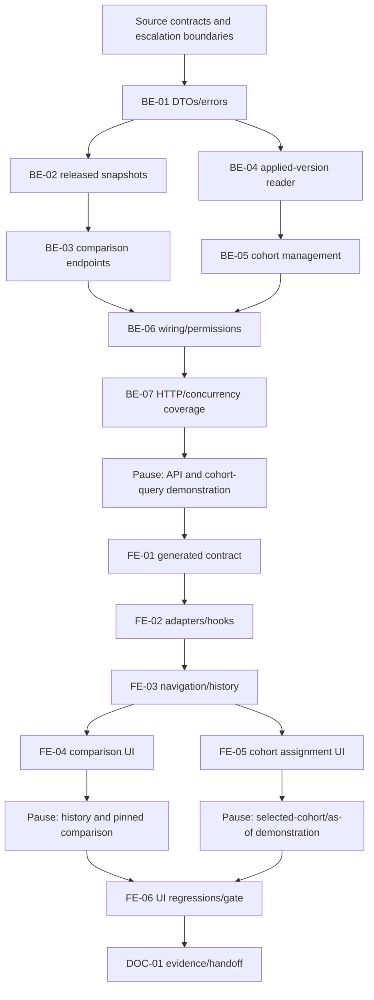

# F-16 Version Comparison and Cohort Assignment — Backend + Frontend Implementation Plan

This plan builds EP-16 (US-078..US-080; CV-194..CV-199 and F-16's contribution to CV-200): released-version comparison (MH-48), completion of history navigation (MH-46/47), and explicit semester-effective cohort assignment (MH-50). It defines the shared, transaction-aware answer to “which program version applies to this cohort in this semester?” and the integration contract that B5 student-facing features must use. It does not build student records, student exceptions, registration eligibility, graduation, a portal, an integration API, or the unbuilt grading-formula feature.

> **Companion documents**
>
> - Decisions: `docs/planning/feature-questions.md:249` (F16-01 = A; blank F16-02/03 = A).
> - Epic and acceptance: `docs/planning/epics.md:156`, `docs/planning/epics.md:169`; stories `docs/planning/user-stories.md:951`, `docs/planning/user-stories.md:962`, `docs/planning/user-stories.md:972`.
> - Requirements: `docs/requirement/REQUIREMENTS.md:544` (FR-72..74), `docs/requirement/REQUIREMENTS.md:948` (BR-22..26), DEC-01/08.
> - Design: `docs/design/data-dictionary.md:270`, `docs/design/data-dictionary.md:368`, `docs/design/data-dictionary.md:392`, `docs/design/data-dictionary.md:693`; `docs/design/erd.md` M-5/M-6/M-8 and E-9; `docs/design/state-diagrams.md` PB-01..09 and GD-01..04; `docs/design/sequence-diagrams.md:550` §12; `docs/design/screen-inventory.md:127` (MH-46..50).
> - Tasks: `docs/planning/task-breakdown.md:375`; deferred work: `docs/planning/deferred-scope.md` (audit, PI, objectives, formal documents stay deferred).
> - Built dependencies: implementation reports for F-02, F-06/07, F-10/11, F-13/14, and especially `docs/implement-report/f-15-release-version-snapshots-implement-report.md` (frozen-row detail and existing selectors differ from the original plan).
> - Test cases: `docs/planning/test-plan.md` KB-059, NT-B4-10/11/12, NT-B5-02; no separate F-16 test-case document exists at planning time.
> - Conventions: `docs/implementation/README.md`; F-15 and F-09 implementation plans; `docs/architecture/general_architecture.md`, `docs/architecture/features_architecture.md`, `docs/architecture/database_and_models.md`; frontend `src/shared/design-system/DESIGN_SYSTEM.md`.

**Status**: Done — BE-01..BE-07, FE-01..FE-06 và DOC-01 hoàn tất; kiểm thử tự động đã xác nhận, còn nợ manual F16-TC_023..027 và C9.

Ngày 2026-10-27, orchestrator xác nhận backend unit 1134/1134, hai suite F-16 e2e 18/18 và regression releases/corrections/permission-table/users đạt. Playwright lượt 2 đạt 14/14 (9 auth setup và 5 ca F-16), 1.3 phút, sau khi sửa hai lỗi helper ở lượt 1. Frontend F-16 scoped đạt 81/81; full suite lượt đầu dưới tải nặng đạt 469/478, 8 file lỗi chạy lại riêng đạt 58/58, không phải một lượt full suite xanh. DOC-01 đã đồng bộ kiến trúc, tiến độ, chỉ mục và kết quả TC. Toàn bộ quyết định/default §8 đã được người dùng chấp thuận ngày 2026-10-26; không suy diễn nghiệm thu Khoa từ dữ liệu tổng hợp. Manual F16-TC_023..027 và lịch/fixture nghiệm thu C9 còn nợ; U1/U2 không thuộc F-16.

---

## 0. Plan at a glance

Everything below in one table. Read this; the rest is detail for whoever builds it.

| What                                                                 | Why                                                                                    | How and where                                                                                                                                                                             |
| -------------------------------------------------------------------- | -------------------------------------------------------------------------------------- | ----------------------------------------------------------------------------------------------------------------------------------------------------------------------------------------- |
| **Browse old versions without rebuilding history**                   | US-079; F-15 already supplies metadata, frozen rows and origin links                   | Keep the existing release history/detail APIs; add safe selection and missing group navigation in `features/releases/pages/VersionHistoryPage.tsx` and `VersionDetailPage.tsx` (FE-03/06) |
| **Compare any two issued snapshots, including non-adjacent ones**    | US-078 AC1/4; FR-72                                                                    | New frozen snapshot reader and direct natural-key diff; six content sections with Thêm / Bớt / Sửa, not a replay of proposals (BE-02/03, FE-04)                                           |
| **Show unchanged groups and the actual pinned syllabus difference**  | US-078 AC2/3; F16-03 A                                                                 | Keep empty sections, display “Không thay đổi”, and drill into the two version-derived syllabus pins (BE-01..03, FE-04)                                                                    |
| **Assign only explicitly selected cohorts from a selected semester** | US-080 AC1..3; F16-01 A; BR-26                                                         | R1 batch POST and single-link semester correction; full confirmation, no implicit cohort migration or fabricated student counts (BE-05, FE-05)                                            |
| **One stable cohort/program/semester query for B5**                  | US-080 AC4; student records, eligibility, graduation, portal and dDUT must agree       | Export `AppliedProgramVersionReader.forCohort/forCohorts` from `shared/releases`; require a semester and never fall back to Program ACTIVE (BE-04/06)                                     |
| **Keep assignment writes atomic and stale decisions visible**        | Selected cohorts must change all-or-none; concurrent R1/release writers exist          | Existing Program lock plus Serializable write transaction and schedule/calendar revision token; explicit 409/reconfirm (BE-04/05/07, FE-02/05)                                            |
| **Preserve built tables and feature boundaries**                     | This task cannot approve changed behavior in F-15 or unbuilt features                  | No migration, new permission seed, runtime package or student stub; preserve F-13 readers and F-15 publisher/correction/activation (BE-01..07)                                            |
| **Do not conceal the correction-history conflict**                   | A stable query cannot recreate cohort intervals the current correction writer rewrites | Characterize current code, fence the correction-stable acceptance slice and record E1; ordinary cohort scheduling remains buildable (BE-07, §8)                                           |

**Key behaviours worth knowing**

| Behaviour                                                                                   | Why it is this way                                                                                                                                                    |
| ------------------------------------------------------------------------------------------- | --------------------------------------------------------------------------------------------------------------------------------------------------------------------- |
| PENDING can apply to a future queried semester; HISTORICAL can still apply to an old cohort | Lifecycle status is not cohort entitlement. Resolver uses explicit assignments and semester starts, not worker timing                                                 |
| A missing mapping returns UNASSIGNED; a missing date or invalid mapping is an error         | “No assignment” and “cannot safely calculate” must not both become a guessed ACTIVE version                                                                           |
| Existing same-date ties are deterministic; new F-16 writes refuse another same-date mapping | Preserve F-15-owned data while avoiding new ambiguity; tie order is link.createdAt then link.id                                                                       |
| Editing a link's starting semester can deliberately change past answers                     | MH-50 permits schedule correction; warn/confirm. A later version switch is a new link, not moving the old row forward                                                 |
| Current correction/calendar edits can change old assignment answers                         | E1/E3 decided 2026-10-26: accepted administrative retroactivity, no history/freeze work; the query is stable in contract, not an immutable ledger                     |
| History's cohort column is membership of schedule links, not an as-of result                | Existing serializer maps every linked cohort (`source/backend/src/features/releases/version-history.reader.ts:213`); MH-50's query gives the semester-specific answer |

**Not included**

| Excluded                                                                             | Why                                                                                                               |
| ------------------------------------------------------------------------------------ | ----------------------------------------------------------------------------------------------------------------- |
| Student identities, exceptions, dual-major/enrollment transitions and student counts | Unbuildable before F-17; its assumed adapter/transition contract is specified, not faked                          |
| Assessment/formula diff and the exact formula B4 scenario                            | Unbuildable before F-12's real revision-addressed schema/reader; no parallel-plan assumption                      |
| Excel import/export, reports, timeline, portal and dDUT routes                       | Other features; F-09 backend now exists in `source/backend/src/features/imports/`, but is not a prerequisite here |
| Separate conversion-evidence persistence and stronger calendar/correction semantics  | E1/E2/E3 decided 2026-10-26: no separate conversion-evidence store or history/freeze work                         |
| Repeat intervals of the same cohort/version pair or mapping deletion                 | Existing `(cohortId, programVersionId)` uniqueness remains unchanged (`source/backend/prisma/schema.prisma:490`)  |

**Open questions**

| Question                                                                   | Resolved when              | Default if unanswered                                                                                |
| -------------------------------------------------------------------------- | -------------------------- | ---------------------------------------------------------------------------------------------------- |
| Do corrections preserve pre-conversion cohort answers?                     | Owner decides E1           | Preserve current F-15 behavior; do not certify correction-stable history                             |
| Is a distinct conversion decision/basis mandatory?                         | Faculty decides E2         | Explicit R1 selection and displayed release decision only; separate evidence acceptance remains open |
| Must all assignment-used semester dates be frozen?                         | Owner/Faculty decides E3   | Existing live-calendar policy; unknown dates fail closed                                             |
| What official calendar and sanitized 1024034 fixture establish acceptance? | Faculty supplies E4 inputs | Synthetic behavioral fixtures only, no institutional-data claim                                      |

---

## 1. Scope

| In scope                                                                                   | Why                                                                                  |
| ------------------------------------------------------------------------------------------ | ------------------------------------------------------------------------------------ |
| Compare any two issued versions of one program, including non-adjacent versions            | US-078 AC1/4; FR-72                                                                  |
| Six content groups, each with Thêm / Bớt / Sửa and explicit unchanged output               | US-078 AC1/3; F16-03 A                                                               |
| Pinned-syllabus difference drill-down using the two version contexts                       | US-078 AC2; never substitute the current syllabus                                    |
| Reuse existing history, frozen detail, origin request and approval-history navigation      | US-079; no second history implementation                                             |
| Add and edit cohort application schedules; batch assignment to explicitly selected cohorts | US-080 AC1/2/5; MH-50                                                                |
| One exported, semester-explicit cohort resolver and one R1 diagnostic HTTP endpoint        | US-080 AC4; CV-197; B5 integration contract                                          |
| Integration tests proving publication/activation alone do not reassign cohorts             | US-080 AC3; F16-01 A                                                                 |
| Preserve current schema, release forms, permissions and correction writer                  | Scope fence; §8 E1 records the temporal limitation instead of silently changing F-15 |

| Out of scope                                                                                                                     | Deferred until                                                                                                                       |
| -------------------------------------------------------------------------------------------------------------------------------- | ------------------------------------------------------------------------------------------------------------------------------------ |
| Student CRUD, materialized enrollment transitions, individual exceptions, dual-degree routing and student identity authorization | F-17; B5 contract below is a dependency, not an endpoint that exists                                                                 |
| Eligibility, graduation, portal, dDUT HTTP routes                                                                                | F-18..F-21; consume the selected version, not Program's ACTIVE version                                                               |
| Grading-formula/assessment tables and their version diff                                                                         | F-12; no dependency on a concurrently written plan                                                                                   |
| Excel import/export                                                                                                              | F-09 backend is built in `source/backend/src/features/imports/`; no imports dependency is required to implement or test this feature |
| Timeline, PDF, external reports, email and delegation                                                                            | F-23..F-25; no imports from their unbuilt code                                                                                       |
| General audit log or a new conversion-document store                                                                             | Deferred audit decision; Faculty must settle separate conversion evidence (§8 E2)                                                    |
| Repeating the same version twice in one cohort's schedule, deletion of mappings, immutable assignment-event history              | Existing pair uniqueness is retained; any changed table behavior needs separate approval                                             |
| Repairing F-15's correction reassignment or freezing semester metadata                                                           | Escalations E1/E3; do not smuggle these into a migration                                                                             |

| AC / task                                                                          | Covered by                                                                                  |
| ---------------------------------------------------------------------------------- | ------------------------------------------------------------------------------------------- |
| US-078 AC1: information, curriculum, electives, PLO, matrices and pins             | BE-01/02/03/07; FE-04/06                                                                    |
| US-078 AC2: syllabus-only change and a link to the two pinned revisions            | BE-02/03/07; FE-03/04/06                                                                    |
| US-078 AC3: every unchanged content group says “Không thay đổi”                    | BE-02/03; FE-04/06                                                                          |
| US-078 AC4: direct endpoint-to-endpoint, non-adjacent comparison                   | BE-02/03/07; FE-04/06                                                                       |
| US-079 AC1: versions, decisions, semester, status and assigned cohorts             | Existing F-15 readers verified in §2; FE-03/06                                              |
| US-079 AC2: full historical content, no edit controls                              | Existing F-15/07/11/10 readers; BE-07 and FE-03/06 regression coverage                      |
| US-079 AC3: origin request and approval history                                    | Existing origin link; FE-03/06 regression through request detail                            |
| US-080 AC1: K2023 unchanged when K2025 is assigned another version                 | BE-04/05/07; FE-05/06                                                                       |
| US-080 AC2: selected old cohorts switch only from the selected semester            | BE-04/05/07; FE-05/06; correction exception E1 is not certified                             |
| US-080 AC3: publication/activation without cohort selection does not switch anyone | BE-07; FE-05 explanatory copy                                                               |
| US-080 AC4: latest starting semester not after requested semester                  | BE-04/05/07; FE-05/06                                                                       |
| US-080 AC5: Draft assignment is refused                                            | BE-01/05/07; FE-05/06                                                                       |
| CV-194/195                                                                         | BE-02/03/07; FE-04                                                                          |
| CV-196                                                                             | FE-03/06, preserve rather than rebuild F-15                                                 |
| CV-197/198/199                                                                     | BE-04/05/07; FE-05/06; synthetic 1024034 fixture                                            |
| CV-200                                                                             | §7 B4 acceptance gate; F-12 and Faculty-owned fixture/evidence dependencies remain explicit |

## 2. Contract verification

This section is the contract gate. **Existing** means verified source below, not an old plan. The six F-16 backend routes below are now source-verified; their HTTP/Testcontainers execution remains pending. **NEW / UNVERIFIED** still identifies unbuilt consumers such as U1/U2, not the implemented backend DTOs. All paths in source tables are repository-relative. No sensitive data tree or dotenv file is an input.

### 2a. Endpoints and behavioral contracts

Every path below has the existing `/api` prefix on the wire. New routes live outside `versions/:versionId` so a literal `compare` can never be swallowed by the existing detail parameter.

| Endpoint                                                            | Verified at                                                                                                                                              | Request                                      | Response                      | Notes                                                                                                                                                                                                                                          |
| ------------------------------------------------------------------- | -------------------------------------------------------------------------------------------------------------------------------------------------------- | -------------------------------------------- | ----------------------------- | ---------------------------------------------------------------------------------------------------------------------------------------------------------------------------------------------------------------------------------------------- |
| `GET /api/programs/:programId/versions`                             | `source/backend/src/features/releases/version-history.controller.ts:16`; mapper `source/backend/src/features/releases/version-history.reader.ts:198`     | Path only                                    | `VersionListDto`              | Ordered by `createdAt desc, id desc`, not numeric version; ALL-scope program viewers can see the plain Draft; request copies and correction Drafts are excluded (`version-history.reader.ts:79`). FE must filter issued comparison candidates. |
| `GET /api/programs/:programId/versions/:versionId`                  | `source/backend/src/features/releases/version-history.controller.ts:26`; serializer `source/backend/src/features/releases/version-history.reader.ts:169` | Two path IDs                                 | `VersionDetailDto`            | Verifies membership in program; ordinary Draft not served, R1 correction Draft can be served. Detail has frozen rows and links, not embedded PLO/matrix collections (`version-history.reader.ts:102`, `:140`).                                 |
| `GET /api/semesters`                                                | `source/backend/src/features/semesters/semesters.controller.ts:19`; `source/backend/src/shared/releases/semester.dto.ts:22`                              | None                                         | `SemesterDto[]`               | Any authenticated user; date may be null. No guessed academic-year parsing.                                                                                                                                                                    |
| `GET /api/cohorts`                                                  | `source/backend/src/features/semesters/semesters.controller.ts:44`; `source/backend/src/shared/releases/semester.dto.ts:32`                              | None                                         | `CohortDto[]`                 | Any authenticated user; reuse the existing query/selector infrastructure.                                                                                                                                                                      |
| `GET /api/programs`                                                 | `source/backend/src/features/programs/programs.controller.ts:43`; serializer `source/backend/src/features/programs/program.dto.ts:168`                   | `q?`, `page`, `pageSize`                     | `ProgramPageDto`              | R1 program picker when entering MH-50 from MH-10. Existing list requires PROGRAM_VIEW ALL, sorts by programCode and paginates (`source/backend/src/features/programs/programs.service.ts:49`). Its currentVersion is NOT cohort entitlement.   |
| `POST /api/programs/:programId/versions/:versionId/release`         | `source/backend/src/features/releases/releases.controller.ts:36`; `source/backend/src/shared/releases/version.publisher.ts:91`                           | Existing `ReleaseVersionDto`                 | Existing `VersionDetailDto`   | Regression fixture only, not a new FE call. Only selected `cohortIds` create links at the release semester.                                                                                                                                    |
| `GET /api/programs/:programId/version-comparison`                   | `source/backend/src/features/releases/version-comparison.controller.ts:20`; service `version-comparison.service.ts:41`                                   | `beforeVersionId`, `afterVersionId` required | `VersionComparisonDto`        | Source-verified, HTTP pending. Read-only; two issued rows of this exact program; same ID allowed and yields six unchanged sections; no writes to ChangeItem.                                                                                   |
| `GET /api/programs/:programId/version-comparison/syllabi/:courseId` | `source/backend/src/features/releases/version-comparison.controller.ts:31`; service `version-comparison.service.ts:65`                                   | Same two required version IDs                | `PinnedSyllabusComparisonDto` | Source-verified, HTTP pending. Both course rows must exist in the compared versions; server derives and checks the two pins. Caller cannot inject arbitrary syllabus IDs.                                                                      |
| `GET /api/programs/:programId/cohort-versions`                      | `source/backend/src/features/releases/cohort-versions.controller.ts:35`; service `cohort-versions.service.ts:44`                                         | Path only                                    | `CohortVersionListDto`        | Source-verified, HTTP pending. R1 management view of the whole schedule, including superseded/future links and a concurrency revision.                                                                                                         |
| `POST /api/programs/:programId/cohort-versions`                     | `source/backend/src/features/releases/cohort-versions.controller.ts:45`; service `cohort-versions.service.ts:58`                                         | `AssignCohortVersionsDto`                    | `CohortVersionListDto` (201)  | Source-verified, HTTP pending. All selected cohorts or none; append a different version at a new semester; no automatic all-cohorts default.                                                                                                   |
| `PATCH /api/programs/:programId/cohort-versions/:assignmentId`      | `source/backend/src/features/releases/cohort-versions.controller.ts:56`; service `cohort-versions.service.ts:96`                                         | `UpdateCohortVersionDto`                     | `CohortVersionListDto` (200)  | Source-verified, HTTP pending. Correct only this link's starting semester; identity and createdAt remain unchanged. Historical-impact confirmation belongs to FE-05.                                                                           |
| `GET /api/programs/:programId/cohorts/:cohortId/applied-version`    | `source/backend/src/features/releases/cohort-versions.controller.ts:68`; service `cohort-versions.service.ts:133`                                        | Required `semesterId`                        | `AppliedCohortVersionDto`     | Source-verified, HTTP pending. R1 diagnostic of the shared query; UNASSIGNED is successful, not an ACTIVE fallback. B5 uses the provider, not an HTTP round trip.                                                                              |

**Existing linked screens, not new API/model adapters:** MH-47 already links to curriculum, PLO and both matrices (`source/frontend/src/features/releases/pages/VersionDetailPage.tsx:88`) and uses `FrozenRowsTable` for pinned syllabus navigation (`:107`). Those owning features keep their existing request/response adapters; do not replace them with comparison DTOs. The existing curriculum endpoint is `GET /api/program-versions/:versionId/curriculum` (`source/backend/src/features/curriculum/program-versions-curriculum.controller.ts:43`).

**Permission trap:** `@RequirePermission(A, B)` is OR, not AND (`source/backend/src/shared/authz/permission.guard.ts:34`). New comparison controllers advertise `VERSION_COMPARE`; services separately assert that permission **and** `PROGRAM_VIEW` against `programTarget`. Assignment controllers advertise `VERSION_ASSIGN_COHORT`; services additionally call `assertSchoolWideDirect` (`source/backend/src/shared/authz/edit-path.ts:66`). Do not add new role checks or change the permission catalog: these backend codes and seeded cells already exist (`source/backend/src/shared/authz/permission-codes.ts:20`, `:35`; `source/backend/prisma/seed-data/permission-catalog.ts:166`, `:271`, `:278`).

### 2b. Response field verification

FE will alias generated OpenAPI types directly, not maintain parallel response models. For existing DTOs every field below is accounted for, including fields merely forwarded to existing components. Nullable storage does not become a non-null wire claim.

**`VersionListDto`, `VersionRefDto` and nested references** — `source/backend/src/features/releases/dto/version-detail.dto.ts`; actual mapping `source/backend/src/features/releases/version-history.reader.ts:198`.

| Field                                 | Wire type                                          | Nullable | Source                                                                                                                                                                              | Modeled as                     | Note                                                        |
| ------------------------------------- | -------------------------------------------------- | -------- | ----------------------------------------------------------------------------------------------------------------------------------------------------------------------------------- | ------------------------------ | ----------------------------------------------------------- |
| `VersionListDto.versions`             | `VersionRefDto[]`                                  | no       | `source/backend/src/features/releases/dto/version-detail.dto.ts:46`; `source/backend/src/features/releases/version-history.reader.ts:93`                                            | `VersionList.versions`         | Keep server order                                           |
| `id`                                  | string                                             | no       | `source/backend/src/features/releases/dto/version-detail.dto.ts:24`; `source/backend/src/features/releases/version-history.reader.ts:204`                                           | `VersionRef.id`                | Selection and route ID                                      |
| `versionNumber`                       | string                                             | yes      | `source/backend/src/features/releases/dto/version-detail.dto.ts:25`; `source/backend/src/features/releases/version-history.reader.ts:205`                                           | `VersionRef.versionNumber`     | Null for Draft; never use lexical numeric sorting           |
| `status`                              | `'DRAFT' \| 'PENDING' \| 'ACTIVE' \| 'HISTORICAL'` | no       | `source/backend/src/features/releases/dto/version-detail.dto.ts:26`; `source/backend/src/features/releases/version-history.reader.ts:206`; `source/backend/prisma/schema.prisma:63` | `VersionRef.status`            | Exclude DRAFT from selectors, not from existing history API |
| `decisionNumber`                      | string                                             | yes      | `source/backend/src/features/releases/dto/version-detail.dto.ts:28`; `source/backend/src/features/releases/version-history.reader.ts:207`                                           | `VersionRef.decisionNumber`    | Render em dash if null                                      |
| `signedDate`                          | ISO day string                                     | yes      | `source/backend/src/features/releases/dto/version-detail.dto.ts:29`; `source/backend/src/features/releases/version-history.reader.ts:208`                                           | `VersionRef.signedDate`        | Date-only, no timezone conversion in UI                     |
| `publishedAt`                         | ISO instant string                                 | yes      | `source/backend/src/features/releases/dto/version-detail.dto.ts:31`; `source/backend/src/features/releases/version-history.reader.ts:209`                                           | `VersionRef.publishedAt`       | Issued filter also requires non-null publication facts      |
| `effectiveSemester`                   | `SemesterDto`                                      | yes      | `source/backend/src/features/releases/dto/version-detail.dto.ts:32`; `source/backend/src/features/releases/version-history.reader.ts:210`                                           | `VersionRef.effectiveSemester` | Display metadata, not cohort activation rule                |
| `cohorts`                             | `CohortDto[]`                                      | no       | `source/backend/src/features/releases/dto/version-detail.dto.ts:34`; `source/backend/src/features/releases/version-history.reader.ts:213`                                           | `VersionRef.cohorts`           | All links to version, not “currently follows”               |
| `originRequest`                       | `{id, requestCode}`                                | yes      | `source/backend/src/features/releases/dto/version-detail.dto.ts:35`; `source/backend/src/features/releases/version-history.reader.ts:214`                                           | `VersionRef.originRequest`     | Existing history/request navigation                         |
| `correctedBy`                         | `VersionLinkDto`                                   | yes      | `source/backend/src/features/releases/dto/version-detail.dto.ts:42`; `source/backend/src/features/releases/version-history.reader.ts:215`                                           | `VersionRef.correctedBy`       | Issued correction only, not an open Draft                   |
| `VersionOriginRequestDto.id`          | string                                             | no       | `source/backend/src/features/releases/dto/version-detail.dto.ts:18`; `source/backend/src/features/releases/version-history.reader.ts:38`                                            | Origin link ID                 | No request-detail mapping added                             |
| `VersionOriginRequestDto.requestCode` | string                                             | no       | `source/backend/src/features/releases/dto/version-detail.dto.ts:19`; `source/backend/src/features/releases/version-history.reader.ts:38`                                            | Link label                     | Initial release can have no origin                          |
| `VersionLinkDto.id`                   | string                                             | no       | `source/backend/src/features/releases/dto/version-detail.dto.ts:13`; `source/backend/src/features/releases/version-history.reader.ts:216`                                           | Version link ID                | Also used below                                             |
| `VersionLinkDto.versionNumber`        | string                                             | yes      | `source/backend/src/features/releases/dto/version-detail.dto.ts:14`; `source/backend/src/features/releases/version-history.reader.ts:216`                                           | Version link label             | Correction Draft can have no number                         |

**`VersionDetailDto` additions to the inherited `VersionRefDto`** — same DTO file, mapped in `source/backend/src/features/releases/version-history.reader.ts:169`. Existing MH-47 consumes these unchanged.

| Field                 | Wire type         | Nullable | Source                                                                                                                                    | Modeled as                        | Note                                  |
| --------------------- | ----------------- | -------- | ----------------------------------------------------------------------------------------------------------------------------------------- | --------------------------------- | ------------------------------------- |
| `programId`           | string            | no       | `source/backend/src/features/releases/dto/version-detail.dto.ts:69`; `source/backend/src/features/releases/version-history.reader.ts:170` | `VersionDetail.programId`         | Parent route                          |
| `programCode`         | string            | no       | `source/backend/src/features/releases/dto/version-detail.dto.ts:70`; `source/backend/src/features/releases/version-history.reader.ts:171` | `VersionDetail.programCode`       | Identity from Program                 |
| `programName`         | string            | no       | `source/backend/src/features/releases/dto/version-detail.dto.ts:71`; `source/backend/src/features/releases/version-history.reader.ts:172` | `VersionDetail.programName`       | Version-owned                         |
| `majorCode`           | string            | no       | `source/backend/src/features/releases/dto/version-detail.dto.ts:72`; `source/backend/src/features/releases/version-history.reader.ts:173` | `VersionDetail.majorCode`         | Version-owned                         |
| `majorName`           | string            | no       | `source/backend/src/features/releases/dto/version-detail.dto.ts:73`; `source/backend/src/features/releases/version-history.reader.ts:174` | `VersionDetail.majorName`         | Version-owned                         |
| `semesterCount`       | number            | no       | `source/backend/src/features/releases/dto/version-detail.dto.ts:74`; `source/backend/src/features/releases/version-history.reader.ts:175` | `VersionDetail.semesterCount`     | Count, not calendar semester ID       |
| `totalCredits`        | decimal string    | no       | `source/backend/src/features/releases/dto/version-detail.dto.ts:75`; `source/backend/src/features/releases/version-history.reader.ts:176` | `VersionDetail.totalCredits`      | No float comparison                   |
| `compulsoryCredits`   | decimal string    | no       | `source/backend/src/features/releases/dto/version-detail.dto.ts:76`; `source/backend/src/features/releases/version-history.reader.ts:177` | `VersionDetail.compulsoryCredits` | Same                                  |
| `electiveCredits`     | decimal string    | no       | `source/backend/src/features/releases/dto/version-detail.dto.ts:77`; `source/backend/src/features/releases/version-history.reader.ts:178` | `VersionDetail.electiveCredits`   | Same                                  |
| `publishedBy`         | `UserRefDto`      | yes      | `source/backend/src/features/releases/dto/version-detail.dto.ts:78`; `source/backend/src/features/releases/version-history.reader.ts:179` | Existing header prop              | No extra user API                     |
| `previousVersion`     | `VersionLinkDto`  | yes      | `source/backend/src/features/releases/dto/version-detail.dto.ts:80`; `source/backend/src/features/releases/version-history.reader.ts:180` | Existing header prop              | Initial release has none              |
| `correctionOf`        | `VersionLinkDto`  | yes      | `source/backend/src/features/releases/dto/version-detail.dto.ts:82`; `source/backend/src/features/releases/version-history.reader.ts:181` | Existing header prop              | Ordinary releases have none           |
| `correctionReason`    | string            | yes      | `source/backend/src/features/releases/dto/version-detail.dto.ts:84`; `source/backend/src/features/releases/version-history.reader.ts:182` | Existing header prop              | Not a cohort-conversion document      |
| `isCorrectionDraft`   | boolean           | no       | `source/backend/src/features/releases/dto/version-detail.dto.ts:87`; `source/backend/src/features/releases/version-history.reader.ts:183` | Existing detail state             | Never a comparison candidate          |
| `openCorrection`      | `VersionLinkDto`  | yes      | `source/backend/src/features/releases/dto/version-detail.dto.ts:94`; `source/backend/src/features/releases/version-history.reader.ts:184` | Existing correction action        | R1-only visibility                    |
| `canCorrect`          | boolean           | no       | `source/backend/src/features/releases/dto/version-detail.dto.ts:98`; `source/backend/src/features/releases/version-history.reader.ts:192` | Existing correction action        | Not permission to edit frozen content |
| `rows`                | `VersionRowDto[]` | no       | `source/backend/src/features/releases/dto/version-detail.dto.ts:99`; `source/backend/src/features/releases/version-history.reader.ts:193` | Existing `FrozenRowsTable`        | Already sorted by semester/order/ID   |
| `UserRefDto.id`       | string            | no       | `source/backend/src/shared/dtos/ref.dto.ts:11`; `source/backend/src/features/releases/version-history.reader.ts:179`                      | Existing header prop              | No sensitive identity fields          |
| `UserRefDto.fullName` | string            | no       | `source/backend/src/shared/dtos/ref.dto.ts:12`; `source/backend/src/features/releases/version-history.reader.ts:179`                      | Existing header prop              | Display only                          |

**Rows, pins and calendar references** — `source/backend/src/features/releases/dto/version-detail.dto.ts:49`, serializer `source/backend/src/features/releases/version-history.reader.ts:140`; `source/backend/src/shared/releases/semester.dto.ts:5`, mappers `:22` and `:32`.

| Field                  | Wire type                                | Nullable | Source                                                                                                                                                                               | Modeled as              | Note                                                                                   |
| ---------------------- | ---------------------------------------- | -------- | ------------------------------------------------------------------------------------------------------------------------------------------------------------------------------------ | ----------------------- | -------------------------------------------------------------------------------------- |
| `VersionRowDto.itemId` | string                                   | no       | `source/backend/src/features/releases/dto/version-detail.dto.ts:58`; `source/backend/src/features/releases/version-history.reader.ts:144`                                            | Existing row ID         | Never diff identity across copies                                                      |
| `plannedSemester`      | number                                   | no       | `source/backend/src/features/releases/dto/version-detail.dto.ts:59`; `source/backend/src/features/releases/version-history.reader.ts:145`                                            | Existing row            | Relative semester                                                                      |
| `courseId`             | string                                   | no       | `source/backend/src/features/releases/dto/version-detail.dto.ts:60`; `source/backend/src/features/releases/version-history.reader.ts:146`                                            | Existing row/link       | Stable catalog identity                                                                |
| `courseCode`           | string                                   | no       | `source/backend/src/features/releases/dto/version-detail.dto.ts:61`; `source/backend/src/features/releases/version-history.reader.ts:147`                                            | Existing row label      | Code cannot be edited (`source/backend/src/features/courses/update-course.dto.ts:4`)   |
| `courseName`           | string                                   | no       | `source/backend/src/features/releases/dto/version-detail.dto.ts:62`; `source/backend/src/features/releases/version-history.reader.ts:148`                                            | Existing row label      | `rowCourse` prefers snapshot (`source/backend/src/shared/curriculum/row-course.ts:22`) |
| `credits`              | decimal string                           | no       | `source/backend/src/features/releases/dto/version-detail.dto.ts:63`; `source/backend/src/features/releases/version-history.reader.ts:149`                                            | Existing row            | Serializer, not schema, establishes string                                             |
| `syllabus`             | `SyllabusPinDto`                         | yes      | `source/backend/src/features/releases/dto/version-detail.dto.ts:64`; `source/backend/src/features/releases/version-history.reader.ts:150`                                            | Existing row link       | Old incomplete data may have none                                                      |
| `SyllabusPinDto.id`    | string                                   | no       | `source/backend/src/features/releases/dto/version-detail.dto.ts:50`; `source/backend/src/features/releases/version-history.reader.ts:152`                                            | Pin identity            | No lookup of “latest”                                                                  |
| `revisionNumber`       | number                                   | no       | `source/backend/src/features/releases/dto/version-detail.dto.ts:51`; `source/backend/src/features/releases/version-history.reader.ts:153`                                            | Pin label               | Revision is not program version number                                                 |
| `status`               | `'DRAFT' \| 'PUBLISHED' \| 'HISTORICAL'` | no       | `source/backend/src/features/releases/dto/version-detail.dto.ts:52`; `source/backend/src/features/releases/version-history.reader.ts:154`; `source/backend/prisma/schema.prisma:615` | Pin status label        | Current lifecycle status; not semantic diff input                                      |
| `SemesterDto.id`       | string                                   | no       | `source/backend/src/shared/releases/semester.dto.ts:6`, `source/backend/src/shared/releases/semester.dto.ts:24`                                                                      | `Semester.id`           | Query context                                                                          |
| `semesterCode`         | string                                   | no       | `source/backend/src/shared/releases/semester.dto.ts:7`, `source/backend/src/shared/releases/semester.dto.ts:25`                                                                      | `Semester.semesterCode` | Label only                                                                             |
| `academicYear`         | string                                   | no       | `source/backend/src/shared/releases/semester.dto.ts:8`, `source/backend/src/shared/releases/semester.dto.ts:26`                                                                      | `Semester.academicYear` | Not guaranteed sortable canonical syntax                                               |
| `termInYear`           | number                                   | no       | `source/backend/src/shared/releases/semester.dto.ts:9`, `source/backend/src/shared/releases/semester.dto.ts:27`                                                                      | `Semester.termInYear`   | Not an absolute chronology                                                             |
| `startDate`            | ISO day string                           | yes      | `source/backend/src/shared/releases/semester.dto.ts:10`, `source/backend/src/shared/releases/semester.dto.ts:28`                                                                     | `Semester.startDate`    | New resolver requires known dates                                                      |
| `CohortDto.id`         | string                                   | no       | `source/backend/src/shared/releases/semester.dto.ts:15`, `source/backend/src/shared/releases/semester.dto.ts:34`                                                                     | `Cohort.id`             | No student rows required                                                               |
| `cohortCode`           | string                                   | no       | `source/backend/src/shared/releases/semester.dto.ts:16`, `source/backend/src/shared/releases/semester.dto.ts:35`                                                                     | `Cohort.cohortCode`     | Never infer assignment from K2023 text                                                 |
| `intakeYear`           | number                                   | no       | `source/backend/src/shared/releases/semester.dto.ts:17`, `source/backend/src/shared/releases/semester.dto.ts:36`                                                                     | `Cohort.intakeYear`     | Display/sort only                                                                      |

**Program picker response** — no feature-to-feature frontend import is needed: alias generated schemas in releases API. These extra fields are explicitly not modeled where they are irrelevant to choosing program identity.

| Field                     | Wire type                                          | Nullable | Source                                                                                                                                                        | Modeled as        | Note                                                                                                                  |
| ------------------------- | -------------------------------------------------- | -------- | ------------------------------------------------------------------------------------------------------------------------------------------------------------- | ----------------- | --------------------------------------------------------------------------------------------------------------------- |
| `ProgramPageDto.items`    | `ProgramSummaryDto[]`                              | no       | `source/backend/src/features/programs/program.dto.ts:51`; `source/backend/src/shared/pagination/page.ts:22`                                                   | Picker table data | Preserve server page                                                                                                  |
| `total`                   | number                                             | no       | `source/backend/src/features/programs/program.dto.ts:52`; `source/backend/src/shared/pagination/page.ts:22`                                                   | DataTable total   | No fetch-all assumption                                                                                               |
| `page`                    | number                                             | no       | `source/backend/src/features/programs/program.dto.ts:53`; `source/backend/src/shared/pagination/page.ts:22`                                                   | Picker page       | Existing default 1                                                                                                    |
| `pageSize`                | number                                             | no       | `source/backend/src/features/programs/program.dto.ts:54`; `source/backend/src/shared/pagination/page.ts:22`                                                   | Picker pageSize   | Existing default 20/max 100 in `source/backend/src/shared/pagination/page-query.dto.ts:5`                             |
| `ProgramSummaryDto.id`    | string                                             | no       | `source/backend/src/features/programs/program.dto.ts:37`, `source/backend/src/features/programs/program.dto.ts:171`                                           | Program route ID  | Never select currentVersion instead                                                                                   |
| `programCode`             | string                                             | no       | `source/backend/src/features/programs/program.dto.ts:38`, `source/backend/src/features/programs/program.dto.ts:172`                                           | Picker label      | Display code                                                                                                          |
| `degreeLevel`             | `'ENGINEER' \| 'BACHELOR'`                         | no       | `source/backend/src/features/programs/program.dto.ts:39`, `source/backend/src/features/programs/program.dto.ts:173`; `source/backend/prisma/schema.prisma:53` | **not modeled**   | Not required for selection                                                                                            |
| `status`                  | `'ACTIVE' \| 'INACTIVE'`                           | no       | `source/backend/src/features/programs/program.dto.ts:41`, `source/backend/src/features/programs/program.dto.ts:174`; `source/backend/prisma/schema.prisma:58` | **not modeled**   | Do not hide historical programs by default                                                                            |
| `faculty`                 | `OrgUnitRefDto`                                    | no       | `source/backend/src/features/programs/program.dto.ts:43`, `source/backend/src/features/programs/program.dto.ts:175`                                           | **not modeled**   | Program ID supplies context                                                                                           |
| `programName`             | string                                             | no       | `source/backend/src/features/programs/program.dto.ts:44`, `source/backend/src/features/programs/program.dto.ts:176`                                           | Picker label      | Current display name, not a frozen cohort name                                                                        |
| `currentVersion`          | `ProgramVersionRefDto`                             | no       | `source/backend/src/features/programs/program.dto.ts:45`, `source/backend/src/features/programs/program.dto.ts:177`                                           | **not modeled**   | Chooses ACTIVE else newest (`source/backend/src/features/programs/program.dto.ts:130`), unsuitable for student lookup |
| `directors`               | `UserRefDto[]`                                     | no       | `source/backend/src/features/programs/program.dto.ts:47`, `source/backend/src/features/programs/program.dto.ts:178`                                           | **not modeled**   | No user display in picker                                                                                             |
| `OrgUnitRefDto.id`        | string                                             | no       | `source/backend/src/shared/dtos/ref.dto.ts:5`; `source/backend/src/features/programs/program.dto.ts:175`                                                      | **not modeled**   | Nested faculty reference                                                                                              |
| `unitCode`                | string                                             | no       | `source/backend/src/shared/dtos/ref.dto.ts:6`; `source/backend/src/features/programs/program.dto.ts:175`                                                      | **not modeled**   | Same                                                                                                                  |
| `unitName`                | string                                             | no       | `source/backend/src/shared/dtos/ref.dto.ts:7`; `source/backend/src/features/programs/program.dto.ts:175`                                                      | **not modeled**   | Same                                                                                                                  |
| `ProgramVersionRefDto.id` | string                                             | no       | `source/backend/src/features/programs/program.dto.ts:19`, `source/backend/src/features/programs/program.dto.ts:146`                                           | **not modeled**   | Never a cohort-version default                                                                                        |
| `versionNumber`           | string                                             | yes      | `source/backend/src/features/programs/program.dto.ts:20`, `source/backend/src/features/programs/program.dto.ts:147`                                           | **not modeled**   | Draft is nullable                                                                                                     |
| `status`                  | `'DRAFT' \| 'PENDING' \| 'ACTIVE' \| 'HISTORICAL'` | no       | `source/backend/src/features/programs/program.dto.ts:22`, `source/backend/src/features/programs/program.dto.ts:148`; `source/backend/prisma/schema.prisma:63` | **not modeled**   | Not an entitlement signal                                                                                             |
| `directors[].id`          | string                                             | no       | `source/backend/src/shared/dtos/ref.dto.ts:11`; `source/backend/src/features/programs/program.dto.ts:178`                                                     | **not modeled**   | No student/user data fetched                                                                                          |
| `directors[].fullName`    | string                                             | no       | `source/backend/src/shared/dtos/ref.dto.ts:12`; `source/backend/src/features/programs/program.dto.ts:178`                                                     | **not modeled**   | Same                                                                                                                  |

### 2c. Verified gaps and mismatch log

| Deliverable | What an earlier plan/design suggests                                                                 | What the source does                                                                                                                                                                                                                                                                                                                                 | Found at                                                                                                                                                                          |
| ----------- | ---------------------------------------------------------------------------------------------------- | ---------------------------------------------------------------------------------------------------------------------------------------------------------------------------------------------------------------------------------------------------------------------------------------------------------------------------------------------------- | --------------------------------------------------------------------------------------------------------------------------------------------------------------------------------- |
| FE-02/05    | Program search might use a generic search parameter                                                  | The existing §2a contract and generated operation require q; the releases-owned picker aliases that operation and resets page on submit. No backend or response contract change                                                                                                                                                                      | `source/frontend/src/shared/api/schema.d.ts:5239`; `source/frontend/src/features/releases/api/releases.ts:28`                                                                     |
| FE-03/04/06 | Earlier frontend file:line anchors still point to the same functions                                 | Existing F-15/F-09 work shifted anchors. Preserve F-09 navigation; keep DiffView feature-local and build a releases-owned renderer as planned                                                                                                                                                                                                        | `source/frontend/src/features/change-requests/components/DiffView.tsx:75`; `source/frontend/src/features/releases/hooks/useReleases.ts:185`; `source/frontend/src/router.tsx:386` |
| FE-03       | F-15 history is issued-only                                                                          | ALL-scope viewers can see a plain Draft; retain history but filter selectors                                                                                                                                                                                                                                                                         | `source/backend/src/features/releases/version-history.reader.ts:79`                                                                                                               |
| BE-02       | Reuse the request diff as the full released-version diff                                             | Request snapshot omits frozen course name/credits and syllabus pins, and its row label reads live course name                                                                                                                                                                                                                                        | `source/backend/src/shared/change-requests/diff/program-snapshot.reader.ts:30`, `:79`, `:81`                                                                                      |
| BE-02       | Pinned detail can be inferred from current syllabus status                                           | Pin is per curriculum item; fallback exists only for unpinned rows                                                                                                                                                                                                                                                                                   | `source/backend/src/shared/syllabi/revision-for-items.ts:25`, `:53`                                                                                                               |
| BE-04/05    | CohortVersion has a program/semester unique constraint and mutable timestamp                         | Only `(cohortId, programVersionId)` is unique; only `createdAt` exists; F-09 shifted the old citation                                                                                                                                                                                                                                                | `source/backend/prisma/schema.prisma:480`, `source/backend/prisma/schema.prisma:490`                                                                                              |
| BE-04/07    | Correction preserves all before-semester assignment answers                                          | Default `moveCohorts` rewrites existing mappings to the correction without adding an interval                                                                                                                                                                                                                                                        | `source/backend/src/features/releases/corrections.service.ts:143`; escalation E1                                                                                                  |
| BE-04/05    | Semester codes/academic year sort chronologically and dates are immutable once used by an assignment | Arbitrary nonempty academicYear is accepted; only dates supporting ACTIVE/HISTORICAL release rows get the start-date guard                                                                                                                                                                                                                           | `source/backend/src/features/semesters/dto/semester.dto.ts:31`; `source/backend/src/features/semesters/semesters.service.ts:87`; E3                                               |
| FE-02/04    | `DiffView` is a shared UI primitive                                                                  | It belongs to change-requests and imports that feature's API/constants                                                                                                                                                                                                                                                                               | `source/frontend/src/features/change-requests/components/DiffView.tsx:2`                                                                                                          |
| BE-05       | §12 sequence can count and move enrolled students at B4                                              | Current schema has CohortVersion, not Student/ProgramEnrollment models; B5 owns that integration                                                                                                                                                                                                                                                     | `source/backend/prisma/schema.prisma:470`; dependency U1                                                                                                                          |
| BE-01..07   | F-09 is not yet built                                                                                | F-09 is built in features/imports and has moved shared course/curriculum code, schema citations, app wiring and permission-table lines. F-16 does not import or replace that work                                                                                                                                                                    | `source/backend/src/app.module.ts:58`; `source/backend/src/shared/curriculum/curriculum-limits.ts:1`; `source/backend/test/permission-table.ts:70`                                |
| BE-05       | Reuse toCohortDto directly for a picked domain cohort                                                | Existing mapper requires the full Prisma Cohort including timestamps; the new domain intentionally carries only id/cohortCode/intakeYear. Map those three fields explicitly rather than widening a built exported contract                                                                                                                           | `source/backend/src/shared/releases/semester.dto.ts:30`; `source/backend/src/features/releases/cohort-versions.mapper.ts:22`                                                      |
| BE-06       | The generic program write counter is a single Program count                                          | The branch also handles director assignments. Insert the cohort counter before the whole existing branch and preserve both cases                                                                                                                                                                                                                     | `source/backend/test/permission-table.e2e-spec.ts:123`                                                                                                                            |
| BE-07       | Fixture release calls can infer request types or allow past semesters implicitly                     | Use built CURRICULUM/SYLLABUS_CONTENT requests, real submit/final-approve routes, two R1 accounts and explicit allowPastSemester for the historical middle release. Initial release selects one cohort while another existing cohort stays unselected; later final releases select none, proving preservation instead of an empty-database tautology | `source/backend/test/fixtures/version-comparison.ts:1`; `source/backend/src/features/change-requests/final-approval.dto.ts:28`                                                    |

No existing response field is silently upgraded to a different type. Source-verified DTO inventory: `source/backend/src/features/releases/dto/version-comparison.dto.ts:27` (queries/issued headers), `:42` (pin links/rows), `:51` (sections/comparison), `:67` (syllabus drill-down); `source/backend/src/features/releases/dto/cohort-version.dto.ts:26` (POST), `:41` (PATCH), `:47` (query), `:50` (assignment), `:57` (list), `:63` (diagnostic). The complete BE-01 inventory remains the wire contract; the presenter, strict snapshot reader and cohort mapper implement it. OpenAPI HTTP generation is not claimed verified here; §8 U1/U2 still names unavailable downstream contracts.

## 3. Decisions

| ID  | Decision                                                                                                                                                         | Why                                                                                                                                                                                     | Rejected alternative                                                          |
| --- | ---------------------------------------------------------------------------------------------------------------------------------------------------------------- | --------------------------------------------------------------------------------------------------------------------------------------------------------------------------------------- | ----------------------------------------------------------------------------- |
| D1  | Extend the existing `releases` feature; put only the cross-feature applied-version reader/types in `shared/releases`                                             | Existing history lives there (`source/backend/src/features/releases/releases.module.ts:18`); B5 must not import a feature service                                                       | New parallel `versions` module or internal HTTP calls                         |
| D2  | New released-content snapshot reader; reuse only the pure `diffSnapshots`, scalar and plain-text presentation primitives                                         | Preserve F-13 working-copy semantics while covering frozen fields and pins                                                                                                              | Changing the shared request reader and every caller                           |
| D3  | Exactly six program comparison sections, all present even when empty; FE subgroups each section into Thêm / Bớt / Sửa                                            | F16-03 A plus US-078's broader group coverage                                                                                                                                           | Whole-program two-column JSON dump or omission of unchanged groups            |
| D4  | Direct comparison of endpoint snapshots by natural keys, not replay of intermediate ChangeItems                                                                  | Non-adjacent versions and different copied row IDs must work                                                                                                                            | Adjacent-only diffs or row-ID identity                                        |
| D5  | Explicit required `semesterId`; chronological key is the referenced semester's non-null `startDate`                                                              | No canonical year syntax is enforced (`source/backend/src/features/semesters/dto/semester.dto.ts:31`); no wall-clock-dependent API default                                              | ACTIVE version, highest version number, intake year, or lexical semester code |
| D6  | Shared resolver returns ASSIGNED/UNASSIGNED; it may return PENDING for a future queried semester or HISTORICAL for an older cohort                               | Version lifecycle is not student entitlement; never auto-upgrade                                                                                                                        | Filtering assignments to ACTIVE only                                          |
| D7  | Same-date legacy ties resolve by assignment `createdAt desc`, then assignment ID in deterministic codepoint-descending order                                     | F-15 can create more than one version in a semester; existing schema permits it                                                                                                         | New uniqueness constraint or rejecting all legacy data                        |
| D8  | New F-16 writes refuse another mapping for that cohort/program at the same start date; keep existing ties readable                                               | Avoid creating new ambiguity without rewriting a built table or release writer                                                                                                          | Deleting/replacing existing links or silently choosing a different target     |
| D9  | Batch POST creates links; PATCH only corrects `fromSemesterId`; no delete, pair-identity change or repeated-version interval                                     | Match MH-50 while retaining existing pair uniqueness                                                                                                                                    | Altering the F-15-owned schema to an interval/event model                     |
| D10 | Program-row lock plus Serializable transaction and a hash revision of the schedule/calendar prevents stale overwrites                                            | Existing release/correction writers also lock Program (`source/backend/src/features/releases/releases.service.ts:77`, `source/backend/src/features/releases/corrections.service.ts:97`) | `updatedAt` optimistic lock on a table that has no such column                |
| D11 | Assignment confirmation names target release decision, cohorts, start semester and retroactive effect; no invented student count or unpersisted free-text reason | Students are unbuilt; release decision is available; separate conversion evidence is E2, not an invented schema field                                                                   | Reporting zero affected students, or collecting and discarding a “basis”      |
| D12 | No schema migration, new permission seed, queue, runtime library, branch or commit in this feature plan                                                          | Built foundation suffices; preserve behavior fences                                                                                                                                     | Additive-looking migration that changes assignment semantics under F-15       |
| D13 | Keep immutable content comparisons separate from mutable lifecycle/assignment metadata                                                                           | A syllabus becoming HISTORICAL or another cohort being assigned is not curriculum change                                                                                                | Comparing timestamps/status/cohort lists as academic content                  |

## 4. Integration boundaries and deliberate divergences

There is no shipped sibling implementation to diverge from. The existing web implementation is a dependency, not a spec for invented backend DTOs. These boundaries make differences from older documents explicit.

| Boundary                                                      | Implementation instruction                                                                                                                    | Authority / consequence                                                                                                                         |
| ------------------------------------------------------------- | --------------------------------------------------------------------------------------------------------------------------------------------- | ----------------------------------------------------------------------------------------------------------------------------------------------- |
| F-15 history/detail already built                             | Modify only selection/navigation and explanatory text, retaining current response contracts and read-only links                               | `source/frontend/src/features/releases/pages/VersionHistoryPage.tsx:35`, `source/frontend/src/features/releases/pages/VersionDetailPage.tsx:88` |
| F-13 request snapshots                                        | Do not replace `readProgramSnapshot`, `readSyllabusSnapshot`, `diffSnapshots`, `toDiffSections` or `DiffView`                                 | Existing reader deliberately represents request-editable data; no old call sites are removed or migrated                                        |
| §12 assignment sequence includes B5 work                      | B4 stores cohort links and offers explicit confirmation; student counts, enrollment transitions and exception records remain F-17             | F16-02 A; U1. Never stub “0 students transferred”                                                                                               |
| Correction timeline differs from US-080's ideal as-of promise | Preserve F-15's current writer and characterize the limitation; do not certify correction-stable historical assignment results                | E1 decided 2026-10-26; accepted limitation, no history/freeze work, not an approved product divergence                                          |
| Separate conversion evidence is not modeled                   | Default confirmation displays the existing release decision. If Faculty requires a distinct conversion decision/basis, stop that slice for E2 | No discarded input, audit-log revival or hidden new persistence                                                                                 |
| Date-only chronology                                          | Use existing date helpers and known semester starts, not a new academic-year grammar or changed Semester edit policy                          | E3 records the mutability limit; no historical date freezing is assumed                                                                         |

## 5. Deliverables

Every NEW path below was checked against its existing parent directory; a new file is not claimed to exist. Paths in file tables are exact. Backend imports use `.js`; frontend imports mirror adjacent files. Each step lists its test files explicitly. No DELETE deliverable is needed: nothing is replaced.

### BE-01 — DTOs, comparison vocabulary and assignment errors

**What / why:** Establish the complete backend/frontend contract before readers or pages are written. The backend classes are now source-verified in §2; actual OpenAPI/HTTP execution remains pending.

**Files**

| Action | Path                                                                      | Mirror / rationale                                                                                            |
| ------ | ------------------------------------------------------------------------- | ------------------------------------------------------------------------------------------------------------- |
| NEW    | `source/backend/src/features/releases/dto/version-comparison.dto.ts`      | `source/backend/src/features/releases/dto/version-detail.dto.ts:12`; concrete Swagger classes                 |
| NEW    | `source/backend/src/features/releases/dto/cohort-version.dto.ts`          | `source/backend/src/features/releases/dto/release-version.dto.ts:23`; request validation and response classes |
| NEW    | `source/backend/src/features/releases/version-comparison.constants.ts`    | `source/backend/src/shared/change-requests/diff/diff-labels.ts:22`; feature-owned section/field labels        |
| NEW    | `source/backend/src/shared/releases/applied-version.errors.ts`            | `source/backend/src/shared/releases/release.errors.ts:4`; typed Vietnamese errors usable by B5                |
| NEW    | `source/backend/src/features/releases/dto/version-comparison.dto.spec.ts` | `source/backend/src/features/releases/version-history.reader.spec.ts:1`; Vitest beside source                 |
| NEW    | `source/backend/src/features/releases/dto/cohort-version.dto.spec.ts`     | Same test convention; exercise class-validator transformations                                                |

**Shape — comparison types**

Use `ApiProperty`, class-validator `IsString`/`IsNotEmpty`, existing `SemesterDto`, `SyllabusPinDto`, and `DiffFieldDto`/`DiffRowDto` imports. Reuse `DiffChange`'s literal values, not a second definition of “modified” (`source/backend/src/shared/change-requests/diff/change-diff.dto.ts:3`).

```ts
export const VERSION_COMPARE_SECTIONS = {
  INFO: "INFO",
  CURRICULUM: "CURRICULUM",
  ELECTIVE_GROUPS: "ELECTIVE_GROUPS",
  PLOS: "PLOS",
  MATRICES: "MATRICES",
  SYLLABI: "SYLLABI",
} as const;
export type VersionCompareSection =
  (typeof VERSION_COMPARE_SECTIONS)[keyof typeof VERSION_COMPARE_SECTIONS];

export const ISSUED_VERSION_STATUSES = [
  "PENDING",
  "ACTIVE",
  "HISTORICAL",
] as const;
export type IssuedVersionStatus = (typeof ISSUED_VERSION_STATUSES)[number];

export class VersionComparisonQueryDto {
  @ApiProperty()
  @IsString()
  @IsNotEmpty()
  beforeVersionId!: string;
  @ApiProperty()
  @IsString()
  @IsNotEmpty()
  afterVersionId!: string;
}

export class IssuedVersionDto {
  @ApiProperty() id!: string;
  @ApiProperty() versionNumber!: string;
  @ApiProperty({
    enum: [...ISSUED_VERSION_STATUSES],
    enumName: "IssuedVersionStatus",
  })
  status!: IssuedVersionStatus;
  @ApiProperty() decisionNumber!: string;
  @ApiProperty({ type: SemesterDto }) effectiveSemester!: SemesterDto;
}

export class SyllabusComparisonLinkDto {
  @ApiProperty() courseId!: string;
  @ApiProperty() beforeSyllabusId!: string;
  @ApiProperty() afterSyllabusId!: string;
}

export class VersionCompareRowDto extends DiffRowDto {
  @ApiProperty({ type: SyllabusComparisonLinkDto, nullable: true })
  syllabusComparison!: SyllabusComparisonLinkDto | null;
}

export class VersionCompareSectionDto {
  @ApiProperty({
    enum: Object.values(VERSION_COMPARE_SECTIONS),
    enumName: "VersionCompareSection",
  })
  key!: VersionCompareSection;
  @ApiProperty() title!: string;
  @ApiProperty({ type: [VersionCompareRowDto] }) rows!: VersionCompareRowDto[];
}

export class VersionComparisonDto {
  @ApiProperty() programId!: string;
  @ApiProperty({ type: IssuedVersionDto }) before!: IssuedVersionDto;
  @ApiProperty({ type: IssuedVersionDto }) after!: IssuedVersionDto;
  @ApiProperty({ type: [VersionCompareSectionDto] })
  sections!: VersionCompareSectionDto[];
}

export class PinnedSyllabusComparisonDto {
  @ApiProperty() programId!: string;
  @ApiProperty() courseId!: string;
  @ApiProperty() courseCode!: string;
  @ApiProperty() beforeVersionId!: string;
  @ApiProperty() afterVersionId!: string;
  @ApiProperty({ type: SyllabusPinDto }) before!: SyllabusPinDto;
  @ApiProperty({ type: SyllabusPinDto }) after!: SyllabusPinDto;
  @ApiProperty({ type: [DiffSectionDto] }) sections!: DiffSectionDto[];
}
```

`DiffSectionDto` is the existing read-only section shape, not `ChangeDiffDto`: there is no `live` flag and no request working copy in these endpoints. Full program comparison always includes six sections; syllabus drill-down always includes its three currently supported sections (text, weeks, CLOs), even when their `rows` arrays are empty.

**Shape — assignment types**

```ts
export const COHORT_ASSIGNMENT_LIMITS = {
  COHORTS_MAX: 50,
  REVISION_LENGTH: 64,
} as const;
export const ASSIGNMENT_REVISION_PATTERN = new RegExp(
  `^[a-f0-9]{${COHORT_ASSIGNMENT_LIMITS.REVISION_LENGTH}}$`,
);
export const APPLIED_VERSION_STATES = ["ASSIGNED", "UNASSIGNED"] as const;

export class AssignCohortVersionsDto {
  @ApiProperty({ type: [String] })
  @IsArray()
  @ArrayMinSize(1)
  @ArrayMaxSize(COHORT_ASSIGNMENT_LIMITS.COHORTS_MAX)
  @ArrayUnique()
  @IsString({ each: true })
  @IsNotEmpty({ each: true })
  cohortIds!: string[];
  @ApiProperty()
  @IsString()
  @IsNotEmpty()
  programVersionId!: string;
  @ApiProperty()
  @IsString()
  @IsNotEmpty()
  fromSemesterId!: string;
  @ApiProperty()
  @Matches(ASSIGNMENT_REVISION_PATTERN)
  expectedRevision!: string;
}

export class UpdateCohortVersionDto {
  @ApiProperty()
  @IsString()
  @IsNotEmpty()
  fromSemesterId!: string;
  @ApiProperty()
  @Matches(ASSIGNMENT_REVISION_PATTERN)
  expectedRevision!: string;
}

export class AppliedVersionQueryDto {
  @ApiProperty()
  @IsString()
  @IsNotEmpty()
  semesterId!: string;
}

export class CohortVersionAssignmentDto {
  @ApiProperty() id!: string;
  @ApiProperty({ type: CohortDto }) cohort!: CohortDto;
  @ApiProperty({ type: IssuedVersionDto }) version!: IssuedVersionDto;
  @ApiProperty({ type: SemesterDto }) fromSemester!: SemesterDto;
  @ApiProperty() createdAt!: string;
}

export class CohortVersionListDto {
  @ApiProperty() programId!: string;
  @ApiProperty() revision!: string;
  @ApiProperty({ type: [CohortVersionAssignmentDto] })
  assignments!: CohortVersionAssignmentDto[];
}

export class AppliedCohortVersionDto {
  @ApiProperty() programId!: string;
  @ApiProperty({ type: CohortDto }) cohort!: CohortDto;
  @ApiProperty({ type: SemesterDto }) semester!: SemesterDto;
  @ApiProperty({
    enum: [...APPLIED_VERSION_STATES],
    enumName: "AppliedVersionState",
  })
  state!: "ASSIGNED" | "UNASSIGNED";
  @ApiProperty({ type: CohortVersionAssignmentDto, nullable: true })
  assignment!: CohortVersionAssignmentDto | null;
}
```

The cohort limit matches the current release DTO's bound (`source/backend/src/features/releases/dto/release-version.dto.ts:18`), but this new DTO owns its bound so shared consumers do not import a feature's DTO. The revision regex uses the named hex-length constant above; keep Swagger examples synchronized with `REVISION_LENGTH`. No arbitrary `minReasonLength` is introduced.

**Complete response field inventory / FE mapping** — NEW BE-01/02/03/04/05 provenance labels in this table now refer to implemented source, located in §2. Existing nested `SemesterDto`, `CohortDto`, `SyllabusPinDto` remain unchanged and are fully inventoried in §2b. HTTP execution and FE generation are pending.

| DTO / field                             | Wire type                                                                          | Nullable | Source                                                                                                     | Modeled as / note                                            |
| --------------------------------------- | ---------------------------------------------------------------------------------- | -------- | ---------------------------------------------------------------------------------------------------------- | ------------------------------------------------------------ |
| `IssuedVersionDto.id`                   | string                                                                             | no       | NEW BE-01, BE-03/05 mapper                                                                                 | Generated alias; ID                                          |
| `versionNumber`                         | string                                                                             | no       | NEW BE-01, BE-03/05                                                                                        | Assert publication facts before mapping                      |
| `status`                                | `'PENDING' \| 'ACTIVE' \| 'HISTORICAL'`                                            | no       | NEW BE-01, BE-03/05                                                                                        | Presentation only, not entitlement filter                    |
| `decisionNumber`                        | string                                                                             | no       | NEW BE-01, BE-03/05                                                                                        | Confirmation's release basis                                 |
| `effectiveSemester`                     | `SemesterDto`                                                                      | no       | NEW BE-01, BE-03/05                                                                                        | Must have known start for new mapping                        |
| `VersionComparisonDto.programId`        | string                                                                             | no       | NEW BE-01/03                                                                                               | Route context                                                |
| `before`                                | `IssuedVersionDto`                                                                 | no       | NEW BE-01/03                                                                                               | Exactly selected left version                                |
| `after`                                 | `IssuedVersionDto`                                                                 | no       | NEW BE-01/03                                                                                               | Exactly selected right version                               |
| `sections`                              | `VersionCompareSectionDto[]`                                                       | no       | NEW BE-01/02                                                                                               | Exactly six ordered groups                                   |
| `VersionCompareSectionDto.key`          | `'INFO' \| 'CURRICULUM' \| 'ELECTIVE_GROUPS' \| 'PLOS' \| 'MATRICES' \| 'SYLLABI'` | no       | NEW BE-01/02                                                                                               | Stable collapse key                                          |
| `title`                                 | string                                                                             | no       | NEW BE-01/02                                                                                               | Vietnamese label                                             |
| `rows`                                  | `VersionCompareRowDto[]`                                                           | no       | NEW BE-01/02                                                                                               | Empty means unchanged                                        |
| `VersionCompareRowDto.itemKey`          | string                                                                             | no       | Existing base DTO `source/backend/src/shared/change-requests/diff/change-diff.dto.ts:18`; NEW BE-02 mapper | Opaque natural key, not parsed by UI                         |
| `label`                                 | string                                                                             | no       | `source/backend/src/shared/change-requests/diff/change-diff.dto.ts:19`; NEW BE-02                          | Frozen display label                                         |
| `change`                                | `'ADDED' \| 'REMOVED' \| 'CHANGED'`                                                | no       | `source/backend/src/shared/change-requests/diff/change-diff.dto.ts:20`; NEW BE-02                          | Three UI subgroups                                           |
| `fields`                                | `DiffFieldDto[]`                                                                   | no       | `source/backend/src/shared/change-requests/diff/change-diff.dto.ts:25`; NEW BE-02                          | Only relevant before/after fields                            |
| `syllabusComparison`                    | `SyllabusComparisonLinkDto`                                                        | yes      | NEW BE-01/02                                                                                               | Only a changed pin with both sides has a link                |
| `SyllabusComparisonLinkDto.courseId`    | string                                                                             | no       | NEW BE-01/02                                                                                               | Builds drill-down URL                                        |
| `beforeSyllabusId`                      | string                                                                             | no       | NEW BE-01/02                                                                                               | Provenance/display; never trusted as request authorization   |
| `afterSyllabusId`                       | string                                                                             | no       | NEW BE-01/02                                                                                               | Same                                                         |
| `DiffFieldDto.name`                     | string                                                                             | no       | `source/backend/src/shared/change-requests/diff/change-diff.dto.ts:11`; NEW mapper BE-02                   | Stable field key                                             |
| `label`                                 | string                                                                             | no       | `source/backend/src/shared/change-requests/diff/change-diff.dto.ts:12`; NEW BE-02                          | Vietnamese field name                                        |
| `before`                                | string                                                                             | yes      | `source/backend/src/shared/change-requests/diff/change-diff.dto.ts:13`; NEW BE-02                          | Plain text, decimal strings preserved                        |
| `after`                                 | string                                                                             | yes      | `source/backend/src/shared/change-requests/diff/change-diff.dto.ts:14`; NEW BE-02                          | Null is absence, not empty text                              |
| `PinnedSyllabusComparisonDto.programId` | string                                                                             | no       | NEW BE-01/03                                                                                               | Route context                                                |
| `courseId`                              | string                                                                             | no       | NEW BE-01/03                                                                                               | Selected course                                              |
| `courseCode`                            | string                                                                             | no       | NEW BE-01/03                                                                                               | Immutable course label                                       |
| `beforeVersionId`                       | string                                                                             | no       | NEW BE-01/03                                                                                               | Back link and context                                        |
| `afterVersionId`                        | string                                                                             | no       | NEW BE-01/03                                                                                               | Same                                                         |
| `before`                                | `SyllabusPinDto`                                                                   | no       | NEW BE-01/03                                                                                               | Actual pin derived by server                                 |
| `after`                                 | `SyllabusPinDto`                                                                   | no       | NEW BE-01/03                                                                                               | Actual pin derived by server                                 |
| `sections`                              | `DiffSectionDto[]`                                                                 | no       | NEW BE-01/03                                                                                               | Three groups, empty groups retained                          |
| `DiffSectionDto.entityType`             | string                                                                             | no       | `source/backend/src/shared/change-requests/diff/change-diff.dto.ts:29`; NEW BE-03 mapper                   | `SYLLABUS_FIELD`, `WEEKLY_CONTENTS`, `CLO`                   |
| `title`                                 | string                                                                             | no       | `source/backend/src/shared/change-requests/diff/change-diff.dto.ts:30`; NEW BE-03                          | Vietnamese section label                                     |
| `rows`                                  | `DiffRowDto[]`                                                                     | no       | `source/backend/src/shared/change-requests/diff/change-diff.dto.ts:31`; NEW BE-03                          | Same four base row fields above, no syllabusComparison field |
| `CohortVersionAssignmentDto.id`         | string                                                                             | no       | NEW BE-01/05                                                                                               | Mapping ID                                                   |
| `cohort`                                | `CohortDto`                                                                        | no       | NEW BE-01/05                                                                                               | Selector/table label                                         |
| `version`                               | `IssuedVersionDto`                                                                 | no       | NEW BE-01/05                                                                                               | Actual assigned version                                      |
| `fromSemester`                          | `SemesterDto`                                                                      | no       | NEW BE-01/05                                                                                               | Starting semester, not version's effective semester          |
| `createdAt`                             | ISO instant string                                                                 | no       | NEW BE-01/05                                                                                               | Tie provenance; not updated by PATCH                         |
| `CohortVersionListDto.programId`        | string                                                                             | no       | NEW BE-01/05                                                                                               | Program context                                              |
| `revision`                              | lowercase hex string                                                               | no       | NEW BE-01/04/05                                                                                            | Opaque concurrency token, not authorization                  |
| `assignments`                           | `CohortVersionAssignmentDto[]`                                                     | no       | NEW BE-01/05                                                                                               | Full table after POST/PATCH; not just changed rows           |
| `AppliedCohortVersionDto.programId`     | string                                                                             | no       | NEW BE-01/05                                                                                               | Program context                                              |
| `cohort`                                | `CohortDto`                                                                        | no       | NEW BE-01/05                                                                                               | Exact requested cohort                                       |
| `semester`                              | `SemesterDto`                                                                      | no       | NEW BE-01/05                                                                                               | Exact requested evaluation semester                          |
| `state`                                 | `'ASSIGNED' \| 'UNASSIGNED'`                                                       | no       | NEW BE-01/05                                                                                               | Never “latest active” fallback                               |
| `assignment`                            | `CohortVersionAssignmentDto`                                                       | yes      | NEW BE-01/05                                                                                               | Non-null iff ASSIGNED                                        |

**Errors**

Define `APPLIED_VERSION_ERRORS` with the same `satisfies Record<string, ErrorDefinition>` pattern as `source/backend/src/shared/releases/release.errors.ts:4`. Reuse existing PROGRAM_NOT_FOUND, VERSION_NOT_FOUND, COHORT_NOT_FOUND, SEMESTER_NOT_FOUND and SEMESTER_START_UNKNOWN definitions; do not mint competing names. New codes:

| HTTP / code                       | Vietnamese message                                                                 | Trigger                                          |
| --------------------------------- | ---------------------------------------------------------------------------------- | ------------------------------------------------ |
| 409 `VERSION_NOT_ISSUED`          | `Chỉ chọn phiên bản đã ban hành.`                                                  | Draft, working copy, missing release facts       |
| 409 `VERSION_SNAPSHOT_INCOMPLETE` | `Ảnh chụp phiên bản chưa đầy đủ; không thể so sánh an toàn.`                       | Missing frozen field or invalid pin              |
| 404 `PINNED_SYLLABUS_NOT_FOUND`   | `Không tìm thấy hai bản đề cương được ghim trong các phiên bản đã chọn.`           | Course/pin not present in both contexts          |
| 404 `COHORT_ASSIGNMENT_NOT_FOUND` | `Không tìm thấy dòng gán phiên bản cho khóa.`                                      | PATCH ID outside selected program or missing     |
| 409 `COHORT_VERSION_EXISTS`       | `Khóa đã có dòng áp dụng phiên bản này; hãy sửa học kỳ của dòng hiện có.`          | Existing pair uniqueness                         |
| 409 `ASSIGNMENT_START_CONFLICT`   | `Khóa đã có phiên bản bắt đầu trong học kỳ này; hãy kiểm tra các dòng áp dụng.`    | Another mapping at same chronological start      |
| 409 `ASSIGNMENT_BEFORE_VERSION`   | `Học kỳ áp dụng không được sớm hơn học kỳ hiệu lực của phiên bản.`                 | New mapping before release eligibility           |
| 409 `ASSIGNMENT_STATE_CHANGED`    | `Dữ liệu gán khóa hoặc lịch học kỳ đã thay đổi; tải lại và xác nhận lại.`          | Hash mismatch or serialization failure           |
| 409 `INVALID_COHORT_ASSIGNMENT`   | `Dữ liệu gán khóa chưa hợp lệ; cần kiểm tra trước khi xác định phiên bản áp dụng.` | Malformed existing timeline, never silently skip |

**Gotchas:** Swagger response classes must carry concrete decorators; union aliases alone are insufficient for generation. Spread readonly status tuples into mutable enum arrays in Swagger options. Do not expose Prisma Decimal/Date objects directly. Validation rejects empty/duplicate cohort lists, missing query IDs, malformed revisions and extra patch identity fields; the global whitelist rejects unknown properties (`source/backend/src/app.setup.ts:30`). All consumers retain the existing error envelope (`source/backend/src/shared/dtos/error-response.dto.ts:12`).

**Verify:** From `source/backend`, `pnpm exec vitest run src/features/releases/dto/version-comparison.dto.spec.ts src/features/releases/dto/cohort-version.dto.spec.ts`; then `pnpm exec tsc --noEmit -p tsconfig.json`. Tests prove valid IDs, invalid lists, Draft rejection through services later, required semester and hash syntax. No database migration is generated.

**Depends on:** —.

### BE-02 — Released snapshots and pure comparison presentation

**What / why:** Compare immutable academic content, not mutable catalog labels or request-copy row IDs.

**Files**

| Action | Path                                                                            | Mirror / rationale                                                                                                      |
| ------ | ------------------------------------------------------------------------------- | ----------------------------------------------------------------------------------------------------------------------- |
| NEW    | `source/backend/src/features/releases/released-version-snapshot.reader.ts`      | `source/backend/src/shared/change-requests/diff/program-snapshot.reader.ts:20`; one include-based read and natural keys |
| NEW    | `source/backend/src/features/releases/version-comparison.presenter.ts`          | `source/backend/src/shared/change-requests/diff/diff-presenter.ts:62`; pure DTO presentation, feature-owned labels      |
| NEW    | `source/backend/src/features/releases/released-version-snapshot.reader.spec.ts` | Existing `version-history.reader.spec.ts:1`; mock reads and assert frozen values                                        |
| NEW    | `source/backend/src/features/releases/version-comparison.presenter.spec.ts`     | `source/backend/src/shared/change-requests/diff/snapshot-differ.spec.ts:1`; pure equality and ordering cases            |
| MODIFY | `source/backend/src/features/releases/version-comparison.constants.ts`          | Fill the section/field dictionaries declared in BE-01                                                                   |

**Shape**

```ts
export const RELEASED_SNAPSHOT_ENTITY = {
  PINNED_SYLLABUS: "PINNED_SYLLABUS",
} as const;

export interface ReleasedProgramSnapshot {
  version: IssuedVersionDto;
  entries: SnapshotEntry[];
  pinsByCourseCode: ReadonlyMap<
    string,
    {
      courseId: string;
      syllabusId: string;
      revisionNumber: number;
    }
  >;
}

export async function readReleasedVersionSnapshot(
  db: Prisma.TransactionClient,
  programId: string,
  versionId: string,
): Promise<ReleasedProgramSnapshot>;

export function presentVersionComparison(
  programId: string,
  before: ReleasedProgramSnapshot,
  after: ReleasedProgramSnapshot,
): VersionComparisonDto;
```

Implement the signatures as exported functions. The reader loads the version using `findFirst({where:{id:versionId,programId,sourceRequestId:null}})` with effective semester, groups, PLOs, and curriculum items including frozen fields, pinned syllabus, requisites and both mapping levels. Require non-DRAFT status, non-null version number, decision, publication timestamp and effective semester. Do not turn a missing/wrong-program row into a validation hint that leaks another program's existence: use VERSION_NOT_FOUND.

For each row require frozen name, frozen credits and a real pinned syllabus of the same course with a non-null revision number and non-DRAFT status. Throw SNAPSHOT_INCOMPLETE if these are missing; do not use the live fallback used by ordinary legacy detail. This stricter new comparison behavior does not alter existing readers (`source/backend/src/shared/curriculum/row-course.ts:17`, `source/backend/src/shared/syllabi/revision-for-items.ts:53`).

| Entry / natural key                                                                 | Exact compared values                                                                                                                                                             | Section         |
| ----------------------------------------------------------------------------------- | --------------------------------------------------------------------------------------------------------------------------------------------------------------------------------- | --------------- |
| VERSION_INFO / field name                                                           | `programName`, `majorCode`, `majorName`, `semesterCount`, `totalCredits`, `compulsoryCredits`, `electiveCredits`, `creditMismatchReason`                                          | INFO            |
| CURRICULUM_ITEM / immutable `courseCode`                                            | Frozen `courseName`, frozen `credits`, `plannedSemester`, `sortOrder`, `blockSymbol`, `isElective`, groupCode/null, `htDa`, `tqDa`, `minStudiedScore`, `minTransferScore`, `note` | CURRICULUM      |
| CURRICULUM_REQUISITE / `JSON.stringify([courseCode,sourceCourseCode,relationType])` | `minScore`                                                                                                                                                                        | CURRICULUM      |
| ELECTIVE_GROUP / groupCode                                                          | `groupName`, `minCredits`, `minCourses`                                                                                                                                           | ELECTIVE_GROUPS |
| PLO / ploCode                                                                       | `description`, `englishDescription`, `competencyGroup`, `sortOrder`                                                                                                               | PLOS            |
| COURSE_PLO / `JSON.stringify([courseCode,ploCode])`                                 | Exact decimal `weight`                                                                                                                                                            | MATRICES        |
| CLO_PLO / `JSON.stringify([courseCode,cloCode,ploCode])`                            | `linked: 'true'`                                                                                                                                                                  | MATRICES        |
| PINNED_SYLLABUS / courseCode                                                        | `syllabusId`, `revisionNumber`                                                                                                                                                    | SYLLABI         |

Use existing `scalar` for decimal/boolean conversion (`source/backend/src/shared/change-requests/diff/snapshot-scalar.ts`), not binary floating-point comparisons. Row/group/PLO/mapping IDs, status, publisher, timestamps, decision numbers, cohort assignments and current syllabus status are **not content**. Keep release metadata in the two headers. Requisites belong to their owning version, not live `CourseRelation`; course equivalence remains global and is not part of the snapshot (ERD M-5/M-6).

Presenter algorithm:

1. `diffSnapshots(before.entries, after.entries, before.version.id)` computes endpoint differences. Do not walk `previousVersionId` or query ChangeItem.
2. Map entity types to the six fixed section keys and create all six arrays up front. Preserve the fixed section order even if every array is empty.
3. Within a section sort by entity rank, then itemKey using Vietnamese collation, mirroring `sortDrafts` (`source/backend/src/shared/change-requests/diff/snapshot-differ.ts:85`). Give curriculum-row labels the frozen name, never the live one. If a row is removed use its old label; for a changed row use its new label and include the old name in `fields` when changed.
4. Present every field's name, Vietnamese label and plain-text before/after values. Reuse existing `toDiffRow` for known entities, but explicitly label `courseName`, `credits`, `syllabusId` and `revisionNumber`; the request diff label dictionary is not assumed to cover the new fields. Plain rich text uses existing `richTextToPlain`, never raw HTML injection.
5. For a changed PINNED_SYLLABUS entry whose course appears on both sides, add `syllabusComparison` with course ID and both pin IDs. For an added/removed course or same pin, set it to null. Keep the raw pin change visible even if the two revision texts later compare equal.

Do not call `toDiffSections` on the new PINNED_SYLLABUS entity: its existing fixed section order would discard unknown types (`source/backend/src/shared/change-requests/diff/diff-presenter.ts:62`). The new presenter owns program grouping; the old presenter and every old caller stay unchanged.

**Gotchas:** Copied row IDs differ, natural identifiers do not. Never compare serialized Maps or unordered query arrays. CLO links compare by cloCode under the pinned revision, not cloId. A PLO/group code rename is remove+add, not a guessed rename. A semester move is CHANGED on the same course. Same version compared with itself is a successful unchanged result. Signed-file additions and lifecycle status changes are intentionally excluded; grading-formula rows cannot be compared until U2 is implemented.

**Verify:** From `source/backend`, `pnpm exec vitest run src/features/releases/released-version-snapshot.reader.spec.ts src/features/releases/version-comparison.presenter.spec.ts src/shared/change-requests/diff/snapshot-differ.spec.ts`. Cover all eight entry types; null/empty handling; differing copy IDs; exact decimals; frozen/live name disagreement; row removal; semester move; pins-only change; non-adjacent equivalence; six empty sections; invalid/missing pin; no reader writes.

**Depends on:** BE-01.

### BE-03 — Program and pinned-syllabus comparison endpoints

**What / why:** Expose the pure comparison with program scope and pin ownership checked before any content is returned.

**Files**

| Action | Path                                                                      | Mirror / rationale                                                                                            |
| ------ | ------------------------------------------------------------------------- | ------------------------------------------------------------------------------------------------------------- |
| NEW    | `source/backend/src/features/releases/version-comparison.controller.ts`   | `source/backend/src/features/releases/version-history.controller.ts:10`; scoped path, cookie auth and Swagger |
| NEW    | `source/backend/src/features/releases/version-comparison.service.ts`      | `source/backend/src/features/releases/version-history.reader.ts:117`; scope then content read                 |
| NEW    | `source/backend/src/features/releases/version-comparison.service.spec.ts` | `source/backend/src/features/releases/version-history.reader.spec.ts:19`; AccessContext fixtures              |

**Shape**

```ts
@ApiTags("releases")
@ApiCookieAuth()
@Controller("programs/:programId/version-comparison")
export class VersionComparisonController {
  constructor(private readonly comparison: VersionComparisonService) {}

  @Get()
  @RequirePermission(PERMISSIONS.VERSION_COMPARE)
  @ApiOkResponse({ type: VersionComparisonDto })
  compare(
    @Param("programId") programId: string,
    @Query() query: VersionComparisonQueryDto,
    @CurrentAccess() access: AccessContext,
  ): Promise<VersionComparisonDto> {
    return this.comparison.compare(programId, query, access);
  }

  @Get("syllabi/:courseId")
  @RequirePermission(PERMISSIONS.VERSION_COMPARE)
  @ApiOkResponse({ type: PinnedSyllabusComparisonDto })
  syllabi(
    @Param("programId") programId: string,
    @Param("courseId") courseId: string,
    @Query() query: VersionComparisonQueryDto,
    @CurrentAccess() access: AccessContext,
  ): Promise<PinnedSyllabusComparisonDto> {
    return this.comparison.syllabi(programId, courseId, query, access);
  }
}

export interface VersionComparisonOperations {
  compare(
    programId: string,
    query: VersionComparisonQueryDto,
    access: AccessContext,
  ): Promise<VersionComparisonDto>;
  syllabi(
    programId: string,
    courseId: string,
    query: VersionComparisonQueryDto,
    access: AccessContext,
  ): Promise<PinnedSyllabusComparisonDto>;
}
```

Implement `@Injectable() VersionComparisonService implements VersionComparisonOperations` with `PrismaService` injection and the two public signatures above. Each operation opens a read-only RepeatableRead interactive transaction; first load Program, assert PROGRAM_VIEW and VERSION_COMPARE with `programTarget`, then load both version snapshots. The shared permission decorator alone is not enough. There is no mutation, queue or request record.

For `syllabi`, derive both curriculum rows by `(versionId, courseId)` inside the same transaction. Both must belong to the program, pin an issued syllabus of the same course, and pass the snapshot checks. Also assert `SYLLABUS_VIEW` with `courseTarget` before reading syllabus text (`source/backend/src/shared/courses/course-target.ts:4`). Call existing `readSyllabusSnapshot(tx, pinId)` for each side (`source/backend/src/shared/change-requests/diff/syllabus-snapshot.reader.ts:13`), diff those snapshots, and present the existing text/weeks/CLO section shapes with all three empty sections retained. Both identical pins and text-identical different pins are valid requests. Populate response pin objects from the actual pinned rows; do not trust values sent in a link.

Use a private scoped-program helper in this service rather than importing the feature-private VersionHistoryReader or extracting/replacing its helper. This is a small, deliberate duplicate of an authorization boundary, not a replacement of shared code. Bound query count is two version loads and the syllabus reads, never one query per curriculum row. Keep a read timeout as a named feature constant only if actual profiling needs one; do not add jobs or a diff runtime package.

**Gotchas:** Query IDs are opaque strings, not UUIDs. Wrong-program version IDs return not found. Draft/correction Draft/request-copy IDs are rejected even for R1. Every field name displayed to users has a Vietnamese label. PENDING is allowed as issued content even before activation. Do not treat syllabus HISTORICAL status as unreadable: a pin remains valid when its current lifecycle changes. Do not return HTML patches or signed-file byte differences.

**Verify:** From `source/backend`, `pnpm exec vitest run src/features/releases/version-comparison.service.spec.ts`; `pnpm exec tsc --noEmit -p tsconfig.json`. Tests include missing permission, correct permission but out-of-program scope, two-program mismatch, attempted syllabus-ID/context substitution, non-adjacent versions, unchanged pair and read-only behavior. Runtime wiring/HTTP status and decorators are checked in BE-06/07, not claimed verified here.

**Depends on:** BE-01, BE-02.

### BE-04 — Shared semester-effective cohort resolver and schedule revision

**What / why:** Ship the stable B5 boundary as a real exported provider now, independently of student tables. The query is semester-explicit, transaction-aware, read-only and bulk-capable.

**Files**

| Action | Path                                                                        | Mirror / rationale                                                                                                  |
| ------ | --------------------------------------------------------------------------- | ------------------------------------------------------------------------------------------------------------------- |
| NEW    | `source/backend/src/shared/releases/applied-version.types.ts`               | `source/backend/src/shared/syllabi/revision-for-items.ts:4`; domain facts, not imports from a feature               |
| NEW    | `source/backend/src/shared/releases/cohort-version-schedule.ts`             | `source/backend/src/shared/releases/semester-start.ts:13`; DB-aware normalization plus pure chronological selection |
| NEW    | `source/backend/src/shared/releases/applied-program-version.reader.ts`      | `source/backend/src/shared/outcomes/outcome-gaps.reader.ts`; injectable cross-feature reader                        |
| NEW    | `source/backend/src/shared/releases/cohort-version-schedule.spec.ts`        | `source/backend/src/shared/releases/version-number.spec.ts`; pure selection/revision tests                          |
| NEW    | `source/backend/src/shared/releases/applied-program-version.reader.spec.ts` | `source/backend/src/shared/releases/version.activator.spec.ts`; injected Prisma and explicit transaction tests      |

**Shape — domain contract, not a wire DTO**

```ts
import type {
  Cohort,
  ProgramVersionStatus,
} from "../../generated/prisma/client.js";
import type { StartedSemester } from "./semester-start.js";

export type IssuedStatus = Exclude<ProgramVersionStatus, "DRAFT">;

export interface IssuedVersionFact {
  id: string;
  programId: string;
  versionNumber: string;
  status: IssuedStatus;
  decisionNumber: string;
  effectiveSemester: StartedSemester;
  publishedAt: Date;
}

export interface CohortAssignmentFact {
  id: string;
  cohort: Pick<Cohort, "id" | "cohortCode" | "intakeYear">;
  version: IssuedVersionFact;
  fromSemester: StartedSemester;
  createdAt: Date;
}

export interface CohortVersionResolution {
  programId: string;
  cohort: Pick<Cohort, "id" | "cohortCode" | "intakeYear">;
  semester: StartedSemester;
  assignment: CohortAssignmentFact | null;
}

export interface CohortVersionLookup {
  programId: string;
  cohortId: string;
  semesterId: string;
}

export interface CohortVersionsLookup {
  programId: string;
  cohortIds: readonly string[];
  semesterId: string;
}
```

Keep these domain facts separate from BE-01 decorators. All shared files import only generated Prisma types and other shared files, never `features/releases/dto`. A `StartedSemester` guarantees a Date in the domain; its reused wire DTO still honestly declares nullable `startDate`.

```ts
@Injectable()
export class AppliedProgramVersionReader {
  constructor(private readonly prisma: PrismaService) {}

  async forCohort(
    input: CohortVersionLookup,
    tx?: Prisma.TransactionClient,
  ): Promise<CohortVersionResolution> {
    const resolutions = await this.forCohorts(
      {
        programId: input.programId,
        cohortIds: [input.cohortId],
        semesterId: input.semesterId,
      },
      tx,
    );
    const resolution = resolutions[0];
    if (!resolution) throw new AppException(RELEASE_ERRORS.COHORT_NOT_FOUND);
    return resolution;
  }

  forCohorts(
    input: CohortVersionsLookup,
    tx?: Prisma.TransactionClient,
  ): Promise<CohortVersionResolution[]> {
    if (tx) return readCohortResolutions(tx, input);
    return this.prisma.$transaction(
      (current) => readCohortResolutions(current, input),
      { isolationLevel: Prisma.TransactionIsolationLevel.RepeatableRead },
    );
  }
}

export function pickAppliedAssignment(
  rows: readonly CohortAssignmentFact[],
  semester: StartedSemester,
): CohortAssignmentFact | null {
  const eligible = rows.filter(
    (row) =>
      row.fromSemester.startDate.getTime() <= semester.startDate.getTime(),
  );
  return [...eligible].sort(compareAssignmentsNewestFirst)[0] ?? null;
}

export function compareAssignmentsNewestFirst(
  left: CohortAssignmentFact,
  right: CohortAssignmentFact,
): number {
  const bySemester =
    right.fromSemester.startDate.getTime() -
    left.fromSemester.startDate.getTime();
  if (bySemester !== 0) return bySemester;
  const byCreatedAt = right.createdAt.getTime() - left.createdAt.getTime();
  if (byCreatedAt !== 0) return byCreatedAt;
  return left.id === right.id ? 0 : left.id < right.id ? 1 : -1;
}
```

`readCohortResolutions(tx, input)` is an exported function in `cohort-version-schedule.ts`. Its exact persistence query is:

```ts
const links = await tx.cohortVersion.findMany({
  where: {
    cohortId: { in: [...new Set(input.cohortIds)] },
    programVersion: { programId: input.programId },
  },
  include: {
    cohort: true,
    fromSemester: true,
    programVersion: { include: { effectiveSemester: true } },
  },
});
```

Before this query, require Program existence, load all requested Cohorts in one read, reject a missing ID rather than return a partial result, and call `requireSemesterStart(tx, input.semesterId)`. Normalize every fetched link into `CohortAssignmentFact`, enforcing issued version facts, known from/effective dates, and `fromSemester.startDate >= effectiveSemester.startDate`. A malformed timeline is INVALID_COHORT_ASSIGNMENT (or the existing SEMESTER_START_UNKNOWN for unknown dates), not an excuse to ignore a row and silently choose another version. There is no filter for ACTIVE and no filter based on today's date. Group links by cohort and apply the pure selector; preserve deduplicated input cohort order. Empty bulk input returns an empty array without inventing an assignment.

The provider has no session/role policy: its callers are trusted server services and must authorize their own subject first. BE-05 checks R1; future F-17 checks student identity and enrollment; future F-21 checks its integration-client policy. A controller must never expose this provider without authorization. Supplying `tx` keeps the entire student import, eligibility read or graduation calculation on one consistent snapshot; no nested transaction or default-client query is allowed in that case.

**Stable lookup examples** — semester labels here are synthetic test contexts with known increasing starts; they are not inferred from cohort names.

| Stored links for one program/cohort                  | Requested semester             | Result                                                   |
| ---------------------------------------------------- | ------------------------------ | -------------------------------------------------------- |
| 1.0 from S1, 1.1 from S3                             | S2                             | 1.0, even if 1.1 is now ACTIVE                           |
| Same                                                 | S3 or later                    | 1.1                                                      |
| 1.0 for K2023; 2.0 for K2025                         | Any semester after both starts | Each cohort keeps its own mapped version                 |
| Only a future link starting S3                       | S1                             | UNASSIGNED                                               |
| No link, but Program has an ACTIVE version           | Any known semester             | UNASSIGNED, never ACTIVE fallback                        |
| PENDING 2.0 mapped from S3                           | Future S3                      | 2.0, irrespective of worker timing                       |
| Two existing same-date links                         | That semester                  | Newest link.createdAt, then codepoint-descending link.id |
| Null start date, malformed issued link or Draft link | Any affected lookup            | Explicit error; no guessed answer                        |

**Schedule revision**

Add `readProgramCohortSchedule(tx, programId)` returning normalized assignments and `revision`; the writer and list mapper both use it. Compute the revision with Node's built-in `createHash`, not an npm dependency:

```ts
export const ASSIGNMENT_REVISION_VERSION = 1;
export const ASSIGNMENT_REVISION_ALGORITHM = "sha256";

export interface ScheduleRevisionInput {
  programId: string;
  links: readonly {
    id: string;
    cohortId: string;
    programVersionId: string;
    fromSemesterId: string;
    createdAt: string;
  }[];
  semesters: readonly { id: string; startDate: string | null }[];
}

export function assignmentRevision(input: ScheduleRevisionInput): string;
```

Sort copies of both arrays by ID with a codepoint comparator, serialize a fixed-key-order object containing `ASSIGNMENT_REVISION_VERSION`, programId, links and semester dates, then `createHash(ASSIGNMENT_REVISION_ALGORITHM).update(serialized).digest('hex')`. `readProgramCohortSchedule` reads all Semester IDs/start dates in the same transaction, including nulls, so changing a proposed target semester cannot evade optimistic concurrency. This deliberately coarse token can change for an unrelated semester edit; the safe result is reload/reconfirm, not stale writes. Exclude version lifecycle status from the digest: activation does not alter entitlement. Include all existing program mapping rows, not just the cohort currently filtered by the UI. The hash is not a signature, user identity, ETag authorization or persisted state.

**B5 hand-off — NEW / UNVERIFIED, dependency U1**

Do **not** create student DTOs, student tables or a student endpoint in this step. Reserve this consuming-service contract for F-17, with no dependency on a parallel plan:

```ts
export interface StudentAppliedVersionLookup {
  studentId: string;
  programId: string;
  semesterId: string;
}
export interface StudentAppliedVersionResult {
  studentId: string;
  enrollmentId: string;
  programId: string;
  semesterId: string;
  programVersionId: string;
  source: "COHORT" | "EXCEPTION";
  cohortAssignmentId: string | null;
}
```

F-17 will own `resolveForStudent(input, tx?)` and export it for F-18..F-21. Required precedence and failure policy:

1. Authorize student identity/data scope; select that student's enrollment in the explicitly requested program and semester. Never pick an arbitrary first enrollment for a dual-major student. Historical enrollment selection and nullable `ProgramEnrollment.fromSemester` must be resolved by F-17, not guessed here.
2. If the applicable enrollment is an exception, its validated non-DRAFT `appliedVersionId` wins, even when the cohort has a newer mapping. Return source EXCEPTION and a null cohortAssignmentId. Transfer, protected re-entry and manual exception evidence belong to F-17.
3. Otherwise call `AppliedProgramVersionReader.forCohort` using the enrollment's cohort and requested semester. Return source COHORT with the selected mapping ID/version ID. Missing assignment is a configuration error for a student calculation/import, not a successful “no curriculum” result or ACTIVE fallback.
4. At initial enrollment, F-17 must resolve and persist the correct admission version. When explicit cohort schedules take effect, F-17 must materialize the specified non-exception enrollment transitions idempotently and keep these normal-enrollment results equivalent to the shared cohort query. F-16 does not update nonexistent rows or add a fake background worker. Reads must not mutate enrollment history.
5. F-18 eligibility and F-19 graduation use the returned version's frozen credits, requisites, PLOs and pinned syllabus; F-20/21 show that same version ID. They must not re-resolve by ACTIVE, highest number or current date. Group batch imports/reviews by program/cohort/semester and use `forCohorts`, not one identical timeline query per student.

This is the contract every B5 feature reads, not a claim that those consumers already exist. E1/E3 are accepted administrative-retroactivity constraints as of 2026-10-26: no immutable pre-correction answers or frozen calendar are promised, and no F-15 history/freeze work is planned. Expose those constraints to future builders rather than silently caching an incorrect ID forever.

**Gotchas:** `academicYear` and semesterCode remain labels; the existing semester list is display-sorted by year/term (`source/backend/src/features/semesters/semesters.service.ts:32`) and is not a chronology service. Do not sort Decimal version strings or assume HISTORICAL means unused. Unknown program/cohort/semester is 404; an existing but unassigned combination is a successful null assignment. Null calendar data and invalid mappings are errors, not UNASSIGNED.

**Verify:** From `source/backend`, `pnpm exec vitest run src/shared/releases/cohort-version-schedule.spec.ts src/shared/releases/applied-program-version.reader.spec.ts`; `pnpm exec tsc --noEmit -p tsconfig.json`. Test every example above, ties with equal timestamps, deterministic input-order independence, program isolation, empty/missing bulk IDs, supplied transaction exclusively used, no writes, and identical revisions despite query-order changes. Test revision changes for semester-date/link edits, but not lifecycle-only changes.

**Depends on:** BE-01 for shared errors; no F-17 implementation dependency.

### BE-05 — Cohort schedule management and diagnostic API

**What / why:** Make cohort changes explicit, atomic, concurrency-safe and visible without changing F-15's release/activation semantics.

**Files**

| Action | Path                                                                   | Mirror / rationale                                                                                            |
| ------ | ---------------------------------------------------------------------- | ------------------------------------------------------------------------------------------------------------- |
| NEW    | `source/backend/src/features/releases/cohort-versions.controller.ts`   | `source/backend/src/features/releases/releases.controller.ts:17`; concrete response decorators                |
| NEW    | `source/backend/src/features/releases/cohort-versions.service.ts`      | `source/backend/src/features/releases/releases.service.ts:69`; authorization, transaction and program locking |
| NEW    | `source/backend/src/features/releases/cohort-versions.mapper.ts`       | `source/backend/src/features/releases/version-history.reader.ts:198`; explicit Date/Decimal-free wire mapping |
| NEW    | `source/backend/src/features/releases/cohort-versions.service.spec.ts` | `source/backend/src/features/releases/corrections.service.spec.ts`; transaction/error behavior                |
| NEW    | `source/backend/src/features/releases/cohort-versions.mapper.spec.ts`  | `source/backend/src/features/releases/version-history.reader.spec.ts`; nullable assignment/state invariants   |

**Shape**

```ts
@ApiTags("releases")
@ApiCookieAuth()
@Controller("programs/:programId")
export class CohortVersionsController {
  constructor(private readonly cohorts: CohortVersionsService) {}

  @Get("cohort-versions")
  @RequirePermission(PERMISSIONS.VERSION_ASSIGN_COHORT)
  @ApiOkResponse({ type: CohortVersionListDto })
  list(
    @Param("programId") programId: string,
    @CurrentAccess() access: AccessContext,
  ): Promise<CohortVersionListDto> {
    return this.cohorts.list(programId, access);
  }

  @Post("cohort-versions")
  @RequirePermission(PERMISSIONS.VERSION_ASSIGN_COHORT)
  @ApiCreatedResponse({ type: CohortVersionListDto })
  assign(
    @Param("programId") programId: string,
    @Body() dto: AssignCohortVersionsDto,
    @CurrentAccess() access: AccessContext,
  ): Promise<CohortVersionListDto> {
    return this.cohorts.assign(programId, dto, access);
  }

  @Patch("cohort-versions/:assignmentId")
  @RequirePermission(PERMISSIONS.VERSION_ASSIGN_COHORT)
  @ApiOkResponse({ type: CohortVersionListDto })
  update(
    @Param("programId") programId: string,
    @Param("assignmentId") assignmentId: string,
    @Body() dto: UpdateCohortVersionDto,
    @CurrentAccess() access: AccessContext,
  ): Promise<CohortVersionListDto> {
    return this.cohorts.update(programId, assignmentId, dto, access);
  }

  @Get("cohorts/:cohortId/applied-version")
  @RequirePermission(PERMISSIONS.VERSION_ASSIGN_COHORT)
  @ApiOkResponse({ type: AppliedCohortVersionDto })
  applied(
    @Param("programId") programId: string,
    @Param("cohortId") cohortId: string,
    @Query() query: AppliedVersionQueryDto,
    @CurrentAccess() access: AccessContext,
  ): Promise<AppliedCohortVersionDto> {
    return this.cohorts.applied(programId, cohortId, query.semesterId, access);
  }
}
```

Implement an injectable `CohortVersionsService` with the four signatures called above and injections `PrismaService`, `AppliedProgramVersionReader`. Every method first requires `assertSchoolWideDirect(access, PERMISSIONS.VERSION_ASSIGN_COHORT)`, loads the program and separately asserts PROGRAM_VIEW with `programTarget`. Do not hardcode R1; honor the existing direct/unscoped grant policy. Reads also require management permission because MH-50 is an R1 screen; staff history retains its separate existing route.

`list` performs a RepeatableRead transaction, loads the entire program schedule/calendar via BE-04 and maps it. Order rows by cohort intakeYear/code, then chronological start descending and deterministic assignment tie order. Old and future links remain in the table. There is no inferred “current” flag without an evaluation semester.

`assign` uses this exact write order:

1. Open an interactive **Serializable** transaction with existing `RELEASE_TRANSACTION` timeout/maxWait (`source/backend/src/shared/releases/release-locks.ts:34`) and take `lockPrograms(tx, [programId])`. Only Program locks are acquired by this new writer; it never takes a Semester lock after Program and therefore does not invert activation's Semester → request → Program order (`source/backend/src/shared/releases/version.activator.ts:37`).
2. Re-read program, target version with its effective semester, requested fromSemester, selected cohorts and the full program schedule/calendar using **tx**. Reassert authorization/ownership before mutation. Compare `expectedRevision` to the fresh schedule digest; mismatch is ASSIGNMENT_STATE_CHANGED. Do not accept a blind overwrite or automatically retry with a new hash.
3. Reject DRAFT/request-copy/correction Draft or missing release facts. Allow ACTIVE, PENDING and HISTORICAL issued versions. Require both target version effective start and mapping start; refuse `fromStart < effectiveStart`. Do not compare with today, because initial/historical cohort schedules are valid.
4. Require every selected cohort to exist. Reject any existing `(cohortId, programVersionId)` pair with COHORT_VERSION_EXISTS, including an older interval: a new application of the same version is not representable without changing the owned schema. Reject another link for this cohort/program with the same from-start date using ASSIGNMENT_START_CONFLICT. Do not delete or update that other row.
5. One `tx.cohortVersion.createMany({ data: cohortIds.map(...) })` writes all selected links, never `skipDuplicates: true`. Use a server timestamp per operation if supplying createdAt explicitly. Unselected cohorts and every existing interval remain unchanged.
6. Re-read and return the full schedule and new revision inside the transaction. Commit all or nothing. Map a Prisma P2002 on the existing pair key to COHORT_VERSION_EXISTS, and P2034 serialization/deadlock failure to ASSIGNMENT_STATE_CHANGED; propagate unrelated database errors. No background notification, enrollment update, audit record or version activation is performed.

```ts
const rows = await this.prisma.$transaction(
  async (tx) => {
    await lockPrograms(tx, [programId]);
    return this.assignLocked(tx, programId, dto, access);
  },
  {
    ...RELEASE_TRANSACTION,
    isolationLevel: Prisma.TransactionIsolationLevel.Serializable,
  },
);
```

`update` uses the same lock, isolation, revision comparison, target checks and conflict policy. Find the mapping using both assignmentId and `programVersion.programId`; reject cross-program IDs. Preserve cohortId, programVersionId and createdAt; update **only** `fromSemesterId`. Same-semester/no-change edit is a no-op returning the current list. Recompute the digest after a real edit. UI must clearly state that this corrects a schedule and can alter past as-of answers; creating a later switch means POST a different version, not moving the old 1.0 row forward.

`applied` authorizes, calls the shared reader and maps the exact resolution. It must not implement a second query. Mapping functions:

```ts
export function toCohortAssignmentDto(
  fact: CohortAssignmentFact,
): CohortVersionAssignmentDto;

export function toAppliedCohortVersionDto(
  resolution: CohortVersionResolution,
): AppliedCohortVersionDto;
```

Map cohort/semester with existing `toCohortDto`/`toSemesterDto`, Date createdAt with `toISOString()`, issued version with an explicit mapper, and state from assignment nullability. The new list mapper's revision must be the same bytes the write method compares, not a frontend recomputation.

**Student impact / evidence boundary:** Confirmation must not claim that students have already moved: the schema's current cohort mapping is the B4 deliverable. Release decisionNumber is displayed as the selected version's existing evidence. A separately recorded conversion decision and F-17's enrollment transition ledger remain E2/U1; do not add a reason input the server cannot persist. Once F-17 is built, it must integrate its count/transition contract atomically with cohort scheduling, not bolt a best-effort second HTTP call onto this screen.

**Gotchas:** Existing release forms still write selected cohorts using VersionPublisher; this step does not replace that function. A repeated POST is not an idempotent success: stale revision/duplicate pair is an explicit conflict, but cannot create duplicate rows. An invalid cohort in a batch rolls back all new mappings. A calendar edit can invalidate the hash; it is not a code error. Multiple same-date links created earlier remain readable with D7's tie rule but this new writer does not add more. No migration or built-feature behavior change is authorized to remove this limitation.

**Verify:** From `source/backend`, `pnpm exec vitest run src/features/releases/cohort-versions.service.spec.ts src/features/releases/cohort-versions.mapper.spec.ts`. Assert all validation gates, exact createMany data, no `skipDuplicates`, pair and same-date conflicts, one-cohort edits leave other rows untouched, stale hashes and P2034 map to 409, no-op edit, strict program ownership, and no VersionPublisher/VersionActivator call. Genuine concurrency/rollback is proved by BE-07, not by mocked promises.

**Depends on:** BE-01, BE-04.

### BE-06 — Module wiring, exports and authorization inventory

**What / why:** Make the new controllers reachable and the applied-version provider consumable without creating a feature-to-feature dependency.

**Files**

| Action | Path                                                           | Mirror / rationale                                                                                                    |
| ------ | -------------------------------------------------------------- | --------------------------------------------------------------------------------------------------------------------- |
| MODIFY | `source/backend/src/features/releases/releases.module.ts`      | Existing controllers/providers at `:18`; append comparison and cohort controllers/services                            |
| MODIFY | `source/backend/src/shared/releases/releases-shared.module.ts` | Existing provider/export lists at `:9`; append AppliedProgramVersionReader                                            |
| MODIFY | `source/backend/test/permission-table.ts`                      | Existing history route entry at `:1030`; inventory every new route                                                    |
| MODIFY | `source/backend/test/permission-table.e2e-spec.ts`             | Existing authorization harness; add a cohortVersion counter branch before the general programs branch (`:92`, `:122`) |

**Shape**

```ts
@Module({
  imports: [ChangeRequestsSharedModule],
  providers: [
    SyllabusPublisher,
    VersionPublisher,
    VersionActivator,
    AppliedProgramVersionReader,
  ],
  exports: [
    SyllabusPublisher,
    VersionPublisher,
    VersionActivator,
    AppliedProgramVersionReader,
  ],
})
export class ReleasesSharedModule {}
```

Append `VersionComparisonController`, `CohortVersionsController` to ReleasesModule.controllers and `VersionComparisonService`, `CohortVersionsService` to its providers. Keep all current imports/controllers/providers and BullMQ registration intact (`source/backend/src/features/releases/releases.module.ts:19`). Pure functions/readers with exported functions do not need to become injectable providers. No AppModule change is required: ReleasesModule is already imported there (`source/backend/src/app.module.ts:57`); verify that wiring at implementation time rather than adding it twice.

Permission-table additions, each as a concrete existing harness entry with a real program fixture:

| Method / suffix                                                | Permission            | Additional service constraint                      |
| -------------------------------------------------------------- | --------------------- | -------------------------------------------------- |
| GET `programs/:programId/version-comparison`                   | VERSION_COMPARE       | PROGRAM_VIEW scope; issued pair                    |
| GET `programs/:programId/version-comparison/syllabi/:courseId` | VERSION_COMPARE       | PROGRAM_VIEW scope plus SYLLABUS_VIEW course scope |
| GET `programs/:programId/cohort-versions`                      | VERSION_ASSIGN_COHORT | School-wide DIRECT and PROGRAM_VIEW                |
| POST same                                                      | VERSION_ASSIGN_COHORT | Same; valid revision and selected cohorts          |
| PATCH `programs/:programId/cohort-versions/:assignmentId`      | VERSION_ASSIGN_COHORT | Same; mapping ownership                            |
| GET `programs/:programId/cohorts/:cohortId/applied-version`    | VERSION_ASSIGN_COHORT | Same; explicit semester                            |

Staff R1..R5 have compare/history cells, R1 alone has the assignment cell in the default seed (`source/backend/prisma/seed-data/permission-catalog.ts:166`, `source/backend/prisma/seed-data/permission-catalog.ts:271`, `source/backend/prisma/seed-data/permission-catalog.ts:278`). Test actual AccessContext scopes as well as default roles; do not relax unrelated program or syllabus read policies to make a role fixture pass. Keep existing R6 program-detail behavior unchanged; direct F-16 staff-compare/management calls remain denied without the required permission.

Add `if (path.includes('/cohort-versions')) return prisma.cohortVersion.count();` before the existing general `/api/programs` branch in `countWrites` (`source/backend/test/permission-table.e2e-spec.ts:122`). The current counter otherwise counts Program rather than mappings. Since a row count alone cannot detect an unauthorized PATCH, BE-07 additionally compares complete mapping values before/after denied patch requests. Do not claim the generic permission harness tests valid business payloads: its existing allowed-role assertion is only “not 403” (`source/backend/test/permission-table.e2e-spec.ts:67`); BE-07 supplies real success/rollback fixtures.

**Gotchas:** Multi-permission decorators are OR; service checks remain mandatory. No new permission catalog row is needed, so do not change seeded permission counts. A shared provider cannot import a feature controller/DTO. Do not add a direct dependency on future StudentModule or another feature's module to ReleasesSharedModule. Permission tests must include the writes in their no-side-effect count because these routes now touch cohortVersion.

**Verify:** From `source/backend`, `pnpm exec tsc --noEmit -p tsconfig.json`; `pnpm test:e2e -- test/permission-table.e2e-spec.ts`. Confirm all six routes are discovered, denied requests make no mappings, and the app starts without missing providers. This uses Docker/Testcontainers; if unavailable, report the environment block, not a failed feature verdict.

**Depends on:** BE-03, BE-04, BE-05.

### BE-07 — HTTP, real transaction and B4 contract coverage

**What / why:** Prove actual serialization, frozen comparison and semester-effective assignment through the real application/database rather than only mocked Prisma methods.

**Files**

| Action | Path                                                 | Mirror / rationale                                                                                                          |
| ------ | ---------------------------------------------------- | --------------------------------------------------------------------------------------------------------------------------- |
| NEW    | `source/backend/test/fixtures/version-comparison.ts` | `source/backend/test/fixtures/releases.ts:123`; synthetic programs released through real API                                |
| NEW    | `source/backend/test/fixtures/cohort-versions.ts`    | `source/backend/test/fixtures/releases.ts:23`; synthetic semesters/cohorts and typed HTTP helpers                           |
| NEW    | `source/backend/test/version-comparison.e2e-spec.ts` | `source/backend/test/releases.e2e-spec.ts:29`; PostgreSQL ICU + Redis + app lifecycle                                       |
| NEW    | `source/backend/test/cohort-versions.e2e-spec.ts`    | Same harness; concurrency and rollback against real PostgreSQL                                                              |
| MODIFY | `source/backend/test/releases.e2e-spec.ts`           | Extend release/no-auto-reassignment regression, retaining current assertions                                                |
| MODIFY | `source/backend/test/corrections.e2e-spec.ts`        | Characterize existing moveCohorts true/false semantics; no changed production behavior or assertion pretending E1 is solved |

**Shape — fixture signatures**

```ts
export interface ComparedVersionFixture {
  programId: string;
  beforeVersionId: string;
  intermediateVersionId: string;
  afterVersionId: string;
  courseId: string;
}
export async function releasedComparisonFixture(
  app: NestExpressApplication,
  admin: Agent,
): Promise<ComparedVersionFixture>;

export async function readCohortVersions(
  agent: Agent,
  programId: string,
): Promise<CohortVersionListDto>;

export async function assignCohorts(
  agent: Agent,
  programId: string,
  input: AssignCohortVersionsDto,
): Promise<CohortVersionListDto>;

export async function appliedVersion(
  agent: Agent,
  input: CohortVersionLookup,
): Promise<AppliedCohortVersionDto>;
```

Backend test code may import the feature DTO types; production shared providers may not. Build versions with initial release plus actual change-request/final-approval or correction APIs. Existing `releaseAnotherVersion` performs a correction with the default cohort move (`source/backend/test/fixtures/change-requests.ts:152`); **do not use it unchanged** for a test claiming cohorts are preserved. In new fixtures use correction issue with `moveCohorts:false` when convenient, or real final approval with an empty cohort list. Do not replace an immutable released row with `prisma.update` to manufacture a content diff. Low-level malformed-row/tie fixtures may use direct DB writes only in a named integrity test; state exactly why the public API cannot create that state.

Create synthetic program code `1024034` in the isolated cohort spec to exercise CV-199's named example. Use a small invented curriculum and K2023/K2024/K2025 with three semesters of increasing known starts. This is a behavioral example, **not** validation against the Faculty's real curriculum; no real-data file is opened and no Excel feature is assumed. Keep fixture dates far enough from the test's app clock or use the existing test clock pattern so worker activation cannot randomly change setup.

| Test group             | Required assertions                                                                                                                                                                                                            |
| ---------------------- | ------------------------------------------------------------------------------------------------------------------------------------------------------------------------------------------------------------------------------ |
| Program comparison     | Six groups always emitted; row addition/removal/semester move; group criteria; PLO and both matrix changes; frozen credits/name; null fields; numeric strings; different row IDs; direct 1.0→2.0 endpoint diff; identical pair |
| Syllabus-only change   | Same course/pinned ID difference appears; returned link carries actual two pins; drill-down text/weeks/CLO differences; both texts equal still shows a revision change                                                         |
| Read-only history      | Existing history metadata/cohorts/origin request retained; detail pin survives later publication; old content cannot be edited through existing writers; no new mutation endpoint for frozen snapshots                         |
| Scope/security         | R1..R5 default grants with valid program context; wrong-program IDs; out-of-scope custom grants; R6 denied compare; R2/R3/R4/R5 denied assignment; no CSRF header denied writes; stale/malformed query IDs                     |
| BR-26 examples         | Assign 1.0 K2023/K2024, 2.0 K2025; adding one cohort never changes another; schedule 1.1 for K2023/K2024 at S3; S2 still 1.0 and S3 1.1                                                                                        |
| Semester query         | Required semester; date-order vs code-order disagreement; no mapping before earliest; no mapping despite global ACTIVE; PENDING future selection; HISTORICAL old-cohort selection; deterministic legacy ties                   |
| Writer integrity       | Batch invalid member creates no links; duplicate pair/start rejected; Draft rejected; before-effective rejected; wrong-program patch rejected; edit affects one link; no delete endpoint                                       |
| Concurrency            | Two admins submit the same revision concurrently: at most one commits, the other reloads after 409; concurrent release/correction writes use Program locking; P2002/P2034 cannot produce partial batches                       |
| Publication/activation | Initial/final publication with no selected cohorts and scheduler activation do not add/move cohort mappings; snapshot comparison remains unchanged after status transition                                                     |
| Correction limitation  | Existing `moveCohorts:false` keeps mappings; true moves old rows with old starting semester. Record this as E1, not proof of a new conversion interval                                                                         |

Assert new endpoints' actual JSON types (decimal strings, ISO dates, no Prisma objects) and that read requests do not change row counts or timestamps. If a frontend would only use a subset of data, the HTTP test still checks the full DTO invariant `state === 'ASSIGNED'` iff assignment is non-null.

**Gotchas:** Testcontainers applies migrations through the existing setup; this feature creates none. Keep unique program/cohort codes scoped to each isolated DB/spec. A green F-16 test suite is not a completed CV-200: the exact grading-formula B4 scenario requires unbuilt F-12 and official calendar/fixture acceptance requires Faculty input. E1/E3 were accepted on 2026-10-26 as administrative retroactivity, not immutable-history promises. Do not silently substitute a different scenario and mark the original accepted.

**Verify:** From `source/backend`, `pnpm test:e2e -- test/version-comparison.e2e-spec.ts test/cohort-versions.e2e-spec.ts test/releases.e2e-spec.ts test/corrections.e2e-spec.ts`; then `pnpm test:e2e` when targeted checks pass. Capture actual results and environment prerequisites; no existing report's historical counts are reused as a current verdict.

**Depends on:** BE-06.

### FE-01 — OpenAPI generation gate

**What / why:** Generate the contract only after registered backend DTOs exist; no hand-maintained response types.

**Files**

| Action             | Path                                         | Mirror / rationale                                                                                                                                    |
| ------------------ | -------------------------------------------- | ----------------------------------------------------------------------------------------------------------------------------------------------------- |
| MODIFY (generated) | `source/frontend/src/shared/api/schema.d.ts` | Existing generation script `source/frontend/package.json:16`; generated schemas consumed by `source/frontend/src/features/releases/api/releases.ts:4` |

**Shape / procedure**

1. Start the built backend using its existing development configuration; do not read or paste dotenv contents. In `source/backend`, the command is `pnpm dev` (existing `source/backend/package.json:13`). Ensure PostgreSQL/Redis are available using the normal developer workflow, not a new service.
2. From `source/frontend`, run `pnpm api:types`, then `pnpm exec prettier --write src/shared/api/schema.d.ts`. This fetches the local registered `/api/docs-json` document, not a stale checked-in contract (`source/frontend/package.json:16`).
3. Generated schemas must include the concrete new DTOs and literal enum schemas. Confirm both compare paths and all four cohort routes in the generated operations, and distinguish nullable from optional.

```ts
type Schemas = components["schemas"];
type Comparison = Schemas["VersionComparisonDto"];
type Applied = Schemas["AppliedCohortVersionDto"];
type AssignmentInput = Schemas["AssignCohortVersionsDto"];
```

The snippets show the generated contract's intended shape; no source types are manually copied into schema.d.ts. Reject a generation that accidentally changes unrelated response semantics; investigate actual backend metadata, not a generated-file patch.

**Gotchas:** Interfaces alone do not produce Swagger schemas; BE-01 uses classes. Backend and frontend are independent projects, not a workspace. Codegen is a local network dependency of this build step, not proof that it has been run during planning. No new runtime library or plugin is needed.

**Verify:** From `source/frontend`, `pnpm api:types` succeeds against the running backend, followed by `pnpm exec tsc -b`. Inspect generation output for all named new DTOs and the enum literals from BE-01. If the backend cannot start, report codegen as blocked; never fake generated declarations to get past this gate.

**Depends on:** BE-06; BE-07 is the recommended contract-certification gate before UI work.

### FE-02 — Typed API, query keys and cache invalidation

**What / why:** Keep all server data in TanStack Query and prevent one semester/program/pair from reusing another's cached answer.

**Files**

| Action | Path                                                                     | Mirror / rationale                                                                                  |
| ------ | ------------------------------------------------------------------------ | --------------------------------------------------------------------------------------------------- |
| MODIFY | `source/frontend/src/features/releases/api/releases.ts`                  | Existing typed `getJson`/`sendJson` wrappers at `:30`, `:60`                                        |
| MODIFY | `source/frontend/src/features/releases/hooks/useReleases.ts`             | Existing query keys `:27` and release invalidation `:69`                                            |
| NEW    | `source/frontend/src/features/releases/api/releases.test.ts`             | Existing `source/frontend/src/features/releases/utils/format.test.ts`; Vitest beside release code   |
| NEW    | `source/frontend/src/features/releases/hooks/useCohortVersions.test.tsx` | Existing `source/frontend/src/features/releases/testRender.tsx`; QueryClient + mocked HTTP          |
| NEW    | `source/frontend/src/features/releases/utils/versionComparison.ts`       | `source/frontend/src/features/releases/utils/format.ts`; pure UI transforms, no server lookup logic |
| NEW    | `source/frontend/src/features/releases/utils/versionComparison.test.ts`  | Adjacent pure test convention                                                                       |

**Shape**

```ts
export type VersionComparison = Schemas["VersionComparisonDto"];
export type PinnedSyllabusComparison = Schemas["PinnedSyllabusComparisonDto"];
export type CohortVersionList = Schemas["CohortVersionListDto"];
export type CohortVersionAssignment = Schemas["CohortVersionAssignmentDto"];
export type AppliedCohortVersion = Schemas["AppliedCohortVersionDto"];
export type AssignCohortVersionsInput = Schemas["AssignCohortVersionsDto"];
export type UpdateCohortVersionInput = Schemas["UpdateCohortVersionDto"];

export const fetchVersionComparison = (
  programId: string,
  beforeVersionId: string,
  afterVersionId: string,
) =>
  getJson<VersionComparison>(
    withQuery(`${programPath(programId)}/version-comparison`, {
      beforeVersionId,
      afterVersionId,
    }),
  );

export const fetchPinnedSyllabusComparison = (
  programId: string,
  courseId: string,
  beforeVersionId: string,
  afterVersionId: string,
) =>
  getJson<PinnedSyllabusComparison>(
    withQuery(
      `${programPath(programId)}/version-comparison/syllabi/${encodeURIComponent(courseId)}`,
      { beforeVersionId, afterVersionId },
    ),
  );

export const fetchCohortVersions = (programId: string) =>
  getJson<CohortVersionList>(`${programPath(programId)}/cohort-versions`);

export const assignCohortVersions = (
  programId: string,
  body: AssignCohortVersionsInput,
) =>
  sendJson<CohortVersionList>(
    "POST",
    `${programPath(programId)}/cohort-versions`,
    body,
  );

export const updateCohortVersion = (
  programId: string,
  assignmentId: string,
  body: UpdateCohortVersionInput,
) =>
  sendJson<CohortVersionList>(
    "PATCH",
    `${programPath(programId)}/cohort-versions/${encodeURIComponent(assignmentId)}`,
    body,
  );

export const fetchAppliedCohortVersion = (
  programId: string,
  cohortId: string,
  semesterId: string,
) =>
  getJson<AppliedCohortVersion>(
    withQuery(
      `${programPath(programId)}/cohorts/${encodeURIComponent(cohortId)}/applied-version`,
      { semesterId },
    ),
  );
```

Import `withQuery` from the existing shared client (`source/frontend/src/shared/api/client.ts:9`). Do not duplicate `/api`, fetch logic, session handling or CSRF headers; the client supplies those (`client.ts:3`, `:28`, `:45`).

Extend `RELEASE_QUERY_KEYS` with:

```ts
comparison: (programId: string, before: string, after: string) =>
  [...RELEASE_QUERY_ROOT, 'comparison', programId, before, after] as const,
syllabusComparison: (programId: string, courseId: string, before: string, after: string) =>
  [...RELEASE_QUERY_ROOT, 'syllabus-comparison', programId, courseId, before, after] as const,
cohortVersions: (programId: string) =>
  [...RELEASE_QUERY_ROOT, 'cohort-versions', programId] as const,
applied: (programId: string, cohortId: string, semesterId: string) =>
  [...RELEASE_QUERY_ROOT, 'applied', programId, cohortId, semesterId] as const,
```

Add hooks `useVersionComparison`, `usePinnedSyllabusComparison`, `useCohortVersions`, `useAppliedCohortVersion`, `useAssignCohortVersions`, `useUpdateCohortVersion`, matching these fetcher parameters. Queries are enabled only when every required ID is nonempty. No polling, “latest” default, optimistic schedule rewrite or client-side applied-version calculation. Set applied/schedule queries staleTime to zero using a named `COHORT_ASSIGNMENT_STALE_TIME_MS = 0`, because these represent entitlement rather than immutable text. Do not set comparison data to infinitely fresh: lifecycle metadata in the headers can still change.

Successful assignment/patch invalidates RELEASE_QUERY_ROOT (including history/detail/cohort/applied projections) and the existing program root. Existing initial/final release/correction and semester edits already invalidate the release root (`source/frontend/src/features/releases/hooks/useReleases.ts:69`, `:145`), so new keys under that root receive those invalidations without cross-feature imports. Keep existing mutation signatures and every call site unchanged. Refresh option lists after semester/cohort catalog edits using the existing RELEASE_OPTIONS_QUERY_ROOT.

For ASSIGNMENT_STATE_CHANGED, do not retry the mutation. Invalidate/reload schedules/options, close any pending confirmation, keep unsaved cohort/version/semester choices visible and require the user to confirm against the new revision. Other errors use `applyFieldErrors`/`errorMessage` as appropriate; do not swallow a 403/404 as an empty schedule.

Pure utilities are restricted to `issuedComparisonCandidates(versions)` and `rowsByChange(section)`/query-string parsing. Candidate filtering requires non-DRAFT plus non-null versionNumber, publishedAt and effectiveSemester; preserve server history ordering. The backend still validates every ID. These utilities do not select which version applies to a cohort.

**Gotchas:** Keep before/after order in query keys; reversing the pair reverses changes. Include semesterId in applied-version keys. A nullable assignment is a real response, not a query error. No handwritten response enums, no imports from another feature's API, and no server data copied into component state.

**Verify:** From `source/frontend`, `pnpm exec vitest run src/features/releases/api/releases.test.ts src/features/releases/hooks/useCohortVersions.test.tsx src/features/releases/utils/versionComparison.test.ts`; `pnpm exec tsc -b`. Assert URL encoding, required query parameters, CSRF path reuse, full mutation response type, pair/semester key separation, query enabling, invalidation after existing and new mutations, and no automatic retry on stale schedule.

**Depends on:** FE-01.

For MH-10 entry, also add an independent releases-owned program picker adapter to the **same API/hook/test files** in this step. It mirrors `source/frontend/src/features/programs/api/programs.ts:40` without importing that feature. This existing endpoint's full consumed/ignored field contract is verified in §2b.

```ts
export type AssignmentProgramPage = Schemas["ProgramPageDto"];
export type AssignmentProgramQuery = NonNullable<
  operations["ProgramsController_list"]["parameters"]["query"]
>;
export const fetchAssignmentPrograms = (query: AssignmentProgramQuery) =>
  getJson<AssignmentProgramPage>(withQuery("/programs", { ...query }));
```

Import generated `operations` in addition to components. Add `useAssignmentPrograms(query)` and `assignmentPrograms: (query: AssignmentProgramQuery) => [...RELEASE_QUERY_ROOT, 'assignment-programs', query] as const` to RELEASE_QUERY_KEYS. Use existing `DEFAULT_PAGE_SIZE` and `PAGE_SIZE_OPTIONS` from `source/frontend/src/shared/api/pagination.ts:1`, not a second arbitrary bound; explicit search submit resets to the first page. Do not fetch only the first 20 rows and pretend the result is the full program catalog. This adapter lists program identities, never provides a cohort version.

### FE-03 — Routes, history selection and existing-screen navigation

**What / why:** Add entry points without duplicating the already built history, frozen version or origin-request screens.

**Files**

| Action | Path                                                                          | Mirror / rationale                                                                        |
| ------ | ----------------------------------------------------------------------------- | ----------------------------------------------------------------------------------------- |
| MODIFY | `source/frontend/src/shared/auth/permissions.ts`                              | Existing backend-aligned constants at `:30`; expose existing compare/assign codes         |
| MODIFY | `source/frontend/src/routes.ts`                                               | Existing `versionHistory`/`versionDetail` constants                                       |
| MODIFY | `source/frontend/src/router.tsx`                                              | Existing release route wrappers; new guarded page imports                                 |
| MODIFY | `source/frontend/src/features/releases/pages/VersionHistoryPage.tsx`          | Existing table at `:35`; add two-row selection and compare action                         |
| MODIFY | `source/frontend/src/features/releases/pages/VersionDetailPage.tsx`           | Existing read-only section links at `:88`; add explicit elective-group link               |
| MODIFY | `source/frontend/src/features/releases/pages/SemestersPage.tsx`               | Existing MH-10 header at `:29`; management navigation only                                |
| MODIFY | `source/frontend/src/features/programs/components/ProgramVersionsSection.tsx` | Existing history action at `:42`; route-only assignment link, no feature-component import |
| MODIFY | `source/frontend/src/features/releases/constants/releaseLabels.ts`            | Add comparison/assignment Vietnamese labels beside existing release strings               |
| MODIFY | `source/frontend/src/features/releases/pages/VersionHistoryPage.test.tsx`     | Existing history behavior assertions at `:16`; preserve them and cover selection          |

**Shape**

```ts
versionCompare: '/programs/:programId/version-comparison',
pinnedSyllabusCompare: '/programs/:programId/version-comparison/syllabi/:courseId',
cohortVersionAssignmentStart: '/cohort-versions',
cohortVersionAssignments: '/programs/:programId/cohort-versions',
```

Add permission aliases `versionCompare: 'version.compare'` and `versionAssignCohort: 'version.assignCohort'` to the existing typed PERMISSIONS object. These are aliases for existing server permissions, not permission-system changes (`source/backend/src/shared/authz/permission-codes.ts:20`, `:36`). Register compare and syllabus-compare pages under `RequirePermission` using versionCompare; both assignment start and program assignment routes use versionAssignCohort. Preserve existing auth/layout wrappers. Backend authorization remains authoritative for scope and permission combinations.

History changes:

- Keep all existing columns/order, origin link and Draft-to-curriculum behavior. Add rowSelection only when the user has versionCompare, with checkboxes disabled for non-issued candidates from FE-02's helper. Define `VERSION_COMPARISON_SELECTION_SIZE = 2`; a third selection cannot displace the chosen pair silently.
- Put an explicit “So sánh hai phiên bản” action above the table, enabled with exactly two valid selections. Map the first selected ID to before and second to after; the compare page makes this order visible and swappable. Use `URLSearchParams` for `beforeVersionId`/`afterVersionId`.
- Preserve “Khóa áp dụng” but explain via Tooltip/secondary text: `Các khóa có dòng gán cho phiên bản này; xem màn hình gán khóa để xác định theo học kỳ.` The existing response lists all linked cohorts, not a current-entitlement calculation (`source/backend/src/features/releases/version-history.reader.ts:213`).
- Retain initial-release/correction affordances; do not present those as edit buttons on frozen content.

MH-47 adds the missing direct “Nhóm tự chọn” link with the same `{programId, versionId}` as its other section links. Do not create another group renderer or change curriculum/matrix/syllabus adapters. Existing elective-group edit actions already depend on the reader's canEditStructure (`source/frontend/src/features/curriculum/pages/ElectiveGroupsPage.tsx:58`); a historical version stays read-only. Keep originRequest and ApprovalHistory navigation unchanged (`source/frontend/src/features/releases/pages/VersionHistoryPage.tsx:89`; `source/frontend/src/features/change-requests/pages/ChangeRequestDetailPage.tsx:152`).

MH-22 `ProgramVersionsSection` adds an R1-permission-gated “Gán phiên bản cho khóa” route link for that program. MH-10 adds the same action pointing to `cohortVersionAssignmentStart`; optionally per cohort include `cohortId` as a prefill query parameter. No new global sidebar item is needed: the existing MH-10 menu and program overview provide both documented entries. The assignment-start page's program picker is specified in FE-05.

**Gotchas:** VersionDetailPage can also show an R1 correction Draft; its new link does not make that Draft comparable. Never enable comparison for a plain Draft because it happens to appear in history. No link imports a component/hook from another feature; ProgramVersionsSection imports only shared permission/route primitives. Preserve original Draft/history tests rather than changing the backend list to suit checkbox logic.

**Verify:** From `source/frontend`, `pnpm exec vitest run src/features/releases/pages/VersionHistoryPage.test.tsx src/features/releases/pages/VersionDetailPage.test.tsx src/features/releases/pages/SemestersPage.test.tsx`; `pnpm exec tsc -b` after FE-04/05 page files exist. Observable: correct permission hides/shows actions, two IDs survive URL encoding, Draft is unselectable, old links still work, and both MH-10/MH-22 can reach MH-50.

**Depends on:** FE-02; router imports land with FE-04/05, not as dangling files in an intermediate build.

### FE-04 — Version comparison and pinned-syllabus drill-down

**What / why:** Make academic differences readable by content group and operation, with an explicit old → new direction and no mutable editing controls.

**Files**

| Action | Path                                                                                  | Mirror / rationale                                                                                                               |
| ------ | ------------------------------------------------------------------------------------- | -------------------------------------------------------------------------------------------------------------------------------- |
| NEW    | `source/frontend/src/features/releases/pages/VersionComparisonPage.tsx`               | `source/frontend/src/features/releases/pages/VersionHistoryPage.tsx:13`; route state, loading/error composition                  |
| NEW    | `source/frontend/src/features/releases/pages/PinnedSyllabusComparisonPage.tsx`        | Existing `VersionDetailPage.tsx:15`; version-scoped read-only detail                                                             |
| NEW    | `source/frontend/src/features/releases/components/VersionComparisonSelectors.tsx`     | Existing `components/VersionHeader.tsx`; release labels and accessible selectors                                                 |
| NEW    | `source/frontend/src/features/releases/components/VersionComparisonSections.tsx`      | `source/frontend/src/features/change-requests/components/DiffView.tsx:40`; local presentation mirror, not a cross-feature import |
| NEW    | `source/frontend/src/features/releases/components/ComparisonFieldsTable.tsx`          | Existing DiffView's before/after table at `:50`; reusable within this feature                                                    |
| NEW    | `source/frontend/src/features/releases/pages/VersionComparisonPage.test.tsx`          | `source/frontend/src/features/releases/pages/VersionHistoryPage.test.tsx`; renderReleasePage harness                             |
| NEW    | `source/frontend/src/features/releases/pages/PinnedSyllabusComparisonPage.test.tsx`   | Same harness with pinned syllabus read response                                                                                  |
| NEW    | `source/frontend/src/features/releases/components/VersionComparisonSections.test.tsx` | Local RTL test using generated response fixtures                                                                                 |

**Shape**

```tsx
interface VersionComparisonSelectorsProps {
  versions: VersionRef[];
  beforeVersionId: string;
  afterVersionId: string;
  onCompare: (beforeVersionId: string, afterVersionId: string) => void;
}

interface VersionComparisonSectionsProps {
  programId: string;
  beforeVersionId: string;
  afterVersionId: string;
  sections: VersionComparison['sections'];
}

type ComparisonFields = VersionComparison['sections'][number]['rows'][number]['fields'];

export function ComparisonFieldsTable({ fields }: { fields: ComparisonFields }) {
  return (
    <Table
      rowKey=name
      size=small
      pagination={false}
      dataSource={fields}
      columns={[
        { title: 'Trường', dataIndex: 'label' },
        { title: 'Trước', dataIndex: 'before', render: renderComparisonValue },
        { title: 'Sau', dataIndex: 'after', render: renderComparisonValue },
      ]}
    />
  );
}
```

`renderComparisonValue` returns React text/`Typography.Paragraph` with line breaks, null shown by named `EMPTY_COMPARISON_VALUE = '—'`. It never uses dangerouslySetInnerHTML or parses transport values as numbers. Define operation order/color/labels in releaseLabels: ADDED → “Thêm”, REMOVED → “Bớt”, CHANGED → “Sửa”; status labels keep existing VersionStatusTag. No new diff/icon/style library.

`VersionComparisonPage`:

1. Read programId from route, pair IDs from search parameters and history from `useVersionHistory`. Keep a draft pair only in the selectors' AntD Form; after “So sánh” navigation the URL is the source of truth for the executed pair. Do not silently select the latest two on load.
2. Use `PageHeader`, two labeled searchable AntD Selects and one primary “So sánh” button; include a “Đổi chiều so sánh” action. On narrow screens stack selectors, keep text labels and keyboard focus order. Show each selected version's number, decision, effective semester and lifecycle status from the actual response.
3. Call `useVersionComparison` only with the complete URL pair. Missing pair shows `Chọn hai phiên bản đã ban hành để so sánh.` Identical IDs are allowed from the direct page. Wrong-program/Draft IDs receive the backend's actual error rather than client-side coercion.
4. Render exactly the six response sections using Collapse/Card. Each section shows Thêm / Bớt / Sửa subgroups and counts; render only nonempty subgroup tables. A section with no rows displays `Không thay đổi`, including the all-identical case. Operation tags carry text as well as color. Preserve server row order.
5. A pin row with syllabusComparison renders “Xem khác biệt đề cương” to `pinnedSyllabusCompare`, carrying beforeVersionId/afterVersionId and the server-returned courseId. Do not send pin IDs as trusted selectors. An added/removed course has no two-sided diff link; its version detail remains available.

`PinnedSyllabusComparisonPage` reads the same pair/course route context, calls `usePinnedSyllabusComparison`, displays the two actual pin revision numbers and offers back-navigation preserving the pair. Use ComparisonFieldsTable for its text/weeks/CLO sections; do not import DiffView. Adapt generated `DiffSectionDto` to a UI-only projection with the same row fields and no syllabus link. Preserve three explicit unchanged sections. Content is already plain text from the server's diff presenter; the two syllabus IDs are provenance, not a reason to fetch the current course syllabus. Optional “Mở bản trước/sau” links use the existing `VERSION_ID_PARAM` plus respective program-version ID (`source/frontend/src/shared/releases/versionParams.ts:3`), not revision-number guessing.

All pages handle pending Skeleton, 403 Result, missing/version-not-found 404 Result, and other errors with a Vietnamese Alert and retry action. A previous pair's table must not masquerade as the new pair while loading; retain layout if useful, but visibly mark loading and never keep old data under new version labels.

**Gotchas:** No table-cell content editor, drag handle, save button or correction mutation exists on these new pages. Do not compare program lifecycle/cohort arrays in the browser. Do not borrow a feature-local renderer through a forbidden cross-feature import. Use existing theme tokens, PageHeader and layouts from `source/frontend/src/shared/design-system/DESIGN_SYSTEM.md`, not new raw headings or hard-coded colors. Long text stays readable with wrapping and horizontal scrolling where necessary, not a page-wide overflow.

**Verify:** From `source/frontend`, `pnpm exec vitest run src/features/releases/pages/VersionComparisonPage.test.tsx src/features/releases/pages/PinnedSyllabusComparisonPage.test.tsx src/features/releases/components/VersionComparisonSections.test.tsx`. Cover selector URL state, swap, same pair, six unchanged groups, operation subgroup ordering, exact old/new values, escaped hostile text, pin link context, added/removed course without a fake pin link, back navigation, pending/403/404/409 and no mutation requests.

**Depends on:** FE-02, FE-03; BE-03.

### FE-05 — Cohort assignment screen, confirmation and as-of query

**What / why:** Give R1 one clear place to manage schedules and ask the authoritative semester-specific query, without pretending B5 student transitions exist.

**Files**

| Action | Path                                                                                    | Mirror / rationale                                                                                                           |
| ------ | --------------------------------------------------------------------------------------- | ---------------------------------------------------------------------------------------------------------------------------- |
| NEW    | `source/frontend/src/features/releases/pages/CohortVersionAssignmentsPage.tsx`          | Existing `pages/SemestersPage.tsx:19`; catalog-like management plus program context                                          |
| NEW    | `source/frontend/src/features/releases/components/CohortAssignmentProgramPicker.tsx`    | `source/frontend/src/features/programs/pages/ProgramListPage.tsx`; paginated identity selection, no import from that feature |
| NEW    | `source/frontend/src/features/releases/components/CohortVersionAssignmentForm.tsx`      | Existing `components/CorrectionIssueForm.tsx`; AntD Form, explicit confirmation, errors                                      |
| NEW    | `source/frontend/src/features/releases/components/CohortVersionAssignmentsTable.tsx`    | Existing `components/FrozenRowsTable.tsx:15`; typed no-pagination schedule table                                             |
| NEW    | `source/frontend/src/features/releases/components/AppliedCohortVersionPanel.tsx`        | Existing `components/VersionHeader.tsx:14`; labeled read-only result                                                         |
| NEW    | `source/frontend/src/features/releases/pages/CohortVersionAssignmentsPage.test.tsx`     | Existing release page test harness                                                                                           |
| NEW    | `source/frontend/src/features/releases/components/CohortVersionAssignmentForm.test.tsx` | Existing `pages/CorrectionPage.test.tsx`; Form and confirm interactions                                                      |
| MODIFY | `source/frontend/src/features/releases/constants/releaseLabels.ts`                      | Add exact management, confirmation and missing-assignment copy                                                               |

**Shape**

```tsx
type AssignmentDialog =
  { kind: "create" } | { kind: "edit"; assignmentId: string } | null;

interface CohortVersionAssignmentFormProps {
  assignments: CohortVersionList;
  versions: VersionRef[];
  assignmentId?: string;
  initialCohortId?: string;
  onCancel: () => void;
  onSaved: () => void;
}

interface AppliedCohortVersionPanelProps {
  programId: string;
  initialCohortId?: string;
}

export function CohortVersionAssignmentsPage() {
  const { programId } = useParams();
  return programId ? (
    <ProgramCohortAssignments programId={programId} />
  ) : (
    <CohortAssignmentProgramPicker />
  );
}
```

Keep the program-specific composition function in this page file. Each child owns its hooks, so optional programId does not cause conditional-hook violations. The two registered routes intentionally share the page: `/cohort-versions` chooses a program, `/programs/:programId/cohort-versions` manages it. A `cohortId` prefill query parameter is optional and untrusted; verify it exists in fetched options before using it.

`CohortAssignmentProgramPicker` uses `useAssignmentPrograms` with server-side search/page/pageSize and generated ProgramPageDto. Render PageHeader “Chọn chương trình để gán phiên bản”, search submit, and design-system DataTable using total/page metadata. Columns need only programCode, programName and “Gán phiên bản cho khóa”. Preserve cohortId query context when navigating. Do not silently filter INACTIVE programs, infer entitlement from currentVersion, assume a single page of programs or import programs' feature API/hooks. Permission failure is an error state, not an empty list.

Program-specific page composition:

1. Back link to program overview, PageHeader “Gán phiên bản cho khóa”, primary “Gán phiên bản”, and warning/help text `Phiên bản mới không tự áp dụng cho mọi khóa. Chỉ các khóa được chọn mới thay đổi từ học kỳ đã chỉ định.`
2. Schedule table backed by `useCohortVersions`. Columns: khóa, phiên bản (read-only detail link/status), số quyết định, từ học kỳ/ngày bắt đầu, and “Sửa học kỳ áp dụng”. Show all historic/future links, not just the query's current winner. Empty state: `Chương trình chưa được gán cho khóa nào.` Never label every linked cohort as currently following that version.
3. As-of panel with single-cohort AntD Select (use existing `useCohorts` option data) and existing SemesterSelect. These are required; no wall-clock default. Query `useAppliedCohortVersion(programId, cohortId, semesterId)` after selections are complete. ASSIGNED shows version number, mapping's from-semester, selected evaluation semester and link to MH-47. UNASSIGNED says `Khóa chưa được gán phiên bản trong học kỳ này.` Do not substitute the global ACTIVE version.
4. No student-count column, “đã chuyển N sinh viên” toast, fake exception checkbox or list of imported students. Show `Gán theo khóa; ghi danh và ngoại lệ từng sinh viên được xử lý ở tính năng hồ sơ sinh viên.` as secondary context until U1 is delivered.

Create form:

- Required published-version Select from history's issued candidates, required existing multi-CohortSelect, required SemesterSelect (existing date-unknown choices remain disabled). At least one cohort is mandatory; no “all cohorts” implicit selection. Reuse the shared selector at `source/frontend/src/shared/releases/CohortSelect.tsx:16`; do not change its release-form empty-list semantics globally.
- Form state is AntD Form, not a mirrored query model. On submit, validate first, then `App.useApp().modal.confirm` with exact selected version/decision, cohort codes and from-semester/start date. CTA `Xác nhận gán phiên bản`; warn that a past start date changes past semester query answers. This is intentional administration, not an automatic upgrade.
- Capture the current `revision` and form values when the confirmation opens. If a background reload changes that revision, invalidate/close the confirmation and require a new one; never silently replace its token. Send exactly cohortIds, programVersionId, fromSemesterId and expectedRevision through `useAssignCohortVersions` on confirmation. Double-submit is disabled while pending. Cancellation sends no request.
- Use the full returned list only through QueryClient/invalidation, then close the form and show `Đã gán phiên bản cho các khóa đã chọn.` Do not infer student transitions or replace unaffected schedule rows locally.

Edit form:

- Fix the selected cohort and version as read-only labels, editable field only fromSemesterId. Display `Sửa học kỳ áp dụng có thể làm thay đổi kết quả tra cứu của các học kỳ trước. Để chuyển sang phiên bản khác từ học kỳ mới, hãy tạo dòng gán mới.`
- Confirm with CTA `Xác nhận sửa học kỳ áp dụng`; PATCH exactly fromSemesterId/expectedRevision. No change to pair identity, createdAt, other rows or automatic old-row deletion. A duplicate pair/start conflict remains on the form with the server's Vietnamese message.

For both modes, ASSIGNMENT_STATE_CHANGED triggers the explicit reload/reconfirm flow from FE-02 while keeping the user's choices visible. Show 403/404 in the page; attach field errors when supplied; otherwise use `errorMessage`. Do not auto-close on failed mutation. Do not collect a separate basis string the backend does not store: E2 is a product/data decision, not an optional UI-only field.

**Gotchas:** The existing CohortSelect is multiple; do not force it into the single-cohort as-of panel. SemesterSelect exposes unknown-date options but disables them (`source/frontend/src/shared/releases/SemesterSelect.tsx:35`). Pair uniqueness means a second application of the exact same version must be refused, not simulated by moving the old row and losing its earlier interval. Existing legacy ties are explainable through server provenance; no frontend independent tie rule is allowed.

**Verify:** From `source/frontend`, `pnpm exec vitest run src/features/releases/pages/CohortVersionAssignmentsPage.test.tsx src/features/releases/components/CohortVersionAssignmentForm.test.tsx`. Cover program-picker pagination/search, cohort prefill preservation, no implicit cohort/date, Draft exclusion, explicit confirmation/cancel, exact POST/PATCH payloads and revision, past-date warning, selected-cohort-only success, stale revision/no retry, null assignment result, missing-date disabled option, error visibility and no student-count claim.

**Depends on:** FE-02, FE-03; BE-04/05.

### FE-06 — Cross-screen regression coverage and UI build gate

**What / why:** Verify the actual journey from program/history through comparison and cohort assignment, while retaining F-15's read-only/pinned behavior.

**Files**

| Action | Path                                                                                | Mirror / rationale                                                                                                                 |
| ------ | ----------------------------------------------------------------------------------- | ---------------------------------------------------------------------------------------------------------------------------------- |
| MODIFY | `source/frontend/src/features/releases/testRender.tsx`                              | Existing generated-typed `versionRef` and fetch stub harness at `:43`; add reusable generated-typed comparison/assignment fixtures |
| MODIFY | `source/frontend/src/features/releases/pages/VersionDetailPage.test.tsx`            | Existing frozen detail test; add elective-group and version-context regression                                                     |
| MODIFY | `source/frontend/src/features/releases/pages/SemestersPage.test.tsx`                | Existing MH-10 test; assert R1 assignment entry                                                                                    |
| MODIFY | `source/frontend/src/features/programs/pages/ProgramOverviewPage.test.tsx`          | Existing MH-22 test harness at `:1`; route-only assignment action                                                                  |
| MODIFY | `source/frontend/src/features/releases/pages/VersionHistoryPage.test.tsx`           | FE-03's test; retain origin/correction/Draft cases                                                                                 |
| MODIFY | `source/frontend/src/features/releases/pages/VersionComparisonPage.test.tsx`        | FE-04's test; full history-pair navigation and back journey                                                                        |
| MODIFY | `source/frontend/src/features/releases/pages/PinnedSyllabusComparisonPage.test.tsx` | FE-04's test; actual pin context and no latest-syllabus fetch                                                                      |
| MODIFY | `source/frontend/src/features/releases/pages/CohortVersionAssignmentsPage.test.tsx` | FE-05's test; invalidation, program selection and as-of changes                                                                    |

**Shape**

```ts
export function versionComparisonFixture(
  patch?: Partial<VersionComparison>,
): VersionComparison;

export function cohortVersionListFixture(
  patch?: Partial<CohortVersionList>,
): CohortVersionList;

export function appliedCohortVersionFixture(
  patch?: Partial<AppliedCohortVersion>,
): AppliedCohortVersion;
```

Extend the existing harness rather than replacing it. Keep current exports/signatures for every existing release-page test. New fixture values satisfy generated schemas, include all six comparison groups and both ASSIGNED/UNASSIGNED examples, and never use `as any` to hide drift. If the optional patch would break assignment/state invariants, expose named assigned/unassigned fixture factories instead of lying about a union; match the actual generated schema.

Test the real link strings and request URLs in memory-router routes, not snapshots of full AntD markup. Confirm history → compare → pinned syllabus → back preserves the selected pair; MH-22/MH-10 → program assignment preserves intended cohort prefill; changing evaluation semester sends a new backend lookup and displays that answer. Verify the R1 action is absent without its permission and direct unauthorized HTTP still fails through BE-07.

Retain assertions that historical detail opens the pinned syllabus using VERSION_ID_PARAM, all immutable content has no inline save/edit controls, and a later status change does not create academic diff rows. An R1 “Đính chính” action is still a separate permitted flow, not inline editing. Test the origin-request link still reaches the request's existing ApprovalHistory component; do not add a duplicate approval-history adapter to releases.

Test option/hash freshness: assignment mutation invalidates history and as-of keys; initial release/correction/semester-edit invalidation also reaches the new keys; stale confirmation is never resubmitted with a silently refreshed revision. Assert no frontend rule chooses ACTIVE, currentVersion or maximum version number when a cohort response is null. Tests use synthetic data and no new browser runner/dependency.

**Gotchas:** Do not “fix” old test failures by changing production history visibility or globally hiding correction Drafts. Avoid brittle Tag color/AntD DOM snapshots; assert text, links, accessible labels and HTTP bodies. Existing testRender's queries/mutations disable retries (`source/frontend/src/features/releases/testRender.tsx:82`); application mutation policy must also avoid stale-write retry, rather than relying on test setup alone.

**Verify:** From `source/frontend`, `pnpm exec vitest run src/features/releases src/features/programs/pages/ProgramOverviewPage.test.tsx`; then `pnpm test`, `pnpm exec tsc -b`, `pnpm lint`, `pnpm build`. Run the configured Prettier check on touched files only before any broader formatting check. No new formatter/configuration, package installation or Playwright scaffolding is part of this step.

**Depends on:** FE-03, FE-04, FE-05; BE-07 for actual HTTP guarantees.

### DOC-01 — Implementation evidence and architecture hand-off

**What / why:** After implementation, record what actually shipped and the stable reader contract without declaring pending Faculty/B5 decisions resolved.

**Files — future implementation deliverable only; this planning run creates none of these except this plan**

| Action | Path                                                                                | Mirror / rationale                                                                                                    |
| ------ | ----------------------------------------------------------------------------------- | --------------------------------------------------------------------------------------------------------------------- |
| NEW    | `docs/implement-report/f-16-version-compare-cohort-assignment-implement-report.md`  | `docs/implement-report/f-15-release-version-snapshots-implement-report.md`; deviations, actual checks and manual debt |
| MODIFY | `docs/architecture/features_architecture.md`                                        | Existing F-15 section at `:307`; add the actual F-16 routes/screens                                                   |
| MODIFY | `docs/architecture/general_architecture.md`                                         | Existing shared/releases layout; add exported reader and B5 consumer policy                                           |
| MODIFY | `docs/implementation/f-16-version-compare-cohort-assignment-implementation-plan.md` | Update Status and §2c as code lands, not an unverified retrospective                                                  |

**Shape**

| Report heading                        | Required content                                          |
| ------------------------------------- | --------------------------------------------------------- |
| `## Status`                           | Delivered BE/FE steps and browser-walkthrough status      |
| `## Implemented`                      | Actual routes, exports and screens with source references |
| `## Contract and deviations`          | Built DTO/resolver contract and plan mismatches           |
| `## Verification`                     | Actual commands, results and environment blocks           |
| `## Remaining risks and user actions` | Open decision gates and outstanding acceptance            |

The report must identify which BE/FE steps landed, actual commands/results, browser walkthrough status, any endpoint/DTO changes and their source lines, the cohort resolver/tie/error contract, and unresolved E1/E2/E3/U1/U2 items. The architecture documentation records only built exports/routes and says explicitly that the student adapter is still unbuilt until F-17 provides it. There is no schema migration to claim or database-reset instruction to copy forward.

README/index/progress updates are owned by the caller's follow-up workflow, not this planning run. Do not edit those concurrently or silently close their tasks. No branch, commit, push or PR operation is specified by this plan.

**Gotchas:** Keep English prose for this plan and Vietnamese user-facing strings. Do not copy F-15's old test totals as current verification; do not equate a synthetic 1024034 test with Faculty acceptance. An unresolved data/behavior decision remains unresolved even if all additive tests pass. Preserve implementation-vs-plan mismatches in §2c before correcting the affected section.

**Verify:** Every reported API/export links to actual built source; actual targeted/broad checks and browser debt are recorded. Index/progress remain with their owner. This step has no schema/code generation command.

**Depends on:** BE-07, FE-06.

## 6. Sequencing

There are **13 build steps: BE-01..BE-07 and FE-01..FE-06**, plus DOC-01. Backend and frontend are one plan with one verified API boundary. The DAG is build order, not an instruction to spawn agents or create a git branch.



| Order | Steps                                       | Exit / pause point                                                                                                                  |
| ----- | ------------------------------------------- | ----------------------------------------------------------------------------------------------------------------------------------- |
| 1     | BE-01                                       | Validation/Swagger vocabulary and all new wire fields fixed                                                                         |
| 2     | BE-02 → BE-03                               | Frozen comparison and pin drill-down unit-tested; no change to F-13                                                                 |
| 3     | BE-04 → BE-05                               | Shared resolver and explicit schedule writes unit-tested; no student stub                                                           |
| 4     | BE-06 → BE-07                               | **Pause 1:** demo six-group HTTP comparison and K2023/S2 vs S3 resolver; test atomic writes and no implicit activation move         |
| 5     | FE-01 → FE-02                               | OpenAPI generated from registered controllers; typed query keys include full context                                                |
| 6     | FE-03 + FE-04                               | Land route imports with real page files. **Pause 2:** staff can browse old content and compare pin revisions without write controls |
| 7     | FE-05 (with FE-03 assignment route imports) | **Pause 3:** R1 selects exact cohorts, confirms and sees authoritative as-of answers; unselected cohorts unchanged                  |
| 8     | FE-06                                       | Regression/build gate and manual walkthrough evidence                                                                               |
| 9     | DOC-01                                      | Source-aligned hand-off; unresolved decisions are not marked complete                                                               |

At each pause, record the independently demoable result and invite user verification in an interactive implementation session. This non-interactive planning task does not wait for that verification. E1/E2/E3 were decided 2026-10-26; preserve the accepted history/calendar limitations and evidence boundary. Faculty inputs remain owed.

## 7. Verification strategy

### Automated coverage and contract gates

| Layer                        | What proves it                                                                                                                                  | Step      |
| ---------------------------- | ----------------------------------------------------------------------------------------------------------------------------------------------- | --------- |
| Validation                   | Required version/semester IDs, nonempty unique bounded cohort lists, hash syntax, immutable patch identity                                      | BE-01     |
| Pure snapshots/diff          | All six groups, natural keys, copied IDs ignored, frozen names/credits, exact decimals, pins, unchanged/non-adjacent comparisons                | BE-02     |
| Authorization/read isolation | Program scope, correct permission combinations, pin ownership, no read-side writes, tx passed everywhere                                        | BE-03/04  |
| Temporal resolver            | Correct pre/post-semester answers, PENDING/HISTORICAL validity, explicit null, null-date/malformed-state failures and deterministic legacy ties | BE-04     |
| Atomic writer                | Program lock, revision check, Serializable conflicts, all-or-none batch, same-pair/start rules, one-link edit, no automatic cohort selection    | BE-05/07  |
| Real HTTP                    | Decorators, JSON shape, permission table, wrong-program IDs, concurrency/rollback and unchanged release/activation behavior                     | BE-06/07  |
| Typed FE boundary            | Generated OpenAPI aliases, complete context query keys, existing mutation invalidation reaches new keys                                         | FE-01/02  |
| Screens/navigation           | Two-version choice, Thêm/Bớt/Sửa, unchanged states, pin drill-down, history and assignment entries, confirmation/error/as-of behavior           | FE-03..06 |

The test-case authority remains `docs/planning/test-plan.md` KB-059 and NT-B4-10/11/12 (`:333`..`:335`), with B5 NT-B5-02 as a future consumer contract. This plan maps those cases to concrete automated files rather than inventing a second numbered acceptance catalog.

### Build gate for the eventual implementation

Run from each independent project directory, after its targeted step checks. These are **planned commands**, not results of this documentation task.

| Directory         | Commands                                                                                             |
| ----------------- | ---------------------------------------------------------------------------------------------------- |
| `source/backend`  | `pnpm exec tsc --noEmit -p tsconfig.json`; `pnpm lint`; `pnpm test`; `pnpm test:e2e`; `pnpm build`   |
| `source/frontend` | `pnpm api:types` against running backend; `pnpm exec tsc -b`; `pnpm lint`; `pnpm test`; `pnpm build` |
| Both              | `pnpm exec prettier --check <explicit touched files>` using each project's installed formatter       |

No package installation, environment-file dump, schema reset or new runtime dependency is required. Container/image unavailability, a blocked localhost backend or interrupted test run must be recorded as an environment block, not a code failure. Do not fix unrelated suite failures or concurrent documentation changes to make this feature appear green.

### Manual walkthrough and acceptance limits

Walk NT-B4-10/11 with R1 and a staff viewer: browse all version metadata; open old curriculum, elective groups, PLO, both matrices and pinned syllabus; follow origin request to approval history; compare non-adjacent versions; open syllabus-only differences; verify every unchanged group; then assign K2025 without changing K2023 and query before/at/after an explicit K2023 switch. Confirm direct writes to released content remain refused, and unauthorized users cannot reach assignment actions or endpoints.

Also walk empty/error/loading states, keyboard selection/confirmation, long Vietnamese names/content, narrow viewport stacking, screen-reader operation labels, and cancellation/stale-revision behavior. No new visual styling or animation layer is necessary; use the checked-in design system.

For CV-200, record all 12 B4 scenarios separately with PASS/BLOCKED/NOT RUN and evidence. The exact formula-change scenario remains dependent on F-12 if unbuilt; do not substitute a text edit. Use synthetic 1024034 data; official sample/calendar acceptance remains Faculty input owed. E1 decided 2026-10-26: NT-B4-12 tests current administrative retroactivity, not immutable pre-correction assignment answers.

No implementation tests, codegen, application startup or browser acceptance are claimed by writing this plan. The planning task's own verification is only the requested line count and section list.

## 8. Risks and open items

### Risks

| Risk                                                                                       | Impact                                                                                                                                   | Mitigation                                                                                                                                                       |
| ------------------------------------------------------------------------------------------ | ---------------------------------------------------------------------------------------------------------------------------------------- | ---------------------------------------------------------------------------------------------------------------------------------------------------------------- |
| **🏫 F16-01 / C07 / E-9:** conversion evidence                                             | Evidence boundary is now decided, not an institutional stop line                                                                         | Decided 2026-10-26 (user): target release decision plus explicit R1 cohort selection is sufficient; no separate conversion-evidence store, no automatic adoption |
| F16-02 A: no student/enrollment integration at B4                                          | No true student-impact count, exception handling or materialized enrollment transitions yet                                              | U1 is an explicit future contract; no fake zeros, writes, services or scheduled task                                                                             |
| F16-03 A plus US-078's broader six groups                                                  | A curriculum-only diff would miss PLO, matrices, electives or pinned syllabus changes                                                    | Six sections and operation subgroups are mandatory; pin drill-down covered by BE-03/FE-04                                                                        |
| F-15 correction rewrites existing cohort links                                             | Past cohort answers can change without a new fromSemester interval; explicit immutable history cannot be reconstructed from missing data | E1 decided 2026-10-26: preserve built retroactivity; no immutable pre-correction history or history/freeze work                                                  |
| Semester starts are nullable and partly mutable                                            | Unknown chronology or deliberate calendar edits can affect entitlement answers                                                           | Known-start validation, fail-closed query, revision includes calendar; E3 decided 2026-10-26: current calendar remains authoritative, with no additional freeze  |
| Existing pair uniqueness and no semester/program uniqueness                                | Cannot represent repeat application of the same version; legacy same-date ties can exist                                                 | D7 deterministic reads; D8 refuse new collisions; no schema alteration under this plan                                                                           |
| No updatedAt on CohortVersion                                                              | Naive optimistic locking would be fictitious                                                                                             | Digest exact schedule/calendar state; Program lock and Serializable writes; conflicts force reconfirmation                                                       |
| Frozen data can be incomplete, and copied snapshot fields reflect what was actually stored | Comparing live fallback or intended changes would misrepresent history                                                                   | Strict new reader errors; stored frozen facts win, no repair/re-freeze in this scope (`source/backend/src/shared/releases/version.publisher.ts:110`)             |
| Mutable syllabus status and signed attachments                                             | Diff may falsely claim academic changes if all metadata/attachments are compared                                                         | Compare pin IDs/revision content; ignore lifecycle status and additive signed files                                                                              |
| Large curriculum/matrices and long text                                                    | N+1 reads or huge client-side recomputation                                                                                              | Include-based bounded reads, pure server diff, local text rendering; no queue or library added without measured need                                             |
| Concurrent planning/documentation runs                                                     | README/progress or another plan can be overwritten accidentally                                                                          | Only this one plan file is written by this task; future DOC step leaves indexes/progress with caller                                                             |
| Real 1024034 fixture/calendar unavailable in permitted inputs                              | Synthetic passing tests are not Faculty-data acceptance                                                                                  | Use invented fixtures only; record official-data acceptance as unverified, not silently read restricted trees                                                    |

### Decision register — accepted 2026-10-26; Faculty defaults remain provisional

These are **not** permission for implementation to change a built feature. The plan uses the A-default/safe current behavior around them, records the limitation, and stops the affected slice at the indicated gate.

| ID / what was hit                                                                                                                                                                                                                                                                                  | Options                                                                                                                                                                                                                                  | Recommendation                                                                          | Default / stop boundary                                                                                                                                                                                                                                        |
| -------------------------------------------------------------------------------------------------------------------------------------------------------------------------------------------------------------------------------------------------------------------------------------------------- | ---------------------------------------------------------------------------------------------------------------------------------------------------------------------------------------------------------------------------------------- | --------------------------------------------------------------------------------------- | -------------------------------------------------------------------------------------------------------------------------------------------------------------------------------------------------------------------------------------------------------------- |
| **E1 — Built correction behavior conflicts with interval-preserving history.** `source/backend/src/features/releases/corrections.service.ts:143` defaults to moving existing CohortVersion rows, retaining their original fromSemester; US-080 AC2 and §12 describe explicit semester-based change | Keep current correction as a retroactive administrative replacement and explicitly accept that exception; or approve a separate F-15 correction contract/write change that appends a conversion interval and records its chosen semester | Alternatives closed by the dated disposition; build with the recorded decision/default. | Decided 2026-10-26 (user): keep built administrative retroactivity and the current calendar; no immutable pre-correction history is promised and no history/freeze work is planned. F-19 audits snapshot their exact inputs so past decisions remain readable. |
| **E2 — Faculty knowledge: conversion evidence.** §12 says confirm/input basis; current CohortVersion has only IDs/start/createdAt (`source/backend/prisma/schema.prisma:428`), while student `basisDecision` exists only in the future design                                                      | Existing target release decision + explicit R1 cohort selection is sufficient; or a separate conversion decision/basis must be durably recorded                                                                                          | Alternatives closed by the dated disposition; build with the recorded decision/default. | Decided 2026-10-26 (user): the target release decision plus explicit R1 cohort selection is sufficient evidence; no separate conversion-evidence store.                                                                                                        |
| **E3 — Built Semester edit policy is weaker than immutable assignment chronology.** `source/backend/src/features/semesters/semesters.service.ts:87` guards starts used by ACTIVE/HISTORICAL releases, not all assignment starts                                                                    | Accept live authoritative calendar corrections; or approve a broader in-use date freeze/effective-date history policy owned by F-15                                                                                                      | Alternatives closed by the dated disposition; build with the recorded decision/default. | Decided 2026-10-26 (user): keep built administrative retroactivity and the current calendar; no immutable pre-correction history is promised and no history/freeze work is planned. F-19 audits snapshot their exact inputs so past decisions remain readable. |
| **E4 — Faculty data/acceptance cannot be inferred.** CV-199/K-8 names 1024034; official curriculum/calendar and acceptance evidence are not available among permitted inputs                                                                                                                       | Validate the algorithm with synthetic records and obtain Faculty acceptance later; or wait for an approved sanitized fixture                                                                                                             | Alternatives closed by the dated disposition; build with the recorded decision/default. | Default in effect 2026-10-26; Faculty input owed. Build with the stated default; institutional compatibility/production certification is not a Faculty answer.                                                                                                 |

### Unbuilt-feature dependencies and assumed contracts

| ID / feature                               | Assumed contract, explicitly NEW / UNVERIFIED                                                                                                                                                                                                                                                                                                                    | Consequence / owner                                                                                                                                                                                                                          |
| ------------------------------------------ | ---------------------------------------------------------------------------------------------------------------------------------------------------------------------------------------------------------------------------------------------------------------------------------------------------------------------------------------------------------------- | -------------------------------------------------------------------------------------------------------------------------------------------------------------------------------------------------------------------------------------------- |
| **U1 — F-17 student records/enrollments**  | F-17 owns student authorization, cohort membership, semester-appropriate enrollment selection, exception precedence, admission pinning and idempotent non-exception transitions. It will export `resolveForStudent(StudentAppliedVersionLookup, tx?)` returning the result contract in BE-04 and call F-16's exported `forCohort/forCohorts` for normal students | Not a prerequisite for F-16's cohort query. It is a hard dependency of student counts/transitions and B5 student endpoints. Historical enrollment reconstruction and null fromSemester policy must be settled in F-17; no stub is built here |
| **U2 — F-12 grading formulas/assessments** | Assessment content is revision-addressed through the pinned Syllabus, copied and immutable on release. When built, F-12 must expose its revision content to comparison using the same SnapshotEntry/presentation semantics and supply release-valid fixtures; no unpublished DTO/table/signature is assumed                                                      | Current comparison covers only built syllabus text/weeks/CLOs. Extend the reader/presenter after actual F-12 source is available; exact formula B4 acceptance is blocked until then                                                          |
| **U3 — F-18..F-21 B5 consumers**           | Eligibility, graduation, portal and dDUT consumers request explicit student/program/semester context through F-17's adapter, propagate the selected programVersionId and never substitute Program.currentVersion or ACTIVE. F-21 additionally owns integration-client authorization                                                                              | These are consumers of the F-16/F-17 boundary, not code required to finish F-16. No external API route or student security policy is implemented here                                                                                        |
| F-09                                       | No dependency. Backend is now built in features/imports; synthetic fixture/API construction still replaces any need for Excel setup                                                                                                                                                                                                                              | Do not call an imports service, sendXlsx helper or worker for F-16                                                                                                                                                                           |
| F-23 / F-25                                | No implementation dependency or assumed parallel-plan content. Future reports may consume explicit issued version IDs; notifications/delegation must not alter resolution policy                                                                                                                                                                                 | Do not import or wait for those concurrent plans                                                                                                                                                                                             |

### Open questions and defaults

| Question                                                                                                            | Resolved when                                            | Default if unanswered                                                                                                     |
| ------------------------------------------------------------------------------------------------------------------- | -------------------------------------------------------- | ------------------------------------------------------------------------------------------------------------------------- |
| Is the A-default permission for old cohorts to receive explicitly selected newer versions institutionally accepted? | Faculty acceptance of F16-01                             | Default in effect 2026-10-26; Faculty input owed. A: yes only when R1 selects; never auto-migrate                         |
| Is a separate conversion decision required beyond the target release decision?                                      | E2 Faculty response and approved data contract if needed | Default in effect 2026-10-26; Faculty input owed. Display existing release decision; no claim of separate stored evidence |
| Must pre-correction cohort answers remain unchanged?                                                                | E1 decided 2026-10-26 (user)                             | Accepted administrative retroactivity; no immutable pre-correction history or history/freeze work                         |
| May an assignment-used semester's start date be edited?                                                             | E3 decided 2026-10-26 (user)                             | Current F-15 calendar edit policy stays; current known starts are authoritative                                           |
| Can the same version be re-applied to a cohort at a second interval?                                                | A separately approved owned-schema change                | No; existing pair uniqueness and explicit 409                                                                             |
| What official calendar and sanitized 1024034 fixture prove institutional acceptance?                                | E4 input supplied through approved channels              | Default in effect 2026-10-26; Faculty input owed. Synthetic fixtures, known dates, no real-data assertion                 |
| How does F-17 select historical enrollment rows and materialize scheduled transitions?                              | U1 implemented/design approved by its owner              | Do not implement or claim student-as-of support in F-16                                                                   |

No new runtime dependency was identified. No schema change to a built table is proposed. No Faculty answer, full B4 sign-off or student integration is fabricated by this plan.
