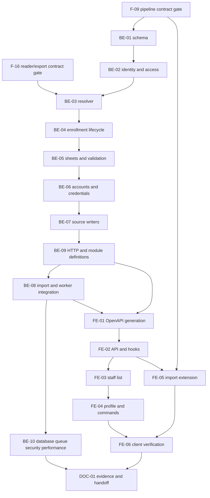

# F-17 Student Records and Academic Results Import — Backend + Frontend Implementation Plan

This plan builds EP-17 (US-081..US-084; CV-201..211): FR-96/97 second-wave Excel templates/imports, student profiles, program enrollments, academic attempts, initial R6 accounts and MH-51/52. It extends the **unbuilt F-09 pipeline as an assumed dependency**, and owns the student-resolution boundary promised by F-16. It does not implement eligibility, graduation, a portal, integration-client APIs, school DB synchronization or grade entry.

> **Companion documents**
> - Decisions: `docs/planning/feature-questions.md:269`, F17-01..05; blank = A, Faculty-marked answers remain risks.
> - Epic/stories/tasks: `docs/planning/epics.md:183` and B5 acceptance; `docs/planning/user-stories.md:990`, `:1000`, `:1013`, `:1025`; `docs/planning/task-breakdown.md:387`.
> - Requirements: `docs/requirement/REQUIREMENTS.md:475` (FR-34/35), `:546` (FR-74), `:586` (FR-96/97), `:952` (BR-26), `:977` (source priority), DEC-10/11, EC-33..37/43/45/46, NFR-05/06/09/11/20 and SRS §12.
> - Design: `docs/design/data-dictionary.md:670`, `:686`, `:702`; `docs/design/erd.md:143`, M-8; `docs/design/state-diagrams.md:337`, `:365`, `:398`; `docs/design/sequence-diagrams.md:102`, `:551`; `docs/design/screen-inventory.md:95`, `:137`; `docs/planning/deferred-scope.md`.
> - Binding contracts: F-16 implementation plan BE-04 and §8 U1; F-09 implementation plan BE-01/03/04/05 and §8 wave-2 extension. Both remain unbuilt, not verified source.
> - Conventions: `docs/implementation/README.md`; F-15/F-09 exemplar plans; the three `docs/architecture/*.md` documents; frontend `src/shared/design-system/DESIGN_SYSTEM.md`.
> - Evidence: F-01/02/04/05/06/07/10/15 implement reports in `docs/implement-report/`; actual source wins over their older plans.
> - Tests: `docs/planning/test-plan.md` B5, Excel, security and NFR-05; NEW manual supplement `docs/testing/feature__f-17-student-records-results-import.md` (DOC-01).

**Status**: Not started — planned against permitted source inspected on 2026-10-25/26. F-09/F-16 require contract re-verification before integration. Accepted historical limitations and Faculty defaults in §8 are not approved here.

---

## 0. Plan at a glance

Everything below in one table. Read this; the rest is detail for whoever builds it.

| What | Why | How and where |
|---|---|---|
| Two more import types, not another pipeline | US-081..083; UC-71..75 reuse | Sheet specs, context loaders, validators and writers extend F-09 `features/imports/`; retain jobs/reports/history (BE-05/07/08, FE-05) |
| Separate identity, enrollment and attempts | Dual majors, transfers and retakes must survive later features | NEW Student, interval ProgramEnrollment, AcademicResult and correction feed (BE-01/04/07) |
| Explicit student/program/semester resolution | BR-26; F-16's exact interface | Authorized shared facade; exception pin wins, otherwise F-16 reader; never ACTIVE/currentVersion fallback (BE-02/03) |
| Admission pin and due normal transitions | F-16 §8 U1; reads cannot create history | Pin on import; idempotent boot/daily reconciliation closes/opens intervals at selected cohort boundaries (BE-04/08) |
| One account and secure initial distribution | US-082; F17-01/02 A | Reuse password primitives; derive R6; encrypted, expiring, single-download credential workbook (BE-02/06) |
| All attempts and all three grade scales | DEC-11; EC-36 | Unique student/course/semester; exact Decimal strings; highest-score4 selector without conversions (BE-01/07) |
| Personal-data authorization at every boundary | R1 imports; R3 supervised programs; R6 itself | Scoped SQL lists and readers; private batch/file/report routes; no PII in queues/logs (BE-02/08/09/10) |
| Staff list/profile and enrollment actions | MH-51/52; US-084 | Evidence-required transfers/second major and read-only results; no fake downstream tabs (FE-03/04) |
| Preserve built release/calendar behavior | Current correction history cannot be reconstructed | No correction writer/calendar freeze/built-table behavioral migration; fence certification at E1/E2 (§8) |

**Key behaviours worth knowing**

| Behaviour | Why it is this way |
|---|---|
| Unassigned cohort: CẢNH BÁO, profile/account created, no enrollment | US-082 AC4. Later calculations fail explicitly; they do not return an empty successful curriculum |
| Student rows explicitly name program, admission semester and status-effective semester | Major/cohort alone cannot distinguish degrees/programs or chronological status changes |
| Normal answers use F-16 even before transition-worker catch-up | Future-semester eligibility and worker lag must not silently return the old pin; reads stay read-only |
| Manual transfer creates an exception; results stay with Student | No lost attempts or copied grades; later graduation remains per enrollment/program |
| Only imported/synchronized status sets GRADUATED | A future eligibility/graduation result cannot change the source status |
| Excel preserves conflicting SCHOOL_DB records and reports the skip | DEC-10; COMMITTED counts processed row decisions, not only changed records |
| Initial passwords expire after 24 hours and are downloadable once by importing R1 | No plaintext in ordinary DTOs/reports/queues; lost response requires administrator reset |

**Not included**

| Excluded | Why |
|---|---|
| F-18..22 calculations, portal, integration routes and connector | Separate consumers of this boundary, not simulated here |
| Real student fixtures, official calendar or grade conversions | Faculty-owned inputs; synthetic fixtures and supplied scales only |
| Immutable pre-correction cohort entitlement | Unbuildable under the current rewriting correction contract without owner decision, E1 |
| Account merging, terminal-status reversal, future manual transfers | No institutional policy supplied; fail explicitly rather than infer |

**Open questions**

| Question | Resolved when | Default if unanswered |
|---|---|---|
| Automatic local accounts and password-file distribution accepted? | Faculty confirms F17-01/02 | A: automatic, nullable link model, random passwords, forced change, no email |
| Official column/status/grade tokens? | Sanitized specification supplied | BE-05 versioned templates authoritative; no guessed conversions |
| Immutable correction chronology/calendar required? | Release/calendar owners decide E1/E2 | Preserve built behavior; stop certification of affected slice |
| Terminal reactivation/backdated conversion policy? | Decided 2026-10-26 (user) | Reject with explicit errors; preserve terminal state and history |

---

## 1. Scope

| In scope | Why |
|---|---|
| R1-only student/result templates, dry-run/commit adapters and MH-29/30 extension | FR-96/97 second wave; UC-71..75 |
| Student identity, optional unique User link, source provenance/status | US-082; E-8/E-10 |
| Admission pins, semester-aware resolution, history and exceptions | US-082/084; BR-26; F-16 contract |
| Academic attempts, retake selector and durable result-change feed | US-083; EC-36/43 |
| Initial accounts, limited encrypted distribution and staff UI | F17-01/02 A; MH-51/52 |
| Own-student shared authorization and security tests | NFR-11; foundation for later portal |

| Out of scope | Deferred until |
|---|---|
| Eligibility, progress, equivalence recognition, graduation/re-audit | F-18/19/20; store/export facts now |
| DB credentials, source schema mapping, polling/conflict dashboard | F-22 |
| Integration-client authentication and public APIs | F-21 |
| Email/delegation/reminders; formula calculation | F-25; F-12; neither blocks F-17 |
| Generic audit log and deferred Faculty artifacts | `docs/planning/deferred-scope.md`; domain histories only |
| README/index/progress edits in this planning run | Caller-owned; only this file is created |

| AC / task | Covered by |
|---|---|
| US-081 AC1: template/validator columns agree | BE-05/08/10; FE-05/06; CV-201/202 |
| US-081 AC2: code/course/semester and three scales | BE-05; FE-05; CV-201/202 |
| US-081 AC3: R3 cannot see/import wave 2 | BE-02/08/10; FE-05/06; CV-205 |
| US-082 AC1: profile fields persisted | BE-01/05/07/10; FE-03/04; CV-203/204 |
| US-082 AC2: PRIMARY admission pin | BE-03/04/07/10; CV-203/204 |
| US-082 AC3: linked R6 and code username | BE-02/06/07/10; FE-05; CV-204 |
| US-082 AC4: warning, no enrollment, profile created | BE-03/05/07/10; FE-04/05 |
| US-082 AC5: all duplicate-code rows error | BE-05/10; FE-05 |
| US-082 AC6: update, no duplicate account | BE-06/07/10 |
| US-083 AC1: three scales/four statuses | BE-01/05/07/10; FE-04 |
| US-083 AC2: unknown references error at row | BE-05/10; FE-05 |
| US-083 AC3: retain retakes, highest grade | BE-01/07/10 |
| US-083 AC4: existing triple reports update | BE-05/07/10 |
| US-083 AC5: 1000 rows, each step under 60s | BE-08/10; CV-208 |
| US-084 AC1: transfer closes old/opens exception | BE-04/09/10; FE-04/06; CV-209..211 |
| US-084 AC2: independent SECOND_MAJOR | BE-01/04/10; FE-04 |
| US-084 AC3: conversion retains results | BE-04/07/10; F-19 owns missing-credit calculation |
| US-084 AC4: re-entry retains original cohort | BE-04/07/10 |
| US-084 AC5: evidence mandatory | BE-01/04/09/10; FE-04 |
| US-084 AC6: release never overwrites exceptions | BE-03/04/10 |
| B5 acceptance 1; foundations of 2/6 | BE-10/FE-06 imports, explicit-version and A/B identity tests. Portal/mobile/calculation acceptance belongs to downstream features |

---

## 2. Contract verification

Completed before deliverable design. **Verified** means inspected source. **NEW / UNVERIFIED** means proposed/assumed contract, never an endpoint claimed to exist. All paths are repository-relative. Sensitive trees and dotenv files are not inputs.

### 2a. Endpoints and behavioral foundations

| Endpoint / boundary | Verified at | Request | Response / behavior | F-17 use |
|---|---|---|---|---|
| `GET /api/semesters` | `source/backend/src/features/semesters/semesters.controller.ts:19`; `semesters.service.ts:32`; mapper `source/backend/src/shared/releases/semester.dto.ts:20` | Authenticated session | SemesterDto[]; nullable startDate | Reuse; null cannot establish chronology |
| `GET /api/cohorts` | `source/backend/src/features/semesters/semesters.controller.ts:44`; `semesters.service.ts:39`; mapper `source/backend/src/shared/releases/semester.dto.ts:30` | Authenticated session | CohortDto[] | Intake year is not an admission semester |
| `GET /api/programs` — deliberately NOT consumed | `source/backend/src/features/programs/programs.service.ts:54`; mapper `source/backend/src/features/programs/program.dto.ts:167` | Paged search | Refuses non-ALL program.view; display currentVersion | NEW scoped student-program options; no entitlement from display currentVersion |
| UsersService.create — NOT called by imports | `source/backend/src/features/users/users.service.ts:67` | Create user + actor | Independent Prisma write, returns plaintext password | Cannot satisfy batch rollback; reuse password primitives instead |
| Login/password change | `source/backend/src/features/auth/auth.service.ts:24`, `:74`; `source/backend/src/shared/auth/authenticated.guard.ts:1` | Login/session/password | ACTIVE User required; password change clears mustChangePassword | Preserve existing session and forced-change enforcement |
| Permission/derived scope | `source/backend/src/shared/authz/permission.guard.ts:32`; `scope.service.ts:92`; `scope-source.reader.ts:23` | Actor on every request | Guard sets request.access; OWN_ENROLLMENT returns empty target today | Extend only this placeholder, never manually assign derived R6 |
| Release/calendar primitives | `source/backend/src/shared/releases/release-locks.ts:5`; `semester-start.ts:11` | tx + IDs | Sorted Program locks; unknown start throws | Use supplied transaction throughout |
| Cohort mapping | `source/backend/prisma/schema.prisma:428` | Cohort/version/start | Unique cohort/version; required start; no revision field | F-16 interprets/digests; no schema behavior change |
| Correction | `source/backend/src/features/releases/corrections.service.ts:143` | moveCohorts, default true | Retargets old mapping without changing its start | E1: old mapping history cannot be reconstructed |
| Calendar edit | `source/backend/src/features/semesters/semesters.service.ts:87` | Changed startDate | Freeze applies to ACTIVE/HISTORICAL release effective dates, not all assignment dates | E2: preserve current behavior |
| Decimal serializer | `source/backend/src/shared/decimal/decimal.ts:9`; `source/backend/src/features/courses/course.dto.ts:85` | Prisma Decimal | Exact decimal strings, not numbers | Nullable string scores; 2.50 serializes as 2.5 |
| File helpers | `source/backend/src/shared/files/send-file.ts:9`; `source/frontend/src/shared/api/client.ts:94`, `:115` | File bytes; FormData/URL | RFC5987, multipart and GET-only download already built | Reuse; credentials require a separate POST download |
| Worker infrastructure | `source/backend/src/shared/queue/queue.module.ts:6`; `source/backend/src/features/releases/release-activation.scheduler.ts:21`; `release-activation.processor.ts:78` | Job payload | Shared prefix; boot/daily reconciliation; bounded forced shutdown | Mirror for enrollment catch-up; F-09 is no longer first worker |

### 2b. Every consumed response field

Program/course/history response DTOs are not secretly consumed: NEW student options and result refs provide minimal shapes. Frontend uses generated schema types only.

**SemesterDto — verified mapper `source/backend/src/shared/releases/semester.dto.ts:20`**

| Field | Wire type | Nullable | Source | Modeled as | Note |
|---|---|---|---|---|---|
| id | string | no | `source/backend/src/shared/releases/semester.dto.ts:22` | Semester.id | Request key |
| semesterCode | string | no | same file `:23` | Semester.semesterCode | Display |
| academicYear | string | no | same file `:24` | Semester.academicYear | Not a date ordering key |
| termInYear | number | no | same file `:25` | Semester.termInYear | Not a date ordering key |
| startDate | ISO day string | **yes** | same file `:26` | Semester.startDate | Disable null-start choices |

**CohortDto — verified mapper `source/backend/src/shared/releases/semester.dto.ts:30`**

| Field | Wire type | Nullable | Source | Modeled as | Note |
|---|---|---|---|---|---|
| id | string | no | `source/backend/src/shared/releases/semester.dto.ts:32` | Cohort.id | Lookup |
| cohortCode | string | no | same file `:33` | Cohort.cohortCode | Template code |
| intakeYear | number | no | same file `:34` | Cohort.intakeYear | No guessed semester |

**F-09 DTOs — all NEW / UNVERIFIED**, sourced from its plan §2b/BE-05, dependency U1. Re-read actual serializers and replace assumptions with source file:line at integration. Every field is retained by generated F-09 types; the student extension adds no raw rows or credentials to the report.

| DTO.field | Wire type | Nullable | Source | Modeled as | Note |
|---|---|---|---|---|---|
| ImportTypeOption.importType | COURSE_CATALOG / CURRICULUM / STUDENT_LIST / ACADEMIC_RESULT | no | F-09 §2b + BE-08 extension | same field | Last two R1-only |
| ImportTypeOption.needsVersion | boolean | no | F-09 §2b | same field | false for wave 2 |
| ImportBatchSummary.id | string | no | F-09 §2b | same field | Link |
| ImportBatchSummary.importType | Four literals above | no | F-09 §2b | same field | No new enum value |
| ImportBatchSummary.fileName | string | no | F-09 §2b | same field | Generated filenames contain no student identifiers |
| ImportBatchSummary.performedBy | object: id:string, fullName:string | no | F-09 §2b | both fields | Administrator reference |
| ImportBatchSummary.program | object: id/programCode/programName strings | yes | F-09 §2b | all three fields | null for wave 2 |
| ImportBatchSummary.versionLabel | string | yes | F-09 §2b | same field | null for wave 2 |
| ImportBatchSummary.totalRows | number | no | F-09 §2b | same field | Parsed rows |
| ImportBatchSummary.successRows | number | no | F-09 §2b | same field | Includes unchanged/source-preserved decisions |
| ImportBatchSummary.errorRows | number | no | F-09 §2b | same field | Distinct bad rows, not issue count |
| ImportBatchSummary.status | VALIDATING / DRY_RUN / COMMITTING / COMMITTED / ABORTED | no | F-09 §2b | same field | No extra lifecycle |
| ImportBatchSummary.recordedAt | ISO timestamp string | no | F-09 §2b | same field | Upload time |
| ImportBatchSummary.finishedAt | ISO timestamp string | yes | F-09 §2b | same field | F-09 prose differs on DRY_RUN timestamp; not used for authorization/chronology |
| ImportBatchDetail.report | ImportReport | yes | F-09 §2b | same field | null while validating |
| ImportBatchDetail.canCommit | boolean | no | F-09 §2b + BE-08 | same field | Includes current R1 gate |
| ImportBatchDetail.fileAvailable | boolean | no | F-09 §2b | same field | Not credential availability |
| ImportReport.formatErrors | ImportFormatError[] | no | F-09 §2b | same field | Header report |
| ImportFormatError.column | string | yes | F-09 §2b | same field | Header label |
| ImportFormatError.message | string | no | F-09 §2b | same field | Vietnamese |
| ImportReport.issues | ImportIssue[] | no | F-09 §2b | same field | Existing sorted report |
| ImportIssue.rowNumber | number | yes | F-09 §2b | same field | Actual Excel row; null=file |
| ImportIssue.severity | ERROR / HIGH / INFO | no | F-09 §2b | same field | LỖI / CẢNH BÁO / LƯU Ý |
| ImportIssue.code | string | no | F-09 §2b | same field | Machine code |
| ImportIssue.column | string | yes | F-09 §2b | same field | Header, no echoed private cell |
| ImportIssue.message | string | no | F-09 §2b | same field | Row/reason, not names/grades/passwords |
| ImportBatchPage.items | ImportBatchSummary[] | no | F-09 BE-05 | same field | SQL-scoped |
| ImportBatchPage.total | number | no | F-09 BE-05 | same field | Same predicate |
| ImportBatchPage.page | number | no | F-09 BE-05 | same field | Pagination |
| ImportBatchPage.pageSize | number | no | F-09 BE-05 | same field | Pagination |

NEW F-17 endpoint response fields are exhaustively specified in BE-09; these are contracts to build, not evidence of existing serializers. Internal F-16 domain objects are specified in BE-03 and are not wire DTOs.

### 2c. Verified gaps and mismatch log

| Deliverable | Earlier/design assumption | Source and disposition | Found at |
|---|---|---|---|
| BE-02/06 | Assign R6 as a manual role | R6 derived from OWN_ENROLLMENT; manual assignment rejects derived roles. Populate linked-student target | `source/backend/prisma/seed-data/roles.ts:50`; `source/backend/src/features/users/role-assignments.service.ts:66`; `scope-source.reader.ts:23` |
| BE-06 | Call UsersService.create per row | Independent write/plaintext return violates batch rollback; use shared password primitives | `source/backend/src/features/users/users.service.ts:67` |
| BE-08/FE-05 | F-09 built / helper work still needed | F-09 unbuilt; file helpers and release worker already exist. Contract-check prerequisites | `source/backend/src/app.module.ts:38`; `source/frontend/src/shared/api/client.ts:94`; `source/backend/src/features/releases/release-activation.processor.ts:17` |
| BE-03/04 | Correction preserves old cohort intervals | Built writer retargets them. Fence correction-stable certification, E1 | `source/backend/src/features/releases/corrections.service.ts:143` |
| BE-09 | Program list works for R3 options | Non-ALL list refused; add student-specific scoped options | `source/backend/src/features/programs/programs.service.ts:54` |
| BE-01/04 | Optional enrollment start can be guessed | New F-17 model requires explicit start/end/admission evidence; no invented backfill | `source/backend/prisma/schema.prisma:403`, `:418`, `:428`; F-16 BE-04 U1 |
| BE-02/06 | Student codes can use all 64 login characters | Existing administrator userCode limit is 32, username minimum 3. New auto-provisioned canonical student codes are 3..32; do not widen built User rules | `source/backend/src/features/users/create-user.dto.ts:13`; `source/backend/src/shared/password/password-policy.ts:4` |

---

## 3. Decisions

| ID | Decision | Why | Rejected alternative |
|---|---|---|---|
| D1 | StudentCode: trimmed uppercase ASCII text, 3..32 characters; User username uses normalizeUsername(studentCode), userCode = studentCode | Leading zeroes preserved; fits existing User create/login constraints | Numeric identifiers/name matching or widened built User rules |
| D2 | Student sheet requires programCode, admissionSemesterCode and statusSemesterCode | Cohort/major cannot uniquely select degree/program/chronology | Latest program or inferred term |
| D3 | Enrollment has program/cohort snapshot and half-open interval; new fromSemester required | F-16 delegates historical/null policy to F-17 | ACTIVE-only selection, unknown start treated as earliest |
| D4 | Exact F-16 interfaces on an actor-bound authorized facade | Keep signature without ambient/request-global auth | Extra actor fields in agreed input, anonymous resolver |
| D5 | Normal answer always F-16; exception pin wins | Future semesters and cohort schedules agree | Stored pin alone or ACTIVE fallback |
| D6 | Boot/daily catch-up and R1 explicit reconcile persist due normal transitions | Read-only resolution, no built release writer changes | Coupled F-15 callback or fictitious event bus |
| D7 | Manual actions require basis; no future or closed-interval backdating | Avoid inventing lifecycle/institutional conversion policy | New undocumented scheduled-transfer workflow |
| D8 | Profile import cannot silently change enrolled cohort/admission/program | Keep admission/re-entry stable | Implicit conversion on re-import |
| D9 | Store supplied scales/status; compare score4; no conversions | DEC-11, no official conversion table | Infer pass/letter/score4 from another scale |
| D10 | Record-level SCHOOL_DB priority; Excel conflict HIGH and skip | SRS §8.2 | Last write wins/partial official-row merge |
| D11 | Default auto-account; nullable link model; collision errors | US-082 and anti-hijacking | Auto-link arbitrary existing username/name/email |
| D12 | Encrypted 24h one-time credentials, optional deployment key with explicit unavailable error | Durable retries, no plaintext in reports/Redis; no package added | DOB passwords/logged secrets/email dependency |
| D13 | Transactional result-change outbox, future F-19 idempotent consumer | Preserve EC-43 obligation | Fake graduation service or dropped corrections |
| D14 | Staff UI only; self-reader implemented/tested now | MH-51/52 without expanding EP-20 | Global R6 search/nonfunctional progress tabs |
| D15 | Existing permissions plus role identity and scope | Seed gives R3 data.importExcel too; presence is insufficient | Permission-only/frontend-only wave-2 guard |

---

## 4. Integration boundaries and deliberate divergences

No shipped sibling student implementation exists among the inputs. These are explicit design elaborations:

| Boundary | Disposition |
|---|---|
| DD has no enrollment end/cohort snapshot/admission pin | Add only to NEW F-17 tables; no built-table constraint change |
| DD allows null enrollment start | Require explicit known start for all NEW rows; no legacy backfill |
| Sequence §12 shows synchronous cohort moves | F-16 exports a reader, not student callbacks. F-17 reconciliation persists due moves; authoritative reads work immediately |
| F-09 allows former owners to read own batches | Wave-2 PII requires current R1 + current ALL/DIRECT import permission on every route; other types unchanged |
| F-09 worker does not reload grants | Wave-2 worker rechecks current actor grants before writes; revoked queued work cannot provision accounts |
| SRS excludes grade entry | No PATCH result/status endpoint; source import/future sync writer only |
| Correction/calendar gaps | Keep §8 gates visible; do not hide them behind a Student migration or ACTIVE fallback |

---

## 5. Deliverables

All files/code below are **to build**. MODIFY paths under F-09/F-16 require the prerequisite gate first. Inspected parents: backend `prisma/migrations`, `src/shared`, `src/features`, `test/fixtures`; frontend `src/features`, `src/shared`; `docs/testing`, `docs/implement-report`. NEW nested directories are created with their deliverable. No existing file is edited by this planning run.

### BE-01 — Student, enrollment, attempt and private artifact schema

**What / why:** Establish F-17-owned persistence; preserve built tables' behavior.

**Files**

| Action | Path | Mirror / rationale |
|---|---|---|
| MODIFY | `source/backend/prisma/schema.prisma` | Existing explicit relations at `:188`, `:241`, `:324`, `:346`, `:403`, `:418`; new enums/models and relation back-fields only |
| NEW | `source/backend/prisma/migrations/<timestamp>_student_records_results/migration.sql` | Generated DDL + checks like `source/backend/prisma/migrations/20261019131021_release_versions/migration.sql:1` |

**Shape**

```prisma
enum StudentStatus {
  STUDYING
  ON_LEAVE
  WITHDRAWN
  GRADUATED
}
enum StudentDataSource {
  EXCEL
  SCHOOL_DB
}
enum EnrollmentType {
  PRIMARY
  SECOND_MAJOR
}
enum EnrollmentStatus {
  ACTIVE
  TRANSFERRED
  ENDED
}
enum AcademicResultStatus {
  PASSED
  FAILED
  IN_PROGRESS
  EXEMPT
}

model Student {
  id                  String            @id @default(cuid(2))
  studentCode         String            @unique
  fullName            String
  cohortId            String
  cohort              Cohort            @relation(fields: [cohortId], references: [id], onDelete: Restrict)
  admissionSemesterId String
  admissionSemester   Semester          @relation(StudentAdmissionSemester, fields: [admissionSemesterId], references: [id], onDelete: Restrict)
  statusSemesterId    String
  statusSemester      Semester          @relation(StudentStatusSemester, fields: [statusSemesterId], references: [id], onDelete: Restrict)
  major               String
  status              StudentStatus     @default(STUDYING)
  dataSource          StudentDataSource @default(EXCEL)
  userId              String?           @unique
  user                User?             @relation(StudentAccount, fields: [userId], references: [id], onDelete: Restrict)
  enrollments         ProgramEnrollment[]
  academicResults     AcademicResult[]
  createdAt           DateTime          @default(now())
  updatedAt           DateTime          @updatedAt

  @@index([cohortId, status])
  @@index([fullName, id])
}

model ProgramEnrollment {
  id                   String           @id @default(cuid(2))
  studentId            String
  student              Student          @relation(fields: [studentId], references: [id], onDelete: Restrict)
  programId            String
  program              Program          @relation(fields: [programId], references: [id], onDelete: Restrict)
  cohortId             String
  cohort               Cohort           @relation(fields: [cohortId], references: [id], onDelete: Restrict)
  appliedVersionId     String
  appliedVersion       ProgramVersion   @relation(EnrollmentAppliedVersion, fields: [appliedVersionId], references: [id], onDelete: Restrict)
  admissionVersionId   String
  admissionVersion     ProgramVersion   @relation(EnrollmentAdmissionVersion, fields: [admissionVersionId], references: [id], onDelete: Restrict)
  cohortAssignmentId   String?
  cohortAssignment     CohortVersion?   @relation(fields: [cohortAssignmentId], references: [id], onDelete: Restrict)
  fromSemesterId       String
  fromSemester         Semester         @relation(EnrollmentFromSemester, fields: [fromSemesterId], references: [id], onDelete: Restrict)
  untilSemesterId      String?
  untilSemester        Semester?        @relation(EnrollmentUntilSemester, fields: [untilSemesterId], references: [id], onDelete: Restrict)
  previousEnrollmentId String?          @unique
  previousEnrollment   ProgramEnrollment? @relation(EnrollmentHistory, fields: [previousEnrollmentId], references: [id], onDelete: Restrict)
  nextEnrollment       ProgramEnrollment? @relation(EnrollmentHistory)
  enrollmentType       EnrollmentType
  isException          Boolean          @default(false)
  basisDecision        String?
  status               EnrollmentStatus @default(ACTIVE)
  createdById          String?
  createdBy            User?            @relation(EnrollmentCreator, fields: [createdById], references: [id], onDelete: Restrict)
  createdAt            DateTime         @default(now())
  updatedAt            DateTime         @updatedAt

  @@index([studentId, programId])
  @@index([programId, cohortId, status, isException])
}

model AcademicResult {
  id            String               @id @default(cuid(2))
  studentId     String
  student       Student              @relation(fields: [studentId], references: [id], onDelete: Restrict)
  courseId      String
  course        Course               @relation(fields: [courseId], references: [id], onDelete: Restrict)
  semesterId    String
  semester      Semester             @relation(fields: [semesterId], references: [id], onDelete: Restrict)
  score10       Decimal?             @db.Decimal(4, 2)
  score4        Decimal?             @db.Decimal(3, 2)
  letterGrade   String?
  status        AcademicResultStatus
  dataSource    StudentDataSource    @default(EXCEL)
  revision      Int                  @default(1)
  changes       AcademicResultChange[]
  createdAt     DateTime             @default(now())
  updatedAt     DateTime             @updatedAt

  @@unique([studentId, courseId, semesterId])
  @@index([studentId, semesterId])
}

model AcademicResultChange {
  id               String         @id @default(cuid(2))
  academicResultId String
  academicResult   AcademicResult @relation(fields: [academicResultId], references: [id], onDelete: Restrict)
  revision         Int
  before           Json?
  after            Json
  recordedAt       DateTime       @default(now())

  @@unique([academicResultId, revision])
  @@index([recordedAt, id])
}

model StudentCredentialDelivery {
  batchId      String      @id
  batch        ImportBatch @relation(fields: [batchId], references: [id], onDelete: Cascade)
  accountCount Int
  ciphertext   Bytes?
  iv           Bytes?
  authTag      Bytes?
  keyId        String?
  expiresAt    DateTime
  downloadedAt DateTime?
  createdAt    DateTime    @default(now())

  @@index([expiresAt])
}
```

Add back-fields only: User.student (`StudentAccount`) and createdEnrollments (`EnrollmentCreator`); Cohort.students/enrollments; Semester.admittedStudents/statusStudents/enrollmentsFrom/enrollmentsUntil/academicResults using the corresponding named relations; Program.enrollments; ProgramVersion.enrollmentsApplied/enrollmentsAdmitted; Course.academicResults; CohortVersion.enrollments; F-09 ImportBatch.studentCredentialDelivery. No rename, changed delete policy, uniqueness change or data rewrite on a built table.

```sql
CREATE UNIQUE INDEX ProgramEnrollment_one_active_program
  ON ProgramEnrollment (studentId, programId) WHERE status = 'ACTIVE';
CREATE UNIQUE INDEX ProgramEnrollment_one_active_primary
  ON ProgramEnrollment (studentId)
  WHERE status = 'ACTIVE' AND enrollmentType = 'PRIMARY';
ALTER TABLE ProgramEnrollment ADD CONSTRAINT ProgramEnrollment_exception_basis
  CHECK (NOT isException OR length(btrim(coalesce(basisDecision, ''))) > 0);
ALTER TABLE ProgramEnrollment ADD CONSTRAINT ProgramEnrollment_closed_interval
  CHECK ((status = 'ACTIVE') = (untilSemesterId IS NULL));
ALTER TABLE AcademicResult ADD CONSTRAINT AcademicResult_score10_range
  CHECK (score10 IS NULL OR score10 BETWEEN 0 AND 10);
ALTER TABLE AcademicResult ADD CONSTRAINT AcademicResult_score4_range
  CHECK (score4 IS NULL OR score4 BETWEEN 0 AND 4);
ALTER TABLE AcademicResult ADD CONSTRAINT AcademicResult_revision_positive
  CHECK (revision > 0);
ALTER TABLE StudentCredentialDelivery ADD CONSTRAINT StudentCredentialDelivery_count_positive
  CHECK (accountCount > 0);
```

Cross-table checks belong in the shared writer: both pins belong to program; pin is issued; starts known; interval chronological; historical intervals do not overlap. A CHECK cannot query Semester. Same-semester transfer may retain a zero-length closed row as evidence; it is never selected. Keep partial indexes in hand-edited migration SQL, not imaginary Prisma annotations.

**Rationale:** Explicit Restrict relations mirror `source/backend/prisma/schema.prisma:428`; exact decimal transport mirrors `source/backend/src/shared/decimal/decimal.ts:9`. Private blobs mirror F-09 BE-01's separate file table contract.

**Gotchas:** ImportBatch must exist first. Admission pin never changes within a normal same-program chain; cross-program transfer begins a new target-program pin. No result references an enrollment. No hard-delete Student/result endpoint. Do not run migration generation against a real-data database.

**Verify:** In `source/backend`: `pnpm exec prisma migrate dev --create-only --name student_records_results`; inspect additive SQL; `pnpm exec prisma migrate dev`; `pnpm prisma:generate`. BE-10 applies the full chain to a disposable empty database and probes partial uniqueness/ranges and existing release/user fixtures.

**Depends on:** U1 F-09 schema; built F-15 schema.

### BE-02 — Shared identity, authorization and R6 derivation

**What / why:** One privacy policy for imports, staff and later self-service, with no anonymous shared reader.

**Files**

| Action | Path | Mirror / rationale |
|---|---|---|
| NEW | `source/backend/src/shared/students/student.constants.ts` | Named constants like `source/backend/src/shared/password/temporary-password.ts:3` |
| NEW | `source/backend/src/shared/students/student-identity.ts` | Normalization like `source/backend/src/shared/auth/username.ts:1` |
| NEW | `source/backend/src/shared/students/student.errors.ts` | Structured definitions like `source/backend/src/shared/releases/release.errors.ts:1` |
| NEW | `source/backend/src/shared/students/student-access.ts` | Explicit grants like `source/backend/src/shared/authz/edit-path.ts:58`, not a feature import |
| NEW | `source/backend/src/shared/students/student-identity.spec.ts` | Pure tests like `source/backend/src/shared/password/temporary-password.spec.ts:1` |
| NEW | `source/backend/src/shared/students/student-access.spec.ts` | Scope tests like `source/backend/src/shared/authz/scope-source.reader.spec.ts:1` |
| MODIFY | `source/backend/src/shared/authz/scope-source.reader.ts` | Replace OWN_ENROLLMENT empty branch at `:23` only |
| MODIFY | `source/backend/src/shared/authz/scope-source.reader.spec.ts` | Characterize derived identity, not manual R6 grants |

**Shape**

```ts
export const STUDENT_ROLES = { OFFICE: 'R1', DIRECTOR: 'R3', SELF: 'R6' } as const;
export const STUDENT_LIMITS = {
  CODE_MIN: 3, CODE_MAX: 32, NAME_MAX: 200, MAJOR_MAX: 64, BASIS_MAX: 1000,
  LETTER_MAX: 16, PASSWORD_HASH_CONCURRENCY: 4,
  PERFORMANCE_ROWS: 1000, PERFORMANCE_BUDGET_MS: 60_000,
} as const;
export const STUDENT_CODE_PATTERN = /^[A-Z0-9][A-Z0-9_-]*$/;
export const STUDENT_WRITE_TRANSACTION = { timeout: 30_000, maxWait: 10_000 } as const;
export function normalizeStudentCode(value: string): string;
export type StudentReadPurpose = 'PROGRESS' | 'ELIGIBILITY' | 'GRADUATION';
export function assertStudentImport(access: AccessContext): void;
export function assertStudentEnrollmentWrite(access: AccessContext): void;
export function studentReadWhere(
  access: AccessContext, purpose: StudentReadPurpose,
  programId: string | undefined, semester: StartedSemester,
): Prisma.StudentWhereInput;
export function assertStudentProgramRead(
  access: AccessContext, purpose: StudentReadPurpose,
  student: { id: string; userId: string | null }, programId: string,
): void;
```

`assertStudentImport`: the **same current R1 assignment** must hold data.importExcel with DIRECT/ALL. Enrollment writes likewise require R1 and DIRECT/ALL version.assignCohort. Staff profile/list reads require R1 or R3 plus student.viewProgress; R3 requires a current director target for the requested program. Do not combine a role from one assignment with an unrelated broad grant from another.

Purpose maps to student.viewProgress, student.viewRegistrationEligibility, graduation.view/graduation.audit as appropriate. SELF requires `Student.userId === access.userId` regardless of program scope; do not rely on AccessContext's OR intersection when both student/program IDs are present (`source/backend/src/shared/authz/access-context.ts:120`). A user with a legitimate staff assignment may act in that staff scope; R6 alone cannot enumerate students or use MH-51/52 routes.

ScopeSourceReader OWN_ENROLLMENT will look up Student by unique userId, return `{studentIds:[student.id], programIds:[...owned enrollment programIds]}` or `{}` when unlinked. Include historical owned programs for read-only self history; account existence/permission does not grant access to another student. A linked student without enrollment still derives R6 through studentIds. Do not create a RoleAssignment for R6; the existing derived-role loop (`source/backend/src/shared/authz/scope.service.ts:92`) supplies it. Never automatically enable an existing DISABLED User or change its password on profile re-import.

Errors use AppException and Vietnamese messages: STUDENT_NOT_FOUND 404, ENROLLMENT_NOT_FOUND 404, ENROLLMENT_AMBIGUOUS 409, APPLIED_VERSION_UNRESOLVED 409, ENROLLMENT_STATE_CHANGED 409, INVALID_ENROLLMENT_INTERVAL 409, ACCOUNT_IDENTITY_CONFLICT 409, STUDENT_CREDENTIALS_UNAVAILABLE 503, CREDENTIALS_EXPIRED/ALREADY_DOWNLOADED 410. Preserve existing common permission errors; personal object misses after scope filtering return 404, not an existence oracle.

**Rationale:** Mirrors explicit role/scope loading at `source/backend/src/shared/authz/scope-source.reader.ts:15` and shared edit-path guards at `source/backend/src/shared/authz/edit-path.ts:58`; permissions stay configurable, but story-defined R1-only operations remain R1-only.

**Gotchas:** IDs remain strings. Reject numeric Excel identity cells rather than losing leading zeroes. A Student import must not rewrite enrolled cohort/admission fields. Adding own programIds does not permit a global student list; every student endpoint must apply identity checks separately.

**Verify:** `pnpm exec vitest run src/shared/students/student-identity.spec.ts src/shared/students/student-access.spec.ts src/shared/authz/scope-source.reader.spec.ts` in backend. Assert R6 A/B denial, R3 other-program denial, unassigned linked R6 derivation, multi-role staff behavior and permission revocation.

**Depends on:** BE-01.

### BE-03 — Export the exact F-16 student-resolution boundary

**What / why:** Make every B5 consumer ask the same authorized, semester-explicit question, inside the caller's transaction when supplied.

**Files**

| Action | Path | Mirror / rationale |
|---|---|---|
| NEW | `source/backend/src/shared/students/student-applied-version.types.ts` | Domain-only types like `source/backend/src/shared/releases/semester-start.ts:8`; copy F-16 BE-04 promised interfaces verbatim |
| NEW | `source/backend/src/shared/students/student-applied-version.reader.ts` | Injectable shared reader like `source/backend/src/shared/outcomes/outcome-gaps.reader.ts:1`; F-16 reader is assumed, not built |
| NEW | `source/backend/src/shared/students/enrollment-period.ts` | Pure selection like `source/backend/src/shared/time/validity.ts:1` |
| NEW | `source/backend/src/shared/students/student-applied-version.reader.spec.ts` | Transaction tests like `source/backend/src/shared/releases/version.activator.spec.ts:1` |
| NEW | `source/backend/src/shared/students/enrollment-period.spec.ts` | Pure boundary tests like `source/backend/src/shared/releases/version-number.spec.ts:1` |
| NEW | `source/backend/src/shared/students/students-shared.module.ts` | Explicit exports like `source/backend/src/shared/releases/releases-shared.module.ts:8` |

**Shape — F-16 interfaces are unchanged**

```ts
export interface StudentAppliedVersionLookup {
  studentId: string;
  programId: string;
  semesterId: string;
}
export interface StudentAppliedVersionResult {
  studentId: string;
  enrollmentId: string;
  programId: string;
  semesterId: string;
  programVersionId: string;
  source: 'COHORT' | 'EXCEPTION';
  cohortAssignmentId: string | null;
}
export interface StudentAppliedVersionResolver {
  resolveForStudent(
    input: StudentAppliedVersionLookup, tx?: Prisma.TransactionClient,
  ): Promise<StudentAppliedVersionResult>;
}

@Injectable()
export class StudentAppliedVersionReader {
  constructor(
    private readonly prisma: PrismaService,
    private readonly appliedVersions: AppliedProgramVersionReader,
  ) {}
  forAccess(
    access: AccessContext, purpose: StudentReadPurpose,
  ): StudentAppliedVersionResolver;
  resolveManyForAccess(
    access: AccessContext, purpose: StudentReadPurpose,
    inputs: readonly StudentAppliedVersionLookup[], tx?: Prisma.TransactionClient,
  ): Promise<StudentAppliedVersionResult[]>;
}
```

The exported provider is a **factory of actor-bound facades**. Its returned object exports exactly `resolveForStudent(input, tx?)`. Authorization context is closed over per call, never stored in a singleton mutable field. This implements F-16's method/input/result contract without adding actor fields to it. No unrestricted public overload; background enrollment writers use their own domain functions, not a fake R1. A future F-21 integration adapter must produce an independently authorized capability before using this boundary (U4), not manufacture a user session.

Selection algorithm, all reads through `tx` if supplied; otherwise a single RepeatableRead transaction:

1. Validate requested semester with `requireSemesterStart`; load student through the authorized predicate. Select enrollment **in the explicitly requested program** by chronological interval: `from.startDate <= requested.startDate` and `until IS NULL OR requested.startDate < until.startDate`. Include TRANSFERRED/ENDED historical rows; ACTIVE alone is not history. Zero-length intervals never match. No match = ENROLLMENT_NOT_FOUND; multiple matches = ENROLLMENT_AMBIGUOUS, never first-row wins.
2. Assert access for this student/program/purpose again on the selected facts. For a dual-major student, the program is mandatory. A staff profile may legitimately show an unassigned student, but a calculation cannot return success without an enrollment.
3. Exception: validate its stored version belongs to requested program, is not DRAFT, has publication/effective-semester facts, and is effective by the requested semester. Require nonblank basis. Return that pin, source EXCEPTION, cohortAssignmentId null. Ignore newer cohort mappings entirely.
4. Normal: call F-16 `AppliedProgramVersionReader.forCohort({programId,cohortId: enrollment.cohortId,semesterId}, tx)`. Use enrollment's admission-cohort snapshot, not a changed Student cohort or a cohort sharing current classes. Missing assignment = APPLIED_VERSION_UNRESOLVED. Return its assignment ID/version, source COHORT. No ACTIVE filter, largest number or current-date fallback.
5. `enrollmentId` identifies the selected materialized interval. For a future request/open interval or worker lag, returned programVersionId can be newer than its persisted appliedVersionId: the shared cohort answer is authoritative. Do not mutate the interval in GET/resolve. BE-04 catches up due transitions; downstream evaluations must record returned versionId, not reread the older stored pin. This temporal distinction is deliberate and tested.
6. Bulk variant loads student/enrollment facts in bounded reads, groups normal inputs by `(programId,semesterId)`, deduplicates cohort IDs and calls F-16 `forCohorts` once per group. Preserve input order. Validate every input's scope before returning any result; no partial cross-scope batch. Exceptions do not trigger cohort queries.

**Rationale:** F-16 BE-04 and §8 U1 are binding contracts; existing tx-aware calendar helpers at `source/backend/src/shared/releases/semester-start.ts:11` establish the local pattern. Dates, not academicYear/code lexical ordering, decide intervals.

**Gotchas:** All new fromSemesterId are required; a corrupt imported/legacy null or unknown date is an explicit error, never “earliest”. Do not call the global Prisma client from a supplied transaction. PENDING can answer a future semester when its effective date qualifies; HISTORICAL can answer the past. The E1/E2 limits remain observable; this resolver cannot restore missing old mappings.

**Verify:** Backend `pnpm exec vitest run src/shared/students/enrollment-period.spec.ts src/shared/students/student-applied-version.reader.spec.ts`. Cover exact-start/end exclusion, historical transferred rows, different program/dual-major, missing assignment, malformed timeline, exception precedence, future PENDING, all queries using injected tx, zero writes, bulk call counts and normal-answer equality with F-16.

**Depends on:** BE-01/02; U2 F-16 exported reader/types/module.

### BE-04 — Enrollment lifecycle, evidence and idempotent normal transitions

**What / why:** Persist admission and explicit schedule transitions without making a reader or publisher own Student state.

**Files**

| Action | Path | Mirror / rationale |
|---|---|---|
| NEW | `source/backend/src/shared/students/enrollment.writer.ts` | Transactional shared writer like `source/backend/src/shared/programs/director.writer.ts:1` |
| NEW | `source/backend/src/shared/students/enrollment-reconciler.ts` | Ordered catch-up like `source/backend/src/shared/releases/version.activator.ts:1` |
| NEW | `source/backend/src/shared/students/student-locks.ts` | Ordered locks like `source/backend/src/shared/releases/release-locks.ts:5` |
| NEW | `source/backend/src/shared/students/enrollment.writer.spec.ts` | Writer tests like `source/backend/src/shared/programs/director.writer.spec.ts:1` |
| NEW | `source/backend/src/shared/students/enrollment-reconciler.spec.ts` | Idempotency tests like `source/backend/src/shared/releases/version.activator.spec.ts:1` |

**Shape**

```ts
export interface AdmissionEnrollmentInput {
  studentId: string;
  programId: string;
  cohortId: string;
  admissionSemesterId: string;
  assignment: CohortAssignmentFact;
  actorId: string | null;
  source: StudentDataSource;
}
export interface StudentEnrollmentCommand {
  operation: 'ASSIGN_EXCEPTION' | 'TRANSFER' | 'ADD_SECOND_MAJOR';
  targetVersionId: string;
  fromSemesterId: string;
  basisDecision: string;
  sourceEnrollmentId?: string;
  expectedStudentUpdatedAt: string;
  expectedEnrollmentUpdatedAt?: string;
}
export async function lockStudents(
  tx: Prisma.TransactionClient, studentIds: readonly string[],
): Promise<void>;
export async function createAdmissionEnrollment(
  tx: Prisma.TransactionClient, input: AdmissionEnrollmentInput,
): Promise<string>;
export async function applyEnrollmentCommand(
  tx: Prisma.TransactionClient, studentId: string,
  command: StudentEnrollmentCommand, actorId: string,
): Promise<string>;
export async function endStudentEnrollments(
  tx: Prisma.TransactionClient, studentId: string, untilSemesterId: string,
  context: SourceWriteContext,
): Promise<void>;
@Injectable()
export class EnrollmentReconciler {
  reconcileProgram(
    programId: string, throughDay?: Date,
  ): Promise<{ transitioned: number; unchanged: number; blocked: number }>;
}
```

Manual/Excel write services check actor authorization outside the shared writer and recheck within the command transaction. SCHOOL_DB uses the internal authorized sync path with SourceWriteContext { source: SCHOOL_DB, actorId: null }, never a fabricated AccessContext/User. Pass that source and nullable actor into AdmissionEnrollmentInput and source-status closure; persist Student.dataSource and the nullable enrollment createdById in the same transaction. applyEnrollmentCommand remains manual-only with actorId: string; SCHOOL_DB never invokes it. Lock order: `lockPrograms` for all relevant program IDs sorted, then Student rows sorted, then affected enrollment rows sorted. Use Serializable isolation and `STUDENT_WRITE_TRANSACTION` from BE-02, mirroring existing release transaction options (`source/backend/src/shared/releases/release-locks.ts:32`); import transactions retain F-09's explicit larger import timeout. Any enrollment mutation also touches Student.updatedAt so expectedStudentUpdatedAt is an actual collection revision, not a token that stays unchanged after enrollment writes. Command conflicts return 409/reload; do not silently reapply the user's action with a new revision token. Worker serialization failures may retry under BullMQ.

Lifecycle rules:

| Operation | Required facts | Transactional result |
|---|---|---|
| Admission | Explicit known admission semester; cohort assignment resolved for that semester; no existing primary chain | PRIMARY ACTIVE, isException false, appliedVersion/admissionVersion = assignment pin, cohort snapshot and assignment ID persisted |
| Unassigned admission | No mapping, but all referenced objects and dates valid | Validator HIGH; no enrollment write; profile/account still imported. Re-import after mapping or explicit R1 exception repairs it; worker never guesses a program from major |
| ASSIGN_EXCEPTION | Student has no primary enrollment; sourceEnrollmentId absent; target issued/effective; evidence | New PRIMARY ACTIVE exception |
| ADD_SECOND_MAJOR | Existing PRIMARY, no ACTIVE enrollment in target program; source absent; evidence | New SECOND_MAJOR ACTIVE exception, PRIMARY unchanged |
| TRANSFER | Explicit source ACTIVE enrollment belongs to student; current revision matches; target issued/effective; evidence | Close source TRANSFERRED at chosen semester; create ACTIVE exception of same type, previousEnrollmentId = source.id |
| Normal cohort switch | Non-exception ACTIVE row; explicit newer due F-16 assignment; no conflicting history | Close old TRANSFERRED at assignment boundary; create same-type normal row linked to old; preserve admissionVersion and cohort snapshot |
| ON_LEAVE / return to STUDYING | Imported source says so, original identity/cohort unchanged | Preserve enrollment and pin/history; never adopt classmates' cohort. An explicit R1 selection for the original cohort still follows F-16 unless a documented exception protects the student |
| WITHDRAWN / GRADUATED | Source-status effective semester known and not before current open starts | Close open enrollments ENDED at status semester. A newly imported terminal student may receive an admission interval immediately ended in the same transaction |

Manual actions require fromSemester.startDate <= todayDate, target.effectiveSemester.startDate <= fromSemester.startDate, and no rewrite of a previously closed interval. New commands do not schedule future manual transfers. Same-start transfer may leave a zero-length evidence row. Terminal status cannot be reversed or manually enrolled by this interface; E4 decided 2026-10-26: no reactivation/backdating; return explicit errors. Do not delete results or mutate their student/course keys on transfer.

Reconciliation is F-17-owned: enumerate distinct normal ACTIVE program/cohort groups, read their schedule boundaries from CohortVersion using F-16's facts/selection rules, and consider every known boundary through `todayDate()` in chronological order. For each boundary, use `forCohorts` in the same transaction. Multiple missed boundaries create the full chain, not one jump. A boundary already represented by matching chain/version/assignment is a no-op; previousEnrollmentId uniqueness plus Student locks prevent duplicate successors. Future boundaries remain only in the cohort schedule until due; BE-03 still answers future queries correctly.

Do not overwrite exception rows, ended chains, admissionVersionId or original cohort. If an assignment was retroactively retargeted/moved before an already materialized boundary, detect it as `RETROACTIVE_COHORT_RECONCILIATION_REQUIRED`, increment blocked, log only opaque IDs/code, and expose the diagnostic to R1. Do not delete/rewrite the old enrollment chain. E1/E2 fence this slice pending an owned release/calendar decision. Ordinary forward transitions remain supported; no promise of universal immutable as-of history is made.

R1 explicit reconciliation returns real transitioned/unchanged/blocked counts. F-16's existing response contract is not altered to invent student-impact counts; adding preview counts there is a separate coordinated extension, not a hidden F-17 prerequisite.

**Rationale:** State transitions follow GD-01..04; the shared writer mirrors `source/backend/src/shared/programs/director.writer.ts:1`, and locks mirror `source/backend/src/shared/releases/release-locks.ts:5`. F-16's U1 requires a real normal-transition owner; merely exporting a query would be incomplete.

**Gotchas:** PRIMARY uniqueness spans programs; program uniqueness spans enrollment types. Never promote SECOND_MAJOR to PRIMARY implicitly. Program/version correspondence must be checked after locking. Status-effective and interval dates must be compared as dates, including same-day equality.

**Verify:** Backend `pnpm exec vitest run src/shared/students/enrollment.writer.spec.ts src/shared/students/enrollment-reconciler.spec.ts`. BE-10 real transactions cover two concurrent transfers, duplicate reconciliation, missed boundaries, secondary-major preservation, exceptions, source terminal closure, leave/re-entry and correction diagnostic without rewritten history.

**Depends on:** BE-01/02/03; U2 F-16.

### BE-05 — Wave-2 sheet specs, contexts and pure validation

**What / why:** Template and parser share exact columns; dry-run validates without business writes or account provisioning.

**Files**

| Action | Path | Mirror / rationale |
|---|---|---|
| NEW | `source/backend/src/features/imports/sheets/student-list.sheet.ts` | F-09 `course-catalog.sheet.ts` contract; sheet descriptors, no feature-specific parser |
| NEW | `source/backend/src/features/imports/sheets/academic-result.sheet.ts` | Same F-09 descriptor pattern |
| NEW | `source/backend/src/features/imports/validation/student-context.ts` | F-09 catalog-context contract; bulk facts and tx injection |
| NEW | `source/backend/src/features/imports/validation/student-validator.ts` | F-09 pure validator/IssueCollector contract |
| NEW | `source/backend/src/features/imports/validation/student-validator.spec.ts` | Local pure tests like `source/backend/src/shared/releases/version-number.spec.ts:1` |
| NEW | `source/backend/src/features/imports/validation/academic-result-context.ts` | Bulk reference lookup, not service-per-row |
| NEW | `source/backend/src/features/imports/validation/academic-result-validator.ts` | F-09 ValidationResult contract |
| NEW | `source/backend/src/features/imports/validation/academic-result-validator.spec.ts` | Same pure test layout |
| NEW | `source/backend/src/features/imports/sheets/student-sheets.spec.ts` | F-09 sheet reader/writer round-trip contract |
| MODIFY | `source/backend/src/features/imports/validation/import-issues.ts` | Add student-specific machine codes, preserve existing codes |

**Shape — authoritative version-one columns**

`required` in F-09 SheetSpec means required **header**. All headers below are present in the template, even when a cell may be empty. Both have empty headerFields and no curriculum-version block. No real names/IDs in examples; documentation sheet examples use only `SYN-STU-0001`, `Sinh viên giả lập 001`, `SYN-PROG-A`, `SYN-COURSE-A`, `SYN-COHORT-A`, `SYN-TERM-A`.

| STUDENT_LIST key | Vietnamese header | Cell rule |
|---|---|---|
| studentCode | Mã sinh viên | Required text; D1; never a numeric Excel cell |
| fullName | Họ tên | Required trimmed NFC string, NAME_MAX |
| cohortCode | Khóa tuyển sinh | Required exact existing code |
| major | Mã ngành | Required text, MAJOR_MAX; validate against selected program/version major where resolvable |
| programCode | Mã chương trình | Required exact existing program; never infer from major |
| admissionSemesterCode | Học kỳ nhập học | Required existing known-start semester |
| statusSemesterCode | Học kỳ trạng thái | Required existing known-start semester, >= admission |
| status | Trạng thái | Blank defaults STUDYING; exact Vietnamese tokens below |

| ACADEMIC_RESULT key | Vietnamese header | Cell rule |
|---|---|---|
| studentCode | Mã sinh viên | Required existing Student; text |
| courseCode | Mã học phần | Required existing Course; discontinued courses still accept historical results |
| semesterCode | Học kỳ | Required existing known-start semester |
| score10 | Điểm thang 10 | Nullable exact decimal 0..10, at most 2 places |
| score4 | Điểm thang 4 | Nullable exact decimal 0..4, at most 2 places |
| letterGrade | Điểm chữ | Nullable trimmed text, LETTER_MAX; no invented conversion or grade whitelist |
| status | Trạng thái | Required source token; no pass/fail inference |

```ts
export type StudentColumn = 'studentCode' | 'fullName' | 'cohortCode' | 'major'
  | 'programCode' | 'admissionSemesterCode' | 'statusSemesterCode' | 'status';
export type ResultColumn = 'studentCode' | 'courseCode' | 'semesterCode'
  | 'score10' | 'score4' | 'letterGrade' | 'status';
export const STUDENT_STATUS_TEXT = {
  'Đang học': 'STUDYING', 'Bảo lưu': 'ON_LEAVE',
  'Thôi học': 'WITHDRAWN', 'Đã tốt nghiệp': 'GRADUATED',
} as const;
export const RESULT_STATUS_TEXT = {
  'Đạt': 'PASSED', 'Không đạt': 'FAILED',
  'Đang học': 'IN_PROGRESS', 'Miễn': 'EXEMPT',
} as const;
export function validateStudentRows(
  rows: readonly SheetRow<StudentColumn>[], context: StudentImportContext,
): ValidationResult<StudentImportPlan>;
export function validateAcademicResultRows(
  rows: readonly SheetRow<ResultColumn>[], context: AcademicResultImportContext,
): ValidationResult<AcademicResultImportPlan>;
export async function loadStudentContext(
  db: Prisma.TransactionClient, rows: readonly SheetRow<StudentColumn>[],
  appliedVersions: AppliedProgramVersionReader,
): Promise<StudentImportContext>;
export async function loadAcademicResultContext(
  db: Prisma.TransactionClient, rows: readonly SheetRow<ResultColumn>[],
): Promise<AcademicResultImportContext>;
```

Descriptors use the F-09 `SheetSpec<K>` shape: sheetName, readonly columns with key/label/required/width, headerFields. Name each column-width choice in `STUDENT_SHEET_WIDTHS`; do not scatter numbers. Sheet tabs: `Sinh viên`, `Kết quả học tập`; format identity columns as Excel text. Template generation uses F-09 writeSheet, not a second ExcelJS wrapper. Instruction-sheet status cells list only supported Vietnamese values.

Context loaders run inside a read transaction for dry-run and supplied write tx for commit. Bulk-load referenced codes plus existing students/users/results/cohort mappings; no per-row findUnique. For student admission group by program/admission semester and use F-16 forCohorts. Snapshot relevant updatedAt/revision/source facts into the in-memory plan for commit comparison; never serialize normalized PII/plans into queue payloads or ordinary reports.

Validation order and report policy:

1. F-09 parser handles workbook/header/cell types and row numbers; reject formulas, errors and unsupported identity cells rather than trusting cached formula values. Reuse its extension/size/row bounds. Normalize Unicode/spacing for headers/status tokens using its normalizeLabel, but do not add unknown aliases.
2. Collect duplicates across **all** file rows before deciding row validity. Student key = normalized studentCode; result key = normalized studentCode + courseCode + semesterCode. Emit ERROR on every occurrence, naming peer row numbers, even when a duplicate has another error. Never pick first/last winner.
3. Unknown student/course/cohort/program/semester => ERROR at actual column/row. Missing or invalid semester start is ERROR, not missing-assignment warning. A nonexistent program is not treated as “no curriculum yet”.
4. Student admission mapping absent => HIGH `PROGRAM_UNRESOLVED`, message `Chưa xác định được chương trình; sinh viên sẽ được tạo nhưng chưa có ghi danh.` Profile/account remain valid. Existing enrolled student's cohort/admission changes, or program change implying implicit transfer => ERROR `ENROLLMENT_CHANGE_REQUIRES_DECISION`. A normal no-change re-import does not re-pin enrollment to the newest version.
5. Existing linked User preserved; unlinked username/userCode collision => ERROR `ACCOUNT_IDENTITY_CONFLICT`, no automatic linkage. New/unlinked profile without collision follows account default. Existing disabled account stays disabled.
6. Source status chronology: statusSemester >= admission and >= stored status-effective semester. Same semester correction may change nonterminal status; reject terminal reactivation under E4. ON_LEAVE never changes the admission cohort. Ended-status changes use BE-04 closure rules.
7. PASSED/FAILED require score10, score4 and letterGrade; IN_PROGRESS requires all three blank; EXEMPT allows all blank or all three supplied, never partial scales. Range/precision errors block; source pass/fail is preserved even if numeric values look unusual. Do not hardcode a Faculty letter-to-score table. Flag unusual source combinations only if a future approved rule names them.
8. Existing result triple => INFO `WILL_UPDATE` or `UNCHANGED`. A retake in another semester is a distinct create. Existing SCHOOL_DB student/result differs => HIGH `SCHOOL_DB_PRESERVED`, plan action PRESERVE_SOURCE; identical official row => INFO/unchanged. Validate malformed Excel fields even on skipped rows. A source-preserved student row must not change enrollment/account data as a side effect.
9. Return F-09 `ValidationResult<P> {report,totalRows,errorRows,plan}`. Row issues contain row/column/reason, no raw names, passwords or scores echoed into messages. ERROR blocks entire file; HIGH/INFO do not. `errorRows` counts rows once; no domain writes, hashes or credential artifacts during dry-run.

**Rationale:** F-09 §8 explicitly requests one sheet, context loader/validator and writer per type. Pure validation mirrors existing shared pure rules such as `source/backend/src/shared/decimal/decimal.ts:14`, while all batch/report orchestration remains F-09-owned.

**Gotchas:** Decimal numeric cells require finite bounded precision conversion, not JS float arithmetic; textual decimal cells accept dot separator per template and reject ambiguous comma/thousands formats. User IDs/codes never use Number(). Do not reject past results solely because a Course is now discontinued or outside the selected curriculum.

**Verify:** Backend `pnpm exec vitest run src/features/imports/validation/student-validator.spec.ts src/features/imports/validation/academic-result-validator.spec.ts src/features/imports/sheets/student-sheets.spec.ts`. Round-trip generated blank templates plus synthetic rows; test leading zeroes, duplicate triples, both duplicates, status labels, unknown references, nullable scales, source priority, missing mapping and zero domain writes.

**Depends on:** BE-01/02/03/04; U1 F-09 sheet/report contracts; U2 F-16.

### BE-06 — Transactional account preparation and one-time credentials

**What / why:** Auto-create linked local accounts without breaking all-or-none import or leaking initial passwords.

**Files**

| Action | Path | Mirror / rationale |
|---|---|---|
| NEW | `source/backend/src/shared/students/student-account.provisioner.ts` | Password primitives from `source/backend/src/features/users/users.service.ts:67`, but no independent transaction |
| NEW | `source/backend/src/shared/students/student-credential-cipher.ts` | Node built-in crypto, comparable existing random source `source/backend/src/shared/password/temporary-password.ts:1` |
| NEW | `source/backend/src/shared/students/student-account.provisioner.spec.ts` | `source/backend/src/shared/password/password.service.spec.ts:1` |
| NEW | `source/backend/src/shared/students/student-credential-cipher.spec.ts` | `source/backend/src/shared/password/temporary-password.spec.ts:1` |
| NEW | `source/backend/src/features/imports/student-credentials.service.ts` | Shared sendFile at `source/backend/src/shared/files/send-file.ts:9`; F-09 file-service contract |
| NEW | `source/backend/src/features/imports/student-credentials.service.spec.ts` | Feature service tests like `source/backend/src/features/users/users.service.spec.ts:1` |
| MODIFY | `source/backend/src/shared/config/env.validation.ts` | Optional typed env validation at `:23`, `:62`; no dotenv edits |
| MODIFY | `source/backend/test/test-env.ts` | Synthetic test configuration, not a credential file |

**Shape**

```ts
export interface PreparedStudentAccount {
  studentCode: string;
  username: string;
  passwordHash: string;
  temporaryPassword: string;
}
@Injectable()
export class StudentAccountProvisioner {
  constructor(private readonly passwords: PasswordService) {}
  prepare(studentCodes: readonly string[]): Promise<PreparedStudentAccount[]>;
}
export const STUDENT_CREDENTIALS = {
  ALGORITHM: 'aes-256-gcm', KEY_BYTES: 32, IV_BYTES: 12, TAG_BYTES: 16,
  TTL_MS: 24 * 60 * 60 * 1000,
} as const;
export interface EncryptedStudentCredentials {
  ciphertext: Uint8Array; iv: Uint8Array; authTag: Uint8Array; keyId: string;
}
export function encryptStudentCredentials(
  plaintext: Uint8Array, key: Uint8Array, batchId: string, ownerId: string,
): EncryptedStudentCredentials;
export function decryptStudentCredentials(
  value: EncryptedStudentCredentials, key: Uint8Array,
  batchId: string, ownerId: string,
): Uint8Array;
@Injectable()
export class StudentCredentialsService {
  status(batchId: string, access: AccessContext): Promise<StudentCredentialStatusDto>;
  consume(batchId: string, access: AccessContext): Promise<{
    content: Uint8Array; fileName: string;
  }>;
  purgeExpired(now?: Date): Promise<number>;
}
```

Add optional `STUDENT_CREDENTIAL_ENCRYPTION_KEY` env string: decoded base64 must be exactly KEY_BYTES; no built-in/example production key, no SESSION_SECRET reuse. Absence does not break existing auth/release startup. STUDENT_LIST upload/commit requiring provisioning returns 503 with `Chưa cấu hình khóa bảo vệ mật khẩu ban đầu.`; never silently skip account creation. Runtime dependencies remain Node crypto, existing Argon2 and F-09 ExcelJS (named in tech-stack); no new package. Operator supplies the key externally, never through a committed dotenv file or this document.

Prepare random passwords with `generateTemporaryPassword()` and hash with PasswordService.hash (Argon2id, `source/backend/src/shared/password/password.service.ts:10`) using bounded concurrency, outside the write transaction but after initial validation. Inside the final transaction revalidate all identities; use prepared entries only for users still absent. If a newly needed identity was not prepared, abort/retry preparation rather than hashing unboundedly while holding locks. Prepared hashes/passwords live only in worker memory; retry may prepare fresh values because rollback left no committed account/artifact.

Create User with username normalized from studentCode, userCode = canonical studentCode, fullName from profile, mustChangePassword true, default ACTIVE. Never create manual R6 assignment. Set Student.userId uniquely in the same batch transaction; if the student already has a linked account, do not create, reset, rename, enable or relink it. Updating Student.fullName does not silently rewrite a separately administered User name. Existing unlinked matching username/userCode is an error, not proof of identity.

Generate an XLSX credential workbook **only for newly created accounts in this commit**, columns `Mã sinh viên`, `Tên đăng nhập`, `Mật khẩu ban đầu`; Excel text cells. Encrypt bytes with a fresh IV, GCM AAD containing batchId/ownerId, and a non-secret key fingerprint as keyId. Persist ciphertext/IV/tag/count/expiry in StudentCredentialDelivery within the same transaction as accounts and COMMITTED batch. Zero new accounts => no artifact. Never persist plaintext in JSON, ImportBatchFile, errorReport, queue payload or logs. Do not persist prepared hashes separately from User.

Consumption is **POST**, not GET: load COMMITTED STUDENT_LIST batch, recheck current R1 import gate AND performedById = actor. Lock delivery row; expiry/downloaded/null ciphertext => 410. Decrypt/authenticate/build response bytes before the transaction commits; then set downloadedAt and null ciphertext/iv/authTag/keyId atomically. If decryption/key rotation fails, return explicit service error without consuming. Simultaneous POSTs: one succeeds, one 410. Response headers `Cache-Control: no-store, private`, `Pragma: no-cache`, `X-Content-Type-Options: nosniff`; filename contains only batch ID, not student identity. A network loss after successful consumption cannot be safely replayed: UI explains R1 must use existing user password reset; no recovery endpoint that redelivers old secrets.

F-09's sweep invokes purgeExpired to null expired encrypted payloads (retain minimal count/timestamps). Raw import files retain F-09's separately declared 30-day policy; they are PII and authorization-protected. Institutional retention approval is E3, not a reason to keep passwords 30 days.

**Rationale:** Reuses existing password mechanics (`source/backend/src/shared/password/temporary-password.ts:8`, `password.service.ts:10`) while avoiding UsersService's independent write. Encrypting a private delivery artifact is an F-17-owned addition, not a new auth implementation.

**Gotchas:** Validate key bytes without echoing value in errors. Key loss/rotation can invalidate outstanding deliveries; key must remain available through their TTL. No credential Blob in TanStack cache/localStorage. R1 downloaded XLSX is intentionally sensitive; UI must warn about secure distribution/deletion. A changed administrator grant is checked again at download.

**Verify:** Backend `pnpm exec vitest run src/shared/students/student-account.provisioner.spec.ts src/shared/students/student-credential-cipher.spec.ts src/features/imports/student-credentials.service.spec.ts`. Test tampering/wrong AAD/key, TTL, concurrent consumption, no-account artifact absence, rollback, password verification/forced change and absence of plaintext in persisted report/job data.

**Depends on:** BE-01/02/05; U1 F-09 commit/sweep ownership.

### BE-07 — Atomic source writers, result history and retake facts

**What / why:** Commit the validated plan through one transaction, preserving identity/attempt IDs, official-source priority and correction evidence.

**Files**

| Action | Path | Mirror / rationale |
|---|---|---|
| NEW | `source/backend/src/shared/students/student-import.types.ts` | Domain types like `source/backend/src/shared/releases/semester-start.ts:8`; no DTO imports |
| NEW | `source/backend/src/shared/students/student-source.writer.ts` | Transactional writer like `source/backend/src/shared/programs/director.writer.ts:1` |
| NEW | `source/backend/src/shared/students/academic-result.writer.ts` | Same supplied-tx pattern, no feature-to-feature service calls |
| NEW | `source/backend/src/shared/students/best-academic-results.ts` | Pure numerical rules like `source/backend/src/shared/decimal/decimal.ts:14` |
| NEW | `source/backend/src/shared/students/academic-results.reader.ts` | Cross-feature reader like `source/backend/src/shared/outcomes/outcome-gaps.reader.ts:1` |
| NEW | `source/backend/src/shared/students/student-source.writer.spec.ts` | Writer tests like `source/backend/src/shared/programs/director.writer.spec.ts:1` |
| NEW | `source/backend/src/shared/students/academic-result.writer.spec.ts` | Same transaction/source tests |
| NEW | `source/backend/src/shared/students/best-academic-results.spec.ts` | Pure deterministic test layout |
| NEW | `source/backend/src/features/imports/writers/student-writer.ts` | F-09 writer adapter contract; uses shared domain writers |
| NEW | `source/backend/src/features/imports/writers/academic-result-writer.ts` | F-09 writer adapter contract |

**Shape**

```ts
export interface StudentProfileValue {
  studentCode: string; fullName: string; cohortId: string; major: string;
  admissionSemesterId: string; statusSemesterId: string; status: StudentStatus;
}
export interface StudentImportPlanRow {
  rowNumber: number;
  action: 'CREATE' | 'UPDATE' | 'UNCHANGED' | 'PRESERVE_SOURCE';
  existingId: string | null;
  expectedUpdatedAt: string | null;
  profile: StudentProfileValue;
  programId: string;
  admissionAssignment: CohortAssignmentFact | null;
}
export interface StudentImportPlan { rows: StudentImportPlanRow[] }
export interface AcademicResultValue {
  studentId: string; courseId: string; semesterId: string;
  score10: string | null; score4: string | null; letterGrade: string | null;
  status: AcademicResultStatus;
}
export interface AcademicResultPlanRow {
  rowNumber: number;
  action: 'CREATE' | 'UPDATE' | 'UNCHANGED' | 'PRESERVE_SOURCE';
  existingId: string | null;
  expectedRevision: number | null;
  value: AcademicResultValue;
}
export interface AcademicResultImportPlan { rows: AcademicResultPlanRow[] }
export interface SourceWriteContext {
  source: StudentDataSource;
  actorId: string | null;
}
export interface AcademicResultWriteOutcome {
  created: number; updated: number; unchanged: number; sourcePreserved: number;
}
export async function writeStudentSource(
  tx: Prisma.TransactionClient, plan: StudentImportPlan,
  context: SourceWriteContext, accounts: readonly PreparedStudentAccount[],
): Promise<{ studentIds: string[]; createdAccountCodes: string[] }>;
export async function writeAcademicResultSource(
  tx: Prisma.TransactionClient, plan: AcademicResultImportPlan,
  context: SourceWriteContext,
): Promise<AcademicResultWriteOutcome>;
```

Imports adapters pass EXCEL and the performing actor. SCHOOL_DB is reserved for F-22's internal shared-writer integration, never accepted from an Excel DTO/cell. No generic public API allows callers to claim official provenance. Source comparison is centralized: SCHOOL_DB may supersede EXCEL in a later F-22 write; EXCEL cannot overwrite SCHOOL_DB; EXCEL may update EXCEL. All provenance-sensitive decisions are rerun from fresh tx state. Decided 2026-10-26 (user): internal SCHOOL_DB writers accept actorId null with source recorded; EXCEL requires the performing actor. Pass accounts: [] for SCHOOL_DB; preserve existing userId links and create no automatic account, credentials, credential file or distribution side effect for new synchronized profiles.

Student writer uses canonical key, inserts/updates Student in place, links the account prepared by BE-06 only for EXCEL, creates admission enrollment only when no existing primary/history makes that an implicit conversion, then applies source-status closure using the same SourceWriteContext. Admission receives context.actorId and context.source; there is no string-only actor requirement on any SCHOOL_DB-reachable write input. Missing admission mapping means no enrollment, not an incomplete enrollment with null pin. Existing profile updates never re-pin or create another account. PRESERVE_SOURCE skips the **entire** row including enrollment/account effects. Any conflict after validation throws and rolls back the whole file; no per-row catch-and-continue or independent Prisma transaction.

Academic writer updates existing triple in place and preserves its ID. A different semester creates a new attempt. No-op rows do not increment revision or emit another change. For actual create/update, save AcademicResult and AcademicResultChange with unique `(resultId, revision)` in the same tx: before null for creation, after full AcademicResultValue plus dataSource; update before/after capture all supplied scales/status/source as JSON decimal strings. Revision increments only for meaningful value/source changes. No names or passwords in this private feed, and no public feed endpoint in F-17. It is a durable producer contract for F-19 EC-43; automatic re-audit/notification delivery is U3, not falsely implemented here.

**Retake/read contract**

```ts
export interface AcademicAttemptFact extends AcademicResultValue {
  id: string;
  semesterStart: Date;
  dataSource: StudentDataSource;
  revision: number;
}
export interface BestAcademicCourseFacts {
  courseId: string;
  attempts: readonly AcademicAttemptFact[];
  bestScoredAttempt: AcademicAttemptFact | null;
  hasPassedAttempt: boolean;
  isExempt: boolean;
  hasInProgressAttempt: boolean;
}
export function bestAcademicResults(
  attempts: readonly AcademicAttemptFact[],
): BestAcademicCourseFacts[];
@Injectable()
export class AcademicResultsReader {
  forAccess(access: AccessContext, purpose: StudentReadPurpose): {
    forStudent(
      input: StudentAppliedVersionLookup, tx?: Prisma.TransactionClient,
    ): Promise<AcademicAttemptFact[]>;
  };
}
```

Reader applies BE-02 identity/purpose policy and BE-03's interval selection rules, then returns the student's attempts with semester.startDate <= requested semester.startDate. Reading imported facts does not require a successful cohort-version calculation: R1 and owning R6 may inspect an unresolved student's source transcript; R3 still requires an applicable enrollment in its directed program. Calculations separately call resolveForStudent and fail on missing mapping. Unknown attempt chronology is an explicit data error. Attempts are student-wide, not restricted to current curriculum membership: transfers/equivalence later need earlier courses. A supervised R3 may read this transcript for the authorized student/program, but sees no other program's enrollment details; this intentional data-sharing boundary is documented in §8. No student-wide list without an explicit authorization context.

Highest-score4 selection compares Prisma.Decimal values, never lexical strings or score10; consider scored PASSED/FAILED attempts only. Ties: later semester start, then opaque ID codepoint order. Return all attempts and independent source-status flags. EXEMPT is not fabricated into 4.0; IN_PROGRESS is not a failing grade or completed credit. Downstream F-18/19 decides how exemption/pass flags satisfy its rules and uses equivalence/frozen credits itself. No academic status is recomputed from marks.

**Rationale:** Decimal and source facts use `source/backend/src/shared/decimal/decimal.ts:9`, while the tx writer boundary follows `source/backend/src/shared/programs/director.writer.ts:1`. Keeping attempts independent of enrollment is what preserves EC-33..36 without duplicating grade data.

**Gotchas:** Atomic upsert must not silently bypass expectedRevision/source checks. Do not use createMany skipDuplicates to hide a conflicting file. Counter successRows is processed valid rows including skips; operational changed counters must never masquerade as F-09 errorRows. No graduation table is created here.

**Verify:** Backend `pnpm exec vitest run src/shared/students/student-source.writer.spec.ts src/shared/students/academic-result.writer.spec.ts src/shared/students/best-academic-results.spec.ts`. Test exact decimals, retakes, correction revision/feed, no-op replay, official-source preservation, identity stability and complete rollback on late failure.

**Depends on:** BE-01..06; U1 F-09 adapter contract.

### BE-08 — Integrate F-09 dispatch and enrollment jobs without changing old types

**What / why:** Enable both wave-2 types across the entire import lifecycle and own normal-enrollment catch-up.

**Files**

| Action | Path | Mirror / rationale |
|---|---|---|
| MODIFY | `source/backend/src/features/imports/import-access.ts` | F-09 support/permission/visibility contract |
| MODIFY | `source/backend/src/features/imports/imports.service.ts` | F-09 upload/template/commit/list/file dispatch |
| MODIFY | `source/backend/src/features/imports/imports.processor.ts` | F-09 validate/commit/sweep dispatch; keep five states |
| MODIFY | `source/backend/src/features/imports/imports.controller.ts` | Pass current access to template; add credential routes |
| MODIFY | `source/backend/src/features/imports/imports.module.ts` | Inject StudentsSharedModule, provisioning and delivery service |
| MODIFY | `source/backend/src/features/imports/imports.service.spec.ts` | Wave-2 security and template tests |
| MODIFY | `source/backend/src/features/imports/imports.processor.spec.ts` | Retry/atomicity and grant-reload tests |
| NEW | `source/backend/src/features/students/enrollment-reconciliation.scheduler.ts` | Boot/daily pattern `source/backend/src/features/releases/release-activation.scheduler.ts:21` |
| NEW | `source/backend/src/features/students/enrollment-reconciliation.processor.ts` | Bounded shutdown `source/backend/src/features/releases/release-activation.processor.ts:78` |
| NEW | `source/backend/src/features/students/enrollment-reconciliation.processor.spec.ts` | Worker tests like `source/backend/src/features/releases/release-activation.processor.spec.ts:1` |
| MODIFY | `source/backend/src/shared/students/students-shared.module.ts` | Export reader/writer/reconciler providers from BE-03/04/07 |
| MODIFY | `source/backend/src/app.module.ts` | Root imports at `:38`; add StudentsModule after prerequisite modules |

**Shape**

```ts
export const STUDENT_ENROLLMENT_QUEUE = 'student-enrollment-reconciliation';
export const STUDENT_ENROLLMENT_JOB = 'reconcile-student-enrollments';
export const STUDENT_ENROLLMENT_SCHEDULE = {
  ID: 'student-enrollment-daily', CRON: '10 0 * * *',
  ATTEMPTS: 3, BACKOFF_MS: 5_000, SHUTDOWN_GRACE_MS: 10_000,
} as const;
export interface EnrollmentReconciliationJob { programId?: string }
```

Use APP_TIME_ZONE for daily scheduling and todayDate for due-date interpretation; do not order by whichever worker happens to run first. F-16's issued PENDING facts can already resolve a due semester, so this worker need not wait for activation to flip ACTIVE. Queue data contains only optional programId; import jobs contain only batchId. Never send rows/accounts/names/marks in Redis.

F-09 integration changes (all **to build**, no private replacement pipeline):

| Surface | Required extension |
|---|---|
| IMPORT_TYPE_SUPPORT | Flip STUDENT_LIST/ACADEMIC_RESULT enabled true, needsVersion false; reject supplied versionId as for catalog |
| types | Return both only after assertStudentImport succeeds; R3 curriculum/catalog behavior unchanged |
| specFor/template | Dispatch to two specs; template takes current access and checks wave-2 authorization before bytes are built |
| create | R1 gate before storing personal file; encryption readiness when account provisioning may be needed; existing multipart/header/ABORTED behavior retained |
| validate | Parse stored file, load wave-2 context in read transaction, return F-09 ValidationResult; no business writes |
| commit request | Current R1 + owner, DRY_RUN/no errors/file available, existing compare-and-set to COMMITTING and stable job ID |
| commit job | Reload actor ACTIVE and a currently valid R1 DIRECT/ALL import grant through tx facts; rerun parser/context/validator; perform domain+artifact+COMMITTED writes in one transaction |
| list/detail/file | Add wave-2 branch requiring **current** R1 gate. Former-owner and broad-permission shortcuts cannot expose PII; retain old predicates for other types |
| sweep/failure | Purge credential payloads after TTL; existing raw-file retention/stale recovery. Wave-2 errors log sanitized code/batch ID, not Prisma parameter dumps/error stacks containing values |

Final write transaction locks ImportBatch row and checks still COMMITTING, then sorted Programs/Students. If validation now fails, commit only ABORTED/new report (no business writes); unexpected writer failure rolls everything back and lets existing retry/final-failure handling apply. Password preparation/hashing happens before lock-heavy writes; plan is revalidated under locks. Generate/encrypt the small final workbook inside the transaction from only accounts actually created, discarding unused prepared entries; never distribute a password for a linked/existing account. Batch/artifact/domain mutations commit together. At-least-once job after successful commit sees COMMITTED and does nothing. Stale-sweep and worker writes must use state predicates/row locks so a late worker cannot overwrite an already ABORTED batch.

The worker's R1 reload uses supplied tx to query current User, valid unretracted SYSTEM R1 RoleAssignment and DIRECT/ALL data.importExcel RolePermission; do not call the global ScopeService from inside tx and mistake it for a transaction-consistent grant. Existing active-date helpers may be reused. No shared ScopeService signature is replaced.

**Changed shared/signature caller inventory:** `ImportsService.template(type)` becomes `template(type, access)` in the unbuilt F-09 surface. Migrate its controller call and every F-09 service/controller test call; worker dispatch uses specFor/readSheet, not template. `specFor` callers remain create/template/validate/commit with new enum cases. Existing sendForm/downloadFile/sendFile APIs are not replaced; existing callers remain unchanged. Before building, symbol-search the actual F-09 source and record any additional callers in §2c; do not rely on planned inventory after drift.

StudentsModule (BE-09) imports StudentsSharedModule and BullModule.registerQueue for its own queue. StudentsSharedModule imports F-16 ReleasesSharedModule and exports StudentAppliedVersionReader, AcademicResultsReader, EnrollmentReconciler, StudentAccountProvisioner and credential cipher provider if injectable. No shared file imports `features/*`. Authz's OWN_ENROLLMENT branch queries Prisma directly to avoid an Authz ↔ StudentsSharedModule cycle. ImportsModule uses shared writers, not StudentsService. New scheduler is not global or a change to F-15's processor.

**Rationale:** Shared Redis prefix at `source/backend/src/shared/queue/queue.module.ts:6` and boot/shutdown behavior at `source/backend/src/features/releases/release-activation.scheduler.ts:21`, `release-activation.processor.ts:78` are built patterns; F-09's status/report contract is the assumed orchestration boundary.

**Gotchas:** No unconditional STUDENT_LIST fallback in a two-way catalog/curriculum switch. Exhaustive enum dispatch must fail for unsupported types. Permissions are checked on template/download/history as well as upload. If Redis is unavailable, report queued-work failure honestly; do not claim import success from an HTTP 202.

**Verify:** Backend `pnpm exec vitest run src/features/imports/imports.service.spec.ts src/features/imports/imports.processor.spec.ts src/features/students/enrollment-reconciliation.processor.spec.ts`; then `pnpm exec tsc --noEmit -p tsconfig.json`. Existing F-09 catalog/curriculum tests must remain unchanged in behavior and pass; worker shutdown must terminate with Redis disconnected.

**Depends on:** BE-01..07; U1 F-09 built pipeline; U2 F-16 exports. BE-09 supplies StudentsModule composition.

### BE-09 — Staff/student HTTP boundary and explicit OpenAPI contract

**What / why:** Expose the smallest useful staff surfaces and safe read foundation, with no hand-written frontend response types.

**Files**

| Action | Path | Mirror / rationale |
|---|---|---|
| NEW | `source/backend/src/features/students/dto/student-query.dto.ts` | Validated paging like `source/backend/src/shared/pagination/page-query.dto.ts:14` |
| NEW | `source/backend/src/features/students/dto/student-enrollment-command.dto.ts` | Validated commands like `source/backend/src/features/releases/dto/release-version.dto.ts:1` |
| NEW | `source/backend/src/features/students/dto/student.dto.ts` | Decorated DTOs like `source/backend/src/features/users/user.dto.ts:31` |
| NEW | `source/backend/src/features/students/dto/academic-result.dto.ts` | Decimal mapper like `source/backend/src/features/courses/course.dto.ts:85` |
| NEW | `source/backend/src/features/students/students.mapper.ts` | Explicit serializer like `source/backend/src/features/users/user.dto.ts:65` |
| NEW | `source/backend/src/features/students/students-read.service.ts` | Scoped pagination like `source/backend/src/features/users/users.service.ts:34`, with BE-02 authorization |
| NEW | `source/backend/src/features/students/student-enrollments.service.ts` | Command orchestration like `source/backend/src/features/releases/corrections.service.ts:1` |
| NEW | `source/backend/src/features/students/students.controller.ts` | Route decorators like `source/backend/src/features/semesters/semesters.controller.ts:14` |
| NEW | `source/backend/src/features/students/students.module.ts` | Feature composition like `source/backend/src/features/semesters/semesters.module.ts:1` |
| NEW | `source/backend/src/features/students/students-read.service.spec.ts` | Tests like `source/backend/src/features/users/users.service.spec.ts:1` |
| NEW | `source/backend/src/features/students/student-enrollments.service.spec.ts` | Tests like `source/backend/src/features/releases/corrections.service.spec.ts:1` |
| NEW | `source/backend/src/features/students/students.mapper.spec.ts` | Mapper contract tests like `source/backend/src/shared/decimal/decimal.spec.ts:1` |
| NEW | `source/backend/src/features/imports/dto/student-credential-status.dto.ts` | Separate private-artifact status; no secret fields |

**Shape — routes (all NEW / UNVERIFIED until built)**

| Method / path | Request | Response / status | Authorization / side effect |
|---|---|---|---|
| GET `/api/students/program-options` | semesterId required | StudentProgramOptionDto[], 200 | Staff R1/R3, student.viewProgress; SQL-filter R3 director programs; no mutation |
| GET `/api/students` | semesterId required; q/cohortId/programId/status/page/pageSize optional | StudentPageDto, 200 | Staff only; R3 students whose enrollment interval covers semester in a directed program; R1 may include unassigned |
| GET `/api/students/:studentId` | semesterId required; programId required for R3, optional R1 | StudentDetailDto, 200 | Staff only; R3 sees only its authorized program enrollment details; missing/foreign = 404 |
| GET `/api/students/:studentId/results` | programId, semesterId required; resultSemesterId/courseId/page/pageSize optional | AcademicResultPageDto, 200 | Authorized staff or owning R6; explicit enrolled program, attempts through semester; no write |
| GET `/api/students/:studentId/applied-version` | programId, semesterId required | StudentAppliedVersionDto, 200 | Authorized staff or owning R6, PROGRESS purpose; exact BE-03 output, no write |
| GET `/api/students/:studentId/enrollment-targets` | programId, semesterId required | StudentEnrollmentTargetDto[], 200 | R1 enrollment-write gate; issued/effective targets only; no current-version inference |
| POST `/api/students/:studentId/enrollments` | StudentEnrollmentCommandDto | StudentEnrollmentDto, 201 | R1, evidence, expected revisions; atomic close/create; mutation returns the new row only |
| POST `/api/students/:studentId/reconcile-enrollments` | expectedStudentUpdatedAt required | StudentReconciliationDto, 200 | R1; explicit small per-student catch-up, real counts; global catch-up remains queued |
| GET `/api/imports/:batchId/student-credentials` | none | StudentCredentialStatusDto, 200 | Current importing R1 only; no plaintext/no consumption |
| POST `/api/imports/:batchId/student-credentials/download` | none; CSRF header | XLSX bytes, 200 | Current importing R1 only; consumes once; no-store; 410 after expiry/download |

Static `/program-options` route precedes parameter routes. All routes use @ApiCookieAuth, @RequirePermission, @CurrentAccess and precise @ApiOkResponse/@ApiCreatedResponse. Staff-role/ownership policy is also in services; decorators alone are insufficient. Existing five import endpoints and their reports/files remain F-09 contracts with BE-08 wave-2 gates, not new student-specific upload endpoints.

```ts
export class StudentContextQueryDto {
  @ApiProperty() @IsString() @IsNotEmpty() semesterId!: string;
  @ApiProperty() @IsString() @IsNotEmpty() programId!: string;
}
export class StudentListQueryDto extends PageQueryDto {
  @ApiProperty() @IsString() @IsNotEmpty() semesterId!: string;
  @ApiPropertyOptional() @IsOptional() @IsString() q?: string;
  @ApiPropertyOptional() @IsOptional() @IsString() cohortId?: string;
  @ApiPropertyOptional() @IsOptional() @IsString() programId?: string;
  @ApiPropertyOptional({ enum: StudentStatus, enumName: 'StudentStatus' })
  @IsOptional() @IsEnum(StudentStatus) status?: StudentStatus;
}
export const STUDENT_ENROLLMENT_OPERATIONS = [
  'ASSIGN_EXCEPTION', 'TRANSFER', 'ADD_SECOND_MAJOR',
] as const;
export class StudentEnrollmentCommandDto {
  @ApiProperty({ enum: STUDENT_ENROLLMENT_OPERATIONS })
  @IsIn(STUDENT_ENROLLMENT_OPERATIONS)
  operation!: 'ASSIGN_EXCEPTION' | 'TRANSFER' | 'ADD_SECOND_MAJOR';
  @ApiProperty() @IsString() @IsNotEmpty() targetVersionId!: string;
  @ApiProperty() @IsString() @IsNotEmpty() fromSemesterId!: string;
  @ApiProperty() @Transform(({ value }) => typeof value === 'string' ? value.trim() : value)
  @IsString() @IsNotEmpty() @MaxLength(STUDENT_LIMITS.BASIS_MAX) basisDecision!: string;
  @ApiPropertyOptional() @IsOptional() @IsString() sourceEnrollmentId?: string;
  @ApiProperty() @IsISO8601() expectedStudentUpdatedAt!: string;
  @ApiPropertyOptional() @IsOptional() @IsISO8601() expectedEnrollmentUpdatedAt?: string;
}
```

Add separate optional-program detail query rather than misusing StudentContextQueryDto. Result query extends explicit context plus PageQueryDto-equivalent inherited paging fields; use class inheritance/composition compatible with class-validator, not a TypeScript-only intersection. Add bounded q/ID validation consistently with neighboring DTOs. Service requires sourceEnrollmentId + expectedEnrollmentUpdatedAt for TRANSFER and rejects these for other operations; decorator optionality does not replace conditional rules.

**Complete NEW response field contract.** Every field below gets @ApiProperty (explicit nullable type and enumName); mapper returns **exactly** these keys. Source column `NEW BE-09` means unverified until serializer exists. Frontend models each field via generated DTOs; fields marked display-only are not used for entitlement.

| DTO.field | Wire type / literal values | Nullable | Source | Client mapping / note |
|---|---|---|---|---|
| StudentProgramOption.id | string | no | NEW BE-09 | Program filter key |
| StudentProgramOption.programCode | string | no | NEW BE-09 | Display |
| StudentProgramOption.programName | string | no | NEW BE-09 | Display label, not version selection |
| StudentSummary.id | string | no | NEW BE-09 | Student identity |
| StudentSummary.studentCode | string | no | NEW BE-09 | Display/search |
| StudentSummary.fullName | string | no | NEW BE-09 | Display; personal |
| StudentSummary.cohort | CohortDto | no | NEW BE-09 | All nested fields per §2b |
| StudentSummary.major | string | no | NEW BE-09 | Source major code |
| StudentSummary.status | STUDYING / ON_LEAVE / WITHDRAWN / GRADUATED | no | NEW BE-09 | Vietnamese StatusTag |
| StudentSummary.dataSource | EXCEL / SCHOOL_DB | no | NEW BE-09 | Provenance label |
| StudentSummary.updatedAt | ISO timestamp string | no | NEW BE-09 | Optimistic token |
| StudentPage.items | StudentSummaryDto[] | no | NEW BE-09 | DataTable rows |
| StudentPage.total | number | no | NEW BE-09 | Scoped count |
| StudentPage.page | number | no | NEW BE-09 | Paging |
| StudentPage.pageSize | number | no | NEW BE-09 | Paging |
| StudentDetail.userId | string | yes | NEW BE-09 | R1 account link only in UI; not a password |
| StudentDetail.admissionSemester | SemesterDto | no | NEW BE-09 | Admission display |
| StudentDetail.statusSemester | SemesterDto | no | NEW BE-09 | Source-status effective date |
| StudentDetail.enrollments | StudentEnrollmentDto[] | no | NEW BE-09 | Authorized program history only |
| StudentDetail.canManageEnrollments | boolean | no | NEW BE-09 | Current actor controls; server remains authoritative |
| StudentDetail.enrollmentWarnings | StudentEnrollmentWarningDto[] | no | NEW BE-09 | Real unresolved/reconciliation diagnostics |
| StudentEnrollmentWarning.code | string | no | NEW BE-09 | Machine code |
| StudentEnrollmentWarning.message | string | no | NEW BE-09 | Vietnamese |
| StudentEnrollmentWarning.enrollmentId | string | yes | NEW BE-09 | null for no enrollment |
| StudentEnrollment.id | string | no | NEW BE-09 | Enrollment identity |
| StudentEnrollment.studentId | string | no | NEW BE-09 | Parent identity |
| StudentEnrollment.program | StudentProgramOptionDto | no | NEW BE-09 | programName from this pin, not global latest |
| StudentEnrollment.cohort | CohortDto | no | NEW BE-09 | Frozen membership snapshot |
| StudentEnrollment.appliedVersion | StudentIssuedVersionDto | no | NEW BE-09 | Materialized pin; BE-03 output is calculation truth |
| StudentEnrollment.admissionVersionId | string | no | NEW BE-09 | Admission evidence |
| StudentEnrollment.cohortAssignmentId | string | yes | NEW BE-09 | null for exception |
| StudentEnrollment.fromSemester | SemesterDto | no | NEW BE-09 | Known-start lower bound |
| StudentEnrollment.untilSemester | SemesterDto | yes | NEW BE-09 | Exclusive end |
| StudentEnrollment.previousEnrollmentId | string | yes | NEW BE-09 | History chain |
| StudentEnrollment.enrollmentType | PRIMARY / SECOND_MAJOR | no | NEW BE-09 | Chính / Song ngành |
| StudentEnrollment.isException | boolean | no | NEW BE-09 | Protected pin |
| StudentEnrollment.basisDecision | string | yes | NEW BE-09 | Required nonblank on exception |
| StudentEnrollment.status | ACTIVE / TRANSFERRED / ENDED | no | NEW BE-09 | Đang theo học / Đã chuyển / Đã kết thúc |
| StudentEnrollment.createdAt | ISO timestamp string | no | NEW BE-09 | History display |
| StudentEnrollment.updatedAt | ISO timestamp string | no | NEW BE-09 | Expected mutation token |
| StudentIssuedVersion.id | string | no | NEW BE-09 | Issued pin |
| StudentIssuedVersion.versionNumber | string | no | NEW BE-09 | Validate issued facts; corrupt null is error |
| StudentIssuedVersion.status | PENDING / ACTIVE / HISTORICAL | no | NEW BE-09 | No DRAFT wire value |
| StudentEnrollmentTarget.version | StudentIssuedVersionDto | no | NEW BE-09 | Target select |
| StudentEnrollmentTarget.program | StudentProgramOptionDto | no | NEW BE-09 | Version-derived label |
| StudentEnrollmentTarget.effectiveSemester | SemesterDto | no | NEW BE-09 | Eligibility for selected start |
| StudentResultCourse.id | string | no | NEW BE-09 | Course identity |
| StudentResultCourse.courseCode | string | no | NEW BE-09 | Display |
| StudentResultCourse.courseName | string | no | NEW BE-09 | Current catalog label, not a frozen credit claim |
| AcademicResult.id | string | no | NEW BE-09 | Attempt ID |
| AcademicResult.studentId | string | no | NEW BE-09 | Parent identity |
| AcademicResult.course | StudentResultCourseDto | no | NEW BE-09 | All nested fields above |
| AcademicResult.semester | SemesterDto | no | NEW BE-09 | Chronology |
| AcademicResult.score10 | exact decimal string | yes | NEW BE-09 | toWireDecimal or null |
| AcademicResult.score4 | exact decimal string | yes | NEW BE-09 | No JS rounding |
| AcademicResult.letterGrade | string | yes | NEW BE-09 | No generated grade |
| AcademicResult.status | PASSED / FAILED / IN_PROGRESS / EXEMPT | no | NEW BE-09 | Đạt / Không đạt / Đang học / Miễn |
| AcademicResult.dataSource | EXCEL / SCHOOL_DB | no | NEW BE-09 | Provenance |
| AcademicResult.revision | number | no | NEW BE-09 | Imported revision |
| AcademicResult.updatedAt | ISO timestamp string | no | NEW BE-09 | Source update display |
| AcademicResultPage.items | AcademicResultDto[] | no | NEW BE-09 | Attempts, not collapsed best-only |
| AcademicResultPage.total | number | no | NEW BE-09 | Scoped/as-of count |
| AcademicResultPage.page | number | no | NEW BE-09 | Paging |
| AcademicResultPage.pageSize | number | no | NEW BE-09 | Paging |
| StudentAppliedVersion.studentId | string | no | NEW BE-09 | Exact BE-03 contract |
| StudentAppliedVersion.enrollmentId | string | no | NEW BE-09 | Selected interval |
| StudentAppliedVersion.programId | string | no | NEW BE-09 | Explicit requested program |
| StudentAppliedVersion.semesterId | string | no | NEW BE-09 | Explicit requested semester |
| StudentAppliedVersion.programVersionId | string | no | NEW BE-09 | Authoritative returned pin |
| StudentAppliedVersion.source | COHORT / EXCEPTION | no | NEW BE-09 | Precedence provenance |
| StudentAppliedVersion.cohortAssignmentId | string | yes | NEW BE-09 | null only EXCEPTION |
| StudentReconciliation.transitioned | number | no | NEW BE-09 | Real transitions |
| StudentReconciliation.unchanged | number | no | NEW BE-09 | Real no-ops |
| StudentReconciliation.blocked | number | no | NEW BE-09 | Retroactive diagnostics |
| StudentCredentialStatus.available | boolean | no | NEW BE-09 | One-time button |
| StudentCredentialStatus.accountCount | number | no | NEW BE-09 | Zero when no artifact |
| StudentCredentialStatus.expiresAt | ISO timestamp string | yes | NEW BE-09 | null when no artifact |
| StudentCredentialStatus.downloadedAt | ISO timestamp string | yes | NEW BE-09 | Consumed state |

StudentDetail extends StudentSummary with all inherited fields unchanged. No passwordHash, ciphertext, raw worksheet rows or outbox payload in any HTTP DTO. No secret is represented as a nullable optional field waiting to be accidentally selected.

SQL predicates apply before skip/take/count. R3 may search only students with an interval covering the requested semester in one of its directed programs; passing an unauthorized program does not expand that set. Detail filters enrollment collection separately, so a dual-major student does not disclose other enrollment decisions. Result access intentionally includes prior-course attempts after authorized program selection (BE-07). Scope filter count and list must share one predicate and transaction. Order students by fullName then id; results by semester start descending, courseCode then id; enrollment history by fromSemester start then createdAt/id. Use database Vietnamese collation, not client sorting of a paged subset.

Add `EnrollmentReconciler.reconcileStudent(studentId, expectedUpdatedAt)` for the explicit small mutation route, using the same transaction/lock/check logic as program reconciliation. No branch or separate transition algorithm. Return only actual counts; invalidate profile/resolution after completion.

**Rationale:** DTO/mapper separation mirrors `source/backend/src/features/users/user.dto.ts:65`; pagination mirrors `source/backend/src/shared/pagination/page.ts:10`. The existing minimal F-15 program selector is not mistaken for a frozen student-version API.

**Gotchas:** Mutations return a partial resource (new enrollment/counts), not StudentDetail. Client must invalidate/refetch. All score nulls are explicit. Do not expose global program/course results to R6 merely because it holds a related permission. Diagnostic reads do not reconcile.

**Verify:** Backend `pnpm exec vitest run src/features/students/students-read.service.spec.ts src/features/students/student-enrollments.service.spec.ts src/features/students/students.mapper.spec.ts`; `pnpm exec tsc --noEmit -p tsconfig.json`; inspect generated `/api/docs-json` for required context, literal enums, nullable decimal strings and binary credential POST.

**Depends on:** BE-01..07; BE-08 wiring is completed in the same integration gate.

### BE-10 — Real database/queue, security and performance acceptance

**What / why:** Prove atomicity and cross-feature contracts against real PostgreSQL/Redis, not just mocked plans.

**Files**

| Action | Path | Mirror / rationale |
|---|---|---|
| NEW | `source/backend/test/fixtures/students.ts` | Existing fixture parent; API/container setup like `source/backend/test/fixtures/syllabi.ts:1` |
| NEW | `source/backend/test/students.e2e-spec.ts` | Session/API pattern `source/backend/test/users.e2e-spec.ts:1` |
| NEW | `source/backend/test/student-imports.e2e-spec.ts` | Real worker/container pattern `source/backend/test/releases.e2e-spec.ts:1`; F-09 import e2e contract |
| NEW | `source/backend/test/student-version-resolution.e2e-spec.ts` | Real release/semester API pattern `source/backend/test/releases.e2e-spec.ts:1` |
| MODIFY | `source/backend/test/permission-table.ts` | Existing endpoint authorization inventory at `:1` |
| MODIFY | `source/backend/test/permission-table.e2e-spec.ts` | Include F-17 domain writes in denied-write assertions |

**Shape**

```ts
export interface SyntheticStudentFixture {
  studentId: string;
  userId: string;
  primaryEnrollmentId: string;
  primaryProgramId: string;
  admissionSemesterId: string;
}
export async function createSyntheticStudentFixture(
  app: NestExpressApplication, suffix: string,
): Promise<SyntheticStudentFixture>;
export function studentWorkbook(rows: readonly SyntheticStudentRow[]): Promise<Uint8Array>;
export function resultWorkbook(rows: readonly SyntheticResultRow[]): Promise<Uint8Array>;
```

Use createTestApp (`source/backend/test/test-app.ts:5`), container setup and existing release-via-API fixtures, plus the prerequisite F-16 assignment APIs. No old direct-status mutation helper, sensitive source directory or real student seed. Byte fixtures are generated with F-09 sheet specs, so template drift is caught. Test suffixes/names explicitly synthetic; no real credentials logged. Poll batches until terminal using named test timeout/interval constants; a 201/202 is not completion.

Required integration matrix:

| Area | Assertions |
|---|---|
| Migration | Empty-db chain succeeds; active primary/program partial indexes reject duplicates; restrictive FKs/ranges work; existing built user/release tests survive |
| Student import | Download template, dry-run writes only batch/file, duplicate rows all error, unknown references abort, no mapping warns but creates profile/account, existing profile preserves identity/account/pin |
| Account distribution | Exactly one new User per new link; derived R6 without manual assignment; encrypted artifact only; importer-only POST consumes once; missing key 503; expired/wrong-key/tampered artifact errors; forced password change before protected data |
| Atomicity | Inject failure on final row/account/enrollment/outbox/artifact write: no partial Student/User/enrollment/result/change/delivery survives; final batch failure is honest |
| Queue | Real duplicate validate/commit deliveries produce no duplicate side effects; kill/retry after COMMITTED does not regenerate credentials; grant revoked while queued prevents writes; Redis/job shutdown bounded |
| Results | All four statuses/scales; exact strings, retake separate semester, same triple update, report WILL_UPDATE, unknown code row error; source grade corrections increment once with durable before/after; unchanged re-import no new revision |
| Source priority | SCHOOL_DB fixture preserved on Excel conflict with HIGH; no account/enrollment side effects on preserved student row; internal official writer supersedes EXCEL consistently; SCHOOL_DB/null-actor admission and terminal closure persist source with null creator, preserve existing account links, leave new profiles unlinked and emit no credentials; EXCEL/null actor is rejected |
| Resolution | Admission pin, future PENDING, historical TRANSFERRED interval, exact boundary, SECOND_MAJOR program selection, exception precedence, missing assignment failure, all reads zero writes |
| Transition worker | Two missed boundaries create full chain; replay no-op; concurrent worker/manual transfer safe; exception/ended row never moved; retroactive correction produces blocked diagnostic without rewriting evidence |
| Source statuses | Leave/return retains original cohort; terminal source closes intervals; eligible audit cannot set GRADUATED because no such writer exists; unsupported terminal reversal rejected; WITHDRAWN/GRADUATED reactivation and backdating are rejected with explicit errors without partial profile/enrollment/result changes |
| Security | No session 401; R2/R4/R5 denied; R3 own/other programs, crafted wave-2 upload/template/detail/file/commit/history filter denied; former importer after revocation denied; R6 A/B results/resolution denied; own allowed; staff endpoints denied to R6-only |
| Pagination | Count/items share scope; a foreign student never changes visible total; filters + pagination + stable date ordering; R3 profile hides other enrollment decisions |
| No secret/PII spill | Queue payload is IDs only; public DTO keys whitelist; logs/report issue messages omit raw private cells/passwords; formula cells refused; credential workbook never appears in ordinary file download |

NFR-05 performance harness: synthetic 1000-student file (new-account hashes included) and separate 1000-result file. Measure each complete dry-run and each complete commit from accepted request to terminal state, not HTTP latency or just SQL time, each `< STUDENT_LIMITS.PERFORMANCE_BUDGET_MS`. Warm worker/container once; record actual hardware/concurrency, enqueue-to-start and processing durations. Assert query growth is bounded by program/semester/cohort groups, not 1000 identical cohort resolver queries. Do not reduce Argon2 security, raise 60s or hide hashing outside measurement to make a test pass. If environment is incapable, record measured limitation and gate NFR acceptance, not a code verdict or invented pass.

**Rationale:** Session/container tests mirror `source/backend/test/users.e2e-spec.ts:1` and `source/backend/test/test-app.ts:5`; worker retry behavior mirrors built release tests, while actual F-09 integration must be tested after U1 lands.

**Gotchas:** Tests use disposable databases/Redis prefixes only, never local real-data scripts. Restore test doubles in finally, close app/workers in afterAll. Performance evidence is not Faculty-data sign-off; correction-stable historical acceptance remains E1/E2 even if ordinary tests pass.

**Verify:** Backend `pnpm test:e2e -- test/students.e2e-spec.ts test/student-imports.e2e-spec.ts test/student-version-resolution.e2e-spec.ts test/permission-table.e2e-spec.ts`; then `pnpm test`, `pnpm test:e2e`, `pnpm lint`, `pnpm exec tsc --noEmit -p tsconfig.json`, `pnpm build`. Environment-broken checks are reported separately.

**Depends on:** BE-01..09; U1/U2 actual implementations.

### FE-01 — OpenAPI generation gate

**What / why:** Freeze actual backend enums/nullability before UI models are written.

**Files**

| Action | Path | Mirror / rationale |
|---|---|---|
| MODIFY | `source/frontend/src/shared/api/schema.d.ts` | Generated types already imported by `source/frontend/src/features/releases/api/releases.ts:2` |

**Shape**

```powershell
Set-Location source/backend
pnpm build
pnpm start
```

Use a separate terminal for the following, against the intended disposable/development API with migrations applied and no real-data source:

```powershell
Set-Location source/frontend
pnpm api:types
pnpm exec tsc -b
```

Compare actual docs-json/serializers to §2b and BE-09 field tables before accepting generation. Specifically: nullable decimal **strings**, required program/semester context, exact enums, canCommit/current privilege, nullable mapping ID on exception, POST binary credentials. Resolve any mismatch in this plan's §2c; do not hand-edit schema.d.ts or cast an incompatible DTO to satisfy a build. F-09 old helper/DTO drift must already have been reconciled at U1 gate.

**Rationale:** The generator script is `source/frontend/package.json:15`; generated response aliases mirror `source/frontend/src/features/releases/api/releases.ts:4`.

**Gotchas:** SWC watch may not provide the same Swagger metadata as a clean build; use the actual generated schema and inspect it. Codegen is a numbered step, not an afterthought. A failed API startup cannot count as successful regeneration.

**Verify:** `pnpm api:types` and `pnpm exec tsc -b` in frontend; inspect only expected contract changes and no manual DTO copies.

**Depends on:** BE-08/09, preferably BE-10 contract tests.

### FE-02 — Generated API aliases, queries and safe mutations

**What / why:** Keep program/semester context in every cache key and avoid caching credential bytes.

**Files**

| Action | Path | Mirror / rationale |
|---|---|---|
| NEW | `source/frontend/src/features/students/api/students.ts` | Generated aliases/encoding like `source/frontend/src/features/releases/api/releases.ts:4` |
| NEW | `source/frontend/src/shared/students/studentQueryRoot.ts` | Shared query root like `source/frontend/src/shared/outcomes/outcomeQueryRoot.ts:3`; imports can invalidate without sibling-feature imports |
| NEW | `source/frontend/src/features/students/hooks/useStudents.ts` | Paged queries/mutations like `source/frontend/src/features/users/hooks/useUsers.ts:18` |
| NEW | `source/frontend/src/features/students/constants/studentLabels.ts` | Status maps like `source/frontend/src/features/users/constants/userLabels.ts:1` |
| NEW | `source/frontend/src/features/students/schema/enrollmentRules.ts` | AntD Form rules like `source/frontend/src/features/users/schema/userRules.ts:1` |
| MODIFY | `source/frontend/src/features/imports/api/imports.ts` | F-09 aliases plus separate credential status/POST byte download |
| MODIFY | `source/frontend/src/features/imports/hooks/useImports.ts` | F-09 hooks; invalidate student/user roots after successful wave-2 COMMITTED |

**Shape**

```ts
type Schemas = components['schemas'];
export type StudentSummary = Schemas['StudentSummaryDto'];
export type StudentDetail = Schemas['StudentDetailDto'];
export type StudentEnrollment = Schemas['StudentEnrollmentDto'];
export type AcademicResult = Schemas['AcademicResultDto'];
export type StudentContext = { programId: string; semesterId: string };
export type StudentListParams = Schemas['StudentListQueryDto'];
import { STUDENT_QUERY_ROOT } from '../../../shared/students/studentQueryRoot';
export const studentKeys = {
  all: STUDENT_QUERY_ROOT,
  list: (params: StudentListParams) => [...STUDENT_QUERY_ROOT, 'list', params] as const,
  detail: (studentId: string, context: StudentContext) =>
    [...STUDENT_QUERY_ROOT, 'detail', studentId, context] as const,
  results: (studentId: string, context: StudentContext, page: number) =>
    [...STUDENT_QUERY_ROOT, 'results', studentId, context, page] as const,
  applied: (studentId: string, context: StudentContext) =>
    [...STUDENT_QUERY_ROOT, 'applied', studentId, context] as const,
};
export function fetchStudents(params: StudentListParams): Promise<Schemas['StudentPageDto']>;
export function fetchStudent(studentId: string, context: StudentContext): Promise<StudentDetail>;
export function fetchStudentResults(
  studentId: string, context: StudentContext, page: number,
): Promise<Schemas['AcademicResultPageDto']>;
export function fetchAppliedVersion(
  studentId: string, context: StudentContext,
): Promise<Schemas['StudentAppliedVersionDto']>;
export function createStudentEnrollment(
  studentId: string, body: Schemas['StudentEnrollmentCommandDto'],
): Promise<StudentEnrollment>;
```

Add typed program-option/enrollment-target/reconciliation fetchers for BE-09 routes. Encode every path ID, use withQuery for filters, getJson/sendJson/sendForm from `source/frontend/src/shared/api/client.ts:70`, `:77`, `:94`. Add an optional-program detail key/fetch overload for R1 unassigned student; do not send empty programId then fake a result. Include every actual result filter and pageSize in the result key, not just page (expand the illustrative key before wiring filters).

`shared/students/studentQueryRoot.ts` exports `const STUDENT_QUERY_ROOT = ['students'] as const`. All consumers, including F-09 invalidation, import that shared root; no feature imports a sibling feature's API/hooks. Existing user invalidation uses its established query root literal/contract without moving or replacing useUsers exports. Define `STUDENT_SEARCH_DEBOUNCE_MS = 300` in studentLabels.ts for the list; this is an interaction constant, not a business rule.

Query hooks require selected semester and program for result/resolution requests; enabled guards prevent fetching with empty context. List uses keepPreviousData for paging only; on student/program change clear incompatible selection and previous result data. Mutation returns are new-enrollment/count DTOs, not full profiles: invalidate student roots and refetch, never cast into StudentDetail. F-09 COMMITTED observation invalidates `['students']`, `['users']` and credential status once per batch/status transition; uncommitted/ABORTED batch does not pretend data changed.

Student labels: STUDYING `Đang học`, ON_LEAVE `Bảo lưu`, WITHDRAWN `Thôi học`, GRADUATED `Đã tốt nghiệp`; enrollment and result labels exactly BE-09. Use StatusTag with typed colorMap, not bespoke badge wrappers. Context/pin labels distinguish `Theo khóa`, `Ngoại lệ`, `Chưa xác định được chương trình` and persisted pin vs requested-semester answer.

Credential download is a feature-local imperative function, not a useQuery returning Blob. POST with X-Requested-With, same-origin cookies and cache no-store; parse errors via ApiError shape and filename via existing fileNameFromHeader (`source/frontend/src/shared/api/client.ts:101`). Download response with object URL, revoke in finally. No localStorage, query cache or ordinary logs. Existing GET-only downloadFile is not modified/replaced; template/original-file callers keep using it. This avoids a hidden breaking shared-helper change.

**Rationale:** Query-key/invalidations mirror `source/frontend/src/features/users/hooks/useUsers.ts:18`; API wrappers mirror `source/frontend/src/features/releases/api/releases.ts:4`; existing upload/download helpers win over F-09's outdated helper scaffolding.

**Gotchas:** Read decimal strings through existing display helpers, not locale arithmetic. A 409 keeps the form input and offers reload/reconfirm; no automatic mutation retry with new tokens. Clear personal query data on logout using existing auth behavior; do not persist this feature's cache to disk.

**Verify:** Frontend `pnpm exec tsc -b`; FE-06 fetch-spy tests prove context in URL/key, correct method/status handling, no GET credential consumption and no Blob cached after success/failure.

**Depends on:** FE-01; U1 F-09 frontend; BE-09.

### FE-03 — MH-51 student list, routes and menu

**What / why:** Staff can locate supervised student records without exposing global search to R6.

**Files**

| Action | Path | Mirror / rationale |
|---|---|---|
| NEW | `source/frontend/src/features/students/pages/StudentListPage.tsx` | `source/frontend/src/features/users/pages/UserListPage.tsx:23` |
| NEW | `source/frontend/src/features/students/components/StudentFilters.tsx` | Existing ListPageLayout/DataTable at `source/frontend/src/shared/design-system/DataTable.tsx:43` |
| NEW | `source/frontend/src/features/students/components/RequireStudentStaff.tsx` | Local staff-role check composed with `source/frontend/src/shared/auth/RequirePermission.tsx:11`; also used by FE-04 |
| MODIFY | `source/frontend/src/routes.ts` | Existing route map at `:1`; add students/studentDetail |
| MODIFY | `source/frontend/src/router.tsx` | Existing lazy/RequirePermission composition at `:1` |
| MODIFY | `source/frontend/src/shared/layout/menuItems.tsx` | Existing role-hiding leaf mechanism at `:6`, `:16` |
| MODIFY | `source/frontend/src/shared/layout/menuItems.test.tsx` | Menu role/permission regression tests |

**Shape**

```ts
students: '/students',
studentDetail: '/students/:studentId',
```

`function StudentListPage()` uses PageHeader `Sinh viên`, ListPageLayout and DataTable<StudentSummary>. Require student.viewProgress **and** a current staff R1/R3 role in a feature-local guard; menu leaf hides R6-only users with the existing hideForRoles mechanism, but backend is authoritative. Do not change the global RequirePermission signature or claim it checks scope: its implementation only checks permission presence (`source/frontend/src/shared/auth/RequirePermission.tsx:11`).

Create RequireStudentStaff in this step. Register only the list lazy page now; reserve the detail route constant and links, then register its lazy page in FE-04 after the file exists. This keeps the per-step type check buildable without an import of a nonexistent page.

Filters: explicit known-start semester selector, scoped program options, cohort, source status, q over code/name; debounce via existing useDebouncedValue with named STUDENT_SEARCH_DEBOUNCE_MS. No inferred current term; initial state says `Chọn học kỳ để xem sinh viên`. Preserve filter context in URL search params so profile Back restores the list. Program options come from F-17 endpoint, never GET /programs for R3.

Columns: `Mã sinh viên`, `Họ tên`, `Khóa`, `Mã ngành`, `Trạng thái`, `Nguồn dữ liệu`; row link includes selected semester/program. R1 list may open an unassigned student without a program; profile explains unresolved rather than invoking calculation with an invented program. R1-only `Nhập từ Excel` links to existing F-09 page preselected STUDENT_LIST; no Add/Edit Student or mark-entry form.

Loading skeleton, recoverable error Result, empty state with authorized import link; table horizontally scrolls on narrow layouts without dropping identifiers. Use theme tokens and existing design-system components, AntD 6 Alert title and Form conventions; no new UI/runtime dependency.

**Rationale:** Mirrors `source/frontend/src/features/users/pages/UserListPage.tsx:23`, reusable server-page table at `source/frontend/src/shared/design-system/DataTable.tsx:43` and route/menu patterns already inspected.

**Gotchas:** Frontend role filtering is display only; direct URL must still fail on server. Reset page to default when filters change. Do not locally filter an already-paged global dataset. Returning to another program cannot reuse prior student's result cache.

**Verify:** Frontend `pnpm exec tsc -b`; FE-06 tests R1/R3 visible, R6-only hidden/direct navigation denied, required semester, SQL-scoped response handling, q/filter paging and context-carrying links.

**Depends on:** FE-01/02; BE-09; F-09 route exists for import link under U1.

### FE-04 — MH-52 profile, attempts and evidence-bearing enrollment actions

**What / why:** Make source data and enrollment history inspectable without inventing downstream calculations.

**Files**

| Action | Path | Mirror / rationale |
|---|---|---|
| NEW | `source/frontend/src/features/students/pages/StudentDetailPage.tsx` | Detail composition like `source/frontend/src/features/users/pages/UserDetailPage.tsx:9` |
| NEW | `source/frontend/src/features/students/components/StudentInfoCard.tsx` | Descriptions/Card like `source/frontend/src/features/users/components/UserInfoCard.tsx:1` |
| NEW | `source/frontend/src/features/students/components/EnrollmentHistoryTable.tsx` | Table/history conventions like `source/frontend/src/features/releases/pages/VersionHistoryPage.tsx:1` |
| NEW | `source/frontend/src/features/students/components/AcademicResultsTable.tsx` | Server pagination like `source/frontend/src/shared/design-system/DataTable.tsx:43` |
| NEW | `source/frontend/src/features/students/components/EnrollmentCommandModal.tsx` | AntD Form/modal like `source/frontend/src/features/users/components/AssignRoleModal.tsx:14` |
| MODIFY | `source/frontend/src/router.tsx` | Register the detail lazy route after its page exists; reuse RequireStudentStaff created in FE-03 |

**Shape**

```tsx
interface EnrollmentCommandModalProps {
  student: StudentDetail;
  sourceEnrollment: StudentEnrollment | null;
  operation: 'ASSIGN_EXCEPTION' | 'TRANSFER' | 'ADD_SECOND_MAJOR';
  open: boolean;
  onClose: () => void;
}
export function StudentDetailPage(): ReactElement;
export function EnrollmentHistoryTable(props: {
  enrollments: StudentEnrollment[];
  canManage: boolean;
  onTransfer: (enrollment: StudentEnrollment) => void;
}): ReactElement;
export function AcademicResultsTable(props: {
  studentId: string;
  context: StudentContext;
}): ReactElement;
export function EnrollmentCommandModal(props: EnrollmentCommandModalProps): ReactElement;
export function RequireStudentStaff(props: { children: ReactNode }): ReactElement;
```

Profile header shows code/name/cohort/source/status and admission/status semester. Tabs only `Ghi danh` and `Kết quả học tập`; F-18/19/20 later add their own views. Do not render disabled/fake `Tiến độ`, `Điều kiện đăng ký` or graduation conclusions. Missing context prompts explicit semester/program selection; missing enrollment shows actual warning and R1 exception/import actions, not a fabricated version.

Enrollment tab shows program, PRIMARY/SECOND_MAJOR, materialized version, admission pin, interval, status, basis and exception tag. Selected-semester panel displays the separate BE-03 resolved version and source; if different from materialized pin because future/lag, label `Phiên bản áp dụng cho học kỳ đã chọn` vs `Ghi danh đã lưu`. A retroactive diagnostic says `Cần đối soát lịch sử gán phiên bản`; R1 may explicitly reconcile ordinary due transitions, but UI never offers an implicit “repair history” command for E1.

R1 controls only when canManageEnrollments: `Gán chương trình ngoại lệ` for unassigned, `Thêm song ngành`, `Chuyển chương trình` on the selected ACTIVE row, `Đồng bộ ghi danh theo khóa` for the explicit per-student reconcile route. R3 is read-only and sees only authorized enrollment details. Unavailable/closed/terminal cases show a reason, not a form that is guaranteed to fail.

Modal uses vertical AntD Form. It selects a target program, explicit starting semester with known date not in the future, and issued target from enrollment-targets; never a global latest selector. Basis field `Căn cứ / số quyết định` is required/trimmed/max-length. Transfer preselects source explicitly; second-major command cannot silently replace primary. Show old → new program/version/semester/basis summary in `App.useApp().modal.confirm()` before POST. Send the expected student/source row updatedAt tokens that were displayed; double-submit disabled while pending. 409 retains entered evidence and asks reload/reconfirm; 403 explains permission changed; no automatic retries with fresh tokens.

Results tab selects authorized program/as-of semester, then pages every attempt with `Học phần`, `Học kỳ`, all three scores, source status and provenance. Repeated course across semesters remains repeated. Blank marks display `—`, never 0. No edit/delete cell/action or aggregate-credit calculation. R1 account link may navigate to existing User detail using userId; do not show an initial password or assume account username remains equal to a current label.

**Rationale:** Detail composition mirrors `source/frontend/src/features/users/pages/UserDetailPage.tsx:9`, Form mechanics mirror `source/frontend/src/features/users/components/AssignRoleModal.tsx:14`, frozen/pin navigation follows `source/frontend/src/features/releases/pages/VersionDetailPage.tsx:18`. Use design-system PageHeader/DetailPageLayout/StatusTag, not new wrappers.

**Gotchas:** Never render other-program enrollment evidence received from a stale client fixture; backend collection must already be filtered. Query changes reset stale result rows. Do not link a materialized version when the selected-semester resolved version differs and imply it is authoritative. Forms remain accessible by keyboard with visible focus/error labels.

**Verify:** Frontend `pnpm exec tsc -b`; FE-06 tests synthetic dual-major/transfer/leave history, decimal null display, unresolved profile, R3 read-only, required evidence, summary confirmation and conflict recovery. Browser walk verifies layout at 360px without claiming EP-20 portal acceptance.

**Depends on:** FE-01/02/03; BE-09.

### FE-05 — Extend MH-29/30 and deliver initial credentials safely

**What / why:** Reuse the approved import UX for wave 2, including private history and post-commit account distribution.

**Files**

| Action | Path | Mirror / rationale |
|---|---|---|
| MODIFY | `source/frontend/src/features/imports/pages/ImportPage.tsx` | F-09 planned upload/dry-run/confirm/poll page |
| MODIFY | `source/frontend/src/features/imports/pages/ImportDetailPage.tsx` | F-09 planned retained report/original-file page |
| MODIFY | `source/frontend/src/features/imports/pages/ImportHistoryPage.tsx` | F-09 planned history filters; backend scope remains authoritative |
| MODIFY | `source/frontend/src/features/imports/components/ImportUploadForm.tsx` | F-09 planned type/version selection |
| MODIFY | `source/frontend/src/features/imports/constants/importLabels.ts` | Preserve four existing enum labels from F-09 plan |
| NEW | `source/frontend/src/features/imports/components/StudentCredentialDownload.tsx` | Imperative secure-file control, mirrors existing `source/frontend/src/features/users/components/TemporaryPasswordModal.tsx:1` for warning intent, not plaintext rendering |

**Shape**

```tsx
interface StudentCredentialDownloadProps {
  batchId: string;
  committed: boolean;
}
export function StudentCredentialDownload(props: StudentCredentialDownloadProps): ReactElement;
```

Use existing F-09 routes `ROUTES.imports = '/imports'`, `ROUTES.importHistory = '/imports/history'`, `ROUTES.importDetail = '/imports/history/:batchId'`, with `type=STUDENT_LIST` preselection. Do not introduce `/students/import` or duplicate history. Type options come only from GET /imports/types; crafted URL selecting a disallowed wave-2 type is reset/refused and never triggers a template/upload request. STUDENT_LIST/ACADEMIC_RESULT hide the version selector and never send versionId; show concise template instructions for required program/admission/status semesters and exact source status tokens.

Retain dry-run totals and row report, ERROR-blocked commit, explicit warning-aware confirmation and polling through the five F-09 states. Show `Sẽ cập nhật` / `Giữ dữ liệu từ cơ sở dữ liệu Trường` issues without exposing raw private cells. A HIGH missing-program warning explicitly says account/profile will be created without enrollment. No client preview that stores every student row in React state or parses the workbook in browser.

On COMMITTED STUDENT_LIST, fetch separate credential status; available => button `Tải mật khẩu ban đầu (một lần)`, account count and expiration. Confirmation: `Tệp chứa mật khẩu ban đầu. Chỉ tải được một lần; hãy bảo quản và phát qua kênh an toàn.` Imperative POST byte download; then invalidate status. 410 message explains expiry/already consumed and points R1 to existing account reset. No automatic download, re-download on page load, retry of consumption, Blob query cache, password table, or fallback plaintext rendering. Credentials are never attached to original-file download.

History shows both types only when server authorizes them. Access revoked/R3 crafted batch URL => generic no-access/not-found state; hide retained personal filename/report rather than leaving stale data visible after an error. Retain original-file download only while fileAvailable and currently authorized. Credential and raw-file expiry are independent. After successful student/result commit refresh shared student roots and users without importing a sibling feature; FE-02 shared root addition below owns that boundary.

**Rationale:** F-09 is the assumed UX contract; existing download headers at `source/frontend/src/shared/api/client.ts:101` and one-time-password warning UI at `source/frontend/src/features/users/components/TemporaryPasswordModal.tsx:1` are built evidence. No MSW/new frontend package is required; existing fetch spies suffice.

**Gotchas:** F-09's import page/history guard uses curriculum.importExportExcel in its plan. Initial R1 has it, but permission matrix may change; do not broaden that global guard silently. U1 requires a coordinated any-of import route/menu guard if data.importExcel-only R1 must use wave 2. The server always narrows student types to R1. Never show STUDENT_LIST solely because data.importExcel is present on R3.

**Verify:** FE-06 upload→DRY_RUN→confirm→COMMITTED tests for both types, no versionId, ERROR block, warning-only commit, crafted R3 URL, scoped history and credential one-time download. Existing catalog/curriculum upload/export tests retain their behavior.

**Depends on:** FE-01/02; U1 F-09 frontend; BE-06/08/09.

### FE-06 — Client contract, privacy and interaction tests

**What / why:** Exercise generated-field mapping and real user flows without a new test runtime.

**Files**

| Action | Path | Mirror / rationale |
|---|---|---|
| NEW | `source/frontend/src/features/students/testRender.tsx` | `source/frontend/src/features/releases/testRender.tsx:44`; synthetic fetch fixtures |
| NEW | `source/frontend/src/features/students/api/students.test.ts` | Existing fetch test pattern `source/frontend/src/features/releases/pages/VersionDetailPage.test.tsx:1` |
| NEW | `source/frontend/src/features/students/pages/StudentListPage.test.tsx` | `source/frontend/src/features/users/pages/UserListPage.test.tsx:1` |
| NEW | `source/frontend/src/features/students/pages/StudentDetailPage.test.tsx` | `source/frontend/src/features/users/pages/UserDetailPage.test.tsx:1` |
| NEW | `source/frontend/src/features/students/components/EnrollmentCommandModal.test.tsx` | `source/frontend/src/features/users/components/AssignRoleModal.test.tsx:1` |
| NEW | `source/frontend/src/features/imports/components/StudentCredentialDownload.test.tsx` | Existing fetch/download tests `source/frontend/src/shared/api/client.test.ts:1` |
| MODIFY | `source/frontend/src/features/imports/pages/ImportPage.test.tsx` | F-09 flow tests plus wave 2 |
| MODIFY | `source/frontend/src/features/imports/pages/ImportHistoryPage.test.tsx` | F-09 history/privacy regressions |

**Shape**

```ts
export function renderStudentPage(options: {
  path: string;
  permissions: string[];
  roleCodes: string[];
  responses: ReadonlyMap<string, unknown>;
}): { writes: { method: string; path: string; body: unknown }[] };
```

Fixtures satisfy generated DTOs with `satisfies`, not `as unknown as`. Use all enum literals, explicit nullable marks/IDs/dates, dual majors and unknown-start semester. Every test identity is synthetic. Test resolved version differs from materialized pin, context carried in URL/query keys, filter reset, pagination, correct display-only source labels, R3 hidden controls, R6 denied staff page, missing enrollment warning and no false empty success. Form tests cover evidence whitespace, source-token inclusion, double submit and 409 retention/reconfirmation. Import tests prove R3 cannot fetch wave-2 template from a crafted URL and status transition invalidation runs once.

Mock URL.createObjectURL/revokeObjectURL for credential POST and assert cleanup in finally, no automatic/retried POST, 410 recovery message, no credential payload stored in query data. Assert cached report is removed/hidden after lost authorization. Menu tests cover R1/R3/R6-only and multi-role users, not just permission presence.

**Rationale:** Uses Vitest/Testing Library already exercised by `source/frontend/src/features/releases/testRender.tsx:44`; fetch fixtures rather than new MSW dependency. Generated types make wire-contract drift fail at compile time.

**Gotchas:** Restore fetch/timers/URL globals after each test; fake timers must not hide polling completion. Avoid DOM-text queries that match both dropdown option and selected tag; use roles/labels like neighboring tests.

**Verify:** Frontend `pnpm test -- src/features/students src/features/imports`; then `pnpm test`, `pnpm lint`, `pnpm exec tsc -b`, `pnpm build`. Report environment failures distinctly; no browser acceptance inferred from unit tests.

**Depends on:** FE-01..05.

### DOC-01 — Implementation evidence and manual handoff

**What / why:** Keep future consumers informed of the actual shipped model/boundary and unresolved institutional gates.

**Files**

| Action | Path | Mirror / rationale |
|---|---|---|
| MODIFY | `docs/architecture/database_and_models.md` | Existing migrated-model record; add only actually built F-17 tables/indexes |
| MODIFY | `docs/architecture/features_architecture.md` | Actual modules/screens and provider ownership |
| MODIFY | `docs/architecture/general_architecture.md` | Actual queue/writer/export wiring and privacy policy |
| MODIFY | `docs/design/data-dictionary.md` | Add agreed interval/admission/source/change-feed fields and exact enum names |
| MODIFY | `docs/design/erd.md` | New relations only, retain M-8 intent |
| MODIFY | `docs/design/state-diagrams.md` | Interval closure/reconciliation and source-state guards, not invented new source statuses |
| NEW | `docs/implement-report/f-17-student-records-results-import-implement-report.md` | Evidence/deviation layout like `docs/implement-report/f-15-release-version-snapshots-implement-report.md:1` |
| NEW | `docs/testing/feature__f-17-student-records-results-import.md` | Existing `docs/testing/_TEMPLATE.md` structure; synthetic walkthrough only |
| MODIFY | `docs/implementation/f-17-student-records-results-import-implementation-plan.md` | Future builder updates Status and §2c on actual drift; no invented completion |

**Shape:** Report sections Status, implemented deliverable IDs, source-backed deviations, test commands/results, performance hardware/timings, remaining browser/Faculty actions and exact exported consumer contracts. Manual doc maps automated tests to named specs, then template/dry-run/commit, account distribution, transfer/dual-major/leave, historical/future context, R3/R6 privacy and source-priority walks. Record E1/E2/E3/E4 gates separately from code verification. Include safe encryption-key deployment/rotation/expiry requirements without secret values or instructions to open dotenv/sensitive trees.

**Rationale:** Mirrors F-15's evidence-first report and architecture/document split. No generic AuditLog is introduced; domain histories remain documented as such.

**Gotchas:** These are **future implementation** deliverables, not permission for this planning task to edit existing docs. Index/README/progress updates remain caller-owned, including after this plan is produced. Do not change concurrently written F-23/24/26/27 plans or infer their contents.

**Verify:** Cross-check every documented endpoint/provider/table against shipped source and named checks. Caller reviews manual/Faculty actions; no branch creation, commit, push or external publication command belongs in this plan.

**Depends on:** BE-10/FE-06 and actual implementation outcomes.

---

## 6. Sequencing



Ordered build list:

1. **P0 prerequisite pause:** F-09 and F-16 are actually built, their source/exports/serializers re-read, U1/U2 checklist accepted. Do not create a replacement pipeline or fictional reader to bypass them. Ordinary schema/pure types may be prepared, but integration cannot be called complete.
2. BE-01 → BE-02 → BE-03 → BE-04. **P1 domain pause:** synthetic direct tests demonstrate admission pin, explicit program/semester selection, exception precedence, historical bounds and idempotent forward transitions with zero read writes. E1/E2 historical-correction certification remains stopped.
3. BE-05 → BE-06 → BE-07. **P2 import-data pause:** synthetic templates/validators and tx writers prove no dry-run domain writes, three-scale retakes, one linked account, encrypted delivery and late-error rollback. Inspect schema/security before exposing HTTP.
4. BE-09 provider/controller definitions → BE-08 root/import/queue composition; finish BE-09 HTTP checks; BE-10. **P3 backend demo pause:** R1 uploads/runs/confirms both types against disposable infrastructure; R3 crafted requests fail; one-time distribution and real performance measured. Required integration may wait on prerequisites, never fake a pass.
5. FE-01 → FE-02 → FE-03. **P4 list pause:** staff selector/filter/pagination works using actual generated contracts. List route is registered now; detail route constant is reserved until FE-04 supplies its lazy page.
6. FE-04 and FE-05 → FE-06. **P5 user walkthrough:** profiles, transfer/evidence, dual-major, leave and two import flows demonstrated. Credential loss/expiry/revocation paths included. Faculty questions and E1/E2 are acceptance gates, not answers inferred by the builder.
7. DOC-01. Only mark code completion after its actual checks; record remaining browser/institutional gates independently. Caller handles index/progress/git work.

Pause points mean a coherent slice is demoable and should be reviewed before more depends on it; they are not a request for unattended builders to invent missing Faculty answers. An unanswered institutional item uses §8's safe A-default and stops the affected acceptance claim.

---

## 7. Verification strategy

| Layer | Required evidence |
|---|---|
| Pure rules | Identity, duplicate detection, exact decimal/range/status validation, half-open period selection, all retake/status combinations; named specs in BE-02..07 |
| Authorization | Current-role/permission/scope checks, R3 selected program, own R6 identity, SQL-scoped totals, no wave-2 retained-file/report access after revocation |
| Transaction/queue | Real Testcontainers PostgreSQL + Redis; failure on final business/artifact write; duplicate/retried job; normal transition catch-up; worker shutdown; source priority and durable correction feed |
| Wire contract | BE-09 explicit mapper key whitelist and decimal/null/enum assertions; actual docs-json before FE-01; generated aliases in client fixture types |
| Frontend | Fetch-spy/Testing Library tests for context-aware queries, no misleading current-version display, commands/evidence/conflicts, import lifecycle, one-time POST download and cache cleanup |
| Performance | Synthetic 1000-result and 1000-new-student dry-run and commit, each complete step <60s, hashes included; hardware/query-count/timing evidence, no weakening security to pass |
| Build gate | Backend `pnpm exec tsc --noEmit -p tsconfig.json`, `pnpm lint`, `pnpm test`, `pnpm test:e2e`, `pnpm build`; frontend `pnpm api:types`, `pnpm exec tsc -b`, `pnpm lint`, `pnpm test`, `pnpm build`, each in its independent project |
| Formatting | Existing Prettier only, scoped to implementation files changed. No formatter/dependency installation for this feature |
| Manual/institutional | `docs/planning/test-plan.md` B5/Excel/NFR-05/NFR-11 and NEW `docs/testing/feature__f-17-student-records-results-import.md`; authorized synthetic-data browser walk and Faculty confirmation, not real-data inspection |

Run targeted specs before broad suites. Never present unavailable Docker/Redis, sandbox spawn failures, interrupted codegen or absent encryption configuration as a code verdict. This **planning** task runs only its requested document line-count/section-list verification; no application build/test/codegen/browser success is claimed by producing the plan.

---

## 8. Risks and open items

### Risks and defaults

| Risk | Impact | Mitigation |
|---|---|---|
| 🏫 F17-01: local accounts automatically created; linkage optional in model | Institution may require a different identity authority or no local login | A-default automatic internal accounts; no automatic merge; nullable unique link; Faculty acceptance E3 |
| 🏫 F17-02: R1 downloads initial passwords | Distribution file is sensitive; official channel/retention not known | Random forced-change credentials, encrypted private artifact, 24h one-time POST, current owner-R1 checks; E3 |
| Missing official student/result column specification and calendar | Cannot assert compatibility with actual Faculty exports or infer semester starts | BE-05 versioned templates and synthetic known-date fixtures; sanitized specification requested E3 |
| F-09 not built and written before later MVP code | Dependency drift, duplicate helpers/workers or missing wave-2 dispatch | U1 source contract gate; existing helper/queue implementations win; no second importer |
| F-16 not built | Cannot implement normal student resolution against an imaginary provider | U2 exact signatures/module/types reverified before BE-03 integration |
| F-15 correction retargets existing mappings | Stored admission evidence and live cohort historical answers can diverge | E1; preserve admission/history, diagnostic on retroactive reconcile, no universal immutable-history claim |
| Semester dates nullable/partly mutable | Chronology unavailable or past answers deliberately change | Known-start validation, date-based selection and F-16 revision token; E2 owns stronger freeze policy |
| Background reconciliation lags schedule writes | Stored enrollment pin can temporarily differ from selected-semester truth | Resolver always calls F-16 for normal students; display the distinction; boot/daily and explicit per-student catch-up |
| Concurrent imports/manual transfers/official sync | Duplicate accounts or torn enrollment/result history | Canonical keys, uniqueness, ordered Program/Student locks, Serializable tx and fresh source/revision checks |
| 1000 Argon2 hashes on target hardware | Student-file commit may exceed NFR-05 even if result import passes | Bounded concurrency outside lock-heavy transaction but inside measured step; measure honestly; no weakened hash or widened 60s |
| Key absent/lost/rotated while delivery pending | Cannot generate/decrypt initial distribution workbook | Explicit 503/decryption error, key readiness before provisioning, operator retention across 24h TTL; no session-secret fallback or plaintext recovery |
| R3 needs a full transcript for transferred/equivalent courses | Prior-course data crosses current program membership | Allow only after authorized student/program context; hide other-program enrollment decisions; document the purpose, no global transcript search |
| Grade conversion/pass thresholds unknown | Unjustified computed scales would corrupt downstream comparisons | Store supplied all-three scales/status and compare score4 only; no conversion table or inferred pass |
| School DB not connected yet | Excel still must be operational while honoring future official precedence | EXCEL rows work standalone; SCHOOL_DB priority tested through synthetic internal writer fixtures; U5 |
| EC-43 re-audit consumer not built | Recording corrections alone does not re-evaluate graduation | Durable outbox producer now; U3 blocks claiming re-audit/notification acceptance until F-19 consumes it |
| Domain source data is personal even without passwords | Logs, files, stale caches or reports could expose identifiers/grades | ID-only jobs, no raw-cell issue echo, whitelist DTOs, current authorization, no browser persistence and independent file/credential TTL |
| Parallel planning/document edits | Existing documents could be overwritten | This run creates one file only; future builder reconciles actual prerequisite source and caller-owned docs |

### Decision register — accepted 2026-10-26; Faculty defaults remain provisional

| ID / what was hit | Options | Recommendation | Default / stop boundary |
|---|---|---|---|
| **E1 — Built correction/history contradiction.** F-15 `source/backend/src/features/releases/corrections.service.ts:143` retargets CohortVersion rows at their original start, whereas interval-preserving history/admission promises need the old mapping | Explicitly accept retroactive administrative correction; or approve an F-15/F-16-owned append-only semester conversion/history change | Alternatives closed by the dated disposition; build with the recorded decision/default. | Decided 2026-10-26 (user): keep built administrative retroactivity and the current calendar; no immutable pre-correction history is promised and no history/freeze work is planned. F-19 audits snapshot their exact inputs so past decisions remain readable. |
| **E2 — Assignment/calendar immutability is not enforced by built semester policy.** `source/backend/src/features/semesters/semesters.service.ts:87` protects only certain release effective dates | Accept current authoritative calendar corrections; or approve broader assignment-used date freeze/history under its owner | Alternatives closed by the dated disposition; build with the recorded decision/default. | Decided 2026-10-26 (user): keep built administrative retroactivity and the current calendar; no immutable pre-correction history is promised and no history/freeze work is planned. F-19 audits snapshot their exact inputs so past decisions remain readable. |
| **E3 — Faculty knowledge: accounts, initial distribution, official templates/calendar and PII retention.** F17-01/02 are explicitly 🏫; actual institutional source contracts are not supplied | Accept A-default local accounts and controlled R1 file, versioned generic templates and F-09 raw-file retention; or provide official identity/delivery/column/retention rules | Alternatives closed by the dated disposition; build with the recorded decision/default. | Default in effect 2026-10-26; Faculty input owed. Build with the stated default; institutional compatibility/production certification is not a Faculty answer. |
| **E4 — Terminal source reactivation and historical manual-conversion policy.** Student state design makes WITHDRAWN/GRADUATED terminal; no rule authorizes reversing them or rewriting closed intervals | Supply an explicit correction/reactivation workflow with evidence and effective dates; or retain terminal/history guards | Alternatives closed by the dated disposition; build with the recorded decision/default. | Decided 2026-10-26 (user): WITHDRAWN/GRADUATED students cannot be reactivated or backdated; reject rows/commands with explicit errors, retaining history. |

No new runtime package outside `docs/design/tech-stack.md:44` (ExcelJS) and the installed stack is required. Node crypto is built-in. No behavioral schema change to a built-feature table is authorized; encountering one during implementation is a new escalation, not permission hidden in this plan.

### Unbuilt dependencies and exact assumed contracts

| ID / feature | Assumed contract — NEW / UNVERIFIED until actual source | Gate / owner |
|---|---|---|
| **U1 — F-09 import foundation** | ImportType includes COURSE_CATALOG/CURRICULUM/STUDENT_LIST/ACADEMIC_RESULT; ImportBatch/ImportBatchFile and five states; multipart upload, template/type discovery, row report/history/file retention, owner-confirmed queued commit; `SheetSpec`, `SheetRow`, readSheet/writeSheet; `ValidationResult<P> {report,totalRows,errorRows,plan}`, IssueCollector and ERROR/HIGH/INFO; parser bounds; tx validator/writer dispatch; ID-only jobs, retries/stale sweep and existing frontend routes/pages | Hard prerequisite. BE-05/07/08 extend it; do not mark Excel integration complete without it |
| **U1 required wave-2 extension** | Enable both types without versionId; new spec/context/validator/writer dispatch at upload/validate/commit/template; current-R1 gates on every personal-file/report/history path; worker tx grant reload; credential service/TTL sweep; response enum/codegen updates; coordinated any-of import page/menu guard for data.importExcel-only R1 if F-09's curriculum-only guard remains | Additive extension to an unbuilt feature, explicitly required in BE-08/FE-05. Catalog/curriculum behavior must stay unchanged. No ImportBatch.programId for wave 2; F-09 CHECK reserves it for CURRICULUM |
| **U2 — F-16 shared cohort reader** | `AppliedProgramVersionReader.forCohort(CohortVersionLookup, tx?)` and `forCohorts(CohortVersionsLookup, tx?)`, exported by shared releases module; return CohortVersionResolution with nullable assignment; known-date IssuedVersionFact/CohortAssignmentFact, deterministic schedule/calendar selection and revision; no ACTIVE fallback | Hard prerequisite of BE-03/04/05. Re-read actual `shared/releases/applied-version.types.ts`, reader and module; do not create alternate interpretation |
| **U3 — F-19 correction consumer** | Consume AcademicResultChange records idempotently using `(academicResultId,revision)`, preserve distinct before/after facts, re-audit affected historical/active program contexts and create its own notifications; source status never changed by audit | Not a prerequisite for F-17 ingestion/feed production. EC-43 end-to-end re-audit remains incomplete until F-19 builds its durable consumer/deduplication; do not import nonexistent services |
| **U4 — F-18/19/20/21 consumers** | Every calculation/display requests explicit student/program/semester through F-17's authorized facade and uses returned programVersionId plus frozen version contents/pinned syllabus; transcript facts/retake selector are shared, not copied. F-20/21 default explicitly to PRIMARY, allow chosen SECOND_MAJOR where required, never arbitrary first row. F-21 owns integration-client authorization before adapting to the same domain resolution | No downstream implementation is presumed. An integration-client adapter must be designed/verified under F-21, not bypass user authorization with a fabricated R1 |
| **U5 — F-22 official source writer** | Read-only external source connector maps to canonical Student/AcademicResult facts, uses shared source writers with SCHOOL_DB, honors official-over-Excel priority, one tx, no parallel unsynchronized writer, no inferred account matching; F-22 owns source IDs/checkpoints/sync logs and conflictCount | Not a prerequisite for Excel operation. Stable natural keys/status/scale/source/outbox semantics are F-17-owned. Faculty identity mapping or incompatible source fields require review, not schema guessing |
| F-12 / F-25 | No required runtime dependency. F-12 does not calculate imported marks; F-25 email/delegation does not replace the A-default initial distribution | Their written plans may be consulted later but no service/signature is assumed here |
| F-23 / F-24 / F-26 / F-27 | No reliance on concurrent unfinished plans. Deployment/backup owners must protect private DB/file artifacts and the externally supplied encryption key | Do not read speculative parallel-plan content or silently allocate their work to this feature |

**F-16 §8 U1 obligation acceptance matrix — F-17 owns and exports this, not F-16**

| Promised responsibility | Concrete implementation / limitation |
|---|---|
| Exact StudentAppliedVersionLookup / Result and resolveForStudent(input, tx?) | BE-03 copies the interfaces verbatim and exports the method on a per-actor facade from StudentsSharedModule; no ambient/singleton mutable actor |
| Student authorization and program-specific semester selection | BE-02/03 explicit scope + half-open historical intervals, mandatory program, R6 unique identity; no first enrollment |
| Exception pin precedence, transfer/protected history | BE-03 exception branch; BE-04 evidence-bearing actions, original-cohort leave handling; no cohort override of exceptions |
| Normal students call forCohort / bulk forCohorts | BE-03/05/04 grouped calls inside supplied tx; missing assignment is a calculation error, import warning only |
| Correct admission pin persisted | BE-04/07 explicit admission semester/cohort/program, required fromSemester and immutable admissionVersion along normal chain |
| Idempotent non-exception transitions | BE-04/08 boot/daily + explicit per-student reconciliation, linked close/open rows, locks and unique successor; reads never write |
| Historical selection and null-start policy | All NEW rows require known fromSemester; TRANSFERRED/ENDED rows selectable by interval; unknown/corrupt chronology fails explicitly |
| Keep normal answers equal to cohort query | BE-03 returns cohort-selected version even for future/worker lag, not the stored old pin; returned enrollmentId is the current applicable materialized interval |
| Accepted historical correction/calendar limitation | Decided 2026-10-26 (user), E1/E2: no immutable pre-correction history or history/freeze work; resolver uses current authoritative facts, admission evidence remains, and F-19 audits snapshot exact inputs |

### Remaining open questions and safe defaults

| Question | Resolved when | Default if unanswered |
|---|---|---|
| Are auto local accounts and R1 password workbooks accepted? | E3 written Faculty answer | Default in effect 2026-10-26; Faculty input owed. F17-01/02 A; one-time encrypted delivery, no email/DOB password |
| Official columns, grade tokens, known dates and retention period? | Sanitized specification approved | Default in effect 2026-10-26; Faculty input owed. BE-05 templates, supplied scales, no alias inference; F-09 raw file retention 30 days, credentials 24h, no real-data acceptance claim |
| What authority/evidence covers a cohort conversion beyond the release decision? | Decided 2026-10-26 (user), F-16 E2 | Target release decision plus explicit R1 cohort selection is sufficient, no separate store; student-specific exceptions still require basisDecision |
| Must pre-correction and pre-calendar-change answers be reproducible? | E1/E2 decided 2026-10-26 (user) | Current authoritative cohort/calendar behavior, retained student admission evidence, blocked retroactive chain repair |
| Terminal reactivation or retrospective conversion rules? | Decided 2026-10-26 (user), E4 | No reactivation/backdating; explicit refusal, retain original rows |
| Can 1000 new accounts meet 60s on the deployment machine? | BE-10 measured target-equivalent run | Keep security and limit; report unmet performance gate honestly |
| How does F-19 reliably consume and acknowledge correction feed? | U3 design/implementation | Durable producer records remain; no fake re-audit or consumed marker |

No Faculty answer, private data access, school DB connection, downstream feature implementation, code execution or institutional sign-off is fabricated by this plan.
