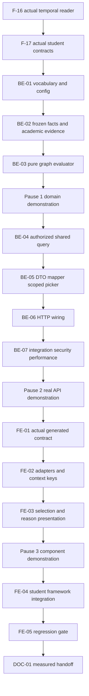

# F-18 Course Registration Eligibility — Backend + Frontend Implementation Plan

This plan builds EP-18, US-085..US-086 and CV-212..CV-214: one on-demand, student/program/semester-specific eligibility query, explainable prerequisite/prior/corequisite evaluation, and the student-context column on MH-25. Backend and frontend share the explicit API below. F-20 and F-21 will consume the same domain answer; this feature does not implement their portal or integration authentication, actual registration, timetable availability, graduation, grade calculation, or student imports.

> **Companion documents**
> - Decisions: `docs/planning/feature-questions.md` §F-18, F18-01..03 (blank = A); F05-01..05; Faculty-marked upstream decisions remain §8 risks.
> - Epic, acceptance and tasks: `docs/planning/epics.md` §B5 / EP-18; `docs/planning/user-stories.md` US-085/086; `docs/planning/task-breakdown.md` CV-212..214.
> - Requirements: `docs/requirement/REQUIREMENTS.md` FR-31/83, BR-06..09, §7.3, EC-11/12/36, DEC-05/06/11, NFR-02/09/11/24; UC-60/63 coverage in the stories and sequence design.
> - Design: `docs/design/data-dictionary.md` CourseRelation, CurriculumRequisite, Student, ProgramEnrollment, AcademicResult; `docs/design/erd.md` M-4/5/8 and E-1/9/11; `docs/design/state-diagrams.md` GD-01..04; `docs/design/sequence-diagrams.md` §13 and L-9/10; `docs/design/screen-inventory.md` MH-25/52/58 and G-4; `docs/planning/deferred-scope.md`.
> - Binding **written, not built** contracts: `docs/implementation/f-17-student-records-results-import-implementation-plan.md` (read in full), especially BE-02/03/07/09 and §8; `docs/implementation/f-16-version-compare-cohort-assignment-implementation-plan.md` (read in full), especially BE-04 and §8. F-12's `docs/implementation/f-12-grade-formula-assessment-clo-implementation-plan.md` supplies declaration-only/source-status semantics, not a grade evaluator.
> - Conventions/evidence: `docs/implementation/README.md`; F-15 and F-09 implementation-plan exemplars; `docs/architecture/general_architecture.md`, `features_architecture.md`, `database_and_models.md`; implement reports for F-02/04/05/06/07/08/15 in `docs/implement-report/`; `source/frontend/src/shared/design-system/DESIGN_SYSTEM.md`.
> - Tests: `docs/planning/test-plan.md` B5 registration/security/performance acceptance; planned manual supplement `docs/testing/feature__f-18-course-registration-eligibility.md` (DOC-01).

**Status**: Not started — planned against permitted source inspected on 2026-10-26. F-16/F-17 are prerequisite contracts, not present implementations. Correction/calendar historical certification and Faculty-dependent interpretations remain explicitly gated in §8.

---

## 0. Plan at a glance

Everything below in one table. Read this; the rest is detail for whoever builds it.

| What | Why | How and where |
|---|---|---|
| **One authoritative answer for each student context** | FR-83; web, portal and dDUT must agree | Actor-bound shared reader calls F-17 `resolveForStudent` with explicit program/semester; all reads use one transaction (BE-02/04) |
| **Frozen requirements, not today's catalog requirements** | M-5; the student's version governs | Read that version's CurriculumRequisite rows; empty means empty, never merge live QH1..3 (BE-02/03) |
| **Three eligibility outcomes plus completion** | F18-01 A; US-085 AC1; US-086 AC1 | `completed` separately from nullable ELIGIBLE / CONDITIONAL / INELIGIBLE; Vietnamese labels and semantic colors (BE-01/05, FE-03/04) |
| **Explain every refusal and joint-registration obligation** | FR-83; EC-11; downstream stable contract | Literal reason codes, server-owned Vietnamese templates, structured course/score/path evidence and full concurrent bundle (BE-01/03/05) |
| **Retakes, equivalents and discontinued prerequisites** | BR-06..09; EC-12/36 | Source status remains authoritative; exact score4 comparisons; current equivalence groups and one-hop ACTIVE QH5 alternatives (BE-02/03) |
| **Safe reciprocal corequisites** | F05-04 A; US-085 AC5/7 | Iterative strongly connected components, blocked-component propagation and configured maximum 20 component levels; never treat a visited node as unconditional success (BE-03) |
| **Student-aware curriculum, unchanged ordinary view** | FR-31; US-086; CV-214 | Scoped staff picker and semester selection on MH-25; navigate to the resolved version before overlaying statuses; no student means no column (FE-02..05) |
| **No eligibility storage or extra infrastructure** | F18-03 A; NFR-02 | Read-time computation, request-local facts only; no migration, Redis cache, worker or new package; real HTTP <3s measurement on synthetic 60-course curriculum (BE-07) |

**Key behaviours worth knowing**

| Behaviour | Why it is this way |
|---|---|
| Completion wins before all other checks | An already PASSED/EXEMPT course or equivalent is not a new registration candidate |
| A FAILED high-scoring attempt never becomes PASSED | F-12 declares conditions; F-17 preserves source result status. Numbers cannot override a source failure |
| A previous-course rule accepts a final FAILED result, not IN_PROGRESS | BR-06 requires a result, not merely an ongoing registration |
| Threshold fallback belongs to the **source course's row** in the selected version | ERD E-1 resolves which CurriculumItem supplies minStudiedScore; never the target row |
| A mutually dependent corequisite group may be CONDITIONAL together | A cycle is not a missing prerequisite; any reachable hard blocker still blocks every dependent member |
| No guessed “current version” or “next semester” | F-16/F-17 require a known-date semester and explicit program; exceptions and dual majors cannot be guessed |
| Eligibility describes academic rules, not seats/classes or an actual booking | SRS §12 excludes registration; MH-58 has no registration action |
| Historical answers use current authoritative mappings/calendar/equivalence | Existing sources are not an immutable entitlement ledger; E1/E2 prohibit claiming otherwise |

**Not included**

| Excluded | Why |
|---|---|
| F-20 screens / F-21 API keys or `/api/v1` routes | Separate features; shared consumer contract is defined now, authentication adapters are not fabricated |
| F-19 graduation or F-22 synchronization | Neither unfinished parallel plan is assumed or required |
| Class offerings, seats, credit-load limits, registration writes, grade improvement permission | No approved rules/data in EP-18; completion is not authorization for a retake |
| Fixing historical cohort/calendar behavior | Built-feature owner decisions E1/E2, not an F-18 migration |
| Index/README/progress updates during this planning run | Caller-owned concurrent work; exactly this plan is created |

**Open questions**

| Question | Resolved when | Default if unanswered |
|---|---|---|
| Must pre-correction/pre-calendar-change answers be reproducible? | Decided 2026-10-26 (user), E1/E2 | Current authoritative facts; no immutable pre-correction history or history/freeze work |
| Can an unscored exemption prove a positive prerequisite threshold? | Faculty confirms E3 | Completion yes; positive numeric threshold no without a supplied score |
| How should an uncompleted corequisite outside the frozen curriculum be evaluated? | Faculty supplies applicable frozen rules, E3 | Block with explicit unavailable-rules reason; never substitute live catalog rules |
| Which official calendar/exports establish institutional acceptance? | Sanitized specifications supplied, E3 | Synthetic fixtures and F-17 templates only |

## 1. Scope

| In scope | Why |
|---|---|
| Full-framework query for explicit studentId/programId/semesterId | US-085; FR-83; shared F-20/F-21 foundation |
| Completion, source-status-aware prior/prerequisite evaluation, equivalence, replacement evidence | BR-06..09; EC-12/36; US-085 AC1..3/6 |
| Complete corequisite closure, cycles, transitive blockers, depth defense | US-085 AC4/5/7; EC-11; C06 |
| Stable codes, Vietnamese reason text, structured evidence and configuration warnings | The response is the downstream contract, not text to parse |
| Staff student/semester selection, eligibility column and reason detail in both MH-25 views | US-086; CV-214 |
| Shared own-student authorization and R6 HTTP tests | NFR-11; later portal must not require global student search |
| Targeted unit, real DB/HTTP, UI and <3s performance verification | CV-213; NFR-02 |

| Out of scope | Deferred until |
|---|---|
| Student/results tables, import workers, accounts, enrollment reconciliation | F-17, with F-09/F-16 upstream; do not reproduce them |
| Portal navigation, choosing PRIMARY by default, dual-major portal chooser | F-20; explicit program remains mandatory in this query |
| Integration-client authentication, caller attribution and external route vocabulary | F-21; no fake R1 access context |
| Graduation counts/audits, result-change consumption | F-19; no assumptions about its unfinished plan |
| DB connector, synchronization and freshness guarantees | F-22; no assumptions about its unfinished plan |
| Generic AuditLog, PI/objectives, export/PDF, persisted eligibility, class enrollment | Deferred scope / other features / SRS §12 |

| AC / acceptance scenario | Covered by |
|---|---|
| US-085 AC1: exact/equivalent passed course is completed | BE-02/03/07; FE-03/05 |
| US-085 AC2: missing/low prerequisite, named reason | BE-01..05/07; FE-03/05 |
| US-085 AC3: failed prior attempt satisfies PRIOR | BE-02/03/07 |
| US-085 AC4: eligible uncompleted corequisite makes result conditional | BE-03/07; FE-03/05 |
| US-085 AC5: transitive corequisite blocker blocks origin | BE-03/07; FE-03/05 |
| US-085 AC6: discontinued prerequisite replacement; missing replacement warning | BE-02/03/05/07; FE-03/05 |
| US-085 AC7: reciprocal/cyclic graph terminates, maximum 20 levels | BE-01/03/07 |
| US-085 AC8: approximately 60 courses <3s | BE-07; measured whole request, not only evaluator |
| US-086 AC1: gray/green/yellow/red column for selected student | FE-03/04/05; BE-05 |
| US-086 AC2: no student, no column | FE-04/05; existing anonymous-to-student curriculum response unchanged |
| US-086 AC3: R3 foreign program rejected server-side | BE-04/05/06/07; FE-05 |
| US-086 AC4: no student function for R2/R4/R5 | BE-04/05/07; FE-03/04/05 |
| B5 scenario 4: candidate list and concrete refusal reasons | BE-04/05/07; MH-25 demonstration now; MH-58 presentation remains F-20 |
| B5 scenario 6: student A cannot read B | BE-04/07; identity checked separately from program scope |
| B5 scenario 9: reusable mobile answer | BE-04/05 contract only; external authentication/routes remain F-21 |
| CV-212 / CV-213 / CV-214 | BE-01..06 / BE-07 / FE-01..05 respectively |

## 2. Contract verification

This section precedes deliverable design. **Verified** means inspected source, including the serializer, not an older implementation plan. **NEW / UNVERIFIED** means a contract to build. Every unbuilt assumption is repeated in §8. Source paths are repository-relative. Restricted data trees and dotenv files are not inputs.

### 2a. Endpoints and behavioral foundations

| Endpoint / boundary | Verified at | Request | Response / behavior | Use |
|---|---|---|---|---|
| GET `/api/semesters` | `source/backend/src/features/semesters/semesters.controller.ts:19`; serializer `source/backend/src/shared/releases/semester.dto.ts:20` | Authenticated session | SemesterDto[]; startDate nullable | Reuse options, disable unknown starts |
| GET `/api/program-versions/:versionId/curriculum` | `source/backend/src/features/curriculum/program-versions-curriculum.controller.ts:43`; `curriculum-read.service.ts:66`; serializer `curriculum.dto.ts:175` | Existing version route | CurriculumDto; PROGRAM_VIEW scoped on program; no student/result input | Existing staff framework stays unchanged; not an own-student API |
| Frozen row display | `source/backend/src/shared/curriculum/row-course.ts:4`, `:11` | Row snapshots plus live Course | Prefers frozen name/credits, falls back when missing | New eligibility loader is stricter for issued rows; no change to this helper |
| Version-specific requisites | `source/backend/src/features/curriculum/curriculum-requisites.service.ts:39`, `:60` | Add row / replace requisites | Catalog edges copied when adding; later catalog changes do not affect copies | Evaluate only selected-version copies; empty is not an inheritance instruction |
| Relation direction and types | `source/backend/prisma/schema.prisma:270`, `:279`; serializer `source/backend/src/features/course-relations/course-relations.service.ts:109` | Source → target | PRIOR / PREREQUISITE / COREQUISITE / REPLACEMENT; minScore decimal string/null | Source is requirement, except QH5 source is discontinued course |
| Replacement deletion protection | `source/backend/src/shared/courses/course-relation.writer.ts:120` | Remove QH5 | Last ACTIVE target for DISCONTINUED source is protected | Still diagnose missing/invalid replacements from imported or legacy facts |
| Equivalence membership | `source/backend/prisma/schema.prisma:253`, `:294` | Course.equivalenceGroupId | One nullable group per course; member set, not directional QH4 | Current group expansion, including courses outside curriculum |
| Graph validation | `source/backend/src/shared/courses/requisite-graph.ts:14`, `:25` | PRIOR/PREREQUISITE edges | Those types checked for cycles; COREQUISITE excluded | Do not reuse this detector as an eligibility evaluator or reject valid reciprocal corequisites |
| Decimal transport | `source/backend/src/shared/decimal/decimal.ts:9` | Prisma.Decimal | Exact string (`toString`), not number | Preserve scores/thresholds/credits; no float or lexical comparison |
| Permission presence vs subject scope | `source/backend/src/shared/authz/permission.guard.ts:32`; `access-context.ts:121` | Session grants / target | Multi-code decorator is OR; target dimensions are OR | Use F-17 subject policy, not combined student/program target as an ownership test |
| Registration permission | `source/backend/src/shared/authz/permission-codes.ts:42`; seed `source/backend/prisma/seed-data/permission-catalog.ts:320` | Existing code | student.viewRegistrationEligibility already exists | No new permission or seed migration |
| GET `/api/students/:studentId/registration-eligibility` | **NEW / UNVERIFIED**, BE-05 | Required programId, semesterId; no version override | RegistrationEligibilityDto, 200; read-only, no-store | Staff R1/R3 or owning R6; shared domain answer |
| GET `/api/programs/:programId/registration-eligibility/students` | **NEW / UNVERIFIED**, BE-05 | Required semesterId; optional q/page/pageSize | EligibilityStudentPageDto, 200; scoped SQL search | Staff R1/R3 only; purpose ELIGIBILITY, not broader transcript search |
| F-17 resolution / results / access | **UNVERIFIED**, F-17 BE-02/03/07; U1 | Explicit lookup + actor-bound facade + optional tx | Exact domain interfaces below | Hard prerequisite; do not create student models/stubs in F-18 |
| F-16 cohort resolution | **UNVERIFIED**, F-16 BE-04; U2 | program/cohort/semester, optional tx | Known-date issued assignment or null | Indirect through F-17; never bypass exception/enrollment selection |

### 2b. Consumed response fields and domain contracts

**SemesterDto, every field** — existing serializer `source/backend/src/shared/releases/semester.dto.ts:20`.

| Field | Wire type | Nullable | Source | Modeled as | Note |
|---|---|---|---|---|---|
| id | string | no | same file `:22` | Semester.id | Request key |
| semesterCode | string | no | same file `:23` | Semester.semesterCode | Label, not chronological order |
| academicYear | string | no | same file `:24` | Semester.academicYear | Display-only |
| termInYear | number | no | same file `:25` | Semester.termInYear | Display-only |
| startDate | ISO day string | yes | same file `:26` | Semester.startDate | Reject/disable null, never infer |

**Existing curriculum adapter is retained, not remapped.** Its generated aliases and fetcher are `source/frontend/src/features/curriculum/api/curriculum.ts:4`, `:35`. BE-05 does not return CurriculumDto; FE-04 only joins the separate eligibility result to existing item IDs. Existing DTO root fields stay with their owning components: version, editPath, canEditStructure, canAddItems, items, semesters, blocks, knowledgeBlocks, electiveGroups, programCredits, warnings (`source/backend/src/features/curriculum/curriculum.dto.ts:116`). No backend widening or second curriculum serializer is hidden here.

| Field joined/displayed | Wire type | Nullable | Source | Mapping / note |
|---|---|---|---|---|
| version.id / programId | string / string | no | `source/backend/src/features/curriculum/curriculum.dto.ts:218`, `:219` | Require exact returned eligibility context match |
| version.versionNumber | string | yes | same file `:222` | Existing label, not version resolution |
| version.status | DRAFT / PENDING / ACTIVE / HISTORICAL | no | same file `:223`; `source/backend/prisma/schema.prisma:63` | Never infer entitlement from ACTIVE |
| item.id | string | no | `source/backend/src/features/curriculum/curriculum.dto.ts:180` | Join by itemId, not row index |
| item.course.id / courseCode / courseName | string / string / string | no | same file `:184`; `source/backend/src/shared/courses/related-course.ts:24` | Snapshot-aware through rowCourse |
| item.course.credits | decimal string | no | `source/backend/src/shared/courses/related-course.ts:27`; `curriculum.dto.ts:184` | Existing table display; no credit arithmetic added |
| item.course.status | ACTIVE / DISCONTINUED / CANCELLED | no | `source/backend/src/shared/courses/related-course.ts:28` | Live catalog status, not seat availability |
| item.plannedSemester / sortOrder / displayOrder | number / number / number | no | `source/backend/src/features/curriculum/curriculum.dto.ts:182`, `:183`, `:181` | Existing order/filtering unchanged |
| item.canEdit | boolean | no | same file `:210` | Student mode forces UI read-only without changing server edit rights |
| version.programCode | string | no | `source/backend/src/features/curriculum/curriculum.dto.ts:220` | Existing header, not newly modeled |
| version.programName | string | no | same file `:221` | Existing header, not newly modeled |
| version.semesterCount | number | no | same file `:224` | Existing board range, not a calendar semester |
| version.sourceRequest | RequestRefDto | yes | same file `:225` | Existing banner only, not eligibility state |
| item.hasSyllabus | boolean | no | same file `:185` | Existing syllabus warning, not newly modeled |
| item.blockSymbol | string | yes | same file `:186` | Existing filter/display, not newly modeled |
| item.blockName | string | yes | same file `:187` | Existing filter/display, not newly modeled |
| item.isElective | boolean | no | same file `:190` | Existing display, not an eligibility exemption |
| item.electiveGroup | CurriculumElectiveGroupRefDto | yes | same file `:191` | Existing display, not newly modeled |
| electiveGroup.id | string | no | same file `:58`, serializer `:191` | Existing group identity |
| electiveGroup.groupCode | string | no | same file `:59`, serializer `:191` | Existing group label |
| item.htDa | boolean | no | same file `:192` | Display-only, no new business semantics |
| item.tqDa | boolean | no | same file `:193` | Display-only, no new business semantics |
| item.minStudiedScore | decimal string | yes | same file `:194` | Existing source-row value; no client comparison |
| item.minTransferScore | decimal string | yes | same file `:196` | Display-only, not an F-18 threshold |
| item.note | string | yes | same file `:200` | Existing renderer, not newly modeled |
| item.requisites | CurriculumRequisiteDto[] | no | same file `:201` | Existing RequisiteTags, not a client evaluator |
| requisite.id | string | no | same file `:202` | Existing requisite identity |
| requisite.sourceCourse | RelatedCourseDto | no | same file `:203` | Same five fields id/code/name/credits/status as course above; existing renderer |
| requisite.relationType | PRIOR / PREREQUISITE / COREQUISITE | no | same file `:204`, DTO `:41` | Existing frozen requisite type, no QH5 in the row |
| requisite.minScore | decimal string | yes | same file `:205` | Existing renderer; backend chooses precedence |
| requisite.sourceSemester | number | yes | same file `:207` | Relative source row semester; null if outside framework |

RequestRefDto is not mapped by F-18: its three existing banner fields are id:string (`source/backend/src/shared/change-requests/request-ref.dto.ts:6`), requestCode:string (`source/backend/src/shared/change-requests/request-ref.dto.ts:7`) and status, whose exact wire literals are DRAFT / PENDING_COORDINATOR / PENDING_DIRECTOR / PENDING_ACADEMIC_OFFICE / APPROVED / EFFECTIVE / REJECTED / WITHDRAWN (`source/backend/prisma/schema.prisma:122`). The existing serializer passes the generated enum through (`source/backend/src/shared/change-requests/request-draft.ts:74`, `source/backend/src/shared/change-requests/request-draft.ts:81`). The banner retains its existing adapter; this feature neither interprets that status nor exposes a request-copy eligibility query. Reverify its exact enum at implementation instead of copying a new client union.

**F-17 internal boundaries — exact assumed shapes, not HTTP DTOs.** Source: F-17 BE-03/07, **UNVERIFIED** until built (U1).

```ts
export interface StudentAppliedVersionLookup {
  studentId: string;
  programId: string;
  semesterId: string;
}
export interface StudentAppliedVersionResult {
  studentId: string;
  enrollmentId: string;
  programId: string;
  semesterId: string;
  programVersionId: string;
  source: 'COHORT' | 'EXCEPTION';
  cohortAssignmentId: string | null;
}
export interface StudentAppliedVersionResolver {
  resolveForStudent(input: StudentAppliedVersionLookup,
    tx?: Prisma.TransactionClient): Promise<StudentAppliedVersionResult>;
}
export interface AcademicResultValue {
  studentId: string;
  courseId: string;
  semesterId: string;
  score10: string | null;
  score4: string | null;
  letterGrade: string | null;
  status: AcademicResultStatus;
}
export interface AcademicAttemptFact extends AcademicResultValue {
  id: string;
  semesterStart: Date;
  dataSource: StudentDataSource;
  revision: number;
}
```

Each lookup/result field is retained verbatim in the shared answer's `context`; source literals remain COHORT/EXCEPTION and assignmentId remains nullable. Attempt fields used by F-18: id/courseId/semesterId/semesterStart/status/score4 (evidence, chronology, comparisons). studentId checks parent consistency; revision is retained internally for deterministic evidence. score10, letterGrade and dataSource are **not modeled in the public eligibility response**: they do not decide this feature and would duplicate transcript data. AcademicResultStatus is exactly PASSED / FAILED / IN_PROGRESS / EXEMPT; StudentDataSource is EXCEL / SCHOOL_DB, both unbuilt F-17 enums. Reuse actual imports after U1, not duplicate production declarations.

F-17 `StudentAppliedVersionReader.forAccess(access, 'ELIGIBILITY')` returns that resolver; `AcademicResultsReader.forAccess(access, 'ELIGIBILITY').forStudent(input, tx?)` returns all relevant student-wide attempts through the requested semester's start inclusively. Normal resolution calls F-16; exceptions keep their validated pin; historical interval selection and future/worker-lag behavior belong to F-17. F-18 uses the **returned** programVersionId, never a reread of persisted appliedVersionId. F-17's `bestAcademicResults` considers scored PASSED **and FAILED** attempts; its aggregate alone is not a prerequisite-satisfaction decision. BE-02 selects evidence from raw attempts with rule-specific status filters.

**All NEW HTTP response fields** are exhaustively inventoried in BE-05, including nested nullability/enums. Source is explicitly NEW BE-05 DTO/mapper, not a fabricated current file:line. Frontend aliases the generated types without handwritten response copies.

### 2c. Verified gaps and mismatch log

| Deliverable | Earlier/design assumption | Source and disposition | Found at |
|---|---|---|---|
| BE-02/03 | Catalog relations remain inherited whenever a row has no requisites | Rows are seeded once and replaced independently; empty snapshot is authoritative | `source/backend/src/features/curriculum/curriculum-requisites.service.ts:37`, `:76` |
| BE-02 | Existing fact reader already loads a complete curriculum for a transaction | It only exposes maxPlannedSemester using its global Prisma client | `source/backend/src/shared/curriculum/curriculum-facts.reader.ts:10`; add F-18 reader, do not replace it |
| BE-03 | Existing cycle detector solves all corequisite recursion | It explicitly excludes COREQUISITE from cycle checks | `source/backend/src/shared/courses/requisite-graph.ts:14`; separate pure evaluator |
| BE-04 | Program scope plus student ID proves R6 ownership | AccessContext intersects target dimensions with OR | `source/backend/src/shared/authz/access-context.ts:121`; require F-17 identity policy |
| BE-02/05 | Released labels are always non-null snapshots | Generic reader permits live fallback | `source/backend/src/shared/curriculum/row-course.ts:8`, `:20`; strict new query errors on missing target snapshots |
| BE-04/07 | Cohort history is immutable across corrections | Correction rewrites mapping version IDs at original start | `source/backend/src/features/releases/corrections.service.ts:143`; E1 accepted limitation, preserve writer |
| BE-04/07 | Every used semester start is frozen | Guard checks ACTIVE/HISTORICAL effective releases, not all mapping/result dates | `source/backend/src/features/semesters/semesters.service.ts:87`; E2 accepted current-calendar limitation |
| FE-04 | Curriculum already accepts student context or a status column | Page queries only by versionId; table has no eligibility prop | `source/frontend/src/features/curriculum/pages/CurriculumPage.tsx:42`; `components/CurriculumTable.tsx:28` |
| BE-03 | Threshold fallback is the target row's minimum | ERD E-1 explicitly names the row containing the source course | `docs/design/erd.md:307`; use source row, log this ambiguity before implementation |

## 3. Decisions

| ID | Decision | Why | Rejected alternative |
|---|---|---|---|
| D1 | New shared registration-eligibility domain module plus thin HTTP feature | F-20/F-21 can reuse the same query without feature-to-feature service imports | Controller-only evaluator, internal HTTP, fake downstream modules |
| D2 | Required student/program/semester; no client version override | F-17 owns temporal enrollment and exceptions | ACTIVE/latest/current-date inference or arbitrary first enrollment |
| D3 | `completed:boolean` plus nullable three-valued eligibility and server statusText | F18-01 A separates completion from three eligibility outcomes | Four competing eligibility enum values or text parsing |
| D4 | PASSED/EXEMPT complete; FAILED can satisfy PRIOR but not PREREQUISITE | Source status is authoritative under F-12/F-17 | Infer passing from score4 or formula cutoffs |
| D5 | Explicit relation minScore, else source-row minStudiedScore, else no numeric threshold | F05-02 A / ERD E-1; zero is explicit, not absent | Target-row fallback, invented 2.0 or JavaScript truthiness |
| D6 | Unscored EXEMPT satisfies completion/PRIOR and unthresholded prerequisite, but cannot prove positive numeric threshold | Do not invent score4; E3 asks Faculty to confirm threshold recognition | Assign 4.0 to exemption or ignore explicit threshold |
| D7 | Current equivalence sets; direct ACTIVE QH5 alternatives only for a DISCONTINUED prerequisite source | BR-09 / EC-12; no directed replacement transitivity was approved | Global replacement-as-equivalence, arbitrary winner, following QH5 cycles |
| D8 | Evaluate all mandatory conditions; complete joint bundle and deterministic all-blocker output | Avoid the SRS sketch's first-corequisite early return masking later failures | Stop at first nonblocked corequisite or order-sensitive reasons |
| D9 | Collapse corequisite SCCs, propagate blockers on the DAG, limit component dependency levels to configured <=20 | Reciprocal co-registration is valid; iterative processing cannot overflow the JS call stack | “Visited means eligible”, reject every cycle, or context-dependent recursive memoization |
| D10 | Uncompleted out-of-frame corequisite has unavailable frozen rules and fails closed | Cannot prove it can register using the student's frozen version; E3 | Treat it as no-rule eligible or silently use today's catalog QH1..3 |
| D11 | On-demand RepeatableRead, request-local indices only; no eligibility persistence | F18-03 A; corrections/results/equivalence immediately affect next request | Redis cache, materialized status, event invalidation infrastructure |
| D12 | Staff picker gets its own eligibility-purpose scoped endpoint | F-17's staff list requires progress permission, which is not equivalent | Borrow a broader student directory or grant progress permission implicitly |
| D13 | MH-25 navigates to the resolved version before joining the overlay | A version currently being browsed is not necessarily this student's version | Compute against route version or display results against mismatched rows |
| D14 | Academic-only verdict; status warnings, not invented class-offering rules | No offerings/calendar booking source is in this feature | Seat/status/credit-load/retake rules inferred without Faculty knowledge |

## 4. Integration boundaries and deliberate divergences

No shipped sibling implements this eligibility feature. The following are explicit elaborations, not silent replacements of existing contracts.

| Boundary | Disposition |
|---|---|
| SRS §7.3 recursive sketch | Preserve rule priority, but inspect every mandatory edge. SCC condensation makes reciprocal corequisites valid and transitive failures deterministic; §5 BE-03 defines the 20-level interpretation |
| F-17 highest-score helper | Reuse attempt facts; do not replace its helper/signature or change its PASSED/FAILED selection for other consumers |
| F-07 curriculum API/components | Endpoint response/permissions unchanged; optional presentation props only. Student mode read-only; ordinary authoring works as before |
| F-15 snapshots and calendar/correction writers | No migration or writer patch. Strict new eligibility validation does not change existing legacy detail fallback |
| Global equivalents/replacements | These are explicitly current catalog recognition facts, not frozen prerequisite definitions. Returned version identifies the frozen rules, not an immutable catalog-history snapshot |
| F-20/F-21 | Shared domain answer and reason vocabulary are ready; own-identity routing/default PRIMARY and independently authorized integration capability remain their responsibility |
| Faculty-dependent edge policies | E3 safe refusals are visible and testable, not an assertion of institutional policy approval |

## 5. Deliverables

All files and signatures in this section are **to build**, not claims that F-16/F-17 exist. Existing parents inspected: backend `src/shared`, `src/features`, `test/fixtures`; frontend `src/features/curriculum`, `src/shared`; `docs/testing`, `docs/implement-report`. Create nested NEW directories with their owning deliverable. Backend relative imports use `.js`. No DELETE step is needed: no shared function or endpoint is replaced.

### BE-01 — Stable vocabulary, facts, errors and configurable depth

**What / why:** Define the reusable answer independently of HTTP DTOs, with literal reason codes and configuration rather than magic thresholds.

**Files**

| Action | Path | Mirror / rationale |
|---|---|---|
| NEW | `source/backend/src/shared/registration-eligibility/eligibility.types.ts` | Domain facts like `source/backend/src/shared/curriculum/curriculum-facts.reader.ts:6`; reuse F-17 lookup/result/attempt types under U1 |
| NEW | `source/backend/src/shared/registration-eligibility/eligibility.constants.ts` | Typed constants like `source/backend/src/shared/courses/requisite-graph.ts:7` |
| NEW | `source/backend/src/shared/registration-eligibility/eligibility.errors.ts` | Structured definitions like `source/backend/src/features/curriculum/curriculum.errors.ts` |
| NEW | `source/backend/src/shared/registration-eligibility/eligibility-reasons.ts` | Vietnamese presentation dictionary like `source/backend/src/shared/change-requests/diff/diff-labels.ts` |
| NEW | `source/backend/src/shared/registration-eligibility/eligibility-reasons.spec.ts` | Pure test layout like `source/backend/src/shared/decimal/decimal.spec.ts` |
| MODIFY | `source/backend/src/shared/config/env.validation.ts` | Existing typed defaults/validation at `:23`; add one optional-with-default numeric setting |
| NEW | `source/backend/src/shared/registration-eligibility/eligibility-config.spec.ts` | Exercise existing validateEnv entry point `source/backend/src/shared/config/env.validation.ts:69` with synthetic configuration |

**Shape**

```ts
export const ELIGIBILITY_VALUES = ['ELIGIBLE', 'CONDITIONAL', 'INELIGIBLE'] as const;
export type EligibilityValue = (typeof ELIGIBILITY_VALUES)[number];
export const ELIGIBILITY_DEFAULTS = { MAX_DEPTH: 20 } as const;
export const ELIGIBILITY_LIMITS = { MIN_DEPTH: 1, MAX_DEPTH: 20, SEARCH_MAX: 200 } as const;
export const ELIGIBILITY_PERFORMANCE = { COURSES: 60, BUDGET_MS: 3_000 } as const;
export const ELIGIBILITY_REASON_CODES = [
  'COURSE_COMPLETED', 'EQUIVALENT_COMPLETED',
  'PREREQUISITE_NOT_PASSED', 'PREREQUISITE_SCORE_MISSING',
  'PREREQUISITE_SCORE_TOO_LOW', 'PRIOR_RESULT_MISSING',
  'COREQUISITE_REQUIRED', 'COREQUISITE_INELIGIBLE',
  'COREQUISITE_RULES_UNAVAILABLE', 'COREQUISITE_DEPTH_LIMIT',
] as const;
export type EligibilityReasonCode = (typeof ELIGIBILITY_REASON_CODES)[number];
export const ELIGIBILITY_WARNING_CODES = [
  'REPLACEMENT_UNAVAILABLE', 'EXTERNAL_REQUISITE',
  'EXTERNAL_COREQUISITE_RULES_UNAVAILABLE', 'COURSE_NOT_ACTIVE',
] as const;
export type EligibilityWarningCode = (typeof ELIGIBILITY_WARNING_CODES)[number];
export type EligibilityRelation = 'PRIOR' | 'PREREQUISITE' | 'COREQUISITE';
export interface EligibilityCourseRef {
  id: string;
  courseCode: string;
  courseName: string;
  nameSource: 'SNAPSHOT' | 'CATALOG';
}
export interface EligibilityReason {
  code: EligibilityReasonCode;
  causeCode: EligibilityReasonCode | null;
  message: string;
  relationType: EligibilityRelation | null;
  requiredCourse: EligibilityCourseRef | null;
  viaCourse: EligibilityCourseRef | null;
  evidenceCourse: EligibilityCourseRef | null;
  evidenceResultId: string | null;
  requiredScore4: string | null;
  actualScore4: string | null;
  actualStatus: AcademicResultStatus | null;
  path: EligibilityCourseRef[];
}
export interface EligibilityWarning {
  code: EligibilityWarningCode;
  message: string;
  course: EligibilityCourseRef;
}
export interface EligibilityItemAnswer {
  itemId: string;
  course: EligibilityCourseRef;
  credits: string;
  catalogStatus: CourseStatus;
  plannedSemester: number;
  completed: boolean;
  eligibility: EligibilityValue | null;
  statusText: string;
  reasons: EligibilityReason[];
  requiredConcurrentCourses: EligibilityCourseRef[];
}
export interface RegistrationEligibilityAnswer {
  contractVersion: 1;
  context: StudentAppliedVersionResult;
  evaluatedAt: string;
  items: EligibilityItemAnswer[];
  warnings: EligibilityWarning[];
}
export interface EligibilityEvaluationOptions { maxDepth: number }
export function eligibilityStatusText(
  completed: boolean, eligibility: EligibilityValue | null,
): string;
export function renderEligibilityReason(
  reason: Omit<EligibilityReason, 'message'>,
  options: EligibilityEvaluationOptions,
): string;
```

Import AcademicResultStatus from F-17's generated Prisma enum, CourseStatus/Prisma from generated client, and StudentAppliedVersionResult from F-17 shared types. Do not copy the §2b interface declarations into a second production module. All messages are built from structured facts; clients never parse them to reconstruct a reason or recompute a verdict. `contractVersion` is a literal protocol identifier, not a persisted schema version. Define `ELIGIBILITY_CONTRACT_VERSION = 1 as const` and use it in the mapper.

Add `@IsInt() @Min(ELIGIBILITY_LIMITS.MIN_DEPTH) @Max(ELIGIBILITY_LIMITS.MAX_DEPTH) ELIGIBILITY_MAX_DEPTH: number = ELIGIBILITY_DEFAULTS.MAX_DEPTH` to Env. Read it through typed ConfigService; missing config uses 20, invalid or >20 fails startup. No dotenv/example credential file is edited. The configuration controls a defensive ceiling, not a Faculty pass threshold.

**Stable Vietnamese presentation contract**

| Condition / code | Exact template / rule |
|---|---|
| completed / eligibility null | `Đã hoàn thành` |
| false / ELIGIBLE | `Được` |
| false / CONDITIONAL | `Được có điều kiện` |
| false / INELIGIBLE | `Không được` |
| COURSE_COMPLETED, PASSED | `Đã hoàn thành học phần {courseCode} — {courseName}.` |
| COURSE_COMPLETED, EXEMPT | `Đã được miễn học phần {courseCode} — {courseName}.` |
| EQUIVALENT_COMPLETED | `Đã hoàn thành nhờ kết quả được công nhận của học phần tương đương {evidenceCode} — {evidenceName}.` |
| PREREQUISITE_NOT_PASSED | `Chưa đạt học phần tiên quyết {requiredCode} — {requiredName}.` |
| PREREQUISITE_SCORE_MISSING | `Chưa có điểm thang 4 để kiểm tra ngưỡng {requiredScore4} của học phần tiên quyết {requiredCode} — {requiredName}.` |
| PREREQUISITE_SCORE_TOO_LOW | `Điểm cao nhất được công nhận của học phần tiên quyết {requiredCode} — {requiredName} là {actualScore4}/4, thấp hơn ngưỡng {requiredScore4}/4.` |
| PRIOR_RESULT_MISSING | `Chưa có kết quả học phần học trước {requiredCode} — {requiredName}.` |
| COREQUISITE_REQUIRED | `Được, nếu đăng ký cùng học phần song hành {requiredCode} — {requiredName}.` |
| COREQUISITE_INELIGIBLE | `Không được — học phần song hành {viaCode} — {viaName} chưa đủ điều kiện. {causeMessage}` |
| COREQUISITE_RULES_UNAVAILABLE | `Chưa thể xác định điều kiện của học phần song hành {requiredCode} — {requiredName} vì học phần không có trong khung áp dụng.` |
| COREQUISITE_DEPTH_LIMIT | `Không thể xác định an toàn điều kiện song hành vì chuỗi phụ thuộc vượt quá giới hạn {maxDepth} cấp.` |
| REPLACEMENT_UNAVAILABLE warning | `Học phần tiên quyết {courseCode} — {courseName} đã ngừng mở lớp nhưng chưa có học phần thay thế đang sử dụng; cần quản trị kiểm tra.` |
| EXTERNAL_REQUISITE warning | `Học phần điều kiện {courseCode} — {courseName} nằm ngoài khung áp dụng; kết quả đã có vẫn được kiểm tra.` |
| EXTERNAL_COREQUISITE_RULES_UNAVAILABLE warning | `Chưa có quy tắc theo phiên bản cho học phần song hành {courseCode} — {courseName}; cần quản trị kiểm tra.` |
| COURSE_NOT_ACTIVE warning | `Học phần {courseCode} — {courseName} hiện không ở trạng thái Đang sử dụng; kết quả này không xác nhận việc mở lớp.` |

Render score placeholders from canonical decimal strings with a dot decimal separator, without rounding or locale-dependent formatting; API and server messages therefore remain deterministic. Names are plain text. `causeMessage` is rendered once from a **leaf** reason, never by recursively embedding another COREQUISITE_INELIGIBLE. MaxDepth comes from evaluation options. Keep template-specific extra parameters internal (e.g. depth); do not put ad-hoc human strings in a machine parameter map. Depth reason's public message records the configured ceiling and its path identifies the first over-limit component boundary.

**HTTP/domain error distinction:** Invalid query = existing 400 validation error; denied/missing subject = existing F-17 scope policy (403 role denial / 404 scope-filtered subject miss); missing enrollment or mapping, ambiguous interval, unknown semester start = preserve F-17/F-16 code/status/message unchanged. New request-level 409 `ELIGIBILITY_SNAPSHOT_INCOMPLETE`: `Ảnh chụp khung chương trình chưa đầy đủ; chưa thể tính điều kiện đăng ký an toàn.` New 409 `ELIGIBILITY_DATA_INVALID`: `Dữ liệu điều kiện đăng ký chưa hợp lệ; cần kiểm tra trước khi tính.` These use AppException/ErrorDefinition, not a new envelope. Academic ineligibility is **200 with item reasons**, not an HTTP exception.

**Gotchas:** completed implies eligibility null and exactly one completion reason; noncompleted implies non-null eligibility. ELIGIBLE has no reasons/concurrent bundle. CONDITIONAL has only COREQUISITE_REQUIRED reasons and a nonempty bundle. INELIGIBLE has blockers and an empty actionable bundle. Nullable scores are never zero. Use `??`, not `||`, for explicit zero thresholds. Never infer marks/pass status from F-12 cutoffs.

**Verify:** Backend `pnpm exec vitest run src/shared/registration-eligibility/eligibility-reasons.spec.ts src/shared/registration-eligibility/eligibility-config.spec.ts`; `pnpm exec tsc --noEmit -p tsconfig.json`. Tests cover all literal codes/templates, exact score text, hostile course-name escaping by consumers, null/zero and depth 1/20/21 configuration. No Prisma migration or package installation.

**Depends on:** U1 generated F-17 enums/types; configuration/vocabulary tests can be drafted before integration, but no fake enum imports are accepted.

### BE-02 — Frozen evaluation context and rule-specific academic evidence

**What / why:** Bulk-load a consistent fact set once, then make every comparison pure and version-correct.

**Files**

| Action | Path | Mirror / rationale |
|---|---|---|
| NEW | `source/backend/src/shared/registration-eligibility/eligibility-context.reader.ts` | Tx-aware exported read functions like `source/backend/src/shared/releases/semester-start.ts`; do not extend the global-client-only CurriculumFactsReader |
| NEW | `source/backend/src/shared/registration-eligibility/academic-evidence.ts` | Pure exact-decimal helpers like `source/backend/src/shared/decimal/decimal.ts`; F-17 attempt facts are the input |
| NEW | `source/backend/src/shared/registration-eligibility/eligibility-context.reader.spec.ts` | Existing reader test style `source/backend/src/shared/curriculum/curriculum-facts.reader.spec.ts` |
| NEW | `source/backend/src/shared/registration-eligibility/academic-evidence.spec.ts` | Pure deterministic tests like `source/backend/src/shared/courses/requisite-graph.spec.ts` |

**Shape**

```ts
export interface EligibilityRequisiteFact {
  id: string;
  targetCourseId: string;
  sourceCourseId: string;
  relationType: EligibilityRelation;
  minScore: Prisma.Decimal | null;
}
export interface EligibilityRowFact {
  itemId: string;
  course: EligibilityCourseRef;
  credits: Prisma.Decimal;
  catalogStatus: CourseStatus;
  plannedSemester: number;
  sortOrder: number;
  minStudiedScore: Prisma.Decimal | null;
  requisites: readonly EligibilityRequisiteFact[];
}
export interface EligibilityCatalogFact {
  course: EligibilityCourseRef;
  status: CourseStatus;
  equivalenceGroupId: string | null;
  activeReplacementIds: readonly string[];
}
export interface EligibilityEvaluationContext {
  resolution: StudentAppliedVersionResult;
  rows: readonly EligibilityRowFact[];
  courses: ReadonlyMap<string, EligibilityCatalogFact>;
  equivalents: ReadonlyMap<string, ReadonlySet<string>>;
  attempts: ReadonlyMap<string, readonly AcademicAttemptFact[]>;
  warnings: readonly EligibilityWarning[];
}
export interface AcademicEvidence {
  attempt: AcademicAttemptFact;
  course: EligibilityCourseRef;
}
export async function readEligibilityContext(
  tx: Prisma.TransactionClient,
  resolution: StudentAppliedVersionResult,
  attempts: readonly AcademicAttemptFact[],
): Promise<EligibilityEvaluationContext>;
export function prerequisiteThreshold(
  requisite: EligibilityRequisiteFact,
  rowsByCourse: ReadonlyMap<string, EligibilityRowFact>,
): Prisma.Decimal | null;
export function completionEvidence(
  context: EligibilityEvaluationContext, courseId: string,
): AcademicEvidence | null;
export function priorEvidence(
  context: EligibilityEvaluationContext, courseId: string,
): AcademicEvidence | null;
export function prerequisiteCandidates(
  context: EligibilityEvaluationContext, sourceCourseId: string,
): readonly AcademicEvidence[];
```

`readEligibilityContext` uses **only the supplied tx**, never global Prisma or another transaction. Read selected ProgramVersion with program, publication facts and curriculum rows including Course, requisites/sourceCourse and frozen fields. Where: exact `resolution.programVersionId`, exact `resolution.programId`, `sourceRequestId:null`; reject DRAFT, missing issued facts, inconsistent program or missing target snapshot. Require frozen courseNameSnapshot and creditsSnapshot on every target row; preserve a legitimate zero credit value. Use `plannedSemester asc, sortOrder asc, id asc`, matching existing ITEM_ORDER (`source/backend/src/features/curriculum/curriculum.dto.ts:162`). An empty issued curriculum is valid empty data only if that version's integrity permits it; no enrollment/mapping error becomes this case. Verify the returned version still has complete issued facts even though F-17 already validated resolution.

Build the fact index in bounded **sets**, not one query per course/edge/attempt:

1. Version+items+frozen requisites in one include-based read; gather target IDs, requisite source IDs and all attempt course IDs.
2. Load those course metadata plus outgoing REPLACEMENT edges with ACTIVE target metadata and equivalenceGroupId. Include no live PRIOR/PREREQUISITE/COREQUISITE edges. QH5 reads use sourceCourseId = discontinued requirement; incoming edges are not replacements for it.
3. Include direct replacement targets in the ID set and load their group memberships. Load all members of collected equivalence groups in one grouped `findMany`, preserving outside-curriculum members. This is bounded by phases, not node count; no nested per-row service calls.
4. Add self to each equivalence set, including ungrouped courses. Current membership implements two-way/transitive recognition; never traverse fictitious QH4 relations. Add no recursively chained QH5 targets. Validate unknown/malformed referenced facts explicitly.
5. Index all attempts student-wide by courseId. Confirm parent student ID, known chronology and semester cutoff; U1 must already filter `semesterStart <= requested.startDate`. Reject corrupt future leakage instead of silently using it. All supplied score4 strings parse to exact Prisma.Decimal in [0,4]; a malformed source fact is ELIGIBILITY_DATA_INVALID, not an academic failure.

Keep target labels/credits frozen. For a required/evidence course present in this version, use its frozen label and nameSource SNAPSHOT; otherwise use current catalog name and CATALOG. CourseCode is the existing immutable catalog identifier; the selected rule remains frozen even when an outside-course label is live. Warn once per `(warningCode, courseId)` for outside requirements, discontinued sources without ACTIVE QH5, and non-ACTIVE target catalog status. Never repair catalog data from GET.

**Rule-specific evidence matrix**

| Attempt status | Target completion / completed corequisite | PRIOR evidence | PREREQUISITE evidence |
|---|---|---|---|
| PASSED | yes | yes | yes; numeric threshold, when present, must be met |
| FAILED | no | yes | no, even if numeric score is above threshold |
| IN_PROGRESS | no | no | no; no guessed final result |
| EXEMPT | yes | yes | yes when no threshold or threshold = 0; positive threshold needs supplied score4 >= threshold |

Threshold = `requisite.minScore ?? rowsByCourse.get(requisite.sourceCourseId)?.minStudiedScore ?? null`. The fallback source row is from this resolved version only. Outside source/no row and both minima absent means **no numeric threshold**, but still requires a recognized PASSED/EXEMPT result. Do not invent a Faculty default passing mark. Explicit zero stays zero; minTransferScore, htDa and tqDa have no eligibility semantics in this feature.

Completion/PRIOR use exact course plus its current equivalent set. Prerequisite evidence additionally considers each direct ACTIVE QH5 replacement (and that replacement's equivalents) **only when the original source is DISCONTINUED**. Preserve the original source/threshold in the reason; do not import a replacement row's lower threshold. Any recognized qualifying candidate can satisfy the requirement; duplicate equivalent/replacement paths do not duplicate evidence. An original/equivalent historical result remains valid even if no replacement is currently configured; the missing-replacement warning does not erase it.

For numeric prerequisites, choose the highest score4 among recognized PASSED/EXEMPT scored candidates; exact Decimal comparison, tie by later semesterStart, then courseCode ascending, then result ID codepoint ascending. A higher FAILED attempt cannot eclipse a lower PASSED one. When no scored recognized candidate meets a positive threshold: report SCORE_TOO_LOW if at least one scored recognized candidate exists, otherwise SCORE_MISSING if unscored recognized exemption exists, otherwise NOT_PASSED. Missing results and only FAILED/IN_PROGRESS both produce NOT_PASSED. Completion prefers exact-course recognized evidence, then equivalent evidence; among candidates use the same score/date/code/id ordering (null score last). PRIOR accepts any recognized final result including FAILED, and uses that deterministic ordering for evidence. No scale conversion, result update or replacement of F-17's best-result helper.

**Gotchas:** Empty requisite snapshots must not inherit live catalog edges. Equivalent result courses need not be framework rows. QH5 is directed and not transitive/equivalent; no chain follows a cycle. All results belong to the student, not enrollment, so earlier-program evidence must survive transfer. F-12 contributes no runtime formula reader to this computation. Validate non-prerequisite minScore or REPLACEMENT in a frozen requisite as malformed data.

**Verify:** Backend `pnpm exec vitest run src/shared/registration-eligibility/eligibility-context.reader.spec.ts src/shared/registration-eligibility/academic-evidence.spec.ts`; `pnpm exec tsc --noEmit -p tsconfig.json`. Assert tx-only query use, bounded query phases, frozen/live disagreement, empty snapshots, source-vs-target threshold fallback, 0/null, 2.49/2.5 boundaries, mixed-status retakes, outside equivalents, multiple ACTIVE replacements, missing replacement with/without original evidence, and no writes.

**Depends on:** BE-01; U1 attempts and resolution contracts, U2 indirectly via U1.

### BE-03 — Pure evaluator, corequisite bundles and transitive explanations

**What / why:** Implement SRS §7.3 without order-dependent early returns, infinite recursion, or a visited-node shortcut that hides blockers.

**Files**

| Action | Path | Mirror / rationale |
|---|---|---|
| NEW | `source/backend/src/shared/registration-eligibility/eligibility-evaluator.ts` | Pure fact-in/result-out rules like `source/backend/src/shared/curriculum/curriculum-warnings.ts` |
| NEW | `source/backend/src/shared/registration-eligibility/corequisite-graph.ts` | Map/Set graph primitives like `source/backend/src/shared/courses/requisite-graph.ts:25`, separate because corequisite cycles are valid |
| NEW | `source/backend/src/shared/registration-eligibility/eligibility-evaluator.spec.ts` | Existing pure rule tests `source/backend/src/shared/curriculum/curriculum-warnings.spec.ts` |
| NEW | `source/backend/src/shared/registration-eligibility/corequisite-graph.spec.ts` | Existing graph-test layout `source/backend/src/shared/courses/requisite-graph.spec.ts` |

**Shape**

```ts
export interface CorequisiteComponent {
  id: string;
  courseIds: readonly string[];
  dependencyComponentIds: readonly string[];
}
export interface CorequisiteGraph {
  components: readonly CorequisiteComponent[];
  componentOfCourse: ReadonlyMap<string, string>;
  dependencyFirstOrder: readonly string[];
}
export function buildCorequisiteGraph(
  courseIds: readonly string[],
  requirements: ReadonlyMap<string, readonly string[]>,
): CorequisiteGraph;
export function corequisitePath(
  requirements: ReadonlyMap<string, readonly string[]>,
  fromCourseId: string, toCourseId: string,
): readonly string[];
export function evaluateEligibility(
  context: EligibilityEvaluationContext,
  options: EligibilityEvaluationOptions,
): Pick<RegistrationEligibilityAnswer, 'items' | 'warnings'>;
```

Use iterative Kosaraju (two explicit-stack DFS passes) or equivalently implement the **specified two-pass algorithm**, not a runtime graph package: first finishing order over target→required edges; second pass over reversed edges assigns SCCs. Implement the two passes directly, with local visited sets and deterministic courseCode/ID-sorted adjacency. Component ID = smallest member course ID by codepoint order, not random or discovery order. Topological order must be dependency-first on the condensed DAG. No recursive production traversal is necessary. `corequisitePath` uses breadth-first search on sorted adjacency and returns a shortest simple path, including endpoints, for explainable provenance; it never repeats an ID.

**Evaluation stages, in this exact priority**

1. Build `rowsByCourse` and the completion index once. Any exact/equivalent PASSED/EXEMPT evidence immediately produces completed=true, eligibility=null, statusText `Đã hoàn thành`, one completion reason, empty concurrent bundle. Ignore that target's future registration obligations; a completed node is removed from the unfinished corequisite graph.
2. For every unfinished row evaluate **all** PREREQUISITE and PRIOR edges with BE-02 evidence, collecting all direct blockers. PRIOR checks final-result existence only. PREREQUISITE checks recognized status plus the resolved threshold. Build reason facts with requiredCourse = original source, evidenceCourse/result = chosen actual attempt when available, required/actual score strings (explicit null), actualStatus, and path `[target, requiredSource]`. Code/text comes from BE-01. Do not traverse prerequisites' own registration rules: existing academic evidence satisfies them independently.
3. Build the unfinished corequisite graph using the row's frozen COREQUISITE edges. Exact/equivalent completion of a required course satisfies the edge, even if that source has no framework row. An uncompleted source outside this version creates direct COREQUISITE_RULES_UNAVAILABLE blocker plus warning; no catalog-rule fallback. A different equivalent course's eligibility is **not** substituted for the named uncompleted corequisite: equivalence recognizes results, not an unapproved choice of co-registration course.
4. Collapse SCCs and evaluate each component dependency-first. Its direct blocker set is the union of its members' blockers. A component is blocked if it has a direct blocker, a blocked dependency, or an over-limit dependency depth. Valid reciprocal/longer cycles with no hard blockers are one co-registration component, not an error and not automatically ELIGIBLE.
5. Compute `componentDepth = 1 + max(dependencyDepth)` (empty maximum = 0). Count the origin component as level 1; a chain of 20 components is allowed, 21 is blocked under default config. Back edges within an SCC add **no recursive level**. This is the explicit C06/20-level interpretation: a reciprocal bundle is simultaneous, not an infinitely long chain. Iterative processing still inspects every member/edge even for an SCC with more than 20 members; it cannot hide one member's blockers behind a depth shortcut. Store the first deterministic over-limit boundary for the depth reason. Completed nodes do not inflate depth. §8 records this interpretation for reviewer/Faculty acceptance, not a recursion claim.
6. For each origin row collect all reachable unfinished corequisite members from its component and dependency closure, excluding the origin itself. If every reachable component is unblocked and this set is nonempty, result CONDITIONAL; emit one COREQUISITE_REQUIRED reason per distinct required course and set requiredConcurrentCourses to this **full transitive bundle**. Never return only the first direct corequisite. If the set is empty and no blockers, result ELIGIBLE.
7. For INELIGIBLE rows include every own direct blocker plus transitive COREQUISITE_INELIGIBLE reasons, one per distinct `(firstRequiredCourse, leafCode, leafRequiredCourse, leafEvidenceResult)` explanation. `viaCourse` = immediate unfinished corequisite from the origin that leads to that blocker; `requiredCourse` = missing/low leaf requirement (or unavailable external corequisite); causeCode = leaf reason code; path = simple origin→corequisite(s)→leaf-required path. Copy leaf threshold/actual/evidence fields, so clients can explain the actual cause without a second query. Do not recursively nest reasons or embed already-wrapped cause text. A directly over-depth origin gets COREQUISITE_DEPTH_LIMIT; a parent depending on such a row gets its own over-depth reason or a single wrapped leaf, not exponentially duplicated messages. Empty requiredConcurrentCourses on blocked rows is intentional: it is not an actionable suggested bundle.
8. Emit all items in frozen row order. Sort reasons by named priority (prerequisite, prior, unavailable corequisite, blocked corequisite, depth, conditional, completion), then required courseCode, via courseCode, path codes and evidence ID codepoint. Deduplicate warnings by code/course and sort code/courseCode. Sort concurrent courses by courseCode then ID. Use fixed `ELIGIBILITY_REASON_PRIORITY` / `ELIGIBILITY_WARNING_PRIORITY` dictionaries and explicit codepoint tie-breakers, never locale-dependent ordering for wire stability.

The component algorithm can memoize **final component results** only after dependencies are complete. A recursion-stack encounter is never cached as success. Root-specific explanation paths are derived after verdict propagation and are not shared as context-free path fragments. A path's corequisite prefix is always simple. If its leaf-required course already appears in that prefix (for example A corequires B, and B requires a final prior result for A), do not append the duplicate: retain path [A,B] and requiredCourse=A separately. The Drawer renders the explicit requiredCourse as the leaf obligation rather than inferring it from the last path entry. Keep all state per evaluate call, not on an injectable singleton. Facts, input arrays and Maps are not mutated. No database, ConfigService, wall clock or logger in these pure functions.

**Required concrete examples**

| Facts | Answer |
|---|---|
| A has no requirements, no result | A ELIGIBLE, empty reasons/bundle |
| A PASSED or equivalent EXEMPT | A completed, eligibility null |
| A needs PRIOR B; B FAILED | A ELIGIBLE if no other blockers |
| A needs PREREQUISITE B at 2.5; B PASSED 2.49 / 2.5 | INELIGIBLE / ELIGIBLE respectively |
| B FAILED 3.8 and PASSED 2.7; threshold 3 | A INELIGIBLE, actual recognized mark 2.7; no score-derived pass |
| A corequires B, B no rules | A CONDITIONAL, bundle [B]; B ELIGIBLE |
| A corequires B and C; C's prerequisite D missing | A INELIGIBLE regardless of edge order; reason via C, leaf D |
| A→B→C corequisites; C has missing PRIOR D | A INELIGIBLE with path A/B/C/D; no vague-only refusal |
| A↔B reciprocal corequisites, neither completed, no blockers | Both CONDITIONAL; A bundle [B], B bundle [A] |
| Same cycle plus B requires missing prerequisite C | Both INELIGIBLE; completed/visited shortcuts cannot conceal C |
| A↔B and B→C, C ELIGIBLE | A bundle [B,C], B bundle [A,C]; no duplicate/self obligation |
| A requires uncompleted external corequisite X | A INELIGIBLE with unavailable-rules reason and warning |
| Depth = 20 / 21 condensed components | Ordinary verdict / explicit over-limit INELIGIBLE; always terminates |

**Gotchas:** Corequisite eligibility is not proof it is actually registered; CONDITIONAL must continue to say “if registered together”. IN_PROGRESS never silently satisfies completion. QH5 substitutions are for prior **evidence of a prerequisite**, not a new graph edge or permission to book a replacement. A warning does not erase valid original evidence. All direct failures are returned, not only a transitive one. Complexity is linear for component verdicts plus bounded per-origin closures/provenance; for a 60-row graph this is acceptable, but BE-07 measures the whole request.

**Verify:** Backend `pnpm exec vitest run src/shared/registration-eligibility/corequisite-graph.spec.ts src/shared/registration-eligibility/eligibility-evaluator.spec.ts`. Include every example, diamond graph, duplicate edges, self-edge corrupt-input rejection, 20/21 boundaries, long reciprocal SCC, completed node breaking a cycle, repeated evaluations with different student results, shuffled input determinism, all-corequisite inspection and no mutable cross-request state.

**Depends on:** BE-01/02.

### BE-04 — Authorized reusable query and shared module

**What / why:** Expose one stable server-side use case for web, future portal and future integration adapters without weakening student privacy.

**Files**

| Action | Path | Mirror / rationale |
|---|---|---|
| NEW | `source/backend/src/shared/registration-eligibility/registration-eligibility.reader.ts` | Actor-bound facade from F-17 BE-03/07 (U1); injectable shared pattern `source/backend/src/shared/curriculum/curriculum-facts.reader.ts:6` |
| NEW | `source/backend/src/shared/registration-eligibility/registration-eligibility-shared.module.ts` | Explicit provider/export list like `source/backend/src/shared/releases/releases-shared.module.ts:8` |
| NEW | `source/backend/src/shared/registration-eligibility/registration-eligibility.reader.spec.ts` | Existing injected-reader tests `source/backend/src/shared/curriculum/curriculum-facts.reader.spec.ts` |

**Shape**

```ts
export interface RegistrationEligibilityQuery {
  evaluate(input: StudentAppliedVersionLookup,
    tx?: Prisma.TransactionClient): Promise<RegistrationEligibilityAnswer>;
}
@Injectable()
export class RegistrationEligibilityReader {
  constructor(
    private readonly prisma: PrismaService,
    private readonly appliedVersions: StudentAppliedVersionReader,
    private readonly results: AcademicResultsReader,
    private readonly config: ConfigService<Env, true>,
  ) {}
  forAccess(access: AccessContext): RegistrationEligibilityQuery;
}
@Module({
  imports: [StudentsSharedModule],
  providers: [RegistrationEligibilityReader],
  exports: [RegistrationEligibilityReader],
})
export class RegistrationEligibilitySharedModule {}
```

`forAccess` creates a closure over immutable access per call; never set `this.access` in a singleton. Inside evaluate: obtain the F-17 `'ELIGIBILITY'` facades, call resolveForStudent, then load AcademicResultsReader.forStudent with the **same lookup and transaction**, call readEligibilityContext, and evaluateEligibility with typed configuration. Return context exactly as resolved, contractVersion constant, evaluatedAt captured at the start of the read as an ISO instant, sorted items/warnings. Without supplied tx wrap **all of this** in one RepeatableRead transaction. With tx use it exclusively, create no nested transaction and require the caller to provide at least RepeatableRead consistency. Tests spy on every read provider. No GET-side enrollment reconciliation, pending-version activation, write lock, queue or persisted cache.

Authorization delegates to U1 but is verified here: R1 current authorized student-eligibility grant; R3 current director scope for the explicit program and student's applicable enrollment; R6 Student.userId equals actor.userId regardless of shared programIds. R2/R4/R5 are denied even if a broader unrelated grant is present; never combine role identity from one assignment with permission from another. Valid multi-role staff assignments may act in staff scope. Do not use a combined `{studentIds,programIds}` target as the sole R6 proof. All subject selection/missing handling preserves U1 403/404 policy; errors propagate, never become an empty successful framework. Query has no student-search capability.

**Downstream boundary:** F-20 can use this same session facade after choosing an authorized enrollment; F-21 must first establish an independently authorized integration capability and coordinate an adapter with F-17's resolution/results boundary. There is no `forSystem`, fake R1, unguarded public Prisma-based overload, or integration authentication in F-18. Export domain types and pure evaluator for trusted server composition, not a public route accepting a caller-supplied transcript. If F-21 needs a different principal, its owner must design that capability without changing reason semantics; U4 names this dependency explicitly.

**Gotchas:** Resolution's enrollmentId may refer to the applicable materialized interval while programVersionId reflects a future cohort schedule or worker lag; only returned versionId is the rule source. Exceptions bypass normal cohort selection under U1. Never consult Program.currentVersion or re-resolve by today's date. F-17's missing assignment is a calculation error even when its raw transcript endpoint is readable.

**Verify:** Backend `pnpm exec vitest run src/shared/registration-eligibility/registration-eligibility.reader.spec.ts`; `pnpm exec tsc --noEmit -p tsconfig.json`. Test own/other R6, R3 other program, explicit dual-major contexts, exception vs newer cohort, future PENDING/historical selection, worker-lag pin difference, supplied tx identity, no writes, and input errors propagated unchanged.

**Depends on:** BE-01..03; U1 StudentsSharedModule/reader/access exports; U2 through U1. Do not implement around absent prerequisites with local substitutes.

### BE-05 — HTTP DTOs, mapper, scoped picker and Vietnamese reason payload

**What / why:** Make the API contract concrete and code-generatable, with no opaque “reason string only” response or broader student-directory dependency.

**Files**

| Action | Path | Mirror / rationale |
|---|---|---|
| NEW | `source/backend/src/features/registration-eligibility/dto/registration-eligibility-query.dto.ts` | class-validator query pattern `source/backend/src/shared/pagination/page-query.dto.ts:11` |
| NEW | `source/backend/src/features/registration-eligibility/dto/registration-eligibility.dto.ts` | Decorated nested response classes `source/backend/src/features/curriculum/curriculum.dto.ts:38` |
| NEW | `source/backend/src/features/registration-eligibility/registration-eligibility.mapper.ts` | Explicit decimal/null mapper `source/backend/src/features/curriculum/curriculum.dto.ts:175` |
| NEW | `source/backend/src/features/registration-eligibility/eligibility-students.service.ts` | Scoped SQL list pattern `source/backend/src/features/users/users.service.ts:34`, using F-17 studentReadWhere |
| NEW | `source/backend/src/features/registration-eligibility/registration-eligibility-query.dto.spec.ts` | Neighbor class-validator tests like `source/backend/src/features/curriculum/curriculum-read.service.spec.ts` for fixtures; direct validate() for DTOs |
| NEW | `source/backend/src/features/registration-eligibility/registration-eligibility.mapper.spec.ts` | Existing serializer tests `source/backend/src/shared/decimal/decimal.spec.ts` |
| NEW | `source/backend/src/features/registration-eligibility/eligibility-students.service.spec.ts` | Existing paged service tests `source/backend/src/features/users/users.service.spec.ts` |

**Shape — requests and facade**

```ts
export class RegistrationEligibilityQueryDto {
  @ApiProperty() @IsString() @IsNotEmpty() programId!: string;
  @ApiProperty() @IsString() @IsNotEmpty() semesterId!: string;
}
export class EligibilityStudentsQueryDto extends PageQueryDto {
  @ApiProperty() @IsString() @IsNotEmpty() semesterId!: string;
  @ApiPropertyOptional() @IsOptional() @IsString()
  @MaxLength(ELIGIBILITY_LIMITS.SEARCH_MAX) q?: string;
}
@Injectable()
export class EligibilityStudentsService {
  constructor(private readonly prisma: PrismaService) {}
  list(programId: string, query: EligibilityStudentsQueryDto,
    access: AccessContext): Promise<EligibilityStudentPageDto>;
}
export function toRegistrationEligibilityDto(
  answer: RegistrationEligibilityAnswer,
): RegistrationEligibilityDto;
```

IDs are opaque nonempty strings (not UUIDs); reject array/empty/missing query values. Global whitelist already rejects extra keys (`source/backend/src/app.setup.ts:30`); specifically reject versionId/result overrides, source claims, semester defaults and custom maxDepth on HTTP input. q trims to optional empty search; match studentCode/fullName with a scoped SQL predicate, not client filtering.

Define concrete `EligibilityCourseRefDto`, `EligibilityReasonDto`, `EligibilityWarningDto`, `EligibilityItemDto`, `EligibilityContextDto`, `RegistrationEligibilityDto`, `EligibilityStudentOptionDto`, `EligibilityStudentPageDto` classes. Every field in the complete inventory below has @ApiProperty with explicit enum/enumName, concrete nested type and explicit nullable type where applicable. Score/credit fields are String, not Number. Arrays are arrays even empty. Use required-but-nullable properties, never accidental optional omission. Example decorator shapes:

```ts
export class EligibilityContextDto {
  @ApiProperty() studentId!: string;
  @ApiProperty() enrollmentId!: string;
  @ApiProperty() programId!: string;
  @ApiProperty() semesterId!: string;
  @ApiProperty() programVersionId!: string;
  @ApiProperty({ enum: ['COHORT', 'EXCEPTION'], enumName: 'EligibilityVersionSource' })
  source!: 'COHORT' | 'EXCEPTION';
  @ApiProperty({ type: String, nullable: true }) cohortAssignmentId!: string | null;
}
export class RegistrationEligibilityDto {
  @ApiProperty({ enum: [ELIGIBILITY_CONTRACT_VERSION] }) contractVersion!: 1;
  @ApiProperty({ type: EligibilityContextDto }) context!: EligibilityContextDto;
  @ApiProperty({ format: 'date-time' }) evaluatedAt!: string;
  @ApiProperty({ type: [EligibilityItemDto] }) items!: EligibilityItemDto[];
  @ApiProperty({ type: [EligibilityWarningDto] }) warnings!: EligibilityWarningDto[];
}
```

**Complete NEW field inventory.** Source for **every row** is **NEW BE-05 response DTO and mapper (UNVERIFIED until implemented)**; public mapping consumes only the BE-01 fields, never raw Prisma entities. Literal vocabularies below are contractual. All client model fields are the same-name generated aliases; none is silently dropped.

| DTO.field | Wire type / literal values | Nullable | Client use / invariant |
|---|---|---|---|
| RegistrationEligibility.contractVersion | literal number 1 | no | Versioned vocabulary contract |
| RegistrationEligibility.context | EligibilityContextDto | no | Response/cache identity |
| RegistrationEligibility.evaluatedAt | ISO instant string | no | Time of live read, not a historical audit ID |
| RegistrationEligibility.items | EligibilityItemDto[] | no | All framework rows, not only eligible candidates |
| RegistrationEligibility.warnings | EligibilityWarningDto[] | no | Same academic configuration diagnostics across consumer channels |
| EligibilityContext.studentId | string | no | Exact subject |
| EligibilityContext.enrollmentId | string | no | Selected interval |
| EligibilityContext.programId | string | no | Exact requested program |
| EligibilityContext.semesterId | string | no | Exact requested semester |
| EligibilityContext.programVersionId | string | no | Authoritative resolved version |
| EligibilityContext.source | COHORT / EXCEPTION | no | Version provenance |
| EligibilityContext.cohortAssignmentId | string | yes | null for EXCEPTION |
| EligibilityItem.itemId | string | no | Join key to curriculum row |
| EligibilityItem.course | EligibilityCourseRefDto | no | Frozen target label |
| EligibilityItem.credits | exact decimal string | no | Frozen target credits; no recognition totals |
| EligibilityItem.catalogStatus | ACTIVE / DISCONTINUED / CANCELLED | no | Offering-status caveat, not invented availability |
| EligibilityItem.plannedSemester | number | no | Relative curriculum semester, not the evaluation calendar semester |
| EligibilityItem.completed | boolean | no | Separate completion state |
| EligibilityItem.eligibility | ELIGIBLE / CONDITIONAL / INELIGIBLE | yes | null iff completed |
| EligibilityItem.statusText | string, four exact labels in BE-01 | no | Server-owned Vietnamese status |
| EligibilityItem.reasons | EligibilityReasonDto[] | no | Completion evidence / actionable obligations / all blockers |
| EligibilityItem.requiredConcurrentCourses | EligibilityCourseRefDto[] | no | Full distinct transitive bundle only for CONDITIONAL |
| EligibilityCourseRef.id | string | no | Course identity |
| EligibilityCourseRef.courseCode | string | no | Visible code |
| EligibilityCourseRef.courseName | string | no | Visible name, plain text |
| EligibilityCourseRef.nameSource | SNAPSHOT / CATALOG | no | Frozen in-frame vs current outside-course label |
| EligibilityReason.code | COURSE_COMPLETED / EQUIVALENT_COMPLETED / PREREQUISITE_NOT_PASSED / PREREQUISITE_SCORE_MISSING / PREREQUISITE_SCORE_TOO_LOW / PRIOR_RESULT_MISSING / COREQUISITE_REQUIRED / COREQUISITE_INELIGIBLE / COREQUISITE_RULES_UNAVAILABLE / COREQUISITE_DEPTH_LIMIT | no | Stable machine interpretation; never parse message |
| EligibilityReason.causeCode | Same exact ten literals | yes | Non-null only on transitive wrapper, always a leaf code |
| EligibilityReason.message | string | no | Vietnamese from BE-01 templates |
| EligibilityReason.relationType | PRIOR / PREREQUISITE / COREQUISITE | yes | null for completion |
| EligibilityReason.requiredCourse | EligibilityCourseRefDto | yes | Original missing/threshold leaf requirement |
| EligibilityReason.viaCourse | EligibilityCourseRefDto | yes | Immediate corequisite leading to a transitive blocker |
| EligibilityReason.evidenceCourse | EligibilityCourseRefDto | yes | Actual course result used, possibly equivalent/replacement |
| EligibilityReason.evidenceResultId | string | yes | Authorized evidence reference, not transcript payload |
| EligibilityReason.requiredScore4 | exact decimal string | yes | Null = no numeric threshold |
| EligibilityReason.actualScore4 | exact decimal string | yes | Null = absent/unscored; zero remains 0 |
| EligibilityReason.actualStatus | PASSED / FAILED / IN_PROGRESS / EXEMPT | yes | Source status when evidence is selected |
| EligibilityReason.path | EligibilityCourseRefDto[] | no | Simple causal path, no repeated course IDs |
| EligibilityWarning.code | REPLACEMENT_UNAVAILABLE / EXTERNAL_REQUISITE / EXTERNAL_COREQUISITE_RULES_UNAVAILABLE / COURSE_NOT_ACTIVE | no | Stable configuration warning |
| EligibilityWarning.message | string | no | Vietnamese, no raw private rows |
| EligibilityWarning.course | EligibilityCourseRefDto | no | Course to inspect |
| EligibilityStudentOption.id | string | no | Selection identity |
| EligibilityStudentOption.studentCode | string | no | Staff-only label/search |
| EligibilityStudentOption.fullName | string | no | Staff-only label/search |
| EligibilityStudentPage.items | EligibilityStudentOptionDto[] | no | SQL-scoped current page |
| EligibilityStudentPage.total | number | no | Count using identical scoped predicate |
| EligibilityStudentPage.page | number | no | Existing PageQueryDto rules |
| EligibilityStudentPage.pageSize | number | no | Existing PageQueryDto rules |

Picker service checks a current R1/R3 assignment with the eligibility grant **before returning options**, validates requested program and known-start semester, then uses F-17 `studentReadWhere(access, 'ELIGIBILITY', programId, semester)` AND an applicable interval in that exact program. Match `from.startDate <= semester.startDate` and `(until IS NULL OR semester.startDate < until.startDate)`, including historical rows rather than ACTIVE-only filtering. Missing mapping may later make evaluate fail, but must not expose other-program students. The service must not require student.viewProgress merely to choose a subject for eligibility. q filtering, count and page all share one SQL predicate in RepeatableRead; sort fullName then id using existing database collation. R6 cannot call the picker, even for its program. R3 with a crafted foreign program is refused, not an empty success that masks scope.

Mapper creates fresh whitelisted objects, keeps score strings canonical, and validates the completion/eligibility invariant before returning. It does not serialize context reader Maps, revision histories, complete transcripts, userId, password/account fields or ORM include objects. It never derives a different verdict than the pure evaluator. Reason/diagnostic arrays are already sorted; mapper does not reorder or localize numeric content differently.

**Gotchas:** A valid “no candidates” response still includes completed and blocked rows. F-20's default candidate view will filter `!completed && eligibility in [ELIGIBLE,CONDITIONAL]`, not ask F-18 to erase reasons for other rows. Mutation-free GET responses use `Cache-Control: no-store, private`; no ETag/304 shortcut. Response JSON nulls and enum metadata must survive actual docs-json generation.

**Verify:** Backend `pnpm exec vitest run src/features/registration-eligibility/registration-eligibility-query.dto.spec.ts src/features/registration-eligibility/registration-eligibility.mapper.spec.ts src/features/registration-eligibility/eligibility-students.service.spec.ts`; `pnpm exec tsc --noEmit -p tsconfig.json`. Assert every response key/type/null, all ten reason codes, invalid extra inputs, scoped totals, historical interval selection, no transcript/account leak and no source-status reinterpretation.

**Depends on:** BE-01..04; U1 shared student access/period contract, not the F-17 progress-list HTTP endpoint.

### BE-06 — Route/module wiring and authorization inventory

**What / why:** Register the two real HTTP surfaces and export the shared reader without altering existing curriculum or student endpoints.

**Files**

| Action | Path | Mirror / rationale |
|---|---|---|
| NEW | `source/backend/src/features/registration-eligibility/registration-eligibility.controller.ts` | Cookie-auth/controller pattern `source/backend/src/features/curriculum/program-versions-curriculum.controller.ts:33` |
| NEW | `source/backend/src/features/registration-eligibility/eligibility-students.controller.ts` | Scoped path/CurrentAccess pattern in the same existing curriculum controller |
| NEW | `source/backend/src/features/registration-eligibility/registration-eligibility.module.ts` | Feature composition `source/backend/src/features/curriculum/curriculum.module.ts:10` |
| MODIFY | `source/backend/src/app.module.ts` | Existing root feature imports `:33`; append RegistrationEligibilityModule |
| MODIFY | `source/backend/test/permission-table.ts` | Existing route inventory, now extended with actual U1 student fixtures |

**Shape**

```ts
@ApiTags('registration-eligibility')
@ApiCookieAuth()
@Controller('students/:studentId/registration-eligibility')
export class RegistrationEligibilityController {
  constructor(private readonly eligibility: RegistrationEligibilityReader) {}

  @Get()
  @Header('Cache-Control', 'no-store, private')
  @RequirePermission(PERMISSIONS.STUDENT_VIEW_REGISTRATION_ELIGIBILITY)
  @ApiOkResponse({ type: RegistrationEligibilityDto })
  async read(
    @Param('studentId') studentId: string,
    @Query() query: RegistrationEligibilityQueryDto,
    @CurrentAccess() access: AccessContext,
  ): Promise<RegistrationEligibilityDto> {
    const answer = await this.eligibility.forAccess(access).evaluate({
      studentId, programId: query.programId, semesterId: query.semesterId,
    });
    return toRegistrationEligibilityDto(answer);
  }
}

@ApiTags('registration-eligibility')
@ApiCookieAuth()
@Controller('programs/:programId/registration-eligibility/students')
export class EligibilityStudentsController {
  constructor(private readonly students: EligibilityStudentsService) {}

  @Get()
  @Header('Cache-Control', 'no-store, private')
  @RequirePermission(PERMISSIONS.STUDENT_VIEW_REGISTRATION_ELIGIBILITY)
  @ApiOkResponse({ type: EligibilityStudentPageDto })
  list(
    @Param('programId') programId: string,
    @Query() query: EligibilityStudentsQueryDto,
    @CurrentAccess() access: AccessContext,
  ): Promise<EligibilityStudentPageDto> {
    return this.students.list(programId, query, access);
  }
}

@Module({
  imports: [RegistrationEligibilitySharedModule],
  controllers: [RegistrationEligibilityController, EligibilityStudentsController],
  providers: [EligibilityStudentsService],
})
export class RegistrationEligibilityModule {}
```

Add imports for the concrete decorators/classes, not a Public/AnyAuthenticated bypass. Existing global session/permission guards remain those registered at `source/backend/src/app.module.ts:60`. Scope and role/subject checks still execute inside BE-04/05 after decorator permission presence. No new permission-catalog entry, manual R6 assignment or role-seed count change. There is no API POST/PATCH/DELETE for eligibility.

Route inventory lists both paths with valid context fixtures. Main query: default R1/R3/R6 subject policy; picker: R1/R3 only. Generic permission-table assertions do not prove business success or own identity; BE-07 checks real response and scoped cases separately. Since endpoints are reads, no new write-counter branch is needed; BE-07 snapshots business rows/updatedAt values to prove no hidden mutation. Existing F-17 literal routes do not conflict with these full paths; verify final application route registration rather than renaming another owner's controller.

**Gotchas:** Feature modules do not import StudentsModule or another feature's service. Shared module imports U1 StudentsSharedModule, not features/students. Root already includes ConfigModule/Prisma (`source/backend/src/app.module.ts:34`); do not create second clients. Keep imports/exports acyclic: F-17 must not import F-18 to satisfy its source-reader contract.

**Verify:** Backend `pnpm exec tsc --noEmit -p tsconfig.json`; `pnpm test:e2e -- test/permission-table.e2e-spec.ts` after BE-07 fixtures exist. Registered docs-json must contain both new GET operations and their concrete DTOs. App startup must have no missing provider/circular dependency; lack of Docker/startup is an environment block, not a permission-test pass.

**Depends on:** BE-04/05; U1 actual implementation.

### BE-07 — Real database, consumer parity, security and performance acceptance

**What / why:** Prove actual query/serialization/privacy and the <3s full-framework requirement, not only a fast in-memory evaluator.

**Files**

| Action | Path | Mirror / rationale |
|---|---|---|
| NEW | `source/backend/test/fixtures/registration-eligibility.ts` | Synthetic API fixture pattern `source/backend/test/fixtures/curriculum.ts:13` and `releases.ts`; U1 student/source-writer fixtures after prerequisite verification |
| NEW | `source/backend/test/registration-eligibility.e2e-spec.ts` | Real app/container test `source/backend/test/curriculum.e2e-spec.ts`; createTestApp `source/backend/test/test-app.ts:5` |
| NEW | `source/backend/test/registration-eligibility-performance.e2e-spec.ts` | Same container harness, named representative-size/budget constants from BE-01 |

**Shape**

```ts
export interface EligibilityFixture {
  studentId: string;
  studentUserId: string;
  programId: string;
  versionId: string;
  semesterId: string;
  itemIds: ReadonlyMap<string, string>;
  courseIds: ReadonlyMap<string, string>;
}
export async function createEligibilityFixture(
  app: NestExpressApplication, office: Agent, suffix: string,
): Promise<EligibilityFixture>;
export async function getEligibility(
  agent: Agent, lookup: StudentAppliedVersionLookup,
): Promise<RegistrationEligibilityDto>;
```

Use only synthetic codes/names: `SYN-ELIG-STU-001`, `Sinh viên giả lập điều kiện 001`, `SYN-ELIG-PROG`, `SYN-ELIG-COURSE-A`. Create public curriculum/requisite/release facts through real built APIs and U1 student/results through its approved test source writer/import fixtures. Do not require Excel orchestration for every rule case when a shared **transactional test fixture writer** from F-17 can create canonical facts; at least one integration fixture must use actual prerequisite feature APIs. No new test-only production endpoint, direct ACTIVE/PUBLISHED toggle or sensitive data source. Direct DB corruption is allowed only in an explicitly named integrity test that a public writer cannot create.

| Area | Required assertions |
|---|---|
| Completion | Exact/equivalent PASSED and EXEMPT complete; equivalent outside framework works; no double-count or credit audit claim |
| Prerequisite | Explicit/fallback source-row thresholds; target-row minimum does not leak; 0/null; inclusive threshold; missing/failed/in-progress; scored/unscored exemption; highest recognized retake vs higher FAILED |
| Prior | FAILED final attempt satisfies; no final result/IN_PROGRESS does not; recognized equivalent and exemption evidence |
| Corequisite | All branches inspected; direct/transitive bundle; failed leaf; reciprocal and larger SCC; diamond; 20/21 component levels; completed node breaks cycle; all blockers named |
| Replacement | Original DISCONTINUED source, multiple direct ACTIVE targets, replacement equivalence, no QH5 chain, original threshold retained; missing replacement warning with valid/invalid original evidence |
| Frozen rules | Later catalog QH1..3 edits and empty snapshots do not change frozen verdict; later equivalent membership changes affect live recognition as documented; frozen names/credits remain; malformed snapshot 409 |
| Version resolution | Different cohort versions; explicit old/future semester; PENDING/HISTORICAL; exception beats newer mapping; dual-major program selection; worker-lag resolved pin; missing mapping/enrollment/date never empty success |
| Authorization | No session 401; R1 full scope; R3 supervised/foreign student/program; R2/R4/R5 denied; R6 A allowed, A→B denied even within same program; R6 picker denied; multi-role valid staff behavior; revoked permission/director scope denied |
| Picker | Matching program+half-open interval in SQL, scoped count/page/search, unknown-date rejection, foreign q does not affect visible total, no progress-permission requirement |
| Wire | All BE-05 keys/literals/nulls; decimal strings; no source rows/account fields; both no-store headers; HTTP 200 blocked vs request-level errors |
| Read-only | Snapshot Student/enrollment/result/mapping/version values and updatedAt before/after query; no reconcile, activation, status change, audit write, job or cached verdict |
| Shared consumer parity | In same trusted test context compare shared reader result with HTTP mapper output (excluding evaluatedAt); future portal/dDUT adapters cannot need a second evaluator |
| Temporal limits | Characterize F-15 correction mapping rewrite and live calendar behavior; do not assert E1/E2 are fixed. Updated source results are current corrected facts filtered by semester, not historical revision-time reconstruction |

Performance test releases a synthetic **60-row** curriculum containing nontrivial prerequisite/prior chains, reciprocal and acyclic corequisites, equivalents, replacements, and multiple historical attempts. Warm app/container and connection once, then measure at least three complete authenticated GET calls with Node performance.now; named `ELIGIBILITY_PERFORMANCE_RUNS = 3`. Every measured response must arrive in `< ELIGIBILITY_PERFORMANCE.BUDGET_MS`, include all 60 rows and match expected outcomes. Begin timing before the HTTP call and end after JSON receipt; do not time only evaluateEligibility or skip authorization/resolution/SQL. No background process or request-local fixture precomputation may provide a stored answer.

Instrument actual query count during this test using the existing test Prisma instrumentation or a scoped spy on data-reader calls; assert the BE-02 loading phases do not grow one query per row/edge and compare 30/60-row fixture counts using named `ELIGIBILITY_PERFORMANCE_SMALL_COURSES = 30`. Record query count, durations, Node/PostgreSQL versions, machine/container resources and cold-read observation separately. At least one measured run includes several retakes per source and blocked transitive chains. If target hardware cannot meet 3s, report actual timing and leave NFR-02 unmet; no widened budget, weakened security or invented PASS. No load-test runtime package required.

**Gotchas:** A mocked resolver test cannot prove U1/U2 integration. An HTTP 200 alone cannot prove reasons are correct. Clear fake timers/test doubles and close app/workers in afterAll. Dependency/container/network failure is an environment verdict, not a code verdict. Synthetic correctness is not Faculty-data sign-off. Do not modify built correction/calendar production behavior to make temporal tests pass.

**Verify:** Backend `pnpm test:e2e -- test/registration-eligibility.e2e-spec.ts test/registration-eligibility-performance.e2e-spec.ts test/permission-table.e2e-spec.ts`; then `pnpm test`, `pnpm test:e2e`, `pnpm exec tsc --noEmit -p tsconfig.json`, `pnpm lint`, `pnpm build`. Run targeted pure/feature specs first. Capture actual results in DOC-01, not historical totals from implement reports.

**Depends on:** BE-01..06; built U1/U2. F-12 implementation is **not** required for imported source-status fixtures.

### FE-01 — Generate the actual API contract and expose the existing permission

**What / why:** Compile frontend against the real registered DTOs before creating response models or UI.

**Files**

| Action | Path | Mirror / rationale |
|---|---|---|
| MODIFY (generated) | `source/frontend/src/shared/api/schema.d.ts` | Existing generated alias consumption `source/frontend/src/features/curriculum/api/curriculum.ts:4` |
| MODIFY | `source/frontend/src/shared/auth/permissions.ts` | Existing typed permission aliases; add existing backend student.viewRegistrationEligibility only |

**Shape / procedure**

From backend, build/start the actual updated application with prerequisite migrations applied using normal development configuration; no dotenv inspection. From frontend run `pnpm api:types` against the configured local docs-json (`source/frontend/package.json:16`) and `pnpm exec prettier --write src/shared/api/schema.d.ts`. Inspect both GET operations and BE-05 nested fields, enums/nullability, then `pnpm exec tsc -b`. Do not hand-edit generated declarations or use casts to hide mismatches.

```ts
studentViewRegistrationEligibility: 'student.viewRegistrationEligibility',
```

Add that property to the existing PERMISSIONS object, retaining its generated PermissionCode satisfaction check. If U1 already added the alias under this exact name, retain it rather than duplicate it; reverify actual prerequisite source. Do not add a backend permission seed or broaden programView. All new response models will be generated aliases; no second status/reason enum union is handwritten on the client.

**Gotchas:** Nullable eligibility must generate as required enum-or-null, not optional string; causeCode and score fields must be nullable; credits/score4 must remain strings. Class-only Swagger registration matters. Backend not starting means codegen BLOCKED, not permission to fabricate schema.d.ts.

**Verify:** Frontend `pnpm api:types`; `pnpm exec tsc -b`; compare actual `/api/docs-json` response schema with BE-05 inventory and resolve drift in §2c before FE-02.

**Depends on:** BE-06; BE-07 recommended as API certification gate.

### FE-02 — Curriculum-owned adapters, context-complete query keys and privacy lifecycle

**What / why:** Keep server data in TanStack Query while preventing stale results for another student, program or semester from being shown under the current labels.

**Files**

| Action | Path | Mirror / rationale |
|---|---|---|
| NEW | `source/frontend/src/features/curriculum/api/registrationEligibility.ts` | Generated aliases and encoded paths `source/frontend/src/features/curriculum/api/curriculum.ts:1`, `:28` |
| NEW | `source/frontend/src/features/curriculum/hooks/useRegistrationEligibility.ts` | Existing useQuery pattern `source/frontend/src/features/curriculum/hooks/useCurriculum.ts:31` |
| NEW | `source/frontend/src/shared/registration-eligibility/eligibilityQueryRoot.ts` | Shared root pattern `source/frontend/src/shared/curriculum/curriculumQueryRoot.ts` |
| NEW | `source/frontend/src/shared/registration-eligibility/eligibilityLabels.ts` | Typed presentation dictionaries like `source/frontend/src/features/curriculum/constants/curriculumLabels.ts` |
| NEW | `source/frontend/src/features/curriculum/api/registrationEligibility.test.ts` | Existing fetch tests `source/frontend/src/shared/api/client.test.ts` |
| NEW | `source/frontend/src/features/curriculum/hooks/useRegistrationEligibility.test.tsx` | Existing hook-test layout `source/frontend/src/features/curriculum/hooks/useSemesterReorder.test.ts` |

**Shape**

```ts
type Schemas = components['schemas'];
export type RegistrationEligibility = Schemas['RegistrationEligibilityDto'];
export type EligibilityItem = Schemas['EligibilityItemDto'];
export type EligibilityReason = Schemas['EligibilityReasonDto'];
export type EligibilityStudentPage = Schemas['EligibilityStudentPageDto'];
export type EligibilityLookup = {
  studentId: string;
  programId: string;
  semesterId: string;
};
export type EligibilityStudentQuery = {
  programId: string;
  semesterId: string;
  q?: string;
  page: number;
  pageSize: number;
};
export const ELIGIBILITY_QUERY_ROOT = ['registration-eligibility'] as const;
export const ELIGIBILITY_QUERY_KEYS = {
  all: ELIGIBILITY_QUERY_ROOT,
  answer: (lookup: EligibilityLookup) =>
    [...ELIGIBILITY_QUERY_ROOT, 'answer', lookup] as const,
  students: (query: EligibilityStudentQuery) =>
    [...ELIGIBILITY_QUERY_ROOT, 'students', query] as const,
};
export function fetchRegistrationEligibility(
  lookup: EligibilityLookup,
): Promise<RegistrationEligibility> {
  return getJson(withQuery(
    `/students/${encodeURIComponent(lookup.studentId)}/registration-eligibility`,
    { programId: lookup.programId, semesterId: lookup.semesterId },
  ));
}
export function fetchEligibilityStudents(
  query: EligibilityStudentQuery,
): Promise<EligibilityStudentPage> {
  return getJson(withQuery(
    `/programs/${encodeURIComponent(query.programId)}/registration-eligibility/students`,
    { semesterId: query.semesterId, q: query.q, page: query.page, pageSize: query.pageSize },
  ));
}
```

The root constant is physically exported by the shared root file and imported into hooks; do not redeclare it in the feature. Import getJson/withQuery from the existing shared client. Request types above describe local input, not handwritten response DTOs; alternatively derive query shapes from generated operations after FE-01. Generated aliases own statuses/reasons. No extra `/api` prefix, fetch wrapper, CSRF implementation or local eligibility algorithm.

Add `useRegistrationEligibility(lookup: EligibilityLookup | null)` and `useEligibilityStudents(query: EligibilityStudentQuery | null)`. enabled requires every relevant ID; null means no request. Answer key includes all three IDs, not route version; authoritative version is returned. Picker key includes program/semester/search/page/pageSize. Use named `ELIGIBILITY_QUERY_OPTIONS = { STALE_TIME_MS: 0, GC_TIME_MS: 0, SEARCH_DEBOUNCE_MS: 300 }`, no retry for subject/config 4xx errors, refetch on remount/window focus, and an explicit `Tính lại` action. No keepPreviousData/placeholderData for answers across identity/context changes, no polling, localStorage or persisted query cache. Picker may retain only its selected option label, not stale result pages under new scope.

Clear this root's previous personal answer/picker queries when selected subject/program/semester changes or the staff affordance loses authorization; cancel requests before removal. Result rendering additionally validates exact context so an in-flight old request cannot be shown even if it finishes after cancellation. Existing logout clears the whole QueryClient (`source/frontend/src/shared/auth/useLogout.ts:12`); preserve that behavior. HTTP no-store plus zero staleTime is not a server push guarantee: a result remains a labeled snapshot until refetch; no “always live” claim after an external import/equivalence change.

No cross-feature mutations are modified for invalidation in this feature. Next view/remount/focus and `Tính lại` recompute; F-17 import or F-16 assignment integration can optionally invalidate the exported shared root later without importing curriculum hooks. Do not add a generic event bus or silently expand F-17's unfinished plan. For F-20/F-21 the backend remains on-demand; client caching cannot decide eligibility.

**Gotchas:** An out-of-scope request is an error, never `items:[]`. Hide old personal data immediately on denied response. A generated answer's evaluatedAt is displayed as timestamp, not a promise that no data changed afterward. No client score comparison; even equivalent recognition and reason ordering come from the server.

**Verify:** Frontend `pnpm exec vitest run src/features/curriculum/api/registrationEligibility.test.ts src/features/curriculum/hooks/useRegistrationEligibility.test.tsx`; `pnpm exec tsc -b`. Assert exact encoding/required context, 4xx handling, null disabled queries, key separation, no prior-answer placeholder, context-change cleanup, logout compatibility and manual/focus recompute.

**Depends on:** FE-01; BE-05/06.

### FE-03 — Scoped context picker and shared status/reason presentation

**What / why:** Let authorized staff choose whose rules to inspect, and render the server's explanations accessibly without copying business logic into UI.

**Files**

| Action | Path | Mirror / rationale |
|---|---|---|
| NEW | `source/frontend/src/features/curriculum/components/EligibilityStudentSelect.tsx` | Existing remote selector `source/frontend/src/shared/courses/CourseSelect.tsx`; own eligibility-purpose endpoint |
| NEW | `source/frontend/src/features/curriculum/components/EligibilityContextBar.tsx` | Existing AntD filter composition `source/frontend/src/features/curriculum/components/CurriculumFiltersBar.tsx`; existing shared SemesterSelect |
| NEW | `source/frontend/src/shared/registration-eligibility/EligibilityStatus.tsx` | Design-system StatusTag in `source/frontend/src/shared/design-system/DESIGN_SYSTEM.md`; generated API types only |
| NEW | `source/frontend/src/shared/registration-eligibility/EligibilityReasons.tsx` | Plain text/list presentation like `source/frontend/src/features/curriculum/components/RequisiteTags.tsx`, not an import from that feature |
| NEW | `source/frontend/src/shared/registration-eligibility/eligibilityView.types.ts` | Shared presentation types like `source/frontend/src/shared/releases/versionParams.ts`; no feature imports |
| NEW | `source/frontend/src/features/curriculum/components/EligibilityStudentSelect.test.tsx` | Existing remote selector fetch-test pattern; RTL/Vitest only |
| NEW | `source/frontend/src/shared/registration-eligibility/EligibilityStatus.test.tsx` | Existing design-system StatusTag test conventions, generated fixtures |
| NEW | `source/frontend/src/shared/registration-eligibility/EligibilityReasons.test.tsx` | Existing RTL/plain-text assertions, no HTML snapshots |

**Shape**

```tsx
type EligibilityItemView = components['schemas']['EligibilityItemDto'];
export type EligibilityByItemId = ReadonlyMap<string, EligibilityItemView>;

export interface EligibilityContextSelection {
  studentId: string;
  semesterId: string;
}
export interface EligibilityContextBarProps {
  programId: string;
  value: EligibilityContextSelection;
  onChange: (value: EligibilityContextSelection) => void;
  onRecalculate: () => void;
  calculating: boolean;
}
export interface EligibilityStudentSelectProps {
  programId: string;
  semesterId: string;
  value?: string;
  onChange: (studentId: string | undefined) => void;
  disabled?: boolean;
  id?: string;
}
export interface EligibilityStatusProps {
  item: EligibilityItemView;
  onShowReasons: () => void;
}
export function EligibilityContextBar(props: EligibilityContextBarProps): ReactElement;
export function EligibilityStudentSelect(props: EligibilityStudentSelectProps): ReactElement;
export function EligibilityStatus(props: EligibilityStatusProps): ReactElement;
export function EligibilityReasons(props: {
  item: EligibilityItemView | null;
  onClose: () => void;
}): ReactElement;
```

Shared files import `components` from shared API schema and other shared primitives only; no import of curriculum aliases/hooks. They can later be used by F-20 without feature-to-feature coupling. Local request/selection types above describe UI state, not duplicated server response models.

Context bar uses labels `Học kỳ xét điều kiện`, `Xem theo sinh viên`, clear action `Bỏ chọn sinh viên`, and button `Tính lại`. Reuse `useSemesters` and `SemesterSelect` (`source/frontend/src/shared/releases/useReleaseOptions.ts:4`; `SemesterSelect.tsx`) with unknown-start choices disabled, not an invented next-semester default. Require semester before enabling student search. The same selected semester determines subject interval and result cutoff. On semester change clear selected student and old answer before new options load; preserve a deliberate user-confirmed selection only by selecting it again from the scoped list. On program change clear both subject and selection label.

Student Select uses server search with `useDebouncedValue` and SEARCH_DEBOUNCE_MS, `filterOption={false}`, text label `{studentCode} — {fullName}`, default shared paging constants, and a controlled Pagination footer in `popupRender`. Reset page on q/program/semester changes; keep selected option label in transient memory so changing search pages does not replace it with an opaque ID. On a bookmarked/reloaded selected-ID URL before the scoped option is found, show neutral `Sinh viên đã chọn`, not a guessed name or a global Student detail fetch. R3 never gets a global list; total/pages come from BE-05's scoped endpoint. Handle loading, `Không tìm thấy sinh viên trong phạm vi này`, and real 403/error states distinctly. No client parsing/search of student workbooks.

EligibilityStatus uses StatusTag with a UI-only display key COMPLETED for completed=true, otherwise the generated non-null eligibility. This is a presentation projection, **not a fourth wire eligibility enum**. ColorMap: COMPLETED→default (gray), ELIGIBLE→success (green), CONDITIONAL→warning (yellow), INELIGIBLE→error (red). Visible label is server statusText; no hardcoded hex values, color-only explanations or client verdict computation. Render a keyboard-focusable text button `Xem lý do` when reasons exist, with accessible label including courseCode. ELIGIBLE can show status alone. A malformed invariant shows an explicit data error, never a green fallback.

EligibilityReasons uses an AntD Drawer titled `Điều kiện đăng ký — {courseCode}`, showing frozen target name, server statusText, every reason.message in order, and structured path/evidence/threshold fields with Vietnamese labels (`Học phần còn thiếu`, `Đi qua học phần song hành`, `Ngưỡng thang 4`, `Điểm được công nhận`, `Kết quả dùng để xét`). Render null marks as `—`, not 0. `requiredConcurrentCourses` appears as `Phải đăng ký cùng` with the complete transitive list. Messages and names are React text, never dangerouslySetInnerHTML. The Drawer may show a code in secondary text for support, but must not translate/reinterpret unknown reasons into a different outcome; preserve server message as fallback.

Configuration warnings appear once above the framework in a compact Alert/List. R1 gets guidance to check existing course relations; R3/R6 get the same message without management controls. Do not add a F-24 task/dashboard dependency or a persistent notification on each GET. Explain `Kết quả chỉ xét điều kiện học tập, không xác nhận việc mở lớp hoặc đăng ký học phần.` Show evaluatedAt on the page, not separately on every cell. Default semantic colors and reduced-motion behavior come from the existing design system; no new animation/style runtime.

**Gotchas:** Form/Select id must connect to its visible label. Context picker is staff-only, not a portal student directory. Drawer closes on context change so old student's evidence cannot persist. Treat response score strings as display text only. Long Vietnamese names wrap; mobile table horizontal scrolling must not make the entire page overflow. No tooltips as the sole way to access failure reasons.

**Verify:** Frontend `pnpm exec vitest run src/features/curriculum/components/EligibilityStudentSelect.test.tsx src/shared/registration-eligibility/EligibilityStatus.test.tsx src/shared/registration-eligibility/EligibilityReasons.test.tsx`; `pnpm exec tsc -b`. Test remote paging/search/reset, label association, all four displayed states, transitive bundle/path, null/zero scores, hostile text escaping, keyboard open/close and no client computation.

**Depends on:** FE-01/02.

### FE-04 — Student-aware MH-25 integration with resolved-version protection

**What / why:** Add the required column to the existing framework without computing against a browsed version that does not apply to the student.

**Files**

| Action | Path | Mirror / rationale |
|---|---|---|
| MODIFY | `source/frontend/src/features/curriculum/pages/CurriculumPage.tsx` | Existing route/version read at `:42`, table/board composition at `:120`, `:129` |
| MODIFY | `source/frontend/src/features/curriculum/components/CurriculumTable.tsx` | Existing typed columns at `:50`; optional extension, existing ordinary behavior retained |
| MODIFY | `source/frontend/src/features/curriculum/components/SemesterBoard.tsx` | Existing semester grouping at `:27`; same optional status presentation in cards |
| MODIFY | `source/frontend/src/features/curriculum/constants/curriculumLabels.ts` | Existing version/view labels; add query-param and Vietnamese column/help constants |
| MODIFY | `source/frontend/src/features/curriculum/pages/CurriculumPage.test.tsx` | Existing page fetch/router harness, extended rather than replaced |

**Shape**

```ts
export const ELIGIBILITY_STUDENT_PARAM = 'studentId';
export const ELIGIBILITY_SEMESTER_PARAM = 'semesterId';
export const ELIGIBILITY_COLUMN_TITLE = 'Đăng ký được?';
```

Add these optional props to both existing view components; retain all existing required props:

```ts
studentMode?: boolean;
eligibilityByItemId?: EligibilityByItemId;
onShowEligibility?: (itemId: string) => void;
```

**Existing caller inventory, verified now:** CurriculumTable is imported/called by `source/frontend/src/features/curriculum/pages/CurriculumPage.tsx:20`, `:120`; SemesterBoard by the same file `:24`, `:129`. Both definitions are `components/CurriculumTable.tsx:41` and `components/SemesterBoard.tsx:19`. No shared function is replaced. Update these two calls; new component tests supply optional props; existing callers/tests without props retain original behavior. Re-run symbol search at implementation and record any extra callers from concurrent work in §2c rather than silently missing them.

Page integration order:

1. Read current route programId/versionId and new search parameters using existing useSearchParams; keep original useCurriculum(versionId), filters, view toggle and focus behavior. Determine staff affordance from `useMe`, permission alias and at least one current roleCode R1/R3 in me.roles. Existing Me mapper emits roles (`source/backend/src/features/auth/me.dto.ts:51`). Client role presence controls display only; scoped server authorization remains decisive. R2/R4/R5/R6-only users never fetch options from a crafted query-param URL or see a student picker. Show `Bạn không có quyền xem khung theo sinh viên` for forbidden selected context and do not render any personal overlay; ordinary framework access remains its existing policy.
2. For authorized staff show EligibilityContextBar above existing filters. No student selected: no answer request, no eligibility column/status/card caption, and existing edit/reorder/actions work unchanged. A semester can be selected without student; this still is ordinary view. If studentId exists but semesterId is absent/unknown, show explicit `Chọn học kỳ để tính điều kiện đăng ký`, no request or fabricated result. Do not infer from plannedSemester/intakeYear/current date.
3. Selection writes studentId/semesterId into search params, using route programId as explicit program. Changing the selection immediately closes the Drawer and hides old answer/cells. Invoke useRegistrationEligibility only with complete authorized context. Pending: show a computation Skeleton/message; selected-student table is not displayed with old or missing verdicts. Error: show actual Vietnamese error and retry/clear-context actions, never an all-eligible/empty success fallback.
4. Validate returned context student/program/semester equals current requested lookup. If context.programVersionId differs from route versionId, navigate with replace to **existing** ROUTES.curriculum for that returned program/version, retaining selected student/semester. Clear the old version's FOCUS_PARAM because its item IDs are not transferable. Display `Đang mở khung của phiên bản áp dụng cho sinh viên...` until the resolved version loads. Never call evaluate with route versionId, never offer a “force this version” override, and never paint the old framework with the new result. Recheck lookup identity inside navigation effects so a late result cannot redirect a newer selection.
5. Only render ready overlay when context.programVersionId === curriculum.version.id, context.programId === curriculum.version.programId, and answer item IDs form the same complete set as curriculum.items. If data changed between the two reads, refetch both once using named `ELIGIBILITY_CONTEXT_RELOAD_LIMIT = 1`, then show explicit `Khung chương trình đã thay đổi; hãy tải lại để tính điều kiện đăng ký` if still inconsistent. Do not loop redirects/refetches indefinitely or silently omit unmatched rows. Because issued content is frozen, ordinary steady-state reads should match; live catalog status changes are warnings, not a reason to rewrite a snapshot.
6. Build the itemId→answer Map from ready data. Set studentMode=true, sortable=false, omit CurriculumAddButton, hide row edit/requisite edit actions and prevent editing/requisites modal opening. Keep read-only framework filters/totals and view toggle. Existing server write authorization is unchanged. Column `Đăng ký được?` uses shared EligibilityStatus and opens EligibilityReasons by itemId; add equivalent status/reason action to semester cards. No selected student means the column/card status is absent, not a disabled placeholder.
7. Student-mode syllabus links carry the resolved program-version query via existing `VERSION_ID_PARAM` (`source/frontend/src/shared/releases/versionParams.ts:3`), so a historical eligibility view never accidentally advertises the latest syllabus. Ordinary links retain their current behavior. This is a scoped student-mode context addition, not an unrelated redesign of syllabus navigation. Retain existing group/consistency read links without adding mutations.
8. Header/help displays selected evaluation semester, version source `Theo khóa` / `Ngoại lệ`, authoritative version label and evaluatedAt. Do not label stored enrollment pin as the calculation source if F-17 returned a different future/lag version. `Bỏ chọn sinh viên` removes the two context params and personal queries; current resolved framework may remain on screen as an ordinary version browse. Keep unrelated filter/view behavior intact. No new route/menu/global student search or import of another feature's components/hooks.

**Readiness caution:** Existing CurriculumPage contains early pending/error returns (`source/frontend/src/features/curriculum/pages/CurriculumPage.tsx:67`). Add all new hooks/effects before conditional returns or extract a local composition component, not conditional hooks. This plan does not authorize refactoring unrelated page layout. Student mode may begin from a Draft browse, but the personal answer redirects to an issued applied version and is never computed against that Draft.

**Gotchas:** Selected student context must not re-enable drag through canEditStructure. onShowEligibility is presentation only and cannot select a foreign ID. Reset Drawer/focus on version switch. Existing component props are additive; no test fixture must invent server eligibility inside CurriculumDto. A backend 404 scoped miss remains nonrevealing. R6 gets its own endpoint support now, not a back door into staff selectors; MH-58 comes later in F-20.

**Verify:** Frontend `pnpm exec vitest run src/features/curriculum/pages/CurriculumPage.test.tsx`; `pnpm exec tsc -b`. Demonstrate ordinary no-column view, R1/R3 selection, route-version correction without stale cells, clear/reset, no unauthorized search, all matching rows, read-only student mode, board parity and version-pinned syllabus links. Existing authoring/reorder/focus tests must retain their prior assertions.

**Depends on:** FE-01..03; actual BE-05/06 API.

### FE-05 — Full client contract, interaction and privacy regression gate

**What / why:** Exercise the actual selection→resolution→column→reason journey and protect existing framework behavior.

**Files**

| Action | Path | Mirror / rationale |
|---|---|---|
| NEW | `source/frontend/src/features/curriculum/eligibilityTestFixtures.ts` | Existing generated-typed fixture pattern `source/frontend/src/features/curriculum/testFixtures.ts` |
| NEW | `source/frontend/src/features/curriculum/components/EligibilityContextBar.test.tsx` | Existing form interaction tests `source/frontend/src/features/curriculum/components/RequisitesModal.test.tsx` |
| NEW | `source/frontend/src/features/curriculum/components/CurriculumTable.test.tsx` | Existing RTL component tests in the same directory; ordinary and student modes |
| NEW | `source/frontend/src/features/curriculum/components/SemesterBoard.test.tsx` | Same fixture/render pattern, board parity |
| MODIFY | `source/frontend/src/features/curriculum/pages/CurriculumPage.test.tsx` | FE-04 page tests, expanded integration and regression assertions |

**Shape**

```ts
export function eligibilityAnswerFixture(
  patch?: Partial<RegistrationEligibility>,
): RegistrationEligibility;
export function eligibleItemFixture(itemId: string): EligibilityItem;
export function conditionalItemFixture(itemId: string): EligibilityItem;
export function ineligibleItemFixture(itemId: string): EligibilityItem;
export function completedItemFixture(itemId: string): EligibilityItem;
```

Fixtures use generated types with `satisfies`; no `as any`/double cast to conceal nullability. Keep completion/eligibility invariants valid, include EXEMPT and FAILED evidence, equivalent/replacement refs outside the framework, all reason codes, explicit null score fields and both resolution sources. Use synthetic identifiers, not imported Faculty data. Add fixture options only when they preserve invariants; tests for corrupt responses deliberately construct malformed transport data at the fetch boundary rather than declaring it a valid DTO.

Test: staff permission+role combinations; R3 scope denial; crafted R2/R4/R5/R6 params cause zero picker/answer calls; same-program R6 A/B privacy is backend BE-07 responsibility; context selection and URL round trip; no implicit date/first student; picker pagination/debounce/reset; status text and accessible labels; reason details and complete bundle; zero vs null; no-student absent column; loading/error hides prior answer; stale in-flight response cannot navigate or show a previous student; failed lookup cleanup; loss of permission; explicit recompute; route version mismatch resolved before row join; one bounded reload; no edit/drag in student mode; ordinary authoring/reorder/filter/focus remains unchanged; narrow viewport and semantic color/text in manual walk.

Shared component tests must not import feature fixture modules into production shared code. Test-only imports are allowed; production dependencies remain shared→shared, feature→shared. Existing logout test behavior is retained, not reimplemented. Restore fetch/timers/URL globals after each test; do not snapshot all AntD markup or test hex color literals. No new frontend runner/MSW/graph/animation package.

**Gotchas:** A UI fetch-spy suite cannot certify actual server scope or performance. A green page test cannot mark MH-58/F-20 complete. Run production type generation before accepting fixture types, not a handwritten schema workaround.

**Verify:** Frontend `pnpm test -- src/features/curriculum src/shared/registration-eligibility`; then `pnpm test`, `pnpm exec tsc -b`, `pnpm lint`, `pnpm build`; scoped installed Prettier check for touched files. Record interrupted/environment-blocked commands separately from code failures.

**Depends on:** FE-01..04; BE-07 for actual HTTP/privacy claims.

### DOC-01 — Implementation evidence and downstream handoff

**What / why:** Record the actual stable query/reason contract and measured acceptance, without claiming unbuilt consumers or unresolved Faculty policy shipped.

**Files — future builder deliverable, not edits in this planning run**

| Action | Path | Mirror / rationale |
|---|---|---|
| NEW | `docs/implement-report/f-18-course-registration-eligibility-implement-report.md` | Evidence/deviation layout `docs/implement-report/f-15-release-version-snapshots-implement-report.md` |
| NEW | `docs/testing/feature__f-18-course-registration-eligibility.md` | Existing `docs/testing/_TEMPLATE.md`; synthetic manual cases + automated coverage table |
| MODIFY | `docs/architecture/general_architecture.md` | Actual shared module export and privacy/transaction boundary |
| MODIFY | `docs/architecture/features_architecture.md` | Actual routes, MH-25 context/column and future consumer ownership |
| MODIFY | `docs/implementation/f-18-course-registration-eligibility-implementation-plan.md` | Future Status/§2c updates only when implementation evidence lands |

**Shape:** Report Status, implemented BE/FE IDs, actual API/domain signatures with source lines, all code/text contract deviations, test commands/results, measured 30/60-row query counts and full HTTP timing/hardware, manual walkthrough debt, §8 gate status, and handoff examples for explicit COHORT/EXCEPTION contexts. Manual doc maps every shipped spec to test coverage and gives exact fixture/service actions for missing/low/prior/corequisite/equivalent/replacement/cycle/depth cases, scope checks, and ordinary vs student framework view. Use `docs/planning/test-plan.md` as acceptance authority; do not invent a competing QA case namespace.

Keep README/index/progress updates with the caller, including this planning run. No change to requirements/business policy, built schema, correction/calendar history or concurrent unfinished plans. Database architecture needs no migration update because F-18 adds no table; source-owned F-17 changes belong to its report. Never document a Faculty answer, browser walkthrough, F-20 screen, F-21 route or green test result that did not happen.

**Gotchas:** These planned future doc edits do not permit editing anything except this single plan now. Preserve template English plan prose and Vietnamese user strings. No branch creation, commit, push, publication or package installation instruction is part of this plan.

**Verify:** Cross-check every documented endpoint/export/reason code against shipped serializers/source and actual recorded commands. Manual/Faculty actions remain NOT RUN/OPEN unless exercised/answered. Caller retains index/progress ownership.

**Depends on:** BE-07, FE-05 and actual implementation outcomes.

## 6. Sequencing

There are **12 build steps: BE-01..BE-07 and FE-01..FE-05**, plus DOC-01. This is one cross-layer plan with one API boundary; the DAG is not an instruction to spawn agents or perform git operations.



| Order | Steps | Exit / pause point |
|---|---|---|
| 0 | Reverify U1/U2 actual files, enums, exports and serializers; carry E1/E2 limits | No fake F-17/F-16 reader/table/helper. Pure rule work may be prepared against documented types, but integrated completion is blocked until real dependencies land |
| 1 | BE-01 → BE-02 → BE-03 | **Pause 1:** synthetic evidence demonstrates source-row threshold, failed prior, equivalents/replacements, reciprocal conditional group and a blocked transitive leaf, including deterministic Vietnamese reasons |
| 2 | BE-04 → BE-05 → BE-06 → BE-07 | **Pause 2:** real authenticated GET for correct semester/version, R6 A/B denial, scoped R3 picker, no read-side writes and measured 60-course response. E1/E2/E3 policy certification remains open |
| 3 | FE-01 → FE-02 → FE-03 | **Pause 3:** generated types compile; picker, status and reason Drawer demonstrate complete bundle, score/null and context reset without framework authoring changes |
| 4 | FE-04 → FE-05 | Staff selects a student, navigates to the applied version, sees all row/card verdicts and reasons; clearing selection restores ordinary view; no stale overlay, edit or foreign-student leak |
| 5 | DOC-01 | Actual source contract, timings, automated coverage and manual/Faculty debt recorded; caller owns index/progress updates |

Pause points are independently demoable implementation slices to review before more depends on them. An unattended builder records the demonstration/evidence and follows §8 safe defaults; it must not invent Faculty answers or alter built-feature behavior to clear a gate. This approved planning run does not wait for acknowledgment.

## 7. Verification strategy

### Automated coverage and build gate

| Layer | Evidence | Owner step |
|---|---|---|
| Vocabulary/config | Ten reason codes, four warning codes, exact Vietnamese templates, completion invariant, decimal string/null handling, depth bound | BE-01 |
| Facts/evidence | Selected-version snapshot only, source-row fallback, raw source status, highest recognized retake, external equivalents, directed replacement alternatives, bounded tx reads | BE-02 |
| Graph | All mandatory edges, SCC joint bundles, downstream blocker propagation, simple explanation prefix, deterministic order, 20/21 component levels, repeated-request isolation | BE-03 |
| Authorization/temporal query | F-17 actor-bound lookup/results, own R6 identity, R3 directed-program interval, exception and future/worker-lag version, same transaction, error propagation | BE-04/07 |
| Actual HTTP | Complete nested DTO keys/literals/nulls, real routes/guards, SQL picker scope/totals, blocked 200 vs configuration errors, no-store, no domain writes | BE-05..07 |
| Performance | Entire authenticated 60-row GET <3s, three measured runs, actual query-count/hardware record; no stored verdict | BE-07 |
| Typed FE boundary | Generated DTOs, encoded context URLs, full query keys, no stale previous-subject answer or persisted PII | FE-01/02 |
| UI/regression | Staff-only picker, ordinary absent column, authoritative version navigation, row/card parity, all reasons/bundles, keyboard access, student-mode no writes, ordinary authoring preserved | FE-03..05 |

Canonical acceptance remains `docs/planning/test-plan.md` B5 / CV-213 / NFR-02 / NFR-11. DOC-01's manual supplement maps the actual automated files to hand-walk cases; it does not replace the canonical test plan or claim F-20/F-21 acceptance. Verify each US-085/086 AC in §1 rather than only the happy-path example.

These are **future implementation commands**, not results of this documentation task. Run narrow step commands first, then broader suites, each from its independent project directory:

| Directory | Commands |
|---|---|
| `source/backend` | `pnpm exec vitest run src/shared/registration-eligibility src/features/registration-eligibility`; `pnpm test:e2e -- test/registration-eligibility.e2e-spec.ts test/registration-eligibility-performance.e2e-spec.ts`; `pnpm exec tsc --noEmit -p tsconfig.json`; `pnpm lint`; `pnpm test`; `pnpm test:e2e`; `pnpm build` |
| `source/frontend` | `pnpm api:types` with actual registered backend running; `pnpm test -- src/features/curriculum src/shared/registration-eligibility`; `pnpm exec tsc -b`; `pnpm lint`; `pnpm test`; `pnpm build` |
| Both | Existing installed `pnpm exec prettier --check <explicit touched files>` only; no formatter/config/package added |

No migration command is needed for F-18. Prerequisite migrations belong to F-17, not an eligibility schema step. Docker/PostgreSQL/Redis are required by the existing application/e2e harness, but this feature adds no queue/Redis runtime behavior. Never report unavailable containers, sandbox restrictions, missing prerequisite files, backend startup failure or interrupted codegen as a code failure or a passing check. Do not fix unrelated failures or concurrent documents.

### Manual walk and acceptance limits

With synthetic R1/R3 accounts: browse an ordinary curriculum (no column); choose an explicit known-start semester and student; confirm it opens the correct applied version, displays gray/green/yellow/red with text, and stays read-only. Open missing prerequisite and transitive corequisite reasons; verify original missing-course name, actual recognized score/evidence and complete registration bundle. Try a failed prior result, equivalent result and discontinued prerequisite replacement. Switch to semester cards, back to table, another student and another semester; old verdicts/details must disappear immediately. Clear selection and verify ordinary editing/reordering still works under its existing authorization.

Try R3 foreign student/program, R2/R4/R5 crafted context URLs, and R6 A/B HTTP access. Check unknown/missing semester, unassigned student, no results, malformed snapshots, unavailable external corequisite rules, failed/refetch/revoked access states and context mismatch bounded reload. Walk keyboard Select→reason Drawer→close focus return, long Vietnamese labels and a narrow viewport. Colors supplement text, not replace it.

For the B5 scenario: F-18 certifies the computation and staff column; F-20 still owns MH-58 candidate/list presentation and F-21 owns externally authenticated routes/client parity. A direct shared-reader-vs-HTTP test is preparation, not proof that those unbuilt apps exist. Faculty acceptance and reproducible pre-correction/calendar history remain §8 gates. No application tests/codegen/browser/performance result is claimed by writing this plan; the planning task itself runs only its requested document line-count and section-list verification.

## 8. Risks and open items

### Risks and safe defaults

| Risk | Impact | Mitigation |
|---|---|---|
| F18-01 blank = A | Completion can be conflated with a fourth eligibility outcome | Separate completed and nullable three-valued eligibility; four presentation labels, invariant tested |
| F18-02 / F05-02/03 blank = A | Wrong source/scale or default minimum changes decisions | Explicit minScore, else source-row minimum, else no numeric threshold; exact thang-4; no mark conversion |
| F18-03 blank = A | Persisted/cached verdict becomes stale after results/group changes | On-demand server reads, request-local indices, no database/Redis eligibility store |
| **🏫 F16-01** selected-cohort conversion authority | Institutional evidence may differ from current cohort mapping | Inherit F-16/F-17 A-default selected cohorts and exception precedence; E1/E2 certification limits remain; F-18 does not approve conversion evidence |
| **🏫 F17-01/02** identity/account provisioning and initial distribution | Own R6 resolution depends on a trusted unique user link; real-data account rollout not approved here | U1 assumes F-17's unique nullable User linkage and own-identity checks; no account/credential behavior in F-18 |
| No 🏫 item appears directly in §F-18 | Upstream Faculty questions can still affect real decisions | Carry the relevant marked risks above and explicit E3 knowledge requests; do not treat blank technical answers as institutional sign-off |
| F-16/F-17 written but not built | Actual types/exports/temporal readers may differ | U1/U2 hard prerequisite gate; replace UNVERIFIED assumptions with source evidence and §2c drift log at integration |
| F-15 correction rewrites old mappings | A historical semester can resolve to a different version after correction | E1; preserve source behavior, retain returned context and label live evaluation; no immutable entitlement claim |
| Semester starts nullable/partly mutable | Unknown chronology or deliberate date correction changes selection | E2; reject unknown starts; use explicit current dates, never lexical code/intake inference |
| Current equivalence/replacement data changes | Same frozen version can produce different recognition later | Explicit current recognition policy, evaluatedAt and evidence; no historical group snapshot promised |
| Source grade correction happens after the evaluated semester | Semester cutoff is not revision-time history | Use current corrected attempts through selected semester, not an invented as-of audit ledger; live answer is clearly labeled |
| High FAILED score or unscored EXEMPT | Numeric-only implementation incorrectly declares a pass | Preserve status; positive-threshold exemption requires score; E3 confirms recognition interpretation |
| External corequisite lacks frozen definition | Cannot prove it can be registered from this program snapshot | Explicit fail-closed unavailable-rules reason/warning; E3 requests applicable institutional rules, no live fallback |
| Multiple ACTIVE replacements / equivalent evidence | Picking first/last row makes answers unstable | Any qualifying evidence; exact comparator/tie rules; original threshold, no QH5 transitivity |
| Cycles plus transitive blockers | Visited-node success or recursive memoization can hide failures | SCC condensation and dependency-first propagation; full bundle; root-specific finite explanation paths |
| Interpretation of “20 levels” in a reciprocal bundle | Recursive call count and simultaneous group depth differ | Count condensed component levels, root=1; no recursion; explicit tests and reviewer visibility under D9, not silent cycle exemption |
| Large equivalence/result graph | N+1 queries or huge repetitive reasons miss NFR-02 | Bounded loading phases, indexed facts, deduplicated leaf provenance, representative full HTTP performance measurement |
| Staff page and answer read separately | Wrong version rows can receive correct answer for another snapshot | Exact context/item-set guard, authoritative route replace, single bounded reload, no overlay until matching |
| Permissions change / in-flight query finishes late | Stale private student evidence stays visible | Backend checks each request; client disables/hides/clears context queries and Drawer, matches returned identity, no persisted cache |
| Live source updates without push | Screen can remain a snapshot until refetch | evaluatedAt, explicit Tính lại, zero staleTime/focus/remount refetch; no unimplemented “always current” promise |
| Institutional offering/retake rules unknown | Academic eligibility could be mistaken for booking permission | Explicit scope caveat; no offering/seat/load/retake rules or real registration action inferred |
| Concurrent planning runs | Existing docs or unfinished F-19/F-22 contracts could be overwritten/assumed | This run creates only this plan; no dependence on those unfinished plans; caller owns indexes/progress |

### Decision register — accepted 2026-10-26; Faculty defaults remain provisional

Decided 2026-10-26 (user): correction/calendar behavior is an accepted limitation, not an implementation gate; no immutable pre-correction history or history/freeze work is planned. Faculty-dependent policies build with the stated defaults; Faculty input remains owed and institutional certification is not claimed.

| ID / what was hit | Options | Recommendation | Default / stop boundary |
|---|---|---|---|
| **E1 — Built correction vs reproducible historical entitlement.** `source/backend/src/features/releases/corrections.service.ts:143` rewrites CohortVersion.versionId links while retaining original fromSemester, as already escalated in F-16/F-17 | Accept retroactive administrative replacement as current authoritative truth; or approve an F-15/F-16/F-17-owned interval/history change | Alternatives closed by the dated disposition; build with the recorded decision/default. | Decided 2026-10-26 (user): keep built administrative retroactivity and the current calendar; no immutable pre-correction history is promised and no history/freeze work is planned. F-19 audits snapshot their exact inputs so past decisions remain readable. |
| **E2 — Built calendar policy cannot guarantee immutable chronology.** `source/backend/src/features/semesters/semesters.service.ts:87` guards ACTIVE/HISTORICAL release effective dates, not all assignment/results start dates | Accept authoritative live-calendar corrections; or approve broader calendar freeze/effective history under its owner | Alternatives closed by the dated disposition; build with the recorded decision/default. | Decided 2026-10-26 (user): keep built administrative retroactivity and the current calendar; no immutable pre-correction history is promised and no history/freeze work is planned. F-19 audits snapshot their exact inputs so past decisions remain readable. |
| **E3 — Faculty knowledge not supplied: exemption threshold recognition, out-of-frame corequisite rules, official calendar/source-status acceptance and any additional registration restrictions.** These are not answered by F18-01..03 | Confirm safe academic-only interpretation and explicit refusals; or supply sanitized institutional rules/recognition evidence and approved contracts | Alternatives closed by the dated disposition; build with the recorded decision/default. | Default in effect 2026-10-26; Faculty input owed. Build with the stated default; institutional compatibility/production certification is not a Faculty answer. |

No schema change to a built table or new runtime package outside `docs/design/tech-stack.md` is needed. If implementation discovers one is unavoidable, add a new escalation and stop that slice rather than silently changing an owner contract. None of these gates is resolved by the existence of a green synthetic test.

### Unbuilt dependencies and exact assumed contracts

| ID / feature | Assumed contract — NEW / UNVERIFIED until source exists | Gate / ownership |
|---|---|---|
| **U1 — F-17 Student / ProgramEnrollment / AcademicResult** | Schema/enums from F-17 BE-01; unique Student.userId; all attempts keyed by student/course/semester with nullable score strings and PASSED/FAILED/IN_PROGRESS/EXEMPT; program-specific half-open historical enrollment intervals, required known starts and explicit exception evidence. No enrollment-local copy of marks | Hard prerequisite for integrated BE/FE completion. F-18 creates no substitute tables, import/account writer or enrollment reconciler |
| **U1a — F-17 resolution facade** | StudentsSharedModule exports StudentAppliedVersionReader; `forAccess(access, 'ELIGIBILITY').resolveForStudent({studentId,programId,semesterId}, tx?)` returns exactly §2b result. Exception validated pin wins; normal uses F-16 even for future semester/worker lag; errors explicit; all reads use supplied tx, no write/reconcile | Hard prerequisite BE-04; exact return programVersionId is rule source. Never use stored appliedVersionId/currentVersion fallback |
| **U1b — F-17 results and evidence** | StudentsSharedModule exports AcademicResultsReader; `forAccess(access, 'ELIGIBILITY').forStudent(lookup, tx?)` returns AcademicAttemptFact[] for that student through requested semester start inclusively, including outside-curriculum/earlier-program attempts and all source status/scale facts. Its bestAcademicResults helper may rank PASSED/FAILED, so F-18 applies rule-specific recognition to raw attempts | Hard prerequisite BE-02/04. Reverify all fields, chronology and tx behavior; no scale conversion or pass inference |
| **U1c — F-17 shared authorization** | `assertStudentProgramRead`, `studentReadWhere(access,purpose,programId,semester)` and interval facts implement R1 scope, current R3 directed-program scope, R6 exact identity and purpose student.viewRegistrationEligibility. Same-assignment role/grant and explicit own-student checks, no student/program OR shortcut | Hard prerequisite for reader and new eligibility-purpose picker. If export names differ, adapt imports only after actual source verification and log §2c; do not call broader progress-list endpoint |
| **U2 — F-16 version resolution** | AppliedProgramVersionReader.forCohort/forCohorts, known-date issued assignment facts, requested-semester selection, no ACTIVE fallback, tx participation and deterministic ties. F-17 owns StudentAppliedVersionResolver integration and exception/interval policy | Indirect hard prerequisite via U1. F-18 does not query CohortVersion independently or create a second temporal interpretation; E1/E2 inherited |
| **U3 — F-12 source pass/fail semantics** | Declaration-only formula/conditional cutoffs pinned through syllabus, no student component-score evaluator or inferred pass/fail. Imported/synchronized AcademicResult.status is authoritative; FAILED is never rescued by its total mark | Semantic dependency only; F-12 need not be built to compute F-18 from F-17 facts. No grading DTO/table/service imports or new threshold units |
| **U4 — F-20 portal / F-21 dDUT consumers** | Same RegistrationEligibilityAnswer vocabulary/context/reasons. Portal owns PRIMARY default, authorized SECOND_MAJOR choice and MH-58 presentation; API owns external routes, trusted client identity/call attribution and independently authorized adapter into F-17/F-18. Both display server status/reason texts and full conditional bundle; no reason parsing or alternate evaluator | Not prerequisites for F-18. Their integration is not claimed built. F-21 principal adapter is a later owner-designed capability, never a fabricated R1 or public transcript-evaluation endpoint |
| F-09 | F-17 depends on its import pipeline; F-18 only consumes F-17 facts and approved test fixture writers | Transitive dependency, no direct F-09 endpoint/job/sheet helper assumed |
| F-19 / F-22 | No contract from their unfinished parallel plans is assumed. Any future result/graduation/official-source logic must preserve U1 facts and reuse this eligibility query where applicable | No import/service/schema dependence on their unfinished content |
| F-23..F-27 | No runtime/implementation dependency; future reports/deployment may document this on-demand endpoint, but cannot invent a cached eligibility table or bypass student privacy | Do not allocate work to those features or edit their plans in this run |

**Prerequisite integration checklist:** Before marking BE-04/07 complete, replace each U1/U2 UNVERIFIED row with inspected actual file:line; confirm generated enums/import paths/module exports, actor facade signatures, exact result fields, semester cutoff, exception/future/historical semantics, scope policy and supplied-tx-only reads. Record any mismatch in §2c and update this plan before coding against the drift. A missing prerequisite is an implementation gate, not a reason to weaken the contract.

### Remaining open questions and defaults

| Question | Resolved when | Default if unanswered |
|---|---|---|
| Must historical eligibility survive retroactive correction/calendar edits unchanged? | E1/E2 decided 2026-10-26 (user) | Current authoritative facts, live evaluatedAt; no reproducibility certification |
| Are unscored exemptions valid for a positive prerequisite threshold? | E3 Faculty recognition rule | Default in effect 2026-10-26; Faculty input owed. No numeric proof; explicit SCORE_MISSING, no invented score4 |
| What frozen rules govern an uncompleted external corequisite? | E3 approved rule source | Explicit INELIGIBLE/unavailable rules and warning; no live catalog fallback |
| Are official source status/scale/calendar tokens compatible with the templates? | Sanitized Faculty specifications and U1 real implementation accepted | Default in effect 2026-10-26; Faculty input owed. Use F-17's declared facts and synthetic known-date fixtures, not sensitive source inspection |
| Do class offerings, terminal student status or improvement attempts restrict booking? | Separate approved registration policy/feature | F-18 is academic eligibility only; no booking/retake permission inferred |
| Does component-level depth satisfy the intended 20-level safeguard for reciprocal groups? | Reviewer/Faculty accepts D9 interpretation or supplies a different approved rule | Default in effect 2026-10-26; Faculty input owed. At most 20 condensed dependency components; all SCC members inspected; no recursion/visited-success shortcut |
| Can deployment-equivalent hardware meet NFR-02? | BE-07 actual complete-request timings recorded | Keep <3s budget and security intact; report unmet/environment-blocked acceptance honestly |
| How will F-21 authorize non-session callers without impersonation? | F-21 and F-17 owners implement capability adapter | F-18 exposes only authorized session facade and trusted pure domain composition; external API remains unbuilt |

No Faculty answer, sensitive real-data fixture, implementation test result, downstream screen/API or immutable-history guarantee is fabricated by this plan.
