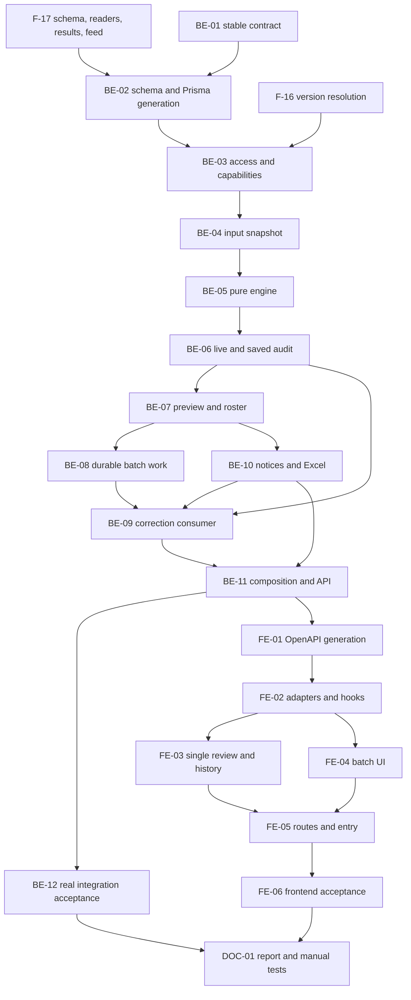

# F-19 Graduation Review — Backend + Frontend Implementation Plan

This plan builds EP-19, US-087..US-091 and CV-215..CV-225: semester-explicit graduation evaluation, staff-recorded audit history, equivalence recognition, four-category shortfalls, asynchronous cohort/program reviews, Excel results, and correction-driven re-audit with conclusion-change notifications. It supplies one versioned result contract for F-20 and F-21. It does not build those consumers, registration eligibility, a gradebook, a certificate register, a graduation-award workflow or school-system synchronization.

> **Companion documents**
> - Decisions: `docs/planning/feature-questions.md:287`, F19-01..04, blank answers = A; F07-03, F05-02/03 and F17-04 remain relevant.
> - Epic and acceptance: `docs/planning/epics.md:185`, B5 acceptance 7/8/9; `docs/planning/user-stories.md:1066`, US-087..091; `docs/planning/task-breakdown.md:413`, CV-215..225.
> - Requirements: `docs/requirement/REQUIREMENTS.md:566`, FR-84..87; BR-02/04/09/10; §7.4; EC-14..18/33..37/43; NFR-03/09/11/18/20.
> - Design: `docs/design/data-dictionary.md:303`, `:329`, `:343`, `:686`, `:702`, `:719`; `docs/design/erd.md` M-8/M-9/E-2/E-11; `docs/design/state-diagrams.md` GD/KQ and §13; `docs/design/sequence-diagrams.md:659`; `docs/design/screen-inventory.md:139`, MH-53/54, with future MH-59.
> - Read-in-full dependency contracts: `docs/implementation/f-17-student-records-results-import-implementation-plan.md`, especially BE-03/07 and D13/U3; `docs/implementation/f-16-version-compare-cohort-assignment-implementation-plan.md`, BE-04; `docs/implementation/f-12-grade-formula-assessment-clo-implementation-plan.md`, F12-01/T-1. All three are **written, not built** at this planning baseline.
> - Conventions/exemplars: `docs/implementation/README.md`; F-15 and F-09 implementation plans; `docs/architecture/general_architecture.md`, `features_architecture.md`, `database_and_models.md`; frontend `src/shared/design-system/DESIGN_SYSTEM.md`.
> - Built-feature evidence: F-02/05/06/07/08/14/15 implement reports under `docs/implement-report/`; actual source, not old plan assertions, establishes existing behavior.
> - Acceptance authority: `docs/planning/test-plan.md`, KB-063..067/074..080, NT-B5-07/08; NEW manual supplement `docs/testing/feature__f-19-graduation-review.md` is a future DOC-01 deliverable. `docs/planning/deferred-scope.md` continues to exclude general audit logging and unrelated institutional extensions.

**Status**: Not started — planned against permitted source inspected on 2026-10-26, Asia/Bangkok. Dependency contracts require source re-verification when built. The Faculty defaults and accepted historical limitations in §8 are not approved by this document.

## 0. Plan at a glance

Everything below in one table. Read this; the rest is detail for whoever builds it.

| What | Why | How and where |
|---|---|---|
| **The student's applicable version, not today's latest** | US-087; BR-26; independent dual-major decisions | F-17's actor-bound resolver over F-16, explicit student/program/semester, frozen frame inputs in `shared/graduation/` (BE-03/04) |
| **One stable evaluation contract** | F-20 and F-21 must not reinterpret eligibility | Version-one result, four shortfall categories, stable codes, decimal strings, evidence/provenance and knowledge-block breakdown (BE-01/04/05/06) |
| **Recognize current equivalence without double credit** | US-088; F19-02/03 A; BR-09/10 | Pure class-based allocation; actual studied-course credit basis; surplus separately identified; ambiguous institutional cases fail explicitly, not arbitrarily (BE-04/05) |
| **Keep each staff review and its evidence** | US-087 AC5; F19-02 A | Append-only `GraduationAudit`, per-context head, snapshot/digest, idempotent request keys; no Student status write (BE-02/06) |
| **Review a cohort or program in the background** | US-090; F19-04 A; NFR-03 | Confirmed frozen context roster, individual data errors isolated, BullMQ/recovery, SQL filters and Excel from saved rows (BE-07/08/10) |
| **Own the result-correction consumer** | US-091; F-17 D13 explicitly hands this to F-19 | Scan durable change feed without a lossy timestamp watermark; per-change receipts/targets, authorized system capability, re-audit/history and atomic notifications (BE-03/09/10) |
| **Make staff outcomes inspectable** | MH-53/54; US-089/090 | Generated types, shared read-only result view, staff history and batch progress/error drill-down (FE-01..06) |
| **Preserve built-feature behavior** | Scope fence and inherited temporal limitations | Only F-19 tables and relation back-fields, one additive notification enum member; no changed Course/Semester/CohortVersion policies or unapproved runtime package (BE-02/11; §8) |

**Key behaviours worth knowing**

| Behaviour | Why it is this way |
|---|---|
| `ELIGIBLE` and `NOT_ELIGIBLE` are academic conclusions; `CANNOT_AUDIT` is an operational outcome | Bad configuration, unresolved version or unsupported policy is not proof of academic failure |
| A live read evaluates without saving; explicit staff/batch/re-audit operations save | MH-59's future read-on-view must not manufacture staff history; source-result changes still have durable staff baselines |
| A saved audit is immutable even if equivalence/catalog/calendar later changes | Re-running uses current authoritative relations and records new evidence; viewing history returns stored evidence |
| Zero-credit mandatory rows still require completion | BR-02; numeric totals cannot substitute for required conditions |
| Knowledge blocks explain allocated credits; global block minima are not a fifth graduation rule | The four checks are authoritative; no per-version block-quota contract exists in the supplied inputs |
| Batch roster is frozen at confirmation, evaluation inputs are read at each item's transaction | Membership does not drift during a run; a batch is not falsely advertised as one global point-in-time transcript snapshot |
| Re-audit can cover several already-committed corrections with one new current-state audit | Every feed event retains its own receipt/target and before/after source record; do not replay stale marks over newer truth |
| An eligible audit never sets `Student.status = GRADUATED` or closes enrollment | F17-04 A and source-owned student status are unchanged |

**Not included**

| Excluded | Why |
|---|---|
| F-18 engine, F-20 portal screens, F-21 API-key routes, F-22 connector | Separate owners; only explicit consumer/producer contracts are specified here |
| GPA, disciplinary/financial gates, time-to-degree, certificate administration or manual waivers | Not FR-84..87; F19-01 A models supplied non-credit conditions as curriculum courses |
| Institutional resolution of conflicting credit allocations, unscored exemptions or historical earned credits | Faculty-owned information is absent; §8 stops the affected academic decision rather than guessing |
| Repairing release correction history, freezing calendar dates or re-freezing old course snapshots | Changes built-feature behavior; owner decisions required |
| Email, general AuditLog, notification deep links or a manual approve/reject award process | In-app conclusion notices suffice; the feature's decisions are computed conclusions, not a new approval workflow |

**Open questions**

| Question | Resolved when | Default if unanswered |
|---|---|---|
| Which official non-credit conditions and completion/exemption rules apply? | Faculty confirms F19-01 and §8 E2 | A: courses in the applicable frame; no certificate entity; ambiguous exemptions return CANNOT_AUDIT |
| Must pre-correction/calendar entitlement and actual historical earned credits be reconstructible? | E1 decided 2026-10-26 (user); E2 default in effect, Faculty input owed | Preserve source contracts and snapshot exact audit inputs; no immutable pre-correction history/freeze work or invented historical earned credits |
| How should competing equivalence buckets and free-credit substitution be resolved? | Faculty settles E3 | No duplicate award or arbitrary bucket choice; affected cases stop with an explicit diagnostic |

## 1. Scope

| In scope | Why |
|---|---|
| Four checks for every explicit enrollment/program/semester context | FR-84/86; US-087/089; UC-61/64 |
| Mandatory and conditional completion, group credit/course-count minima, unique credited total | F19-01/03 A; F07-03; BR-02/04 |
| Current F-05 equivalence membership; cross-version/transfer recognition and evidence | FR-85; US-088; EC-14..18/33/35 |
| Immutable successful audit rows, history, current-state evaluation and freshness diagnostics | US-087 AC5; US-091; future consumer contract |
| Scoped cohort/program preview, confirmation, asynchronous execution, progress, item isolation and XLSX | FR-87; US-090; NFR-03/18/20 |
| Idempotent consumption of F-17's durable correction feed and in-app notices when conclusions change | US-091; EC-43; CV-224/225 |
| R1 and supervised R3 staff screens; owning R6 read foundation only | MH-53/54, seeded graduation permissions, NFR-11 |

| Out of scope | Deferred until |
|---|---|
| Student records/imports, exception/enrollment lifecycle and cohort resolver implementation | F-17/F-16, hard prerequisites rather than stubs |
| Recomputing imported PASSED/FAILED from marks or assessment formulas | Excluded by F12-01/T-1; source status remains authoritative |
| Portal and external integration endpoints/authentication | F-20/F-21; they consume this result contract |
| External DB mapping/checkpoints/conflict policy | F-22; it must use F-17's shared writer/change feed |
| Official certificate/evidence register, new block quotas, graduation award/status mutation | Separate approved institutional scope |
| Index, README, progress or other plans in this planning run | Caller owns those updates; this run creates exactly this file |

| AC / task | Covered by |
|---|---|
| US-087 AC1 all four checks satisfied → Đủ điều kiện | BE-04/05/06/12; FE-03/06 |
| US-087 AC2 required course missing → Chưa đủ điều kiện | BE-05/12; FE-03/06 |
| US-087 AC3 zero-credit mandatory still required | BE-04/05/12; FE-03/06; KB-074 |
| US-087 AC4 dual majors independent | BE-03/06/07/09/12; FE-03/04/06 |
| US-087 AC5 staff/time/history retained | BE-02/06/12; FE-03/06; CV-215/216/217 |
| US-088 AC1 transitive group recognition | BE-04/05/12; FE-03; KB-076 |
| US-088 AC2 3-credit requirement/2-credit substitute, one-credit gap and warning | BE-01/04/05/12; FE-03/06; KB-077 |
| US-088 AC3 same equivalence group counted once; surplus free | BE-04/05/12; FE-03/06; KB-078; E3 fences genuinely ambiguous cases |
| US-088 AC4 old/new codes; AC5 transferred program | BE-03/04/05/12; FE-03/06; KB-079; CV-218/219 |
| US-089 AC1 four categories; AC2 group has 3/needs 6/missing 3 | BE-01/05/06/12; FE-03/06 |
| US-089 AC3 empty shortfalls and explicit completion message | BE-01/05/12; FE-03/06; CV-220 |
| US-090 AC1 ~500 students <5 minutes | BE-07/08/12; FE-04; CV-221/223 |
| US-090 AC2 result filter/detail | BE-07/12; FE-04/06 |
| US-090 AC3 Excel code/name/conclusion/shortfall summary | BE-10/12; FE-04/06; CV-222 |
| US-090 AC4 one bad student's data does not stop others | BE-07/08/12; FE-04/06 |
| US-090 AC5 R3 selects only directed programs | BE-03/07/08/11/12; FE-04/05/06 |
| US-091 AC1 correction creates new audit, retains old | BE-02/03/09/12; FE-03; KB-080 |
| US-091 AC2 changed conclusion notifies R1; AC3 unchanged does not | BE-09/10/12; existing notification UI regression in FE-06; CV-224/225 |
| B5 acceptance 7/8 and domain result for 9 | BE-12/FE-06; actual portal/integration API acceptance remains F-20/F-21 |

## 2. Contract verification

Completed before designing §5. **VERIFIED** rows cite inspected source as it stands on 2026-10-26. **NEW / UNVERIFIED** rows are explicit future contracts, not alleged implementations. The sensitive trees and dotenv files are not inputs. New paths below have inspected existing parents; their absence is intentional.

### 2a. Consumed endpoints and behavioral boundaries

| Endpoint / boundary | Verified at | Request | Response / behavior | Use |
|---|---|---|---|---|
| GET `/api/semesters` | `source/backend/src/features/semesters/semesters.controller.ts:19`; service `source/backend/src/features/semesters/semesters.service.ts:32`; mapper `source/backend/src/shared/releases/semester.dto.ts:20` | Session, no body | SemesterDto[], display-sorted by academicYear/term; nullable startDate | FE selectors; require a known date, never infer chronology from ordering |
| GET `/api/cohorts` | `source/backend/src/features/semesters/semesters.controller.ts:44`; service `source/backend/src/features/semesters/semesters.service.ts:39`; mapper `source/backend/src/shared/releases/semester.dto.ts:30` | Session | CohortDto[] | Nonpersonal cohort selector |
| GET `/api/notifications` | `source/backend/src/features/notifications/notifications.controller.ts:30`; `notifications.service.ts:22`; mapper `source/backend/src/features/notifications/notification.dto.ts:52` | Page/unread filter | Own rows only, createdAt/id descending; no graduation-specific target | Existing UI displays the new content-only notice; no new notification fetch adapter |
| POST `/api/notifications/:id/read` | `source/backend/src/features/notifications/notifications.controller.ts:54`; `notifications.service.ts:53`; same mapper `notification.dto.ts:52` | Session + CSRF | NotificationDto; idempotent read, other recipient 404 | Existing notification interaction, unchanged |
| F-17 student/program/semester resolver | **UNVERIFIED:** F-17 BE-03; F-16 BE-04 | `forAccess(access, 'GRADUATION').resolveForStudent({studentId,programId,semesterId}, tx?)` | Exact result with resolved version, interval enrollment, COHORT/EXCEPTION and nullable mapping ID | Hard U1/U2 gate; not an internal HTTP call |
| F-17 transcript and retake facts | **UNVERIFIED:** F-17 BE-07 | `AcademicResultsReader.forAccess(...).forStudent(lookup, tx?)`; `bestAcademicResults(attempts)` | All student-wide attempts through semester; source statuses and exact supplied scales; highest score4, later-date/ID tie | Hard U1; no grade-formula interpretation |
| F-17 correction producer | **UNVERIFIED:** F-17 BE-01/07, D13 | `AcademicResultChange`, unique `(academicResultId, revision)` | Durable before/after, revision and recordedAt in source write transaction; no consumer/ack | F-19 owns all receipt, fan-out, re-audit and notification work |
| F-16 cohort resolution | **UNVERIFIED:** F-16 BE-04 | `forCohort/forCohorts(input, tx?)` | Known-date semester selection, PENDING/HISTORICAL valid, no ACTIVE fallback | Used through F-17; bulk program/semester/cohort grouping |
| Frozen row read primitives | `source/backend/src/shared/curriculum/row-course.ts:4`, `:11`; publication `source/backend/src/shared/releases/version.publisher.ts:110` | CurriculumItem with course | Prefer existing snapshots; publisher fills only null snapshots | New graduation reader is stricter: missing issued snapshot is CANNOT_AUDIT, not live fallback |
| Curriculum totals are not earned credits | `source/backend/src/shared/curriculum/program-credits.ts:29`, `:40`; `source/backend/src/features/curriculum/curriculum-totals.ts:18`, `:41` | Frame rows/groups | Offered semester/block totals and cheapest-member group requirement, not a student's allocation | Mirror Decimal practice only; do not call these as graduation results |
| Current equivalence membership | `source/backend/prisma/schema.prisma:253`, `:294`; `source/backend/src/features/equivalence-groups/equivalence-groups.service.ts:23`, `:172` | Course.equivalenceGroupId | School-wide current group; merge moves members; no version membership ledger | Read in the same tx and snapshot used membership in each audit |
| Knowledge blocks | `source/backend/prisma/schema.prisma:537`; reader `source/backend/src/features/curriculum/curriculum-read.service.ts:80`; totals `curriculum-totals.ts:41` | Free-form blockSymbol | Global optional requiredCredits; no per-version block quota or FK | Report exact symbols including unknown/null; do not invent block eligibility gates |
| Existing notification writer | `source/backend/src/shared/notifications/notification.service.ts:7`, `:19` | actorId required; optional request target via null | Suppresses actor and only returns count | Do not fake an actor ID for system notices; F-19 uses its own tx writer |
| Current authorization | `source/backend/src/shared/authz/access-context.ts:32`, `:75`, `:120`; `source/backend/src/shared/authz/permission-codes.ts:43`; seed `source/backend/prisma/seed-data/permission-catalog.ts:327`, `:334` | Active assignments/grants | R1/R3 staff audit; R1/R3/own R6 view. Target dimensions are OR, not an identity proof | Add explicit student ownership and role/program conjunction; no permission reseed |
| Queue lifecycle | `source/backend/src/shared/queue/queue.module.ts:6`; `source/backend/src/features/releases/release-activation.scheduler.ts:36`; `release-activation.processor.ts:78` | ID-only jobs | Shared Redis prefix, nonblocking startup, bounded forced worker shutdown | Mirror, do not replace F-15 queue |
| File and HTTP clients | `source/backend/src/shared/files/send-file.ts:9`; `source/frontend/src/shared/api/client.ts:70`, `:77`, `:115` | JSON or GET binary | Direct JSON; CSRF header; RFC5987 download | Reuse unchanged helpers |

**New endpoints this plan builds and its FE calls — not existing source.** Each Verified-at cell is deliberately UNVERIFIED; the binding contract is the named deliverable. U9 requires real serializer/OpenAPI verification before FE-01, rather than invented current line references.

| Endpoint (all under `/api`) | Verified at | Request | Response | Notes |
|---|---|---|---|---|
| GET `/students/:studentId/graduation` | NEW/UNVERIFIED BE-06/11 | programId, semesterId | GraduationOutcomeDto | Read-only; owning R6 allowed |
| POST `/students/:studentId/graduation-audits` | NEW/UNVERIFIED BE-06/11 | programId, semesterId, requestKey | GraduationAuditDto | Staff save; 201; no audit on unevaluable input |
| GET `/students/:studentId/graduation-audits` | NEW/UNVERIFIED BE-06/11 | programId, semesterId, page/pageSize | GraduationAuditPageDto | Staff exact-context history |
| GET `/graduation-audits/:auditId` | NEW/UNVERIFIED BE-06/11 | auditId | GraduationAuditDto | Stored immutable result, not re-evaluation |
| POST `/graduation-batches/preview` | NEW/UNVERIFIED BE-07/11 | filters | GraduationBatchPreviewDto | No writes, 200, CSRF |
| POST `/graduation-batches` | NEW/UNVERIFIED BE-07/11 | filters, previewRevision, requestKey | GraduationBatchDto | Durable roster before enqueue, 201 |
| GET `/graduation-batches` | NEW/UNVERIFIED BE-07/11 | page/pageSize | GraduationBatchPageDto | Creator + current staff scope |
| GET `/graduation-batches/:id` | NEW/UNVERIFIED BE-07/11 | id | GraduationBatchDto | Counts from durable item aggregates |
| GET `/graduation-batches/:id/items` | NEW/UNVERIFIED BE-07/11 | page/pageSize, q, conclusion, outcome | GraduationBatchItemPageDto | Filter SQL before count/page; original item.auditId |
| GET `/graduation-batches/:id/export` | NEW/UNVERIFIED BE-10/11 | q, conclusion, outcome | XLSX binary | Saved terminal batch; no recalc |
| GET `/students/:studentId/graduation-reaudit-tasks` | NEW/UNVERIFIED BE-09/11 | programId, semesterId, page/pageSize | GraduationReauditTaskPageDto | R1-only scoped operational list |
| POST `/graduation-reaudit-tasks/:taskId/retry` | NEW/UNVERIFIED BE-09/11 | no body | GraduationReauditTaskDto | R1-only; idempotent, 200 |
| GET `/graduation/program-options` | NEW/UNVERIFIED BE-11 | semesterId | GraduationProgramOptionDto[] | Staff minimal scoped selector |
| GET `/graduation/student-options` | NEW/UNVERIFIED BE-11 | programId, semesterId, q, page/pageSize | GraduationStudentOptionPageDto | Staff minimal scoped selector |

### 2b. Consumed response fields

Generated aliases retain the whole wire DTO; no independently translated response enums or handwritten FE transport models. Internal domain facts are specified in BE-03/04, not incorrectly presented as HTTP DTOs. Every new DTO field is inventoried in BE-01/06/07; those sources are explicitly NEW.

**SemesterDto / CohortDto — complete existing selector mapping**

| Field | Wire type | Nullable | Source | Modeled as | Note |
|---|---|---|---|---|---|
| Semester.id | string | no | `source/backend/src/shared/releases/semester.dto.ts:22` | Select value | Required context |
| semesterCode | string | no | same file `:23` | Label | Never chronology |
| academicYear | string | no | same file `:24` | Label | No parsing |
| termInYear | number | no | same file `:25` | Label | Not relative plannedSemester |
| startDate | ISO day string | **yes** | same file `:26` | Disabled-option check | Server validates too |
| Cohort.id | string | no | same file `:32` | Select value | No inferred cohort |
| cohortCode | string | no | same file `:33` | Label | Search/display |
| intakeYear | number | no | same file `:34` | Label | Not a version selector |

**Existing notification DTOs — reused wholesale by their owning shared client**

| Field | Wire type | Nullable | Source | Modeled as | Note |
|---|---|---|---|---|---|
| Notification.id | string | no | `source/backend/src/features/notifications/notification.dto.ts:54` | Existing Notification | Read key |
| notificationType | `REQUEST_AWAITING_YOU / REQUEST_RETURNED / REQUEST_REJECTED / REQUEST_APPROVED / REQUEST_OVERRIDDEN / REQUEST_COMMENTED / REQUEST_EFFECTIVE` | no | same file `:55`; enum `source/backend/prisma/schema.prisma:145` | Existing generated enum | NEW `GRADUATION_CONCLUSION_CHANGED` extends this set in BE-02 |
| content | string | no | `source/backend/src/features/notifications/notification.dto.ts:56` | Existing text | Vietnamese snapshot; no HTML |
| changeRequestId | string | **yes** | same file `:57` | Existing optional navigation | null for graduation; no fake request |
| readStatus | `UNREAD / READ` | no | same file `:58`; enum `source/backend/prisma/schema.prisma:155` | Existing generated enum | Unchanged |
| createdAt | ISO instant string | no | `source/backend/src/features/notifications/notification.dto.ts:59` | Existing display | Server timestamp |
| readAt | ISO instant string | **yes** | same file `:60` | Existing display | Explicit null |
| NotificationPage.items | NotificationDto[] | no | same file `:42`; `source/backend/src/features/notifications/notifications.service.ts:38` | Existing page | Not recast into graduation data |
| total / page / pageSize | number each | no | `source/backend/src/features/notifications/notification.dto.ts:43`, `:44`, `:45`; mapper `notifications.service.ts:38` | Existing pagination, all three retained | Own rows only |

F-17 Student detail/results and F-15 curriculum/version-detail HTTP DTOs are deliberately **not** additional FE dependencies: graduation returns its own minimal subject/options and evaluation evidence. This avoids pretending their planned adapters or display `currentVersion` resolve entitlement. The existing notification interaction stays in `source/frontend/src/shared/notifications/NotificationItem.tsx:24`; with null changeRequestId it marks read without navigating (`:28`).

**New result DTO — complete outer-field mapping.** Source cells are explicitly NEW/UNVERIFIED contracts, not invented current citations. Every nested field is pinned by BE-01 declarations and concretely decorated in BE-06. All fields are retained by generated shared aliases; no independently translated FE transport model.

| Field | Wire type | Nullable | Source | Modeled as | Note |
|---|---|---|---|---|---|
| schemaVersion | literal 1 | no | NEW BE-01/06, U9 | GraduationResult.schemaVersion | Unsupported stored version is explicit error |
| ruleVersion | literal graduation-v1 | no | NEW BE-01/06, U9 | GraduationResult.ruleVersion | Rule identity |
| evaluatedAt | ISO timestamp string | no | NEW BE-01/06, U9 | GraduationResult.evaluatedAt | Not semester-as-of |
| context | GraduationContextDto | no | NEW BE-01/06, U9 | GraduationResult.context | Every BE-01 context field retained |
| conclusion | ELIGIBLE / NOT_ELIGIBLE | no | NEW BE-01/06, U9 | GraduationResult.conclusion | No operational third conclusion |
| shortfalls | discriminated DTO array | no | NEW BE-01/06, U9 | GraduationResult.shortfalls | Five BE-01 codes, four categories |
| warnings | GraduationWarningDto[] | no | NEW BE-01/06, U9 | GraduationResult.warnings | Three BE-01 codes |
| credits | GraduationCreditsDto | no | NEW BE-01/06, U9 | GraduationResult.credits | requiredTotal/recognizedTotal/missingTotal/compulsory/elective/free: strings |
| electiveGroups | GraduationGroupProgressDto[] | no | NEW BE-01/06, U9 | GraduationResult.electiveGroups | Absent minima nullable |
| knowledgeBlocks | GraduationBlockProgressDto[] | no | NEW BE-01/06, U9 | GraduationResult.knowledgeBlocks | Advisory catalog quota |
| recognitions | GraduationRecognitionDto[] | no | NEW BE-01/06, U9 | GraduationResult.recognitions | Selected course/attempt/provenance |
| freeCredits | GraduationFreeCreditDto[] | no | NEW BE-01/06, U9 | GraduationResult.freeCredits | SURPLUS_EQUIVALENT / OUTSIDE_FRAME |

**New outcome/audit DTOs — every field**

| Field | Wire type | Nullable | Source | Modeled as | Note |
|---|---|---|---|---|---|
| Outcome.status | REVIEWED / CANNOT_AUDIT | no | NEW BE-01/06, U9 | GraduationOutcome.status | oneOf discriminator |
| Outcome.result | GraduationResultDto | **yes** | NEW BE-01/06, U9 | GraduationOutcome.result | Null iff CANNOT_AUDIT |
| Outcome.error | code:string, message:string, enrollmentId:string|null | **yes** | NEW BE-01/06, U9 | GraduationOutcome.error | Null iff REVIEWED |
| Audit.id | string | no | NEW BE-06, U9 | GraduationAudit.id | Immutable identity |
| contextId | string | no | NEW BE-06, U9 | GraduationAudit.contextId | Program/semester context |
| enrollmentId | string | no | NEW BE-06, U9 | GraduationAudit.enrollmentId | Selected interval |
| programVersionId | string | no | NEW BE-06, U9 | GraduationAudit.programVersionId | Resolved version |
| auditedAt | ISO timestamp string | no | NEW BE-06, U9 | GraduationAudit.auditedAt | Save time |
| auditedBy | id:string, fullName:string object | **yes** | NEW BE-06, U9 | GraduationAudit.auditedBy | Null for system |
| trigger | STAFF / BATCH / RESULT_CHANGE | no | NEW BE-06, U9 | GraduationAudit.trigger | Origin |
| supersedesId | string | **yes** | NEW BE-06, U9 | GraduationAudit.supersedesId | Previous head |
| inputDigest | string | no | NEW BE-06, U9 | GraduationAudit.inputDigest | Not raw inputs |
| result | GraduationResultDto | no | NEW BE-06, U9 | GraduationAudit.result | Stored decoded v1 |
| freshness | CURRENT / RECHECK_PENDING / RECHECK_FAILED | no | NEW BE-06, U9 | GraduationAudit.freshness | Operational, not academic |

**New preview/batch DTOs — every field.** Batch includes preview fields. Filters is an object with semesterId:string, programId:string|null, cohortId:string|null.

| Field | Wire type | Nullable | Source | Modeled as | Note |
|---|---|---|---|---|---|
| Preview.filters | filters object above | no | NEW BE-07, U9 | BatchPreview.filters | Canonical nulls |
| studentCount | number | no | NEW BE-07, U9 | BatchPreview.studentCount | Distinct students |
| enrollmentCount | number | no | NEW BE-07, U9 | BatchPreview.enrollmentCount | Context items incl errors |
| previewRevision | string | no | NEW BE-07, U9 | BatchPreview.previewRevision | Opaque SHA-256 |
| Batch.id | string | no | NEW BE-07, U9 | GraduationBatch.id | Durable key |
| requestedById | string | no | NEW BE-07, U9 | GraduationBatch.requestedById | Current access still required |
| status | QUEUED / RUNNING / COMPLETED / COMPLETED_WITH_ERRORS / FAILED | no | NEW BE-07, U9 | GraduationBatch.status | Job state |
| processedCount | number | no | NEW BE-07, U9 | GraduationBatch.processedCount | Terminal counts sum |
| eligibleCount | number | no | NEW BE-07, U9 | GraduationBatch.eligibleCount | Reviewed ELIGIBLE |
| notEligibleCount | number | no | NEW BE-07, U9 | GraduationBatch.notEligibleCount | Reviewed NOT_ELIGIBLE |
| errorCount | number | no | NEW BE-07, U9 | GraduationBatch.errorCount | Not academic failure |
| createdAt | ISO timestamp string | no | NEW BE-07, U9 | GraduationBatch.createdAt | Creation |
| startedAt | ISO timestamp string | **yes** | NEW BE-07, U9 | GraduationBatch.startedAt | Null queued |
| finishedAt | ISO timestamp string | **yes** | NEW BE-07, U9 | GraduationBatch.finishedAt | Null until terminal |
| failure | code:string, message:string object | **yes** | NEW BE-07, U9 | GraduationBatch.failure | Safe operational detail |

BE-07 GraduationBatchItemValue, BE-09 GraduationReauditTaskDto and BE-11 selector table enumerate every remaining DTO field with exact nulls/literal statuses, all retained by generated aliases. Every page DTO (audit/batch/item/task/student selector) has exactly items (its named DTO array), total:number, page:number, pageSize:number. No public input snapshot, queue lease, feed before/after or source-grade fields are planned; these are deliberately private, not silently dropped response fields.

### 2c. Verified gaps and mismatch log

| Deliverable | Earlier/design expectation | Actual source and disposition | Found at |
|---|---|---|---|
| BE-02/03 | Graduation/Student models already available | Neither is built; F-17/F-16 are hard contract gates, not present modules | `source/backend/prisma/schema.prisma:403`, `:428`, `:537`; `source/backend/src/app.module.ts:38` |
| BE-04 | Dictionary calls the frame FK programVersion | Actual column is `versionId`; groups also use versionId | `source/backend/prisma/schema.prisma:550`, `:567` |
| BE-04/05 | Existing credit totals can be reused for earned credit | They sum offered rows or group minima; there is no completion/allocation logic | `source/backend/src/shared/curriculum/program-credits.ts:29`; `source/backend/src/features/curriculum/curriculum-totals.ts:18` |
| BE-04 | All course facts are frozen | Name/credits are frozen; equivalence and courseType remain catalog facts, and F-17's proposed attempt has no earned-credit snapshot | `source/backend/prisma/schema.prisma:247`, `:253`, `:583`; F-17 BE-01; E2 |
| BE-03/09 | A worker can call the session-only student facade | Proposed F-17 reader binds AccessContext and forbids fabricated identity; specify a restricted task-backed capability, U1 extension | F-17 BE-03/07, UNVERIFIED |
| BE-09 | A timestamp cursor reliably consumes changes | The F-17 feed has timestamps/revisions, not a commit-order sequence/ack; use absence of F-19 receipts | F-17 BE-01/07, UNVERIFIED |
| BE-10 | Shared notifier supports anonymous system event | Its actorId is required and actor suppression is unconditional; keep old signature/callers | `source/backend/src/shared/notifications/notification.service.ts:7`, `:23` |
| BE-03/04 | Historical cohort mappings/calendar are immutable | Correction retargets mappings at old start; calendar protection covers only ACTIVE/HISTORICAL release starts | `source/backend/src/features/releases/corrections.service.ts:143`; `source/backend/src/features/semesters/semesters.service.ts:87`; E1 |
| FE-04 | Shared CohortSelect can bind one cohortId | It is a multiple-value selector; use a local single Select from the existing cohort hook without changing old callers | `source/frontend/src/shared/releases/CohortSelect.tsx:14`; `source/frontend/src/shared/releases/useReleaseOptions.ts:12` |

## 3. Decisions

| ID | Decision | Why | Rejected alternative |
|---|---|---|---|
| D1 | Separate pure `shared/graduation` engine/read service from staff `features/graduation` orchestration | F-20/21 need the same computation without staff persistence side effects | Feature-service imports or copied portal/API algorithms |
| D2 | Required explicit student/program/semester; store the resolver's returned version ID separately from enrollment's pin | F-17 can resolve future/cohort changes before materialized interval catch-up | ACTIVE/latest/currentVersion or rereading the stored pin |
| D3 | Result schemaVersion 1; fixed codes and four categories; operational error union outside academic conclusion | Stable downstream contract; no false NOT_ELIGIBLE on corrupt input | Localized messages as identifiers or a third GraduationAudit conclusion |
| D4 | Exact Decimal arithmetic and decimal-string transport; no formula/score threshold evaluation | F12-01/T-1, EC-36 and existing wire convention | Float sums, guessed pass marks or grade conversions |
| D5 | Use current equivalence, snapshot exact membership/evidence per audit | F19-02 A; old saved decisions remain explainable | Version-scoped group migration or overwriting history |
| D6 | Knowledge-block allocation is explanatory, with optional catalog requirement shown as advisory | Four-check specification and free-form global block catalog | New fifth failure category or new per-program block schema |
| D7 | Persist successful evaluations only; errors live in batch/task outcomes and HTTP diagnostics | GraduationAudit retains the dictionary's two conclusions | Storing fabricated NOT_ELIGIBLE when evaluation failed |
| D8 | Database roster/progress/receipts are authoritative; BullMQ schedules and retries only | Redis loss/duplicates must not lose decisions or create duplicates | Redis-only batch results or dedup relying only on job IDs |
| D9 | Freeze roster at confirmation; each enrollment evaluated transactionally against then-current inputs | Bounded work and explicit reproducibility; no 500-student transaction | Live roster drift or unsupported global-snapshot claim |
| D10 | Re-audit previously audited contexts, including historical/transferred and dual-major contexts | F-17 U3/EC-43; not merely the current PRIMARY enrollment | One student-wide latest result or ACTIVE-only lookup |
| D11 | Add a task-backed system capability to the unbuilt F-17 boundary, preserving existing methods | Background work has no interactive actor; authorization remains explicit | Fake R1, captured revoked reviewer or duplicated resolution logic |
| D12 | F-19 writes automatic notices in the same transaction as new audit and completed target | Exactly-once durable effect; notification cannot outlive a rolled-back audit | Queue-only notices, changing shared notifier signature or fake actor IDs |
| D13 | Excel exports saved batch item outcomes, including errors; no recalculation or mark formulas | Export must agree with reviewed decisions; F19-04 A | Rerunning audits on download or requiring the F-09 importer |
| D14 | Stop ambiguous institutional slices with CANNOT_AUDIT and §8 escalation | No unattended business-policy invention | Greedy allocations, fabricated historical credits or treating exemptions as numeric marks |

## 4. Integration boundaries and deliberate divergences

| Boundary | Disposition |
|---|---|
| Dictionary GraduationAudit has no version/as-of/evidence fields | Add them only to the NEW F-19 model; an enrollment FK alone cannot explain the actual resolved version after schedules change |
| Sequence suggests one synchronous cohort loop | Keep the same four checks but use durable BullMQ batch work, confirmation and progress per F19-04 A |
| Dictionary shortfalls nullable | NEW wire/storage contract always has an array; ELIGIBLE has `[]`. This does not migrate or change any existing graduation table |
| Four shortfall categories versus minCourses | Keep four categories; `ELECTIVE_COURSES_MISSING` belongs to ELECTIVE_GROUP alongside credit gaps; when both minima exist, enforce both |
| KnowledgeBlock.requiredCredits is global, not version-owned | Show it as advisory metadata only. Actual graduation requirements remain applicable frame/group/version facts; E2 asks about additional institutional requirements |
| Staff and live evaluation | Staff save creates immutable history; live read is read-only. F-20/21 must deliberately choose live evaluation versus saved history and display evaluatedAt/as-of context |
| F-17 is a producer only | No result writer or importer calls a graduation feature service. F-19 owns receipts, targets, reconciliation, system capability, history and notices |
| Existing notifications lack graduation links | Preserve their DTO and nullable request link; add a new type with full Vietnamese content. No deep-link schema is needed for the story |
| Built correction/calendar limitations | Retain current behavior; store evidence used, but do not certify reconstruction of source facts already overwritten; E1 is not silently solved |
| No shared API is replaced | Existing `NotificationService.notify`, row helpers, release writers, ScopeService and frontend file helpers keep their signatures and callers. F-17 adds separate methods, not a breaking overload |

## 5. Deliverables

All files and code in this section are **to build**. MODIFY paths inside F-17 are **UNBUILT DEPENDENCY paths**, not claims that the file exists now. Existing parents inspected: backend `src/features`, `src/shared`, `prisma/migrations`, `test/fixtures`; frontend `src/features`, `src/shared`; `docs/testing` and `docs/implement-report`. A NEW nested directory is created with its first step. No source or existing documentation is edited by this planning run.

### BE-01 — Stable evaluation vocabulary, shortfalls and diagnostics

**What / why:** Fix the reusable domain/wire meaning before persistence or UI implementation.

**Files**

| Action | Path | Mirror / rationale |
|---|---|---|
| NEW | `source/backend/src/shared/graduation/graduation.constants.ts` | Named literals/limits like `source/backend/src/shared/curriculum/curriculum-warnings.ts:5` |
| NEW | `source/backend/src/shared/graduation/graduation.types.ts` | Domain-only contracts like `source/backend/src/shared/releases/semester-start.ts:8` |
| NEW | `source/backend/src/shared/graduation/graduation.errors.ts` | ErrorDefinition/AppException pattern in `source/backend/src/shared/releases/release.errors.ts:4` |
| NEW | `source/backend/src/shared/graduation/graduation-contract.spec.ts` | Pure contract tests like `source/backend/src/shared/decimal/decimal.spec.ts:1` |

**Shape — complete NEW result contract, not existing API output**

All declarations below are exported. Date values in the result are ISO strings; quantities called credits are exact decimal strings. DTO classes in BE-06 must expose these same keys with concrete Swagger metadata. FE and future F-20/21 alias generated schemas; they do not import backend TypeScript or duplicate the enums.

```ts
export const GRADUATION_SCHEMA_VERSION = 1 as const;
export const GRADUATION_RULE_VERSION = 'graduation-v1' as const;
export const GRADUATION_QUEUE = 'graduation-review';
export const GRADUATION_LIMITS = {
  REVISION_LENGTH: 64, REQUEST_KEY_MAX: 64, SEARCH_MAX: 200,
  BATCH_CHUNK_SIZE: 50, TRANSACTION_TIMEOUT_MS: 30_000,
  TRANSACTION_MAX_WAIT_MS: 10_000, JOB_ATTEMPTS: 3,
  JOB_BACKOFF_MS: 5_000, SCAN_INTERVAL_MS: 5_000,
  LEASE_MS: 60_000, WORKER_CONCURRENCY: 2, SHUTDOWN_GRACE_MS: 10_000,
  PERFORMANCE_STUDENTS: 500, PERFORMANCE_BUDGET_MS: 300_000, TRANSACTION_RETRIES: 3,
} as const;
export type GraduationConclusion = 'ELIGIBLE' | 'NOT_ELIGIBLE';
export type ShortfallCategory = 'MANDATORY_COURSE' | 'ELECTIVE_GROUP'
  | 'TOTAL_CREDITS' | 'CONDITIONAL_COURSE';
export type CreditBasis = 'APPLIED_VERSION_SNAPSHOT' | 'CURRENT_CATALOG';
export type CompletionReason = 'NOT_TAKEN' | 'FAILED' | 'IN_PROGRESS';
export interface GraduationLookup {
  studentId: string; programId: string; semesterId: string;
}
export interface GraduationCourseRef {
  id: string; courseCode: string; courseName: string;
}
export interface GraduationContextValue extends GraduationLookup {
  enrollmentId: string;
  studentCode: string; fullName: string;
  programCode: string; programName: string;
  cohortId: string; cohortCode: string;
  programVersionId: string; versionNumber: string;
  semesterCode: string; semesterStartDate: string;
  versionSource: 'COHORT' | 'EXCEPTION'; cohortAssignmentId: string | null;
}
export interface CourseShortfall {
  code: 'MANDATORY_COURSE_MISSING' | 'CONDITIONAL_COURSE_MISSING';
  category: 'MANDATORY_COURSE' | 'CONDITIONAL_COURSE';
  curriculumItemId: string; course: GraduationCourseRef;
  blockSymbol: string | null; reason: CompletionReason; message: string;
}
export interface ElectiveCreditShortfall {
  code: 'ELECTIVE_CREDITS_MISSING'; category: 'ELECTIVE_GROUP';
  groupId: string; groupCode: string; groupName: string;
  requiredCredits: string; earnedCredits: string; missingCredits: string;
  message: string;
}
export interface ElectiveCourseShortfall {
  code: 'ELECTIVE_COURSES_MISSING'; category: 'ELECTIVE_GROUP';
  groupId: string; groupCode: string; groupName: string;
  requiredCourses: number; earnedCourses: number; missingCourses: number;
  message: string;
}
export interface TotalCreditShortfall {
  code: 'TOTAL_CREDITS_MISSING'; category: 'TOTAL_CREDITS';
  requiredCredits: string; earnedCredits: string; missingCredits: string;
  message: string;
}
export type GraduationShortfall = CourseShortfall | ElectiveCreditShortfall
  | ElectiveCourseShortfall | TotalCreditShortfall;
export interface GraduationRecognition {
  curriculumItemId: string; requiredCourse: GraduationCourseRef;
  studiedCourse: GraduationCourseRef; attemptId: string; attemptRevision: number;
  completionStatus: 'PASSED' | 'EXEMPT';
  viaEquivalence: boolean; equivalenceGroupId: string | null;
  requiredCredits: string; recognizedCredits: string; creditBasis: CreditBasis;
  category: 'MANDATORY_COURSE' | 'ELECTIVE_GROUP' | 'CONDITIONAL_COURSE';
  electiveGroupId: string | null; blockSymbol: string | null;
}
export interface GraduationFreeCredit {
  course: GraduationCourseRef; attemptId: string; credits: string;
  creditBasis: CreditBasis; reason: 'SURPLUS_EQUIVALENT' | 'OUTSIDE_FRAME';
}
export interface GraduationGroupProgress {
  groupId: string; groupCode: string; groupName: string;
  requiredCredits: string | null; earnedCredits: string; missingCredits: string | null;
  requiredCourses: number | null; earnedCourses: number; missingCourses: number | null;
}
export interface GraduationBlockProgress {
  blockSymbol: string | null; blockName: string | null;
  earnedCredits: string; compulsoryCredits: string; electiveCredits: string;
  catalogRequiredCredits: string | null; advisoryGap: string | null;
}
export interface GraduationWarning {
  code: 'EQUIVALENT_CREDIT_GAP' | 'CURRENT_CATALOG_CREDIT_BASIS'
    | 'UNKNOWN_KNOWLEDGE_BLOCK';
  curriculumItemId: string | null; courseId: string | null;
  creditGap: string | null; message: string;
}
export interface GraduationResult {
  schemaVersion: 1; ruleVersion: 'graduation-v1';
  evaluatedAt: string; context: GraduationContextValue;
  conclusion: GraduationConclusion;
  shortfalls: GraduationShortfall[]; warnings: GraduationWarning[];
  credits: {
    requiredTotal: string; recognizedTotal: string; missingTotal: string;
    compulsory: string; elective: string; free: string;
  };
  electiveGroups: GraduationGroupProgress[];
  knowledgeBlocks: GraduationBlockProgress[];
  recognitions: GraduationRecognition[]; freeCredits: GraduationFreeCredit[];
}
export interface GraduationDiagnostic {
  code: string; message: string; enrollmentId: string | null;
}
export type GraduationOutcome =
  | { status: 'REVIEWED'; result: GraduationResult; error: null }
  | { status: 'CANNOT_AUDIT'; result: null; error: GraduationDiagnostic };
```

Invariant: `ELIGIBLE` iff shortfalls is empty; warning-only evaluations may be ELIGIBLE. No null/omitted shortfalls, negative missing amount, duplicated recognized attempt/class or numeric credits. `EXEMPT` is a reserved completion literal, not permission to infer exemption credit: E2's gate must be satisfied before such evidence is emitted.

Shortfall codes are the public identifiers. Vietnamese messages are presentation snapshots: `Chưa hoàn thành học phần bắt buộc …`, `Nhóm … đã có 3 tín chỉ, còn thiếu 3 tín chỉ.`, `Còn thiếu … học phần trong nhóm …`, `Còn thiếu … tín chỉ tích lũy.`, `Chưa hoàn thành học phần điều kiện …`. Both course code/category pairings are validated. Group missing-credit and missing-course entries may coexist, rather than hiding one unmet minimum. Sort categories in the stated four-check order, then frame semester/sortOrder/courseCode or groupCode; stable code breaks ties.

Define diagnostics separately from shortfalls: `APPLIED_VERSION_UNRESOLVED`, `ENROLLMENT_AMBIGUOUS`, `SEMESTER_START_UNKNOWN`, `GRADUATION_SNAPSHOT_INCOMPLETE`, `GRADUATION_INPUT_INVALID`, `EQUIVALENCE_ALLOCATION_AMBIGUOUS`, `EXEMPTION_POLICY_UNCONFIRMED`, `GRADUATION_POLICY_UNCONFIRMED`, `GRADUATION_STATE_CHANGED`, `GRADUATION_JOB_FAILED`, `GRADUATION_ACCESS_REVOKED`. Reuse F-17/F-16 existing error definitions for their codes after U1/U2 land; graduation's new definitions use 409 for unevaluable input/stale confirmation, 404 for scope-filtered misses, 503 for unavailable execution/export infrastructure. Never return raw Prisma/worker messages as student diagnostics. Transport validation/auth failures remain 400/401/403/404, not successful academic outcomes.

**Rationale:** Code/message separation mirrors `source/backend/src/shared/curriculum/curriculum-warnings.ts:51`; exact strings mirror `source/backend/src/shared/decimal/decimal.ts:9`. Version and provenance are necessary because F-20/F-21 must explain the same result, not rerun client rules.

**Gotchas:** No grade, GPA or requirement is inferred from F-12 formulas. Do not use absent fields to mean zero or unassigned. Unknown future schemaVersion is an explicit unsupported-version error on stored-result reads, never an unsafe JSON cast.

**Verify:** Backend `pnpm exec vitest run src/shared/graduation/graduation-contract.spec.ts`; assert every code/category pairing, all nullable branches, exact decimals and conclusion/shortfalls invariant. Add JSON round-trip fixtures for both outcomes and all five shortfall codes.

**Depends on:** —; U1/U2 error names must be reconciled before integrating their implementation.

### BE-02 — F-19 persistence, additive migration and Prisma generation

**What / why:** Store independent per-context histories, recoverable batches and durable correction deduplication without changing built academic tables.

**Files**

| Action | Path | Mirror / rationale |
|---|---|---|
| MODIFY | `source/backend/prisma/schema.prisma` | Explicit Restrict relations and cuid IDs like `source/backend/prisma/schema.prisma:428`; new models plus back-fields only |
| NEW | `source/backend/prisma/migrations/<timestamp>_graduation_review/migration.sql` | Generate next chronological migration; mirror `source/backend/prisma/migrations/20261019131021_release_versions/migration.sql:1` |
| MODIFY (generated) | `source/backend/src/generated/prisma/` | Schema generator output; regenerate the whole directory, never hand-edit generated files |

**Shape**

```prisma
enum GraduationConclusion {
  ELIGIBLE
  NOT_ELIGIBLE
}
enum GraduationAuditTrigger {
  STAFF
  BATCH
  RESULT_CHANGE
}
enum GraduationBatchStatus {
  QUEUED
  RUNNING
  COMPLETED
  COMPLETED_WITH_ERRORS
  FAILED
}
enum GraduationBatchItemStatus {
  PENDING
  REVIEWED
  ERROR
}
enum GraduationReauditStatus {
  PENDING
  RUNNING
  COMPLETED
  COVERED
  FAILED
}

model GraduationAuditContext {
  id            String   @id @default(cuid(2))
  studentId     String
  student       Student  @relation(fields: [studentId], references: [id], onDelete: Restrict)
  programId     String
  program       Program  @relation(fields: [programId], references: [id], onDelete: Restrict)
  semesterId    String
  semester      Semester @relation(fields: [semesterId], references: [id], onDelete: Restrict)
  lastAuditId   String?  @unique
  lastAudit     GraduationAudit? @relation(GraduationContextHead, fields: [lastAuditId], references: [id], onDelete: Restrict)
  audits        GraduationAudit[] @relation(GraduationContextAudits)
  reauditTasks  GraduationReauditTask[]
  createdAt     DateTime @default(now())
  updatedAt     DateTime @updatedAt

  @@unique([studentId, programId, semesterId])
  @@index([studentId])
}

model GraduationAudit {
  id               String   @id @default(cuid(2))
  contextId        String
  context          GraduationAuditContext @relation(GraduationContextAudits, fields: [contextId], references: [id], onDelete: Restrict)
  currentFor       GraduationAuditContext? @relation(GraduationContextHead)
  enrollmentId     String
  enrollment       ProgramEnrollment @relation(fields: [enrollmentId], references: [id], onDelete: Restrict)
  programVersionId String
  programVersion   ProgramVersion @relation(fields: [programVersionId], references: [id], onDelete: Restrict)
  auditedAt        DateTime @default(now())
  auditedById      String?
  auditedBy        User? @relation(GraduationReviewer, fields: [auditedById], references: [id], onDelete: Restrict)
  trigger          GraduationAuditTrigger
  operationKey     String @unique
  conclusion       GraduationConclusion
  schemaVersion    Int
  ruleVersion      String
  shortfalls       Json
  result           Json
  inputs           Json
  inputDigest      String
  supersedesId     String? @unique
  supersedes       GraduationAudit? @relation(GraduationAuditChain, fields: [supersedesId], references: [id], onDelete: Restrict)
  supersededBy     GraduationAudit? @relation(GraduationAuditChain)
  batchItem        GraduationBatchItem?
  baselineTasks    GraduationReauditTask[] @relation(GraduationTaskBaseline)
  completedTasks   GraduationReauditTask[] @relation(GraduationTaskResult)

  @@index([contextId, auditedAt, id])
  @@index([enrollmentId, auditedAt])
}

model GraduationBatch {
  id              String @id @default(cuid(2))
  requestedById   String
  requestedBy     User @relation(GraduationBatchRequester, fields: [requestedById], references: [id], onDelete: Restrict)
  requestKey      String
  filters         Json
  previewRevision String
  rosterDigest    String
  studentCount    Int
  enrollmentCount Int
  status          GraduationBatchStatus @default(QUEUED)
  failureCode     String?
  leaseToken      String?
  leaseUntil      DateTime?
  createdAt       DateTime @default(now())
  startedAt       DateTime?
  finishedAt      DateTime?
  items           GraduationBatchItem[]

  @@unique([requestedById, requestKey])
  @@index([status, leaseUntil, createdAt])
}

model GraduationBatchItem {
  id              String @id @default(cuid(2))
  batchId         String
  batch           GraduationBatch @relation(fields: [batchId], references: [id], onDelete: Restrict)
  studentId       String
  student         Student @relation(fields: [studentId], references: [id], onDelete: Restrict)
  programId       String
  program         Program @relation(fields: [programId], references: [id], onDelete: Restrict)
  semesterId      String
  semester        Semester @relation(fields: [semesterId], references: [id], onDelete: Restrict)
  rosterEnrollmentId String?
  rosterEnrollment ProgramEnrollment? @relation(fields: [rosterEnrollmentId], references: [id], onDelete: Restrict)
  rosterIdentity  Json
  status          GraduationBatchItemStatus @default(PENDING)
  auditId         String? @unique
  audit           GraduationAudit? @relation(fields: [auditId], references: [id], onDelete: Restrict)
  errorCode       String?
  errorMessage    String?
  finishedAt      DateTime?

  @@unique([batchId, studentId, programId, semesterId])
  @@index([batchId, status, id])
}

model GraduationResultChangeReceipt {
  changeId      String @id
  change        AcademicResultChange @relation(fields: [changeId], references: [id], onDelete: Restrict)
  targetCount   Int
  reason        String?
  recordedAt    DateTime @default(now())
  tasks         GraduationReauditTask[]
}

model GraduationReauditTask {
  id               String @id @default(cuid(2))
  changeId         String
  receipt          GraduationResultChangeReceipt @relation(fields: [changeId], references: [changeId], onDelete: Restrict)
  contextId        String
  context          GraduationAuditContext @relation(fields: [contextId], references: [id], onDelete: Restrict)
  baselineAuditId  String
  baselineAudit    GraduationAudit @relation(GraduationTaskBaseline, fields: [baselineAuditId], references: [id], onDelete: Restrict)
  completedAuditId String?
  completedAudit   GraduationAudit? @relation(GraduationTaskResult, fields: [completedAuditId], references: [id], onDelete: Restrict)
  status           GraduationReauditStatus @default(PENDING)
  attempts         Int @default(0)
  leaseToken       String?
  leaseUntil       DateTime?
  errorCode        String?
  createdAt        DateTime @default(now())
  finishedAt       DateTime?

  @@unique([changeId, contextId])
  @@index([status, leaseUntil, createdAt])
}
```

Add relation back-fields only to Student (contexts/items), Program (contexts/items), Semester (contexts/items), User (reviewed audits/requested batches), ProgramVersion (audits), ProgramEnrollment (audits/roster items), and AcademicResultChange (optional receipt). F-17 owns the Student/enrollment/feed definitions; verify their exact names before generating. No result score, source table, cohort mapping, existing FK action, uniqueness or semester edit guard is altered.

Append `GRADUATION_CONCLUSION_CHANGED` to existing NotificationType (`source/backend/prisma/schema.prisma:145`). This is an additive **new event**, not repurposing REQUEST_* values; Notification's table, request FK, recipient semantics and existing rows remain unchanged. No existing field becomes required. An implementation needing to change those policies must stop/escalate.

Migration adds checks on NEW tables: schemaVersion positive; nonnegative receipt targetCount/task attempts; positive batch student/enrollment counts with studentCount <= enrollmentCount; RUNNING lease token/date both present; REVIEWED item requires auditId, rosterEnrollmentId and null errors; ERROR requires code/message and null audit; PENDING has neither outcome; auditedBy required for STAFF/BATCH and null for RESULT_CHANGE. A null rosterEnrollmentId requires a nonempty rosterDiagnostic in rosterIdentity, enforced in the writer/decoder; these invalid contexts become individual errors, not invented enrollment FKs. Use quoted Prisma SQL identifiers. Validate duplicated shortfalls equals result.shortfalls in writer/decoder; no invalid cross-row CHECK. Context head, audit context/version/program/enrollment correspondence and chain identity are tx invariants. No UPDATE/DELETE audit endpoint or cleanup.

Use a new timestamp later than the actual dependency migrations, not an old reserved date that sorts before F-17. Generate with `pnpm exec prisma migrate dev --create-only --name graduation_review`, inspect additive SQL, apply only to disposable/dev infrastructure, then run **explicit codegen** `pnpm prisma:generate`. The complete generated output is owned by the generator.

**Rationale:** Mirrors release relation/index discipline at `source/backend/prisma/schema.prisma:428`; immutable business-history intent follows the separate-row design of `source/backend/prisma/schema.prisma:877`. A context is keyed by program/semester, not latest enrollment ID, because a forward interval can later materialize without changing the requested academic context.

**Gotchas:** Do not migrate before actual F-17 dependencies exist. SQL null uniqueness does not implement context identity by itself; use the explicit composite key. Historical batch items link their original audit, never follow the context's later head. Large private input snapshots live in PostgreSQL, never queue payloads or ordinary list DTOs.

**Verify:** Backend `pnpm exec prisma validate`; migration generation/application to a disposable database; `pnpm prisma:generate`; `pnpm exec tsc --noEmit -p tsconfig.json`. BE-12 probes every new uniqueness/check/FK and runs existing release/notification fixtures unchanged.

**Depends on:** BE-01; U1 actual F-17 schema; built F-15 schema.

### BE-03 — Staff access and restricted re-audit capabilities

**What / why:** Use the same identity, interval and version rules for manual, batch and correction-triggered evaluations, without impersonating a user.

**Files**

| Action | Path | Mirror / rationale |
|---|---|---|
| NEW | `source/backend/src/shared/graduation/graduation-access.ts` | Permission target checks like `source/backend/src/shared/authz/access-context.ts:75` |
| NEW | `source/backend/src/shared/graduation/graduation-capability.ts` | Narrow domain contracts like `source/backend/src/shared/releases/semester-start.ts:8` |
| NEW | `source/backend/src/shared/graduation/graduation-access.spec.ts` | Pure authorization tests mirroring `source/backend/src/shared/decimal/decimal.spec.ts:1` layout |
| MODIFY (unbuilt dependency) | `source/backend/src/shared/students/student-applied-version.reader.ts` | Add restricted task facade to F-17 BE-03; retain original methods |
| MODIFY (unbuilt dependency) | `source/backend/src/shared/students/academic-results.reader.ts` | Add matching task facade to F-17 BE-07, same underlying transcript selection |
| NEW | `source/backend/src/shared/graduation/graduation-capability.spec.ts` | Same synthetic transaction approach as `source/backend/src/shared/releases/version.publisher.spec.ts:1` |

**Shape — additive signatures to build**

```ts
export interface GraduationReaderCapability {
  resolve(tx: Prisma.TransactionClient): Promise<StudentAppliedVersionResult>;
  attempts(tx: Prisma.TransactionClient): Promise<AcademicAttemptFact[]>;
}
export function staffGraduationCapability(
  access: AccessContext, lookup: GraduationLookup,
  versions: StudentAppliedVersionReader, results: AcademicResultsReader,
): GraduationReaderCapability;
export function assertGraduationRead(
  access: AccessContext, target: ScopeTarget,
): void;
export function assertGraduationWrite(
  access: AccessContext, target: ScopeTarget,
): void;

// Add these methods to the corresponding F-17 classes, not unrestricted overloads.
// StudentAppliedVersionReader:
forReauditTask(taskId: string, tx: Prisma.TransactionClient): Promise<{
  lookup: StudentAppliedVersionLookup;
  resolveForStudent(): Promise<StudentAppliedVersionResult>;
}>;
// AcademicResultsReader:
forReauditTask(taskId: string, tx: Prisma.TransactionClient): Promise<{
  forStudent(): Promise<AcademicAttemptFact[]>;
}>;
```

These fragments pin method declarations, not standalone executable statements. Both task factories verify the durable task, its receipt/change, context and baseline audit refer to the same student/context in the supplied tx, are processable under its lease, and expose **only that context**. They share F-17's private resolution/attempt implementation; they cannot accept a second lookup or override the target. The capability never leaves internal DI; no controller accepts taskId as authority. Student readers may query the new task tables through Prisma; shared code must not import `features/graduation/*`, avoiding a StudentsSharedModule/GraduationModule cycle. U4 is an explicit additive integration contract, not a claim F-17 already promises system reads.

Staff read uses GRADUATION_VIEW; writes require GRADUATION_AUDIT in DIRECT mode for the resolved program/student. Reuse F-17's GRADUATION purpose identity predicate, not `has(permission)` alone: a student-bound grant cannot be widened by an OR-ed program target. R1 is system-wide; R3 is restricted to its supervised programs. Owning R6 can use the read-only shared boundary and live endpoint, never history of staff identities, roster, batch, export, retry or save. R2/R4/R5 cannot obtain personal graduation results merely through general curriculum access. Out-of-scope IDs are 404; missing permission is 403. Do not grant new permissions or change seed roles.

Batch execution reloads `ScopeService.loadAccess(requestedById)` before each chunk, and checks each item against fresh access before its write; a deactivated/revoked requester produces an explicit item error. The existing method has no tx argument (`source/backend/src/shared/authz/scope.service.ts:42`); do not invent one or alter its old callers. Re-audit is a system continuation of a previously saved context, not authority inherited from a now-revoked original reviewer. No AccessContext is fabricated, and no original actor receives implicit authority.

**Rationale:** Existing `AccessContext.modeFor` resolves per-target mode, whereas target dimensions are OR-ed (`source/backend/src/shared/authz/access-context.ts:75`, `:120`). The F-17 bound facade preserves the identity constraints that a generic permission decorator cannot enforce. A separate task facade preserves the user API unchanged.

**Gotchas:** Inspect all actual F-17 reader callers when U1 lands and record each unchanged disposition in the implementation report; planned callers include F-17 HTTP adapters and future F-18/20, not assumed implementations. Do not copy the version-resolution algorithm, catch missing mappings as an empty curriculum, mutate a singleton's actor, or reuse the initiating R3 for all correction work.

**Verify:** Backend `pnpm exec vitest run src/shared/graduation/graduation-access.spec.ts src/shared/graduation/graduation-capability.spec.ts`; prove owning/other R6, R3 dual-major cross-program, revoked R1/R3, guessed task ID, completed task and mismatched event/context cannot cross the capability boundary. BE-12 repeats these over HTTP/SQL.

**Depends on:** BE-01/02; U1 F-17 identity/readers; U2 F-16 resolution; U4 task capability agreement.

### BE-04 — Transactional input reader and reproducible evidence

**What / why:** Read the applicable issued frame, current equivalence and authoritative result statuses as one coherent input, then save precisely what the engine consumed.

**Files**

| Action | Path | Mirror / rationale |
|---|---|---|
| NEW | `source/backend/src/shared/graduation/graduation-input.types.ts` | Domain contracts like `source/backend/src/shared/curriculum/row-course.ts:4` |
| NEW | `source/backend/src/shared/graduation/graduation-input.reader.ts` | Tx-aware shared reader like `source/backend/src/shared/releases/semester-start.ts:11` |
| NEW | `source/backend/src/shared/graduation/graduation-input.codec.ts` | Exact decimal conversion like `source/backend/src/shared/decimal/decimal.ts:9` |
| NEW | `source/backend/src/shared/graduation/graduation-input.reader.spec.ts` | Frozen-row fixtures like `source/backend/src/shared/releases/version.publisher.spec.ts:1` |

**Shape**

```ts
export interface GraduationFrameFact {
  id: string; course: GraduationCourseRef; credits: string;
  courseType: 'THEORY' | 'PRACTICE' | 'LAB' | 'PROJECT'
    | 'CAPSTONE' | 'INTERNSHIP' | 'CONDITIONAL';
  isElective: boolean; electiveGroupId: string | null;
  blockSymbol: string | null; plannedSemester: number; sortOrder: number;
}
export interface GraduationInputSnapshot {
  schemaVersion: 1; ruleVersion: 'graduation-v1'; context: GraduationContextValue;
  version: { totalCredits: string; compulsoryCredits: string; electiveCredits: string };
  frame: GraduationFrameFact[];
  groups: Array<{ id: string; groupCode: string; groupName: string;
    minCredits: string | null; minCourses: number | null }>;
  blocks: Array<{ blockCode: string; blockName: string; requiredCredits: string | null }>;
  courses: Array<{ course: GraduationCourseRef; courseType: GraduationFrameFact['courseType'];
    credits: string; creditBasis: CreditBasis; equivalenceGroupId: string | null }>;
  attempts: Array<{ id: string; revision: number; courseId: string; semesterId: string;
    dataSource: 'EXCEL' | 'SCHOOL_DB';
    semesterStartDate: string; score10: string | null; score4: string | null;
    letterGrade: string | null; status: 'PASSED' | 'FAILED' | 'EXEMPT' | 'IN_PROGRESS' }>;
}
@Injectable()
export class GraduationInputReader {
  read(
    capability: GraduationReaderCapability, tx: Prisma.TransactionClient,
  ): Promise<GraduationInputSnapshot>;
}
export function encodeGraduationInput(value: GraduationInputSnapshot): Prisma.InputJsonValue;
export function decodeGraduationInput(value: Prisma.JsonValue): GraduationInputSnapshot;
export function graduationInputDigest(value: GraduationInputSnapshot): string;
```

Resolve context through BE-03 first; use the **returned** programVersionId, not enrollment.appliedVersionId. Validate program identity, non-DRAFT/issued publication, known semester dates and complete name/credit snapshots on every row. A missing frame, negative quantity, group pointing outside version, both minima missing, duplicated course, unknown attempt chronology or incomplete issued snapshot is CANNOT_AUDIT. Do not repair source or derive a version total by silently adding offered courses. Zero-credit rows remain present. Load groups/rows deterministically; resolve all student-wide attempt course IDs and all current equivalence members in bounded queries rather than per-row round trips.

Credit basis: an attempt course present in the applicable frame uses that course's frozen `creditsSnapshot`, whether matched directly or via equivalence. A studied course outside that frame uses current catalog credits, basis CURRENT_CATALOG, and a visible warning; retain this exact value in input evidence. This is an A-default operational estimate, **not certified historical earned credits** (E2). Course names use frozen names for required-course display and catalog identity for old studied codes. CourseType and current equivalence membership are snapshotted on each review because F-15 does not freeze those fields (`source/backend/prisma/schema.prisma:583`). Never silently fetch an earlier program's snapshot and claim it is an official earned-credit ledger.

Validate/encode every nested object, enum, decimal and date; persist a canonical JSON form sorted by IDs, not Prisma.Decimal objects or object-key insertion accident. SHA-256 uses existing Node `node:crypto`, and excludes only ephemeral evaluation timestamp, not any academic fact, revision, equivalence member, required minimum, context version or warning-relevant catalog basis. Store the full snapshot/digest privately. F-20/F-21 receive the stable result/evidence summaries, not raw import metadata or feed before/after. Retain all attempts through the requested semester, not only the selected best attempt, to explain why IN_PROGRESS/retakes did not complete a requirement.

**Rationale:** Snapshot preference is established by `source/backend/src/shared/curriculum/row-course.ts:4` and null-only publication at `source/backend/src/shared/releases/version.publisher.ts:148`. Current global equivalence is established by `source/backend/src/features/equivalence-groups/equivalence-groups.service.ts:23`. Global blocks are metadata (`source/backend/prisma/schema.prisma:537`), not invented per-version restrictions.

**Gotchas:** No ACTIVE/latest fallback; no archived-course exclusion that erases earned work. Do not classify an unknown source status as FAILED. KnowledgeBlock seed may be empty; unknown/null symbols are retained under an unclassified display group with warnings, not dropped. All reads use the supplied tx, and result has a server timestamp explicitly distinct from semester-as-of.

**Verify:** Backend `pnpm exec vitest run src/shared/graduation/graduation-input.reader.spec.ts`; assert historical/exception/future resolutions, transferred attempts, missing snapshots, changed catalog versus preserved frame, unknown blocks, changed equivalence digest, revision-sensitive digest and exact decimal round trips.

**Depends on:** BE-01/03; U1/U2; E1/E2 documented provenance limits.

### BE-05 — Pure four-check graduation engine

**What / why:** Produce one deterministic result for single, live, batch and correction workflows; no controller or UI reimplements eligibility.

**Files**

| Action | Path | Mirror / rationale |
|---|---|---|
| NEW | `source/backend/src/shared/graduation/graduation-allocation.ts` | Pure Decimal operations like `source/backend/src/shared/curriculum/program-credits.ts:29` (not its offered-total algorithm) |
| NEW | `source/backend/src/shared/graduation/graduation-engine.ts` | Pure calculation boundary like `source/backend/src/features/curriculum/curriculum-totals.ts:18` |
| NEW | `source/backend/src/shared/graduation/graduation-engine.spec.ts` | Table-driven numerical fixtures like `source/backend/src/shared/decimal/decimal.spec.ts:1` |
| NEW | `source/backend/src/shared/graduation/graduation-allocation.spec.ts` | Same pure spec layout; independent ambiguity/no-double-count examples |

**Shape**

```ts
export type GraduationAllocation = {
  recognitions: GraduationRecognition[]; freeCredits: GraduationFreeCredit[];
  warnings: GraduationWarning[];
};
export function allocateGraduationCredits(input: GraduationInputSnapshot): GraduationAllocation;
export function evaluateGraduation(
  input: GraduationInputSnapshot, evaluatedAt: Date,
): GraduationResult;
```

Engine throws only typed BE-01 operational diagnostics; orchestration converts them into CANNOT_AUDIT. It performs no I/O. Reconstruct F-17 AcademicAttemptFact from the private snapshot using context.studentId, the retained dataSource and `semesterStart: new Date(semesterStartDate)`; keep exact supplied scales/letterGrade/status/revision. Group attempts using F-17 `bestAcademicResults` unchanged: highest-scored FAILED does not negate an independent PASSED flag; a lower-scored PASSED still completes its course. For selected completion evidence, run the same helper over PASSED attempts so its score4/later-semester/ID tie policy is retained, rather than invent another grade selector. A PASSED/FAILED with missing scales violates U1 and is GRADUATION_INPUT_INVALID, not a fabricated score. FAILED and IN_PROGRESS alone never count. A necessary EXEMPT invokes E2's unresolved-policy diagnostic, not numeric conversion or silent zero. If PASSED independently establishes the same course's facts, an unused exemption does not block the result.

Allocation contract:

1. A course belongs to its current equivalence group, or a singleton class when null. Match completion to the same required course first; otherwise use a passed member of that class, including old/other-program codes. Course completion and numeric credit contribution are separate facts.
2. Each counted studied course/selected attempt has one destination. A class may satisfy at most one distinct frame requirement/group-count slot. Retakes of the same course never become free credit. Distinct additional passed courses of an already used equivalence class are listed once as SURPLUS_EQUIVALENT free credit. Other completed courses outside the frame are listed as OUTSIDE_FRAME free credit. Never assign one attempt to two groups or sum multiple attempts of one course.
3. Direct requirement identity wins when it does not create competing independent requirements. If alternative allocations across mandatory rows, groups or conditional courses can change completion, required-category totals or eligibility, return EQUIVALENCE_ALLOCATION_AMBIGUOUS rather than guess a greedy order. E3 blocks only these connected ambiguous components. Equivalent choices with identical effects use direct match, then courseCode/id order. No new optimizer or heuristic threshold is introduced.
4. Recognized credits are the studied course's BE-04 credit basis, not automatically the required course's credits. For required 3 / studied 2: completed course, 2 earned, EQUIVALENT_CREDIT_GAP warning of 1; the group/global shortfall reflects the missing amount. Do not emit a false mandatory-course shortfall. A higher-credit substitute contributes its actual credits once; do not manufacture a second free entry by splitting the same attempt.
5. Classify CONDITIONAL before mandatory/elective, so an obligatory zero-credit condition gets exactly one CONDITIONAL_COURSE_MISSING entry when unfinished. Other non-elective rows produce MANDATORY_COURSE_MISSING, including nonconditional zero-credit rows. Elective rows with no group contribute electives/global credits but create no invented mandatory condition. Group members that are conditions still need policy validation under E2 if their classification makes the four-rule meaning ambiguous.
6. For every version group, sum uniquely allocated member credits and count distinct allocated classes. Enforce minCredits and minCourses independently; both set means both must pass. Empty group with a positive minimum is visibly unmet, not ignored. Populate nullable minimum/missing fields exactly as declared.
7. Global recognizedTotal counts recognized curriculum credits plus permitted free credits exactly once; compulsory/elective/free partitions reconcile to that total. Free credits do **not** fill an unmet group's minima. Whether free credits may replace a prescribed compulsory/elective budget rather than contribute only to overall total is E3; no unmodeled category-budget gate is added. Compare total to ProgramVersion.totalCredits using Decimal. Zero-credit conditional evidence is retained regardless of total.
8. Attribute allocated row credits to blockSymbol and preserve unknown/unclassified buckets. Free credits are separate, not made-up block assignments. Global catalogRequiredCredits/advisoryGap is informational; never append a fifth eligibility criterion. Sort all evidence/shortfalls deterministically and set conclusion solely from empty/nonempty shortfalls.

Fixture `requiredTotal=120, other recognized=118, required A=3, passed equivalent C=2` must yield 120 recognized only if those 118 exclude A and include no duplicated credit; use a second fixture with other recognized=117 to demonstrate TOTAL_CREDITS_MISSING=1. Explicit fixture arithmetic prevents a warning from becoming a fabricated global shortfall when overall credits already suffice.

**Rationale:** Built F-07 totals count offered rows (`source/backend/src/features/curriculum/curriculum-totals.ts:18`) and minimum-course group requirements use cheapest members (`source/backend/src/shared/curriculum/program-credits.ts:29`); neither can evaluate actual transcript credit. F-19 needs its own pure calculation, while retaining their exact Decimal discipline.

**Gotchas:** No grade threshold, rounding to integers, null-to-zero minimum, or status inference. F-12 grades/formulas are not imported into this engine. Ambiguity is an operational diagnostic, never an academic shortfall. Do not add course-specific institutional rules under a generic helper name.

**Verify:** Backend `pnpm exec vitest run src/shared/graduation/graduation-engine.spec.ts src/shared/graduation/graduation-allocation.spec.ts`; cover all US-087..089 AC, transitive equivalence, pass/failed retakes, both group minima, count-only groups, zero-credit rows, surplus versus retake, decimal fractions, missing policy diagnostics, unknown blocks, input-order independence and no duplicated attempt credit.

**Depends on:** BE-01/04; U1 authoritative status/retake helper; E2/E3 default diagnostics apply, Faculty input owed.

### BE-06 — Live evaluation, immutable staff saves and history API

**What / why:** Expose the shared result while keeping live reads side-effect free and staff reviews reproducible/idempotent.

**Files**

| Action | Path | Mirror / rationale |
|---|---|---|
| NEW | `source/backend/src/shared/graduation/graduation-evaluator.ts` | Tx-aware injectable like `source/backend/src/shared/releases/version.publisher.ts:110` |
| NEW | `source/backend/src/shared/graduation/graduation-audit.writer.ts` | Lock helpers like `source/backend/src/shared/releases/release-locks.ts:5` |
| NEW | `source/backend/src/shared/graduation/graduation-result.codec.ts` | Decimal mapper boundary like `source/backend/src/shared/decimal/decimal.ts:9` |
| NEW | `source/backend/src/features/graduation/graduation.dto.ts` | Concrete Swagger DTO/mapper like `source/backend/src/features/notifications/notification.dto.ts:25` |
| NEW | `source/backend/src/features/graduation/graduation.service.ts` | Scoped reads like `source/backend/src/features/notifications/notifications.service.ts:22` |
| NEW | `source/backend/src/features/graduation/graduation.service.spec.ts` | Synthetic transaction spec like `source/backend/src/shared/releases/version.publisher.spec.ts:1` |

**Shape — NEW HTTP contract, no alleged current endpoints**

| Method and route (under `/api`) | Input | Output / authorization |
|---|---|---|
| GET `students/:studentId/graduation` | programId, semesterId required | 200 GraduationOutcomeDto; authorized GRADUATION_VIEW including owning R6; no persistence |
| POST `students/:studentId/graduation-audits` | GraduationSaveDto | 201 GraduationAuditDto; staff DIRECT GRADUATION_AUDIT; replay returns same audit |
| GET `students/:studentId/graduation-audits` | programId, semesterId required; PageQueryDto | 200 GraduationAuditPageDto; scoped staff GRADUATION_VIEW; exact context only |
| GET `graduation-audits/:auditId` | none | 200 GraduationAuditDto; scoped staff GRADUATION_VIEW; 404 foreign/missing |

```ts
export class GraduationLookupQueryDto {
  @ApiProperty() @IsString() @IsNotEmpty() programId!: string;
  @ApiProperty() @IsString() @IsNotEmpty() semesterId!: string;
}
export class GraduationSaveDto extends GraduationLookupQueryDto {
  @ApiProperty({ maxLength: GRADUATION_LIMITS.REQUEST_KEY_MAX })
  @IsString() @IsNotEmpty() @MaxLength(GRADUATION_LIMITS.REQUEST_KEY_MAX)
  requestKey!: string;
}
export interface GraduationAuditValue {
  id: string; contextId: string; enrollmentId: string; programVersionId: string;
  auditedAt: string; auditedBy: { id: string; fullName: string } | null;
  trigger: 'STAFF' | 'BATCH' | 'RESULT_CHANGE'; supersedesId: string | null;
  inputDigest: string; result: GraduationResult;
  freshness: 'CURRENT' | 'RECHECK_PENDING' | 'RECHECK_FAILED';
}
@Injectable()
export class GraduationEvaluator {
  evaluate(capability: GraduationReaderCapability, tx: Prisma.TransactionClient):
    Promise<{ input: GraduationInputSnapshot; result: GraduationResult; digest: string }>;
}
@Injectable()
export class GraduationAuditWriter {
  append(tx: Prisma.TransactionClient, input: {
    lookup: GraduationLookup; capability: GraduationReaderCapability;
    trigger: 'STAFF' | 'BATCH' | 'RESULT_CHANGE'; actorId: string | null;
    operationKey: string;
  }): Promise<GraduationAuditValue>;
}
@Injectable()
export class GraduationService {
  live(access: AccessContext, lookup: GraduationLookup): Promise<GraduationOutcome>;
  save(access: AccessContext, lookup: GraduationLookup, requestKey: string): Promise<GraduationAuditValue>;
  history(access: AccessContext, lookup: GraduationLookup, query: PageQueryDto):
    Promise<{ items: GraduationAuditValue[]; total: number; page: number; pageSize: number }>;
  byId(access: AccessContext, auditId: string): Promise<GraduationAuditValue>;
}
```

Implement corresponding concrete decorated classes for **every** BE-01 interface: context, course refs, course/group/total shortfalls, recognition/free-credit/group/block/warning/result, diagnostic and both outcome branches. Export GraduationOutcomeDto with `@ApiExtraModels`/`oneOf` discriminated by status; Shortfall DTOs use `oneOf` discriminated by code. Pin exact literal enum values, nullable fields and decimal strings, not Object or `any`. GraduationAuditDto fields equal GraduationAuditValue above; its nested result carries all BE-01 fields. GraduationAuditPageDto has items/total/page/pageSize, with items an array of GraduationAuditDto. No raw inputs, source scores, requestKey or feed bodies appear in these DTOs. `auditedBy=null` only RESULT_CHANGE; profile name is current display identity while auditedAt/actor ID remain historical identity.

Use PageQueryDto defaults 1/20 and maximum 100 (`source/backend/src/shared/pagination/page-query.dto.ts:5`). History SQL filters context before count/skip/take and sorts auditedAt descending, then id descending. Unauthorized program/student combinations are not converted into a successful CANNOT_AUDIT payload.

Live: scoped known lookup runs one RepeatableRead transaction, evaluates once and returns REVIEWED. Authorized but academically unevaluable inputs map typed diagnostics to CANNOT_AUDIT with result null; this domain outcome is HTTP 200, not a false NOT_ELIGIBLE. Schema/auth/not-found remain normal transport errors. This clarifies BE-01: internal diagnostic exceptions may carry 409, but the live orchestrator maps recognized evaluation diagnostics into the typed outcome. Staff saves return 409 on CANNOT_AUDIT and create **no audit**; display the same stable code/message through the normal error envelope. No write-on-GET, including missing-context provisioning.

Save: in a Serializable tx, lock the named Program, then Student, then upsert/lock GraduationAuditContext. Use the existing sorted program lock helper (`source/backend/src/shared/releases/release-locks.ts:5`), plus parameterized Student/context `FOR UPDATE`; no string-built identifiers. Use the named transaction timeout/maxWait and retry serialization/deadlock only up to TRANSACTION_RETRIES; never retry domain/auth failure. Resolve/evaluate inside the lock/tx, append audit with supersedesId=current head, then advance head. Retain every previous row. Derive operationKey as hash of `STAFF + actorId + requestKey`; find existing key first and assert same lookup/trigger/actor before replay. Same key with a different lookup is 409, not a new save. Separate clicks create separate request keys/audits even for identical inputs.

Freshness is operational metadata, not an academic conclusion or guarantee that all external data are current. Compare stored input attempt IDs/revisions to relevant source facts through the context semester, including newly inserted attempts; combine this with pending/failed task state. Any relevant source revision not represented means RECHECK_PENDING, or RECHECK_FAILED when its target exhausted retries. Thus a change committed before the next scanner run cannot masquerade as CURRENT. A saved historical row remains readable even when superseded; freshness describes whether that specific row matches relevant current result facts. Version/equivalence administrative changes are reevaluated on a new explicit review/live read; US-091 does not promise automatic listeners for every catalog mutation.

**Rationale:** Existing mapping returns direct DTOs, not invented envelopes (`source/backend/src/features/notifications/notification.dto.ts:52`). Context locking plus unique operationKey/chain constraints makes one append and head update replayable; the source enrollment's materialized version pin is deliberately not authoritative.

**Gotchas:** Never update Student.status, ProgramEnrollment or AcademicResult from graduation code. A failed append rolls back context/head creation. Do not overwrite a historical result when current equivalence changes. Do not use raw stored JSON as a DTO: decode version one and validate all invariants before mapping; unknown schema versions fail explicitly.

**Verify:** Backend `pnpm exec vitest run src/features/graduation/graduation.service.spec.ts`; assert no live writes, serializable append/replay, different-key history, same-key conflict, exact version capture, invalid-input rollback, pending-before-scanner freshness and complete DTO JSON snapshots. BE-12 verifies real concurrent transactions and scope.

**Depends on:** BE-01..05; U1/U2/U4; E1 limits.

### BE-07 — Batch preview, confirmation, frozen roster and read APIs

**What / why:** Make the staff confirm a bounded, authorized population before queuing; review decisions remain tied to that roster.

**Files**

| Action | Path | Mirror / rationale |
|---|---|---|
| NEW | `source/backend/src/features/graduation/graduation-batch.dto.ts` | Validated page/filter DTO like `source/backend/src/features/notifications/notification.dto.ts:12` |
| NEW | `source/backend/src/features/graduation/graduation-roster.reader.ts` | Authorized where-before-count pattern `source/backend/src/features/notifications/notifications.service.ts:22` |
| NEW | `source/backend/src/features/graduation/graduation-batches.service.ts` | Direct service/DTO mapping like `source/backend/src/features/notifications/notifications.service.ts:22` |
| NEW | `source/backend/src/features/graduation/graduation-batches.service.spec.ts` | Transaction fixture pattern `source/backend/src/shared/releases/version.publisher.spec.ts:1` |

**Shape — NEW routes and complete wire values**

| Method and route | Request | Response |
|---|---|---|
| POST `/api/graduation-batches/preview` | GraduationBatchFilterDto | 200 GraduationBatchPreviewDto; read-only, CSRF-protected |
| POST `/api/graduation-batches` | GraduationBatchCreateDto | 201 GraduationBatchDto; idempotent requester/key pair |
| GET `/api/graduation-batches` | PageQueryDto | GraduationBatchPageDto; staff's own batches only |
| GET `/api/graduation-batches/:id` | none | GraduationBatchDto; creator plus current audit scope, otherwise 404 |
| GET `/api/graduation-batches/:id/items` | page/pageSize, optional conclusion/outcome/q | GraduationBatchItemPageDto; SQL-filtered saved outcomes |

```ts
export class GraduationBatchFilterDto {
  @ApiProperty() @IsString() @IsNotEmpty() semesterId!: string;
  @ApiPropertyOptional() @IsOptional() @IsString() @IsNotEmpty() programId?: string;
  @ApiPropertyOptional() @IsOptional() @IsString() @IsNotEmpty() cohortId?: string;
}
export class GraduationBatchCreateDto extends GraduationBatchFilterDto {
  @ApiProperty({ minLength: 64, maxLength: 64 })
  @IsString() @Length(64, 64) previewRevision!: string;
  @ApiProperty({ maxLength: GRADUATION_LIMITS.REQUEST_KEY_MAX })
  @IsString() @IsNotEmpty() @MaxLength(GRADUATION_LIMITS.REQUEST_KEY_MAX) requestKey!: string;
}
export interface GraduationBatchPreviewValue {
  filters: { semesterId: string; programId: string | null; cohortId: string | null };
  studentCount: number; enrollmentCount: number; previewRevision: string;
}
export interface GraduationBatchValue extends GraduationBatchPreviewValue {
  id: string; requestedById: string;
  status: 'QUEUED' | 'RUNNING' | 'COMPLETED' | 'COMPLETED_WITH_ERRORS' | 'FAILED';
  processedCount: number; eligibleCount: number; notEligibleCount: number; errorCount: number;
  createdAt: string; startedAt: string | null; finishedAt: string | null;
  failure: { code: string; message: string } | null;
}
export interface GraduationBatchItemValue {
  id: string; studentId: string; studentCode: string; fullName: string;
  programId: string; programCode: string; programName: string;
  semesterId: string; enrollmentId: string | null;
  status: 'PENDING' | 'REVIEWED' | 'ERROR'; auditId: string | null;
  conclusion: 'ELIGIBLE' | 'NOT_ELIGIBLE' | null;
  shortfallCount: number | null;
  error: { code: string; message: string } | null;
  finishedAt: string | null;
}
@Injectable()
export class GraduationBatchesService {
  preview(access: AccessContext, filters: GraduationBatchFilterDto): Promise<GraduationBatchPreviewValue>;
  create(access: AccessContext, command: GraduationBatchCreateDto): Promise<GraduationBatchValue>;
  list(access: AccessContext, query: PageQueryDto): Promise<GraduationBatchPageDto>;
  detail(access: AccessContext, id: string): Promise<GraduationBatchValue>;
  items(access: AccessContext, id: string, query: GraduationBatchItemQueryDto): Promise<GraduationBatchItemPageDto>;
}
```

Implement concrete decorated DTOs matching each field exactly, including explicit nullability. Both page DTOs have items/total/page/pageSize. ItemQuery extends PageQueryDto: optional conclusion enum ELIGIBLE/NOT_ELIGIBLE, outcome enum PENDING/REVIEWED/ERROR, q string max SEARCH_MAX; trim q, parameterized case-insensitive studentCode/fullName search. Invalid enum or incompatible conclusion+PENDING/ERROR is 400. SQL joins item.auditId for original conclusion/shortfalls, **not context.lastAuditId**. Stable roster order studentCode/programCode/id; list order createdAt/id descending.

Require at least programId OR cohortId. When both are supplied they intersect; semester mandatory. R3 only sees its directed programs and cannot request a whole-cohort cross-program roster. Query enrollment intervals covering that semester, including historical transferred/ended rows; one item per `(studentId,programId,semesterId)`. A dual-major student can yield two items but one studentCount. Do not restrict to Student.status=STUDYING: current GRADUATED/withdrawn status alone cannot erase a historical context. Missing mapping remains an item diagnostic, not exclusion. Overlapping intervals produce one roster context with null rosterEnrollmentId and the conflicting identities retained privately; processing records ERROR/ENROLLMENT_AMBIGUOUS while other students continue. enrollmentCount is the count of program-context review items, including such erroneous contexts, not count of raw overlapping rows.

Compute previewRevision SHA-256 over canonical filters, authorized ordered roster identities/enrollment updatedAt values, interval dates and current admission/version-resolution facts; F-17 does not promise an integer enrollment revision. Include all conflicting enrollment IDs for an ambiguous context; represent missing mapping as a stable diagnostic fact, not a preview-wide exception. No server preview row/token store is needed. On confirmation reauthorize/recompute in a consistent transaction and reject changed population/context facts with GRADUATION_STATE_CHANGED (409), “Danh sách đã thay đổi, vui lòng xem lại trước khi xét.” Zero roster is a validation failure. Persist batch and all roster items atomically; `(requestedById,requestKey)` replay requires matching filters/revision. Enqueue **after** commit; failure leaves QUEUED for recovery, not lost work. Transcript changes after confirmation are evaluated freshly per item; no all-students snapshot promise.

Store rosterIdentity JSON with frozen student/program labels, original enrollment ID when unique and a stable rosterDiagnostic for already-known item data problems. A null original enrollment is permitted only with that diagnostic; never invent an FK. Preview counts include these contexts, and confirmation warns generally that erroneous data produce individual errors, not cohort-wide refusal. No transcript or other-program IDs appear in preview. BE-08 checks a stored roster diagnostic first and records its item ERROR without trying an arbitrary enrollment.

Counters are derived from durable item states via aggregate queries, not incremented optimistically in Redis. `processedCount = eligibleCount + notEligibleCount + errorCount`, denominator=enrollmentCount. All terminal outcomes sum to roster length; errors never count as NOT_ELIGIBLE. No delete/cancel/award/status mutation is introduced.

**Rationale:** Scoped count/list consistency follows existing notification reads (`source/backend/src/features/notifications/notifications.service.ts:22`). Nullable start dates in selectors (`source/backend/src/shared/releases/semester.dto.ts:26`) require an explicit gate; display sort cannot select the semester.

**Gotchas:** Do not call general program/student-list endpoints just to fill selectors: F-17's option contract has separate progress permission and is not implicitly granted to graduation-only staff. BE-11 owns safe minimal options. Never interpolate q into SQL, silently shrink a confirmed roster, or reuse an old preview after filter changes.

**Verify:** Backend `pnpm exec vitest run src/features/graduation/graduation-batches.service.spec.ts`; roster intersection/dual-major counts/historical intervals, R3 rejection, changed preview, no source writes on preview, same-key replay/different-payload conflict, queue-after-commit failure recovery, original-audit filtering and exact DTO snapshots.

**Depends on:** BE-01/02/03/06; U1/U2. Inject BullMQ Queue using the BE-01 shared GRADUATION_QUEUE constant for post-commit enqueue; BE-08 later supplies recovery, not a circular service dependency.

### BE-08 — BullMQ batch worker, leases and recovery

**What / why:** Review around 500 students without holding an HTTP request or losing work when the process/Redis restarts.

**Files**

| Action | Path | Mirror / rationale |
|---|---|---|
| NEW | `source/backend/src/features/graduation/graduation-jobs.constants.ts` | Queue/job names like `source/backend/src/features/releases/release-activation.scheduler.ts:36` |
| NEW | `source/backend/src/features/graduation/graduation.scheduler.ts` | Nonblocking boot/repeat setup like `source/backend/src/features/releases/release-activation.scheduler.ts:36` |
| NEW | `source/backend/src/features/graduation/graduation.processor.ts` | WorkerHost/bounded shutdown like `source/backend/src/features/releases/release-activation.processor.ts:17`, `:78` |
| NEW | `source/backend/src/features/graduation/graduation-batch.runner.ts` | Program-lock/tx pattern `source/backend/src/shared/releases/release-locks.ts:5`, `:32` |
| NEW | `source/backend/src/features/graduation/graduation.processor.spec.ts` | Release worker spec layout `source/backend/src/features/releases/release-activation.processor.ts:17` |

**Shape**

```ts
export { GRADUATION_QUEUE } from '../../shared/graduation/graduation.constants.js';
export const GRADUATION_JOB = {
  RUN_BATCH: 'run-batch', SCAN_CHANGES: 'scan-result-changes',
  RUN_REAUDIT: 'run-reaudit', RECOVER: 'recover-graduation',
} as const;
export type GraduationJobData = { batchId: string } | { taskId: string } | Record<string, never>;
export const GRADUATION_JOB_HANDLERS = Symbol('GRADUATION_JOB_HANDLERS');
export interface GraduationJobHandlers {
  scanChanges(): Promise<void>;
  runReaudit(taskId: string): Promise<void>;
  recoverReaudits(): Promise<void>;
}
@Injectable()
export class GraduationBatchRunner {
  run(batchId: string): Promise<void>;
  recover(): Promise<number>;
}
@Injectable()
export class GraduationScheduler implements OnApplicationBootstrap {
  onApplicationBootstrap(): void;
  enqueueBatch(batchId: string): Promise<void>;
  enqueueReaudit(taskId: string): Promise<void>;
}
@Processor(GRADUATION_QUEUE, { concurrency: GRADUATION_LIMITS.WORKER_CONCURRENCY })
export class GraduationProcessor extends WorkerHost implements OnModuleDestroy {
  process(job: Job<GraduationJobData>): Promise<void>;
  onModuleDestroy(): Promise<void>;
}
```

Register one feature-owned queue under the shared Redis/prefix configuration, not a new global connection or F-15 processor change. Jobs contain opaque IDs only; jobId uses hyphen-delimited names and IDs (no colon). Use JOB_ATTEMPTS/backoff, remove terminal queue jobs as retention permits; PostgreSQL remains authoritative. Bootstrap asynchronously registers the recurring scan/recovery scheduler every SCAN_INTERVAL_MS and immediately triggers recovery; log setup failures and retry with the same named cadence rather than blocking server startup indefinitely. BullMQ is an existing runtime dependency, not a reason to add a second task framework.

Processor injects the GRADUATION_JOB_HANDLERS token for correction dispatch; it does not import not-yet-built BE-09 classes. BE-11 provides this token with scanChanges/runReaudit/recoverReaudits closures bound to BE-09 providers. BE-08 tests use a strict fake handler object; production wiring must provide real handlers, never no-ops. This keeps the build graph acyclic while testing all job dispatches before correction implementation.

Runner claims a QUEUED or expired RUNNING batch with a random leaseToken and leaseUntil. Select PENDING items by stable roster order in chunks BATCH_CHUNK_SIZE; reload active requester/scope for each chunk and assert each item. Each item transaction locks Program → Student → context, asserts the batch lease is still owned/unexpired, reevaluates current enrollment resolution/source inputs, appends using operationKey `BATCH + batchId + itemId`, and atomically writes item REVIEWED/auditId/finishedAt. Final conditional lease fence/update is in the same tx, so a losing worker rolls back its audit too. Renew before expiration after each item; never let a 50-item loop assume its initial lease stays live.

Business inability is an item ERROR with stable code and safe Vietnamese message, committed separately after the failed academic tx rolls back; it does not create an audit or abort unrelated students. An enrollment identity that changed since confirmation is ERROR/GRADUATION_STATE_CHANGED, not silently audited against a different roster enrollment. A resolved version differing only because F-16's normal resolution has legitimately advanced is reevaluated and recorded as the actual version; original roster and resolved evidence remain distinguishable. Infrastructure/serialization exhaustion throws to BullMQ; completed items are never replayed as new audits. Recovery takes expired leases and resumes pending items. If retries exhaust, persist FAILED/failureCode, while retaining all completed item outcomes and visible counts; do not paint it COMPLETED.

After all items terminal, aggregate counts in SQL and mark COMPLETED when no errors, otherwise COMPLETED_WITH_ERRORS. Clear lease and stamp finish atomically. `eligible + notEligible + error = processed = enrollmentCount`; students and enrollments remain separately labeled. A retry/recovery of a terminal batch is a no-op. No staff cancel/retry-whole-batch API is needed; a deliberate new batch can review the same population again.

Bound shutdown with SHUTDOWN_GRACE_MS: stop accepting jobs, wait for tracked in-flight work until the grace timeout, then force worker close like F-15; DB lease/recovery owns unfinished work. Log IDs/codes/timing/counts only, never roster names, grades, JSON input or feed bodies. Queue failure must be visible through batch FAILED/QUEUED and retry logs, not swallowed into academic NOT_ELIGIBLE.

**Rationale:** Existing queue config centralizes Redis credentials/prefix (`source/backend/src/shared/queue/queue.module.ts:6`); F-15 separates scheduler/processor and bounds worker shutdown (`source/backend/src/features/releases/release-activation.processor.ts:78`). Durable item state is necessary because queue job completion is not durable academic evidence.

**Gotchas:** Never open one transaction for the whole cohort, put all attempts in Redis, increment counters outside item commits, or rely solely on BullMQ completed-job dedup. No global batch snapshot is promised. Source change during/after an item is covered by the shared Student lock plus BE-09 catch-up feed.

**Verify:** Backend `pnpm exec vitest run src/features/graduation/graduation.processor.spec.ts`; fake-clock lease rollover, lost enqueue, duplicate delivery, partial crash, revoked requester, failed item continuation and bounded shutdown. BE-12 adds real PostgreSQL/Redis crash/recovery and 500-student timing.

**Depends on:** BE-01/02/06/07; built QueueModule. BE-11 binds the handler interface to BE-09 after both are implemented.

### BE-09 — Idempotent result-correction consumer and re-audit

**What / why:** Fulfil F-17 D13/US-091 here: no source writer imports graduation, and no correction can silently leave a previously reviewed context current.

**Files**

| Action | Path | Mirror / rationale |
|---|---|---|
| NEW | `source/backend/src/features/graduation/graduation-result-change.scanner.ts` | Reconciliation loop like `source/backend/src/features/releases/release-activation.processor.ts:36` |
| NEW | `source/backend/src/features/graduation/graduation-reaudit.runner.ts` | Caller transaction/lock pattern `source/backend/src/shared/releases/release-locks.ts:5` |
| NEW | `source/backend/src/features/graduation/graduation-reaudit.service.ts` | Scoped mutation pattern `source/backend/src/features/notifications/notifications.service.ts:53` |
| NEW | `source/backend/src/features/graduation/graduation-result-change.scanner.spec.ts` | Synthetic transactional fixtures like `source/backend/src/shared/releases/version.publisher.spec.ts:1` |
| NEW | `source/backend/src/features/graduation/graduation-reaudit.runner.spec.ts` | Same caller-tx pattern; deterministic correction scenarios |

**Shape**

```ts
@Injectable()
export class GraduationResultChangeScanner {
  scan(): Promise<{ receipts: number; targets: number }>;
}
@Injectable()
export class GraduationReauditRunner {
  run(taskId: string): Promise<void>;
  recover(): Promise<number>;
}
@Injectable()
export class GraduationReauditService {
  retry(access: AccessContext, taskId: string): Promise<GraduationReauditTaskDto>;
}
export class GraduationReauditTaskDto {
  @ApiProperty() id!: string;
  @ApiProperty() contextId!: string;
  @ApiProperty({ enum: ['PENDING', 'RUNNING', 'COMPLETED', 'COVERED', 'FAILED'] })
  status!: 'PENDING' | 'RUNNING' | 'COMPLETED' | 'COVERED' | 'FAILED';
  @ApiProperty() attempts!: number;
  @ApiProperty({ nullable: true, type: String }) completedAuditId!: string | null;
  @ApiProperty({ nullable: true, type: String }) errorCode!: string | null;
}
```

NEW POST `/api/graduation-reaudit-tasks/:taskId/retry` returns 200 GraduationReauditTaskDto: active R1 + DIRECT GRADUATION_AUDIT only, no arbitrary target/event substitution. FAILED resets to PENDING and clears lease/error; a PENDING/RUNNING/completed task is idempotently returned, not duplicated. Retry does not erase prior academic history or call a source writer. Expose task IDs/status/errors to staff through NEW GET `/api/students/:studentId/graduation-reaudit-tasks?programId&semesterId&page&pageSize`; R1 only, full page items/total/page/pageSize. R3 sees coarse audit freshness but no system task IDs/retry control.

**Scanner algorithm (durable receipt, not timestamp acknowledgment):**

1. Select at most BATCH_CHUNK_SIZE F-17 AcademicResultChange rows with **no GraduationResultChangeReceipt**, ordered recordedAt/id for fairness. There is **no advancing timestamp/ID cursor**: an older recordedAt can commit later. Process each event in a Serializable transaction with named retry limits; lock its feed row using parameterized `FOR UPDATE SKIP LOCKED`, skip if already claimed, then recheck receipt. Receipt PK remains the uniqueness backstop. Reading/locking is not mutating feed contents.
2. For each change derive student and changed semester(s) from validated before/after; source attempt identity/student/course/semester must obey U3. Load all previously saved GraduationAuditContext rows of that student with requested semester date >= changed-result semester date, regardless of current enrollment status, program, cohort, auditedBy validity or current Student.status. This includes both dual-major programs and historical/TRANSFERRED/ENDED contexts. Unknown chronology is an explicit failed scan diagnostic/retry, not a receipt pretending zero targets.
3. Lock all involved Program IDs in sorted order, Student, then contexts in stable order. Requery context heads after locks. Staff-save source paths use the same Student lock; a newly created context after this receipt is safe because its first audit reads the already committed corrected source facts. No ACTIVE-only optimization or “changed course is not in frame” exclusion: a new equivalence/free-credit attempt may still matter.
4. Insert receipt and all `(changeId,contextId)` tasks atomically, with baselineAuditId=head observed under lock. A zero-target change gets targetCount=0/reason=`NO_PREVIOUS_AUDIT`; replay is a no-op. Never create receipt without all required targets, and never use createMany skipDuplicates to conceal an incomplete fan-out. Store targetCount for diagnostics; do not delete/prune F-17 feed rows.
5. After commit enqueue ID-only task jobs. Recovery scans PENDING and expired RUNNING tasks as well as feed rows without receipts. Crash after receipt/before enqueue is safe. A receipt is acknowledgment of **durable target creation**, not proof the re-audits completed.

**Runner algorithm (one context transaction):**

1. Claim task with lease/attempt count; establish sorted Program → Student → context lock order, then recheck task/lease token. Obtain both BE-03 restricted task facades inside the supplied tx. No fake session/R1, no using original reviewer's access, no copy of F-16 version selection.
2. Read the current context head and fresh input. If its snapshot already contains the changed result ID at an equal/newer revision (and all currently relevant attempts/revisions match), mark task COVERED with completedAuditId=current head; append no duplicate audit and notify nobody. A later correction may cover several older feed events; preserve every receipt/task linkage. Current-head coverage is checked from academic input facts, not event timestamp order.
3. Otherwise evaluate **current committed source facts**, not event.after patched onto stale input. Append RESULT_CHANGE audit with operationKey hash of `RESULT_CHANGE + taskId`, actor null and supersedesId=immediately previous head. Store the new version/input snapshot, advance head and mark task COMPLETED/completedAuditId in the same tx. Even if conclusion is unchanged, changed input produces a new saved audit as US-091 AC1 requires.
4. Compare prior head conclusion and new conclusion. Call BE-10 only on actual ELIGIBLE ↔ NOT_ELIGIBLE transition, in this very tx. Commit audit/head/task/notices as one unit; duplicate delivery sees completed task/operationKey and cannot resend. Compare the actual immediately previous head, not baselineAuditId if other reviews have intervened.
5. Failed evaluation leaves old head immutable, marks task FAILED/errorCode after tx rollback, and exposes RECHECK_FAILED. No false new NOT_ELIGIBLE/ELIGIBLE, and no “conclusion changed” notice on an operational error. Infrastructure transient failure retries according to JOB_ATTEMPTS/leases, then persists FAILED; the R1 retry endpoint is the explicit repair mechanism.

Source revision can change while Redis is unavailable: freshness still detects it before scanning, and scanner/recovery catches up when execution resumes. If writer lock cooperation is unavailable, Serializable retries plus another durable event preserve eventual convergence, but no claim of instantaneous consistency is made; U3 must be reverified. Relevant source result creates count as changes, not just updates. Changes after a context semester do not re-audit that context. Catalog/equivalence-only edits are not invented result events; explicit review/live read uses current equivalence per F19-02.

**Rationale:** Existing release processing is idempotent reconciliation rather than queue-history truth (`source/backend/src/features/releases/release-activation.processor.ts:36`). F-17 D13 explicitly delegates the consumer and lacks a commit-order cursor; the new receipt/task tables fill that gap without modifying producer behavior.

**Gotchas:** No lastSeenAt watermark, processed boolean on F-17 events, actorless call to shared NotificationService, active-enrollment-only fan-out, post-commit “best effort” notice, or replay of obsolete event data over newer source results. Worker errors must never be discarded because one task has failed.

**Verify:** Backend `pnpm exec vitest run src/features/graduation/graduation-result-change.scanner.spec.ts src/features/graduation/graduation-reaudit.runner.spec.ts`; duplicate/concurrent scanners, late-commit older timestamp, zero targets, dual-major/historical targets, changed semester cutoff, old reviewer revoked, two out-of-order corrections, covered targets, unchanged conclusion history, all rollback windows, failed task/retry and exactly-once notifications. BE-12 runs these against real DB/Redis.

**Depends on:** BE-01..06/08; BE-10 transactional notifier; U1/U2/U3/U4.

### BE-10 — Atomic Academic Office notices and Excel export

**What / why:** Deliver the precise changed conclusion to R1 and export the exact saved batch outcomes without recalculation.

**Files**

| Action | Path | Mirror / rationale |
|---|---|---|
| NEW | `source/backend/src/shared/graduation/graduation-notifications.writer.ts` | Caller-tx insert like `source/backend/src/shared/notifications/notification.service.ts:19`; recipient predicate `source/backend/src/shared/change-requests/academic-office.ts:11` |
| NEW | `source/backend/src/features/graduation/graduation-export.service.ts` | Binary response boundary `source/backend/src/shared/files/send-file.ts:9` |
| NEW | `source/backend/src/shared/graduation/graduation-notifications.writer.spec.ts` | Same atomic writer test style as `source/backend/src/shared/releases/version.publisher.spec.ts:1` |
| NEW | `source/backend/src/features/graduation/graduation-export.service.spec.ts` | Workbook readback spec, standalone F-19 tests in the existing Vitest setup |
| MODIFY if absent | `source/backend/package.json`, `source/backend/pnpm-lock.yaml` | Install only ExcelJS already named in `docs/design/tech-stack.md:44`; retain F-09's version if installed |

**Shape**

```ts
@Injectable()
export class GraduationNotificationsWriter {
  conclusionChanged(tx: Prisma.TransactionClient, input: {
    auditId: string; context: GraduationContextValue;
    previous: GraduationConclusion; next: GraduationConclusion;
  }): Promise<number>;
}
@Injectable()
export class GraduationExportService {
  exportBatch(access: AccessContext, batchId: string, query: GraduationBatchItemFilterDto):
    Promise<{ body: Uint8Array; fileName: string; mime: string }>;
}
```

Notification writer runs only from BE-09's fenced append transaction. Query RoleAssignment with `activeAcademicOfficeWhere(todayDate())`, deduplicate userId and insert Notification.createMany of type GRADUATION_CONCLUSION_CHANGED, changeRequestId null. **All active R1 holders** are eligible, including a person who happened to initiate the old audit; no invented actor exclusion. A zero-recipient result returns 0 and is logged by count, not silently described as delivered. Existing shared NotificationService stays unchanged; automatic graduation has no actor and must not misrepresent one. Transactional task/audit idempotency provides exactly-once effect without modifying the Notification table or needing a unique notification key.

Content snapshot: `Kết luận tốt nghiệp của sinh viên {studentCode} — {fullName}, chương trình {programCode}, học kỳ {semesterCode} đã đổi từ “{oldLabel}” sang “{newLabel}”.` Labels are `Đủ điều kiện` / `Chưa đủ điều kiện`. Include program/semester to distinguish independent contexts. No grade details or unescaped HTML. Existing content-only notification interaction already supports null request links (`source/frontend/src/shared/notifications/NotificationItem.tsx:28`); do not fabricate a ChangeRequest or alter shared request-navigation semantics.

NEW GET `/api/graduation-batches/:batchId/export` takes the same q/conclusion/outcome filters as items, without page/pageSize, and returns XLSX with Content-Type `application/vnd.openxmlformats-officedocument.spreadsheetml.sheet` and filename `xet-tot-nghiep-{batchId}.xlsx`. Require own batch/current staff audit access and terminal COMPLETED/COMPLETED_WITH_ERRORS; otherwise 409. FAILED batches remain inspectable in UI, but partial export is not presented as a completed review. Revalidate access on download; revoked creator cannot retain access through a guessed ID. Use `sendFile(res, body, fileName, mime)` unchanged and `Cache-Control: no-store` for private downloads.

Workbook sheets (Vietnamese headings, frozen header, no executable formulas):

| Sheet | Row grain / exact columns |
|---|---|
| `Tổng hợp` | One metadata record: Mã đợt, Học kỳ, Khóa, Chương trình, Số sinh viên, Số ghi danh, Đã xử lý, Đủ điều kiện, Chưa đủ điều kiện, Lỗi xét, Thời điểm xuất, Bộ lọc |
| `Kết quả` | One filtered roster item: Mã sinh viên, Họ tên, Chương trình, Học kỳ, Phiên bản áp dụng, Kết luận, Tín chỉ yêu cầu, Tín chỉ công nhận, Tín chỉ thiếu, Số hạng mục thiếu, Tóm tắt hạng mục thiếu, Mã lần xét, Thời điểm xét, Mã lỗi, Chi tiết lỗi |
| `Hạng mục thiếu` | One saved shortfall: Mã sinh viên, Chương trình, Mã lần xét, Nhóm thiếu, Mã thiếu, Mã học phần, Tên học phần, Mã nhóm tự chọn, Tên nhóm tự chọn, Yêu cầu tín chỉ, Đã có tín chỉ, Thiếu tín chỉ, Yêu cầu học phần, Đã có học phần, Thiếu học phần, Chi tiết |

Null/not-applicable cells are blank, not false zeroes; ERROR rows say `Không xét được`, no academic conclusion. The summary column joins saved shortfall messages with line breaks; eligible rows say “Không còn thiếu hạng mục nào”. Decimal values export as exact text (not floating arithmetic), student codes text preserving leading zeros. Neutralize leading formula triggers in untrusted text or use an explicit safe text-cell function; never create formula objects from names/messages. Read saved item.auditId/decoded result only; later corrections cannot rewrite an old batch export. Include schema/rule metadata and errors, no raw transcript/feed. Filters/order match SQL result list, with bounded pagination while collecting rows.

ExcelJS is **approved by the existing stack specification** (`docs/design/tech-stack.md:44`), absent from the inspected dependencies (`source/backend/package.json:35`). If absent when building, run backend `pnpm add exceljs` as the F-09 plan prescribes and retain the resolved version in pnpm-lock.yaml. Use the CJS-compatible default import `import ExcelJS from 'exceljs'`, never unverified named imports. If F-09 has landed, reuse its installed version/public safe-text helper after inspection; otherwise export is self-contained. No other new runtime dependency, ImportBatch state/file coupling or generic export platform.

**Rationale:** Existing notifier's actorId and actor suppression are mandatory (`source/backend/src/shared/notifications/notification.service.ts:7`, `:23`), while the exported R1 predicate already defines active recipients (`source/backend/src/shared/change-requests/academic-office.ts:11`). RFC5987 filenames are already handled (`source/backend/src/shared/files/send-file.ts:16`).

**Gotchas:** No source-data changes on export, no PII logging, no post-commit notification send, no duplicate recipient rows, no shared-notifier signature replacement. Terminal batch outcome and its historical audit are separate from the student's current corrected result.

**Verify:** Backend `pnpm exec vitest run src/shared/graduation/graduation-notifications.writer.spec.ts src/features/graduation/graduation-export.service.spec.ts`; active/expired/revoked/duplicate R1 holders, unchanged conclusion, rollback/replay, content-only DTO compatibility, workbook readback with all five codes/errors/filtering/leading-zero codes/formula payloads and unchanged old-batch export after correction.

**Depends on:** BE-02/06/07; built notification/file infrastructure; U5 ExcelJS availability. Notifier is independently unit-testable before BE-09; its exactly-once integration is verified after BE-09 lands.

### BE-11 — Composition, controllers, selectors and endpoint security inventory

**What / why:** Wire one acyclic shared boundary and expose only explicitly authorized staff/student operations.

**Files**

| Action | Path | Mirror / rationale |
|---|---|---|
| NEW | `source/backend/src/shared/graduation/graduation-shared.module.ts` | Explicit shared exports like `source/backend/src/shared/releases/releases-shared.module.ts:8` |
| NEW | `source/backend/src/features/graduation/graduation.module.ts` | Queue/module composition like `source/backend/src/features/releases/releases.module.ts:1` |
| NEW | `source/backend/src/features/graduation/graduation.controller.ts` | CurrentAccess + concrete Swagger responses; notification controller shape `source/backend/src/features/notifications/notifications.controller.ts:25` |
| NEW | `source/backend/src/features/graduation/graduation-batches.controller.ts` | Same controller shape, binary sendFile boundary `source/backend/src/shared/files/send-file.ts:9` |
| NEW | `source/backend/src/features/graduation/graduation-options.dto.ts` | Selector DTO pattern `source/backend/src/shared/releases/semester.dto.ts:20` |
| NEW | `source/backend/src/features/graduation/graduation-options.service.ts` | Scope-filtered SQL pattern `source/backend/src/features/notifications/notifications.service.ts:22` |
| MODIFY | `source/backend/src/app.module.ts` | Add GraduationModule at the composition root `source/backend/src/app.module.ts:38` |
| MODIFY | `source/backend/test/permission-table.e2e-spec.ts` | Extend real route inventory/write counters `source/backend/test/permission-table.e2e-spec.ts:92` |

**Shape**

```ts
@Module({
  imports: [StudentsSharedModule],
  providers: [GraduationInputReader, GraduationEvaluator, GraduationAuditWriter,
    GraduationNotificationsWriter],
  exports: [GraduationEvaluator, GraduationAuditWriter, GraduationNotificationsWriter],
})
export class GraduationSharedModule {}

@Module({
  imports: [GraduationSharedModule, StudentsSharedModule,
    BullModule.registerQueue({ name: GRADUATION_QUEUE })],
  controllers: [GraduationController, GraduationBatchesController],
  providers: [GraduationService, GraduationBatchesService, GraduationRosterReader,
    GraduationBatchRunner, GraduationResultChangeScanner, GraduationReauditRunner,
    GraduationReauditService, GraduationExportService, GraduationOptionsService,
    GraduationScheduler, GraduationProcessor,
    { provide: GRADUATION_JOB_HANDLERS,
      inject: [GraduationResultChangeScanner, GraduationReauditRunner],
      useFactory: (scanner: GraduationResultChangeScanner, runner: GraduationReauditRunner) => ({
        scanChanges: async () => { await scanner.scan(); },
        runReaudit: (taskId: string) => runner.run(taskId),
        recoverReaudits: async () => { await runner.recover(); },
      } satisfies GraduationJobHandlers) }],
})
export class GraduationModule {}

@ApiTags('graduation')
@ApiCookieAuth()
@Controller()
export class GraduationController {
  @Get('students/:studentId/graduation')
  @RequirePermission(PERMISSIONS.GRADUATION_VIEW)
  @ApiOkResponse({ type: GraduationOutcomeDto })
  live(@CurrentAccess() access: AccessContext,
    @Param('studentId') studentId: string, @Query() query: GraduationLookupQueryDto) {
    return this.graduation.live(access, { studentId, ...query });
  }
}
```

Skeleton elides constructor injection and remaining route bodies only; implement every route in BE-06/07/09/10 with matching documented status, DTO, permission, CSRF/session and service call. Do not accidentally apply a staff-only class decorator to the owning-R6 live endpoint. View controllers use GRADUATION_VIEW, mutation/export/batch controllers require staff DIRECT GRADUATION_AUDIT; a program-specific service check always follows the coarse decorator. R1-only system task endpoints additionally check an active R1 assignment. Background batch detail/item/task polling uses `@PassiveRequest()` so it does not keep an idle session alive; preview/save/export remain deliberate user activity. Preserve existing exception envelopes and global /api prefix.

NEW safe graduation selectors, rather than assuming that `student.viewProgress` or `program.view` is granted:

| Endpoint | Required query | Complete response fields / behavior |
|---|---|---|
| GET `/api/graduation/program-options` | semesterId | GraduationProgramOptionDto[]: id:string, programCode:string, programName:string. Scoped staff view/audit only; active directed R3 programs, R1 eligible programs; no version inference |
| GET `/api/graduation/student-options` | programId, semesterId; optional q/page/pageSize | GraduationStudentOptionPageDto with items/total/page/pageSize. Each item: id:string, studentCode:string, fullName:string, enrollmentId:string\|null, cohortId:string, cohortCode:string. Interval covers semester; ambiguous enrollmentId null disables selection with explicit diagnostic |

Both return labels/IDs only, never grades, account IDs or other-program enrollments. For ambiguity in admission cohort as well as enrollment, return a 409 diagnostic rather than choose one cohort for the declared non-null fields. Use parameterized q capped at SEARCH_MAX. Authorization/data filtering precedes page/count; own R6 is rejected from both staff selectors. Shared semesters/cohorts are the verified nonpersonal existing endpoints in §2a. No need to consume/map the larger unbuilt F-17 student/profile/program-option DTOs on these screens.

One shared GraduationEvaluator provider resolves/evaluates without persistence for F-20/F-21; those consumers supply an independently authorized capability, not bypass student ownership. AuditWriter is used only for explicit staff/batch/system persistence. StudentsSharedModule exports its amended readers without importing GraduationModule; no `shared/*` imports `features/*`. Inject existing global Prisma/Authz modules according to their actual module exports; do not register extra Prisma clients or duplicate the global queue configuration.

Add all listed endpoints to the permission inventory and count writes to the six F-19 tables plus Notification when the harness tests denied writes. Its generic “allowed” assertion only checks not-403 (`source/backend/test/permission-table.e2e-spec.ts:92`); it is not a substitute for successful 2xx/semantic E2E in BE-12. Do not relax older endpoint expectations.

**Rationale:** Root composition is explicit (`source/backend/src/app.module.ts:38`), and RequirePermission is metadata, not student identity validation (`source/backend/src/shared/authz/require-permission.decorator.ts:1`). Small graduation-owned selectors avoid hidden permission dependencies and excessive DTO exposure.

**Gotchas:** Swagger DTOs must survive actual generated OpenAPI with nullable unions. Every binary endpoint must document its MIME. Internal queue jobs cannot be called by a public “run” endpoint. Keep both task-list/read and retry under R1, even if a caller holds a separate general student permission.

**Verify:** Backend `pnpm typecheck`; `pnpm exec vitest run --config vitest.config.e2e.ts test/permission-table.e2e-spec.ts test/graduation.e2e-spec.ts`; inspect `/api/docs-json` for every new route and concrete nested schema, including live outcome/shortfall unions. Confirm importing AppModule has no DI cycle and existing releases/notifications remain registered.

**Depends on:** BE-01..10; U1..U5; BE-12 fixtures for successful route checks.

### BE-12 — Database, queue, security and performance acceptance

**What / why:** Prove four-rule correctness and durable correction processing on real infrastructure, not merely a mocked queue or permissive endpoint inventory.

**Files**

| Action | Path | Mirror / rationale |
|---|---|---|
| NEW | `source/backend/test/fixtures/graduation.ts` | Synthetic issued-release fixtures `source/backend/test/fixtures/releases.ts:23` |
| NEW | `source/backend/test/graduation.e2e-spec.ts` | Real createTestApp `source/backend/test/test-app.ts:5` |
| NEW | `source/backend/test/graduation-batches.e2e-spec.ts` | Same app/container infrastructure, independent batch assertions |
| NEW | `source/backend/test/graduation-corrections.e2e-spec.ts` | Real result-writer transactions + durable worker/scanner fixtures |
| NEW | `source/backend/test/graduation-performance.e2e-spec.ts` | Same container app, explicitly opted-in benchmark |

**Shape**

```ts
export interface GraduationFixture {
  studentId: string; secondStudentId: string;
  programId: string; secondProgramId: string;
  semesterId: string; priorSemesterId: string;
  versionId: string; cohortId: string;
  passedCourseId: string; equivalentCourseId: string; conditionalCourseId: string;
}
export async function seedGraduationFixture(app: INestApplication): Promise<GraduationFixture>;
export async function waitForGraduationTask(
  prisma: PrismaService, taskId: string,
): Promise<GraduationReauditTask>;
```

Fixtures create only synthetic students/results. Publish versions through the real F-15 release fixture/API, not raw Draft→ACTIVE status flips, because publication freezes row/syllabus evidence (`source/backend/src/shared/releases/version.publisher.ts:110`). Use actual built F-17 source writer/import APIs after U1; create PASSED/FAILED/EXEMPT/IN_PROGRESS facts with the authoritative contract, never update Prisma results directly in a way that bypasses feed emission. Backend unit tests can bypass for corrupt-input diagnostics, but acceptance must prove the shared writer emits events and F-19 alone consumes them.

Acceptance matrix to implement:

| Area | Required assertions |
|---|---|
| Four checks / five codes | All complete; one compulsory failed; obligatory 0-credit failed; conditional separate; group 3/6; course-count-only and both minima; no shortfalls when eligible; exact decimal credit deficit |
| Equivalence | A/B/C transitive; cross-version/transfer old code; 3→2 warning and credit gap; direct plus surplus member; repeated same-course attempts never free; ambiguous multi-bucket context CANNOT_AUDIT |
| Source authority | PASSED+FAILED retake flags independent of best numeric grade; IN_PROGRESS no completion; EXEMPT policy fence; no F-12 score conversion/threshold; source revision changes digest |
| Version/identity | COHORT/EXCEPTION; missing mapping; historical/TRANSFERRED; dual-major independent results; future resolution newer than materialized pin; wrong/latest version never used |
| Persistence | Live no writes; staff append/time/actor; idempotent replay/conflict; immutable original snapshots; chain/head consistency and rollback; all new FK/unique/check constraints |
| Batch | Preview/confirm drift; empty roster; ambiguous context becomes one ERROR while others continue; 500 students; dual-major counts; SQL conclusion/q filtering/count; scoped own-batch access; frozen historical export |
| Recovery | Enqueue loss, duplicate jobs, crash after item commit, expired/stale worker lease, Redis loss/recovery, partial FAILED batch, bounded shutdown |
| Correction ownership | Producer and consumer separate; no-event no-op import; late-commit older timestamp; duplicate fan-out; receipt/task creation rollback; two programs/historical contexts; no active-only filter; cutoff semester |
| Exactly-once effect | Changed conclusion creates new audit + R1 notices; unchanged conclusion creates audit only; two corrections out of order; current-head COVERED; rolled-back notice; no duplicate after crash/retry |
| Access | R1/R3 allowed scope; other-program R3; owning/other R6; R2/R4/R5; revoked reviewer versus valid system re-audit; revoked batch requester; task guessing; private export; no unauthorized write counts |
| Consumer compatibility | Exact version-one JSON snapshots for all codes/null branches; unsupported stored schema rejection; Excel safe text and MIME/filename; existing null-link notifications still render |

Benchmark an opt-in 500-student synthetic cohort using realistic multisemester attempts/groups/equivalence and PostgreSQL/Redis. Named constants define 500 students and 300,000ms budget (NFR-03; confirm precise acceptance environment in §8). Measure confirmation-to-terminal, processed/eligible/notEligible/error counts, query count, peak memory, progress visibility and unchanged rerun recovery; exclude fixture seeding/password hashing from review latency. Do not assert a hardware-dependent five-minute benchmark in every unit run, and do not claim success when Docker/Redis is unavailable.

**Rationale:** Existing test app/container helpers provide the supported execution environment (`source/backend/test/test-app.ts:5`, `source/backend/test/containers.ts:1`); issued releases need their real snapshot writers, as the F-15 report records. Permission inventory alone cannot establish academic success.

**Gotchas:** Never use prohibited real-data trees or credentials to seed tests. Keep container/worker cleanup deterministic, restore fake timers, do not let the recurrent scanner leak handles, and distinguish code failures from unavailable Docker/network infrastructure.

**Verify:** Backend `pnpm exec vitest run src/shared/graduation src/features/graduation`; `pnpm exec vitest run --config vitest.config.e2e.ts test/graduation.e2e-spec.ts test/graduation-batches.e2e-spec.ts test/graduation-corrections.e2e-spec.ts test/permission-table.e2e-spec.ts`; opt-in PowerShell `$env:RUN_GRADUATION_PERFORMANCE='1'; pnpm exec vitest run --config vitest.config.e2e.ts test/graduation-performance.e2e-spec.ts; Remove-Item Env:RUN_GRADUATION_PERFORMANCE`. Full gates in §7 after targeted passes.

**Depends on:** BE-01..11; actual U1/U2/U3/U4 source; U5 workbook package.

### FE-01 — Generate the API contract before writing adapters

**What / why:** Generate every nested graduation schema/enum from the implemented backend; no guessed TypeScript transport types.

**Files**

| Action | Path | Mirror / rationale |
|---|---|---|
| MODIFY (generated) | `source/frontend/src/shared/api/schema.d.ts` | Existing generator command `source/frontend/package.json:16` |

**Shape**

```powershell
Set-Location source/frontend
pnpm api:types
pnpm exec tsc -b --pretty false
```

Run against the implemented backend serving `http://localhost:3000/api/docs-json`, with disposable infrastructure and synthetic data. Inspect generated `components['schemas']` entries for GraduationResultDto, every shortfall DTO, both outcome branches/oneOf, Audit/Batch/Item/Task/Options/page DTOs, literal conclusion/status enums, nullable fields and the new NotificationType member. Credits must be string; enum values must match BE-01 exactly. Fix Swagger declarations on the backend and rerun, never hand-patch a generated union or lie with frontend casts. Source DTO declarations are the input, the generated file is wholly generator-owned.

**Rationale:** Existing release API aliases generated schemas (`source/frontend/src/features/releases/api/releases.ts:4`). Explicit codegen here prevents frontend implementation from accidentally depending on the planning document as a runtime schema.

**Gotchas:** A reachable old backend can generate successfully while omitting all new endpoints; assert their presence. If OpenAPI's union discriminator is absent, do not weaken response types to `Record<string, unknown>`. Generation requires BE-11, not only a database migration.

**Verify:** `pnpm api:types` and frontend `pnpm exec tsc -b --pretty false`; generated-field/union assertions in FE-06. Compare with BE-06/07/09/11 complete wire shapes.

**Depends on:** BE-11; backend running with its Prisma client generated.

### FE-02 — Generated adapters, query keys, hooks and Vietnamese labels

**What / why:** Keep request/filter semantics and stable result codes in one feature boundary; never calculate graduation on the client.

**Files**

| Action | Path | Mirror / rationale |
|---|---|---|
| NEW | `source/frontend/src/features/graduation/api/graduation.ts` | Generated aliases and direct JSON client `source/frontend/src/features/releases/api/releases.ts:4` |
| NEW | `source/frontend/src/features/graduation/hooks/useGraduation.ts` | Query/mutation/invalidation pattern `source/frontend/src/features/releases/hooks/useReleases.ts:27` |
| NEW | `source/frontend/src/features/graduation/constants/graduationLabels.ts` | Label maps like `source/frontend/src/features/releases/constants/releaseLabels.ts:1` |
| NEW | `source/frontend/src/features/graduation/constants/graduationUi.ts` | Named UI constants; shared notification constants mirror `source/frontend/src/shared/notifications/notificationConstants.ts:1` |
| NEW | `source/frontend/src/shared/graduation/types.ts` | Generated type aliases like `source/frontend/src/shared/notifications/types.ts:1`, safe future F-20 reuse |

**Shape**

```ts
type Schemas = components['schemas'];
export type GraduationResult = Schemas['GraduationResultDto'];
export type GraduationOutcome = Schemas['GraduationOutcomeDto'];
export type GraduationAudit = Schemas['GraduationAuditDto'];
export type GraduationBatch = Schemas['GraduationBatchDto'];
export type GraduationBatchItem = Schemas['GraduationBatchItemDto'];
export type GraduationLookup = { studentId: string; programId: string; semesterId: string };
export const GRADUATION_QUERY_ROOT = ['graduation'] as const;
export const GRADUATION_QUERY_KEYS = {
  live: (lookup: GraduationLookup) => [...GRADUATION_QUERY_ROOT, 'live', lookup] as const,
  history: (lookup: GraduationLookup, page: number) =>
    [...GRADUATION_QUERY_ROOT, 'history', lookup, page] as const,
  audit: (id: string) => [...GRADUATION_QUERY_ROOT, 'audit', id] as const,
  batches: (page: number) => [...GRADUATION_QUERY_ROOT, 'batches', page] as const,
  batch: (id: string) => [...GRADUATION_QUERY_ROOT, 'batch', id] as const,
  items: (id: string, filters: Schemas['GraduationBatchItemQueryDto']) =>
    [...GRADUATION_QUERY_ROOT, 'items', id, filters] as const,
};
export function fetchGraduation(lookup: GraduationLookup): Promise<GraduationOutcome>;
export function saveGraduation(lookup: GraduationLookup, requestKey: string): Promise<GraduationAudit>;
export function previewGraduationBatch(input: Schemas['GraduationBatchFilterDto']):
  Promise<Schemas['GraduationBatchPreviewDto']>;
export function createGraduationBatch(input: Schemas['GraduationBatchCreateDto']): Promise<GraduationBatch>;
export function downloadGraduationBatch(id: string, filters: GraduationBatchFilters): Promise<void>;
export const GRADUATION_UI = { POLL_INTERVAL_MS: 2_000, SEARCH_DEBOUNCE_MS: 300 } as const;
```

Use generated aliases in shared/graduation/types.ts and re-export in feature adapter, not duplicate declarations across both files. Add concrete adapter functions for every BE-06/07/09/11 read/mutation, using `getJson`/`sendJson`/`downloadFile` unchanged (`source/frontend/src/shared/api/client.ts:70`, `:77`, `:115`). Adapter path starts `/students/...` or `/graduation-*`, without duplicating API_BASE_URL's `/api`. Encode opaque IDs, URLSearchParams for q/context/filters; do not coerce decimals into JS numbers. Body DTOs use generated schemas. Query DTOs may not appear as component schemas when Swagger emits parameters inline: in that case alias the operation's parameter type from generated `operations`/`paths`, rather than creating a falsely promised component. Name a UI-only filter type as a Pick of those generated parameters.

Hooks key **all** student/program/semester and list filters/page/pageSize to avoid cross-context cached personal results; extend the displayed skeleton accordingly where pageSize can vary. Disable queries until all context IDs are present. Poll only QUEUED/RUNNING batches and visible staff task panels; stop terminal polling, unauthorized/session errors and unmounted queries. Poll uses passive backend endpoints, not repeated writes. One user save/create action gets one `crypto.randomUUID()` requestKey retained through network retry; create a new key only for a new deliberate action. Preview mutation never creates a batch. Clear confirmed preview on any filter change and 409 drift.

Successful save invalidates that context's live/history and saved audit detail; successful batch creation invalidates batch list, not source results. Task retry invalidates context freshness/task state. A completed batch refetches its items/counts and affected open histories; no broad eviction of unrelated students. Server truth determines labels/shortfalls/conclusions; no four-rule predicate in FE, no highest-score logic, no optimistic ELIGIBLE. Label maps use `satisfies Record<GeneratedEnum, string>` for exhaustive graduation statuses/codes; visible fallback for an unsupported stored/result schema is “Chưa hỗ trợ phiên bản kết quả này”, not blank success.

**Rationale:** Release hooks centralize query roots/invalidation (`source/frontend/src/features/releases/hooks/useReleases.ts:27`, `:39`). Shared generated aliases let F-20 reuse presentation without importing another feature's service or reproducing enums.

**Gotchas:** GET live may return a valid CANNOT_AUDIT domain payload; do not show a green conclusion. Request failures use existing ApiError handling, not custom envelope assumptions. Do not put PII/raw transcript into query keys or localStorage; opaque context IDs are sufficient.

**Verify:** Frontend `pnpm exec tsc -b --pretty false`; FE-06 adapter/hook tests assert complete URLs, request keys/CSRF use, filter/page cache separation, terminal polling stop, 409 preview invalidation and no graduation calculation in clients.

**Depends on:** FE-01; BE-06/07/09/11.

### FE-03 — MH-53 single review, shared result view and audit history

**What / why:** Let staff inspect the actual applied version, each shortfall and recognized old code, then explicitly save/revisit a review.

**Files**

| Action | Path | Mirror / rationale |
|---|---|---|
| NEW | `source/frontend/src/features/graduation/pages/GraduationReviewPage.tsx` | Detail/error/action pattern `source/frontend/src/features/releases/pages/VersionDetailPage.tsx:15` |
| NEW | `source/frontend/src/features/graduation/pages/GraduationAuditPage.tsx` | Same read-only issued-detail pattern, no recalculation |
| NEW | `source/frontend/src/features/graduation/components/GraduationContextForm.tsx` | AntD vertical form like `source/frontend/src/features/releases/components/SemesterForm.tsx:1` |
| NEW | `source/frontend/src/features/graduation/components/GraduationHistoryTable.tsx` | DataTable anatomy `source/frontend/src/shared/design-system/DataTable.tsx:1` |
| NEW | `source/frontend/src/features/graduation/components/GraduationReauditPanel.tsx` | Inline action/error pattern `source/frontend/src/features/releases/pages/VersionDetailPage.tsx:15` |
| NEW | `source/frontend/src/shared/graduation/GraduationResultView.tsx` | Read-only table/card presentation like `source/frontend/src/features/releases/components/FrozenRowsTable.tsx:1`, but shared for F-20 |
| NEW | `source/frontend/src/shared/graduation/GraduationShortfalls.tsx` | Existing DataTable/EmptyState components, no new visual primitives |
| NEW | `source/frontend/src/shared/graduation/graduationPresentation.ts` | Pure formatting helpers like `source/frontend/src/features/releases/utils/format.ts:1` |

**Shape**

```tsx
export function GraduationReviewPage(): ReactElement;
export function GraduationAuditPage(): ReactElement;
export function GraduationContextForm(props: {
  value: GraduationLookup | null;
  onChange: (lookup: GraduationLookup | null) => void;
}): ReactElement;
export function GraduationResultView(props: {
  result: GraduationResult;
}): ReactElement;
export function GraduationShortfalls(props: {
  shortfalls: GraduationResult['shortfalls'];
}): ReactElement;
export function GraduationHistoryTable(props: {
  lookup: GraduationLookup;
}): ReactElement;
```

Use DetailPageLayout + PageHeader (“Xét tốt nghiệp”), vertical context form and a deliberate “Xem kết quả” action. Program and semester are explicit; student options depend on both. Preserve valid query-string context for deep links from MH-52; no automatic default to latest/current program version. Student detail entry may prefill IDs, but server always resolves ownership/version. A changed context clears old displayed result and save key, cancels/ignores stale responses and prevents another student's result flashing. No page requires typing internal UUIDs.

Live result header shows student code/name, program, cohort, requested semester, applied version, source COHORT/EXCEPTION and evaluatedAt. Conclusion StatusTag uses Vietnamese `Đủ điều kiện` / `Chưa đủ điều kiện`, accessible text as well as color. Summary shows exact required/recognized/missing credits. Then display the four shortfall sections in engine order; ELECTIVE_GROUP renders both credit and course-count gaps without inventing a fifth category. Eligible empty state says “Không còn thiếu hạng mục nào”. Warning-only result remains eligible and warnings remain visible.

Evidence sections: group progress including both minima; knowledge-block allocations with advisory catalog minima explicitly labeled “Tham khảo, không phải điều kiện xét riêng”; required/studied course codes and names side-by-side, equivalence marker, recognized versus required credits and creditBasis; free-credit list explaining surplus versus outside frame. String credits use locale display without a JS arithmetic/rounding pass. A 3→2 equivalent displays completed required course and the one-credit warning; do not turn the required course red as not completed.

“Lưu lần xét” requires staff graduation.audit, saves with an explicit requestKey and server reevaluation, then displays the **returned saved result**, auditedBy/time and immutable audit link. It must not pretend a previously displayed live result was saved byte-for-byte if source changed before click. Save-disabled when live CANNOT_AUDIT, missing context or a pending save; show server 409 rather than forcing success. History shows timestamp/reviewer (system label for null), trigger, version, conclusion and freshness; selecting opens `/graduation/audits/:auditId`, never substitutes latest result. No edit/delete control.

Freshness banners: “Kết quả học tập đã thay đổi, đang chờ xét lại” and “Không thể tự động xét lại, cần kiểm tra dữ liệu”. Old saved conclusion is labeled historical and never shown as current assurance. R1 task panel lists pending/failed system work and “Thử xét lại”; it does not expose feed bodies. R3 sees coarse freshness only. CANNOT_AUDIT is a neutral/error Alert with stable diagnostic and “Chưa thể kết luận”, not “Chưa đủ điều kiện”. A missing mapping directs contact with Phòng Đào tạo without asking the client to pick a substitute version.

Shared components accept **result data only**, import generated shared aliases and design-system primitives, and contain no staff hooks, permissions, mutation, route assumptions or academic calculations. Future F-20 may compose them; F-21 consumes the same result JSON, not this UI. Loading Skeleton, retryable transport Alert, 403/404, unassigned context, empty history and unsupported-version states are distinct.

**Rationale:** Reuse current design-system components rather than nonexistent PageContainer/ApiErrorAlert mentioned in old plans; current exports live in `source/frontend/src/shared/design-system/index.ts:1`. RequirePermission checks presence only (`source/frontend/src/shared/auth/RequirePermission.tsx:11`), so backend remains authoritative for personal scope.

**Gotchas:** No certificate upload, graduation award action, degree status toggle, manual score entry, hover-only explanations or color-only status. Do not import feature label maps into shared result components; put read-only code presentation maps in shared/graduation/graduationPresentation.ts and re-export in staff constants if needed.

**Verify:** FE-06 page/view tests plus manual MH-53 walkthrough: direct, equivalent, 0-credit failure, both group minima, current-catalog warning, CANNOT_AUDIT, dual-major switch, explicit save/history, changed result pending/failed and R1-only retry. Frontend `pnpm exec tsc -b --pretty false`.

**Depends on:** FE-01/02; BE-06/09/11; design system.

### FE-04 — MH-54 batch preview, confirmation, progress, results and export

**What / why:** Make roster/progress understandable without conflating operational errors with students who academically fall short.

**Files**

| Action | Path | Mirror / rationale |
|---|---|---|
| NEW | `source/frontend/src/features/graduation/pages/GraduationBatchesPage.tsx` | ListPageLayout/PageHeader/DataTable `source/frontend/src/features/users/pages/UserListPage.tsx:23` |
| NEW | `source/frontend/src/features/graduation/pages/GraduationBatchPage.tsx` | Detail states `source/frontend/src/features/releases/pages/VersionDetailPage.tsx:15` |
| NEW | `source/frontend/src/features/graduation/components/GraduationBatchForm.tsx` | Validated AntD form `source/frontend/src/features/releases/components/SemesterForm.tsx:1` |
| NEW | `source/frontend/src/features/graduation/components/GraduationBatchProgress.tsx` | Shared StatusTag `source/frontend/src/shared/design-system/StatusTag.tsx:16` + AntD Progress |
| NEW | `source/frontend/src/features/graduation/components/GraduationBatchResultsTable.tsx` | Shared DataTable `source/frontend/src/shared/design-system/DataTable.tsx:1` |

**Shape**

```tsx
export function GraduationBatchesPage(): ReactElement;
export function GraduationBatchPage(): ReactElement;
export function GraduationBatchForm(props: {
  onCreated: (batchId: string) => void;
}): ReactElement;
export function GraduationBatchProgress(props: { batch: GraduationBatch }): ReactElement;
export function GraduationBatchResultsTable(props: { batchId: string }): ReactElement;
```

List page title “Xét tốt nghiệp hàng loạt”, action “Tạo đợt xét”; semester required, program/cohort at-least-one validator; both means intersection. Reuse SemesterSelect (`source/frontend/src/shared/releases/SemesterSelect.tsx:14`). The existing CohortSelect is multi-select (`source/frontend/src/shared/releases/CohortSelect.tsx:14`), incompatible with one cohortId: compose a local single AntD Select inside GraduationBatchForm from existing useCohorts (`source/frontend/src/shared/releases/useReleaseOptions.ts:12`), without replacing/changing the shared component. Use scoped graduation program options. No F-09 wizard dependency. Preview shows separate student/context counts and filters; confirm disabled only for no roster/request failure. Warn that individual data problems are recorded as errors while others continue, and inputs are read per student, not atomically frozen for the cohort.

Use `App.useApp().modal.confirm()` (“Bắt đầu xét tốt nghiệp?”), not static Modal.confirm; retain previewRevision/requestKey through retry. Change any filter or receive 409 clears preview and requires review again; an old modal cannot submit new filters with old revision. On creation navigate to durable batch detail, including when enqueue is delayed. Never poll preview or auto-create while mounting.

Detail shows createdAt, filters, frozen counts and status labels “Đang chờ” / “Đang xét” / “Hoàn tất” / “Hoàn tất có lỗi” / “Thất bại”. Progress denominator is enrollmentCount; expose processedCount and separate eligible/notEligible/error counts. Error rows show “Không thể xét” with stable code/reason, **not** “Chưa đủ điều kiện”. Keyboard-readable progress live region updates politely; avoid announcing every table refresh. Poll only queued/running and stop on terminal/session expiry.

Results are server-paged/filtered by conclusion, outcome and q; reset page to 1 on filter change. Pending rows have no conclusion/audit link; reviewed rows link to immutable auditId; errors have no fabricated result. Do not filter only the loaded page or replace batch-audit links after correction. Preserve loading and empty filtered state separately. “Xuất Excel” uses the same committed filters, disabled until permitted terminal states, and calls downloadFile; surface export failures. Historic warning: “Kết quả tại thời điểm đợt xét; lần xét mới hơn xem trong hồ sơ sinh viên”.

List retains user's own historic batches with page/count/status. FAILED remains visible with processed counts and safe failure message; a deliberate new batch is distinct from hidden rerunning old decisions. No stop/delete/award/import controls beyond the contract.

**Rationale:** Built list pages compose ListPageLayout/PageHeader/DataTable (`source/frontend/src/features/users/pages/UserListPage.tsx:23`); file client preserves server filenames (`source/frontend/src/shared/api/client.ts:101`, `:115`). Use these rather than a new task-monitor platform.

**Gotchas:** Never round credit strings, calculate eligibility, rename errors as shortfalls or retain cached downloads after access revocation. Respect reduced motion, keyboard focus and responsive table overflow per DESIGN_SYSTEM.md; no new motion/colors.

**Verify:** FE-06 batch tests; manual preview→confirm→queued→running→terminal, mixed errors, filter/page/export parity, stale preview, dual-major counts, lost connection/reload and revoked access. Frontend `pnpm exec tsc -b --pretty false`.

**Depends on:** FE-01/02/03; BE-07/08/10/11.

### FE-05 — Routes, staff navigation and MH-52 entry

**What / why:** Make staff screens discoverable without exposing staff lists to R6 or adding a placeholder portal.

**Files**

| Action | Path | Mirror / rationale |
|---|---|---|
| MODIFY | `source/frontend/src/routes.ts` | Typed route constants `source/frontend/src/routes.ts:1` |
| MODIFY | `source/frontend/src/router.tsx` | Named-export lazy routes `source/frontend/src/router.tsx:10` |
| MODIFY | `source/frontend/src/shared/auth/permissions.ts` | Generated PermissionCode map `source/frontend/src/shared/auth/permissions.ts:6` |
| MODIFY | `source/frontend/src/shared/layout/menuItems.tsx` | Permission/hideForRoles leaves `source/frontend/src/shared/layout/menuItems.tsx:6`, `:16` |
| MODIFY (unbuilt dependency) | `source/frontend/src/features/students/pages/StudentDetailPage.tsx` | F-17 FE-04 route-only entry; inspect actual path when U1 lands |
| MODIFY | `source/frontend/src/shared/layout/menuItems.test.tsx` | Existing role/permission tests `source/frontend/src/shared/layout/menuItems.test.tsx:1` |

**Shape**

```ts
graduation: '/graduation',
graduationAudit: '/graduation/audits/:auditId',
graduationBatches: '/graduation/batches',
graduationBatch: '/graduation/batches/:batchId',
```

Add permission aliases `graduationView: 'graduation.view'`, `graduationAudit: 'graduation.audit'` to the existing typed map, not a new registry. Lazy-load four pages under RequireAuth/AppLayout. Single/audit routes require graduation.view **and staff role**; batches require graduation.audit and staff role. A local staff boundary renders existing 403 Result using current Me roles; it is display protection, not a substitute for BE scope. R6 with graduation.view cannot open staff pages by pasting URLs; its read-only consumption belongs to F-20.

Menu group “Xét tốt nghiệp” has “Xét từng sinh viên” (view) and “Xét hàng loạt” (audit), hidden for only-R6 identities using existing hideForRoles semantics. Mixed staff/R6 identities remain staff-capable when actual permissions allow it. Do not show leaves to R2/R4/R5 merely through curriculum access. On MH-52 add a permission-gated “Xét tốt nghiệp” Link with selected studentId/programId/semesterId query; it navigates only, never evaluates/saves on click. Without an unambiguous context disable with explanation rather than default another program/semester. Preserve F-17 progress/results behavior.

**Rationale:** Router uses named-export lazy imports (`source/frontend/src/router.tsx:10`); menu hiding is presentation-only (`source/frontend/src/shared/layout/menuItems.tsx:16`). This is route integration, not an unbuilt F-20 portal or navigation refactor.

**Gotchas:** No public student search, menu-only security or staff-page import into F-17. MH-52 uses route constants only. Reverify the unbuilt StudentDetailPage path before editing.

**Verify:** Frontend `pnpm exec vitest run src/shared/layout/menuItems.test.tsx`; FE-06 router tests for R1/R3/R6/mixed/denied roles, lazy imports/direct URL 403; MH-52 context round trip.

**Depends on:** FE-01..04; U1 actual MH-52 entry; BE-03/11 authorization.

### FE-06 — Adapter, page, contract and navigation regressions

**What / why:** Prove decisions are rendered faithfully and future consumers can reuse the result without frontend policy drift.

**Files**

| Action | Path | Mirror / rationale |
|---|---|---|
| NEW | `source/frontend/src/features/graduation/testRender.tsx` | Fresh QueryClient, memory router, App and fetch stub `source/frontend/src/features/releases/testRender.tsx:44` |
| NEW | `source/frontend/src/features/graduation/api/graduation.test.ts` | Adapter/URL tests, existing Vitest setup `source/frontend/src/test/setup.ts:1` |
| NEW | `source/frontend/src/features/graduation/hooks/useGraduation.test.tsx` | Hook tests like `source/frontend/src/shared/notifications/useNotifications.test.tsx:1` |
| NEW | `source/frontend/src/features/graduation/pages/GraduationReviewPage.test.tsx` | Release page tests `source/frontend/src/features/releases/pages/VersionDetailPage.test.tsx:1` |
| NEW | `source/frontend/src/features/graduation/pages/GraduationAuditPage.test.tsx` | Same read-only history/detail approach |
| NEW | `source/frontend/src/features/graduation/pages/GraduationBatchesPage.test.tsx` | List/confirm tests `source/frontend/src/features/users/pages/UserListPage.test.tsx:1` |
| NEW | `source/frontend/src/features/graduation/pages/GraduationBatchPage.test.tsx` | Progress/filter/export tests, fresh QueryClient per test |
| NEW | `source/frontend/src/shared/graduation/GraduationResultView.test.tsx` | Pure shared-component tests, synthetic generated DTO fixtures |
| NEW | `source/frontend/src/features/graduation/graduationRoutes.test.tsx` | Memory-router role/URL checks without browser network |
| MODIFY | `source/frontend/src/shared/notifications/NotificationBell.test.tsx` | New enum/content-only rendering, retain all old types |

**Shape**

```ts
export const eligibleGraduation: GraduationResult;
export const shortfallGraduation: GraduationResult;
export function renderGraduationPage(options: {
  path: string; entry: string; element: ReactElement;
  permissions: string[]; roleCodes: string[];
  reads?: Record<string, unknown>;
  writeResponse?: (write: Write) => Response | undefined;
}): ReturnType<typeof render> & { writes: Write[] };
```

Typed fixture builders cover all five codes/two outcome branches, nullable minima, future/historical contexts, current-catalog warning/free credits, unsupported schema, pending/failed freshness and saved versus live. No double casts hiding missing fields. Mirror release harness but include role codes: staff guards cannot be tested by permission strings alone. Fake timers for polling/debounce must reset after every test; no poll after terminal/unmount.

Assert: mandatory/zero-credit failure versus equivalent completion; four headings and both group gaps; eligible empty state; returned save replaces live preview; retry retains key; no save on mount; stale context ignored; explicit program/semester; R6 staff-route denial; no foreign-program selection; preview reset on change/409; frozen counts; ERROR distinct from notEligible; saved auditId links; filter/export parity; download error; catalog disclaimer; R1-only retry; null-link notice never navigates to ChangeRequest.

Add compile-time generated-schema checks for literal codes/statuses/null branches; obsolete values must be rejected. Where Swagger emits query parameters inline, alias generated operation parameters rather than nonexistent schema components. Shared result view must render without staff hooks, demonstrating F-20 reuse without building its portal.

**Rationale:** Existing release helper supplies supported memory-router/QueryClient/AntD setup (`source/frontend/src/features/releases/testRender.tsx:44`); existing notification tests provide regression coverage (`source/frontend/src/shared/notifications/NotificationBell.test.tsx:1`). No new browser-test/runtime packages.

**Gotchas:** Accessibility verification means actual keyboard/label/focus assertions, not claiming a new audit package exists. No prohibited real datasets, network services or credentials. UI snapshots cannot prove backend authorization/arithmetic.

**Verify:** Frontend `pnpm exec vitest run src/features/graduation src/shared/graduation src/shared/layout/menuItems.test.tsx src/shared/notifications/NotificationBell.test.tsx`; `pnpm lint`; `pnpm build`. Manual browser checks remain separate.

**Depends on:** FE-01..05; stable BE-12 DTO fixtures.

### DOC-01 — Implementation report and manual acceptance documentation

**What / why:** Record shipped boundaries/actual verification, particularly institutional gates, rather than presenting this plan as implemented behavior.

**Files — future implementation deliverables only, NOT changes in this planning run**

| Action | Path | Mirror / rationale |
|---|---|---|
| NEW | `docs/implement-report/f-19-graduation-review-implement-report.md` | Built-feature deviation/verification reports such as F-15 under the inspected `docs/implement-report/` |
| NEW | `docs/testing/feature__f-19-graduation-review.md` | Manual cases in inspected `docs/testing/` |
| MODIFY | `docs/architecture/features_architecture.md` | Actual module/read/write/worker contracts after implementation |
| MODIFY | `docs/architecture/database_and_models.md` | Six new tables, additive enum and SQL checks |
| MODIFY | `docs/architecture/general_architecture.md` | Shared evaluator/capability and queue topology if actual composition changes |

**Shape**

```md
# F-19 Graduation Review — Implementation Report
### Delivered
### Deviations From Plan
### API And Consumer Contract
### Verification
### Remaining Gates And Risks
```

Manual test doc maps AC→automated spec and names exact actions: live/save/history, dual major/historical version, 0-credit condition, 3→2 equivalent, batch preview/progress/error/export, F-17 correction import/shared writer, changed/unchanged notices, duplicate/recovery and scope denial. Record expected diagnostics for institutional gates, not approval claims. Report exact scripts/results/environment, codegen endpoint, installed ExcelJS version, source-reader caller inventory and no built behavior alteration. Caller owns README/progress updates; this planning run creates neither.

**Rationale:** Implement reports are code-versus-plan reconciliation inputs; acceptance/dependency assumptions must not remain buried in a stale plan.

**Gotchas:** No private student screenshots, invented verdicts or unrelated parallel-doc rewrites. Builder coordinates later documentation scope separately; this run writes only the target plan.

**Verify:** Each US-087..091 AC maps to a real automated test or explicitly unpassed institutional/manual case; links exist after build; report captures all §8 gates. No claim graduation award or Student.status mutation exists.

**Depends on:** BE-12, FE-06 and actual manual verification; publication/progress coordination by caller.

## 6. Sequencing



1. **Dependency stop gate:** Reverify actual F-17/F-16 code and F-12 status semantics against U1..U4. Do not migrate against absent F-17 schema or silently modify other plans. E1 is an accepted historical limitation; E2/E3 build with the stated diagnostics/defaults and Faculty input owed, not pending build approval.
2. Build BE-01/02/03, Prisma generation immediately after schema/migration, then BE-04/05. **Pause A:** pure fixture demo proves all unambiguous four-check cases, exact codes and 3→2 recognition. Review policy diagnostics before persistence depends on them.
3. Build BE-06/07, BE-10 notifier/export, then BE-08/09. BE-08's typed handler token keeps dispatch independent of BE-09 concrete classes; BE-11 binds real providers, never production no-ops. Complete wiring/Swagger and targeted BE-12. **Pause B:** HTTP live/save/history and a correction show preserved old audit, one new audit and one changed-conclusion notice.
4. FE-01 generation, FE-02 adapters and FE-03 single screen. **Pause C:** staff browser demo of explicit version, shortfalls/equivalence, save/history and foreign-program denial; R6 staff navigation hidden/blocked.
5. Finish real queue/export acceptance and FE-04/05 routes. **Pause D:** 500-student review shows separate counts/progress/errors and matching filtered workbook. Demonstrate process/Redis recovery before calling batch complete.
6. Run BE-12/FE-06 targeted then broad gates, manual cross-role/browser checks and DOC-01. Institutional cases remain visibly unpassed. F-20/F-21 are later consumers, not hidden deliverables.

The DAG denotes package readiness; transaction collaborators can be built together. BE-06/09/10 are one atomic write contract, not circular Nest imports. No build step asks for branches, commits, pushes or other git ownership actions.

## 7. Verification strategy

### Automated boundaries

| Layer | Evidence | Gate |
|---|---|---|
| Pure engine/allocation | BE-01/04/05 decimal/status/equivalence fixtures | Deterministic result, no duplicated credit/mark conversion, every code/category |
| Persistence/consumer | BE-06/07/09/10 unit and real DB | Atomic audit/head/task/notices, durable receipts, no lossy watermark, rollback/retry safe |
| Runtime | BE-08/11/12 SQL+Redis/HTTP | Recovery, authorization, original batch evidence/export, no DI/worker leak |
| FE transport/state | FE-01/02/06 generated types, URLs/query/cache | No handwritten transport enums, context cache leaks, client academic decisions or repeated mutation |
| FE presentation | FE-03..06 interactions | Four sections/five codes, no false academic conclusion, accessible staff flows/scope denial |
| Performance | Opt-in BE-12 benchmark | 500 students / five-minute budget on recorded environment; explicit infrastructure block otherwise |

### Commands for the future builder

Run independently in the two projects; no pnpm workspace. These commands have **not** been run by this planning task.

```powershell
Set-Location E:\PBL6\curriculum-management\source\backend
pnpm exec prisma validate
pnpm prisma:generate
pnpm typecheck
pnpm exec vitest run src/shared/graduation src/features/graduation
pnpm exec vitest run --config vitest.config.e2e.ts test/graduation.e2e-spec.ts test/graduation-batches.e2e-spec.ts test/graduation-corrections.e2e-spec.ts test/permission-table.e2e-spec.ts
pnpm lint
pnpm test
pnpm test:e2e
pnpm build
Set-Location E:\PBL6\curriculum-management\source\frontend
pnpm api:types
pnpm exec vitest run src/features/graduation src/shared/graduation src/shared/layout/menuItems.test.tsx src/shared/notifications/NotificationBell.test.tsx
pnpm lint
pnpm test
pnpm build
```

Use disposable PostgreSQL/Redis for migrations/E2E, never production or real DUT datasets. If Docker/Redis, package installation or codegen service is unavailable, record **environment-blocked**, not failed business logic or successful verification. Do not repair unrelated baseline failures. After targeted passes run existing F-07/F-15/F-14 regressions because rows/publication/notifications are shared.

### Manual and institutional acceptance

Use `docs/planning/test-plan.md` KB-074..080/NT-B5-07..08 plus future `docs/testing/feature__f-19-graduation-review.md`; record actual steps/results rather than duplicate a case catalog. Walk R1, in/out-of-scope R3 and owning/other R6 through live API, staff guards, historic/exception/future versions, history, old-code equivalence, group both minima, batch drift/progress/export and a correction flipping then preserving conclusion. R6 portal itself remains F-20.

Check keyboard/labels/validation/focus, reduced motion, loading/empty/error and narrow-screen overflow against DESIGN_SYSTEM.md. Notification content includes student/program/semester/old+new labels; null-link click never opens a fake request. Pending/failed correction cannot make historical ELIGIBLE look freshly certified. E1..E3 confirmation uses sanitized examples or approved written policy, never sensitive files.

**Completion:** all implemented-domain AC have automated/manual evidence; unresolved branches return CANNOT_AUDIT and remain blocked for certification; unbuilt contracts reverified; codegen/build/lint/tests honestly reported; old audits/built behavior preserved. A complete plan does not certify institutional policy or readiness before U1..U4 land.

## 8. Risks and open items

### Assumed contracts of unbuilt features

All assumptions are **UNVERIFIED at source** because these features are written plans, not built code. They are hard integration gates unless explicitly non-runtime/future dependencies. Reinspect actual implementation/report and adjust this plan deliberately before building; no endpoint/provider below is claimed to exist now.

| ID / feature | Assumed contract | Impact if absent/different | Mitigation / acceptance gate |
|---|---|---|---|
| U1 — F-17 schema and identity | Student linked uniquely to User; interval ProgramEnrollment with program/cohort, dated half-open interval, exception basis and updatedAt; AcademicResult unique student/course/semester and revision; ownership/read purpose GRADUATION | Wrong person/version, lost retakes/history, migration/authorization break | BE-02 waits for actual names/keys. BE-03 uses actor-bound reader; no guessed identity mapping or student-scope shortcut |
| U1 — F-17 version reader | `StudentAppliedVersionReader.forAccess(access,'GRADUATION').resolveForStudent(input,tx?)`; exact student/enrollment/program/semester/version/source/mapping response. Exception wins; normal calls F-16 even if materialized pin lags | Current/latest pin can give a wrong graduation conclusion | Returned versionId authoritative; historical TRANSFERRED/ENDED and dual major included; no ACTIVE/latest fallback |
| U1 — F-17 results/helper | `AcademicResultsReader.forAccess(...).forStudent(input,tx?)`: student-wide attempts through semester; supplied nullable scales; bestAcademicResults highest score4 among scored PASSED/FAILED, later-semester/ID ties, independent pass/exempt/in-progress flags | Wrong transfer/equivalence/retake completion | No current-frame restriction or grade threshold inference; verify exact letterGrade/revision fields |
| U2 — F-16 resolution | AppliedProgramVersionReader.forCohort/forCohorts honors known semester.startDate, COHORT interval/provenance, applicable PENDING/HISTORICAL and no latest ACTIVE fallback; F-17 owns student selection | Wrong past/future/cohort context | Through F-17 capability only; bounded bulk resolution; preserve E1 limitation |
| U3 — F-17 D13 feed/writers | Durable AcademicResultChange unique academicResultId/revision, full before/after/recordedAt in source tx; create/update emits, no-op does not; existing attempt identity/semester immutable; writers lock Programs sorted → Students sorted → enrollments | Lost/duplicate/racing corrections | F-19 owns receipt/targets, no high-water cursor. Reverify locks/event JSON; match both old/new semesters if contract expands. No producer behavior/schema change assumed |
| U4 — F-17 system continuation | Add restricted `forReauditTask(taskId,tx)` facades over same private resolver/transcript logic; validate task/receipt/context/student/lease; preserve existing user APIs/callers | Revoked actor/fake R1 breaks background authorization | BE-03 additive integration owned by F-19; no unrestricted overload/cycle/copied resolver. If owner rejects seam, stop for an authorized capability alternative |
| U5 — F-09 / Excel | F-09 not built; ExcelJS named in `docs/design/tech-stack.md:44`, absent from dependencies at `source/backend/package.json:35`. F-17 imports depend indirectly on F-09; F-19 export does not use its files/jobs | Hidden dependency or extra package | Only add ExcelJS if absent; reuse actual installed version/public safe-text helper after inspection. Core graduation tests may use F-17 shared writers without Excel pipeline |
| U6 — F-12 authority | Grading formulas unbuilt; official/imported PASSED/FAILED/EXEMPT/IN_PROGRESS and supplied scales remain authoritative; formula does not infer F-19 official transcript status | Inconsistent formula/import conclusions | Never evaluate formulas/GPA/thresholds. F-12 is a semantic contract, not runtime prerequisite when F-17 facts exist; verify later source preserves this boundary |
| U7 — F-18 / F-22 parallel plans | No content assumed/read. F-18 may later share read facts. Future F-22 sync must use F-17 result writer/feed, not bypass it or call graduation | Parallel engines or invisible sync corrections | Producer-agnostic durable consumer; required future seam is writer/revision/feed; no connector/credential access here |
| U8 — F-20 / F-21 consumers | Use schemaVersion=1/ruleVersion graduation-v1, shared evaluator/authorized capability, explicit context/time, stable codes and separate outcome/freshness | Portal/API drift or old audit mistaken as live | No staff persistence side effects by default. F-21 supplies independently authorized integration capability, not fake user/R1; token/API design out of scope |
| U9 — New F-19 HTTP contract | All proposed endpoints/DTOs in §2/BE-01/06/07/09/11 are new, not verified runtime APIs; future FE aliases generated serializer schemas | Swagger nullability/union/field drift | Real HTTP/JSON snapshot assertions in BE-12, then FE-01 generation/type checks; change backend annotations, never hand-patch generated types |

### Decision register — accepted 2026-10-26; Faculty defaults remain provisional

The A-default applies only where supplied rules define it. These rows do not approve built behavior changes or private Faculty policies. Continue ordinary unambiguous cases; stop the affected certification slice with the named diagnostic/provenance limitation.

| ID / what was hit | Options | Recommendation and default | Resolution / blocked acceptance |
|---|---|---|---|
| E1 — Built source history cannot guarantee immutable historical certification | Accept administrative retroactivity; or approve immutable mapping/calendar history/freeze plus a separate migration | Alternatives closed by the dated disposition; build with the recorded decision/default. | Decided 2026-10-26 (user): keep built administrative retroactivity and the current calendar; no immutable pre-correction history is promised and no history/freeze work is planned. F-19 audits snapshot their exact inputs so past decisions remain readable. |
| E2 — F19-01 🏫 course-modeled noncredit conditions, exemptions and earned-credit provenance need Faculty knowledge | Confirm all conditions as CONDITIONAL courses and EXEMPT credit policy; or approve future certificate/earned-credit evidence model | Alternatives closed by the dated disposition; build with the recorded decision/default. | Default in effect 2026-10-26; Faculty input owed. Build with the stated default; institutional compatibility/production certification is not a Faculty answer. |
| E3 — Equivalent members compete across independent buckets; free-credit limits unspecified | Define allocation/substitution priority; approve optimizing rule; or separately constrain future curriculum authoring | Alternatives closed by the dated disposition; build with the recorded decision/default. | Default in effect 2026-10-26; Faculty input owed. Build with the stated default; institutional compatibility/production certification is not a Faculty answer. |

E1 evidence: correction retargets cohort rows without old target history (`source/backend/src/features/releases/corrections.service.ts:143`); CohortVersion lacks mapping revision history (`source/backend/prisma/schema.prisma:428`); semester edit protection only covers effective starts of ACTIVE/HISTORICAL versions (`source/backend/src/features/semesters/semesters.service.ts:87`). Dependency plans already fence this limit. Changing it is outside this task's authority.

### Operational risks and open questions

| Risk / open item | Impact | Mitigation / default if unanswered |
|---|---|---|
| No per-version knowledge-block minima | Global requiredCredits mistaken for graduation rule | Advisory only; supplied four categories authoritative. A new version-owned rule requires separate Faculty/schema approval |
| Equivalence/type/catalog changes without result events | Old audit differs from new live review | Preserve snapshot; current review uses current facts; no invented catalog listener or historical certification claim |
| Scan lag / Redis unavailable | Correction remains pending | Revision-aware freshness before receipt; durable recovery; explicit pending/failed, not false current approval |
| Concurrent source/context writes | Lost audit or duplicate notice | Shared sorted locks, Serializable retry bound, unique receipt/task/key, fenced atomic head/task/notices; late-commit regression |
| No active R1 recipient | Changed conclusion has nobody to notify | Persist academic result/task, return/log zero recipient count, surface operationally; no fabricated recipient/role |
| Performance hardware unspecified | Cannot certify 500-student timing in a plan | Record synthetic workload/environment and five-minute budget; exclude fixture setup; agree deployment acceptance environment before sign-off |
| Null dates/overlaps/unknown stored schema | Temptation to produce empty eligible | Explicit diagnostic/no successful audit; owner corrects source then retries |
| PII in evidence/batches/export | Student privacy leak | Scope/creator guards every request/job/download, ID-only Redis, no-store downloads, no raw input/log bodies, synthetic tests |
| Unbuilt plan-to-code drift | Provider/DTO/caller names change before implementation | Inspect actual reports/source and reconcile U1..U9, regenerate. Stop if it would change built behavior or require unapproved runtime dependency |

**No hidden decisions:** no institutional threshold, grade conversion, certificate policy, built temporal-history rewrite, source graduation-status change, integration-client authorization or extra runtime dependency is approved. This plan is build-ready for the specified unambiguous domain and operational failure behavior, conditional on the explicit unbuilt contracts; not every institutional case is claimed decidable.
