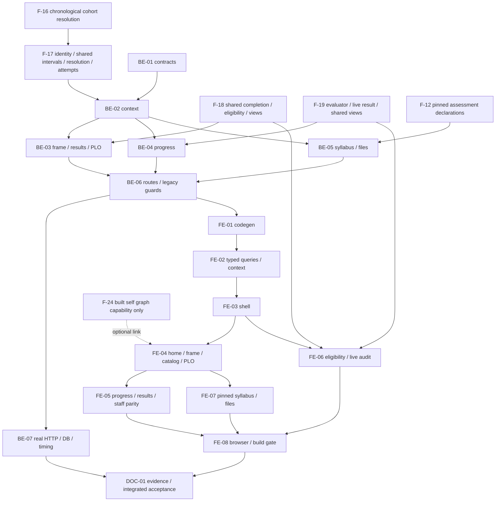

# F-20 Student Portal — Backend + Frontend Implementation Plan

This plan builds EP-20, US-092..097 and CV-226..236: the R6 mobile-first portal, its own applied program, semester curriculum and course results, progress, registration advice, pinned syllabi and live graduation review. It is a read-only consumer of shared domains, not another enrollment resolver, equivalence allocator, registration engine or graduation engine. Backend and frontend are covered together, including their explicit API contract. There is no schema migration, registration command, grade entry, integration-client API or new runtime package in F-20.

> **Companion documents**
> - Decisions: `docs/planning/feature-questions.md` §F-20, F20-01..03; blank answers mean A. Faculty-dependent upstream decisions remain risks, not approvals.
> - Scope: `docs/planning/epics.md` EP-20 and B5 scenarios 2..6/9; `docs/planning/user-stories.md` US-092..097; `docs/planning/task-breakdown.md` CV-226..236.
> - Requirements: `docs/requirement/REQUIREMENTS.md` FR-88..93/95, BR-02/09/10/16/26, EC-30/36/52, NFR-01/02/09/11/17/26; UC-59/84 and the stories' related UC-25/32/60/61/63/64/65.
> - Design: `docs/design/data-dictionary.md` Student/ProgramEnrollment/AcademicResult/GraduationAudit and version-owned content; `docs/design/erd.md` M-8/E-8..11; `docs/design/state-diagrams.md` enrollment/result states; `docs/design/sequence-diagrams.md` §12..15/L-9/L-10; `docs/design/screen-inventory.md` MH-55..59 and MH-52; `docs/planning/deferred-scope.md`.
> - Binding written, **not built**, contracts: F-16, F-17, F-18, F-19 and F-24 implementation plans in this directory; F-12 for revision-owned assessment declarations. Each consumed boundary is repeated under §8 U1..U6. F-09 is only a transitive import prerequisite and a plan-style exemplar.
> - Conventions/evidence: `docs/implementation/README.md`; F-15/F-09 exemplar plans; `docs/architecture/general_architecture.md`, `features_architecture.md`, `database_and_models.md`; implement reports for F-01/02/04/05/06/07/10/11/15; `source/frontend/src/shared/design-system/DESIGN_SYSTEM.md`.
> - Testing: `docs/planning/test-plan.md` B5/security/responsive acceptance; planned manual supplement `docs/testing/feature__f-20-student-portal.md` (DOC-01). No existing F-20 test-case document is assumed.

**Status**: Not started — plan against permitted source inspected on 2026-10-26. Unbuilt providers require source/serializer re-verification before implementation. Institutional certification and optional publication work remain gated in §8. This planning run creates only this file.

## 0. Plan at a glance

Everything below in one table. Read this; the rest is detail for whoever builds it.

| What | Why | How and where |
|---|---|---|
| **My program, not the newest program** | US-092; BR-26 | Resolve authenticated Student.userId, explicit program/semester, then F-17 resolveForStudent; show PRIMARY first and allow SECOND_MAJOR (BE-02, FE-03/04) |
| **Full curriculum with four course states** | US-093; EC-52 | Frozen frame plus F-18 completionEvidence and F-17 attempt flags; no second equivalence/grade evaluator (BE-03, FE-04) |
| **One authoritative progress calculation** | US-094; BR-02/10 | Project F-19 GraduationEvaluator's credit/group/block results; same reader for owning student and authorized R1/R3 (BE-04, FE-05) |
| **Actual attempts without grade editing** | Student progress/results requirement; EC-36 | Read F-17 AcademicResultsReader, retain retakes and all supplied scales; separate attempt history from requirement completion (BE-03, FE-05) |
| **Explain registration, do not perform it** | US-095; FR-91/92 | Consume F-18's complete response, three labels, reason texts and full concurrent bundle; candidate and blocked views (FE-06) |
| **Pinned syllabus and formula, safely downloadable files** | US-096; BR-16 | Exact applied row's syllabusId, shared revision lookup and F-12 declarations; separate explicitly labeled catalog-latest read (BE-05, FE-07) |
| **Live graduation, no saved student audit** | MH-59 | Consume F-19's owning-R6 live GET unchanged; preserve REVIEWED/CANNOT_AUDIT, warnings and all shortfall codes (FE-06) |
| **A separate mobile shell in the same React app** | F20-03 A; US-097 | /student routes, token-based compact layout, accessible menu, local table scrolling, no page overflow at 360px (FE-03..08) |
| **Close legacy program-addressed bypasses** | US-092 AC2/5; NFR-11 | Remove OWN_ENROLLMENT grants only on staff-addressed program/version/syllabus reads; keep valid staff grants and use own-context portal reads (BE-06/07) |

**Key behaviours worth knowing**

| Behaviour | Why it is this way |
|---|---|
| No business-table writes on any portal GET | Readers never reconcile enrollments, activate releases, save audits or create missing context. Session idle-expiry bookkeeping is infrastructure, not academic mutation. |
| No enrollment is a real empty state, not an empty successful curriculum | Display `Chưa xác định được chương trình, liên hệ Phòng Đào tạo`; do not select the current ACTIVE version. |
| Semester and planned semester are different | Calendar semester identifies the evaluation cutoff; plannedSemester is the relative position in a frozen curriculum. |
| Progress can be unavailable while curriculum remains readable | F-19 policy/ambiguity diagnostics must not fabricate zero credits or an academic refusal. F-18 completion evidence can still annotate the frame. |
| No results still produces the full frame | Four-state annotation becomes Chưa học; progress displays `Chưa có dữ liệu kết quả học tập`. A valid zero-valued calculation is not missing data. |
| Registration evaluates the chosen upcoming calendar semester | Default to the next configured known start, never arithmetic on semester codes; show the actual target term. No class-offering or timetable guarantee. |
| Catalog-latest and my-version syllabi are separate links | F20-01 A allows all catalog courses, but a curriculum link must never drift to a newer syllabus. |
| Student course state is not allocated graduation credit | F-18 completion and F-19 unique credit allocation answer different questions; no summing green rows on the client. |

**Not included**

| Excluded | Why |
|---|---|
| Student/account/import/enrollment writers and admission/reconciliation | F-09/F-16/F-17 ownership; not built by this plan |
| Class booking, fees, component marks, grade conversion/GPA and certificates | Outside EP-20/SRS scope or unresolved Faculty policy |
| dDUT, integration keys, official DB synchronization or freshness certification | F-21/F-22; no dependency on the unfinished F-21 plan |
| Student-created program PDF exports or staff health/timeline screens | F-24 specifies staff PDF permissions, not a student PDF endpoint; E4 below |
| A new graph renderer or PDF package | Optional F-24 owns publication and its dependency approvals; F-20 installs nothing |
| Immutable recovery of pre-correction cohort/calendar answers | Not buildable from overwritten source facts without an owner decision, E1 |

**Open questions**

| Question | Resolved when | Default if unanswered |
|---|---|---|
| Are historical correction/calendar guarantees required? | Decided 2026-10-26 (user), E1 | Current authoritative resolver/calendar; accepted absence of immutable pre-correction history, no history/freeze work |
| Are exemption/free-credit/condition policies accepted? | Faculty resolves inherited F-19 E2/E3 | Shared engine's explicit diagnostic; no portal-side guessed result |
| Which real calendar, exports and devices establish acceptance? | Sanitized Faculty/operator handoff, E3 | Synthetic records, known dates and measured test environment only |
| Is student PDF creation intended? | F-24 owner supplies an approved self contract, E4 | No student PDF action; signed syllabus downloads remain in scope |

## 1. Scope

| In scope | Boundary |
|---|---|
| MH-55 own identity, cohort, decision/version and program switcher | Server-bound identity, primary first, explicit context |
| MH-56 curriculum by semester, equivalent completion, grades, PLO read | Frozen applied version only; no matrix/editor/request UI |
| MH-57 progress and separate attempt history | Shared recognized credits; every attempt remains distinct |
| MH-58 candidate/blocked/conditional registration advice | Same F-18 response; no registration mutation |
| MH-59 live own graduation | Same F-19 outcome; no saved staff history or reviewer identities |
| Read-only catalog and published syllabus access | F20-01 A; excludes canceled catalog courses as existing visibility does |
| Responsive 360px layout, errors/empty/loading states, security/performance checks | FR-95; NFR-01/02/11/17/26 |
| Same progress projection for authorized R1/R3 | US-094 AC4; staff shell and permissions remain separate |

| Out / deferred | Owner / unblocker |
|---|---|
| Student identity provisioning, manual transfers, historical reconciliation | F-17 |
| Cohort schedule semantics and individual exception resolution | F-16 through F-17, not a new F-20 query policy |
| Academic eligibility and graduation policies | F-18/F-19 shared providers, not copied algorithms |
| Formula authoring and evaluator | F-12 declarations only; no mark evaluator |
| Optional graph and any future self PDF | F-24 built self authorization, renderer approval, explicit PDF contract if approved |
| Planning-run README/index/progress/report edits | Caller-owned; exactly one new file is permitted here |

### Acceptance coverage

| Acceptance criterion / task | Deliverables |
|---|---|
| US-092 AC1: K2023 keeps assigned version/decision despite K2025 release | BE-02/03/06/07; FE-03/04/08 |
| US-092 AC2/5: A cannot read B or another program/list | BE-02/06/07; FE-03/08; direct legacy endpoint probes, not just hidden links |
| US-092 AC3: PRIMARY then SECOND_MAJOR switch | BE-02; FE-02/03/04/08 |
| US-092 AC4: unassigned student actionable empty state | BE-02/07; FE-03/04/08 |
| US-093 AC1: four states and supplied marks | BE-03/07; FE-04/08 |
| US-093 AC2: equivalent completion names studied code | BE-03; FE-04/08; F-18 evidence retained |
| US-093 AC3: full frame/no results message | BE-03/04/07; FE-04/05/08 |
| US-093 AC4: approximately 60 rows, whole curriculum request <2s | BE-07; FE-08 browser observation |
| US-094 AC1: total/mandatory/elective, groups and blocks | BE-04/07; FE-05/08 |
| US-094 AC2/3: zero-credit conditions/retakes | BE-03/04/07; FE-05/08; upstream calculation parity |
| US-094 AC4: scoped R1/R3 same progress | BE-04/06/07; FE-05/08 |
| US-095 AC1: candidates exclude completed; eligible and conditional | FE-06/08; F-18 full response |
| US-095 AC2/3: blocked reason and entire concurrent bundle | FE-06/08; codes/text remain server-owned |
| US-095 AC4: no registration action | BE-06/07; FE-06/08 |
| US-096 AC1/2: pinned text/CLO/weeks/formula; newer revision does not replace pin | BE-05/07; FE-07/08; U5 required for full formula acceptance |
| US-096 AC3: signed attachment downloads | BE-05/06/07; FE-07/08 |
| US-096 AC4: no drafts/requests/comments/internal metadata | BE-05/06/07; FE-07/08; allowlisted serializers |
| US-097 AC1..3: 360px, <=2 taps, Chrome/Firefox/Edge | FE-03..08; DOC-01 |
| B5 scenarios 2..6 and portal part of 9 | BE-02..07; FE-01..08; external API part of scenario 9 remains F-21 |
| CV-226/227/228 | BE-02/06, FE-03/04, BE-07 respectively |
| CV-229/230/231/232 | BE-03, FE-04, BE-04, FE-05 respectively |
| CV-233/234/235/236 | FE-06, BE-05+FE-07, FE-03..08, FE-08 respectively |

## 2. Contract verification

This section is the contract gate, not a claim that dependent plans have shipped. **VERIFIED** means source including the serializer was inspected. **NEW / UNVERIFIED** means a proposed or prerequisite contract; every such assumption appears again in §8. Source references below describe current code only. New DTOs are exhaustively shaped in BE-01; dependency field accounting follows here before deliverable design.

### 2a. Existing endpoints and behavioral foundations

| Endpoint / boundary | Verified at | Request | Response / consequence |
|---|---|---|---|
| GET `/api/auth/me` | `source/backend/src/features/auth/me.dto.ts:38`; `source/frontend/src/shared/auth/useMe.ts:5` | Session cookie | MeDto; role codes/permissions, no student ID. Do not infer identity from username/userCode. |
| GET `/api/semesters` | `source/backend/src/features/semesters/semesters.controller.ts:19`; serializer `source/backend/src/shared/releases/semester.dto.ts:20` | Any authenticated user | SemesterDto[]; nullable startDate is real. Reuse, do not infer chronology from code. |
| GET `/api/courses` | `source/backend/src/features/courses/courses.controller.ts:36`; `courses.service.ts:57`; serializer `source/backend/src/features/courses/course.dto.ts:69` | Existing CourseQueryDto | CoursePageDto, exact decimal strings. Portal reuses the catalog API, not staff detail/usage links. |
| GET `/api/programs` | `source/backend/src/features/programs/programs.service.ts:54` | Existing list query | Non-ALL program.view is refused; never use as student enrollment options. |
| GET `/api/programs/:programId` and directors | `source/backend/src/features/programs/programs.service.ts:95`; `program-directors.service.ts:28` | Program ID | Program-scope check, not applied-version check; staff-addressed read must exclude own-enrollment grants. |
| GET `/api/program-versions/:versionId/curriculum` | `source/backend/src/features/curriculum/program-versions-curriculum.controller.ts:43`; `curriculum-read.service.ts:66` | Version ID | Program-scope check; no student/semester context. Portal needs a narrow self reader rather than rendering this editing aggregate. |
| GET `/api/program-versions/:versionId/plos` | `source/backend/src/features/outcomes/outcomes.controller.ts:58`; `plos.service.ts:35` | Version ID | Scoped OUTCOME_VIEW, not an applied-version resolver. New own PLO read avoids administrative counts. |
| Matrix/coverage reads | `source/backend/src/features/outcomes/outcome-access.ts:97` | Version/item IDs | Existing ALL-only staff check; retain it, do not widen for portal PLO access. |
| GET `/api/programs/:programId/versions` and `/api/programs/:programId/versions/:versionId` | `source/backend/src/features/releases/version-history.reader.ts:73`, `:96`, `:117` | Program/version IDs | Version list/detail authorize program; history is not a self entitlement boundary. |
| GET `/api/courses/:courseId/syllabus` | `source/backend/src/features/syllabi/syllabi.controller.ts:72`; `syllabi.service.ts:76`, `:152`; serializer `syllabus.dto.ts:157` | Optional requestId/versionId | Staff aggregate includes capabilities, usage and request metadata. Do not reuse that response as a student allowlist. |
| Revision pin lookup | `source/backend/src/shared/syllabi/revision-for-items.ts:30`, `:49` | tx plus row ID/courseId/syllabusId | Pin honored regardless of revision's current status; **unpinned fallback can be Draft**. Portal must reject a missing issued pin before calling it. |
| GET `/api/syllabus-attachments/:attachmentId/file` | `source/backend/src/features/syllabi/syllabi.controller.ts:213`; `syllabus-attachments.service.ts:110` | Attachment ID | Existing revision visibility; portal adds exact selected-syllabus membership on its own route. |
| Shared auth scope | `source/backend/src/shared/authz/access-context.ts:75`, `:120`; `scope-source.reader.ts:23` | AccessContext | Target dimensions are OR-ed; OWN_ENROLLMENT currently returns empty. F-17 must supply real self identity; program scope alone never proves ownership. |
| Roles/permissions in response | `source/backend/src/features/auth/me.dto.ts:49`; codes `source/backend/src/shared/authz/permission-codes.ts:41` | Current grants | R6/PROGRESS/ELIGIBILITY/GRADUATION permission codes exist, but this is not a built student domain. |
| Persistence foundation | `source/backend/prisma/schema.prisma:346`, `:403`, `:418`, `:428`, `:583`, `:622` | Version/calendar/rows/revisions | F-20 adds no columns/tables; F-17/F-19 own future persistence. Frozen course fields/pins, not live labels/credits, drive my framework. |
| Decimal and private downloads | `source/backend/src/shared/decimal/decimal.ts:9`; `shared/files/send-file.ts:9`; `source/frontend/src/shared/api/client.ts:115` | Exact strings/file stream | Reuse; set private/no-store headers explicitly. No new blob URL server or file path in DTO. |
| Session routing/cache | `source/frontend/src/shared/auth/RequireAuth.tsx:10`; `shared/auth/useLogout.ts:6`; `router.tsx:1` | MeDto | Keep forced password change, lazy routes and logout query-cache clear; add a sibling student layout. |

### 2b. Complete reused-wire field accounting

All fields below retain generated API aliases, even when deliberately not displayed. `not modeled` means no independent portal view-model field, not permission to alter the source DTO. Internal domain facts are accounted for separately after the wire tables.

**MeDto and nested refs — VERIFIED.** Source for scalar serialization: `source/backend/src/features/auth/me.dto.ts:38`; role mapping `:51`. Shared ref declarations: `source/backend/src/shared/dtos/ref.dto.ts:4`.

| Field | Wire type | Nullable | Source | Portal use |
|---|---|---|---|---|
| id | string | no | `source/backend/src/features/auth/me.dto.ts:44` | Principal in query keys |
| username | string | no | `source/backend/src/features/auth/me.dto.ts:45` | Not modeled; never student identity |
| userCode | string | no | `source/backend/src/features/auth/me.dto.ts:46` | Not modeled; never linkage |
| fullName | string | no | `source/backend/src/features/auth/me.dto.ts:47` | Account menu |
| email | string | yes | `source/backend/src/features/auth/me.dto.ts:48` | Not modeled; account page owns it |
| mustChangePassword | boolean | no | `source/backend/src/features/auth/me.dto.ts:49` | Preserve RequireAuth redirect |
| orgUnit | OrgUnitRefDto | yes | `source/backend/src/features/auth/me.dto.ts:50` | Not modeled; account page |
| roles | MeRoleDto[] | no | `source/backend/src/features/auth/me.dto.ts:51` | R6 portal entry / legitimate staff mode |
| permissions | PermissionCode[] | no | `source/backend/src/features/auth/me.dto.ts:58` | Coarse UI gating, not authorization proof |
| roles[].roleCode | string | no | `source/backend/src/features/auth/me.dto.ts:52` | R6 identity hint |
| roles[].roleName | string | no | `source/backend/src/features/auth/me.dto.ts:53` | Account role display |
| roles[].scopeType | SYSTEM / UNIT / ASSIGNMENT | no | `source/backend/src/features/auth/me.dto.ts:54`; storage enum `source/backend/prisma/schema.prisma:100` | Not modeled; server authorizes |
| roles[].scopeUnit | OrgUnitRefDto | yes | `source/backend/src/features/auth/me.dto.ts:55` | Not modeled |
| roles[].derived | boolean | no | `source/backend/src/features/auth/me.dto.ts:56` | Not modeled; never assign R6 locally |
| OrgUnitRef.id | string | no | `source/backend/src/shared/dtos/ref.dto.ts:5` | Not modeled on portal |
| OrgUnitRef.unitCode | string | no | `source/backend/src/shared/dtos/ref.dto.ts:6` | Not modeled on portal |
| OrgUnitRef.unitName | string | no | `source/backend/src/shared/dtos/ref.dto.ts:7` | Not modeled on portal |

**SemesterDto — VERIFIED.** Serializer `source/backend/src/shared/releases/semester.dto.ts:20` maps every field explicitly.

| Field | Wire type | Nullable | Source | Portal use |
|---|---|---|---|---|
| id | string | no | `source/backend/src/shared/releases/semester.dto.ts:22` | Required context selector |
| semesterCode | string | no | `source/backend/src/shared/releases/semester.dto.ts:23` | Label only |
| academicYear | string | no | `source/backend/src/shared/releases/semester.dto.ts:24` | Label only |
| termInYear | number | no | `source/backend/src/shared/releases/semester.dto.ts:25` | Label, not relative plannedSemester |
| startDate | YYYY-MM-DD string | yes | `source/backend/src/shared/releases/semester.dto.ts:26` | Disable unknown chronology; server chooses defaults |

**CoursePageDto/CourseSummaryDto — VERIFIED.** Mapper `source/backend/src/features/courses/course.dto.ts:69`; declared nested refs `source/backend/src/shared/dtos/ref.dto.ts:4`, `:21`.

| Field | Wire type | Nullable | Source | Portal use |
|---|---|---|---|---|
| items | CourseSummaryDto[] | no | `source/backend/src/features/courses/course.dto.ts:34` | Read-only catalog rows |
| total | number | no | `source/backend/src/features/courses/course.dto.ts:35` | Pagination |
| page | number | no | `source/backend/src/features/courses/course.dto.ts:36` | Pagination |
| pageSize | number | no | `source/backend/src/features/courses/course.dto.ts:37` | Pagination |
| items[].id | string | no | `source/backend/src/features/courses/course.dto.ts:71` | Catalog syllabus target |
| items[].courseCode | string | no | `source/backend/src/features/courses/course.dto.ts:72` | Display |
| items[].courseName | string | no | `source/backend/src/features/courses/course.dto.ts:73` | Live catalog label, never overwrite snapshot |
| items[].englishName | string | yes | `source/backend/src/features/courses/course.dto.ts:74` | Optional expanded text |
| items[].credits | decimal string | no | `source/backend/src/features/courses/course.dto.ts:75` | Catalog credits only |
| items[].courseType | THEORY / PRACTICE / LAB / PROJECT / CAPSTONE / INTERNSHIP / CONDITIONAL | no | `source/backend/src/features/courses/course.dto.ts:76`; `source/backend/prisma/schema.prisma:37` | Display, no rule inference |
| items[].status | ACTIVE / DISCONTINUED / CANCELLED | no | `source/backend/src/features/courses/course.dto.ts:77`; `source/backend/prisma/schema.prisma:47` | Display; R6 cannot request canceled results |
| items[].ownerFaculty | OrgUnitRefDto | no | `source/backend/src/features/courses/course.dto.ts:78` | Not modeled; no staff links |
| items[].ownerGroup | SubjectGroupRefDto | yes | `source/backend/src/features/courses/course.dto.ts:79` | Not modeled |
| items[].isForeign | boolean | no | `source/backend/src/features/courses/course.dto.ts:80` | Not modeled |
| SubjectGroupRef.id | string | no | `source/backend/src/shared/dtos/ref.dto.ts:22` | Not modeled |
| SubjectGroupRef.groupCode | string | no | `source/backend/src/shared/dtos/ref.dto.ts:23` | Not modeled |
| SubjectGroupRef.groupName | string | no | `source/backend/src/shared/dtos/ref.dto.ts:24` | Not modeled |
| SubjectGroupRef.status | ACTIVE / INACTIVE | no | `source/backend/src/shared/dtos/ref.dto.ts:25` | Not modeled |

The portal does **not** consume existing CourseDetailDto, CourseSyllabusDto, CurriculumDto, PloListDto, VersionDetailDto or saved GraduationAuditDto. They carry staff/authoring/usage details or a different context. NEW narrow projections in BE-01/03/05 are intentional; no implicit remapping of their omitted fields is proposed.

**RegistrationEligibilityDto and descendants — UNVERIFIED U2.** Source for every row in this table is `docs/implementation/f-18-course-registration-eligibility-implementation-plan.md` BE-01/04/05. This is a prerequisite contract, not existing source. Alias the generated DTO; do not reconstruct it in F-20.

| Field | Wire type | Nullable | Source | Modeled as / use |
|---|---|---|---|---|
| contractVersion | literal 1 | no | U2: F-18 BE-01/05, UNVERIFIED | Compatibility gate |
| context | StudentAppliedVersionResult-shaped DTO | no | U2: F-18 BE-01/05, UNVERIFIED | Response identity |
| context.studentId | string | no | U2: F-18 BE-01/05, UNVERIFIED | Must equal bootstrap subject |
| context.enrollmentId | string | no | U2: F-18 BE-01/05, UNVERIFIED | Evidence/context label |
| context.programId | string | no | U2: F-18 BE-01/05, UNVERIFIED | Selected owned program |
| context.semesterId | string | no | U2: F-18 BE-01/05, UNVERIFIED | Eligibility target term |
| context.programVersionId | string | no | U2: F-18 BE-01/05, UNVERIFIED | Show target version; may differ from current-term curriculum |
| context.source | COHORT / EXCEPTION | no | U2: F-18 BE-01/05, UNVERIFIED | Provenance |
| context.cohortAssignmentId | string | yes | U2: F-18 BE-01/05, UNVERIFIED | Provenance; null for EXCEPTION |
| evaluatedAt | ISO instant string | no | U2: F-18 BE-01/05, UNVERIFIED | Live timestamp |
| items | EligibilityItemDto[] | no | U2: F-18 BE-01/05, UNVERIFIED | All frame rows; client filters presentation only |
| items[].itemId | string | no | U2: F-18 BE-01/05, UNVERIFIED | Stable row key |
| items[].course | EligibilityCourseRefDto | no | U2: F-18 BE-01/05, UNVERIFIED | Course label/evidence links |
| items[].credits | decimal string | no | U2: F-18 BE-01/05, UNVERIFIED | Frozen target credits, never accumulated credits |
| items[].catalogStatus | ACTIVE / DISCONTINUED / CANCELLED | no | U2: F-18 BE-01/05, UNVERIFIED | Offering caveat |
| items[].plannedSemester | number | no | U2: F-18 BE-01/05, UNVERIFIED | Relative frame semester |
| items[].completed | boolean | no | U2: F-18 BE-01/05, UNVERIFIED | Exclude from registration candidates |
| items[].eligibility | ELIGIBLE / CONDITIONAL / INELIGIBLE | yes | U2: F-18 BE-01/05, UNVERIFIED | Null iff completed |
| items[].statusText | string | no | U2: F-18 BE-01/05, UNVERIFIED | Display server text, not a translation fork |
| items[].reasons | EligibilityReasonDto[] | no | U2: F-18 BE-01/05, UNVERIFIED | Reason panel |
| items[].requiredConcurrentCourses | EligibilityCourseRefDto[] | no | U2: F-18 BE-01/05, UNVERIFIED | Entire actionable bundle |
| warnings | EligibilityWarningDto[] | no | U2: F-18 BE-01/05, UNVERIFIED | Preserve warnings without changing verdict |
| CourseRef.id | string | no | U2: F-18 BE-01/05, UNVERIFIED | Evidence key |
| CourseRef.courseCode | string | no | U2: F-18 BE-01/05, UNVERIFIED | Display |
| CourseRef.courseName | string | no | U2: F-18 BE-01/05, UNVERIFIED | Plain text display |
| CourseRef.nameSource | SNAPSHOT / CATALOG | no | U2: F-18 BE-01/05, UNVERIFIED | Source caveat; no label substitution |
| Reason.code | reason literal listed below | no | U2: F-18 BE-01/05, UNVERIFIED | Semantic grouping, never parse message |
| Reason.causeCode | same reason literal set | yes | U2: F-18 BE-01/05, UNVERIFIED | Nested blocker identity |
| Reason.message | string | no | U2: F-18 BE-01/05, UNVERIFIED | Server-owned Vietnamese message |
| Reason.relationType | PRIOR / PREREQUISITE / COREQUISITE | yes | U2: F-18 BE-01/05, UNVERIFIED | Evidence heading |
| Reason.requiredCourse | EligibilityCourseRefDto | yes | U2: F-18 BE-01/05, UNVERIFIED | Required course |
| Reason.viaCourse | EligibilityCourseRefDto | yes | U2: F-18 BE-01/05, UNVERIFIED | Transitive/corequisite origin |
| Reason.evidenceCourse | EligibilityCourseRefDto | yes | U2: F-18 BE-01/05, UNVERIFIED | Studied/equivalent course |
| Reason.evidenceResultId | string | yes | U2: F-18 BE-01/05, UNVERIFIED | Completion attempt, not a writable object |
| Reason.requiredScore4 | decimal string | yes | U2: F-18 BE-01/05, UNVERIFIED | Null is not zero |
| Reason.actualScore4 | decimal string | yes | U2: F-18 BE-01/05, UNVERIFIED | Null is not zero |
| Reason.actualStatus | PASSED / FAILED / IN_PROGRESS / EXEMPT | yes | U2: F-18 BE-01/05, UNVERIFIED | Source status, not computed from mark |
| Reason.path | EligibilityCourseRefDto[] | no | U2: F-18 BE-01/05, UNVERIFIED | Full blocker path in order |
| Warning.code | REPLACEMENT_UNAVAILABLE / EXTERNAL_REQUISITE / EXTERNAL_COREQUISITE_RULES_UNAVAILABLE / COURSE_NOT_ACTIVE | no | U2: F-18 BE-01/05, UNVERIFIED | Stable warning key |
| Warning.message | string | no | U2: F-18 BE-01/05, UNVERIFIED | Server text |
| Warning.course | EligibilityCourseRefDto | no | U2: F-18 BE-01/05, UNVERIFIED | Context |

Reason.code/causeCode literals are exactly `COURSE_COMPLETED`, `EQUIVALENT_COMPLETED`, `PREREQUISITE_NOT_PASSED`, `PREREQUISITE_SCORE_MISSING`, `PREREQUISITE_SCORE_TOO_LOW`, `PRIOR_RESULT_MISSING`, `COREQUISITE_REQUIRED`, `COREQUISITE_INELIGIBLE`, `COREQUISITE_RULES_UNAVAILABLE`, `COREQUISITE_DEPTH_LIMIT`. F-20 does not assign new meanings or add a generic NOT_ELIGIBLE code. Status labels are `Đã hoàn thành`, `Được`, `Được có điều kiện`, `Không được` as delivered by U2; re-verify the actual completed label on integration. Vietnamese reason messages and decimal placeholders remain byte-for-byte server-owned.

**GraduationOutcomeDto and descendants — UNVERIFIED U3.** Source for every field below is `docs/implementation/f-19-graduation-review-implementation-plan.md` BE-01/06/11. Preserve the generated discriminated unions, decimal strings and nulls; do not request saved audit/history/batch DTOs.

| Field | Wire type | Nullable | Source | Modeled as / use |
|---|---|---|---|---|
| status | REVIEWED / CANNOT_AUDIT | no | U3: F-19 BE-01/06, UNVERIFIED | Branch before reading result |
| result | GraduationResultDto | yes | U3: F-19 BE-01/06, UNVERIFIED | Null only CANNOT_AUDIT |
| error | GraduationDiagnosticDto | yes | U3: F-19 BE-01/06, UNVERIFIED | Null only REVIEWED |
| error.code | string | no when error exists | U3: F-19 BE-01/06, UNVERIFIED | Diagnostic identity |
| error.message | string | no when error exists | U3: F-19 BE-01/06, UNVERIFIED | Actionable Vietnamese message |
| error.enrollmentId | string | yes | U3: F-19 BE-01/06, UNVERIFIED | Context, not selection authority |
| result.schemaVersion | literal 1 | no | U3: F-19 BE-01/06, UNVERIFIED | Compatibility |
| result.ruleVersion | literal graduation-v1 | no | U3: F-19 BE-01/06, UNVERIFIED | Rule attribution |
| result.evaluatedAt | ISO instant string | no | U3: F-19 BE-01/06, UNVERIFIED | Live calculation time |
| result.context | GraduationContextDto | no | U3: F-19 BE-01/06, UNVERIFIED | Exact resolved context |
| context.studentId | string | no | U3: F-19 BE-01/06, UNVERIFIED | Self consistency |
| context.programId | string | no | U3: F-19 BE-01/06, UNVERIFIED | Selected program |
| context.semesterId | string | no | U3: F-19 BE-01/06, UNVERIFIED | Selected calendar term |
| context.enrollmentId | string | no | U3: F-19 BE-01/06, UNVERIFIED | Materialized interval identity |
| context.studentCode | string | no | U3: F-19 BE-01/06, UNVERIFIED | Subject heading |
| context.fullName | string | no | U3: F-19 BE-01/06, UNVERIFIED | Subject heading |
| context.programCode | string | no | U3: F-19 BE-01/06, UNVERIFIED | Program heading |
| context.programName | string | no | U3: F-19 BE-01/06, UNVERIFIED | Version-owned program heading |
| context.cohortId | string | no | U3: F-19 BE-01/06, UNVERIFIED | Context |
| context.cohortCode | string | no | U3: F-19 BE-01/06, UNVERIFIED | Display |
| context.programVersionId | string | no | U3: F-19 BE-01/06, UNVERIFIED | Exact version |
| context.versionNumber | string | no | U3: F-19 BE-01/06, UNVERIFIED | Display |
| context.semesterCode | string | no | U3: F-19 BE-01/06, UNVERIFIED | Display |
| context.semesterStartDate | YYYY-MM-DD string | no | U3: F-19 BE-01/06, UNVERIFIED | Known chronology |
| context.versionSource | COHORT / EXCEPTION | no | U3: F-19 BE-01/06, UNVERIFIED | Provenance |
| context.cohortAssignmentId | string | yes | U3: F-19 BE-01/06, UNVERIFIED | Provenance |
| result.conclusion | ELIGIBLE / NOT_ELIGIBLE | no | U3: F-19 BE-01/06, UNVERIFIED | `Đủ điều kiện` / `Chưa đủ điều kiện`; never use for diagnostic branch |
| result.shortfalls | GraduationShortfallDto[] | no | U3: F-19 BE-01/06, UNVERIFIED | Empty only when eligible |
| result.warnings | GraduationWarningDto[] | no | U3: F-19 BE-01/06, UNVERIFIED | Visible even if eligible |
| result.credits | credits object | no | U3: F-19 BE-01/06, UNVERIFIED | Server totals |
| credits.requiredTotal | decimal string | no | U3: F-19 BE-01/06, UNVERIFIED | Required credits |
| credits.recognizedTotal | decimal string | no | U3: F-19 BE-01/06, UNVERIFIED | Earned credits |
| credits.missingTotal | decimal string | no | U3: F-19 BE-01/06, UNVERIFIED | Missing credits; no client subtraction |
| credits.compulsory | decimal string | no | U3: F-19 BE-01/06, UNVERIFIED | Allocated compulsory credits |
| credits.elective | decimal string | no | U3: F-19 BE-01/06, UNVERIFIED | Allocated elective credits |
| credits.free | decimal string | no | U3: F-19 BE-01/06, UNVERIFIED | Free credits, not invented elective progress |
| result.electiveGroups | GraduationGroupProgressDto[] | no | U3: F-19 BE-01/06, UNVERIFIED | Per-group progress |
| Group.groupId | string | no | U3: F-19 BE-01/06, UNVERIFIED | Row key |
| Group.groupCode | string | no | U3: F-19 BE-01/06, UNVERIFIED | Display |
| Group.groupName | string | no | U3: F-19 BE-01/06, UNVERIFIED | Display |
| Group.requiredCredits | decimal string | yes | U3: F-19 BE-01/06, UNVERIFIED | Null means no credit minimum |
| Group.earnedCredits | decimal string | no | U3: F-19 BE-01/06, UNVERIFIED | Display |
| Group.missingCredits | decimal string | yes | U3: F-19 BE-01/06, UNVERIFIED | Null paired with absent minimum |
| Group.requiredCourses | number | yes | U3: F-19 BE-01/06, UNVERIFIED | Null means no count minimum |
| Group.earnedCourses | number | no | U3: F-19 BE-01/06, UNVERIFIED | Display |
| Group.missingCourses | number | yes | U3: F-19 BE-01/06, UNVERIFIED | Independent count minimum |
| result.knowledgeBlocks | GraduationBlockProgressDto[] | no | U3: F-19 BE-01/06, UNVERIFIED | Breakdown, not extra graduation checks |
| Block.blockSymbol | string | yes | U3: F-19 BE-01/06, UNVERIFIED | Keep unclassified block |
| Block.blockName | string | yes | U3: F-19 BE-01/06, UNVERIFIED | `Chưa phân loại` when absent |
| Block.earnedCredits | decimal string | no | U3: F-19 BE-01/06, UNVERIFIED | Display |
| Block.compulsoryCredits | decimal string | no | U3: F-19 BE-01/06, UNVERIFIED | Display |
| Block.electiveCredits | decimal string | no | U3: F-19 BE-01/06, UNVERIFIED | Display |
| Block.catalogRequiredCredits | decimal string | yes | U3: F-19 BE-01/06, UNVERIFIED | Labeled advisory catalog target |
| Block.advisoryGap | decimal string | yes | U3: F-19 BE-01/06, UNVERIFIED | Advisory only |
| result.recognitions | GraduationRecognitionDto[] | no | U3: F-19 BE-01/06, UNVERIFIED | Expandable evidence, not reallocation inputs |
| Recognition.curriculumItemId | string | no | U3: F-19 BE-01/06, UNVERIFIED | Required-row link |
| Recognition.requiredCourse | GraduationCourseRefDto | no | U3: F-19 BE-01/06, UNVERIFIED | Required course |
| Recognition.studiedCourse | GraduationCourseRefDto | no | U3: F-19 BE-01/06, UNVERIFIED | Actual studied course |
| Recognition.attemptId | string | no | U3: F-19 BE-01/06, UNVERIFIED | Source attempt identity |
| Recognition.attemptRevision | number | no | U3: F-19 BE-01/06, UNVERIFIED | Evidence revision |
| Recognition.completionStatus | PASSED / EXEMPT | no | U3: F-19 BE-01/06, UNVERIFIED | Display; exemption policy belongs to U3 |
| Recognition.viaEquivalence | boolean | no | U3: F-19 BE-01/06, UNVERIFIED | Show actual studied code |
| Recognition.equivalenceGroupId | string | yes | U3: F-19 BE-01/06, UNVERIFIED | Not separately modeled; evidence only |
| Recognition.requiredCredits | decimal string | no | U3: F-19 BE-01/06, UNVERIFIED | Display mismatch evidence |
| Recognition.recognizedCredits | decimal string | no | U3: F-19 BE-01/06, UNVERIFIED | Actual recognized contribution |
| Recognition.creditBasis | APPLIED_VERSION_SNAPSHOT / CURRENT_CATALOG | no | U3: F-19 BE-01/06, UNVERIFIED | Explicit provenance caveat |
| Recognition.category | MANDATORY_COURSE / ELECTIVE_GROUP / CONDITIONAL_COURSE | no | U3: F-19 BE-01/06, UNVERIFIED | Evidence grouping |
| Recognition.electiveGroupId | string | yes | U3: F-19 BE-01/06, UNVERIFIED | Group link |
| Recognition.blockSymbol | string | yes | U3: F-19 BE-01/06, UNVERIFIED | Breakdown link |
| result.freeCredits | GraduationFreeCreditDto[] | no | U3: F-19 BE-01/06, UNVERIFIED | Read-only free-credit evidence |
| FreeCredit.course | GraduationCourseRefDto | no | U3: F-19 BE-01/06, UNVERIFIED | Display |
| FreeCredit.attemptId | string | no | U3: F-19 BE-01/06, UNVERIFIED | Evidence identity |
| FreeCredit.credits | decimal string | no | U3: F-19 BE-01/06, UNVERIFIED | Display |
| FreeCredit.creditBasis | APPLIED_VERSION_SNAPSHOT / CURRENT_CATALOG | no | U3: F-19 BE-01/06, UNVERIFIED | Source caveat |
| FreeCredit.reason | SURPLUS_EQUIVALENT / OUTSIDE_FRAME | no | U3: F-19 BE-01/06, UNVERIFIED | Evidence label, no client rule |
| CourseRef.id | string | no | U3: F-19 BE-01/06, UNVERIFIED | Link/key |
| CourseRef.courseCode | string | no | U3: F-19 BE-01/06, UNVERIFIED | Display |
| CourseRef.courseName | string | no | U3: F-19 BE-01/06, UNVERIFIED | Plain text display |
| Warning.code | EQUIVALENT_CREDIT_GAP / CURRENT_CATALOG_CREDIT_BASIS / UNKNOWN_KNOWLEDGE_BLOCK | no | U3: F-19 BE-01/06, UNVERIFIED | Stable warning identity |
| Warning.curriculumItemId | string | yes | U3: F-19 BE-01/06, UNVERIFIED | Link when available |
| Warning.courseId | string | yes | U3: F-19 BE-01/06, UNVERIFIED | Link when available |
| Warning.creditGap | decimal string | yes | U3: F-19 BE-01/06, UNVERIFIED | Exact warning amount |
| Warning.message | string | no | U3: F-19 BE-01/06, UNVERIFIED | Server Vietnamese text |

**Every GraduationShortfall variant — same UNVERIFIED U3 source.** Common fields occur in each applicable concrete DTO, not an untyped JSON map.

| Field | Wire type | Nullable | Source | Modeled as / use |
|---|---|---|---|---|
| code | MANDATORY_COURSE_MISSING / CONDITIONAL_COURSE_MISSING / ELECTIVE_CREDITS_MISSING / ELECTIVE_COURSES_MISSING / TOTAL_CREDITS_MISSING | no | U3: F-19 BE-01/06, UNVERIFIED | Discriminator |
| category | MANDATORY_COURSE / CONDITIONAL_COURSE / ELECTIVE_GROUP / TOTAL_CREDITS | no | U3: F-19 BE-01/06, UNVERIFIED | Server four-check order |
| message | string | no | U3: F-19 BE-01/06, UNVERIFIED | Server Vietnamese text |
| curriculumItemId | string; course variants | no | U3: F-19 BE-01/06, UNVERIFIED | Link |
| course | GraduationCourseRefDto; course variants | no | U3: F-19 BE-01/06, UNVERIFIED | Display |
| blockSymbol | string; course variants | yes | U3: F-19 BE-01/06, UNVERIFIED | Optional grouping |
| reason | NOT_TAKEN / FAILED / IN_PROGRESS; course variants | no | U3: F-19 BE-01/06, UNVERIFIED | Incomplete reason |
| groupId | string; group variants | no | U3: F-19 BE-01/06, UNVERIFIED | Link |
| groupCode | string; group variants | no | U3: F-19 BE-01/06, UNVERIFIED | Display |
| groupName | string; group variants | no | U3: F-19 BE-01/06, UNVERIFIED | Display |
| requiredCredits | decimal string; group-credit/total variants | no | U3: F-19 BE-01/06, UNVERIFIED | Display |
| earnedCredits | decimal string; group-credit/total variants | no | U3: F-19 BE-01/06, UNVERIFIED | Display |
| missingCredits | decimal string; group-credit/total variants | no | U3: F-19 BE-01/06, UNVERIFIED | Display |
| requiredCourses | number; group-count variant | no | U3: F-19 BE-01/06, UNVERIFIED | Display |
| earnedCourses | number; group-count variant | no | U3: F-19 BE-01/06, UNVERIFIED | Display |
| missingCourses | number; group-count variant | no | U3: F-19 BE-01/06, UNVERIFIED | Display independently of credits |

**Internal dependencies — NEW / UNVERIFIED, not wire DTOs.**

| Contract / source | Complete fields retained or discarded | Use |
|---|---|---|
| U1 StudentAppliedVersionResult, F-17 BE-03 | studentId, enrollmentId, programId, semesterId, programVersionId, source COHORT/EXCEPTION, nullable cohortAssignmentId | Reuse verbatim in self content/results/progress context; never reread stored appliedVersionId as truth |
| U1 AcademicAttemptFact, F-17 BE-07 | id, studentId, courseId, semesterId, score10?, score4?, letterGrade?, status PASSED/FAILED/IN_PROGRESS/EXEMPT, semesterStart Date, dataSource EXCEL/SCHOOL_DB, revision | All supplied grades retained in safe attempt projection; studentId becomes context; dataSource/revision are not exposed in the ordinary attempt list; no mutation/source claims |
| U1 BestAcademicCourseFacts, F-17 BE-07 | courseId, attempts, nullable bestScoredAttempt, hasPassedAttempt, isExempt, hasInProgressAttempt | Reuse flags/selector; no portal numeric sorting or inferred pass |
| U2 AcademicEvidence, F-18 BE-02 | attempt AcademicAttemptFact; course `{id,courseCode,courseName,nameSource}` | completionEvidence identifies actual completion/equivalent, without a second rule engine |
| U2 EligibilityEvaluationContext, F-18 BE-02 | resolution, rows, courses, equivalents, attempts, warnings | Request-local input to completionEvidence only; not serialized as a portal response |
| U3 GraduationEvaluator return, F-19 BE-06 | input GraduationInputSnapshot, result GraduationResult, digest string | Result totals/groups/blocks/warnings projected; input only provides declared category targets/condition counts/hasResults; digest not modeled or exposed |
| U3 GraduationReaderCapability, F-19 BE-03 | resolve(tx), attempts(tx) | Close over F-17 authorized lookup/purpose; never a fabricated R1/system capability |
| U5 AssessmentRuleInput, F-12 BE-02 | failingScore?, clos `{id,cloCode,sortOrder}`, assessmentComponents `{id?,componentCode,weight,isConditional,conditionThreshold?,failingScore?,mappings[{cloId,cloWeight?}]}` | Shared declaration loader/total only; metadata names/form from the same pinned persisted children; no score evaluator |
| U6 StudentGraphContextPort, F-24 BE-02 | resolveOwn(userId,programId,semesterId) → `{studentId,programId,programVersionId,semesterId}` | F-24 adapter binds identity/resolution itself; portal only links its own-context UI |

No F-21 endpoint, principal adapter, module or response shape is assumed. The F-24 CourseGraphDto is not mapped by F-20: linking a built, authorized page does not require copying its graph model.

### 2c. Verification corrections / mismatch log

| Deliverable | Design/earlier assumption | What source/contract actually says | Found at / disposition |
|---|---|---|---|
| BE-02 | MeDto/userCode identifies Student | No student identity in MeDto; actual relation is U1 Student.userId | `source/backend/src/features/auth/me.dto.ts:20`; U1 prerequisite |
| BE-03/05 | revisionForItems guarantees a student-safe published revision | Unpinned rows can fall back to Draft | `source/backend/src/shared/syllabi/revision-for-items.ts:49`; require a valid issued pin before invoking helper |
| BE-06 | Own program scope implies only applied version | Generic curriculum/PLO/history/syllabus reads use program scope | `source/backend/src/features/curriculum/curriculum-read.service.ts:68`; `features/outcomes/plos.service.ts:38`; `features/releases/version-history.reader.ts:123`; exclude own grants there |
| BE-06 | Removing own assignments alone denies every generic syllabus read | Published syllabus/file services check visibility, not a retained SYLLABUS_VIEW grant; create also calls forCourse internally | `source/backend/src/features/syllabi/syllabi.service.ts:76`, `:249`; `source/backend/src/features/syllabi/syllabus-attachments.service.ts:110`; filter and explicitly require retained permission at the two GET controller boundaries; keep internal write/read behavior unchanged |
| BE-04 | Progress equals sum of completed rows | U3 allocates equivalence/retakes/free credits once; unknown policies give CANNOT_AUDIT | F-19 BE-04/05/06, UNVERIFIED U3; project shared output only |
| FE-03 | ScopeType wire labels match permission scopes | Wire ScopeType is SYSTEM / UNIT / ASSIGNMENT; grant scope is ALL / SCOPED | `source/backend/prisma/schema.prisma:95`, `:100`; use generated enum unchanged |
| FE-07 | Built syllabus includes formulas | Current mapper contains text/weeks/CLOs/files only | `source/backend/src/features/syllabi/syllabus.dto.ts:157`; formula acceptance requires U5 |
| FE-08 | Browser suite already covers Firefox/Edge | Current projects are setup and chromium | `source/e2e/playwright.config.ts:36`; add F-20-specific projects, preserve current suite |
| FE-04 | F-24 permits student PDF export | Its own graph is gated; PDF create/status/file are staff permissions | F-24 §2d/BE-01, UNVERIFIED U6; no PDF action, E4 |

### 2d. Proposed API contract — NEW / UNVERIFIED

Paths include the existing global `/api` prefix (`source/backend/src/app.setup.ts:17`). All IDs are opaque nonempty strings, never UUID-validated CUIDs. Required context query keys are scalar strings; global whitelisting rejects caller-supplied studentId/versionId/requestId/source/score overrides on self routes (`source/backend/src/app.setup.ts:30`). JSON is direct DTO data, not a new success envelope.

| Method / endpoint | Request | Response | Authorization / behaviour |
|---|---|---|---|
| GET `/api/me/student-portal` | Optional semesterId | PortalBootstrapDto, 200 | Linked own Student; default known current start, owned program options only. Empty enrollment is 200; unlinked identity is U1 404. |
| GET `/api/me/programs/:programId/curriculum` | Required semesterId | PortalCurriculumDto, 200 | PROGRAM_VIEW + STUDENT_VIEW_PROGRESS and explicit self identity; exact resolved version, no writes |
| GET `/api/me/programs/:programId/results` | Required semesterId | PortalResultsDto, 200 | STUDENT_VIEW_PROGRESS; explicit own context; safe all-attempt list through cutoff |
| GET `/api/me/programs/:programId/progress` | Required semesterId | PortalProgressOutcomeDto, 200 | STUDENT_VIEW_PROGRESS; same shared projection as staff; AVAILABLE or UNAVAILABLE diagnostic |
| GET `/api/students/:studentId/progress` | Required programId, semesterId | PortalProgressOutcomeDto, 200 | U1 PROGRESS policy: R1, directing R3, owning R6; no staff selector added |
| GET `/api/me/programs/:programId/plos` | Required semesterId | PortalPlosDto, 200 | OUTCOME_VIEW + PROGRAM_VIEW + STUDENT_VIEW_PROGRESS, self identity and exact applied version |
| GET `/api/me/programs/:programId/courses/:courseId/syllabus` | Required semesterId | PortalSyllabusDto, 200 | SYLLABUS_VIEW + PROGRAM_VIEW + STUDENT_VIEW_PROGRESS, exact row membership/pin; no latest fallback |
| GET `/api/me/programs/:programId/courses/:courseId/syllabus/attachments/:attachmentId/file` | Required semesterId | File stream, 200 | Repeat own context/pin/file membership; private,no-store; attachment may have been added after publication |
| GET `/api/me/courses/:courseId/syllabus` | No context query | PortalSyllabusDto, 200 | SYLLABUS_VIEW, linked own identity; catalog PUBLISHED revision only; explicit catalog context |
| GET `/api/me/courses/:courseId/syllabus/attachments/:attachmentId/file` | No context query | File stream, 200 | Repeat catalog-published revision and membership checks; no arbitrary revision ID accepted |
| GET `/api/students/:studentId/registration-eligibility` | Required programId, semesterId | RegistrationEligibilityDto, 200 | **U2-owned existing-to-be-built contract**, not another F-20 endpoint implementation |
| GET `/api/students/:studentId/graduation` | Required programId, semesterId | GraduationOutcomeDto, 200 | **U3-owned live contract**; owning R6 allowed, no audit persistence |

Use existing auth/CSRF/permission errors. Preserve U1/U4 scope-filtered 404, role/permission 403, unknown semester/missing mapping/ambiguity diagnostics and status. An unowned program must not become a successful UNAVAILABLE result. New errors: 409 `PORTAL_SNAPSHOT_INCOMPLETE` (`Ảnh chụp chương trình chưa đầy đủ; liên hệ Phòng Đào tạo.`), 404 `PORTAL_SYLLABUS_UNAVAILABLE` (`Chưa có đề cương đã ban hành cho học phần này.`), 404 `PORTAL_ATTACHMENT_NOT_FOUND` (`Không tìm thấy tài liệu của đề cương này.`), 409 `PORTAL_CONTEXT_CHANGED` (`Chương trình áp dụng đã thay đổi; vui lòng tải lại.`). Files missing on disk use the storage layer's sanitized missing-artifact response, never a path. No portal POST/PUT/PATCH/DELETE is introduced.

## 3. Decisions

| ID | Decision | Why | Rejected alternative |
|---|---|---|---|
| D1 | Same React app, separate /student layout | F20-03 A; mobile navigation without staff menus | Separate application/session/cache |
| D2 | Backend identity from Student.userId; program and semester explicit thereafter | NFR-11, dual majors and historical context | Username matching; accepting studentId on /me |
| D3 | Default current semester = latest known start <= application today; upcoming = next known start; show chosen term | Semester has starts, not an official current-term flag | Parsing HK labels or incrementing relative semester |
| D4 | Default PRIMARY first; SECOND_MAJOR selectable; no PRIMARY means explicit selection | US-092 AC3; no guessed primary assignment | First arbitrary row/latest version |
| D5 | Complete > IN_PROGRESS > FAILED > NOT_STARTED presentation precedence | F-18 completion and F-17 independent flags; retake must not erase prior completion | Infer state from score or replace passed with a current retake |
| D6 | Completion evidence from F-18 helper; all credit allocation from F-19 evaluator | Single shared domains; no counting green course rows | Portal equivalence traversal/credit sums |
| D7 | Progress is an authorization-specific projection, not exposure of an entire staff audit | US-094 and independently configurable permissions | Require graduation.view merely to read progress; expose staff audit identities |
| D8 | Current-term progress/graduation and upcoming-term eligibility have separate context keys | A future cohort assignment can resolve to a different version | Overlay eligibility on old curriculum by course code |
| D9 | Candidate default plus a visible blocked tab/search; completed excluded from both | US-095 AC1/2 need both advice and refusal explanations | Hide all ineligible courses or include completed candidates |
| D10 | Typed unavailable progress, distinct from a valid zero-result calculation | Inherited policy diagnostics cannot become fake zero/100%/NOT_ELIGIBLE | Catch-all success fallback |
| D11 | New allowlisted syllabus DTO; my pin vs catalog PUBLISHED are explicit contexts | US-096 and F20-01 A have different selection rules | Latest syllabus for curriculum links; serialize staff aggregate then delete fields |
| D12 | Reuse live F-18/F-19 HTTP contracts directly in FE | Already define own-student authorization and full result vocabulary | New portal eligibility/audit DTO forks or internal HTTP calls |
| D13 | Staff-addressed program/revision reads exclude OWN_ENROLLMENT grants; actual staff grants survive | Own-context routes carry semester; generic staff routes do not | Program scope OR shortcut; stripping legitimate multi-role staff access |
| D14 | No new tables, queue, cache, polling or packages | Read-only consumer; existing shared providers own rules | Materialized portal progress or Redis business cache |
| D15 | Optional graph link only after F-24 capability exists; no student PDF export | U6 contract and its approval gates are not built | Placeholder links, staff PDF bypass or G6 installation |
| D16 | Applied content uses the existing PROGRESS-purpose self resolver plus its specific program/PLO/syllabus permission | U1 exposes three purposes, not a separate public content resolver; default R6 grants satisfy these explicit checks | Silently inventing a U1 purpose or treating OR-decorated permissions as AND |

## 4. Integration boundaries and deliberate divergences

No shipped sibling student portal is assumed. These elaborations are explicit, not accidental drift:

| Boundary | Disposition |
|---|---|
| FR-89/epic older wording vs F20-02/US-093 | Use `Đã đạt`, `Chưa đạt`, `Đang học`, `Chưa học` exactly; source result FAILED still serializes as FAILED |
| UC-59 mentions staff viewers | One shared progress reader; staff route/page require U1 R1/R3 scope, never broaden R2/R4/R5 access |
| Built staff readers authorize whole program | Keep staff semantics; add explicit exclusion of own-enrollment authority and narrow self endpoints before deriving usable R6 scopes |
| Course-state completion vs graduation allocation | Completion uses U2 evidence; credits use U3 unique allocation. An ambiguous audit does not erase trustworthy source attempts or hide the frame |
| F-24 graph/PDF wording | Own graph only after its self adapter is built. F-24 has no self PDF-create contract; signed syllabus file download is a different capability |
| Date/history limits inherited from F-16/17/19 | Preserve built correction/calendar behavior. Display returned context/evaluatedAt and diagnostics; no new historical-entitlement guarantee |
| Formula requirement vs built syllabus | U5 is a hard gate for full US-096 AC1; text-only work may be demoed but cannot be called full F-20 acceptance |

## 5. Deliverables

Everything below is **to build**. NEW nested directories are created with their owning step. Existing parents inspected: backend `src/shared`, `src/features`, `test/fixtures`; frontend `src/features`, `src/shared`, `src/shared/layout`; `source/e2e/specs`, `source/e2e/fixtures`; `docs/testing`, `docs/implement-report`. Prerequisite paths are marked UNBUILT, never treated as existing source. No shared function is replaced or deleted; the exact legacy-read call-site disposition is in BE-06.

### BE-01 — Portal vocabulary, DTOs and read contracts

**What / why:** Pin the narrow student wire contract before readers and components; no authoring/internal fields can leak by spreading an existing aggregate.

**Files**

| Action | Path | Mirror / rationale |
|---|---|---|
| NEW | `source/backend/src/shared/student-portal/portal.types.ts` | Domain-only types like `source/backend/src/shared/syllabi/revision-for-items.ts:4` |
| NEW | `source/backend/src/shared/student-portal/portal.constants.ts` | Named vocabulary/limits like `source/backend/src/shared/decimal/decimal.ts:4` |
| NEW | `source/backend/src/shared/student-portal/portal.errors.ts` | AppException definitions like `source/backend/src/features/syllabi/syllabus.errors.ts:16` |
| NEW | `source/backend/src/features/student-portal/portal-query.dto.ts` | Decorated query pattern `source/backend/src/features/syllabi/syllabus.dto.ts:84` |
| NEW | `source/backend/src/features/student-portal/portal.dto.ts` | Explicit fields/serializers like `source/backend/src/features/notifications/notification.dto.ts:25` |
| NEW | `source/backend/src/features/student-portal/portal.mapper.ts` | Direct mapping like `source/backend/src/features/courses/course.dto.ts:69` |
| NEW | `source/backend/src/features/student-portal/portal.mapper.spec.ts` | Mapper tests like `source/backend/src/shared/decimal/decimal.spec.ts:1` |

**Shape — domain values and complete NEW response fields**

```ts
export const PORTAL_COURSE_STATES = ['PASSED', 'FAILED', 'IN_PROGRESS', 'NOT_STARTED'] as const;
export type PortalCourseState = (typeof PORTAL_COURSE_STATES)[number];
export const PORTAL_LIMITS = { PERFORMANCE_COURSES: 60, LOOKUP_BUDGET_MS: 2_000,
  PERCENT_SCALE: 2, PERCENT_MAX: 100 } as const;
export interface PortalStudent {
  id: string; studentCode: string; fullName: string;
  cohort: { id: string; cohortCode: string; intakeYear: number };
}
export interface PortalEnrollmentOption {
  enrollmentId: string; programId: string; programCode: string;
  programName: string; enrollmentType: 'PRIMARY' | 'SECOND_MAJOR';
}
export interface PortalBootstrap {
  student: PortalStudent; semesterId: string | null;
  currentSemesterId: string | null; nextSemesterId: string | null;
  enrollments: PortalEnrollmentOption[]; defaultProgramId: string | null;
}
export interface PortalProgram {
  programId: string; programCode: string; programName: string;
  majorCode: string; majorName: string; semesterCount: number;
  versionNumber: string; status: 'PENDING' | 'ACTIVE' | 'HISTORICAL';
  decisionNumber: string; signedDate: string;
  effectiveSemester: { id: string; semesterCode: string; startDate: string };
  totalCredits: string; compulsoryCredits: string; electiveCredits: string;
}
export interface PortalCourseRef {
  id: string; courseCode: string; courseName: string;
}
export interface PortalGrade {
  attemptId: string; score10: string | null; score4: string | null;
  letterGrade: string | null; sourceStatus: 'PASSED' | 'FAILED' | 'IN_PROGRESS' | 'EXEMPT';
}
export interface PortalCurriculumItem {
  id: string; course: PortalCourseRef; credits: string;
  plannedSemester: number; sortOrder: number;
  blockSymbol: string | null; isElective: boolean; electiveGroupId: string | null;
  state: PortalCourseState; grade: PortalGrade | null;
  completionCourse: PortalCourseRef | null; viaEquivalence: boolean;
  syllabusAvailable: boolean;
}
export interface PortalElectiveGroup {
  id: string; groupCode: string; groupName: string;
  minCredits: string | null; minCourses: number | null;
}
export interface PortalCurriculum {
  context: StudentAppliedVersionResult; evaluatedAt: string;
  program: PortalProgram; hasResults: boolean;
  items: PortalCurriculumItem[]; electiveGroups: PortalElectiveGroup[];
}
export interface PortalResultAttempt extends PortalGrade {
  course: PortalCourseRef;
  semester: { id: string; semesterCode: string; startDate: string };
}
export interface PortalResults {
  context: StudentAppliedVersionResult; items: PortalResultAttempt[];
}
export interface PortalProgress {
  context: StudentAppliedVersionResult; evaluatedAt: string; hasResults: boolean;
  credits: GraduationResult['credits']; completionPercent: string | null;
  requiredCompulsoryCredits: string; requiredElectiveCredits: string;
  conditions: { required: number; completed: number };
  electiveGroups: GraduationGroupProgress[]; knowledgeBlocks: GraduationBlockProgress[];
  warnings: GraduationWarning[];
}
export type PortalProgressOutcome =
  | { status: 'AVAILABLE'; value: PortalProgress; error: null }
  | { status: 'UNAVAILABLE'; value: null; error: GraduationDiagnostic };
export interface PortalPlo {
  id: string; ploCode: string; description: string;
  englishDescription: string | null; competencyGroup: string | null; sortOrder: number;
}
export interface PortalPlos {
  context: StudentAppliedVersionResult; items: PortalPlo[];
}
export interface PortalClo {
  id: string; cloCode: string; description: string;
  englishDescription: string | null; cognitiveLevel: string | null; sortOrder: number;
}
export interface PortalWeek {
  id: string; weekLabel: string; sortOrder: number; content: string;
  teachingActivities: string | null; cloIds: string[];
}
export interface PortalAttachment {
  id: string; fileName: string; fileType: 'PDF' | 'DOCX' | 'XLSX' | 'IMAGE';
  sizeBytes: number; recordedAt: string;
}
export interface PortalAssessmentComponent {
  id: string; componentCode: string; componentName: string; weight: string;
  assessmentForm: string | null; isConditional: boolean;
  conditionThreshold: string | null; failingScore: string | null;
  mappings: { cloId: string; cloWeight: string | null }[];
}
export interface PortalFormula {
  failingScore: string | null; totalWeight: string;
  components: PortalAssessmentComponent[];
}
export interface PortalSyllabus {
  selection: 'APPLIED_VERSION' | 'CATALOG_PUBLISHED';
  context: StudentAppliedVersionResult | null;
  course: PortalCourseRef; id: string; revisionNumber: number;
  status: 'PUBLISHED' | 'HISTORICAL'; publishedAt: string;
  courseDescription: string | null; englishDescription: string | null;
  objectives: string | null; teachingMethods: string | null;
  assessmentMethods: string | null; references: string | null;
  clos: PortalClo[]; weeklyContents: PortalWeek[];
  formula: PortalFormula; attachments: PortalAttachment[];
}
```

StudentAppliedVersionResult, GraduationResult/Diagnostic/GroupProgress/BlockProgress/Warning above are imports from **shared U1/U3 domain types**, not feature DTOs. Formula children are U5 revision-owned fields. Every NEW wire class uses the same fields as its value interface: `PortalBootstrapDto`, `PortalCurriculumDto`, `PortalResultsDto`, `PortalProgressOutcomeDto`, `PortalPlosDto`, `PortalSyllabusDto`, plus concrete nested `Portal*Dto` classes. Reuse built SemesterDto only for the standalone selector; the nested effective/attempt term above deliberately guarantees a known start.

Concrete decoration pattern (implement all fields above, not just the example):

```ts
export class PortalSemesterQueryDto {
  @ApiProperty() @IsString() @IsNotEmpty() semesterId!: string;
}
export class PortalBootstrapQueryDto {
  @ApiPropertyOptional() @IsOptional() @IsString() @IsNotEmpty()
  semesterId?: string;
}
export class PortalStaffProgressQueryDto extends PortalSemesterQueryDto {
  @ApiProperty() @IsString() @IsNotEmpty() programId!: string;
}
export class PortalGradeDto {
  @ApiProperty() attemptId!: string;
  @ApiProperty({ type: String, nullable: true }) score10!: string | null;
  @ApiProperty({ type: String, nullable: true }) score4!: string | null;
  @ApiProperty({ type: String, nullable: true }) letterGrade!: string | null;
  @ApiProperty({ enum: ['PASSED', 'FAILED', 'IN_PROGRESS', 'EXEMPT'] })
  sourceStatus!: 'PASSED' | 'FAILED' | 'IN_PROGRESS' | 'EXEMPT';
}
export function toPortalSyllabusDto(value: PortalSyllabus): PortalSyllabusDto;
export function toPortalProgressDto(value: PortalProgressOutcome): PortalProgressOutcomeDto;
```

Decorate every nested object/array with its concrete class; literal enums and all nullability are explicit. PortalProgressOutcomeDto uses Swagger `oneOf`, discriminated by status, with concrete available/unavailable branches. Nested U3-shaped progress objects use concrete PortalCreditsDto/PortalGroupProgressDto/PortalBlockProgressDto/PortalGraduationWarningDto classes with exactly the fields accounted for in §2b, not `Object`, `any`, raw Prisma or a feature-to-feature DTO import. This is a wire projection, not an allocation implementation. Unknown contract/schema versions fail visibly.

**Rationale:** Whitelist projections intentionally differ from the staff mapper at `source/backend/src/features/syllabi/syllabus.dto.ts:157`, which includes sourceRequest; straightforward direct DTO mapping mirrors `source/backend/src/features/notifications/notification.dto.ts:52`.

**Gotchas:** Decimal values remain strings, absent marks remain null, zero remains zero. No `sourceRequest`, programsUsing, originRequestId, userId, reviewer, uploadedBy, internal path, editPath, canEdit, draft, comment, credential or raw input snapshot is serialized. Pinned HISTORICAL revisions are valid; DRAFT is never a PortalSyllabus.status. No API supplies arbitrary selection overrides.

**Verify:** Backend `pnpm exec vitest run src/features/student-portal/portal.mapper.spec.ts`; assert complete literal JSON fixtures, null/zero branches, union schemas and negative forbidden-field assertions. `pnpm exec tsc --noEmit -p tsconfig.json` after prerequisites exist.

**Depends on:** U1/U2/U3/U5 actual generated/shared types; vocabulary/fixtures can be drafted first, not backed by fake runtime stubs.

### BE-02 — Own identity, enrollment options and semester-explicit context

**What / why:** One self boundary supplies all portal reads without changing F-17's resolver or duplicating its enrollment timeline algorithm.

**Files**

| Action | Path | Mirror / rationale |
|---|---|---|
| NEW | `source/backend/src/shared/student-portal/portal-context.reader.ts` | Actor-bound shared reader U1; built tx helper `source/backend/src/shared/releases/semester-start.ts:11` |
| NEW | `source/backend/src/shared/student-portal/portal-semester.ts` | Pure app-day utilities like `source/backend/src/shared/time/today.ts:4` |
| NEW | `source/backend/src/shared/student-portal/portal-context.reader.spec.ts` | Reader tests like `source/backend/src/shared/syllabi/revision-for-items.spec.ts:1` |
| NEW | `source/backend/src/shared/student-portal/portal-semester.spec.ts` | Pure date-boundary tests like `source/backend/src/shared/time/today.ts:4` |
| MODIFY (UNBUILT U1) | `source/backend/src/shared/students/student-applied-version.types.ts` | Add own-option fact/query interface only; retain exact existing lookup/result/resolver signatures |
| MODIFY (UNBUILT U1) | `source/backend/src/shared/students/student-applied-version.reader.ts` | Extend the actor-bound facade using its own interval selector; no anonymous student-ID overload |

**Shape**

```ts
export interface PortalSubject {
  student: PortalStudent; lookup: StudentAppliedVersionLookup;
  resolution: StudentAppliedVersionResult;
}
export interface PortalContextQuery {
  bootstrap(semesterId?: string): Promise<PortalBootstrap>;
  resolveOwn(programId: string, semesterId: string, purpose: StudentReadPurpose,
    tx: Prisma.TransactionClient): Promise<PortalSubject>;
}
@Injectable()
export class PortalContextReader {
  constructor(private readonly prisma: PrismaService,
    private readonly versions: StudentAppliedVersionReader) {}
  forAccess(access: AccessContext): PortalContextQuery;
}
export function pickPortalSemesterDefaults(
  semesters: readonly { id: string; startDate: Date | null }[], today: Date,
): { currentSemesterId: string | null; nextSemesterId: string | null };
export interface OwnEnrollmentOptionFact {
  enrollmentId: string; programId: string; programCode: string;
  programName: string; enrollmentType: 'PRIMARY' | 'SECOND_MAJOR';
}
export interface OwnEnrollmentOptionsQuery {
  ownEnrollmentOptionsAt(semesterId: string,
    tx: Prisma.TransactionClient): Promise<OwnEnrollmentOptionFact[]>;
}
```

The last two interfaces belong to U1's shared types, not a portal-importing student module. Its existing forAccess return becomes `StudentAppliedVersionResolver & OwnEnrollmentOptionsQuery`; the original resolveForStudent input/result/tx signature is unchanged. The new method closes over access/purpose, derives Student.userId again, validates a current applicable personal-read permission and delegates the actual interval selection to U1. It accepts no caller studentId, program population or raw query predicate. Bootstrap chooses an actually held PROGRESS/ELIGIBILITY/GRADUATION purpose; syllabus-only users may still use catalog reads without gaining applied-content access. Do not make bootstrap failure hide the permitted catalog/account outlet.

Algorithm:

1. Bind immutable access per invocation. Require a linked Student through unique `userId === access.userId`; never resolve from submitted studentCode/username, role display name or a program-scope OR. A staff-only account does not gain a fictitious student identity.
2. Bootstrap uses one RepeatableRead transaction. Capture application today with built `todayDate()` (`source/backend/src/shared/time/today.ts:4`). Optional semesterId is validated with U4 requireSemesterStart; otherwise pick latest configured known start not after today. Next = least known start strictly after the current start (or after today when no current exists). Do not parse academicYear/termInYear/code. Equal conflicting starts return a typed context diagnostic rather than choose an arbitrary ID.
3. If no known current and no supplied semester, return own student with semesterId/currentSemesterId/defaultProgramId null and empty enrollments; display term-selection guidance. Unknown-start semesters remain visible but disabled in the separate selector. No invented term/calendar write.
4. Enumerate **only distinct program IDs from this student's enrollment relation**, then use F-17's shared interval-selection helper for the selected semester. F-17 owns half-open boundaries/zero-length exclusion/ambiguity; do not transcribe its interval predicate. Expose a small exported `ownEnrollmentOptionsAt(semesterId,tx) on StudentAppliedVersionReader.forAccess(access,purpose)` adapter from the F-17 shared layer if its actual implementation does not already export enumeration. This additive U1 contract returns the interval-selected enrollment facts, not independently resolved versions. Record this integration requirement before coding.
5. Return options sorted PRIMARY before SECOND_MAJOR, then programCode/id deterministic. More than one eligible PRIMARY is a source diagnostic, not an arbitrary default. No PRIMARY with valid secondary options means defaultProgramId null and explicit selection. Read option labels from the stored interval's issued pin solely as labels; actual selected content always comes from resolveForStudent. No enrollment yields the exact actionable empty state, not a thrown mapping error or a fake program.
6. For every content request, resolveOwn builds the private lookup with linked student ID, requested owned program and explicit semester; invokes `StudentAppliedVersionReader.forAccess(access,purpose).resolveForStudent(lookup,tx)`. Verify all returned identity/context fields. Exceptions/cohort mapping/future version/worker lag remain U1/U4 policy. Reject wrong-program/missing identity using U1 non-enumerating error policy. No stored appliedVersion/currentVersion/ACTIVE recovery.

**Rationale:** Relation-based identity matches the U1 contract; built OWN_ENROLLMENT is currently only a placeholder (`source/backend/src/shared/authz/scope-source.reader.ts:23`). The exported enumeration adapter belongs to the same F-17 interval implementation, not a portal-specific re-creation of historical logic.

**Gotchas:** Bootstrap is not a school-wide program search and does not require mapping success for every option. A selected option may later fail explicit resolution; retain its diagnostic. Terminal/ON_LEAVE students follow U1 intervals, not an invented portal enrollment lifecycle. Any supplied tx is used for all reads; no mutable actor on singleton providers, writes, background reconciliation or raw PII logging.

**Verify:** Backend `pnpm exec vitest run src/shared/student-portal/portal-semester.spec.ts src/shared/student-portal/portal-context.reader.spec.ts`; linked/unlinked/no-enrollment, second major, duplicate primary, term gap/tie/null, historical interval, exception precedence, future PENDING, worker lag and A/B denial. Spy on U1 resolution and tx identity; assert no create/update/delete calls.

**Depends on:** BE-01; hard U1/U4 actual runtime contracts, including the shared enumeration integration.

### BE-03 — Frozen curriculum, completion annotations, PLO and attempt readers

**What / why:** Project version-owned content and source attempts while delegating completion/equivalence and grade selection to shared owners.

**Files**

| Action | Path | Mirror / rationale |
|---|---|---|
| NEW | `source/backend/src/shared/student-portal/portal-curriculum.reader.ts` | Ordered projections like `source/backend/src/features/curriculum/curriculum-read.service.ts:66`; no import of that feature service |
| NEW | `source/backend/src/shared/student-portal/portal-course-state.ts` | Pure source-fact mapping like `source/backend/src/shared/curriculum/row-course.ts:4` |
| NEW | `source/backend/src/shared/student-portal/portal-results.reader.ts` | Bulk-read pattern like `source/backend/src/shared/outcomes/outcome-gaps.reader.ts:51` |
| NEW | `source/backend/src/shared/student-portal/portal-curriculum.reader.spec.ts` | Reader fixture pattern `source/backend/src/shared/syllabi/revision-for-items.spec.ts:1` |
| NEW | `source/backend/src/shared/student-portal/portal-course-state.spec.ts` | Pure mapping pattern `source/backend/src/shared/decimal/decimal.spec.ts:1` |
| NEW | `source/backend/src/shared/student-portal/portal-results.reader.spec.ts` | Same supplied-tx fixture pattern |

**Shape**

```ts
export function portalCourseState(input: {
  targetCourseId: string; completion: AcademicEvidence | null; facts: BestAcademicCourseFacts | null;
}): { state: PortalCourseState; grade: PortalGrade | null;
  completionCourse: PortalCourseRef | null; viaEquivalence: boolean };
@Injectable()
export class PortalCurriculumReader {
  constructor(private readonly prisma: PrismaService,
    private readonly context: PortalContextReader,
    private readonly results: AcademicResultsReader) {}
  readOwn(access: AccessContext, programId: string, semesterId: string): Promise<PortalCurriculum>;
  plosOwn(access: AccessContext, programId: string, semesterId: string): Promise<PortalPlos>;
}
@Injectable()
export class PortalResultsReader {
  constructor(private readonly prisma: PrismaService,
    private readonly context: PortalContextReader,
    private readonly results: AcademicResultsReader) {}
  readOwn(access: AccessContext, programId: string, semesterId: string): Promise<PortalResults>;
}
```

Each read owns one RepeatableRead transaction. Resolve self with PROGRESS purpose, load attempts with `AcademicResultsReader.forAccess(access,'PROGRESS').forStudent(lookup,tx)`, then call U2 `readEligibilityContext(tx,resolution,attempts)` and `completionEvidence(context,courseId)` without calling the eligibility graph evaluator. These shared helpers consume authorized facts and do not add an ELIGIBILITY permission requirement to PROGRESS reads. Use `bestAcademicResults(attempts)` for exact-course flags/grade selection. Load frame display fields/groups/version/PLOs in bounded set reads, all through tx and using resolution.programVersionId. Guard issued facts and exact program membership; frame sort `(plannedSemester,sortOrder,id)` preserves the built order (`source/backend/src/features/curriculum/curriculum.dto.ts:162`). No per-row SQL/service calls.

| Source evidence | Portal state / grade |
|---|---|
| U2 completionEvidence is present | PASSED; actual completion attempt's supplied marks/status; studied course evidence retained |
| No completion, exact-course hasInProgressAttempt | IN_PROGRESS; no invented numeric mark; grade null unless the chosen source attempt itself has supplied marks under U1 |
| No completion/in-progress, exact-course FAILED evidence | FAILED; choose best failed attempt through U1 selector, not numeric/string sorting |
| No source evidence for this course | NOT_STARTED; grade/completionCourse null |

Compute viaEquivalence from `completion.course.id !== input.targetCourseId`; do not infer it from different labels or traverse equivalence membership again. EXEMPT completion is shown as `Đã đạt` with `Miễn` evidence; progress credit for exemption remains U3 policy and may be unavailable. A later failed/in-progress retake cannot erase earlier completion. A failed equivalent does not make an unattempted required course FAILED; only successful equivalence is propagated by U2.

hasResults means **any own transcript attempt through this cutoff**, including transferred/outside-frame work. No results still returns every frame row and group. Never filter a frozen row out because its live catalog course is DISCONTINUED/CANCELLED. Frozen courseNameSnapshot/creditsSnapshot must exist, including legitimate zero; missing snapshot/pin is diagnostic, not live fallback. syllabusAvailable is true only for an existing, non-DRAFT, correctly owned pinned revision; it is not permission to use a different revision.

PLO read applies OUTCOME_VIEW and PROGRAM_VIEW plus own resolution before selecting only BE-01 PortalPlo fields in `(sortOrder,id)` order. No usage counters/matrix/editor/request data. Result history maps **every U1 attempt** through cutoff, including repeats/outside-frame courses, using one bulk course/semester metadata load; preserve score10/score4/letter/status without conversion. Attempt order is semesterStart descending, courseCode ascending, attemptId ascending. The endpoint returns the complete student's cutoff transcript, not silent truncation; FE paginates this request-local list for presentation. Do not count it as recognized credits.

**Rationale:** Built fallback row display is not a completeness validator (`source/backend/src/shared/curriculum/row-course.ts:4`); strict issued-snapshot checks are inherited from U2. Shared completionEvidence and bestAcademicResults avoid introducing a third academic rule set.

**Gotchas:** Source CANCELLED work can still be historical evidence; catalog browsing rules differ. Grade marks are taken from the completion evidence, not necessarily the highest FAILED attempt. Null grade on IN_PROGRESS is not 0/FAILED. Eligibility errors/auth/mapping failures are never caught as a successful empty frame. No copied live prerequisite rules, threshold comparisons, equivalence traversal, current catalog totals or client-side status calculation.

**Verify:** Backend `pnpm exec vitest run src/shared/student-portal/portal-course-state.spec.ts src/shared/student-portal/portal-curriculum.reader.spec.ts src/shared/student-portal/portal-results.reader.spec.ts`; all four states, four source statuses, successful equivalence, retake precedence/ties, 0/2.5 credits, archived courses, missing snapshots, empty transcript/full frame, all-attempt preservation, no per-row reads and injected-tx-only access.

**Depends on:** BE-01/02; U1 and U2 completion helper exports; U3 type declarations used by BE-01 must exist, but this slice never invokes the F-19 evaluator.

### BE-04 — Shared progress projection and scoped staff parity

**What / why:** Use the same F-19 evaluation for earned credits without exposing staff saved audits or duplicating allocation rules.

**Files**

| Action | Path | Mirror / rationale |
|---|---|---|
| NEW | `source/backend/src/shared/student-portal/portal-progress.reader.ts` | Shared injected reader like `source/backend/src/shared/outcomes/outcome-gaps.reader.ts:1`; U3 capability/evaluator contract |
| NEW | `source/backend/src/shared/student-portal/portal-progress.mapper.ts` | Exact decimal projection like `source/backend/src/shared/decimal/decimal.ts:9` |
| NEW | `source/backend/src/shared/student-portal/portal-progress.reader.spec.ts` | Reader fixtures like `source/backend/src/shared/syllabi/revision-for-items.spec.ts:1` |
| NEW | `source/backend/src/shared/student-portal/portal-progress.mapper.spec.ts` | Pure decimal fixtures like `source/backend/src/shared/decimal/decimal.spec.ts:1` |

**Shape**

```ts
export function portalProgressValue(
  evaluation: { input: GraduationInputSnapshot; result: GraduationResult; digest: string },
  resolution: StudentAppliedVersionResult,
): PortalProgress;
export function portalProgressDiagnostic(error: unknown): GraduationDiagnostic | null;
@Injectable()
export class PortalProgressReader {
  constructor(private readonly prisma: PrismaService,
    private readonly context: PortalContextReader,
    private readonly versions: StudentAppliedVersionReader,
    private readonly results: AcademicResultsReader,
    private readonly graduation: GraduationEvaluator) {}
  readOwn(access: AccessContext, programId: string, semesterId: string): Promise<PortalProgressOutcome>;
  read(access: AccessContext, lookup: StudentAppliedVersionLookup): Promise<PortalProgressOutcome>;
}
```

readOwn derives the linked own lookup, then calls the **same** private read path as read. read performs U1 PROGRESS authorization for the exact subject/program/term; R1 sees authorized school scope, R3 only its currently directed program, R6 only itself. R2/R4/R5 cannot use a general program grant to read progress. A legitimate multi-role staff grant is allowed under U1, not a blanket R6-role deny.

Inside one RepeatableRead tx, build a `GraduationReaderCapability` from the **PROGRESS-purpose** F-17 facades: resolve(tx) delegates to resolveForStudent, attempts(tx) to forStudent for the same closed lookup. Both are independently authorized; no fake system actor or unrestricted reader. Invoke U3 `GraduationEvaluator.evaluate(capability,tx)` exactly once. The evaluator returns input/result/digest without writes; no calls to GraduationService.save, audit writer, task worker or history reader. Capture its resolved context (including authoritative version, not the persisted old pin).

Mapping is presentation-only:

- Copy requiredTotal/recognizedTotal/missingTotal/compulsory/elective/free, group/block progress and warnings **unchanged** from result. Do not sum attempts, completed curriculum rows, group minima or knowledge-block requirements.
- Copy requiredCompulsoryCredits/requiredElectiveCredits from input.version's declared targets. They are not additional graduation rules. hasResults = input.attempts.length > 0.
- conditions.required counts input.frame rows classified CONDITIONAL; conditions.completed counts distinct recognition curriculumItemIds classified CONDITIONAL_COURSE in that same frame. This is counting the evaluator's facts, not rerunning completion. Do not include them in credit totals.
- completionPercent is an explicitly non-authoritative display ratio using Prisma.Decimal: recognizedTotal / requiredTotal * PERCENT_MAX, rounded to PERCENT_SCALE, clamped to [0,PERCENT_MAX]. For requiredTotal zero return null and display `Không áp dụng`; never divide by zero, fabricate 100% or infer graduation from this ratio. Surplus/free credits remain visible in their original totals.
- Discard digest/private input evidence, conclusion, shortfalls, audit/reviewer/source metadata from the progress DTO. The separate graduation screen has its own GRADUATION_VIEW permission and U3 wire contract.

Only recognized U3 **academic-evaluation diagnostic codes** become `{status:'UNAVAILABLE',value:null,error}` with original code/message and safe enrollmentId. The allowlist is the F-19 BE-01 evaluation-diagnostic set (snapshot/input/policy/allocation errors), reconciled against actual shared error definitions. Do not swallow permission, identity, unknown target, query validation, infrastructure or programmer errors. Preserve U1 resolution errors as transport diagnostics, not successful unavailable responses. portalProgressDiagnostic is a small response adapter, not a copy of the engine; unit-test its exact allowlist against U3. A valid no-results review returns AVAILABLE with authentic zero totals and a no-results banner.

**Rationale:** Exact same evaluator satisfies US-094 staff parity and preserves U3's equivalence/retake/credit-basis semantics. The core/client boundary follows explicit decimal serialization (`source/backend/src/shared/decimal/decimal.ts:9`), not frontend arithmetic on marks.

**Gotchas:** Progress authorization does not imply permission to expose an entire live graduation conclusion. Warnings such as CURRENT_CATALOG_CREDIT_BASIS and UNKNOWN_KNOWLEDGE_BLOCK remain visible; advisoryGap/catalogRequiredCredits do not become invented compulsory minima. CANNOT_AUDIT-derived unavailability does not mean `Chưa đủ điều kiện`. No durable cache or calls to feature services from shared code.

**Verify:** Backend `pnpm exec vitest run src/shared/student-portal/portal-progress.mapper.spec.ts src/shared/student-portal/portal-progress.reader.spec.ts`; assert shared evaluator call count, capability purpose/tx, student/staff payload parity, 0-credit conditions, decimal fractional/over-total/zero-total percent, retakes, differing-credit equivalents, both group minima, unknown block, all diagnostic branches and no audit/enrollment/result writes.

**Depends on:** BE-01/02; U1/U3 actual capability/evaluator exports. Full numeric progress cannot ship against an invented evaluator.

### BE-05 — Published/pinned syllabus projection and safe attachment opening

**What / why:** Keep my syllabus/formula bound to the applied version while allowing explicitly labeled catalog-published browsing.

**Files**

| Action | Path | Mirror / rationale |
|---|---|---|
| NEW | `source/backend/src/shared/student-portal/portal-syllabus.reader.ts` | Pin helper `source/backend/src/shared/syllabi/revision-for-items.ts:30`; read projection `source/backend/src/features/syllabi/syllabus.dto.ts:157` |
| NEW | `source/backend/src/shared/student-portal/portal-syllabus.mapper.ts` | Allowlist direct mapper like `source/backend/src/features/courses/course.dto.ts:69` |
| NEW | `source/backend/src/shared/student-portal/portal-syllabus.reader.spec.ts` | Revision lookup fixture pattern `source/backend/src/shared/syllabi/revision-for-items.spec.ts:1` |
| NEW | `source/backend/src/shared/student-portal/portal-syllabus.mapper.spec.ts` | DTO fixture pattern `source/backend/src/shared/decimal/decimal.spec.ts:1` |

**Shape**

```ts
export type PortalSyllabusSelection =
  | { kind: 'APPLIED_VERSION'; programId: string; semesterId: string; courseId: string }
  | { kind: 'CATALOG_PUBLISHED'; courseId: string };
export interface PortalOpenedAttachment {
  stream: Readable; fileName: string; mime: string;
}
@Injectable()
export class PortalSyllabusReader {
  constructor(private readonly prisma: PrismaService,
    private readonly context: PortalContextReader,
    private readonly files: FileStorageService) {}
  read(access: AccessContext, selection: PortalSyllabusSelection): Promise<PortalSyllabus>;
  openAttachment(access: AccessContext, selection: PortalSyllabusSelection,
    attachmentId: string): Promise<PortalOpenedAttachment>;
}
```

The controller constructs the discriminated selection from the route. It is **not** a body/query accepted from the client. Common selection function is private and tx-aware; both read and openAttachment repeat authorization and selection, rather than trusting a previously downloaded DTO.

Applied path: check SYLLABUS_VIEW and PROGRAM_VIEW, resolve linked own context using U1, load the exact curriculum row by resolved version + course. Require issued version with complete publication facts, non-null syllabusId and matching syllabus.courseId; missing pin gives PORTAL_SNAPSHOT_INCOMPLETE, not latest fallback. Call `revisionForItems(tx,[row])` only after validating that pin. Require non-DRAFT, non-request-copy revision and non-null revisionNumber/publishedAt. Both PUBLISHED and HISTORICAL are student-readable when pinned; do not replace an old pin with a newer PUBLISHED revision. Use frozen target courseName and immutable code, not today's renamed label. A pin to the wrong course is corrupt source, not permission to reveal that other revision.

Catalog path: require linked own Student + SYLLABUS_VIEW; apply existing catalog visibility (non-CANCELLED for student-only readers) as observed in `source/backend/src/features/courses/courses.service.ts:285`. Select exactly the course's PUBLISHED revision with sourceRequestId null, never Draft/Historical/latest-by-number. No version/program metadata, usage lists or effective-program claims. Set selection CATALOG_PUBLISHED/context null. No published revision yields the dedicated unavailable response, not a draft or a fake empty syllabus. A student does not require an enrollment to browse the catalog.

Load text, CLOs, weeks/links, attachments and F-12 assessment children from that **same** revision. Preserve order `(sortOrder,id)` for CLOs/weeks, `(componentCode,id)` for assessment components, `(recordedAt,id)` for files. Shared U5 `loadAssessmentRules(tx,syllabusId)` and `totalAssessmentWeight` provide declaration values/total; componentName/assessmentForm are read from the same revision's persisted children and joined by ID, not inferred from code. No component-score evaluation or grade-cutoff comparison. Missing U5 runtime is a dependency gate, not formula=null pretending US-096 is complete.

Mapper creates the exact BE-01 PortalSyllabus value field-by-field. Text remains stored sanitized HTML for the single existing RichTextView boundary; plain names/CLO descriptions are text. No `sourceRequest`, author/approver identity, canEdit/canDelete, internal file path or workflow metadata, even when underlying source objects contain them.

Download repeats selection in a short read transaction; attachment must belong to that selected revision. Open only the database-owned relative path through FileStorageService after authorization, not a submitted path/URL. Use built `sendFile` (`source/backend/src/shared/files/send-file.ts:9`), Content-Disposition and `Cache-Control: private, no-store`; add no preview HTML endpoint. The attached-file model does not have a signed flag (`source/backend/prisma/schema.prisma:679`): show available published-revision documents without claiming a file's legal signature was verified. Late signed attachments are visible because files are selected from the pin at request time, not frozen into a new portal table.

**Rationale:** Existing open uses revision visibility alone (`source/backend/src/features/syllabi/syllabus-attachments.service.ts:110`); F-20 requires contextual membership as well. Existing signed-file addition on released revisions is preserved (`source/backend/src/features/syllabi/syllabus-attachments.service.ts:53`); no built file-storage rewrite or public static path.

**Gotchas:** Catalog and applied links must remain distinct in API, URL, cache key and title. Historical syllabus is not a pending curriculum switch. If context changes between page and file request, repeat resolution and reject an unrelated attachment; never open the old blob by ID alone. Do not serialize U5 assessment warnings containing authoring-only usage metadata; read-only mapping remains limited to declared public formula fields.

**Verify:** Backend `pnpm exec vitest run src/shared/student-portal/portal-syllabus.reader.spec.ts src/shared/student-portal/portal-syllabus.mapper.spec.ts`; pinned old revision vs future revision, missing/wrong pin, Draft/copy exclusion, canceled historical frame vs canceled catalog, conditional threshold 0/null, formula precision, no internal fields, wrong-context file 404, current permission revocation and safe headers/filename.

**Depends on:** BE-01/02; U1/U4/U5 and built file/revision helpers. No F-24 PDF dependency.

The applied-context path also enforces the documented common PROGRESS-purpose permission through PortalContextReader; this supplements SYLLABUS_VIEW/PROGRAM_VIEW, not an invented U1 purpose. Catalog selection remains independent of enrollment/progress grants. Both invalid source chronology and conflicting calendar defaults use explicit typed errors; define `PORTAL_CALENDAR_AMBIGUOUS` (409), `Có nhiều học kỳ cùng ngày bắt đầu; chọn học kỳ cụ thể hoặc liên hệ Phòng Đào tạo.` in portal.errors.ts, never choose an arbitrary semester ID.

### BE-06 — Controllers, module wiring and legacy-read boundary hardening

**What / why:** Wire explicit self routes and deny attempts to bypass them via existing program/version/staff syllabus endpoints.

**Files**

| Action | Path | Mirror / rationale |
|---|---|---|
| NEW | `source/backend/src/shared/student-portal/student-portal-shared.module.ts` | Explicit exports like `source/backend/src/shared/releases/releases-shared.module.ts:8` |
| NEW | `source/backend/src/features/student-portal/student-portal.controller.ts` | CurrentAccess/DTO decorators like `source/backend/src/features/semesters/semesters.controller.ts:19` |
| NEW | `source/backend/src/features/student-portal/student-progress.controller.ts` | Scoped per-student read adapter; U1/U3 ownership pattern |
| NEW | `source/backend/src/features/student-portal/student-portal.module.ts` | Feature composition like `source/backend/src/features/curriculum/curriculum.module.ts:9` |
| NEW | `source/backend/src/shared/authz/staff-read-access.ts` | Immutable AccessContext construction `source/backend/src/shared/authz/access-context.ts:52` |
| NEW | `source/backend/src/shared/authz/staff-read-access.spec.ts` | Scope unit tests like `source/backend/src/shared/authz/scope-source.reader.spec.ts:1` |
| MODIFY | `source/backend/src/app.module.ts` | Register StudentPortalModule after prerequisite shared/feature modules, composition root at `:38` |
| MODIFY | `source/backend/src/features/programs/programs.service.ts` | Detail read at `:95`; preserve list/write behavior |
| MODIFY | `source/backend/src/features/programs/program-directors.service.ts` | History list read at `:28` |
| MODIFY | `source/backend/src/features/curriculum/curriculum-read.service.ts` | Generic version read at `:66` |
| MODIFY | `source/backend/src/features/consistency/consistency.service.ts` | Generic consistency report at `:54` |
| MODIFY | `source/backend/src/features/outcomes/plos.service.ts` | Generic PLO list at `:35` |
| MODIFY | `source/backend/src/features/releases/version-history.reader.ts` | Shared scopedProgram gate at `:117` covers list/detail |
| MODIFY | `source/backend/src/features/syllabi/syllabi.controller.ts` | Guard the GET aggregate at `:72` and GET file at `:213`; preserve all write handlers and internal service calls |
| MODIFY | `source/backend/test/permission-table.ts` | Inventory new routes alongside existing cases at `:18` |

**Shape**

```ts
export function staffReadAccess(
  access: AccessContext,
  requiredPermission: PermissionCode,
): AccessContext {
  const staffAccess = new AccessContext(access.userId, access.assignments.filter(
    (assignment) => assignment.scopeSource !== 'OWN_ENROLLMENT',
  ));
  if (!staffAccess.has(requiredPermission)) {
    throw new AppException(COMMON_ERRORS.PERMISSION_DENIED);
  }
  return staffAccess;
}
@Module({
  imports: [StudentsSharedModule, RegistrationEligibilitySharedModule,
    GraduationSharedModule, FilesModule],
  providers: [PortalContextReader, PortalCurriculumReader, PortalResultsReader,
    PortalProgressReader, PortalSyllabusReader],
  exports: [PortalContextReader, PortalProgressReader],
})
export class StudentPortalSharedModule {}
@ApiTags('student-portal')
@ApiCookieAuth()
@Controller('me')
export class StudentPortalController {
  constructor(private readonly context: PortalContextReader,
    private readonly curriculum: PortalCurriculumReader,
    private readonly results: PortalResultsReader,
    private readonly progress: PortalProgressReader,
    private readonly syllabi: PortalSyllabusReader) {}

  @Get('student-portal')
  @RequirePermission(PERMISSIONS.PROGRAM_VIEW, PERMISSIONS.STUDENT_VIEW_PROGRESS,
    PERMISSIONS.STUDENT_VIEW_REGISTRATION_ELIGIBILITY, PERMISSIONS.GRADUATION_VIEW,
    PERMISSIONS.SYLLABUS_VIEW)
  @ApiOkResponse({ type: PortalBootstrapDto })
  bootstrap(@CurrentAccess() access: AccessContext,
    @Query() query: PortalBootstrapQueryDto) {
    return this.context.forAccess(access).bootstrap(query.semesterId);
  }

  @Get('programs/:programId/curriculum')
  @RequirePermission(PERMISSIONS.STUDENT_VIEW_PROGRESS)
  @ApiOkResponse({ type: PortalCurriculumDto })
  curriculumOwn(@CurrentAccess() access: AccessContext,
    @Param('programId') programId: string, @Query() query: PortalSemesterQueryDto) {
    return this.curriculum.readOwn(access, programId, query.semesterId);
  }
}
@ApiTags('student-progress')
@ApiCookieAuth()
@Controller('students')
export class StudentProgressController {
  constructor(private readonly progress: PortalProgressReader) {}
  @Get(':studentId/progress')
  @RequirePermission(PERMISSIONS.STUDENT_VIEW_PROGRESS)
  @ApiOkResponse({ type: PortalProgressOutcomeDto })
  read(@CurrentAccess() access: AccessContext, @Param('studentId') studentId: string,
    @Query() query: PortalStaffProgressQueryDto) {
    return this.progress.read(access, { studentId, ...query });
  }
}
@Module({ imports: [StudentPortalSharedModule],
  controllers: [StudentPortalController, StudentProgressController] })
export class StudentPortalModule {}
```

Implement the remaining §2d F-20 routes with analogous concrete response/query decorators and the named reader methods: results→readOwn, progress→readOwn, plos→plosOwn, applied/catalog syllabus→read with route-built selection, files→openAttachment + sendFile. JSON uses explicit BE-01 mapper functions and `Cache-Control: private, no-store`; controllers do not return raw domain Date/Decimal records. File methods use `@Res({passthrough:true})`, `@ApiProduces` supported MIME types and binary Swagger schema. Session/CSRF/error handling stays global; no Public decorator or GET-side academic write.

The common contextual portal gate is U1 **PROGRESS** authorization, including PLO/applied-syllabus context resolution; additionally require PROGRAM_VIEW and OUTCOME_VIEW/SYLLABUS_VIEW as applicable. This is explicit because U1 has PROGRESS/ELIGIBILITY/GRADUATION purposes, not a silently invented content purpose. `@RequirePermission` is OR (`source/backend/src/shared/authz/permission.guard.ts:36`); combined required permissions must therefore be checked individually in services, not listed in a decorator and assumed AND. Default R6 grants satisfy this; revocation is enforced, not bypassed. Bootstrap checks linked identity and an applicable current personal-read grant before exposing owned handles; a syllabus-only grant may use catalog reads without enrollment. F-18/F-19 pages retain their independent purpose permissions.

**Exact existing read-call disposition** — no existing shared function is replaced:

| Existing entry / source | Disposition |
|---|---|
| ProgramsService.list, `source/backend/src/features/programs/programs.service.ts:54` | KEEP non-ALL refusal; no new student list |
| ProgramsService.detail, `source/backend/src/features/programs/programs.service.ts:95` | Use staffReadAccess(access, PERMISSIONS.PROGRAM_VIEW) throughout the existing read/mapping; self goes to own curriculum header |
| ProgramDirectorsService.list, `source/backend/src/features/programs/program-directors.service.ts:28` | Require retained PROGRAM_VIEW and use filtered access for existing scope check; do not expose director history through own program grant |
| CurriculumReadService.read, `source/backend/src/features/curriculum/curriculum-read.service.ts:66` | Require retained PROGRAM_VIEW, then use filtered access for read capabilities/scope; keep findVersion/itemDto/write callers unchanged |
| ConsistencyService.report, `source/backend/src/features/consistency/consistency.service.ts:54` | Require retained PROGRAM_VIEW and filter own grants before existing authorization; no checker algorithm changes; existing acceptMismatch-to-report call at `source/backend/src/features/consistency/consistency.service.ts:117` keeps its existing VIEW requirement |
| PlosService.list, `source/backend/src/features/outcomes/plos.service.ts:35` | Require retained OUTCOME_VIEW and filter own grants; own PLO read uses exact context endpoint |
| Matrix/coverage check, `source/backend/src/features/outcomes/outcome-access.ts:97` | KEEP staff-only ALL check; no R6 broadening |
| VersionHistoryReader.scopedProgram, `source/backend/src/features/releases/version-history.reader.ts:117` | Require retained PROGRAM_VIEW and filter own grants; list/detail keep existing staff semantics and receive filtered access for capability mapping too |
| SyllabiController.forCourse, `source/backend/src/features/syllabi/syllabi.controller.ts:80` | Pass staffReadAccess(access, PERMISSIONS.SYLLABUS_VIEW) to the existing aggregate, covering versionId/requestId branches; portal uses new allowlisted endpoints |
| SyllabiController.download, `source/backend/src/features/syllabi/syllabi.controller.ts:221` | Pass staffReadAccess(access, PERMISSIONS.SYLLABUS_VIEW) to attachments.open; portal files use contextual reader |
| SyllabiService.forCourse and create-to-forCourse, `source/backend/src/features/syllabi/syllabi.service.ts:76`, `:249` | KEEP service semantics and internal call unchanged; adding a mandatory VIEW check inside the service would regress legitimate edit-only creation |
| SyllabusAttachmentsService.open, `source/backend/src/features/syllabi/syllabus-attachments.service.ts:110` | KEEP service signature/visibility logic; harden its HTTP GET caller above, not uploads/remove/writes |
| revisionForItems and best/result/resolver helpers | KEEP signatures and all existing callers; F-20 is an additional consumer |
| F-18/F-19 owning-R6 endpoints | KEEP exact public contracts and owning-identity checks; no redirect through staff services |
| F-24 staff/own publication routes | KEEP its own-grant exclusion and real self adapter when built; do not add a staff PDF exception |

Filtering removes only authority derived from OWN_ENROLLMENT; it does not remove a real independent R1/R3/R4/R5 grant, change seed permissions, narrow staff scope, modify AccessContext.covers or replace the shared PermissionGuard. Do not blanket-deny a multi-role account merely because roles includes R6. Enumerate actual exports/callers with symbol search at implementation time and record any newly discovered read path before completing security inventory. No future route is assumed safe just because its URL lacks studentId.

**Rationale:** The existing per-request permission guard loads AccessContext (`source/backend/src/shared/authz/permission.guard.ts:26`); immutable filtering composes with that pattern rather than adding a second identity/session system or a global URL allowlist. Student scope is not currently functional (`scope-source.reader.ts:23`), so this closes the newly activated authority path without changing legitimate staff behavior.

**Gotchas:** Deny own-only reads before returning data/capabilities/files. Import PermissionCode from shared/authz/permission-codes.js and AppException/COMMON_ERRORS from shared/exception/app.exception.js and error-codes.js, matching `source/backend/src/shared/authz/access-context.ts:1`. Filtering without a retained-permission check is insufficient for generic syllabus reads: their services do not themselves require SYLLABUS_VIEW. Apply the helper at those GET controller boundaries only; preserve SyllabiService.create-to-forCourse and edit-only staff behavior. Mapper code must receive filtered access too, otherwise buttons/hidden Draft branches can still consult broad student grants. Keep staff list permission fixtures intact. Preserve arbitrary staff version selection/history and file access; no schema/calendar/release writer changes. New U1 enumeration adapter may be added in its shared module, but no domain feature imports a different feature service/DTO.

**Verify:** Backend `pnpm exec vitest run src/shared/authz/staff-read-access.spec.ts`; then BE-07 HTTP suite and existing permission-table suite. Prove R6-only guessed own-program Draft/other issued versions and published syllabus/files cannot use generic routes; a valid multi-role staff grant still succeeds inside its scope. Unit tests prove an empty/own-only filtered context fails the required permission even for published content. Existing edit-only syllabus creation and its aggregate response must still pass unchanged. OpenAPI lists every §2d F-20 route, no student mutation, explicit binary downloads and all discriminated DTOs.

**Depends on:** BE-01..05; U1/U2/U3/U5 module exports; U4 transitive resolution. Do not activate real R6 scope in an environment before these read-boundary protections are deployed together.

### BE-07 — Database/HTTP privacy, rule parity and performance acceptance

**What / why:** Verify the complete request boundary and read-only behavior, not only mocked role checks or a client screenshot.

**Files**

| Action | Path | Mirror / rationale |
|---|---|---|
| NEW | `source/backend/test/student-portal.e2e-spec.ts` | Session/DB harness `source/backend/test/syllabi.e2e-spec.ts:1`, `source/backend/test/test-app.ts:5` |
| NEW | `source/backend/test/student-progress.e2e-spec.ts` | Real scoped reads like `source/backend/test/outcomes.e2e-spec.ts:1` |
| NEW | `source/backend/test/student-portal-performance.e2e-spec.ts` | Existing container harness `source/backend/test/containers.ts:1` |
| NEW | `source/backend/test/fixtures/student-portal.ts` | Synthetic fixtures under inspected test/fixtures; mirror `source/backend/test/fixtures/releases.ts:1` and the concrete built release suite named below |
| MODIFY | `source/backend/test/permission-table.ts` | New controller entries; preserve existing cases at `:18` |

Use `source/backend/test/releases.e2e-spec.ts:1` as the unconditional built fixture-pattern mirror; no particular exported helper name from a plan is assumed. Reuse actual U1/U2/U3 fixture writers after they exist. No seed/fixture from restricted real-data trees, dotenv files, actual student exports or credential artifacts is read. Fixture passwords/accounts are disposable test-owned values handled through the normal auth harness, never printed.

**Shape**

```ts
export interface PortalFixture {
  studentAId: string; studentBId: string; ownProgramId: string;
  otherProgramId: string; currentSemesterId: string; nextSemesterId: string;
  ownVersionId: string; newestVersionId: string; secondProgramId: string;
}
export async function portalFixture(prisma: PrismaService): Promise<PortalFixture>;
describe('student portal HTTP boundary', () => {
  it('resolves the cohort version, not the newest active version', async () => {});
  it('rejects another subject on every personal domain endpoint', async () => {});
  it('rejects self-only grants on staff-addressed version readers', async () => {});
  it('keeps all academic table counts and revisions unchanged on reads', async () => {});
});
describe('student progress parity', () => {
  it('projects exactly the shared evaluator totals for self and scoped staff', async () => {});
  it('preserves unavailable-policy diagnostics instead of inventing zero progress', async () => {});
});
```

Implement assertions/fixtures, not empty test bodies. Required matrix:

- Unauthenticated 401; forced-password-change policy unchanged; missing grant 403; self A/B/program/item/attachment guesses 404 where U1 scope-filtered; no existence oracle. Test combined student+program OR target hazards explicitly.
- Both own programs, no enrollment, unlinked account, unknown calendar, exception, history, future PENDING schedule, worker-lag returned version vs persisted pin; ordinary new release never repins the student.
- Every personal domain route: new curriculum/results/progress/PLO/syllabus/file, U2 registration-eligibility and U3 live graduation. Change path IDs and query/body overrides; verify actual nonempty 2xx fixtures for allowed cases, not merely `status !== 403`.
- Generic staff programs/detail/directors/curriculum/PLO/consistency/history/syllabus/file paths reject R6-only; existing staff access and valid mixed-role access retain correct scope. Foreign program Drafts/correction copies never appear via self links or raw calls.
- Snapshot labels/credits/pins beat live catalog edits; no-result 60-row frame; completion parity with U2 evidence; 0/2.5-credit, retake and equivalent evidence; progress parity with U3 differing-credit substitution/free credit/group minima; no client/portal reallocation.
- Live graduation REVIEWED eligible/unmet and CANNOT_AUDIT; complete U2 three-state/null-completed vocabulary, all reason codes and bundles; exact shared response parity. Saved GraduationAudit/context/feed/task/Notification counts and revisions remain unchanged.
- Whitelist JSON asserts no workflow, request, account linkage, author/reviewer/uploadedBy, private path, raw input/digest/import/source credentials. Download checks private/no-store, safe original filename and exact attachment membership; removal/revocation after page load is enforced on file GET.

Measure the **whole authenticated curriculum HTTP request** on a synthetic approximately 60-row/representative-retake fixture, with setup excluded but all resolver/auth/DB/serialization work included: elapsed <PORTAL_LIMITS.LOOKUP_BUDGET_MS. Record environment and repeated cold/warm observations. Separately preserve U2's <3s eligibility budget. Instrument query phases to detect per-row N+1 rather than papering over slow reads with caching; all backend lookups target NFR-01. A Docker/runtime/hardware failure is an environment-blocked measurement, not a passing/failing code verdict.

**Rationale:** Existing permission inventory tests are coarse route checks (`source/backend/test/permission-table.ts:18`); full subject/file/context/no-write assertions are required in addition. Real source mutations prove the portal reads current authoritative facts instead of a hidden cache.

**Gotchas:** Session touch can change session rows, so assert academic/business persistence, not total database immutability. F-19 input policy diagnostics are expected outputs, not a reason to weaken tests or infer Faculty policy. No new migration is generated for F-20 and no existing schema is reset to make a fixture work.

**Verify:** In backend: `pnpm test:e2e -- test/student-portal.e2e-spec.ts test/student-progress.e2e-spec.ts test/student-portal-performance.e2e-spec.ts test/permission-table.e2e-spec.ts`; `pnpm exec tsc --noEmit -p tsconfig.json`; `pnpm lint`. These are future builder commands, not executed by this planning run.

**Depends on:** BE-01..06; actual U1..U5 implementations and disposable PostgreSQL/Redis test environment.

### FE-01 — Generate the backend/frontend API contract

**What / why:** Make the new projections and prerequisite discriminated unions available before any portal adapter is written.

**Files**

| Action | Path | Mirror / rationale |
|---|---|---|
| MODIFY (generated) | `source/frontend/src/shared/api/schema.d.ts` | Existing generation script `source/frontend/package.json:16` and aliases `source/frontend/src/features/releases/api/releases.ts:6` |

**Shape**

```ts
type PortalBootstrap = components['schemas']['PortalBootstrapDto'];
type PortalCurriculum = components['schemas']['PortalCurriculumDto'];
type PortalProgressOutcome = components['schemas']['PortalProgressOutcomeDto'];
type RegistrationEligibility = components['schemas']['RegistrationEligibilityDto'];
type GraduationOutcome = components['schemas']['GraduationOutcomeDto'];
```

Start the actual backend with BE-06 and U1..U5 registered in a disposable development environment, then run `pnpm api:types` from `source/frontend`. Inspect the generated operations for every §2d route, required query keys, known-start refs, decimal strings, nullability, `oneOf` discriminators and binary responses. Correct Swagger DTOs at the source and regenerate if any field is `unknown`, `Record<string,never>` or an untyped object. Do not hand-edit generated declarations or substitute handwritten response interfaces. No generated client or OpenAPI download from the unfinished F-21 API is required.

**Rationale:** Follow the existing alias approach (`source/frontend/src/features/releases/api/releases.ts:6`), with one backend source of truth for the wire. Codegen is its own step and gates FE-02.

**Gotchas:** A successful generator exit against an older running backend proves nothing; inspect operation IDs/schemas and verify the process has the new modules. Unknown prerequisite DTO/schema names are contract mismatches, not a reason to guess. Do not claim a text-only syllabus fulfills the formula contract while U5 is absent.

**Verify:** Frontend `pnpm api:types`; `pnpm exec tsc -b`; generated enums contain all literal U2/U3 codes and both progress/audit outcome branches. These are future build-time checks, not commands for this plan-only run.

**Depends on:** BE-06 and U1..U5 HTTP serializers; can precede BE-07 measurements but not actual contracts.

### FE-02 — Generated adapters, context-aware query keys and safe URL state

**What / why:** Keep identity/program/semester/selection isolated in cache and URL without storing private academic data in browser persistence.

**Files**

| Action | Path | Mirror / rationale |
|---|---|---|
| NEW | `source/frontend/src/features/student-portal/api/studentPortal.ts` | getJson/withQuery/generated alias pattern `source/frontend/src/features/releases/api/releases.ts:1` |
| NEW | `source/frontend/src/features/student-portal/api/studentPortal.test.ts` | Mock existing HTTP boundary `source/frontend/src/shared/api/client.ts:77`; API-test shape follows local Vitest specs |
| NEW | `source/frontend/src/features/student-portal/hooks/useStudentPortal.ts` | Query keys/enabled pattern `source/frontend/src/features/releases/hooks/useReleases.ts:28` |
| NEW | `source/frontend/src/features/student-portal/hooks/usePortalContext.ts` | Existing useMe state owner `source/frontend/src/shared/auth/useMe.ts:5`; route-based selection |
| NEW | `source/frontend/src/features/student-portal/hooks/useStudentPortal.test.tsx` | Query-provider/component test pattern `source/frontend/src/shared/layout/menuItems.test.tsx:1` |
| NEW | `source/frontend/src/features/student-portal/constants/portalLabels.ts` | Semantic label-map pattern `source/frontend/src/features/syllabi/constants/syllabusLabels.ts:1` |

**Shape**

```ts
export type PortalBootstrap = components['schemas']['PortalBootstrapDto'];
export type PortalCurriculum = components['schemas']['PortalCurriculumDto'];
export type PortalResults = components['schemas']['PortalResultsDto'];
export type PortalProgressOutcome = components['schemas']['PortalProgressOutcomeDto'];
export type PortalPlos = components['schemas']['PortalPlosDto'];
export type PortalSyllabus = components['schemas']['PortalSyllabusDto'];
export type RegistrationEligibility = components['schemas']['RegistrationEligibilityDto'];
export type GraduationOutcome = components['schemas']['GraduationOutcomeDto'];
export type CatalogPage = components['schemas']['CoursePageDto'];
export type CatalogQuery = NonNullable<operations['CoursesController_list']['parameters']['query']>;
export interface PortalLookup { studentId: string; programId: string; semesterId: string }
export interface PortalQueryScope extends PortalLookup { principalId: string }
export const PORTAL_QUERY_ROOT = ['student-portal'] as const;
export const portalKeys = {
  bootstrap: (principalId: string, semesterId: string | null) =>
    [...PORTAL_QUERY_ROOT, principalId, 'bootstrap', semesterId] as const,
  context: (scope: PortalQueryScope, kind: string) =>
    [...PORTAL_QUERY_ROOT, scope.principalId, scope.studentId,
      scope.programId, scope.semesterId, kind] as const,
  syllabus: (scope: PortalQueryScope, courseId: string) =>
    [...PORTAL_QUERY_ROOT, scope.principalId, scope.studentId,
      scope.programId, scope.semesterId, 'syllabus', courseId, 'APPLIED_VERSION'] as const,
  catalogSyllabus: (principalId: string, courseId: string) =>
    [...PORTAL_QUERY_ROOT, principalId, 'syllabus', courseId, 'CATALOG_PUBLISHED'] as const,
};
export const fetchPortalBootstrap = (semesterId?: string) =>
  getJson<PortalBootstrap>(withQuery('/me/student-portal', { semesterId }));
export const fetchPortalCurriculum = (programId: string, semesterId: string) =>
  getJson<PortalCurriculum>(withQuery(
    `/me/programs/${encodeURIComponent(programId)}/curriculum`, { semesterId }));
export const fetchPortalEligibility = (lookup: PortalLookup) =>
  getJson<RegistrationEligibility>(withQuery(
    `/students/${encodeURIComponent(lookup.studentId)}/registration-eligibility`,
    { programId: lookup.programId, semesterId: lookup.semesterId }));
export const fetchPortalGraduation = (lookup: PortalLookup) =>
  getJson<GraduationOutcome>(withQuery(
    `/students/${encodeURIComponent(lookup.studentId)}/graduation`,
    { programId: lookup.programId, semesterId: lookup.semesterId }));
```

Add analogous typed wrappers for §2d results/progress/staff-progress/PLO/applied/catalog syllabi/files; catalog uses getJson<CatalogPage> and `/courses`, not a feature-to-feature import. Query types come from generated operations; PortalLookup/QueryScope above are UI context only, not invented wire DTOs. Reuse shared fetchSemesters/semesterLabel (`source/frontend/src/shared/releases/semesters.ts:15`).

All contextual hooks require nonempty principalId + bootstrap studentId + programId + semesterId before enabling. No missing selector becomes an empty/global endpoint. Keys include every request selector and principal; catalog/own syllabi and staff/self reads never collide. `staleTime:0`, ordinary focus/remount refetch and explicit `Tải lại`; no timer polling, persisted query client/localStorage/sessionStorage, retry loop on 4xx or fake fallback data. Do not use keepPreviousData/placeholderData for personal context switches. A late A-program response stays under its old key and never flashes in B-program UI.

URL state uses programId, semesterId and, on eligibility only, registrationSemesterId; parse via URLSearchParams and validate against bootstrap options. Invalid program must not silently default to another option. First visit without program uses server defaultProgramId; if null with available secondary options require selection. Program/semester changes clear course-specific dialogs and recompute bootstrap options. Tampered paths remain server-authorized regardless of UI validation.

Compare returned studentId/programId/semesterId with the request. If panels for the **same** term disagree on programVersionId/enrollmentId, hide mixed panels, invalidate that context and show `Chương trình áp dụng đã thay đổi; vui lòng tải lại.`; require deliberate reload rather than looping. Upcoming eligibility can legitimately resolve a different version from current-term curriculum: show its target context separately. No stored enrollment pin/version override is sent from the client.

Labels: PASSED→`Đã đạt`, FAILED→`Chưa đạt`, IN_PROGRESS→`Đang học`, NOT_STARTED→`Chưa học`; PRIMARY→`Chính`, SECOND_MAJOR→`Song ngành`. Use StatusTag semantic color maps. Eligibility statusText/reason.message and graduation shortfall.message come from the server; only structural headings/stable enum labels are localized here. Unknown protocol versions/codes produce a compatibility message, never an invented academic verdict.

**Rationale:** Existing getJson/withQuery handles requests/errors (`source/frontend/src/shared/api/client.ts:9`, `:77`); logout clears cached state (`source/frontend/src/shared/auth/useLogout.ts:12`). No new HTTP/auth library.

**Gotchas:** Registration term is not plannedSemester. No marks-to-state, credit, equivalence, threshold, registration-bundle or shortfall calculation in hooks/TSX. Detect ApiError/code, not message matching. A local route wrapper must not fork its response shape or calculation.

**Verify:** Frontend `pnpm test -- src/features/student-portal/api/studentPortal.test.ts src/features/student-portal/hooks/useStudentPortal.test.tsx`; URL encoding, required terms, 4xx, two users/programs/terms, catalog/pin separation, late responses, same-term mismatch and independent future-term version.

**Depends on:** FE-01; BE-02..06 contracts.

### FE-03 — Student shell, guarded entry and <=2-tap navigation

**What / why:** Give R6 a compact student experience while preserving staff routes and forced password change.

**Files**

| Action | Path | Mirror / rationale |
|---|---|---|
| NEW | `source/frontend/src/features/student-portal/components/StudentPortalLayout.tsx` | Suspense/Outlet/account menu pattern `source/frontend/src/shared/layout/AppLayout.tsx:1` |
| NEW | `source/frontend/src/features/student-portal/components/StudentPortalLayout.module.css` | CSS-module boundary `source/frontend/src/shared/components/rich-text/RichText.module.css:1` |
| NEW | `source/frontend/src/features/student-portal/components/PortalContextBar.tsx` | Select anatomy `source/frontend/src/shared/design-system/DESIGN_SYSTEM.md:41` |
| NEW | `source/frontend/src/features/student-portal/components/PortalRouteGate.tsx` | RequireAuth/useMe pattern `source/frontend/src/shared/auth/RequireAuth.tsx:10` |
| NEW | `source/frontend/src/features/student-portal/components/PortalHomeEntry.tsx` | Existing home index `source/frontend/src/router.tsx:216` |
| MODIFY | `source/frontend/src/routes.ts` | Named routes alongside existing paths at `:1` |
| MODIFY | `source/frontend/src/router.tsx` | Sibling branch under RequireAuth at `:216`; keep lazy imports |
| MODIFY | `source/frontend/src/shared/layout/menuItems.tsx` | Preserve R6 program-menu exclusion at `:25`; add portal entry |
| NEW | `source/frontend/src/features/student-portal/components/StudentPortalLayout.test.tsx` | Existing menu-role tests `source/frontend/src/shared/layout/menuItems.test.tsx:1` |

**Shape**

```tsx
const studentRouteEntries = {
  studentHome: '/student', studentCurriculum: '/student/curriculum',
  studentProgress: '/student/progress', studentResults: '/student/results',
  studentEligibility: '/student/registration-eligibility',
  studentGraduation: '/student/graduation', studentPlos: '/student/plos',
  studentCatalog: '/student/courses', studentSyllabus: '/student/courses/:courseId/syllabus',
  studentCatalogSyllabus: '/student/catalog/courses/:courseId/syllabus',
  staffStudentProgress: '/students/:studentId/progress',
} as const;
export function StudentPortalLayout() {
  return <Layout className={styles.root}>
    <Layout.Header className={styles.header}><PortalContextBar /></Layout.Header>
    <Layout.Content className={styles.content}>
      <Suspense fallback={<Skeleton active />}><Outlet /></Suspense>
    </Layout.Content>
  </Layout>;
}
export function PortalRouteGate() {
  const { data: me } = useMe();
  return me?.roles.some((role) => role.roleCode === 'R6')
    ? <StudentPortalLayout />
    : <Result status={'403'} title={'Tài khoản chưa liên kết hồ sơ sinh viên'} />;
}
```

Merge the entries above into existing ROUTES, not a second routing registry. The student branch is under RequireAuth, sibling to AppLayout, using PortalRouteGate and lazy page imports. `/account` remains canonical for forced password change; keep RequireAuth's existing redirect (`source/frontend/src/shared/auth/RequireAuth.tsx:26`). Account/logout links remain in the student header.

Replace only the root index element with PortalHomeEntry: R6-only derived accounts redirect to `/student`; accounts with real non-R6 roles retain HomePage and receive `Cổng sinh viên` when also R6. Preserve LoginPage's deep-link behavior (`source/frontend/src/features/auth/pages/LoginPage.tsx:20`). Frontend role checks are convenience; backend relation/current grants remain authoritative. No second session store.

Use AntD theme tokens, PageHeader/StatusTag/EmptyState/Skeleton/Result. The header stacks/wraps program and semester selectors with visible labels and account/menu controls. One menu tap opens a Drawer with direct links to home, curriculum, progress, results, eligibility, graduation, PLOs and catalog: any destination in menu tap + link tap, at most two. Desktop can show the same flat menu inline. No nested submenu/hover-only actions or staff editor/program links.

CSS: root/content/children `min-width:0`, content width 100%, token-based gutters, wrapped long names/decision numbers; no fixed desktop header reservation. Local table regions use `overflow-x:auto; max-width:100%`; never hide page overflow on body to conceal clipping. Reuse global motion/reduced-motion treatment. Named `PORTAL_UI.MIN_TOUCH_PX = 44`; use AntD screen tokens/useBreakpoint rather than a second media system. Focus main content after route changes, restore focus after Drawer dismissal, maintain keyboard labels and selected navigation state.

**Rationale:** AppLayout is the staff shell (`source/frontend/src/shared/layout/AppLayout.tsx:1`); a sibling avoids reworking every staff screen. Existing design-system components are reused, not rewrapped.

**Gotchas:** No browser-persisted student selection/marks. No-enrollment students still reach catalog/account/contact guidance. Do not duplicate `/` route matches or duplicate layouts. PortalHomeEntry retains the existing staff HomePage lazy boundary. Avoid copying staff layout's hardcoded white styles.

**Verify:** Frontend `pnpm test -- src/features/student-portal/components/StudentPortalLayout.test.tsx src/shared/layout/menuItems.test.tsx`; R6 landing, mixed-role home/entry, password redirect, <=2 menu activations, keyboard/focus and context-preserving URLs. FE-08 covers real 360px.

**Depends on:** FE-02; existing RequireAuth; wire pages as they land, not as permanent placeholders.

### FE-04 — Home, curriculum, own PLO and read-only catalog

**What / why:** Deliver MH-55/56 and the discoverable version/decision evidence without linking students into editing aggregates.

**Files**

| Action | Path | Mirror / rationale |
|---|---|---|
| NEW | `source/frontend/src/features/student-portal/pages/StudentHomePage.tsx` | Detail layout `source/frontend/src/shared/design-system/DESIGN_SYSTEM.md:161` |
| NEW | `source/frontend/src/features/student-portal/pages/StudentCurriculumPage.tsx` | Table/list anatomy `source/frontend/src/shared/design-system/DESIGN_SYSTEM.md:130` |
| NEW | `source/frontend/src/features/student-portal/pages/StudentPlosPage.tsx` | Read-only outcome presentation `source/frontend/src/features/outcomes/pages/PloListPage.tsx:1` |
| NEW | `source/frontend/src/features/student-portal/pages/StudentCatalogPage.tsx` | Read list pattern `source/frontend/src/features/courses/pages/CourseListPage.tsx:1` |
| NEW | `source/frontend/src/features/student-portal/components/StudentCurriculumRows.tsx` | Built frame view `source/frontend/src/features/curriculum/pages/CurriculumPage.tsx:1`; consume only portal DTO |
| NEW | `source/frontend/src/features/student-portal/components/PortalProgramSummary.tsx` | PageHeader/Descriptions pattern `source/frontend/src/shared/design-system/DESIGN_SYSTEM.md:90` |
| NEW | `source/frontend/src/features/student-portal/pages/StudentCurriculumPage.test.tsx` | Component interaction tests `source/frontend/src/features/syllabi/components/AttachmentPanel.test.tsx:1` |

**Shape**

```tsx
export function StudentHomePage() { return <PortalProgramSummary />; }
export function StudentCurriculumPage() {
  const context = usePortalContext();
  const query = usePortalCurriculum(context);
  return <StudentCurriculumRows query={query} />;
}
export interface StudentCurriculumRowsProps {
  query: ReturnType<typeof usePortalCurriculum>;
}
export function StudentCurriculumRows({ query }: StudentCurriculumRowsProps): ReactNode;
export function StudentPlosPage(): ReactNode;
export function StudentCatalogPage(): ReactNode;
```

Home renders bootstrap identity/cohort, primary/secondary label, programName/code, major, versionNumber, decisionNumber, signedDate and effective semester from **selected current context's curriculum header**; never a global program-detail/latest-release call. Summary links go to each direct student page preserving programId/semesterId. Missing enrollment uses the exact contact guidance; missing term offers a known-start selector; mapping/snapshot failures show specific server message plus reload/contact action. Use a structured summary and one navigation list, not eight identical decorative cards.

Curriculum groups ordered items by relative plannedSemester (preserving server order inside each group), shows code/name/frozen credits/mandatory-elective/group/block, StatusTag, supplied marks when available, actual equivalent code and a pinned syllabus link. At compact width render a semantic list/Collapse per semester or a locally scrollable table; the containing page never scrolls sideways. A passed equivalent reads `Đã đạt (tương đương {courseCode})`; no grade conversion or independent equivalence lookup. A row with no mark shows `Chưa có điểm`, not 0. hasResults false displays the full frame plus `Chưa có dữ liệu kết quả học tập`; NOT_STARTED remains `Chưa học`.

PLO page reads only own /me/.../plos; display code/description/optional English/competency group. No PLO usage counts, mutation buttons, matrix links, draft version picker or arbitrary version ID. Catalog page reads existing CoursePageDto with server q/page/pageSize, code/name/credits/type/status and `Xem đề cương đã ban hành`; links only to studentCatalogSyllabus. Do not reuse staff CourseDetailPage/ProgramsUsingList or its program links (`source/frontend/src/features/courses/pages/CourseDetailPage.tsx:61`). Empty catalog/PLO state uses specific EmptyState, not a fake missing-enrollment failure.

For catalog server pagination, reuse ListPageLayout + DataTable; query size defaults follow the generated contract and existing PageQueryDto, not new technical bounds. At 360px collapse optional columns or use card/list rendering while preserving accessible paging/search. Search can submit explicitly with Enter/search button; no new debounce constant is necessary.

Optional graph: only when actual U6 route/page/capability is registered, show a link to F-24 `ownCourseGraph` with program/semester, not a staff version-graph endpoint. F-20 does not instantiate a graph renderer, import its graph DTO, add PDF buttons or claim graph approval is resolved. If U6 is unavailable, omit the action with no dead link; core portal acceptance remains independent.

**Rationale:** The built CourseDetailPage exposes staff program-usage navigation (`source/frontend/src/features/courses/pages/CourseDetailPage.tsx:61`); a small portal catalog projection reuses the API, not that unsafe page. Existing semester/status components fit the design system without a new dashboard framework.

**Gotchas:** Different term keys may legitimately show different program versions; do not rewrite bootstrap/default assignment. Server data, not the four green states, determines totals. All text links preserve context using URLSearchParams/generatePath. No CSS-only hiding of editing controls from a staff aggregate.

**Verify:** Frontend `pnpm test -- src/features/student-portal/pages/StudentCurriculumPage.test.tsx`; old-vs-new version decision, program switching, all four states/null scores, equivalent evidence, 0 credits, no results full frame, unavailable pin, PLO/catalog empty states, no staff links/actions and optional graph omission. FE-08 supplies route/performance/mobile assertions.

**Depends on:** FE-02/03; BE-02/03; U2 completion facts. U6 optional only.

### FE-05 — Progress, all-attempt results and authorized staff parity

**What / why:** Render MH-57 and the same progress for R1/R3 without moving academic calculation into components.

**Files**

| Action | Path | Mirror / rationale |
|---|---|---|
| NEW | `source/frontend/src/features/student-portal/pages/StudentProgressPage.tsx` | DetailPageLayout anatomy `source/frontend/src/shared/design-system/DESIGN_SYSTEM.md:161` |
| NEW | `source/frontend/src/features/student-portal/pages/StudentResultsPage.tsx` | Read-only result/table pattern `source/frontend/src/features/releases/components/FrozenRowsTable.tsx:1` |
| NEW | `source/frontend/src/features/student-portal/pages/StaffStudentProgressPage.tsx` | Staff scoped detail page `source/frontend/src/features/users/pages/UserDetailPage.tsx:1` |
| NEW | `source/frontend/src/features/student-portal/components/ProgressSummary.tsx` | StatusTag/Descriptions anatomy `source/frontend/src/shared/design-system/DESIGN_SYSTEM.md:71` |
| NEW | `source/frontend/src/features/student-portal/pages/StudentProgressPage.test.tsx` | RTL fixtures `source/frontend/src/features/syllabi/components/AttachmentPanel.test.tsx:1` |
| MODIFY (UNBUILT U1) | `source/frontend/src/features/students/pages/StudentDetailPage.tsx` | F-17 FE-04 planned MH-52; only an explicit progress link |
| MODIFY | `source/frontend/src/router.tsx` | Staff route under AppLayout/RequirePermission, student routes under portal shell |

**Shape**

```tsx
export interface ProgressSummaryProps {
  outcome: PortalProgressOutcome;
}
export function ProgressSummary({ outcome }: ProgressSummaryProps): ReactNode;
export function StudentProgressPage(): ReactNode;
export function StudentResultsPage(): ReactNode;
export function StaffStudentProgressPage(): ReactNode;
```

ProgressSummary accepts **only the generated DTO**. AVAILABLE shows recognized/required total, server missingTotal, completionPercent (or `Không áp dụng`), mandatory/elective earned vs declared targets, free credits separately, completed/required conditions, group credit/count minima independently, and per-block earned/compulsory/elective amounts. Mark block catalog minima/advisoryGap `Tham khảo, không phải điều kiện xét riêng`. Preserve warnings and current-catalog credit-basis caveats. Do not compute missing compulsory/elective totals unless the server contract later adds them; allocated earned vs declared required is sufficient here. No frame/attempt summation, GPA, grade conversion or graduation badge based on a percentage.

UNAVAILABLE shows the actual diagnostic and `Chưa thể tính tiến độ học tập; liên hệ Phòng Đào tạo`, not a 0% chart, passed badge, blank page or `Chưa đủ điều kiện`. Valid no-results AVAILABLE still displays the server's legitimate values plus `Chưa có dữ liệu kết quả học tập`; retain navigation to the full curriculum. Loading uses Skeleton; transport errors use specific Result/Alert plus deliberate retry, not the academic-unavailable branch.

Results page lists all attempts grouped by calendar term, including retakes and outside-frame courses; source PASSED/FAILED/IN_PROGRESS/EXEMPT labels/score10/score4/letterGrade are displayed as supplied. Add `Các lần học được giữ nguyên; tiến độ dùng kết quả được công nhận theo quy tắc chung`. Marks are plain text, no editable fields or improvement/regrade buttons. All-attempt payload is already own/cutoff authorized; paginate the list locally with a named UI page-size constant, not a fabricated server count or source-data truncation. At compact width show term sections with compact result rows; keep only a locally scrollable grade table when necessary.

StaffStudentProgressPage reads studentId from the staff route and **required** programId/semesterId from validated URL; no default program/latest version. It calls `/students/:studentId/progress` and reuses the exact ProgressSummary, under staff AppLayout. MH-52 gets `Xem tiến độ học tập` only for its currently authorized R1/directing R3 context, carrying explicit IDs; no new global student picker. A foreign/stale link receives the actual server denial. The owning R6 route remains on the portal and never gets a staff selector.

**Rationale:** Shared component parity makes US-094 AC4 observable while authorization remains at U1 and BE-04. Existing staff route/page conventions remain in place (`source/frontend/src/router.tsx:216`), not merged into the mobile shell.

**Gotchas:** Do not show source metadata/other-program enrollment decisions with attempt history. Source result status and four curriculum labels are related but not identical enums. 100% credit progress can coexist with a missing mandatory condition; only U3 conclusion determines graduation. Local result pagination must not omit data from export-like assumptions; there is no portal export button.

**Verify:** Frontend `pnpm test -- src/features/student-portal/pages/StudentProgressPage.test.tsx`; zero-credit conditions, fractional credits, surplus/free credits, group dual minima, unknown block, zero total, no-results, UNAVAILABLE, all four source statuses/retakes, same self/staff render and foreign staff denial.

**Depends on:** FE-02/03/04; BE-03/04/06; U1 MH-52 for its optional staff entry, not for the direct staff route itself.

### FE-06 — Eligibility advice and live graduation using shared views

**What / why:** Build MH-58/59 on the existing-to-be-built shared response/presentation contracts, with no registration or audit-save action.

**Files**

| Action | Path | Mirror / rationale |
|---|---|---|
| NEW | `source/frontend/src/features/student-portal/pages/StudentEligibilityPage.tsx` | Read list/detail anatomy `source/frontend/src/shared/design-system/DESIGN_SYSTEM.md:130` |
| NEW | `source/frontend/src/features/student-portal/pages/StudentGraduationPage.tsx` | Detail/error pattern `source/frontend/src/features/releases/pages/VersionDetailPage.tsx:1` |
| NEW | `source/frontend/src/features/student-portal/pages/StudentEligibilityPage.test.tsx` | Existing modal/interaction tests `source/frontend/src/features/syllabi/components/AttachmentPanel.test.tsx:1` |
| NEW | `source/frontend/src/features/student-portal/pages/StudentGraduationPage.test.tsx` | Same generated-DTO fixture/testing pattern |
| REUSE (UNBUILT U2; no modification) | `source/frontend/src/shared/registration-eligibility/EligibilityStatus.tsx` | F-18 FE-03 shared status/gray-completed projection |
| REUSE (UNBUILT U2; no modification) | `source/frontend/src/shared/registration-eligibility/EligibilityReasons.tsx` | F-18 FE-03 complete reason/path/bundle view |
| REUSE (UNBUILT U3; no modification) | `source/frontend/src/shared/graduation/GraduationResultView.tsx` | F-19 FE-03 explicitly shared for F-20 |
| REUSE (UNBUILT U3; no modification) | `source/frontend/src/shared/graduation/GraduationShortfalls.tsx` | F-19 FE-03 four sections/five codes |

REUSE rows are dependencies, not additional edits. Reconcile actual exports/props and responsive behavior before integration; do not import staff feature pages to borrow their views.

**Shape**

```tsx
export type EligibilityItem = components['schemas']['EligibilityItemDto'];
export function registrationCandidates(items: readonly EligibilityItem[]): EligibilityItem[] {
  return items.filter((item) => !item.completed &&
    (item.eligibility === 'ELIGIBLE' || item.eligibility === 'CONDITIONAL'));
}
export function registrationBlocked(items: readonly EligibilityItem[]): EligibilityItem[] {
  return items.filter((item) => !item.completed && item.eligibility === 'INELIGIBLE');
}
export function StudentEligibilityPage(): ReactNode;
export function StudentGraduationPage(): ReactNode;
```

Eligibility defaults registrationSemesterId to bootstrap.nextSemesterId; show the named term and the returned context/version. If no next known start exists, show `Chưa xác định được học kỳ đăng ký; chọn học kỳ hoặc liên hệ Phòng Đào tạo`; require explicit known target instead of evaluating the current term under a `kỳ tới` title. The user can choose another configured known-start term, clearly relabeling the target. Bootstrap options must be rechecked for this target (and revalidate the selected program); do not reuse an enrollment that ended before it. Current-term curriculum selection stays unchanged.

Default `Có thể đăng ký` tab shows ELIGIBLE/CONDITIONAL only; visible `Chưa đủ điều kiện` tab lists blocked courses and searchable code/name. Completed rows appear in neither tab. Filtering is presentation-only: keep the original full response/ordering/IDs and do not evaluate rules. Empty candidates says `Chưa có học phần đủ điều kiện trong học kỳ đã chọn`; if blocked items exist, give a direct switch to their tab. Conditional is not “already registered”. No selected-checkbox workflow, submit-registration button, mutation, timetable, offering promise or credit-limit invention.

Use U2 EligibilityStatus and EligibilityReasons for server statusText, reason.message, structured threshold/null-zero evidence, source-course identity, full paths/warnings and **all requiredConcurrentCourses**, including transitive obligations not visible in the current search. Reason view is keyboard-accessible; use Drawer at compact width and Modal/inline detail otherwise, never hover-only Tooltip. Keep text escaped, semantic colors plus labels, no new human-text parsing or reason-code vocabulary.

Graduation uses current selected program/semester and U3's owning-R6 `/students/:id/graduation` GET. REVIEWED renders the shared GraduationResultView/Shortfalls with original result, evaluatedAt and context, all four categories/five codes, warnings, equivalent evidence, free-credit/basis caveats and both group minima. CANNOT_AUDIT renders error.code/message and safe contact/reload guidance with no academic conclusion. Empty shortfalls says `Không còn thiếu hạng mục nào`. No save/retry-system-task/export/batch/history button or staff audit identities. Do not call a POST simply to populate MH-59.

**Rationale:** F-18 and F-19 explicitly designate their shared frontend views for downstream consumers (U2/U3). Reusing them prevents the portal inventing different status labels/shortfall interpretations while still owning its layout and filters.

**Gotchas:** “Được có điều kiện” includes the whole bundle, not only direct neighbors. Unknown code/version is not INELIGIBLE. A transport 403/404 must not be rendered as a successful no-candidate result. A passed equivalent with lower credits can be completed yet have a global/group gap; never recolor it FAILED. Independent current/upcoming versions must remain labeled separately.

**Verify:** Frontend `pnpm test -- src/features/student-portal/pages/StudentEligibilityPage.test.tsx src/features/student-portal/pages/StudentGraduationPage.test.tsx`; every U2 reason code, three/null states, complete/transitive bundle, blocked discovery, no next term, ended enrollment, no registration POST, all U3 shortfall variants/warnings, CANNOT_AUDIT vs NOT_ELIGIBLE, keyboard close/focus and no save/audit POST.

**Depends on:** FE-02/03; U2 and U3 generated DTOs/live endpoints/shared views; BE-02 target-term bootstrap. No F-21 contract.

### FE-07 — Contextual syllabus/formula and private signed-file downloads

**What / why:** Render the correct released revision and its formula without staff authoring panels or unsafe attachment URLs.

**Files**

| Action | Path | Mirror / rationale |
|---|---|---|
| NEW | `source/frontend/src/features/student-portal/pages/StudentSyllabusPage.tsx` | Read section anatomy `source/frontend/src/features/syllabi/components/SyllabusSections.tsx:57`, not its staff aggregate props |
| NEW | `source/frontend/src/features/student-portal/components/PortalSyllabusContent.tsx` | Stored HTML display `source/frontend/src/shared/components/rich-text/RichTextView.tsx:11` |
| NEW | `source/frontend/src/features/student-portal/pages/StudentSyllabusPage.test.tsx` | File/permission interaction pattern `source/frontend/src/features/syllabi/components/AttachmentPanel.test.tsx:1` |

**Shape**

```tsx
export interface PortalSyllabusContentProps { syllabus: PortalSyllabus }
export function PortalSyllabusContent({ syllabus }: PortalSyllabusContentProps): ReactNode;
export function StudentSyllabusPage(): ReactNode;
export async function downloadPortalAttachment(input:
  | { selection: 'APPLIED_VERSION'; programId: string; semesterId: string;
      courseId: string; attachmentId: string; fileName: string }
  | { selection: 'CATALOG_PUBLISHED'; courseId: string;
      attachmentId: string; fileName: string },
): Promise<void>;
```

The helper belongs to FE-02's studentPortal.ts (extend that NEW file, no extra transport module). It constructs only the matching §2d path and calls built `downloadFile` (`source/frontend/src/shared/api/client.ts:115`); no hardcoded server file paths, public object URLs, URLs taken from DTO text or download by arbitrary attachment ID.

Applied page reads program/semester from validated portal context, courseId from route, and fetches the applied endpoint. Title identifies program version/decision context and `Đề cương theo chương trình của tôi`; render the response's revision/status/evaluated context, not a current-catalog label. Catalog route has a distinct generated fetch/key and title `Đề cương đã ban hành trong danh mục`, with `Nội dung này không thay thế đề cương được ghim trong chương trình của bạn`. No automatic fall-through between endpoints on 404/409. The API response selection/context must match the route branch before rendering.

Render six nullable rich-text sections with RichTextView and specific empty text; plain-text CLO identity/descriptions/optional English, weekly content/activities/CLO references, formula components/weights/forms, overall/component cutoffs, conditional flags/thresholds and optional CLO mappings. Missing thresholds remain `Chưa khai báo`, not 0; legitimate 0 displays 0. Formula is a declaration, not a calculator for the student's component marks. Total weight is the server/shared value; do not recompute or normalize it. State PUBLISHED/HISTORICAL is context evidence, not an editable tab or draft picker.

Attachment list shows fileName/type/size/recordedAt and accessible `Tải tài liệu` action using the matched-context helper. No upload/delete, author/reviewer identities, request diff/comment panel or blanket browser download URL. Keep inline pending/error state and preserve specific denial/unavailable message after a context/permission change; do not retry another revision's file. Downloaded signed documents can be viewed externally by the browser; F-20 does not add a PDF renderer, export generator or signature verifier.

Responsive content: wrap long course/file/component names; RichText tables scroll inside their own existing rich-text container; formula/week tables likewise use bounded regions or stacked descriptions. Do not reimplement the shared HTML injection boundary or set dangerouslySetInnerHTML on arbitrary strings. Reuse global motion/focus styling.

**Rationale:** Staff SyllabusSections can offer upload behavior (`source/frontend/src/features/syllabi/components/SyllabusSections.tsx:21`); the new student-only composition consumes the smaller allowlisted DTO and reuses RichTextView, avoiding fake staff capability objects.

**Gotchas:** Full formula acceptance is blocked until U5 exists; no local placeholder “công thức đang cập nhật” counts as completion. Historical pin can be correct after a future revision is approved. File type PDF does not imply a student program-PDF export capability. Empty attachments are normal, not an unavailable syllabus.

**Verify:** Frontend `pnpm test -- src/features/student-portal/pages/StudentSyllabusPage.test.tsx`; pin vs catalog endpoints/keys, future revision does not replace pin, published/historical allowed, no Draft/internal data/actions, all formula fields/null-zero, safe HTML boundary, signed-file request context/filename/errors, and long 360px content in FE-08.

**Depends on:** FE-02/03/04; BE-05/06; U5 full revision formula. No U6 PDF dependency.

### FE-08 — Responsive/browser regression and frontend build gate

**What / why:** Prove 360px usability, <=2-tap navigation and browser parity without confusing mocked UI coverage with real backend authorization.

**Files**

| Action | Path | Mirror / rationale |
|---|---|---|
| NEW | `source/frontend/src/features/student-portal/pages/StudentPortalRoutes.test.tsx` | Router/role fixtures like `source/frontend/src/shared/layout/menuItems.test.tsx:1` |
| NEW | `source/e2e/fixtures/student-portal.ts` | Typed browser fixtures like `source/e2e/fixtures/release-versions.ts:1`; synthetic API response fixtures only |
| NEW | `source/e2e/specs/f-20-student-portal.spec.ts` | Playwright test/expect pattern `source/e2e/specs/f-15-release-version-snapshots.spec.ts:1` |
| NEW | `source/e2e/playwright.student-portal.config.ts` | Existing config shape `source/e2e/playwright.config.ts:12`, but no live auth setup/credential dependency |

**Shape**

```ts
export const PORTAL_VIEWPORTS = {
  mobile: { width: 360, height: 800 }, desktop: { width: 1280, height: 900 },
} as const;
export default defineConfig({
  testDir: '.', testMatch: 'specs/f-20-student-portal.spec.ts',
  fullyParallel: false, workers: 1,
  use: { baseURL: 'http://localhost:5173', locale: 'vi-VN',
    timezoneId: 'Asia/Ho_Chi_Minh', viewport: PORTAL_VIEWPORTS.mobile },
  projects: [
    { name: 'student-chrome', use: { ...devices['Desktop Chrome'],
      channel: 'chrome', viewport: PORTAL_VIEWPORTS.mobile } },
    { name: 'student-firefox', use: { ...devices['Desktop Firefox'],
      viewport: PORTAL_VIEWPORTS.mobile } },
    { name: 'student-edge', use: { ...devices['Desktop Edge'],
      channel: 'msedge', viewport: PORTAL_VIEWPORTS.mobile } },
  ],
});
test('all portal destinations fit 360px', async ({ page }) => {
  await installPortalResponseFixtures(page);
  await page.goto('/student');
  expect(await page.evaluate(() =>
    document.documentElement.scrollWidth <= document.documentElement.clientWidth,
  )).toBe(true);
});
```

Keep viewport constants in the NEW e2e fixture/config shared import with no feature runtime dependency. Type fixture responses with type-only imports of generated schema declarations; no copying production DTOs or importing frontend runtime modules into a second pnpm project. installPortalResponseFixtures intercepts only explicit permitted API paths with generated-DTO fixtures, including `/auth/me`; all unhandled requests fail the test. It does not install a production auth bypass, create application endpoints or use real accounts/credential files. Existing browser config/suite is unchanged.

Browser fixture scenarios: long Vietnamese names/codes/decision numbers/files; 60-row frozen frame; all four course states and four source statuses; empty results/full frame; dual majors/primary default; unresolved term/mapping; U2 conditional multi-course bundle and blocked reason path; U3 all five shortfall codes and CANNOT_AUDIT; formula/week rich-text tables; private-file success and revoked/unavailable errors. Test actual route transitions, selector labels, returned context/version, no stale A→B data, correct catalog/pin URLs, keyboard/focus and reduced motion. Assert no portal registration/save/edit mutation requests are made.

For **each** home/curriculum/progress/results/eligibility/graduation/PLO/catalog/syllabus destination: assert page scrollWidth <= viewport width, no clipped labels or offscreen primary navigation; wide tables scroll only in their bounded region. Count menu-open + destination click to enforce <=2 taps. Verify 44px action targets, dialog/Drawer focus return and a desktop smoke viewport. Do not take a screenshot as the only assertion.

These intercepted-response tests prove browser/layout/transport behavior, **not** session authorization, real DB calculation or NFR timing. BE-07 proves actual HTTP identity/no-write/domain parity; DOC-01's integrated manual walkthrough uses an approved disposable synthetic backend with real F-17 accounts/imports and no route interception. Record browser versions, viewport and evidence. Missing Chrome/Edge/Firefox executable is an environment block, not a passing three-browser result; use operator-provisioned binaries or approved Playwright browser installation, no new npm runtime package.

**Rationale:** The current browser configuration only registers setup/chromium (`source/e2e/playwright.config.ts:30`); a dedicated config adds exact NFR-26 coverage without rewriting current suite setup or reading its credential files. Existing frontend unit tests and BE real HTTP tests remain independent.

**Gotchas:** Do not commit/download sensitive fixture accounts, actual student exports or auth storageState. Do not persist PII in screenshots/traces; use synthetic data only. F-24 renderer/PDF absence is not repaired by adding a package. A browser screenshot cannot establish the <2s backend budget.

**Verify:** Frontend `pnpm test -- src/features/student-portal`; `pnpm exec tsc -b`; `pnpm lint`; `pnpm test`; `pnpm build`. In `source/e2e`: `pnpm exec playwright test --config playwright.student-portal.config.ts`; `pnpm typecheck`. Run scoped existing Prettier checks on touched source files; no formatter installation or repository-wide rewrite. Record unrun/environment-blocked cases honestly.

**Depends on:** FE-01..07; generated contracts; provisioned browsers and local frontend. Real integrated acceptance additionally depends on BE-07/U1..U5.

### DOC-01 — Implementation evidence and manual acceptance handoff

**What / why:** Keep a future implementation auditable without claiming that this plan built or tested the feature.

**Files — future implementation only**

| Action | Path | Mirror / rationale |
|---|---|---|
| NEW | `docs/implement-report/f-20-student-portal-implement-report.md` | Evidence/deviation layout `docs/implement-report/f-15-release-version-snapshots-implement-report.md` |
| NEW | `docs/testing/feature__f-20-student-portal.md` | Existing manual-test structure under inspected docs/testing |
| MODIFY | `docs/architecture/features_architecture.md` | Shipped portal/read boundaries only |
| MODIFY | `docs/architecture/general_architecture.md` | New sibling layout and shared composition when built |
| MODIFY | `docs/implementation/f-20-student-portal-implementation-plan.md` | Status, actual source anchors, §2c corrections after implementation |

**Shape**

```md
# F-20 Student Portal — Implementation Report
## Delivered steps
## Contract re-verification and deviations
## Automated checks and environment
## Manual acceptance evidence
## Remaining gates
```

Report every BE/FE ID with actual command outcome, source/serializer anchors replacing UNVERIFIED rows, deployed route/read-call disposition, dependency-contract changes and any still-unresolved institutional policies. Manual doc maps FR/story/AC to actual automated test names plus precise manual trigger/data/expected result. Include real synthetic login/forced password change, K2023 vs newer release, primary/secondary selection, equivalent/retake/0-credit cases, no results, scoped R1/R3 parity, upcoming eligibility and reasons, live audit diagnostic, pinned formula/file download, A/B raw-request denial, 360px <=2 taps and three browsers. Link the doc from this plan when it exists rather than duplicating the complete case catalog.

Do not update database architecture as if F-20 added tables; it adds none. README/index/progress bookkeeping remains caller-owned in this planning brief. No existing document is edited by this run; the future builder/caller coordinates ownership before documentation changes, especially when other runs are editing adjacent docs.

**Rationale:** Implementation reports distinguish shipped code from older plans; that is the same evidence discipline required at this plan's contract gate.

**Gotchas:** A mock-based responsive test, unbuilt dependency, interrupted command or institutional policy default is not full B5 acceptance. No release/history guarantee or Faculty approval is invented. No branch/commit/publish instruction is part of this plan.

**Verify:** The report accounts for all 7 BE + 8 FE steps, matches actual code and lists unrun checks/gates; the manual doc traces US-092..097/MH-55..59 and current screenshots contain synthetic data only.

**Depends on:** BE-07 and FE-08 results, plus actual integrated manual evidence or an explicitly recorded environment block.

## 6. Sequencing

### Dependency DAG



### Ordered build list and pause points

1. **Prerequisite gate:** inspect actual U1..U5 exports, serializers, reports and grants; reconcile §2/§8. Do not create speculative Student/Graduation stubs. If a required provider is absent, stop the integration slice, not the whole planning/documentation task.
2. BE-01; BE-02; BE-03. Unit-demo own context/full curriculum/results/PLO with source-backed prerequisites. **Pause P1:** independently demonstrate old cohort pin, dual majors, no enrollment/no results and A/B denial before adding progress/policy surfaces. At this pause the reader slice can be exercised through tests; no unsecured R6 deployment or incomplete route is advertised.
3. BE-04 and BE-05; BE-06. They share BE-02 but are independent read providers, not circular module imports. **Pause P2:** real HTTP demonstration of progress parity, pinned syllabus/formula/file authorization and legacy-route rejection; every GET leaves business tables unchanged.
4. BE-07 targeted HTTP/security/performance checks. Resolve correctness failures before UI integration; record hardware/browser/infrastructure blocks separately.
5. FE-01 codegen; FE-02 adapters/context; FE-03 shell; FE-04 home/frame/catalog/PLO. **Pause P3:** 360px primary/secondary flow and no-results full frame, with no staff editing links or stale context flash.
6. FE-05 progress/results/staff view; FE-06 eligibility/audit; FE-07 syllabus/files. **Pause P4:** complete student read-only journey, same server totals and exact upcoming/pinned context; verify no mutations.
7. FE-08 focused tests, three-browser layout checks and full build gates; DOC-01 integrated synthetic manual walkthrough/evidence. Optional U6 graph navigation is added only after that feature's real self capability is verified; absence of graph/PDF never becomes a fake passing action.

The feature's build set is **BE-01..07 + FE-01..08**, with DOC-01 evidence handoff. Deliverables sharing a NEW file extend that same file rather than replacing one another. No step creates a branch, commits, resets a database, publishes or changes an external system.

## 7. Verification strategy

### Automated boundaries

| Layer | What is proven | Gate |
|---|---|---|
| Shared identity/context | Relation-bound user, owned options, explicit semester, U1/U4 delegated resolution and zero writes | BE-02; no ACTIVE/latest or guessed identity |
| Curriculum/results projection | Frozen data, U2 completion evidence, U1 selected marks/attempts, all four states, no per-row reads | BE-03; no duplicated equivalence/threshold rule |
| Progress | U3 evaluator parity, exact decimals, zero-credit counts, known diagnostics, staff/self scope | BE-04; no second allocation engine |
| Syllabus/files | Exact pin/publication branch, formula declaration, whitelist fields, contextual download membership | BE-05/06; no draft/workflow/identity/file-path leakage |
| Real server | Actual auth/session/role/subject scope, generic bypass closure, no business mutation, complete serializers, <2s frame | BE-07; synthetic disposable DB/Redis only |
| React transport/state | Generated schemas, isolated cache/URLs, no stale subject/context mixing, no persistence/mutations | FE-01/02/08 |
| Shared academic presentation | All U2 reason codes/bundles and U3 shortfall/outcome branches, no client rules | FE-06; reused shared components |
| Browser/responsive | All pages 360px, local scroll only, <=2 taps, keyboard/touch/reduced motion, Chrome/Firefox/Edge | FE-08; mocked response scope stated |

### Commands for the future builder

Run in independent projects, not a pnpm workspace. These implementation commands are **not executed by this plan-only task**. Start targeted, then broaden. The actual planning-run verification is only the two commands in the caller's brief.

```powershell
Set-Location E:\PBL6\curriculum-management\source\backend
pnpm exec vitest run src/shared/student-portal src/features/student-portal src/shared/authz/staff-read-access.spec.ts
pnpm test:e2e -- test/student-portal.e2e-spec.ts test/student-progress.e2e-spec.ts test/student-portal-performance.e2e-spec.ts test/permission-table.e2e-spec.ts
pnpm exec tsc --noEmit -p tsconfig.json
pnpm lint
pnpm test
pnpm test:e2e
pnpm build

Set-Location E:\PBL6\curriculum-management\source\frontend
pnpm api:types
pnpm test -- src/features/student-portal src/shared/layout/menuItems.test.tsx
pnpm exec tsc -b
pnpm lint
pnpm test
pnpm build

Set-Location E:\PBL6\curriculum-management\source\e2e
pnpm exec playwright test --config playwright.student-portal.config.ts
pnpm typecheck
```

Use installed scoped Prettier checks on files actually touched. No migration/schema reset/package installation/new formatter is part of this feature. Existing release/calendar/syllabus/curriculum/outcome regression suites must stay green after read-boundary hardening. A browser binary/DB/server or prerequisite-provider failure is reported as blocked/unrun, never disguised as a code verdict.

### Manual acceptance and completion boundary

The detailed manual cases belong in planned `docs/testing/feature__f-20-student-portal.md` (DOC-01), linked to `docs/planning/test-plan.md` B5. Real synthetic integration must cover login on a 360px phone/browser, K2023 vs latest release, second major, null/unknown term, no enrollment/results, equivalents/retakes/0-credit conditions, staff parity and foreign program denial, upcoming eligibility/full reason bundle, live graduation/unavailable policy, pinned historical syllabus/formula/file, forbidden raw requests and no registration/save controls.

NFR-01 curriculum budget is a whole real authenticated request, not mocked browser response latency. U2's NFR-02 remains <3s for eligibility; no cached shortcut or relaxed threshold. Record environment, workload and browser versions. Full F-20 acceptance requires actual U1..U5, successful permission/contract tests, build gates and real mobile/browser evidence. Optional U6 and Faculty-certified history/credit provenance remain separately gated; no plan-only command is evidence of shipped behavior.

## 8. Risks and open items

### Risks and mitigations

| Risk | Impact | Mitigation |
|---|---|---|
| F-17/F-18/F-19 are written, not built | Code/DTO/module assumptions can drift | Hard U1/U2/U3 source/serializer gate, generated types and §2c correction log; no feature stubs |
| F-16 is unbuilt and owns chronological assignment facts | Wrong term/version if portal reconstructs schedules | U4 only through U1; exception/interval/future/worker-lag semantics remain shared |
| Missing explicit F-17 own-enrollment enumeration export | Temptation to duplicate interval SQL in bootstrap | Add the small U1 shared adapter over its actual interval selector; no new selection semantics or built schema change |
| Independent configurable read permissions | A generic OR decorator may bypass a needed specific grant | Individual service checks; common contextual PROGRESS gate explicitly documented, independent U2/U3 purpose checks retained |
| Generic staff APIs become reachable when R6 scope is implemented | Student could read other versions/drafts within its own program | BE-06 excludes OWN_ENROLLMENT grants on staff-addressed reads before R6 activation; preserve legitimate staff assignments |
| Built correction retarget/calendar edit behavior | Repeated historical reads may change | E1: current authoritative result/evaluatedAt; no rewritten-source recovery or behavioral migration |
| Necessary exemptions/ambiguous equivalents/free-credit policies | Graduation/progress cannot always be certified | Preserve U3 diagnostics/warnings; no portal guessed allocation/credits/conditions, E2 |
| U2 completion can differ from U3 unique credit allocation | User might interpret green rows as sufficient credits | Separate course-completion state from shared allocated totals; explanations and zero-credit condition counts |
| No result data vs unavailable calculation | Misleading zero/100%/not-eligible UI | hasResults separate; AVAILABLE/UNAVAILABLE and REVIEWED/CANNOT_AUDIT branches tested |
| Upcoming term has a different applied version/enrollment | Advice could be joined onto the wrong frame | Separate target-term bootstrap/key/header; preserve returned context; validate owned program at target term |
| Independent requests race a new assignment/result import | Mixed context panels or stale grades | Per-request snapshot, principal/program/term keys, no previous-data placeholder, context-mismatch barrier and manual reload |
| F-12 is unbuilt | Full formula and conditional thresholds cannot be shown yet | U5 hard US-096 gate; never call text-only syllabus full acceptance |
| Rich text, long names/files and broad staff aggregates | XSS/privacy/mobile-overflow risk | Existing RichTextView plus explicit allowlist DTO, plain-text names, contextual file access and 360px tests |
| Results may include transferred/outside-frame work | Confusing transcript vs program progress | Keep own transcript all attempts; source status/mark labels, no cross-program enrollment details or client sums |
| No official current/next-term flag/end dates | Wrong default around calendar gaps | Known-start app-day default is a labeled UI choice; explicit term selector, no code arithmetic or invented calendar data |
| Unlinked/no-enrollment/terminal students | Dead end or accidental fallback to newest program | U1 own identity/interval policy, actionable contact/term selection, catalog remains available where authorized |
| F-24 graph renderer/PDF permissions unbuilt | Dead link or unauthorized PDF action | U6 optional, graph link only after actual registration; no student PDF endpoint, E4 |
| Current browser setup only Chromium / hardware unspecified | False cross-browser/performance claim | Dedicated Chrome/Firefox/Edge projects and measured synthetic environment; missing binaries block that evidence |
| Private academic data in client caches/logs/artifacts | NFR-11 leak | In-memory scoped query keys, logout clear, no browser persistence, no-store responses/files, synthetic test screenshots only |
| Parallel docs/code edits | Lost work or incorrect claims about source | Only this new plan is written now; re-verify actual prerequisite code/report before implementation and coordinate overlapping edits |

### Unbuilt-feature dependencies and exact assumed contracts

Every row below is **NEW / UNVERIFIED**. No planned provider is described as currently available. Reconcile real source and every returned wire field before its consuming step; import-name-only adaptations are logged, semantic changes require revisiting this plan.

| ID / feature | Assumed contract | Gate / owner |
|---|---|---|
| **U1 — F-17 student domain** | Unique nullable Student.userId linkage; R6 derived even when unassigned; explicit own identity checks independent of OR-ed program scope; R1/R3 purpose-limited access. StudentAppliedVersionReader.forAccess(access,purpose).resolveForStudent({studentId,programId,semesterId},tx?) returns all seven §2b fields; interval/exception precedence, F-16 normal resolution, explicit diagnostics, supplied-tx/no-write semantics. AcademicResultsReader.forAccess(...).forStudent returns all AcademicAttemptFacts through the requested start; bestAcademicResults retains flags/highest-score4/tie policy. StudentsSharedModule exports readers. | Hard BE-02..06/FE contract gate. Bootstrap additionally needs shared enrollment enumeration using F-17's actual interval selector: export `ownEnrollmentOptionsAt(semesterId,tx)` on `StudentAppliedVersionReader.forAccess(access,purpose)` returning selected interval facts/labels; no duplicated portal interval algorithm. This additive integration API is planned here, not already promised by F-17. |
| **U2 — F-18 eligibility** | Shared readEligibilityContext/completionEvidence/AcademicEvidence exports, current-equivalence completion and source-status semantics; authorized RegistrationEligibilityReader query plus GET `/students/:studentId/registration-eligibility?programId&semesterId`; exact contractVersion/context/items/reasons/warnings and literal server Vietnamese texts listed in §2b. Shared frontend EligibilityStatus/EligibilityReasons accept the actual generated item and show full reason/path/concurrent bundle without domain calculation. | Hard BE-03/FE-06 gate. PROGRESS readers use pure helper on independently authorized facts, not an ELIGIBILITY endpoint or unauthorized staff picker. No eligibility schema/cache or second evaluator. |
| **U3 — F-19 graduation** | GraduationSharedModule exports read-only GraduationEvaluator; evaluate(authorized capability,tx) returns {input,result,digest}; capability has resolve(tx)/attempts(tx). Input/result, exact decimals, unique allocation, diagnostics and all five shortfall codes are as §2b. GET `/students/:studentId/graduation?programId&semesterId` allows owning R6 and returns REVIEWED/CANNOT_AUDIT with no audit writes; shared frontend GraduationResultView/GraduationShortfalls are read-only. | Hard BE-04/FE-05/06 gate. Portal progress supplies PROGRESS-authorized capability and projects only totals/groups/blocks/warnings/counts/percentage; graduation page consumes the separate purpose-authorized live endpoint unchanged. No saved audit/history/batch/worker or fabricated identity. |
| **U4 — F-16 cohort/version** | AppliedProgramVersionReader.forCohort/forCohorts, known start dates, latest qualifying fromSemester and deterministic tie policy, no ACTIVE/current-date fallback, explicit unassigned diagnostics and tx participation. F-17 owns enrollment intervals/exceptions and authoritative returned version even before reconciliation catches up. | Transitive hard resolution dependency through U1. No direct portal CohortVersion schedule interpretation or schema/calendar change. E1 historical limits inherited. |
| **U5 — F-12 formula declarations** | Revision-owned Syllabus failingScore/assessment children, immutable release pinning, shared loadAssessmentRules/totalAssessmentWeight, full component metadata/mappings/cutoffs/conditionThreshold and exact string units. Definitions only, no component-score or pass/fail evaluator; source AcademicResult.status remains authoritative. | Hard BE-05/FE-07/full US-096 AC1 acceptance gate. Recheck actual persisted child fields/mapper before projecting; no F-20 migration or inferred units/thresholds. |
| **U6 — F-24 publication** | Own graph GET `/me/programs/:programId/course-graph?semesterId`, self adapter using real U1/F-17 Student.userId and returned version, and ownCourseGraph UI route. Staff-addressed graph/PDF cannot use own-only authority. Graph JSON can exist independently of G6 renderer approval. F-24 PDF create/status/file remain staff-scoped; it declares no student PDF-create endpoint. | Optional graph navigation only, not a core portal prerequisite. Do not advertise until real adapter/route/renderer capability exists; no installation, duplicated graph/PDF mapper or staff permission exception. E4 records PDF-contract mismatch. |
| **F-09** | Student/results imports and synthetic setup are transitively required by U1; its pipeline/templates/jobs are not built here. | Transitive only. No imports HTTP/worker/sendXlsx/ExcelJS helper is assumed by portal code. |
| **F-21** | None. Its plan is unfinished/in parallel. | No dependency, route, DTO, principal adapter or assumption; do not manufacture an integration-client AccessContext. |
| **F-22 / F-23 / F-25 / F-26 / F-27** | No direct provider dependency. Later official source/reporting/deployment may change operational evidence, not the shared student authorization/read contracts. | No connector, report, notification, backup, observability service or new runtime package imported by F-20. |

**Prerequisite source gate:** replace assumed rows with actual file:line for provider signatures, errors, serializer fields, enum literals, module exports, shared view props and transactions. Exercise own-student A/B tests before accepting any runtime adapter. Missing exports are build blockers for the affected step, not permission to widen a query, copy a rule engine or fabricate a successful result.

### Decision register — accepted 2026-10-26; Faculty defaults remain provisional

| ID / what was hit | Options | Recommendation | A-default / stop boundary |
|---|---|---|---|
| **E1 — Inherited correction/calendar history contradiction** | Accept administrative retroactivity; or approve an F-15/F-16-owned append-only history/date freeze design and migration | Alternatives closed by the dated disposition; build with the recorded decision/default. | Decided 2026-10-26 (user): keep built administrative retroactivity and the current calendar; no immutable pre-correction history is promised and no history/freeze work is planned. F-19 audits snapshot their exact inputs so past decisions remain readable. |
| **E2 — Faculty-owned exemption/condition/free-credit/allocation/provenance rules** | Accept the F-19 A-default operational estimate and unambiguous rules; or supply an approved recognition/certification policy/model | Alternatives closed by the dated disposition; build with the recorded decision/default. | Default in effect 2026-10-26; Faculty input owed. Build with the stated default; institutional compatibility/production certification is not a Faculty answer. |
| **E3 — Official calendar/exports/mobile acceptance environment** | Supply sanitized approved specifications and deployment/device/browser acceptance inputs; or limit evidence to synthetic fixtures | Alternatives closed by the dated disposition; build with the recorded decision/default. | Default in effect 2026-10-26; Faculty input owed. Build with the stated default; institutional compatibility/production certification is not a Faculty answer. |
| **E4 — Student PDF is not an F-24 contract** | Keep student program-PDF creation outside EP-20; or ask F-24 owner to design/approve a self-authorized PDF creation/status/file contract | Alternatives closed by the dated disposition; build with the recorded decision/default. | Decided 2026-10-26 (user): student program PDF is out of scope; contextual signed syllabus download stays. No student PDF creation contract. |

E1 is grounded in current code: correction retargets cohort mappings (`source/backend/src/features/releases/corrections.service.ts:144`), the built mapping lacks a revision ledger (`source/backend/prisma/schema.prisma:428`), and semester protection is limited to the existing release policy (`source/backend/src/features/semesters/semesters.service.ts:87`). This plan does not alter any of those owned behaviors. E2/E3 inherit Faculty-marked upstream risks even though F20-01..03 themselves have no Faculty marker. E4 is a contract clarification, not authorization to extend F-24.

### Remaining open questions and safe defaults

| Question | Resolved when | Default if unanswered |
|---|---|---|
| Must old cohort/calendar answers remain immutable after administrative correction? | E1 decided 2026-10-26 (user) | Current shared answer; no historical certification claim |
| How are exemptions, competing equivalent buckets, surplus/free credits and historical earned-credit evidence officially recognized? | E2 Faculty policy and U3 runtime acceptance | Default in effect 2026-10-26; Faculty input owed. Shared diagnostic/warning; never guess credits or graduation |
| Are all noncredit graduation conditions represented as CONDITIONAL courses? | E2 Faculty confirms F19-01 A | Default in effect 2026-10-26; Faculty input owed. Course-only model and explicit diagnostic for ambiguous classification; no certificate UI |
| Which calendar/start dates and sanitized exports are authoritative? | E3 approved handoff | Known configured starts/synthetic fixtures; missing chronology remains explicit |
| Does the common PROGRESS-gated applied-content context fit later permission customizations? | Actual U1 grants/revocation scenarios reviewed at integration | Keep documented common context gate plus individual content permissions; no unapproved purpose expansion or OR bypass |
| Does U1 export the required same-policy own-enrollment enumeration? | F-17 source integration | Add small shared adapter over its selector; no portal SQL reimplementation |
| Are U2/U3 shared views responsive at 360px with actual props? | Source/serializer re-verification and FE-08 | Reuse their real contracts, fix presentation within their owned shared view through coordinated implementation; never fork the academic renderer/rules |
| Will F-24 supply a working own graph or student program PDF? | Graph depends on U6; E4 decided 2026-10-26 (user) | Own graph waits for actual integration; student program PDF out of scope, signed syllabus download stays |
| Can current deployment-equivalent hardware/browsers satisfy NFR budgets? | Recorded BE-07/FE-08/integrated evidence | Keep <2s/<3s/360px/three-browser gates unchanged; report environment blocks honestly |

No new runtime dependency, built-table behavioral migration, Faculty answer, F-21 contract, registration command or historical-certification promise is approved by this plan. Planning is complete when this document is reviewed; implementation and full institutional acceptance remain conditional on the explicit prerequisite/owner gates above.
