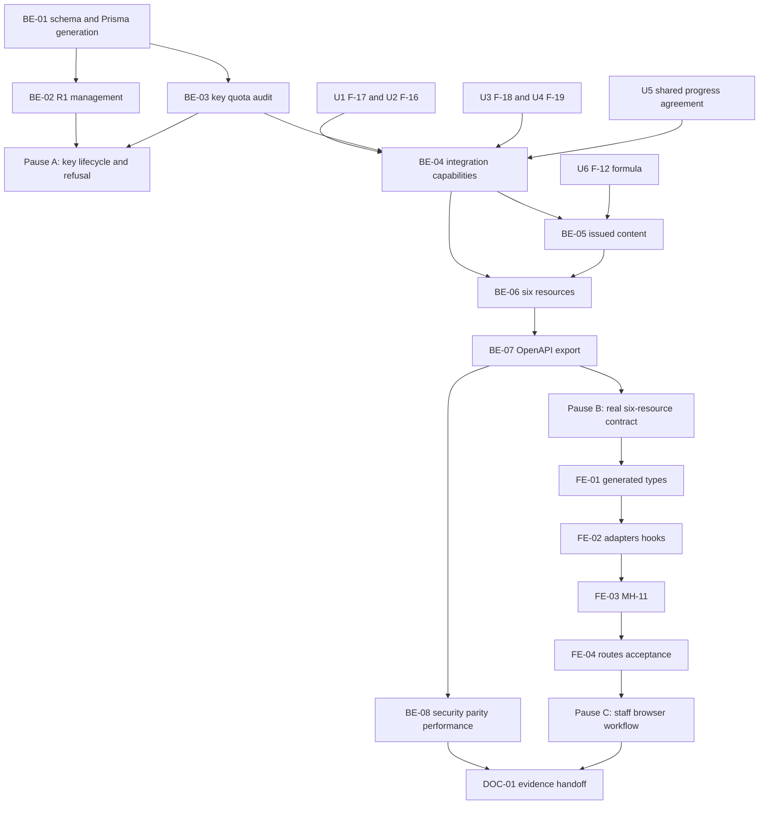

# F-21 dDUT Read API — Backend + Frontend Implementation Plan

Build EP-21, US-098..101 and CV-237..244: six stable, read-only `/api/v1` resources for dDUT, a separately authenticated integration principal, a published OpenAPI 3.0 contract, and the R1 integration-client screen MH-11. Academic results, applicable-version resolution, registration eligibility and graduation remain shared-domain responsibilities. This is not a mobile-app implementation, a second student portal, a grade engine, or permission to change released-version history. CV-245 is a cross-feature B5 acceptance gate, not a claim that this feature builds all of B5.

> **Companion documents**
> - Decisions: `docs/planning/feature-questions.md` F00-14 and F21-01..05; blank answers mean A. F21 has no Faculty-marked row, but inherited Faculty decisions remain gates in §8.
> - Acceptance: `docs/planning/epics.md` EP-21 / B5 scenario 9; `docs/planning/user-stories.md` US-098..101; `docs/planning/task-breakdown.md` CV-237..245.
> - Requirements: `docs/requirement/REQUIREMENTS.md` FR-94, API-01..05, BR-06..09/23/26, EC-52, NFR-01/02/07/09/11/16/18/19; UC-66..70.
> - Design: `docs/design/data-dictionary.md` IntegrationClient / Student / ProgramEnrollment / AcademicResult; `docs/design/erd.md` M-8/9; `docs/design/state-diagrams.md` §13; `docs/design/sequence-diagrams.md` §16 and L-9/L-10; `docs/design/screen-inventory.md` MH-11; `docs/planning/deferred-scope.md` §2.1; `docs/design/tech-stack.md`.
> - Binding written, **not built**, contracts: `docs/implementation/f-18-course-registration-eligibility-implementation-plan.md`, `f-19-graduation-review-implementation-plan.md`, `f-17-student-records-results-import-implementation-plan.md`, and `f-16-version-compare-cohort-assignment-implementation-plan.md`. §8 names every consumed assumption. F-12's `f-12-grade-formula-assessment-clo-implementation-plan.md` supplies revision-owned formula declarations, not official mark computation.
> - Structure/examples: `docs/implementation/README.md`, `f-15-release-version-snapshots-implementation-plan.md`, `f-09-excel-import-export-implementation-plan.md`; architecture documents and dependency reports in `docs/implement-report/`; frontend `source/frontend/src/shared/design-system/DESIGN_SYSTEM.md`.
> - Verification: `docs/planning/test-plan.md` B5/API/security; future manual supplement `docs/testing/feature__f-21-ddut-api.md` (DOC-01).

**Status**: Not started — source baseline inspected on 2026-10-26. This plan is complete as a build specification; its dependencies and institutional/deployment acceptance gates are not claimed implemented or approved.

## 0. Plan at a glance

Everything below in one table. Read this; the rest is detail for whoever builds it.

| What | Why | How and where |
|---|---|---|
| **A server credential, not a browser session** | F21-01/02 A; API-03; F-18 explicitly leaves external authorization to this feature | Random X-Api-Key, hash-only client, separately verified/target-bound integration capability; no fake R1/user (BE-01/03/04, shared/integration-access) |
| **R1 owns partner access** | US-098; MH-11 | Session-protected management and one-time key modal; lock/unlock, rate setting, no retrieve/delete/rotation route (BE-02, FE-01..04, features/integration-clients) |
| **Six stable read resources** | FR-94; UC-66..70; US-099/100 | Exact SRS `/api/v1` paths, explicit minimized DTOs and Vietnamese messages; PRIMARY enrollment, dated context and no latest-version shortcut (BE-04..06, features/ddut-api) |
| **The same academic answers as web** | US-100 AC1..3; CV-242 | Reuse F-17 facts/resolver, F-18 evaluator, F-19 live capability; consume F-20 BE-04 PortalProgressReader, never a second API-side engine (BE-04/08) |
| **Released curriculum and the right syllabus** | BR-23/26; F21-03 A; US-099 AC1..3 | Frozen rows/requisites and validated pin; explicit student or code/version selector; same-revision F-12 formula (BE-05/06, shared/published-programs) |
| **Explicit empty and unevaluable states** | US-100 AC4; EC-52 | No attempts gives NO_ACADEMIC_RESULTS, empty study payloads and intact curriculum; missing context is 409, gated graduation is CANNOT_AUDIT (BE-04/06) |
| **Quota and accountable reads across processes** | F21-05 A; US-098 AC4/5 | PostgreSQL fixed-minute counter default 60/key; append-only minimal per-call record before successful response, no Redis cache/new package (BE-01/03/08) |
| **A contract dDUT can actually build against** | US-101 AC1..3; API-02 | Separate OpenAPI 3.0.x web/JSON plus exported `source/backend/openapi/ddut-v1.json`, synthetic fixtures, public generated TS and real-response parity/compatibility checks (BE-07/08, FE-01) |

**Key behaviours worth knowing**

| Behaviour | Why it is this way |
|---|---|
| The partner key must stay on a trusted server; it is not proof of an individual student | A-default trusts partner identity enforcement and logs mssv attribution; shipping a shared key to mobile would break that assumption |
| Missing/locked keys are the same 401; cookie-only calls cannot use v1 | No browser-session fallback or key-status oracle |
| A lock rejects later admissions, not a read already admitted before commit | Honest immediate-revocation boundary; no fictional cancellation guarantee |
| Default semester is latest known start not after application today; request next semester explicitly | One deterministic date-based context; no calendar or offering knowledge invented |
| API reads may write only quota/call records, never academic state | No saved graduation review, enrollment reconciliation, activation, grade or queue side effect |
| No transcript is not the same as no primary enrollment/assignment | Valid empty study response still requires a resolvable academic context |
| Historical/current verdicts use authoritative live facts; explicit issued content remains read-only | Built corrections/calendar changes limit historical entitlement reproducibility; this plan does not change them |
| Successful JSON waits for the call log; process death/DB outage is not magically exactly-once | Durability before disclosure with an explicitly documented failure limit |

**Not included**

| Excluded | Why |
|---|---|
| Mobile app changes, real credentials/data and source/ddut-app-api inspection | Forbidden/sensitive; sanitized client contract is needed for real integration sign-off |
| OAuth, new end-user identity protocol, SECOND_MAJOR v1 or registration writes | A-default and read-only SRS scope |
| A duplicate progress/eligibility/graduation/grade engine | Domain reuse is mandatory; unbuilt shared contracts are integration gates |
| Built correction/calendar/schema-policy changes, generic AuditLog or new runtime packages | Owner decisions/explicitly deferred work, not hidden prerequisites |
| Full production acceptance before shared progress/formula and partner policy exist | Mocked output or staged 503 is not delivery of all six resources |

**Open questions**

| Question | Resolved when | Default if unanswered |
|---|---|---|
| Can actual dDUT protect the key and enforce each student's identity? | Sanitized trusted-server contract accepted, E1 | Server-to-server A only; stop real-client/NFR-11 sign-off |
| Must past entitlement survive retroactive correction/calendar edits? | Built-feature owners decide, E2 | Preserve current authoritative behavior; no historical certification |
| What shared progress provider/percentage semantics does F-20 own? | Decided 2026-10-26 (user), E3 | F-20 BE-04 PortalProgressReader owns the shared calculation/display ratio; implementation remains a dependency, not an ownership question |
| What call-log retention/access/abuse policy is authorized? | Faculty/operators approve, E4 | Minimal append-only records, no runtime delete/view; no real-data operational sign-off |
| Are inherited academic policies and acceptance environment confirmed? | Upstream Faculty evidence and actual measurements, E5 | Shared explicit reasons/diagnostics, synthetic verification only |

## 1. Scope

| In scope | Why |
|---|---|
| Per-partner random API key, hash-only persistence, ACTIVE/LOCKED, configurable requests/minute | US-098; F21-01/05 A |
| R1 session-protected create/list/edit/lock/unlock and one-time key presentation | MH-11; no machine credential may administer clients |
| Independent integration capability, no session/user impersonation | F-18 §8 explicitly leaves this to F-21; F21-02 A trusts the integration |
| Six exact Vietnamese SRS resource paths, English JSON property names, Vietnamese display/error text | US-099/100/101; API-01/05 |
| PRIMARY interval selection, explicit/known semester, exception/cohort version provenance | F21-04 A; BR-26; F-16/F-17 contracts |
| Frozen curriculum and pinned syllabus/formula; live progress/eligibility/graduation | UC-66..70; no academic rules in transport adapters |
| PostgreSQL shared rate counter and dedicated append-only call records | API-04; US-098 AC5; generic AuditLog remains deferred |
| Separate OpenAPI document, committed synthetic contract examples, generated types and parity tests | dDUT builds against a versioned deliverable, not web DTO accidents |

| Out of scope | Deferred until |
|---|---|
| Reading/editing the dDUT repository or its configuration; embedding a shared key in an installed app | Sanitized client specification and approved trusted-server deployment, E1 |
| OAuth2, student bearer tokens, SSO exchange, scopes selected by a caller | Separately approved authentication requirement; never silently substitute for A |
| Secondary-major selection in v1 | A future version/approved extension; F21-04 A is PRIMARY only |
| Registration writes, enrollment reconciliation, saved graduation audits, batch review, import/sync | Their owning features; GET must not trigger them |
| Reconstructing immutable past entitlement after built correction/calendar edits | Owner decision E2; no built-table behavior change here |
| Generic audit viewer, mobile screens, F-20 portal screens, anonymous PLO website | Separate scope; R-7 A permits a server-side key consumer, not anonymous student data |
| New runtime packages, Redis data/cache, retention/deletion of call records | No package is required; retention is an explicit E4 decision |

| AC | Covered by |
|---|---|
| US-098 AC1 hash-only/one-time key | BE-01/02, FE-02/03, BE-08 |
| US-098 AC2 missing/invalid key → standard Vietnamese HTTP error | BE-03/06/08 |
| US-098 AC3 lock takes effect on subsequent requests | BE-02/03/08, FE-03 |
| US-098 AC4 configured frequency/window refusal | BE-01/03/08, FE-03 |
| US-098 AC5 attributable student/resource/time call record | BE-01/03/08 |
| US-099 AC1 applicable PRIMARY version and semester curriculum | BE-04/05/06/08 |
| US-099 AC2 exact issued version, never Draft | BE-05/06/08 |
| US-099 AC3 currently published or explicitly pinned syllabus | BE-05/06/07/08; U6 formula integration |
| US-099 AC4 missing resource 404, Vietnamese message | BE-03/05/06/08 |
| US-100 AC1 same progress as portal | BE-04/06/08; U5 shared progress gate |
| US-100 AC2 same eligibility/reasons as portal | BE-04/06/08; U3 |
| US-100 AC3 conclusion and structured shortfalls | BE-04/06/08; U4 |
| US-100 AC4 no academic records → valid empty result and explicit flag | BE-04/06/08; full curriculum is still readable |
| US-100 AC5 dual enrollment → PRIMARY only | BE-04/06/08 |
| US-101 AC1 six paths/parameters/errors in OpenAPI 3.0 web docs | BE-06/07, FE-03 |
| US-101 AC2 actual JSON matches published schemas | BE-07/08, FE-01/04 |
| US-101 AC3 incompatible change requires new major path | BE-07/08, DOC-01 |
| B5 scenario 9 / UC-66..70 / CV-237..244 | BE-01..08, FE-01..04, DOC-01 |
| CV-245 other B5 scenarios | Owner's later integrated run; F-21 supplies API parity evidence, not other features' completion |

## 2. Contract verification

### 2a. Actual routes and integration boundaries

No dDUT route or student-domain implementation is claimed to exist. No feature service is called through internal HTTP. Existing web endpoints below are evidence/mirrors, **not** interfaces a machine key can call.

| Endpoint or boundary | Verified at | Request | Actual response/behavior | Disposition |
|---|---|---|---|---|
| App middleware and docs | `source/backend/src/app.setup.ts:17`, `source/backend/src/app.setup.ts:26`, `source/backend/src/app.setup.ts:39` | Global `/api`; session middleware; validation whitelist | Cookie-auth Swagger at `/api/docs` and its JSON endpoint; no v1 document configured | Add separate v1 document; preserve internal docs/type-generation URL |
| Global authorization | `source/backend/src/app.module.ts:59`, `source/backend/src/shared/auth/authenticated.guard.ts:34`, `source/backend/src/shared/authz/permission.guard.ts:23` | Session on non-public handlers | Both session and permission guards bypass `@Public`; otherwise session and explicit permission required | Machine controllers need `@Public` **and mandatory integration guard**, with an inventory test |
| CSRF | `source/backend/src/shared/auth/csrf.guard.ts:12` | GET/HEAD/OPTIONS or X-Requested-With | Public metadata does not bypass unsafe-method CSRF | All six reads are GET; management remains session + CSRF; no global relaxation |
| GET `/api/programs/:programId/versions/:versionId` | `source/backend/src/features/releases/version-history.controller.ts:26`, `source/backend/src/features/releases/version-history.reader.ts:96`, `source/backend/src/features/releases/version-history.reader.ts:140` | Internal IDs, PROGRAM_VIEW | Scoped issued detail; privileged correction Draft can be read; rows use snapshot helpers | Do not expose this DTO or fake R1 to call it; v1 filters every Draft and strips editing/provenance-of-person fields |
| GET `/api/program-versions/:versionId/curriculum` | `source/backend/src/features/curriculum/program-versions-curriculum.controller.ts:43`, `source/backend/src/features/curriculum/curriculum-read.service.ts:66`, `source/backend/src/features/curriculum/curriculum.dto.ts:175` | ID + AccessContext | Includes editing capabilities; item mapping prefers frozen name/credits; frozen requisites are row-owned | Reuse shared row helpers, new shared issued-content projection; no editing DTO reuse |
| Syllabus version selection | `source/backend/src/features/syllabi/syllabi.service.ts:152`, `source/backend/src/features/syllabi/syllabus.dto.ts:157` | Course ID + optional versionId under session | Pinned revision mapped as published; sourceRequest/capabilities and attachments are internal | New safe projection; keep internal behavior unchanged |
| Pinned revision helper | `source/backend/src/shared/syllabi/revision-for-items.ts:30`, `source/backend/src/shared/syllabi/revision-for-items.ts:54` | Db + item IDs/course IDs/pins | Pins win; unpinned item can fall back Published-else-Draft | Require non-null issued pin before using helper; never permit that fallback in v1 |
| Student resolver / transcript | **UNVERIFIED — U1**, F-17 BE-03/07 | Actor-bound required student/program/semester, optional tx | Resolution and raw attempts; no unrestricted external facade promised | BE-04 adds resource-bound integration facades over the same private implementation |
| Registration query | **UNVERIFIED — U3**, F-18 BE-04 | `forAccess(access).evaluate(lookup, tx?)` | Context, evaluatedAt, completed + nullable three-way outcome, reasons/bundle/warnings | Add capability factory, not an unguarded overload or second engine |
| Graduation live engine | **UNVERIFIED — U4**, F-19 BE-03/06 | `GraduationReaderCapability`, supplied tx | Evaluator returns input/result/digest; live service wraps REVIEWED/CANNOT_AUDIT | Build integration capability and project live result; no staff save/history calls |
| Shared progress | **PLANNED — U5**, F-20 BE-04 `PortalProgressReader` | Same target-bound capability and tx | `source/backend/src/shared/student-portal/portal-progress.reader.ts`, `StudentPortalSharedModule`; add the BE-04 integration facade without changing user methods | Actual F-20 implementation is required; ownership/semantics decided 2026-10-26 |
| Formula declaration | **UNVERIFIED — U6**, F-12 BE-03/04 | Exact syllabus revision | GradeFormulaDto with components, mappings, warnings and nullable cutoffs | Shared revision reader/mapper needed; do not invent official student scores |
| Management permission | `source/backend/src/shared/authz/permission-codes.ts:9`, `source/backend/prisma/seed-data/permission-catalog.ts:89` | integrationClient.manage | Already catalogued, seeded R1 direct; no endpoint implementation asserted | Reuse permission and `assertSchoolWideDirect` at `source/backend/src/shared/authz/edit-path.ts:66`; no seed/role migration |

### 2b. Field-level ledger

Sources marked NEW are contract proposals, not current output. The complete new v1 nested declarations appear in BE-06; their only consumer in this repository is generated contract types/tests, not a handwritten mobile model. No existing response DTO is spread into v1. Internal-only fields are explicitly excluded below.

**Actually consumed helpers/serializer facts**

| Field | Wire/domain type | Nullable | Source | Modeled as | Note |
|---|---|---|---|---|---|
| courseNameSnapshot | string | yes | `source/backend/src/shared/curriculum/row-course.ts:14` | Published row courseName | Issued API rejects incomplete snapshots; no mutable-name fallback |
| creditsSnapshot | Prisma.Decimal | yes | `source/backend/src/shared/curriculum/row-course.ts:15` | decimal-string credits | Same fail-closed issued validation |
| course.courseName | string | no | `source/backend/src/shared/curriculum/row-course.ts:12` | Not modeled for issued row name | Only a fallback in ordinary shared helper |
| course.credits | Prisma.Decimal | no | `source/backend/src/shared/curriculum/row-course.ts:5` | Not modeled for issued credits | Do not change historical academic totals |
| revision.id | string | no | `source/backend/src/shared/syllabi/revision-for-items.ts:4` | syllabus.id | Returned pin |
| revision.revisionNumber | number | no | `source/backend/src/shared/syllabi/revision-for-items.ts:6` | syllabus.revisionNumber | Helper returns null for unnumbered revision at `:96` |
| revision.status | DRAFT / PUBLISHED / HISTORICAL | no | `source/backend/prisma/schema.prisma:615`, `source/backend/src/shared/syllabi/revision-for-items.ts:98` | PUBLISHED / HISTORICAL only | Validate again after lookup |
| decimal | string | no | `source/backend/src/shared/decimal/decimal.ts:9` | All credit/score/weight quantities | Never number coercion |
| day | YYYY-MM-DD string | no | `source/backend/src/shared/time/today.ts:11` | Semester/signed dates | Instant fields remain ISO UTC |
| syllabus.id | string | no | `source/backend/src/features/syllabi/syllabus.dto.ts:162` | same | New shared reader uses raw revision, not this feature DTO |
| syllabus.revisionNumber | number | yes | `source/backend/src/features/syllabi/syllabus.dto.ts:163` | required number | Reject incomplete issued revision |
| syllabus.status | DRAFT / PUBLISHED / HISTORICAL | no | `source/backend/src/features/syllabi/syllabus.dto.ts:164` | issued literals only | Never Draft |
| syllabus.sourceRequest | object | yes | `source/backend/src/features/syllabi/syllabus.dto.ts:165` | **not modeled** | Internal workflow |
| syllabus.courseDescription | sanitized HTML string | yes | `source/backend/src/features/syllabi/syllabus.dto.ts:166` | same | Not evaluated |
| syllabus.englishDescription | sanitized HTML string | yes | `source/backend/src/features/syllabi/syllabus.dto.ts:167` | same | Stored optional content, not UI chrome |
| syllabus.objectives | sanitized HTML string | yes | `source/backend/src/features/syllabi/syllabus.dto.ts:168` | same | Preserve sanitization |
| syllabus.teachingMethods | sanitized HTML string | yes | `source/backend/src/features/syllabi/syllabus.dto.ts:169` | same | Preserve null |
| syllabus.assessmentMethods | sanitized HTML string | yes | `source/backend/src/features/syllabi/syllabus.dto.ts:170` | same | Declaration, not score calculation |
| syllabus.references | sanitized HTML string | yes | `source/backend/src/features/syllabi/syllabus.dto.ts:171` | same | Preserve null |
| syllabus.publishedAt | ISO instant | yes | `source/backend/src/features/syllabi/syllabus.dto.ts:172` | required ISO instant | Issued validation |
| syllabus.updatedAt | ISO instant | no | `source/backend/src/features/syllabi/syllabus.dto.ts:173` | **not modeled** | Not part of stable v1 academic content |
| syllabus.weeklyContents | array | no | `source/backend/src/features/syllabi/syllabus.dto.ts:174` | safe weekly fields in BE-06 | Explicit projection |
| syllabus.clos | array | no | `source/backend/src/features/syllabi/syllabus.dto.ts:175` | safe CLO fields in BE-06 | No internal linked-program/capability fields |
| syllabus.attachments | array | no | `source/backend/src/features/syllabi/syllabus.dto.ts:176` | **not modeled** | Existing downloads require session; never expose disk path or uploader |

**Management contract — every field, NEW BE-02**

| Field | Wire type | Nullable | Source | Modeled as | Note |
|---|---|---|---|---|---|
| IntegrationClientDto.id | string | no | NEW BE-02 | generated alias | Opaque ID |
| clientName | string | no | NEW BE-02 | same | Unique trimmed name |
| status | ACTIVE / LOCKED | no | NEW BE-01/02; dictionary IntegrationClient | generated literal union | No DELETED state |
| rateLimit | integer | no | NEW BE-01/02 | same | Requests per minute, default 60 |
| createdAt | ISO instant | no | NEW BE-02 | same | UTC |
| updatedAt | ISO instant | no | NEW BE-02 | same | For optimistic updates |
| IntegrationClientPageDto.items | IntegrationClientDto[] | no | NEW BE-02 | same | No hash/key |
| total | integer | no | NEW BE-02 | same | Count same predicate |
| page | integer | no | NEW BE-02 | same | Existing pagination conventions |
| pageSize | integer | no | NEW BE-02 | same | Maximum 100 |
| CreatedIntegrationClientDto.client | IntegrationClientDto | no | NEW BE-02 | same | Non-secret metadata |
| apiKey | string | no | NEW BE-02 | transient component state only | Only successful create response; never list/detail/cache |

**New top-level v1 response ledger**

| Field | Wire type | Nullable | Source | Modeled as | Note |
|---|---|---|---|---|---|
| apiVersion | literal v1 | no | NEW BE-06, every successful response | generated alias | Path-level major contract |
| evaluatedAt | ISO instant | no | NEW BE-06, every successful response | same | Captured once per read snapshot |
| ApplicableProgramResponseDto.context | StudentContext | no | NEW BE-04/06; U1 | same | PRIMARY only |
| ApplicableProgramResponseDto.program | PublishedProgram | no | NEW BE-05/06 | same | Includes full curriculum even with no academic attempts |
| ProgramVersionResponseDto.program | PublishedProgram | no | NEW BE-05/06 | same | Exact code/version, issued only |
| SyllabusResponseDto.selection | SyllabusSelection | no | NEW BE-05/06 | same | Effective or explicitly pinned |
| SyllabusResponseDto.course | CourseRef | no | NEW BE-05/06 | same | Frozen name for version-selected context |
| SyllabusResponseDto.syllabus | PublishedSyllabus | no | NEW BE-05/06; U6 | same | Not internal CourseSyllabusDto |
| ProgressResponseDto.context | StudentContext | no | NEW BE-04/06; U1 | same | Explicit resolved version/semester |
| ProgressResponseDto.dataStatus | AVAILABLE / NO_ACADEMIC_RESULTS | no | NEW BE-04/06; U5 | same | Not inferred from item count |
| ProgressResponseDto.summary | ProgressSummary | yes | NEW BE-04/06; U5 | same | null iff no academic records |
| ProgressResponseDto.items | ProgressItem[] | no | NEW BE-04/06; U5 | same | [] in no-data branch |
| EligibilityResponseDto.context | StudentContext | no | NEW BE-04/06; U1 | same | Matches shared reader context |
| EligibilityResponseDto.dataStatus | AVAILABLE / NO_ACADEMIC_RESULTS | no | NEW BE-04/06 | same | Empty transcript branch, not an error |
| EligibilityResponseDto.items | EligibilityItem[] | no | NEW BE-06; U3 | same | Shared verdict/reasons/concurrent bundle, [] for no data |
| EligibilityResponseDto.warnings | EligibilityWarning[] | no | NEW BE-06; U3 | same | [] for no data |
| GraduationResponseDto.context | StudentContext | no | NEW BE-04/06; U1 | same | No full name or staff identity |
| GraduationResponseDto.dataStatus | AVAILABLE / NO_ACADEMIC_RESULTS | no | NEW BE-04/06 | same | Separate from evaluation outcome |
| GraduationResponseDto.status | REVIEWED / CANNOT_AUDIT / NO_ACADEMIC_RESULTS | no | NEW BE-06; U4 | same | Three explicit branches |
| GraduationResponseDto.result | GraduationPublicResult | yes | NEW BE-06; U4 | same | Only REVIEWED |
| GraduationResponseDto.error | Diagnostic | yes | NEW BE-06; U4 | same | Only CANNOT_AUDIT |

Nested field types/nullability are pinned exhaustively by the TypeScript declarations in BE-06, including literal enums, the five graduation shortfall variants, all eligibility reasons, and formula children. They are **NEW**, not claims about a built serializer. U3's full RegistrationEligibilityAnswer.context/evaluatedAt/contractVersion are mapped to the v1 envelope; item/reason/warning fields are preserved. U4 input/digest/recognitions/freeCredits/auditor/history/freshness are **not modeled** because v1 exposes live conclusion/shortfalls/credits/warnings, not saved staff evidence. U1 raw result score10/score4/letterGrade/dataSource/revision/attempt IDs are **not exposed** as a transcript endpoint.

The nested ledgers below describe proposed projection fields, not existing serializers. Inherited ApiReadMeta fields apply to every successful response; inherited CourseRef fields apply unchanged to EligibilityCourseRef. Their upstream source assumptions are U1 for StudentContext, U5 for progress, U3 for eligibility, U4 for graduation and U6 for grading; no source verification is implied by a NEW label. BE-06 supplies the complete declarations and mapper dispositions.

**ApiReadMeta - nested wire field ledger (NEW)**

| Field | Wire type | Nullable | Source | Modeled as | Note |
|---|---|---|---|---|---|
| apiVersion | `'v1'` | no | NEW BE-05/06; U3/U4/U6 where applicable | same named field | Explicit projection; no omitted fields |
| evaluatedAt | `string` | no | NEW BE-05/06; U3/U4/U6 where applicable | same named field | Explicit projection; no omitted fields |

**CourseRef - nested wire field ledger (NEW)**

| Field | Wire type | Nullable | Source | Modeled as | Note |
|---|---|---|---|---|---|
| id | `string` | no | NEW BE-05/06; U3/U4/U6 where applicable | same named field | Explicit projection; no omitted fields |
| courseCode | `string` | no | NEW BE-05/06; U3/U4/U6 where applicable | same named field | Explicit projection; no omitted fields |
| courseName | `string` | no | NEW BE-05/06; U3/U4/U6 where applicable | same named field | Explicit projection; no omitted fields |

**StudentContext - nested wire field ledger (NEW)**

| Field | Wire type | Nullable | Source | Modeled as | Note |
|---|---|---|---|---|---|
| studentCode | `string` | no | NEW BE-05/06; U3/U4/U6 where applicable | same named field | Explicit projection; no omitted fields |
| enrollmentId | `string` | no | NEW BE-05/06; U3/U4/U6 where applicable | same named field | Explicit projection; no omitted fields |
| programCode | `string` | no | NEW BE-05/06; U3/U4/U6 where applicable | same named field | Explicit projection; no omitted fields |
| programVersionId | `string` | no | NEW BE-05/06; U3/U4/U6 where applicable | same named field | Explicit projection; no omitted fields |
| versionNumber | `string` | no | NEW BE-05/06; U3/U4/U6 where applicable | same named field | Explicit projection; no omitted fields |
| semesterCode | `string` | no | NEW BE-05/06; U3/U4/U6 where applicable | same named field | Explicit projection; no omitted fields |
| semesterStartDate | `string` | no | NEW BE-05/06; U3/U4/U6 where applicable | same named field | Explicit projection; no omitted fields |
| versionSource | `'COHORT' &#124; 'EXCEPTION'` | no | NEW BE-05/06; U3/U4/U6 where applicable | same named field | Explicit projection; no omitted fields |

**PublishedRequisite - nested wire field ledger (NEW)**

| Field | Wire type | Nullable | Source | Modeled as | Note |
|---|---|---|---|---|---|
| sourceCourse | `CourseRef` | no | NEW BE-05/06; U3/U4/U6 where applicable | same named field | Explicit projection; no omitted fields |
| relationType | `'PRIOR' &#124; 'PREREQUISITE' &#124; 'COREQUISITE'` | no | NEW BE-05/06; U3/U4/U6 where applicable | same named field | Explicit projection; no omitted fields |
| minScore | `string &#124; null` | yes | NEW BE-05/06; U3/U4/U6 where applicable | same named field | Explicit projection; no omitted fields |

**PublishedCurriculumItem - nested wire field ledger (NEW)**

| Field | Wire type | Nullable | Source | Modeled as | Note |
|---|---|---|---|---|---|
| id | `string` | no | NEW BE-05/06; U3/U4/U6 where applicable | same named field | Explicit projection; no omitted fields |
| course | `CourseRef` | no | NEW BE-05/06; U3/U4/U6 where applicable | same named field | Explicit projection; no omitted fields |
| credits | `string` | no | NEW BE-05/06; U3/U4/U6 where applicable | same named field | Explicit projection; no omitted fields |
| sortOrder | `number` | no | NEW BE-05/06; U3/U4/U6 where applicable | same named field | Explicit projection; no omitted fields |
| blockSymbol | `string &#124; null` | yes | NEW BE-05/06; U3/U4/U6 where applicable | same named field | Explicit projection; no omitted fields |
| isElective | `boolean` | no | NEW BE-05/06; U3/U4/U6 where applicable | same named field | Explicit projection; no omitted fields |
| electiveGroupId | `string &#124; null` | yes | NEW BE-05/06; U3/U4/U6 where applicable | same named field | Explicit projection; no omitted fields |
| htDa | `boolean` | no | NEW BE-05/06; U3/U4/U6 where applicable | same named field | Explicit projection; no omitted fields |
| tqDa | `boolean` | no | NEW BE-05/06; U3/U4/U6 where applicable | same named field | Explicit projection; no omitted fields |
| minStudiedScore | `string &#124; null` | yes | NEW BE-05/06; U3/U4/U6 where applicable | same named field | Explicit projection; no omitted fields |
| minTransferScore | `string &#124; null` | yes | NEW BE-05/06; U3/U4/U6 where applicable | same named field | Explicit projection; no omitted fields |
| note | `string &#124; null` | yes | NEW BE-05/06; U3/U4/U6 where applicable | same named field | Explicit projection; no omitted fields |
| syllabusId | `string` | no | NEW BE-05/06; U3/U4/U6 where applicable | same named field | Explicit projection; no omitted fields |
| requisites | `PublishedRequisite[]` | no | NEW BE-05/06; U3/U4/U6 where applicable | same named field | Explicit projection; no omitted fields |

**PublishedSemester - nested wire field ledger (NEW)**

| Field | Wire type | Nullable | Source | Modeled as | Note |
|---|---|---|---|---|---|
| plannedSemester | `number` | no | NEW BE-05/06; U3/U4/U6 where applicable | same named field | Explicit projection; no omitted fields |
| items | `PublishedCurriculumItem[]` | no | NEW BE-05/06; U3/U4/U6 where applicable | same named field | Explicit projection; no omitted fields |

**PublishedElectiveGroup - nested wire field ledger (NEW)**

| Field | Wire type | Nullable | Source | Modeled as | Note |
|---|---|---|---|---|---|
| id | `string` | no | NEW BE-05/06; U3/U4/U6 where applicable | same named field | Explicit projection; no omitted fields |
| groupCode | `string` | no | NEW BE-05/06; U3/U4/U6 where applicable | same named field | Explicit projection; no omitted fields |
| groupName | `string` | no | NEW BE-05/06; U3/U4/U6 where applicable | same named field | Explicit projection; no omitted fields |
| minCredits | `string &#124; null` | yes | NEW BE-05/06; U3/U4/U6 where applicable | same named field | Explicit projection; no omitted fields |
| minCourses | `number &#124; null` | yes | NEW BE-05/06; U3/U4/U6 where applicable | same named field | Explicit projection; no omitted fields |

**PublishedProgram - nested wire field ledger (NEW)**

| Field | Wire type | Nullable | Source | Modeled as | Note |
|---|---|---|---|---|---|
| id | `string` | no | NEW BE-05/06; U3/U4/U6 where applicable | same named field | Explicit projection; no omitted fields |
| programCode | `string` | no | NEW BE-05/06; U3/U4/U6 where applicable | same named field | Explicit projection; no omitted fields |
| programName | `string` | no | NEW BE-05/06; U3/U4/U6 where applicable | same named field | Explicit projection; no omitted fields |
| majorCode | `string` | no | NEW BE-05/06; U3/U4/U6 where applicable | same named field | Explicit projection; no omitted fields |
| majorName | `string` | no | NEW BE-05/06; U3/U4/U6 where applicable | same named field | Explicit projection; no omitted fields |
| versionNumber | `string` | no | NEW BE-05/06; U3/U4/U6 where applicable | same named field | Explicit projection; no omitted fields |
| status | `'PENDING' &#124; 'ACTIVE' &#124; 'HISTORICAL'` | no | NEW BE-05/06; U3/U4/U6 where applicable | same named field | Explicit projection; no omitted fields |
| semesterCount | `number` | no | NEW BE-05/06; U3/U4/U6 where applicable | same named field | Explicit projection; no omitted fields |
| totalCredits | `string` | no | NEW BE-05/06; U3/U4/U6 where applicable | same named field | Explicit projection; no omitted fields |
| compulsoryCredits | `string` | no | NEW BE-05/06; U3/U4/U6 where applicable | same named field | Explicit projection; no omitted fields |
| electiveCredits | `string` | no | NEW BE-05/06; U3/U4/U6 where applicable | same named field | Explicit projection; no omitted fields |
| publishedAt | `string` | no | NEW BE-05/06; U3/U4/U6 where applicable | same named field | Explicit projection; no omitted fields |
| effectiveSemesterCode | `string` | no | NEW BE-05/06; U3/U4/U6 where applicable | same named field | Explicit projection; no omitted fields |
| effectiveSemesterStartDate | `string` | no | NEW BE-05/06; U3/U4/U6 where applicable | same named field | Explicit projection; no omitted fields |
| correctedByVersionNumber | `string &#124; null` | yes | NEW BE-05/06; U3/U4/U6 where applicable | same named field | Explicit projection; no omitted fields |
| semesters | `PublishedSemester[]` | no | NEW BE-05/06; U3/U4/U6 where applicable | same named field | Explicit projection; no omitted fields |
| electiveGroups | `PublishedElectiveGroup[]` | no | NEW BE-05/06; U3/U4/U6 where applicable | same named field | Explicit projection; no omitted fields |
| plos | `PublishedPlo[]` | no | NEW BE-05/06 | same named field | Version-owned published outcomes, no usage/edit flags |

**PublishedPlo - nested wire field ledger (NEW)**

| Field | Wire type | Nullable | Source | Modeled as | Note |
|---|---|---|---|---|---|
| id | string | no | NEW BE-05/06; mapper mirror `source/backend/src/features/outcomes/plo.dto.ts:101` | same | Version-owned row |
| ploCode | string | no | NEW BE-05/06; mapper mirror `source/backend/src/features/outcomes/plo.dto.ts:102` | same | Stable outcome code |
| description | string | no | NEW BE-05/06; mapper mirror `source/backend/src/features/outcomes/plo.dto.ts:103` | same | Stored content |
| englishDescription | string | yes | NEW BE-05/06; mapper mirror `source/backend/src/features/outcomes/plo.dto.ts:104` | same | Explicit null |
| competencyGroup | string | yes | NEW BE-05/06; mapper mirror `source/backend/src/features/outcomes/plo.dto.ts:105` | same | Explicit null |
| sortOrder | integer | no | NEW BE-05/06; mapper mirror `source/backend/src/features/outcomes/plo.dto.ts:106` | same | Sort then id |

PloDto.courseCount and cloLinkCount are not modeled: they are editing/deletion usage counts, not published outcome content (`source/backend/src/features/outcomes/plo.dto.ts:107`, `source/backend/src/features/outcomes/plo.dto.ts:108`). No internal PloListDto editing flags are exposed.

**PublishedWeek - nested wire field ledger (NEW)**

| Field | Wire type | Nullable | Source | Modeled as | Note |
|---|---|---|---|---|---|
| id | `string` | no | NEW BE-05/06; U3/U4/U6 where applicable | same named field | Explicit projection; no omitted fields |
| weekLabel | `string` | no | NEW BE-05/06; U3/U4/U6 where applicable | same named field | Explicit projection; no omitted fields |
| sortOrder | `number` | no | NEW BE-05/06; U3/U4/U6 where applicable | same named field | Explicit projection; no omitted fields |
| content | `string` | no | NEW BE-05/06; U3/U4/U6 where applicable | same named field | Explicit projection; no omitted fields |
| teachingActivities | `string &#124; null` | yes | NEW BE-05/06; U3/U4/U6 where applicable | same named field | Explicit projection; no omitted fields |
| cloIds | `string[]` | no | NEW BE-05/06; U3/U4/U6 where applicable | same named field | Explicit projection; no omitted fields |

**PublishedClo - nested wire field ledger (NEW)**

| Field | Wire type | Nullable | Source | Modeled as | Note |
|---|---|---|---|---|---|
| id | `string` | no | NEW BE-05/06; U3/U4/U6 where applicable | same named field | Explicit projection; no omitted fields |
| cloCode | `string` | no | NEW BE-05/06; U3/U4/U6 where applicable | same named field | Explicit projection; no omitted fields |
| description | `string` | no | NEW BE-05/06; U3/U4/U6 where applicable | same named field | Explicit projection; no omitted fields |
| englishDescription | `string &#124; null` | yes | NEW BE-05/06; U3/U4/U6 where applicable | same named field | Explicit projection; no omitted fields |
| cognitiveLevel | `string &#124; null` | yes | NEW BE-05/06; U3/U4/U6 where applicable | same named field | Explicit projection; no omitted fields |
| sortOrder | `number` | no | NEW BE-05/06; U3/U4/U6 where applicable | same named field | Explicit projection; no omitted fields |

**AssessmentCloMapping - nested wire field ledger (NEW)**

| Field | Wire type | Nullable | Source | Modeled as | Note |
|---|---|---|---|---|---|
| cloId | `string` | no | NEW BE-05/06; U3/U4/U6 where applicable | same named field | Explicit projection; no omitted fields |
| cloWeight | `string &#124; null` | yes | NEW BE-05/06; U3/U4/U6 where applicable | same named field | Explicit projection; no omitted fields |

**AssessmentComponent - nested wire field ledger (NEW)**

| Field | Wire type | Nullable | Source | Modeled as | Note |
|---|---|---|---|---|---|
| id | `string` | no | NEW BE-05/06; U3/U4/U6 where applicable | same named field | Explicit projection; no omitted fields |
| componentCode | `string` | no | NEW BE-05/06; U3/U4/U6 where applicable | same named field | Explicit projection; no omitted fields |
| componentName | `string` | no | NEW BE-05/06; U3/U4/U6 where applicable | same named field | Explicit projection; no omitted fields |
| weight | `string` | no | NEW BE-05/06; U3/U4/U6 where applicable | same named field | Explicit projection; no omitted fields |
| assessmentForm | `string &#124; null` | yes | NEW BE-05/06; U3/U4/U6 where applicable | same named field | Explicit projection; no omitted fields |
| isConditional | `boolean` | no | NEW BE-05/06; U3/U4/U6 where applicable | same named field | Explicit projection; no omitted fields |
| conditionThreshold | `string &#124; null` | yes | NEW BE-05/06; U3/U4/U6 where applicable | same named field | Explicit projection; no omitted fields |
| failingScore | `string &#124; null` | yes | NEW BE-05/06; U3/U4/U6 where applicable | same named field | Explicit projection; no omitted fields |
| mappings | `AssessmentCloMapping[]` | no | NEW BE-05/06; U3/U4/U6 where applicable | same named field | Explicit projection; no omitted fields |

**AssessmentWarning - nested wire field ledger (NEW)**

| Field | Wire type | Nullable | Source | Modeled as | Note |
|---|---|---|---|---|---|
| code | `'ASSESSMENT_CLO_UNCOVERED'` | no | NEW BE-05/06; U3/U4/U6 where applicable | same named field | Explicit projection; no omitted fields |
| cloId | `string` | no | NEW BE-05/06; U3/U4/U6 where applicable | same named field | Explicit projection; no omitted fields |
| cloCode | `string` | no | NEW BE-05/06; U3/U4/U6 where applicable | same named field | Explicit projection; no omitted fields |
| message | `string` | no | NEW BE-05/06; U3/U4/U6 where applicable | same named field | Explicit projection; no omitted fields |

**GradeFormula - nested wire field ledger (NEW)**

| Field | Wire type | Nullable | Source | Modeled as | Note |
|---|---|---|---|---|---|
| failingScore | `string &#124; null` | yes | NEW BE-05/06; U3/U4/U6 where applicable | same named field | Explicit projection; no omitted fields |
| totalWeight | `string` | no | NEW BE-05/06; U3/U4/U6 where applicable | same named field | Explicit projection; no omitted fields |
| components | `AssessmentComponent[]` | no | NEW BE-05/06; U3/U4/U6 where applicable | same named field | Explicit projection; no omitted fields |
| warnings | `AssessmentWarning[]` | no | NEW BE-05/06; U3/U4/U6 where applicable | same named field | Explicit projection; no omitted fields |

**PublishedSyllabus - nested wire field ledger (NEW)**

| Field | Wire type | Nullable | Source | Modeled as | Note |
|---|---|---|---|---|---|
| id | `string` | no | NEW BE-05/06; U3/U4/U6 where applicable | same named field | Explicit projection; no omitted fields |
| revisionNumber | `number` | no | NEW BE-05/06; U3/U4/U6 where applicable | same named field | Explicit projection; no omitted fields |
| status | `'PUBLISHED' &#124; 'HISTORICAL'` | no | NEW BE-05/06; U3/U4/U6 where applicable | same named field | Explicit projection; no omitted fields |
| publishedAt | `string` | no | NEW BE-05/06; U3/U4/U6 where applicable | same named field | Explicit projection; no omitted fields |
| courseDescription | `string &#124; null` | yes | NEW BE-05/06; U3/U4/U6 where applicable | same named field | Explicit projection; no omitted fields |
| englishDescription | `string &#124; null` | yes | NEW BE-05/06; U3/U4/U6 where applicable | same named field | Explicit projection; no omitted fields |
| objectives | `string &#124; null` | yes | NEW BE-05/06; U3/U4/U6 where applicable | same named field | Explicit projection; no omitted fields |
| teachingMethods | `string &#124; null` | yes | NEW BE-05/06; U3/U4/U6 where applicable | same named field | Explicit projection; no omitted fields |
| assessmentMethods | `string &#124; null` | yes | NEW BE-05/06; U3/U4/U6 where applicable | same named field | Explicit projection; no omitted fields |
| references | `string &#124; null` | yes | NEW BE-05/06; U3/U4/U6 where applicable | same named field | Explicit projection; no omitted fields |
| weeklyContents | `PublishedWeek[]` | no | NEW BE-05/06; U3/U4/U6 where applicable | same named field | Explicit projection; no omitted fields |
| clos | `PublishedClo[]` | no | NEW BE-05/06; U3/U4/U6 where applicable | same named field | Explicit projection; no omitted fields |
| gradingFormula | `GradeFormula` | no | NEW BE-05/06; U3/U4/U6 where applicable | same named field | Explicit projection; no omitted fields |

**SyllabusSelection - nested wire field ledger (NEW)**

| Field | Wire type | Nullable | Source | Modeled as | Note |
|---|---|---|---|---|---|
| source | `'CURRENT_PUBLISHED' &#124; 'PROGRAM_VERSION' &#124; 'STUDENT_VERSION'` | no | NEW BE-05/06; U3/U4/U6 where applicable | same named field | Explicit projection; no omitted fields |
| studentCode | `string &#124; null` | yes | NEW BE-05/06; U3/U4/U6 where applicable | same named field | Explicit projection; no omitted fields |
| programCode | `string &#124; null` | yes | NEW BE-05/06; U3/U4/U6 where applicable | same named field | Explicit projection; no omitted fields |
| versionNumber | `string &#124; null` | yes | NEW BE-05/06; U3/U4/U6 where applicable | same named field | Explicit projection; no omitted fields |
| semesterCode | `string &#124; null` | yes | NEW BE-05/06; U3/U4/U6 where applicable | same named field | Explicit projection; no omitted fields |

**ProgressSummary - nested wire field ledger (NEW)**

| Field | Wire type | Nullable | Source | Modeled as | Note |
|---|---|---|---|---|---|
| earnedCredits | `string` | no | NEW BE-05/06; U3/U4/U6 where applicable | same named field | Explicit projection; no omitted fields |
| requiredCredits | `string` | no | NEW BE-05/06; U3/U4/U6 where applicable | same named field | Explicit projection; no omitted fields |
| missingCredits | `string` | no | NEW BE-05/06; U3/U4/U6 where applicable | same named field | Explicit projection; no omitted fields |
| completionPercent | `string &#124; null` | yes | F-20 BE-04 PortalProgressReader | copied unchanged | Non-authoritative display ratio; null when requiredTotal is zero |

**ProgressItem - nested wire field ledger (NEW)**

| Field | Wire type | Nullable | Source | Modeled as | Note |
|---|---|---|---|---|---|
| itemId | `string` | no | NEW BE-05/06; U3/U4/U6 where applicable | same named field | Explicit projection; no omitted fields |
| courseId | `string` | no | NEW BE-05/06; U3/U4/U6 where applicable | same named field | Explicit projection; no omitted fields |
| status | `'PASSED' &#124; 'IN_PROGRESS' &#124; 'NOT_TAKEN' &#124; 'FAILED'` | no | NEW BE-05/06; U3/U4/U6 where applicable | same named field | Explicit projection; no omitted fields |

**EligibilityCourseRef - nested wire field ledger (NEW)**

| Field | Wire type | Nullable | Source | Modeled as | Note |
|---|---|---|---|---|---|
| nameSource | `'SNAPSHOT' &#124; 'CATALOG'` | no | NEW BE-05/06; U3/U4/U6 where applicable | same named field | Explicit projection; no omitted fields |

**EligibilityReason - nested wire field ledger (NEW)**

| Field | Wire type | Nullable | Source | Modeled as | Note |
|---|---|---|---|---|---|
| code | `EligibilityReasonCode` | no | NEW BE-05/06; U3/U4/U6 where applicable | same named field | Explicit projection; no omitted fields |
| causeCode | `EligibilityReasonCode &#124; null` | yes | NEW BE-05/06; U3/U4/U6 where applicable | same named field | Explicit projection; no omitted fields |
| message | `string` | no | NEW BE-05/06; U3/U4/U6 where applicable | same named field | Explicit projection; no omitted fields |
| relationType | `'PRIOR' &#124; 'PREREQUISITE' &#124; 'COREQUISITE' &#124; null` | yes | NEW BE-05/06; U3/U4/U6 where applicable | same named field | Explicit projection; no omitted fields |
| requiredCourse | `EligibilityCourseRef &#124; null` | yes | NEW BE-05/06; U3/U4/U6 where applicable | same named field | Explicit projection; no omitted fields |
| viaCourse | `EligibilityCourseRef &#124; null` | yes | NEW BE-05/06; U3/U4/U6 where applicable | same named field | Explicit projection; no omitted fields |
| evidenceCourse | `EligibilityCourseRef &#124; null` | yes | NEW BE-05/06; U3/U4/U6 where applicable | same named field | Explicit projection; no omitted fields |
| evidenceResultId | `string &#124; null` | yes | NEW BE-05/06; U3/U4/U6 where applicable | same named field | Explicit projection; no omitted fields |
| requiredScore4 | `string &#124; null` | yes | NEW BE-05/06; U3/U4/U6 where applicable | same named field | Explicit projection; no omitted fields |
| actualScore4 | `string &#124; null` | yes | NEW BE-05/06; U3/U4/U6 where applicable | same named field | Explicit projection; no omitted fields |
| actualStatus | `'PASSED' &#124; 'FAILED' &#124; 'IN_PROGRESS' &#124; 'EXEMPT' &#124; null` | yes | NEW BE-05/06; U3/U4/U6 where applicable | same named field | Explicit projection; no omitted fields |
| path | `EligibilityCourseRef[]` | no | NEW BE-05/06; U3/U4/U6 where applicable | same named field | Explicit projection; no omitted fields |

**EligibilityItem - nested wire field ledger (NEW)**

| Field | Wire type | Nullable | Source | Modeled as | Note |
|---|---|---|---|---|---|
| itemId | `string` | no | NEW BE-05/06; U3/U4/U6 where applicable | same named field | Explicit projection; no omitted fields |
| course | `EligibilityCourseRef` | no | NEW BE-05/06; U3/U4/U6 where applicable | same named field | Explicit projection; no omitted fields |
| credits | `string` | no | NEW BE-05/06; U3/U4/U6 where applicable | same named field | Explicit projection; no omitted fields |
| catalogStatus | `'ACTIVE' &#124; 'DISCONTINUED' &#124; 'CANCELLED'` | no | NEW BE-05/06; U3/U4/U6 where applicable | same named field | Explicit projection; no omitted fields |
| plannedSemester | `number` | no | NEW BE-05/06; U3/U4/U6 where applicable | same named field | Explicit projection; no omitted fields |
| completed | `boolean` | no | NEW BE-05/06; U3/U4/U6 where applicable | same named field | Explicit projection; no omitted fields |
| eligibility | `'ELIGIBLE' &#124; 'CONDITIONAL' &#124; 'INELIGIBLE' &#124; null` | yes | NEW BE-05/06; U3/U4/U6 where applicable | same named field | Explicit projection; no omitted fields |
| statusText | `string` | no | NEW BE-05/06; U3/U4/U6 where applicable | same named field | Explicit projection; no omitted fields |
| reasons | `EligibilityReason[]` | no | NEW BE-05/06; U3/U4/U6 where applicable | same named field | Explicit projection; no omitted fields |
| requiredConcurrentCourses | `EligibilityCourseRef[]` | no | NEW BE-05/06; U3/U4/U6 where applicable | same named field | Explicit projection; no omitted fields |

**EligibilityWarning - nested wire field ledger (NEW)**

| Field | Wire type | Nullable | Source | Modeled as | Note |
|---|---|---|---|---|---|
| code | `'REPLACEMENT_UNAVAILABLE' &#124; 'EXTERNAL_REQUISITE' &#124; 'EXTERNAL_COREQUISITE_RULES_UNAVAILABLE' &#124; 'COURSE_NOT_ACTIVE'` | no | NEW BE-05/06; U3/U4/U6 where applicable | same named field | Explicit projection; no omitted fields |
| message | `string` | no | NEW BE-05/06; U3/U4/U6 where applicable | same named field | Explicit projection; no omitted fields |
| course | `EligibilityCourseRef` | no | NEW BE-05/06; U3/U4/U6 where applicable | same named field | Explicit projection; no omitted fields |

**GraduationCourseShortfall - nested wire field ledger (NEW)**

| Field | Wire type | Nullable | Source | Modeled as | Note |
|---|---|---|---|---|---|
| code | `'MANDATORY_COURSE_MISSING' &#124; 'CONDITIONAL_COURSE_MISSING'` | no | NEW BE-05/06; U3/U4/U6 where applicable | same named field | Explicit projection; no omitted fields |
| category | `'MANDATORY_COURSE' &#124; 'CONDITIONAL_COURSE'` | no | NEW BE-05/06; U3/U4/U6 where applicable | same named field | Explicit projection; no omitted fields |
| curriculumItemId | `string` | no | NEW BE-05/06; U3/U4/U6 where applicable | same named field | Explicit projection; no omitted fields |
| course | `CourseRef` | no | NEW BE-05/06; U3/U4/U6 where applicable | same named field | Explicit projection; no omitted fields |
| blockSymbol | `string &#124; null` | yes | NEW BE-05/06; U3/U4/U6 where applicable | same named field | Explicit projection; no omitted fields |
| reason | `'NOT_TAKEN' &#124; 'FAILED' &#124; 'IN_PROGRESS'` | no | NEW BE-05/06; U3/U4/U6 where applicable | same named field | Explicit projection; no omitted fields |
| message | `string` | no | NEW BE-05/06; U3/U4/U6 where applicable | same named field | Explicit projection; no omitted fields |

**GraduationElectiveCreditShortfall - nested wire field ledger (NEW)**

| Field | Wire type | Nullable | Source | Modeled as | Note |
|---|---|---|---|---|---|
| code | `'ELECTIVE_CREDITS_MISSING'` | no | NEW BE-05/06; U3/U4/U6 where applicable | same named field | Explicit projection; no omitted fields |
| category | `'ELECTIVE_GROUP'` | no | NEW BE-05/06; U3/U4/U6 where applicable | same named field | Explicit projection; no omitted fields |
| groupId | `string` | no | NEW BE-05/06; U3/U4/U6 where applicable | same named field | Explicit projection; no omitted fields |
| groupCode | `string` | no | NEW BE-05/06; U3/U4/U6 where applicable | same named field | Explicit projection; no omitted fields |
| groupName | `string` | no | NEW BE-05/06; U3/U4/U6 where applicable | same named field | Explicit projection; no omitted fields |
| requiredCredits | `string` | no | NEW BE-05/06; U3/U4/U6 where applicable | same named field | Explicit projection; no omitted fields |
| earnedCredits | `string` | no | NEW BE-05/06; U3/U4/U6 where applicable | same named field | Explicit projection; no omitted fields |
| missingCredits | `string` | no | NEW BE-05/06; U3/U4/U6 where applicable | same named field | Explicit projection; no omitted fields |
| message | `string` | no | NEW BE-05/06; U3/U4/U6 where applicable | same named field | Explicit projection; no omitted fields |

**GraduationElectiveCourseShortfall - nested wire field ledger (NEW)**

| Field | Wire type | Nullable | Source | Modeled as | Note |
|---|---|---|---|---|---|
| code | `'ELECTIVE_COURSES_MISSING'` | no | NEW BE-05/06; U3/U4/U6 where applicable | same named field | Explicit projection; no omitted fields |
| category | `'ELECTIVE_GROUP'` | no | NEW BE-05/06; U3/U4/U6 where applicable | same named field | Explicit projection; no omitted fields |
| groupId | `string` | no | NEW BE-05/06; U3/U4/U6 where applicable | same named field | Explicit projection; no omitted fields |
| groupCode | `string` | no | NEW BE-05/06; U3/U4/U6 where applicable | same named field | Explicit projection; no omitted fields |
| groupName | `string` | no | NEW BE-05/06; U3/U4/U6 where applicable | same named field | Explicit projection; no omitted fields |
| requiredCourses | `number` | no | NEW BE-05/06; U3/U4/U6 where applicable | same named field | Explicit projection; no omitted fields |
| earnedCourses | `number` | no | NEW BE-05/06; U3/U4/U6 where applicable | same named field | Explicit projection; no omitted fields |
| missingCourses | `number` | no | NEW BE-05/06; U3/U4/U6 where applicable | same named field | Explicit projection; no omitted fields |
| message | `string` | no | NEW BE-05/06; U3/U4/U6 where applicable | same named field | Explicit projection; no omitted fields |

**GraduationTotalShortfall - nested wire field ledger (NEW)**

| Field | Wire type | Nullable | Source | Modeled as | Note |
|---|---|---|---|---|---|
| code | `'TOTAL_CREDITS_MISSING'` | no | NEW BE-05/06; U3/U4/U6 where applicable | same named field | Explicit projection; no omitted fields |
| category | `'TOTAL_CREDITS'` | no | NEW BE-05/06; U3/U4/U6 where applicable | same named field | Explicit projection; no omitted fields |
| requiredCredits | `string` | no | NEW BE-05/06; U3/U4/U6 where applicable | same named field | Explicit projection; no omitted fields |
| earnedCredits | `string` | no | NEW BE-05/06; U3/U4/U6 where applicable | same named field | Explicit projection; no omitted fields |
| missingCredits | `string` | no | NEW BE-05/06; U3/U4/U6 where applicable | same named field | Explicit projection; no omitted fields |
| message | `string` | no | NEW BE-05/06; U3/U4/U6 where applicable | same named field | Explicit projection; no omitted fields |

**GraduationCredits - nested wire field ledger (NEW)**

| Field | Wire type | Nullable | Source | Modeled as | Note |
|---|---|---|---|---|---|
| requiredTotal | `string` | no | NEW BE-05/06; U3/U4/U6 where applicable | same named field | Explicit projection; no omitted fields |
| recognizedTotal | `string` | no | NEW BE-05/06; U3/U4/U6 where applicable | same named field | Explicit projection; no omitted fields |
| missingTotal | `string` | no | NEW BE-05/06; U3/U4/U6 where applicable | same named field | Explicit projection; no omitted fields |
| compulsory | `string` | no | NEW BE-05/06; U3/U4/U6 where applicable | same named field | Explicit projection; no omitted fields |
| elective | `string` | no | NEW BE-05/06; U3/U4/U6 where applicable | same named field | Explicit projection; no omitted fields |
| free | `string` | no | NEW BE-05/06; U3/U4/U6 where applicable | same named field | Explicit projection; no omitted fields |

**GraduationWarning - nested wire field ledger (NEW)**

| Field | Wire type | Nullable | Source | Modeled as | Note |
|---|---|---|---|---|---|
| code | `'EQUIVALENT_CREDIT_GAP' &#124; 'CURRENT_CATALOG_CREDIT_BASIS' &#124; 'UNKNOWN_KNOWLEDGE_BLOCK'` | no | NEW BE-05/06; U3/U4/U6 where applicable | same named field | Explicit projection; no omitted fields |
| curriculumItemId | `string &#124; null` | yes | NEW BE-05/06; U3/U4/U6 where applicable | same named field | Explicit projection; no omitted fields |
| courseId | `string &#124; null` | yes | NEW BE-05/06; U3/U4/U6 where applicable | same named field | Explicit projection; no omitted fields |
| creditGap | `string &#124; null` | yes | NEW BE-05/06; U3/U4/U6 where applicable | same named field | Explicit projection; no omitted fields |
| message | `string` | no | NEW BE-05/06; U3/U4/U6 where applicable | same named field | Explicit projection; no omitted fields |

**GraduationPublicResult - nested wire field ledger (NEW)**

| Field | Wire type | Nullable | Source | Modeled as | Note |
|---|---|---|---|---|---|
| schemaVersion | `1` | no | NEW BE-05/06; U3/U4/U6 where applicable | same named field | Explicit projection; no omitted fields |
| ruleVersion | `'graduation-v1'` | no | NEW BE-05/06; U3/U4/U6 where applicable | same named field | Explicit projection; no omitted fields |
| conclusion | `'ELIGIBLE' &#124; 'NOT_ELIGIBLE'` | no | NEW BE-05/06; U3/U4/U6 where applicable | same named field | Explicit projection; no omitted fields |
| shortfalls | `GraduationShortfall[]` | no | NEW BE-05/06; U3/U4/U6 where applicable | same named field | Explicit projection; no omitted fields |
| credits | `GraduationCredits` | no | NEW BE-05/06; U3/U4/U6 where applicable | same named field | Explicit projection; no omitted fields |
| warnings | `GraduationWarning[]` | no | NEW BE-05/06; U3/U4/U6 where applicable | same named field | Explicit projection; no omitted fields |

**Diagnostic - nested wire field ledger (NEW)**

| Field | Wire type | Nullable | Source | Modeled as | Note |
|---|---|---|---|---|---|
| code | `string` | no | NEW BE-05/06; U3/U4/U6 where applicable | same named field | Explicit projection; no omitted fields |
| message | `string` | no | NEW BE-05/06; U3/U4/U6 where applicable | same named field | Explicit projection; no omitted fields |

**ErrorResponseDto — existing shape preserved, version-specific safe values**

| Field | Wire type | Nullable | Source | Modeled as | Note |
|---|---|---|---|---|---|
| statusCode | number | no | `source/backend/src/shared/filter/all-exceptions.filter.ts:34` | same | Real HTTP status |
| code | string | no | `source/backend/src/shared/filter/all-exceptions.filter.ts:35` | frozen v1 code | No downstream raw exception text |
| message | string | no | `source/backend/src/shared/filter/all-exceptions.filter.ts:36` | Vietnamese text | Cause + recovery action |
| details | FieldErrorDto[] | absent allowed | `source/backend/src/shared/filter/all-exceptions.filter.ts:37` | same | Sanitized field names only |
| details[].field | string | no | `source/backend/src/shared/dtos/error-response.dto.ts:5` | same | No submitted secret value |
| details[].constraints | string[] | no | `source/backend/src/shared/dtos/error-response.dto.ts:8` | same | Vietnamese |
| path | string | no | `source/backend/src/shared/filter/all-exceptions.filter.ts:38` | route pathname | Exclude query/header values |
| timestamp | ISO instant | no | `source/backend/src/shared/filter/all-exceptions.filter.ts:39` | same | Add X-Request-Id header, not a new body field |

### 2c. Verified gaps and mismatch log

| Deliverable | Earlier/design expectation | What source actually does | Found at / disposition |
|---|---|---|---|
| BE-03 | API auth could reuse a session guard | Both global authentication/permission guards bypass Public, not an independent key check | `source/backend/src/shared/auth/authenticated.guard.ts:35`, `source/backend/src/shared/authz/permission.guard.ts:25`; require mandatory v1 guard |
| BE-05 | Published lookup alone prevents Draft syllabus disclosure | Unpinned helper has Published-else-Draft fallback | `source/backend/src/shared/syllabi/revision-for-items.ts:48`; require issued pin and issued status, do not change helper |
| BE-05 | Version detail is the whole program API | Built mapper emits flat rows and staff correction capabilities, not full public curriculum | `source/backend/src/features/releases/version-history.reader.ts:169`; add safe shared projection |
| BE-04 | Enrollment/eligibility/graduation readers can be called now | They are written contracts, not built exports | U1..U4; no fabricated source references |
| BE-04 | Progress ownership was previously undecided | Decided 2026-10-26 (user): consume F-20 BE-04 PortalProgressReader and its existing percentage semantics | U5; integrate the actual shared provider, no duplicate engine |
| BE-05 | Formula already exists in built syllabus DTO | Built serializer has text/weeks/CLOs/attachments only | `source/backend/src/features/syllabi/syllabus.dto.ts:161`; U6 is a hard dependency for complete formula delivery |
| History | Historical assignment remains reproducible after corrections | Built correction retargets cohort rows; calendar edits have narrower guards | `source/backend/src/features/releases/corrections.service.ts:143`, `source/backend/src/features/semesters/semesters.service.ts:87`; E2, preserve owner behavior |

## 3. Decisions

| ID | Decision | Why | Rejected alternative |
|---|---|---|---|
| D1 | F21-01 A: high-entropy partner key in `X-Api-Key`, SHA-256 hash only | A random server credential is not a human password; Node crypto suffices; API-03 is satisfied without browser cookies | OAuth client credentials, embedding a key in the mobile binary, fake login/session |
| D2 | F21-02 A: authenticated trusted **server** principal may read requested student codes; server binds each read capability to one resource/student/context | Independently resolves F-18's open non-session boundary while keeping user/R6 authorization unchanged | Fabricated R1 AccessContext, relaxing F-17 session checks, treating a caller-supplied mssv header as student identity |
| D3 | Exact six SRS Vietnamese paths; English stable property names; bare JSON DTOs, no ad-hoc success wrapper | Published route AC and existing DTO conventions; transport is separate from internal web types | Renaming resource paths to English or spreading current feature DTOs into public JSON |
| D4 | Optional `semester` is a semester **code**; default latest known start not after `todayDate()`; ties fail explicitly | Deterministic date-based selection, same lookup shared with portal; no undocumented year/code sorting | Latest version, first semester row, hardcoded calendar; claiming default means next semester |
| D5 | Select exactly one PRIMARY enrollment applicable at that semester; then call F-17 with explicit student/program/semester | F21-04 A; half-open historical intervals and exception rules remain F-17-owned | First ACTIVE enrollment, current stored pin, SECOND_MAJOR fallback |
| D6 | Per-key PostgreSQL fixed UTC minute window, default 60 accepted reads; no Redis business keys | F21-05 A and tech-stack queue-only Redis rule; works across processes | In-memory counters, @nestjs/throttler or a new store/runtime dependency |
| D7 | Dedicated append-only IntegrationCallLog; log successful and refused v1 resource calls; fail closed on audit unavailability | US-098 AC5; deferred-scope explicitly retains API call history | Reviving generic AuditLog, background best-effort logging that can silently lose a successful read |
| D8 | One RepeatableRead academic snapshot per request; read-only domain composition; key/rate/audit are separate operational transactions | No mixed-version/attempt answers; failures must still be auditable | GET saves an audit/reconciles enrollment, or log rows roll back with academic read |
| D9 | No attempts through requested semester → explicit NO_ACADEMIC_RESULTS and empty three study responses; curriculum remains complete | US-100 AC4 and EC-52 distinguish missing results from missing configuration | Manufacturing an eligible verdict, treating all missing results as FAILED, hiding unresolved enrollment as empty data |
| D10 | Student-context syllabus selects that student's version; explicit program/version pins; no-selector call returns PUBLISHED revision | F21-03 A plus US-099 AC3; both context and historical pins must work | Always latest, changing internal syllabus behavior, falling through to Draft |
| D11 | Versioned public DTOs and separate OpenAPI 3.0.x document; internal docs retain existing URL | API-02/US-101, isolated compatibility baseline for dDUT | Mobile relies on all internal endpoints or FE schema renames become public breaks |
| D12 | Consume F-20 BE-04 PortalProgressReader through the target-bound integration facade | Decided 2026-10-26 (user); one shared engine and F-20 display percentage | Second aggregation in DdutApiService, guessed ratio or fabricated session actor |
| D13 | Minimal student payload, no full name/transcript/staff identity; public graduation projects existing conclusion/shortfalls/credits/warnings | Need-to-know read contract and stable v1 surface | Returning F-19 input snapshots, raw grades, saved reviewer identities or file paths |
| D14 | New-client key appears once, never retried or cached; lost response requires a separately named replacement client and lock old client | Hash-only persistence precludes recovery; no unrequested rotation protocol | Persisting recoverable key, blind POST retry, key in localStorage/URL/Swagger examples |

## 4. Integration boundaries and deliberate divergences

No sibling application source was inspected. `source/ddut-app-api/`, `source/current-data-dut/` and dotenv files are excluded, including fixtures/extraction scripts that would read them. E1 requires a sanitized contract/deployment description, not access to those trees.

- Compared with existing session-only web endpoints, the new `/api/v1` surface uses a real integration identity and ignores cookies. Existing R1/R3/R6 user scopes remain unchanged; only an authenticated trusted partner receives the new narrow capability.
- F21-03 contextual answers take precedence over sequence §16's older shorthand “latest published”: no-context syllabus still means PUBLISHED, but explicit student/version context means its pinned revision. This is an additive route design, not an existing-code change.
- Public version reads exclude **all** Drafts, including privileged correction Drafts which the internal reader intentionally permits (`source/backend/src/features/releases/version-history.reader.ts:106`). No internal route is replaced.
- A released row missing snapshot/pin is a v1 configuration failure, not permission to use the shared helper's live/Draft fallback (`source/backend/src/shared/curriculum/row-course.ts:20`, `source/backend/src/shared/syllabi/revision-for-items.ts:54`). Ordinary web behavior is preserved; repairs belong to the owner.
- F-09 remains a transitive F-17 ingestion prerequisite, not a dDUT import service. F-22's official-source writer must preserve F-17 facts. Neither is an API-side recomputation or credential source.

## 5. Deliverables

Paths are repository-relative. New parent feature/shared directories are deliberate creations under the inspected `source/backend/src/features/`, `source/backend/src/shared/` and frontend features roots. MODIFY (unbuilt) means reconcile after the dependency lands, not create a second file to approximate its behavior. There are no deletions or replaced shared APIs.

### BE-01 — Additive integration-owned persistence and generation

**What / why:** Store hash-only clients, multi-instance rate windows and append-only call attribution without changing academic tables.

**Files**

| Action | Path | Mirror / rationale |
|---|---|---|
| MODIFY | `source/backend/prisma/schema.prisma` | Cuid(2)/Restrict convention at `source/backend/prisma/schema.prisma:346`; add only three new models, enum and a User inverse relation |
| NEW | `source/backend/prisma/migrations/<timestamp>_ddut_integration_api/migration.sql` | Existing migration directory; generated timestamp, reviewed additive SQL |
| NEW | `source/backend/src/shared/integration-access/integration.constants.ts` | Named literals like `source/backend/src/shared/pagination/page-query.dto.ts:5` |
| NEW | `source/backend/src/shared/integration-access/integration.errors.ts` | ErrorDefinition/AppException pattern `source/backend/src/shared/exception/app.exception.ts:5` |

**Shape**

```prisma
enum IntegrationClientStatus {
  ACTIVE
  LOCKED
}
model IntegrationClient {
  id          String                  @id @default(cuid(2))
  clientName  String                  @unique
  keyHash     String                  @unique @db.Char(64)
  rateLimit   Int                     @default(60)
  status      IntegrationClientStatus @default(ACTIVE)
  createdById String
  createdBy   User                    @relation("IntegrationClientCreator", fields: [createdById], references: [id], onDelete: Restrict)
  createdAt   DateTime                @default(now())
  updatedAt   DateTime                @updatedAt
  windows     IntegrationRateWindow[]
  calls       IntegrationCallLog[]
}
model IntegrationRateWindow {
  clientId    String
  client      IntegrationClient @relation(fields: [clientId], references: [id], onDelete: Restrict)
  windowStart DateTime          @db.Timestamptz(3)
  used        Int
  @@id([clientId, windowStart])
  @@index([windowStart])
}
model IntegrationCallLog {
  id          String             @id @default(cuid(2))
  requestId   String             @unique
  clientId    String?
  client      IntegrationClient? @relation(fields: [clientId], references: [id], onDelete: Restrict)
  resource    String
  studentCode String?
  occurredAt  DateTime           @default(now()) @db.Timestamptz(3)
  httpStatus  Int
  errorCode   String?
  durationMs  Int
  @@index([clientId, occurredAt])
  @@index([studentCode, occurredAt])
}
```

Add only `integrationClientsCreated IntegrationClient[] @relation("IntegrationClientCreator")` to User. This is an inverse relation for a new FK, not a User behavior/default/status change. Do not migrate or update ProgramVersion, Semester, CohortVersion, CurriculumItem, Student, results or session rows.

```ts
export const INTEGRATION = {
  HEADER: 'X-Api-Key', KEY_PREFIX: 'ddut_', KEY_BYTES: 32,
  HASH_HEX_LENGTH: 64, DEFAULT_RATE_PER_MINUTE: 60,
  WINDOW_SECONDS: 60, MILLISECONDS_PER_SECOND: 1_000,
  CLIENT_NAME_MAX: 200, CODE_MAX: 100, MAX_POSTGRES_INT: 2_147_483_647,
  ABORTED_HTTP_STATUS: 499, OPENAPI_VERSION: '1.0.0', API_VERSION: 'v1',
} as const;
export const INTEGRATION_RESOURCES = [
  'STUDENT_PROGRAM', 'PROGRAM_VERSION', 'SYLLABUS',
  'PROGRESS', 'ELIGIBILITY', 'GRADUATION',
] as const;
export type IntegrationResource = (typeof INTEGRATION_RESOURCES)[number];
```

Use SQL CHECKs on new tables: rateLimit between 1 and MAX_POSTGRES_INT; used positive; durationMs nonnegative; httpStatus 100..599; resource in the six literals; nonblank clientName. KeyHash must be exactly lowercase hex of the named length. Define the same values in migration literals with the constant names documented here. Add a table-local BEFORE UPDATE OR DELETE trigger raising an exception on IntegrationCallLog; migrations/tests are the only owner-level maintenance path, never a runtime deletion route. IntegrationRateWindow is operational, **not** this append-only table.

**Gotchas:** Never add seed keys; no recoverable encrypted key column. No DB CHECK queries another table. Never run reset, destructive migration or real-data seed. Snapshot current migration head at implementation time; this plan does not reserve a timestamp across concurrent features. An unexpected existing IntegrationClient model is a reconcile/ownership stop, not create-or-overwrite.

**Verify:** Builder, in `source/backend`: `pnpm exec prisma migrate dev --create-only --name ddut_integration_api`; inspect SQL, apply to a disposable database with `pnpm exec prisma migrate deploy`; `pnpm prisma:generate`. BE-08 proves full-chain empty-DB migration, existing release fixtures intact, uniqueness/checks and log UPDATE/DELETE refusal. Prisma generation is this step, before new delegate types are compiled.

**Depends on:** Built User schema only; none of U1..U6 for this independently demoable groundwork.

### BE-02 — Session-protected client lifecycle and one-time issuance

**What / why:** Implement MH-11's R1-only management API without widening the machine principal.

**Files**

| Action | Path | Mirror / rationale |
|---|---|---|
| NEW | `source/backend/src/features/integration-clients/integration-clients.dto.ts` | Concrete decorated DTOs like `source/backend/src/features/users/user.dto.ts` |
| NEW | `source/backend/src/features/integration-clients/integration-clients.service.ts` | `source/backend/src/features/users/users.service.ts:67` one-time secret response, plus shared school-wide direct check |
| NEW | `source/backend/src/features/integration-clients/integration-clients.controller.ts` | `source/backend/src/features/users/users.controller.ts:36` session/permission boundary |
| NEW | `source/backend/src/features/integration-clients/integration-clients.module.ts` | Feature module pattern `source/backend/src/features/semesters/semesters.module.ts` |
| NEW | `source/backend/src/features/integration-clients/integration-clients.service.spec.ts` | Existing users service spec beside implementation |
| MODIFY | `source/backend/src/app.module.ts` | Append IntegrationClientsModule; retain all existing imports/guards |

**Shape — new internal API, never under `/api/v1`**

| Method/path | Input | Output |
|---|---|---|
| GET `/api/integration-clients` | page/pageSize, search?, status?, sortBy?, sortOrder? | 200 IntegrationClientPageDto |
| POST `/api/integration-clients` | clientName, rateLimit? | 201 CreatedIntegrationClientDto, no-store |
| PATCH `/api/integration-clients/:clientId` | clientName?, rateLimit?, expectedUpdatedAt | 200 IntegrationClientDto |
| POST `/api/integration-clients/:clientId/lock` | expectedUpdatedAt | 200 IntegrationClientDto |
| POST `/api/integration-clients/:clientId/unlock` | expectedUpdatedAt | 200 IntegrationClientDto |

Every operation requires `@RequirePermission(PERMISSIONS.INTEGRATION_CLIENT_MANAGE)` and service-level `assertSchoolWideDirect(access, ...)`; no hardcoded role name, no client-key bypass. Status action uses `@HttpCode(HttpStatus.OK)`. No DELETE, retrieve-key, reset-key or rotation endpoint.

```ts
export class IntegrationClientDto {
  @ApiProperty() id!: string;
  @ApiProperty() clientName!: string;
  @ApiProperty({ enum: IntegrationClientStatus }) status!: IntegrationClientStatus;
  @ApiProperty({ minimum: 1 }) rateLimit!: number;
  @ApiProperty({ format: 'date-time' }) createdAt!: string;
  @ApiProperty({ format: 'date-time' }) updatedAt!: string;
}
export class CreateIntegrationClientDto {
  @ApiProperty({ maxLength: INTEGRATION.CLIENT_NAME_MAX })
  @Transform(trimString) @IsString() @Length(1, INTEGRATION.CLIENT_NAME_MAX)
  clientName!: string;
  @ApiPropertyOptional({ default: INTEGRATION.DEFAULT_RATE_PER_MINUTE })
  @IsOptional() @IsInt() @Min(1) @Max(INTEGRATION.MAX_POSTGRES_INT)
  rateLimit?: number;
}
export interface CreatedIntegrationClientValue {
  client: IntegrationClientDto;
  apiKey: string;
}
@Injectable()
export class IntegrationClientsService {
  list(access: AccessContext, query: IntegrationClientQueryDto): Promise<IntegrationClientPageDto>;
  create(access: AccessContext, input: CreateIntegrationClientDto): Promise<CreatedIntegrationClientValue>;
  update(access: AccessContext, id: string, input: UpdateIntegrationClientDto): Promise<IntegrationClientDto>;
  setStatus(access: AccessContext, id: string, status: IntegrationClientStatus,
    expectedUpdatedAt: string): Promise<IntegrationClientDto>;
}
```

Add fully decorated page/created/update/status/query DTOs from the §2b ledger. Update fields match create constraints; require at least one change; expectedUpdatedAt uses `@IsISO8601`. Query extends PageQueryDto; search trimmed/max CLIENT_NAME_MAX; status enum; sortBy literal clientName/createdAt/status, default clientName; sortOrder asc/desc, default asc. Use allowlisted Prisma ordering then id as tie-breaker. One where predicate for count and rows, database search before pagination. No keyHash in any select used for list/DTO projection.

Generate `apiKey = KEY_PREFIX + randomBytes(KEY_BYTES).toString('base64url')`; hash the **entire** token with `createHash('sha256').update(apiKey).digest('hex')`. Insert hash/metadata with createdById=access.userId, then return the key only after commit; serialize explicit safe metadata. Random hash-index lookup avoids an O(number-of-clients) password-hash scan. Map only known clientName uniqueness to 409 `INTEGRATION_CLIENT_NAME_EXISTS`; no catching all DB errors as duplicate. Update/status compare expectedUpdatedAt atomically; zero-row update → 409 `INTEGRATION_CLIENT_CHANGED`. A same-state action with matching version is a safe no-op, not key renewal. Log only clientId/actorId/action, never key/hash/body.

**Gotchas:** No automatic POST retry. A lost create response cannot be recovered; list identifies the created metadata and R1 locks it before creating a differently named replacement. Unlock restores the same key; retained current-window counters mean it does not bypass throttling. Changing rateLimit affects the next authorization check within the same window. Preserve CSRF on all management mutations.

**Verify:** `pnpm exec vitest run src/features/integration-clients/integration-clients.service.spec.ts`; BE-08 checks R1/no-role/R3/R6, direct vs scoped permission, no-store, exact hash storage, absence of key/hash in subsequent JSON, lost-response workflow, optimistic conflicts, same-state actions, pagination and duplicate names.

**Depends on:** BE-01.

### BE-03 — Non-session authentication, quota, safe errors and durable call attribution

**What / why:** Establish an actual partner principal before any student/domain lookup, and cover failures occurring before controller/interceptor execution.

**Files**

| Action | Path | Mirror / rationale |
|---|---|---|
| NEW | `source/backend/src/shared/integration-access/integration-principal.ts` | Request augmentation pattern `source/backend/src/shared/auth/authenticated-user.ts:19`; separate identity, never request.user |
| NEW | `source/backend/src/shared/integration-access/integration-authenticator.ts` | Injectable guard dependencies like `source/backend/src/shared/auth/authenticated.guard.ts:21` |
| NEW | `source/backend/src/shared/integration-access/integration-api.guard.ts` | Same CanActivate pattern; no modifications to session guard |
| NEW | `source/backend/src/shared/integration-access/current-integration.decorator.ts` | `source/backend/src/shared/auth/current-user.decorator.ts` extraction pattern |
| NEW | `source/backend/src/shared/integration-access/integration-call-audit.ts` | PrismaService-bound provider pattern `source/backend/src/shared/curriculum/curriculum-facts.reader.ts:6` |
| NEW | `source/backend/src/shared/integration-access/integration-request.middleware.ts` | Existing app middleware registration in `source/backend/src/app.setup.ts:26` |
| NEW | `source/backend/src/shared/integration-access/integration-response.interceptor.ts` | RxJS/Nest transport boundary; mirror the explicit error body boundary at `source/backend/src/shared/filter/all-exceptions.filter.ts:27` |
| NEW | `source/backend/src/shared/integration-access/integration-exception.filter.ts` | Existing filter, but no raw exception/header logging and mandatory audit before error response |
| NEW | `source/backend/src/shared/integration-access/integration-access.module.ts` | Explicit shared provider/export list `source/backend/src/shared/releases/releases-shared.module.ts:8` |
| NEW | `source/backend/src/shared/integration-access/integration-authenticator.spec.ts` | Mock-injected guard tests like `source/backend/src/shared/auth/authenticated.guard.spec.ts` |
| NEW | `source/backend/src/shared/integration-access/integration-call-audit.spec.ts` | Existing filter specs, plus once-only finalization tests |
| MODIFY | `source/backend/src/app.setup.ts` | Skip session middleware only for exact `/api/v1` segment and descendants; register v1 audit middleware before routes |

**Shape**

```ts
export interface IntegrationCallPrincipal {
  readonly clientId: string;
  readonly requestId: string;
  readonly resource: IntegrationResource;
}
export interface IntegrationCallCompletion {
  httpStatus: number;
  errorCode: string | null;
}
@Injectable()
export class IntegrationAuthenticator {
  authenticateAndConsume(request: Request,
    resource: IntegrationResource): Promise<IntegrationCallPrincipal>;
}
@Injectable()
export class IntegrationCallAudit {
  begin(request: Request, resource: IntegrationResource): void;
  completeOnce(request: Request, outcome: IntegrationCallCompletion): Promise<void>;
}
@Injectable()
export class IntegrationApiGuard implements CanActivate {
  canActivate(context: ExecutionContext): Promise<boolean>;
}
```

These interfaces describe exported types; an arbitrary object with those fields is **not** authority. Authenticator mints principals through a module-private factory, registers object identity in a private WeakSet, and exposes an assertion used by capability issuance. Freeze each principal. The CurrentIntegration decorator reads a separate request.integrationPrincipal; it never accepts JSON or headers as a prebuilt principal. Middleware creates UUID requestId and a request-local audit span; no singleton mutable request state. Resource is server route metadata, not a client parameter.

Authentication sequence:

1. Match one of the six resource templates; set `Cache-Control: no-store`, `X-Request-Id`, and `Vary: X-Api-Key`. Guard rejects methods other than GET (including automatic HEAD handling) with 405; no unsafe v1 operation exists. Do not enable CORS or accept a browser origin as authority.
2. Accept exactly one nonempty X-Api-Key header, bounded to the generated format (prefix plus base64url encoding of KEY_BYTES). Reject duplicates/arrays/comma-joined values, whitespace corruption, query-string/body/Authorization substitutes. Never log candidate token or its digest.
3. In a short DB transaction, hash token and select the unique keyHash row `FOR SHARE`, returning live id/status/rateLimit from that locked read. Do not validate an earlier unlocked findUnique result after waiting for a lock. Missing or LOCKED → identical 401 `DDUT_KEY_INVALID`; no academic lookup. Read live status/rateLimit every request; no auth cache. Lock/unlock's update serializes with this admission transaction. A read admitted before a lock commits may finish; every later admission fails. Do not claim cancellation of an in-flight read.
4. Consume a quota atomically using the DB clock, not process time or Redis. The SQL fragment below is a **single** upsert, with bound values via Prisma.sql/$queryRaw, no string interpolation. If RETURNING yields no row, 429; compute Retry-After as the positive ceiling of seconds until next minute. Window policy is fixed UTC minute, not rolling: near-boundary bursts are documented, not a bug.
5. Delete only that client's operational windows older than the current DB window in this transaction; never delete call records. A subsequent request cleans up a late in-flight old-window row. Budget is per key/client across resources/processes. Refused 429 attempts do not increment used; failed authorized academic reads do consume their admitted slot.
6. Mint the principal only after successful admission. Missing/invalid keys have clientId=null in call records; a known authenticated key hitting quota is attributed to its client. Do not attach an arbitrary client's ID based on a guessed prefix.

```sql
WITH current_window AS (
  SELECT date_trunc('minute', clock_timestamp()) AS started
)
INSERT INTO "IntegrationRateWindow" ("clientId", "windowStart", "used")
SELECT $1, started, 1 FROM current_window
ON CONFLICT ("clientId", "windowStart") DO UPDATE
SET "used" = "IntegrationRateWindow"."used" + 1
WHERE "IntegrationRateWindow"."used" < $2
RETURNING "used", "windowStart";
```

`$1` and `$2` in this explanatory SQL are the authenticated clientId and live rateLimit, never caller-provided identity. Keep upsert/deletion and client admission in the same short transaction. Academic reads occur afterwards in their own RepeatableRead transaction.

**Audit lifecycle:** Middleware identifies resource and bounded/canonical requested mssv (including syllabus `mssv` selector), captures monotonic start time and request ID. It records no raw URL/query, header, body, IP, name, marks or response body. Unknown/malformed student codes are nullable or bounded safe values, not unbounded PII injection. Successful interceptor awaits `completeOnce(...200...)` before emitting the response. Controller-scoped exception filter handles **guard, pipe, domain and serialization** errors, translates them, awaits completeOnce, then writes the error. Guard failures cannot be handled solely by an interceptor because interceptors have not run yet. Bind filter at the same class level as the mandatory key guard and prove this path in e2e.

`completeOnce` stores one promise/state per request and inserts one append-only row with unique requestId. An aborted connection finalizer uses internal audit status 499 if no response was finalized; it does not send a fictional 499 JSON. Normal finish after successful finalization adds no row. Repeated finalization uses the same promise; unique violation is only safe if an identical existing request record is confirmed, not a blanket catch. Log insert failure produces 503 `DDUT_AUDIT_UNAVAILABLE`, never successful student JSON; emit sanitized infrastructure telemetry without the request object. A DB outage may prevent the refusal itself being durably recorded; disclose that operational limit, do not claim exactly-once delivery across process death/network loss. A read is never released successfully unless its audit insert succeeded. No audit write is inside the rollbackable academic transaction.

**Safe v1 error catalog:** All errors keep §2b's envelope. Public path excludes query text; details never echo values. Define constants using ErrorDefinition:

| HTTP | Code | Vietnamese message |
|---|---|---|
| 400 | DDUT_REQUEST_INVALID | Yêu cầu chưa hợp lệ. Vui lòng kiểm tra tham số theo tài liệu API. |
| 401 | DDUT_KEY_INVALID | Khóa truy cập không hợp lệ hoặc đã bị khóa. Vui lòng liên hệ Phòng Đào tạo. |
| 404 | DDUT_RESOURCE_NOT_FOUND | Không tìm thấy dữ liệu đã ban hành theo mã yêu cầu. Vui lòng kiểm tra lại mã. |
| 405 | DDUT_METHOD_NOT_ALLOWED | API này chỉ hỗ trợ phương thức GET. |
| 409 | DDUT_CONTEXT_UNAVAILABLE | Chưa xác định được chương trình hoặc học kỳ áp dụng. Vui lòng liên hệ Phòng Đào tạo. |
| 409 | DDUT_SNAPSHOT_INCOMPLETE | Dữ liệu phiên bản đã ban hành chưa đầy đủ. Vui lòng liên hệ Phòng Đào tạo. |
| 429 | DDUT_RATE_LIMITED | Đã vượt giới hạn gọi API. Vui lòng thử lại sau thời gian được thông báo. |
| 503 | DDUT_DEPENDENCY_UNAVAILABLE | Chức năng tra cứu tạm thời chưa sẵn sàng. Vui lòng thử lại sau. |
| 503 | DDUT_AUDIT_UNAVAILABLE | Chưa thể ghi nhận lượt truy cập. Vui lòng thử lại sau. |
| 500 | DDUT_INTERNAL_ERROR | Chưa thể xử lý yêu cầu. Vui lòng liên hệ bộ phận hỗ trợ và cung cấp mã yêu cầu. |

Map only explicitly verified F-16/F-17/F-18 data/configuration error codes to public 404/409. Unknown errors → 500, never an empty successful answer. Missing dependencies may yield 503 during staged rollout, not production placeholder content. Session-only management continues using internal error definitions; its session-required error is not reclassified as a machine-key error.

**Gotchas:** In app.setup use exact-segment path matching, not `startsWith('/api/v1')` that also matches `/api/v10`. Keep original handler for every non-v1 path. The skip makes even requests carrying an incidental cookie neither renew nor create browser sessions; it does not delete cookies. Public Swagger/static examples contain no keys/PII. Do not alter global guards or place Public on management controllers.

**Verify:** `pnpm exec vitest run src/shared/integration-access/integration-authenticator.spec.ts src/shared/integration-access/integration-call-audit.spec.ts`; BE-08 verifies header duplicates, key-only/no-cookie success, cookie-only refusal, no Set-Cookie/session-row activity, lock visibility, concurrent quota, Retry-After, invalid-DTO/404/429/error audit, no raw key in telemetry, abort/finalization and fail-closed audit outage. Use injected clocks for unit tests; real DB time for quota races.

**Depends on:** BE-01; BE-02 for end-to-end key lifecycle. No student dependency to test the security layer.

### BE-04 — Target-bound integration capabilities over the shared student domains

**What / why:** Resolve F-18's open external authorization explicitly and reuse the same version, attempts, eligibility and graduation code without granting user privileges.

**Files**

| Action | Path | Mirror / rationale |
|---|---|---|
| NEW | `source/backend/src/shared/integration-access/student-integration-capability.ts` | Narrow task-capability pattern specified by F-19 BE-03; no feature import |
| NEW | `source/backend/src/shared/integration-access/integration-context.reader.ts` | Tx-aware `source/backend/src/shared/releases/semester-start.ts:11`; F-17 interval contract U1 |
| NEW | `source/backend/src/shared/integration-access/integration-context.reader.spec.ts` | Shared reader tests beside implementation |
| MODIFY (unbuilt U1) | `source/backend/src/shared/students/student-applied-version.reader.ts` | Add forIntegration factory; preserve all session and F-19 task facades |
| MODIFY (unbuilt U1) | `source/backend/src/shared/students/academic-results.reader.ts` | Same bound integration factory; same private attempt selection |
| MODIFY (unbuilt U1) | `source/backend/src/shared/students/students-shared.module.ts` | Export actual readers/types; no feature-level import |
| MODIFY (unbuilt U3) | `source/backend/src/shared/registration-eligibility/registration-eligibility.reader.ts` | Add integration factory calling the existing evaluation pipeline, not a fork |
| MODIFY (unbuilt U5) | `source/backend/src/shared/student-portal/portal-progress.reader.ts` | F-20 BE-04; add forIntegration(capability).read(tx), preserving read/readOwn |
| MODIFY (unbuilt U5) | `source/backend/src/shared/student-portal/portal-curriculum.reader.ts` | F-20 BE-03; reuse existing item states through the same integration seam |
| MODIFY (unbuilt U5) | `source/backend/src/shared/student-portal/student-portal-shared.module.ts` | Reuse/export F-20 readers for the bridge; no feature service import |
| NEW | `source/backend/src/shared/integration-access/integration-domain-bridge.ts` | Compose shared reader providers; F-19's GraduationReaderCapability shape |
| NEW | `source/backend/src/shared/integration-access/integration-domain-bridge.spec.ts` | Test transaction identity and unchanged academic outputs |

**Shape — additive signatures to agree/reverify when U1..U4 land**

```ts
export type IntegrationStudentPurpose = 'PROGRAM' | 'PROGRESS' | 'ELIGIBILITY' | 'GRADUATION' | 'SYLLABUS';
export interface StudentIntegrationCapability {
  readonly clientId: string;
  readonly requestId: string;
  readonly purpose: IntegrationStudentPurpose;
  readonly lookup: Readonly<StudentAppliedVersionLookup>;
}
export interface ResolvedIntegrationContext {
  capability: StudentIntegrationCapability;
  resolution: StudentAppliedVersionResult;
  studentCode: string;
  programCode: string;
  versionNumber: string;
  semesterCode: string;
  semesterStartDate: string;
}
@Injectable()
export class IntegrationContextReader {
  resolvePrimary(principal: IntegrationCallPrincipal, studentCode: string,
    semesterCode: string | undefined, tx: Prisma.TransactionClient): Promise<ResolvedIntegrationContext>;
}
```

Capability is opaque authority: issuer validates the real principal's private identity, resource-to-purpose match and requested path/selector before minting. Register/freeze capability identity privately as in BE-03. Do not export a public factory taking only `{clientId,studentId}`; do not accept serialized capabilities or lookups from the controller. Expire use at end of that request by revoking its local registration. Facades check identity, purpose and request validity on each call; they expose **no second target argument**.

```ts
// Add to StudentAppliedVersionReader without removing existing methods:
forIntegration(capability: StudentIntegrationCapability): {
  resolveForStudent(tx: Prisma.TransactionClient): Promise<StudentAppliedVersionResult>;
};
// Add to AcademicResultsReader:
forIntegration(capability: StudentIntegrationCapability): {
  forStudent(tx: Prisma.TransactionClient): Promise<AcademicAttemptFact[]>;
};
// Add to RegistrationEligibilityReader:
forIntegration(capability: StudentIntegrationCapability): {
  evaluate(tx: Prisma.TransactionClient): Promise<RegistrationEligibilityAnswer>;
};
```

Do not implement these by calling forAccess with a fabricated actor. Refactor **private** common read/evaluate functions as necessary, preserving the existing public signatures and call sites. F-17 user factories continue to assert R1/R3/R6 identity/purpose; F-19 forReauditTask continues to validate its durable task. New capability factory validates independent partner authority, then uses identical interval/version/result selection. Shared modules depend only on shared authority **types/assertions**, not IntegrationClientsModule or DdutApiModule; split issuer composition from leaf capability validation to avoid a circular dependency. No shared→features imports.

Context algorithm in the same academic tx:

1. Canonicalize requested code using F-17's actual student identity helper, not numeric conversion; preserve leading zeroes. Resolve unique Student or 404. Never require Student.userId; dDUT uses a student record without browser account/session.
2. With explicit `semester`, resolve its unique semesterCode and require known start. Without it, select max known startDate <= todayDate() in application timezone, with no future/default-year invention; no candidate or equal-date ambiguity → DDUT_CONTEXT_UNAVAILABLE. Reuse this context rule in parity fixtures and require U5 to consume the same resolved lookup. Clients wanting next semester must pass it explicitly.
3. Select PRIMARY interval applicable at that start using F-17's existing half-open interval logic, including historical TRANSFERRED/ENDED rows. No primary → 409; more than one applicable primary → 409. Do not fall back to SECOND_MAJOR. Student.status alone is not a new read restriction.
4. Mint a target-bound capability with this studentId/programId/semesterId and call F-17's common resolver. Exception pin wins; otherwise F-16 cohort mapping wins, including future PENDING or HISTORICAL where its date qualifies. Require the selected enrollment/version to match this lookup; returned programVersionId, not stored appliedVersionId, governs all later reads. No GET reconciliation or latest ACTIVE fallback.
5. The bridge obtains student-wide attempts through the **same** supplied tx/semester cutoff. Empty attempts means NO_ACADEMIC_RESULTS. For program/syllabus context, that does not suppress curriculum. For the three study resources it produces the explicit empty branches in BE-06, after context validation, rather than passing an empty transcript off as a reviewed conclusion.

```ts
export function integrationGraduationCapability(
  capability: StudentIntegrationCapability,
  versions: StudentAppliedVersionReader,
  results: AcademicResultsReader,
): GraduationReaderCapability;
```

Its resolve/attempts methods close over the same target; pass it to U4 GraduationEvaluator.evaluate(capability, tx), never GraduationService.save or a user-specific live method with an invented AccessContext. Reuse U4's outcome/error classification; extract a shared classification helper if implementation has it inside the feature. Only known unevaluable diagnostics become CANNOT_AUDIT; unexpected exceptions remain HTTP errors. No GraduationAudit, feed receipt, notification or queue side effect is allowed from these GETs.

**Decided progress contract (U5, 2026-10-26):** consume F-20 BE-04 `PortalProgressReader` from `source/backend/src/shared/student-portal/portal-progress.reader.ts`, exported by `StudentPortalSharedModule`. Add the already planned `forIntegration(capability).read(tx): Promise<PortalProgressOutcome>` facade to that reader; it validates the PROGRESS capability and calls the same private evaluation/projection path as read/readOwn using the supplied tx. Existing user methods/authorization stay unchanged. F-20 alone owns recognized credits and completionPercent (recognizedTotal / requiredTotal, two decimals, clamped 0..100; null for zero requiredTotal), not an institutional certification percentage. Map credits.recognizedTotal/requiredTotal/missingTotal directly to earnedCredits/requiredCredits/missingCredits; copy completionPercent including null. Preserve its known UNAVAILABLE diagnostic through the existing BE-04 domain-error path; never turn an unevaluable answer into zero/no-data. For existing per-frame items, reuse F-20 BE-03 PortalCurriculumReader via the same target-bound forIntegration(capability).read(tx) facade, projecting id/course.id/state only, not another status engine. No-academic-results transport branching stays as BE-06 specifies. Actual dependency implementation is still required, but ownership and semantics are no longer open.

The F-20 additions use the same existing facade shape, with no second target argument:

PortalProgressReader preserves read/readOwn and adds:

```ts
forIntegration(capability: StudentIntegrationCapability): {
  read(tx: Prisma.TransactionClient): Promise<PortalProgressOutcome>;
};
```

PortalCurriculumReader preserves readOwn/plosOwn and adds:

```ts
forIntegration(capability: StudentIntegrationCapability): {
  read(tx: Prisma.TransactionClient): Promise<PortalCurriculum>;
};
```

The bridge imports StudentPortalSharedModule and injects PortalProgressReader/PortalCurriculumReader. Their integration entry points validate the bound request capability; shared private pipelines remain read-only and do not rerun session authorization with a fabricated user. Tests must compare portal and integration projections, nullable zero-target percentages, UNAVAILABLE diagnostics, EXEMPT frame states and the same transaction identity; assert no second evaluation/aggregation implementation or academic writes.

**Rationale:** F-17/F-18 explicitly reserve this seam for F-21; F-19 already requires a narrow capability, so add one legitimate principal rather than contaminating session AccessContext. This resolves the **authentication/authority architecture** now; it does not claim the dependencies are built.

**Gotchas:** AcademicResult status stays PASSED/FAILED/IN_PROGRESS/EXEMPT and source-provided marks remain authoritative. No grade conversions, duplicate best-result ranking, copied recursive eligibility logic, external-corequisite fallback or graduation policy decision. F-18's completed/null-eligibility state and full concurrent bundle must survive unchanged. Unknown semester/assignment or missing primary is not no-data. Do not add cross-program list/transcript endpoints.

**Verify:** `pnpm exec vitest run src/shared/integration-access/integration-context.reader.spec.ts src/shared/integration-access/integration-domain-bridge.spec.ts`; fixtures for no User, leading-zero code, PRIMARY+SECOND_MAJOR, multiple primary corruption, exception, dated transfer, unknown calendar, future mapping/worker lag and attempt cutoff. Spy every reader to prove the same tx and zero academic writes. Reject forged/reused/wrong-purpose/cross-target capability. Re-run actual F-17/F-18/F-19 authorization suites unchanged after additive factories.

**Depends on:** BE-03; U1 F-17 and U2 F-16. Eligibility waits for U3; graduation waits for U4; progress waits for U5 implementation (E3 decided). Inventory every actual shared-reader caller before refactoring private implementation and record unchanged session/task dispositions in DOC-01; do not guess today's call-site list from a future plan.

### BE-05 — Shared issued curriculum and pinned syllabus projection

**What / why:** Read released content safely, reuse frozen domain facts, and avoid routing a machine key through staff-only feature services.

**Files**

| Action | Path | Mirror / rationale |
|---|---|---|
| NEW | `source/backend/src/shared/published-programs/published-content.types.ts` | Shared domain types like `source/backend/src/shared/syllabi/revision-for-items.ts:4`; no Swagger dependency |
| NEW | `source/backend/src/shared/published-programs/published-program.reader.ts` | Issued selection/projection mirror `source/backend/src/features/releases/version-history.reader.ts:42`; reuse rowCourse/toWireDecimal |
| NEW | `source/backend/src/shared/published-programs/published-syllabus.reader.ts` | Pin behavior in `source/backend/src/features/syllabi/syllabi.service.ts:181` and shared revisionForItems |
| NEW | `source/backend/src/shared/published-programs/published-programs-shared.module.ts` | Explicit shared export module like `source/backend/src/shared/releases/releases-shared.module.ts:8` |
| NEW | `source/backend/src/shared/published-programs/published-program.reader.spec.ts` | Existing version-history reader spec pattern |
| NEW | `source/backend/src/shared/published-programs/published-syllabus.reader.spec.ts` | Existing revision-for-items spec pattern |
| MODIFY (unbuilt U6) | F-12's actual shared revision formula reader/mapper, exact path to be recorded when built | No existing shared formula export is promised by its plan; additive seam only, not an invented file claim |

**Shape**

```ts
export type SyllabusSelector =
  | { kind: 'CURRENT' }
  | { kind: 'PROGRAM_VERSION'; programCode: string; versionNumber: string }
  | { kind: 'STUDENT'; context: ResolvedIntegrationContext };
@Injectable()
export class PublishedProgramReader {
  byCodeAndVersion(principal: IntegrationCallPrincipal, programCode: string,
    versionNumber: string, tx: Prisma.TransactionClient): Promise<PublishedProgram>;
  forResolvedStudent(context: ResolvedIntegrationContext,
    tx: Prisma.TransactionClient): Promise<PublishedProgram>;
}
@Injectable()
export class PublishedSyllabusReader {
  read(principal: IntegrationCallPrincipal, courseCode: string,
    selector: SyllabusSelector, tx: Prisma.TransactionClient): Promise<PublishedSyllabusValue>;
}
```

Readers validate the real principal/capability and server-selected resource. Content/query code accepts only supplied tx. Direct version route uses unique `(programId, versionNumber)` after resolving programCode; public numeric-looking version remains a string matching major.minor, never a float. Require sourceRequestId=null, status in PENDING/ACTIVE/HISTORICAL, publishedAt, versionNumber and effectiveSemester with known start; Draft/missing code/version → 404. A corrupt issued row → 409, never fallback. Return PENDING honestly for an explicit future issued version; no activation side effect. For student context use exactly returned programVersionId with identical issued checks, never select ACTIVE/latest.

Load curriculum rows once, ordered plannedSemester/sortOrder/id; groups once, groupCode/id; requisite source refs in a bounded include; version-owned PLO rows once, sortOrder/id. Build semester buckets 1..semesterCount, including empty buckets. For each issued row require non-null courseNameSnapshot, creditsSnapshot and syllabusId before calling rowCourse. Serialize exact credit strings; freeze row courseName/credits, keep current catalog status separately only where explicitly specified. Requisites are version-owned CurriculumRequisite rows; never reconstruct from current CourseRelation. Preserve isElective, electiveGroupId, blockSymbol, htDa, tqDa, minStudiedScore, minTransferScore and note. PLO projection mirrors only content fields of `source/backend/src/features/outcomes/plo.dto.ts:101`, omitting usage/edit counts; this supports F11-08's server-side website consumer without anonymous student access. Group listed totals can be omitted; do not introduce a new credit engine. Frame totals use published version fields, not a fresh sum that overwrites declared totals.

Syllabus selection is mutually exclusive:

| Query | Selection | Rejection |
|---|---|---|
| No selectors | Course's unique PUBLISHED revision with sourceRequestId=null | No PUBLISHED → 404, never Draft/HISTORICAL-by-largest-number |
| `program=<maCT>&programVersion=<major.minor>` | Exact issued version → matching curriculum row → its pin | Missing pair, missing membership or Draft → 400/404; incomplete pin → 409 |
| `mssv=<studentCode>` and optional `semester=<semesterCode>` | BE-04 PRIMARY context → row in its resolved version → pin | Missing membership → 404; missing primary/unknown calendar → 409 |
| `semester` without `mssv`, or mixed student and program/version selectors | Invalid | 400 rather than guessing a cohort/program or overriding PRIMARY |

Validate selectors in a class-validator cross-field validator or a pure validated-query constructor, with its own tests. Explicitly document these public query names; `programVersion` is a version **number**, not internal ID. Student-specific default is supplied by mssv; the route without a student cannot infer one from a machine key. This satisfies F21-03 A without relying on a cookie.

For pinned mode validate course membership and non-null pin, call revisionForItems for that row, then reload the returned revision including safe weeks/CLOs/formula in the same tx. Require revision belongs to course, status PUBLISHED/HISTORICAL, revisionNumber and publishedAt; pin status may legitimately be HISTORICAL. Never use its Published-else-Draft fallback. No attachments/download URLs are delivered because session file endpoints do not accept a machine key. Adding externally authenticated downloads is a future contract, not a leaked internal URL.

Safe text projection uses the stored sanitized HTML and explicit properties, with weekly rows sortOrder/id and CLOs sortOrder/id. Do not re-sanitize into a semantically different document or expose sourceRequest, uploader, filePath or edit flags. Formula is U6's **same revision** declaration, full exact component/mapping values; empty legitimate formula remains its explicit empty aggregate. If F-12 is not built, complete syllabus/formula acceptance is gated: do not manufacture `{components:[]}` as if official content were absent. Expose temporary 503 only in an intentionally staged environment; full F-21 production completion requires U6.

**Rationale:** The safe projection is reusable by the future portal; academic behavior is still F-16..19-owned. Existing shared row/revision helpers are used with stricter public preconditions instead of altering their web callers.

**Gotchas:** No renaming, replacing or moving existing shared functions is required. If a future owner-approved extraction of an F-12 feature mapper is needed, enumerate every current call site and its unchanged output/disposition before editing. Stop if extraction would alter built behavior or cross-feature imports. E2 prevents claims of correction-stable historic assignment, even though an explicitly addressed issued snapshot itself remains read-only.

**Verify:** `pnpm exec vitest run src/shared/published-programs/published-program.reader.spec.ts src/shared/published-programs/published-syllabus.reader.spec.ts`; test both selector forms/current, future/historical issued content, every Draft type, catalog edits after release, empty semester, missing snapshots/pin, different-course pin, all-null optional text, HTML/weeks/CLO ordering and formula revision equality. Assert all queries use supplied tx and no writes occur.

**Depends on:** BE-03/04, built F-07/F-10/F-11/F-15. U6 for complete formula projection; student-context mode additionally U1/U2.

### BE-06 — Complete v1 wire vocabulary, controllers and read composition

**What / why:** Give dDUT a stable, minimal JSON contract over the shared answers; no client recomputation or staff DTO leakage.

**Files**

| Action | Path | Mirror / rationale |
|---|---|---|
| NEW | `source/backend/src/features/ddut-api/ddut-api.dto.ts` | Concrete Swagger response classes like `source/backend/src/features/releases/dto/version-detail.dto.ts` |
| NEW | `source/backend/src/features/ddut-api/ddut-api-query.dto.ts` | Query validation pattern `source/backend/src/features/syllabi/syllabus.dto.ts:81` |
| NEW | `source/backend/src/features/ddut-api/ddut-api.mapper.ts` | Explicit serialization pattern `source/backend/src/features/syllabi/syllabus.dto.ts:157` |
| NEW | `source/backend/src/features/ddut-api/ddut-api.service.ts` | Thin domain composition; tx-aware shared reader boundary from BE-04/05 |
| NEW | `source/backend/src/features/ddut-api/ddut-api.controller.ts` | Controller delegates like `source/backend/src/features/releases/version-history.controller.ts:26` |
| NEW | `source/backend/src/features/ddut-api/ddut-api.module.ts` | Features import shared modules only |
| NEW | `source/backend/src/features/ddut-api/ddut-api.mapper.spec.ts` | Pure serializer tests like existing release reader specs |
| NEW | `source/backend/src/features/ddut-api/ddut-api-query.spec.ts` | Validate selector combinations and strict queries |
| MODIFY | `source/backend/src/app.module.ts` | Append DdutApiModule, keep guard order unchanged |

**Shape — public operation inventory**

All six are 200 application/json on successful retrieval, guarded by X-Api-Key, and explicitly have no cookie security requirement. Expected transport errors: 400,401,404,405,409,429,500,503. Runtime-only abort audit status 499 is not a response contract. Request headers Cache-Control/Content-Type are not input identity. No request body, studentId override, raw transcript or requested verdict is accepted.

| GET path | Query | operationId | Response |
|---|---|---|---|
| `/api/v1/sinh-vien/{mssv}/chuong-trinh` | semester? | ddutV1GetApplicableProgram | ApplicableProgramResponseDto |
| `/api/v1/chuong-trinh/{maCT}/phien-ban/{soPB}` | none | ddutV1GetProgramVersion | ProgramVersionResponseDto |
| `/api/v1/hoc-phan/{maHP}/de-cuong` | mssv?, semester?, program?, programVersion?; BE-05 grammar | ddutV1GetSyllabus | SyllabusResponseDto |
| `/api/v1/sinh-vien/{mssv}/tien-do` | semester? | ddutV1GetProgress | ProgressResponseDto |
| `/api/v1/sinh-vien/{mssv}/hoc-phan-du-dieu-kien` | semester? | ddutV1GetEligibility | EligibilityResponseDto |
| `/api/v1/sinh-vien/{mssv}/xet-tot-nghiep` | semester? | ddutV1GetGraduation | GraduationResponseDto |

Path/query code strings are bounded by INTEGRATION.CODE_MAX, trimmed with existing helpers and canonicalized only according to the owning catalog/student rules; no new uppercase/numeric assumptions. soPB/programVersion reuse VERSION_NUMBER_PATTERN (`source/backend/src/shared/releases/version-number.ts:9`) via @Matches; shared parseVersionNumber (`source/backend/src/shared/releases/version-number.ts:15`) retains its existing meaning. Unknown query properties are rejected by the global whitelist, not silently ignored. Semester is a code; IDs in returned context are opaque read identifiers, never supported write inputs.

**Complete new domain-to-wire declarations.** These are code shapes for the builder, not new handwritten frontend models. Put reusable content shapes in published-content.types.ts, integration projection types in the mapper, and implement one concrete decorated DTO class for every object/union branch below. Use explicit `@ApiProperty` enum/type/nullable/format metadata; do not expose TypeScript-only interfaces as Swagger schemas. All arrays exist even when empty, optional domain values become explicit nulls, and all non-null declarations are validated before serialization.

```ts
export interface ApiReadMeta { apiVersion: 'v1'; evaluatedAt: string }
export interface CourseRef { id: string; courseCode: string; courseName: string }
export interface StudentContext {
  studentCode: string;
  enrollmentId: string;
  programCode: string;
  programVersionId: string;
  versionNumber: string;
  semesterCode: string;
  semesterStartDate: string;
  versionSource: 'COHORT' | 'EXCEPTION';
}
export interface PublishedRequisite {
  sourceCourse: CourseRef;
  relationType: 'PRIOR' | 'PREREQUISITE' | 'COREQUISITE';
  minScore: string | null;
}
export interface PublishedCurriculumItem {
  id: string;
  course: CourseRef;
  credits: string;
  sortOrder: number;
  blockSymbol: string | null;
  isElective: boolean;
  electiveGroupId: string | null;
  htDa: boolean;
  tqDa: boolean;
  minStudiedScore: string | null;
  minTransferScore: string | null;
  note: string | null;
  syllabusId: string;
  requisites: PublishedRequisite[];
}
export interface PublishedSemester {
  plannedSemester: number;
  items: PublishedCurriculumItem[];
}
export interface PublishedElectiveGroup {
  id: string;
  groupCode: string;
  groupName: string;
  minCredits: string | null;
  minCourses: number | null;
}
export interface PublishedPlo {
  id: string;
  ploCode: string;
  description: string;
  englishDescription: string | null;
  competencyGroup: string | null;
  sortOrder: number;
}
export interface PublishedProgram {
  id: string;
  programCode: string;
  programName: string;
  majorCode: string;
  majorName: string;
  versionNumber: string;
  status: 'PENDING' | 'ACTIVE' | 'HISTORICAL';
  semesterCount: number;
  totalCredits: string;
  compulsoryCredits: string;
  electiveCredits: string;
  publishedAt: string;
  effectiveSemesterCode: string;
  effectiveSemesterStartDate: string;
  correctedByVersionNumber: string | null;
  semesters: PublishedSemester[];
  electiveGroups: PublishedElectiveGroup[];
  plos: PublishedPlo[];
}
export interface PublishedWeek {
  id: string;
  weekLabel: string;
  sortOrder: number;
  content: string;
  teachingActivities: string | null;
  cloIds: string[];
}
export interface PublishedClo {
  id: string;
  cloCode: string;
  description: string;
  englishDescription: string | null;
  cognitiveLevel: string | null;
  sortOrder: number;
}
export interface AssessmentCloMapping { cloId: string; cloWeight: string | null }
export interface AssessmentComponent {
  id: string;
  componentCode: string;
  componentName: string;
  weight: string;
  assessmentForm: string | null;
  isConditional: boolean;
  conditionThreshold: string | null;
  failingScore: string | null;
  mappings: AssessmentCloMapping[];
}
export interface AssessmentWarning {
  code: 'ASSESSMENT_CLO_UNCOVERED';
  cloId: string;
  cloCode: string;
  message: string;
}
export interface GradeFormula {
  failingScore: string | null;
  totalWeight: string;
  components: AssessmentComponent[];
  warnings: AssessmentWarning[];
}
export interface PublishedSyllabus {
  id: string;
  revisionNumber: number;
  status: 'PUBLISHED' | 'HISTORICAL';
  publishedAt: string;
  courseDescription: string | null;
  englishDescription: string | null;
  objectives: string | null;
  teachingMethods: string | null;
  assessmentMethods: string | null;
  references: string | null;
  weeklyContents: PublishedWeek[];
  clos: PublishedClo[];
  gradingFormula: GradeFormula;
}
export interface SyllabusSelection {
  source: 'CURRENT_PUBLISHED' | 'PROGRAM_VERSION' | 'STUDENT_VERSION';
  studentCode: string | null;
  programCode: string | null;
  versionNumber: string | null;
  semesterCode: string | null;
}
export interface ApplicableProgramResponse extends ApiReadMeta {
  context: StudentContext;
  program: PublishedProgram;
}
export interface ProgramVersionResponse extends ApiReadMeta { program: PublishedProgram }
export interface SyllabusResponse extends ApiReadMeta {
  selection: SyllabusSelection;
  course: CourseRef;
  syllabus: PublishedSyllabus;
}
export type DataStatus = 'AVAILABLE' | 'NO_ACADEMIC_RESULTS';
export interface ProgressSummary {
  earnedCredits: string;
  requiredCredits: string;
  missingCredits: string;
  completionPercent: string | null;
}
export interface ProgressItem {
  itemId: string;
  courseId: string;
  status: 'PASSED' | 'IN_PROGRESS' | 'NOT_TAKEN' | 'FAILED';
}
export interface ProgressResponse extends ApiReadMeta {
  context: StudentContext;
  dataStatus: DataStatus;
  summary: ProgressSummary | null;
  items: ProgressItem[];
}
```

Progress items reuse F-20 PortalCurriculumReader states, including its EXEMPT completion mapping; no fifth display state or score is invented. F-20 PortalProgressReader is authoritative for totals and nullable display percentage. E3 is decided, not a production/semantic approval gate.

```ts
export interface EligibilityCourseRef extends CourseRef { nameSource: 'SNAPSHOT' | 'CATALOG' }
export type EligibilityReasonCode =
  | 'COURSE_COMPLETED' | 'EQUIVALENT_COMPLETED'
  | 'PREREQUISITE_NOT_PASSED' | 'PREREQUISITE_SCORE_MISSING'
  | 'PREREQUISITE_SCORE_TOO_LOW' | 'PRIOR_RESULT_MISSING'
  | 'COREQUISITE_REQUIRED' | 'COREQUISITE_INELIGIBLE'
  | 'COREQUISITE_RULES_UNAVAILABLE' | 'COREQUISITE_DEPTH_LIMIT';
export interface EligibilityReason {
  code: EligibilityReasonCode;
  causeCode: EligibilityReasonCode | null;
  message: string;
  relationType: 'PRIOR' | 'PREREQUISITE' | 'COREQUISITE' | null;
  requiredCourse: EligibilityCourseRef | null;
  viaCourse: EligibilityCourseRef | null;
  evidenceCourse: EligibilityCourseRef | null;
  evidenceResultId: string | null;
  requiredScore4: string | null;
  actualScore4: string | null;
  actualStatus: 'PASSED' | 'FAILED' | 'IN_PROGRESS' | 'EXEMPT' | null;
  path: EligibilityCourseRef[];
}
export interface EligibilityItem {
  itemId: string;
  course: EligibilityCourseRef;
  credits: string;
  catalogStatus: 'ACTIVE' | 'DISCONTINUED' | 'CANCELLED';
  plannedSemester: number;
  completed: boolean;
  eligibility: 'ELIGIBLE' | 'CONDITIONAL' | 'INELIGIBLE' | null;
  statusText: string;
  reasons: EligibilityReason[];
  requiredConcurrentCourses: EligibilityCourseRef[];
}
export interface EligibilityWarning {
  code: 'REPLACEMENT_UNAVAILABLE' | 'EXTERNAL_REQUISITE'
    | 'EXTERNAL_COREQUISITE_RULES_UNAVAILABLE' | 'COURSE_NOT_ACTIVE';
  message: string;
  course: EligibilityCourseRef;
}
export interface EligibilityResponse extends ApiReadMeta {
  context: StudentContext;
  dataStatus: DataStatus;
  items: EligibilityItem[];
  warnings: EligibilityWarning[];
}
export interface GraduationCourseShortfall {
  code: 'MANDATORY_COURSE_MISSING' | 'CONDITIONAL_COURSE_MISSING';
  category: 'MANDATORY_COURSE' | 'CONDITIONAL_COURSE';
  curriculumItemId: string;
  course: CourseRef;
  blockSymbol: string | null;
  reason: 'NOT_TAKEN' | 'FAILED' | 'IN_PROGRESS';
  message: string;
}
export interface GraduationElectiveCreditShortfall {
  code: 'ELECTIVE_CREDITS_MISSING'; category: 'ELECTIVE_GROUP';
  groupId: string; groupCode: string; groupName: string;
  requiredCredits: string; earnedCredits: string; missingCredits: string;
  message: string;
}
export interface GraduationElectiveCourseShortfall {
  code: 'ELECTIVE_COURSES_MISSING'; category: 'ELECTIVE_GROUP';
  groupId: string; groupCode: string; groupName: string;
  requiredCourses: number; earnedCourses: number; missingCourses: number;
  message: string;
}
export interface GraduationTotalShortfall {
  code: 'TOTAL_CREDITS_MISSING'; category: 'TOTAL_CREDITS';
  requiredCredits: string; earnedCredits: string; missingCredits: string;
  message: string;
}
export type GraduationShortfall = GraduationCourseShortfall
  | GraduationElectiveCreditShortfall | GraduationElectiveCourseShortfall | GraduationTotalShortfall;
export interface GraduationCredits {
  requiredTotal: string;
  recognizedTotal: string;
  missingTotal: string;
  compulsory: string;
  elective: string;
  free: string;
}
export interface GraduationWarning {
  code: 'EQUIVALENT_CREDIT_GAP' | 'CURRENT_CATALOG_CREDIT_BASIS' | 'UNKNOWN_KNOWLEDGE_BLOCK';
  curriculumItemId: string | null;
  courseId: string | null;
  creditGap: string | null;
  message: string;
}
export interface GraduationPublicResult {
  schemaVersion: 1;
  ruleVersion: 'graduation-v1';
  conclusion: 'ELIGIBLE' | 'NOT_ELIGIBLE';
  shortfalls: GraduationShortfall[];
  credits: GraduationCredits;
  warnings: GraduationWarning[];
}
export interface Diagnostic { code: string; message: string }
export type GraduationResponse = ApiReadMeta & { context: StudentContext } & (
  | { dataStatus: 'NO_ACADEMIC_RESULTS'; status: 'NO_ACADEMIC_RESULTS'; result: null; error: null }
  | { dataStatus: 'AVAILABLE'; status: 'CANNOT_AUDIT'; result: null; error: Diagnostic }
  | { dataStatus: 'AVAILABLE'; status: 'REVIEWED'; result: GraduationPublicResult; error: null }
);
```

The U3-derived types above document the wire projection, **not** permission to duplicate their production domain definitions. Import actual shared source types and use explicit mappers/DTO classes; make a compile-time assertion that every shared item/reason/warning field is mapped. EvidenceResultId is an opaque explanation reference intentionally retained for F-18 parity; no raw transcript row, student marks list or endpoint can be fetched through it. The scalar actualScore4/requiredScore4 only occurs where the shared reason needs to explain a threshold, not as a new transcript service.

**Controller shape**

```ts
@ApiTags('ddut-v1')
@ApiSecurity('DdutApiKey')
@Public()
@UseGuards(IntegrationApiGuard)
@UseInterceptors(IntegrationResponseInterceptor)
@UseFilters(IntegrationExceptionFilter)
@Controller('v1')
export class DdutApiController {
  constructor(private readonly api: DdutApiService) {}

  @Get('sinh-vien/:mssv/chuong-trinh')
  @IntegrationResource('STUDENT_PROGRAM')
  @ApiOperation({ operationId: 'ddutV1GetApplicableProgram' })
  @ApiOkResponse({ type: ApplicableProgramResponseDto })
  applicable(@CurrentIntegration() principal: IntegrationCallPrincipal,
    @Param() path: StudentCodePathDto, @Query() query: StudentSemesterQueryDto) {
    return this.api.applicable(principal, path.mssv, query);
  }

  @Get('chuong-trinh/:maCT/phien-ban/:soPB')
  @IntegrationResource('PROGRAM_VERSION')
  @ApiOperation({ operationId: 'ddutV1GetProgramVersion' })
  @ApiOkResponse({ type: ProgramVersionResponseDto })
  version(@CurrentIntegration() principal: IntegrationCallPrincipal,
    @Param() path: ProgramVersionPathDto, @Query() query: EmptyDdutQueryDto) {
    return this.api.version(principal, path.maCT, path.soPB, query);
  }

  @Get('hoc-phan/:maHP/de-cuong')
  @IntegrationResource('SYLLABUS')
  @ApiOperation({ operationId: 'ddutV1GetSyllabus' })
  @ApiOkResponse({ type: SyllabusResponseDto })
  syllabus(@CurrentIntegration() principal: IntegrationCallPrincipal,
    @Param() path: CourseCodePathDto, @Query() query: SyllabusSelectionQueryDto) {
    return this.api.syllabus(principal, path.maHP, query);
  }

  @Get('sinh-vien/:mssv/tien-do')
  @IntegrationResource('PROGRESS')
  @ApiOperation({ operationId: 'ddutV1GetProgress' })
  @ApiOkResponse({ type: ProgressResponseDto })
  progress(@CurrentIntegration() principal: IntegrationCallPrincipal,
    @Param() path: StudentCodePathDto, @Query() query: StudentSemesterQueryDto) {
    return this.api.progress(principal, path.mssv, query);
  }

  @Get('sinh-vien/:mssv/hoc-phan-du-dieu-kien')
  @IntegrationResource('ELIGIBILITY')
  @ApiOperation({ operationId: 'ddutV1GetEligibility' })
  @ApiOkResponse({ type: EligibilityResponseDto })
  eligibility(@CurrentIntegration() principal: IntegrationCallPrincipal,
    @Param() path: StudentCodePathDto, @Query() query: StudentSemesterQueryDto) {
    return this.api.eligibility(principal, path.mssv, query);
  }

  @Get('sinh-vien/:mssv/xet-tot-nghiep')
  @IntegrationResource('GRADUATION')
  @ApiOperation({ operationId: 'ddutV1GetGraduation' })
  @ApiOkResponse({ type: GraduationResponseDto })
  graduation(@CurrentIntegration() principal: IntegrationCallPrincipal,
    @Param() path: StudentCodePathDto, @Query() query: StudentSemesterQueryDto) {
    return this.api.graduation(principal, path.mssv, query);
  }
}
```

Use the ASCII security-scheme identifier `DdutApiKey` consistently in code/spec. Define IntegrationResource metadata helper in integration-principal.ts alongside its literal type; it is server-only. Apply reusable Swagger error/header decorators to all six handlers, not only the illustrative success annotation. ApiParam describes each path field explicitly even though runtime @Param uses a validated DTO. Use concrete oneOf/discriminator schemas for the three graduation branches and the five shortfall codes (split the two course variants into separate decorated schemas, so code/category cannot cross-pair). All decimal schemas are string, never format float/double. Use date for day values, date-time for instants, integer for counts.

**Read service shape**

```ts
@Injectable()
export class DdutApiService {
  applicable(principal: IntegrationCallPrincipal, studentCode: string,
    query: StudentSemesterQueryDto): Promise<ApplicableProgramResponse>;
  version(principal: IntegrationCallPrincipal, programCode: string,
    versionNumber: string, query: EmptyDdutQueryDto): Promise<ProgramVersionResponse>;
  syllabus(principal: IntegrationCallPrincipal, courseCode: string,
    query: SyllabusSelectionQueryDto): Promise<SyllabusResponse>;
  progress(principal: IntegrationCallPrincipal, studentCode: string,
    query: StudentSemesterQueryDto): Promise<ProgressResponse>;
  eligibility(principal: IntegrationCallPrincipal, studentCode: string,
    query: StudentSemesterQueryDto): Promise<EligibilityResponse>;
  graduation(principal: IntegrationCallPrincipal, studentCode: string,
    query: StudentSemesterQueryDto): Promise<GraduationResponse>;
}
```

Each method captures evaluatedAt once, opens RepeatableRead, resolves context if needed, delegates to a shared capability-bound reader/evaluator and maps explicit fields. Context equality is asserted against the resulting domain context; a mismatch is an error, never silently relabeled. No feature-to-feature service imports. Academic tx returns a plain projected value; operational audit is appended before the interceptor releases it. For graduation U4 returns full result but mapper strips staff/private evidence; domain schemaVersion=1/ruleVersion=graduation-v1 are checked, not unchecked JSON casts. Future unknown major shared contracts fail explicitly pending a v1 adapter.

No-data examples (synthetic student `SV_TEST_001`, abbreviated envelope only in this prose): progress → `dataStatus=NO_ACADEMIC_RESULTS, summary=null, items=[]`; eligibility → same dataStatus, items=[], warnings=[]; graduation → same dataStatus, status=NO_ACADEMIC_RESULTS, result=null, error=null. A legitimate all-failed or outside-frame transcript is AVAILABLE; an all-completed eligibility item has completed=true, eligibility=null, statusText from U3, not a fourth eligibility enum. Unevaluable graduation is CANNOT_AUDIT with a Vietnamese diagnostic, not NOT_ELIGIBLE and not empty data. Its REVIEWED conclusion and shortfalls must be byte-for-byte projected from U4, ignoring only the transport envelope.

**Gotchas:** Existing web DTO names are not public ABI. Do not return internal sourceRequest/edit flags through inheritance or spreads. Any API change that would add a new required input, remove a property, change nullability/units/selection/empty/error semantics or narrow allowed values is incompatible even if TypeScript compiles; v2 is required. New optional output fields may be additive only after contract review and fixture tests. No silent envelope/enum migration.

**Verify:** `pnpm exec vitest run src/features/ddut-api/ddut-api.mapper.spec.ts src/features/ddut-api/ddut-api-query.spec.ts`; six endpoint e2e paths in BE-08; JSON stringify/parse all variants and check exact nulls/literals/string decimals. Run backend typecheck after dependency contracts are real. Wrong-purpose capability, selector conflicts and unknown query properties fail before any academic read.

**Depends on:** BE-03..05; U1..U6 for full integrated acceptance. Do not mark mocked/staged progress or formula delivery production-complete.

### BE-07 — Versioned OpenAPI publication, examples and reproducible contract export

**What / why:** Deliver a usable, reviewable contract to dDUT independently of the internal application schemas.

**Files**

| Action | Path | Mirror / rationale |
|---|---|---|
| NEW | `source/backend/src/features/ddut-api/ddut-openapi.ts` | Existing DocumentBuilder/SwaggerModule setup `source/backend/src/app.setup.ts:39`; isolated include list |
| NEW | `source/backend/scripts/export-ddut-openapi.ts` | Existing scripts parent; Node fetch/fs, no new library or server bootstrap |
| NEW (GENERATED) | `source/backend/openapi/ddut-v1.json` | New contract artifact directory; generated from actual app, never handwritten response schemas |
| NEW | `source/backend/openapi/fixtures/ddut-v1-examples.json` | Synthetic request/response/header examples derived from BE-08 fixtures |
| MODIFY | `source/backend/src/app.setup.ts` | Register separate docs web/JSON with same document factory; main doc also registers referenced key security scheme |
| MODIFY | `source/backend/package.json` | Add api:ddut:export script; no dependency additions |
| NEW | `source/backend/test/ddut-openapi.e2e-spec.ts` | Existing Supertest/Testcontainers setup `source/backend/test/test-app.ts:6` |
| NEW | `source/backend/test/fixtures/ddut-contract.ts` | Existing test/fixtures parent; limited assertion helper for the exact OpenAPI subset emitted |

**Shape**

```ts
export const DDUT_DOCS_PATH = 'api/v1/docs';
export const DDUT_SCHEMA_PATH = 'api/v1/docs-json';
export function createDdutDocument(app: INestApplication): OpenAPIObject {
  const configuration = new DocumentBuilder()
    .setTitle('API tích hợp dDUT')
    .setVersion(INTEGRATION.OPENAPI_VERSION)
    .addApiKey({ type: 'apiKey', in: 'header', name: INTEGRATION.HEADER }, 'DdutApiKey')
    .build();
  return SwaggerModule.createDocument(app, configuration, { include: [DdutApiModule] });
}
```

Register `SwaggerModule.setup(DDUT_DOCS_PATH, app, () => createDdutDocument(app), {jsonDocumentUrl: DDUT_SCHEMA_PATH, swaggerOptions: {persistAuthorization: false}})`. Public docs contain only six resource GET operations, their DTOs and security scheme; management endpoints remain in internal docs. Swagger's framework-installed docs routes are not resource operations and do not receive resource quotas/call logs. Use synthetic examples only; never prefill a key or persist Swagger authorization. Maintain existing `/api/docs-json` as frontend management type source (`source/backend/src/app.setup.ts:18`), register DdutApiKey there to avoid unresolved security references when it also includes v1 handlers. Do not add cookie security to the standalone v1 document or relax session controls for internal routes.

Each public operation includes Vietnamese summaries/descriptions, canonical mssv/maHP/maCT/version format, optional semester default rule, syllabus selector grammar, issued-state restrictions, nullable/empty behavior, reason-code literals, data types and the whole safe error catalog. Describe Cache-Control, X-Request-Id, Retry-After (429 integer seconds), fixed-window semantics, accepted-before-lock behavior and the trusted-server threat model. Components for shortfalls/outcome use explicit oneOf/discriminator and `@ApiExtraModels`; no unresolved refs, object/any response placeholders or `additionalProperties: true` escape hatch for academic payloads.

Exporter script `pnpm api:ddut:export -- http://localhost:3000` fetches the **running** app's docs JSON with no credential, verifies 3.0.x and all six expected paths/operationIds, recursively sorts object keys (never array order), writes UTF-8 LF artifact, and fails on non-2xx/invalid JSON/schema family. package script is `tsx scripts/export-ddut-openapi.ts`. The export starts no server, applies no migration and sends no academic request. Bind the default artifact location to source/backend/openapi/ddut-v1.json relative to the script, not the caller's arbitrary CWD; do not write secrets or account URLs into the spec's servers. Explain environment-specific HTTPS base URL in companion documentation rather than a private production hostname.

Contract tests use the actual createDdutDocument factory, actual HTTP responses and **frozen representative v1 baseline fixtures**. A narrow test-only JSON/OpenAPI assertion helper resolves local `$ref`, checks type/required/nullable/enum, array items, properties and oneOf branch pairing; fail explicitly on unsupported schema keywords rather than silently skipping validation. Include numeric-vs-string, missing-field, wrong-null and wrong-discriminator negative fixtures. This helper is not a new runtime dependency or production JSON-schema validator. Generated openapi-typescript compilation adds independent static coverage in FE-01. Compare representative old examples against regenerated schemas; changing the golden artifact is not itself evidence of compatibility. Require reviewer approval for artifact/example diffs and a v2 plan for breaks.

**Gotchas:** No contract download needs a browser cookie; actual resource calls always need the header key. Swagger route availability is not proof any academic dependency is implemented. Do not merely relabel 3.1 schema as 3.0: if installed generator output changes dialect, stop and adapt within existing library capabilities or escalate dependency needs. No new validation library is approved.

**Verify:** `pnpm exec vitest run --config ./vitest.config.e2e.ts test/ddut-openapi.e2e-spec.ts`; `pnpm api:ddut:export -- http://localhost:3000` against a synthetic disposable app. Re-export twice and byte-compare; require six paths only, exact stable operationIds, apiKey-only security, accurate nullability/oneOf/errors, 3.0.x, no PII/key/hash/internal route, and no unreviewed v1 baseline break.

**Depends on:** BE-06. Dependency-incomplete routes cannot be used to claim US-101 AC2; full examples/parity wait for actual U1..U6. No fake endpoint is generated solely to make a schema file look complete.

### BE-08 — Real-database security, six-resource parity and performance gate

**What / why:** Prove the API is the same domain answer over a different legitimate principal, not a parallel implementation.

**Files**

| Action | Path | Mirror / rationale |
|---|---|---|
| NEW | `source/backend/test/integration-clients.e2e-spec.ts` | `source/backend/test/users.e2e-spec.ts` and accounts fixtures |
| NEW | `source/backend/test/ddut-api.e2e-spec.ts` | `source/backend/test/releases.e2e-spec.ts` synthetic issued snapshots |
| NEW | `source/backend/test/ddut-rate-limit.e2e-spec.ts` | Real PostgreSQL concurrency pattern in existing release tests |
| NEW | `source/backend/test/ddut-parity.e2e-spec.ts` | Same app configureApp path as production; actual U1..U5 providers |
| NEW | `source/backend/test/fixtures/ddut.ts` | `source/backend/test/fixtures/releases.ts` plus actual F-17 fixture/writer contracts when built |
| MODIFY | `source/backend/test/permission-table.ts` | Existing integration permission at `source/backend/src/shared/authz/permission-codes.ts:9`; add five management rows |
| MODIFY | `source/backend/test/permission-table.e2e-spec.ts` | Include new management writes in denied-write counters using its actual helper |

**Shape**

```ts
export const DDUT_PERFORMANCE = { CURRICULUM_COURSES: 60, ELIGIBILITY_BUDGET_MS: 3_000,
  LOOKUP_BUDGET_MS: 2_000, RATE_PARALLEL_REQUESTS: 61 } as const;
export const DDUT_V1_OPERATIONS = [
  'ddutV1GetApplicableProgram', 'ddutV1GetProgramVersion', 'ddutV1GetSyllabus',
  'ddutV1GetProgress', 'ddutV1GetEligibility', 'ddutV1GetGraduation',
] as const;
```

Fixture construction uses built release APIs and owning shared source writers, not direct mutation of released rows or sensitive data extracts. Corrupt-input tests may use isolated disposable fixtures explicitly labeled as corruption, never recommended production repair SQL. Capture API key in local test variables from the management response; fixtures/artifacts contain placeholders/synthetic IDs, not returned keys. No fixture imports either sensitive tree, dotenv or real-data seeds.

Required test partitions:

- **Lifecycle/security:** R1 with direct unscoped manage works; R3/R6/no-role/scoped-only denied with zero writes; cookie-only cannot access any of six resources; API key cannot administer clients or access internal student endpoints. Both key and unrelated cookie still use integration authority and do not touch session state. All six resource handlers carry Public + mandatory key guard + resource metadata + audit/error hooks; absence of any is a failing inventory test.
- **Hash/secrets:** raw key appears only on creation, DB holds correct 64-char hash, list/edit/lock/unlock/docs/errors/logs contain neither raw token nor hash. Invalid/locked/not-found tokens give identical 401. Query/Authorization alternatives, duplicate headers, malformed keys, wrong methods and unknown query parameters fail safely.
- **Rate:** prime DB window away from boundary using injectable test coordination, issue 61 concurrent calls at limit 60 across two app instances sharing DB; exactly 60 admissions and one 429. Check current-window counter, Retry-After, per-key isolation, mixed-resource total, live rate edit, lock/unlock without counter reset and next-window recovery. Avoid flaky tests that cross a minute accidentally; if the real clock crosses, explicitly retry the fixture setup rather than assert a false code defect.
- **Audit:** one row per ordinary successful/refused resource request, including no key, validation, missing resource, context failure, throttle and domain exception; studentCode/resource/client attribution/time correct, no response/PII beyond declared code. Assert UPDATE/DELETE blocked. Inject log outage and verify no successful body, no swallowed failure; abort finalization once-only. Record crash/outage limit honestly.
- **Content/context:** PRIMARY vs second major; no user account; historical transfer; exception; future mapping/worker lag; deterministic calendar/default; no primary/ambiguous/unknown dates; exact code/version; no Draft/correction-copy disclosure; pinned historical syllabus and same-revision formula; post-release catalog edits cannot change snapshot names/credits. No academic writes or queue events after GET.
- **Domain parity:** same student/program/semester and synthetic data, call actual F-18 reader/session endpoint and F-21 eligibility; compare every item/reason/bundle/warning including completed/null, threshold missing, failed-high-score, equivalent, discontinued replacement, reciprocal corequisite and unavailable external rule. Compare F-19 live result projection for equivalents/elective credit+course minima/zero-credit condition, policy diagnostic and missing items. Compare the actual shared progress reader plus F-20 portal endpoint **only once built**; F-20 endpoint/signature is not guessed. Normalize only request metadata/evaluatedAt, never statuses, decimals, context or messages. Same shared input in one frozen fixture must produce the same projection; concurrent source changes are not a false parity requirement.
- **No data:** context valid + no attempts through requested semester → three explicit empty branches, full curriculum unaffected; all FAILED, EXEMPT or outside-frame attempts are not “no results”. Unresolved assignment/configuration never masquerades as successful empty data. Approved exemption cases retain U4 diagnostics/defaults, not marked passing on synthetic policy assumptions.
- **Performance:** synthetic representative 60-course context, real HTTP eligibility includes key lookup/quota, transaction, domain evaluation, mapping and successful durable log under 3 seconds; ordinary lookups under 2 seconds where NFR-01 applies. Record hardware/DB/setup/warmup and individual timings. Exclude fixture creation, not auth/audit overhead. Never remove security/audit to meet the budget. NFR-04 200-user capacity and real deployment acceptance remain later system gates, not measured by a unit mock.

**Rationale:** Existing permission-table e2e actually checks denied writes (`source/backend/test/permission-table.e2e-spec.ts:66`); retain it and add a separate machine-principal inventory rather than pretending API keys are one of the R1..R6 cases.

**Gotchas:** Docker/Testcontainers failure is environment-blocked, not failed academic logic. A fake progress provider or mocked graduation result can test transport shape but cannot satisfy CV-242. Do not edit upstream tests to relax their own-student authorization. All B5 sign-off waits for the owning features and unresolved policy gates.

**Verify:** In backend, targeted unit paths from BE-02..06 first; then `pnpm exec vitest run --config ./vitest.config.e2e.ts test/integration-clients.e2e-spec.ts test/ddut-api.e2e-spec.ts test/ddut-rate-limit.e2e-spec.ts test/ddut-parity.e2e-spec.ts test/ddut-openapi.e2e-spec.ts test/permission-table.e2e-spec.ts`; then backend build gates in §7. Record exact completed runs, not this plan's proposed commands as results.

**Depends on:** BE-01..07 and real U1..U6 for full parity; unresolved branches remain explicitly unpassed.

### FE-01 — Generate management and public contract types

**What / why:** Establish the management contract and a separate public ABI before UI adapters.

**Files**

| Action | Path | Mirror / rationale |
|---|---|---|
| MODIFY (GENERATED) | `source/frontend/src/shared/api/schema.d.ts` | api:types output at `source/frontend/package.json:16` |
| NEW (GENERATED) | `source/frontend/src/shared/api/ddut-v1-schema.d.ts` | Same installed openapi-typescript, separate ABI |
| MODIFY | `source/frontend/package.json` | Add api:types:ddut, no package installation |
| NEW | `source/frontend/src/features/integration-clients/api/ddutContract.test.ts` | Existing Vitest layout; generated operations/schema assertions |

**Shape:** Add script `api:types:ddut` with command `openapi-typescript ../backend/openapi/ddut-v1.json -o src/shared/api/ddut-v1-schema.d.ts`. Run existing `pnpm api:types` against the matching actual backend; then public generation after BE-07 export. Never hand-edit generated declarations.

Compile-test each of the six generated operations, including all three graduation branches, string decimals and nulls. Management aliases use the internal schema. The web does not import backend TS, store a machine key, or render student screens via this new API. The separate public declaration is a contract check/example, not a new runtime frontend client.

**Rationale:** The existing script explicitly targets internal docs at `source/frontend/package.json:16`; retain it and add an independent consumer ABI rather than replace it.

**Gotchas:** An outdated server or fake plan-only spec cannot prove implementation. Internal schemas may include v1 DTOs, but public artifact excludes management paths and cookie security. No casts to any to bypass schema drift.

**Verify:** In frontend: `pnpm api:types`; `pnpm api:types:ddut`; `pnpm exec tsc -b`; `pnpm exec vitest run src/features/integration-clients/api/ddutContract.test.ts`. Repeated generation is byte-identical. No generation is performed in this planning run.

**Depends on:** BE-02/06/07.

### FE-02 — Safe management adapters, hooks and validation

**What / why:** Use the session client for R1 controls while keeping the one-time key out of query/mutation caches and persistent stores.

**Files**

| Action | Path | Mirror / rationale |
|---|---|---|
| NEW | `source/frontend/src/features/integration-clients/api/integrationClients.ts` | `source/frontend/src/features/users/api/users.ts:5`; getJson/sendJson/withQuery at `source/frontend/src/shared/api/client.ts:9` |
| NEW | `source/frontend/src/features/integration-clients/hooks/useIntegrationClients.ts` | Query-key/invalidation pattern `source/frontend/src/features/users/hooks/useUsers.ts:21` |
| NEW | `source/frontend/src/features/integration-clients/schema/integrationClientRules.ts` | AntD rules pattern `source/frontend/src/features/users/schema/userRules.ts` |
| NEW | `source/frontend/src/features/integration-clients/constants/integrationClientLabels.ts` | Existing user labels directory; Vietnamese status text/semantic colors |
| NEW | `source/frontend/src/features/integration-clients/api/integrationClients.test.ts` | Stub fetch in Vitest, no new mocking dependency |
| NEW | `source/frontend/src/features/integration-clients/hooks/useIntegrationClients.test.tsx` | Existing hooks/page test providers, fresh QueryClient per test |

**Shape**

```ts
export type IntegrationClient = components['schemas']['IntegrationClientDto'];
export type IntegrationClientPage = components['schemas']['IntegrationClientPageDto'];
export type CreatedIntegrationClient = components['schemas']['CreatedIntegrationClientDto'];
export type CreateIntegrationClient = components['schemas']['CreateIntegrationClientDto'];
export type UpdateIntegrationClient = components['schemas']['UpdateIntegrationClientDto'];
export type IntegrationClientQuery = NonNullable<paths['/api/integration-clients']['get']['parameters']['query']>;
export function fetchIntegrationClients(query: IntegrationClientQuery): Promise<IntegrationClientPage>;
export function createIntegrationClient(input: CreateIntegrationClient): Promise<CreatedIntegrationClient>;
export function updateIntegrationClient(id: string, input: UpdateIntegrationClient): Promise<IntegrationClient>;
export function lockIntegrationClient(id: string, expectedUpdatedAt: string): Promise<IntegrationClient>;
export function unlockIntegrationClient(id: string, expectedUpdatedAt: string): Promise<IntegrationClient>;
export const INTEGRATION_CLIENT_KEYS = {
  all: ['integration-clients'] as const,
  list: (query: IntegrationClientQuery) => ['integration-clients', 'list', query] as const,
};
export interface IssuedKeyCallback { (apiKey: string, client: IntegrationClient): void }
export function useCreateIntegrationClient(onIssued: IssuedKeyCallback) {
  const queryClient = useQueryClient();
  return useMutation({
    retry: false,
    gcTime: 0,
    mutationFn: async (input: CreateIntegrationClient) => {
      const issued = await createIntegrationClient(input);
      onIssued(issued.apiKey, issued.client);
      return issued.client;
    },
    onSuccess: () => queryClient.invalidateQueries({ queryKey: INTEGRATION_CLIENT_KEYS.all }),
  });
}
```

Import components/paths from generated internal schema. Runtime adapter paths are relative to `/api`: `/integration-clients`, `/:id`, `/:id/lock`, `/:id/unlock`; encode IDs like `source/frontend/src/features/users/api/users.ts:20`. No X-Api-Key header in the web client. Changes carry expectedUpdatedAt from selected metadata; conflict invalidates list and asks user to reload, never automatically retries with a fresh timestamp.

The mutationFn consumes the raw response and returns **only client metadata** to MutationCache. Do not return issued or setQueryData with it. Other mutations are metadata-only, retry:false, invalidate the list. onIssued transfers the key to a mounted modal owner; if auth changed/unmounted, discard it and use lost-key recovery. One-time transient credential state is an explicit exception to reusable server-state storage, not a second session store. Set no persistent cache.

Rules export trimmed required clientName bounded by CLIENT_NAME_MAX and integer rateLimit 1..MAX_POSTGRES_INT with Vietnamese validation. Share frontend named limits/default=60 across form/rules; do not import backend runtime code. Labels `Hoạt động` / `Đã khóa` use semantic color constants, not inline hex. All errors propagate as ApiError; map field details with form.setFields.

**Rationale:** Reuse ordinary session adapter/hooks rather than introduce a key-bearing frontend client. Returning metadata only prevents TanStack's mutation result from retaining the key after modal dismissal.

**Gotchas:** No localStorage/sessionStorage, URL, key toast/error/analytics/console or automatic clipboard write. Creation network failure does not prove no client was created: refetch list, advise locking an orphaned client and creating a replacement, not blindly resending.

**Verify:** `pnpm exec vitest run src/features/integration-clients/api/integrationClients.test.ts src/features/integration-clients/hooks/useIntegrationClients.test.tsx`; assert verbs/CSRF, query keys, version body, no retry, invalidation and no apiKey/keyHash in QueryCache or MutationCache after issuance/close/unmount. Synthetic tokens only.

**Depends on:** FE-01, BE-02.

### FE-03 — MH-11 client management and one-time key display

**What / why:** Provide R1's workflow without turning the UI into a mobile authentication client.

**Files**

| Action | Path | Mirror / rationale |
|---|---|---|
| NEW | `source/frontend/src/features/integration-clients/pages/IntegrationClientListPage.tsx` | `source/frontend/src/features/users/pages/UserListPage.tsx` list/form workflow |
| NEW | `source/frontend/src/features/integration-clients/components/IntegrationClientFormModal.tsx` | `source/frontend/src/features/users/components/UserFormModal.tsx:1`; AntD Form/rules |
| NEW | `source/frontend/src/features/integration-clients/components/IssuedApiKeyModal.tsx` | `source/frontend/src/features/users/components/TemporaryPasswordModal.tsx:9`, stricter close/cleanup |
| NEW | `source/frontend/src/features/integration-clients/pages/IntegrationClientListPage.test.tsx` | Existing users list test; interaction, not snapshots alone |
| NEW | `source/frontend/src/features/integration-clients/components/IssuedApiKeyModal.test.tsx` | Existing modal test layout, secret cleanup |

**Shape**

```tsx
interface IssuedApiKeyModalProps {
  clientName: string;
  apiKey: string | null;
  onAcknowledge: () => void;
}
export function IssuedApiKeyModal({ clientName, apiKey, onAcknowledge }: IssuedApiKeyModalProps) {
  return (
    <Modal open={apiKey !== null} title={`Khóa truy cập — ${clientName}`}
      maskClosable={false} keyboard={false} closable={false}
      onOk={onAcknowledge} okText={'Đã lưu khóa'}
      cancelButtonProps={{ style: { display: 'none' } }}>
      <Alert type={'warning'} showIcon
        title={'Khóa chỉ hiển thị một lần. Hãy lưu an toàn ở máy chủ tích hợp; không đưa vào ứng dụng di động.'} />
      {apiKey && <Typography.Text copyable code>{apiKey}</Typography.Text>}
    </Modal>
  );
}
```

Use named function components, shared ListPageLayout/PageHeader/DataTable/StatusTag/EmptyState, AntD tokens and existing global motion. No new stylesheet, wrapper or decorative three-card stack. Columns: Tên bên tích hợp; Trạng thái; Giới hạn/phút; Ngày tạo; Thao tác. Server search/status/sort/page; filter change resets page to 1. Explicit loading/error/retry/empty states. Empty text `Chưa có bên tích hợp nào` with `Thêm bên tích hợp`. Docs action `Tài liệu API dDUT` opens `/api/v1/docs` without a key/query. No private hardcoded hostname.

Create form: `Tên bên tích hợp`, `Giới hạn gọi/phút`; disable save while pending. Success closes form and opens one-time key modal. Acknowledgment nulls secret immediately. Clear credential state on unmount, changed account, session loss or permission loss; do not retain a hidden modal with old token. Copy is a deliberate action; never automatically overwrite/clear the clipboard later. Lost/unreceived key cannot be retrieved: lock that client, create a replacement. No key in success toast.

Edit changes metadata/rate only. Lock/unlock uses `App.useApp().modal.confirm()`; lock copy `Khóa bên tích hợp này? Các lời gọi mới sẽ bị từ chối ngay.`; unlock explains the same credential becomes valid again. Carry latest expectedUpdatedAt, prevent double submit, refetch on 409. Toasts `Đã thêm bên tích hợp`, `Đã khóa bên tích hợp`, `Đã mở khóa bên tích hợp`; actionable Vietnamese errors. No optimistic unlock, key rotation or delete button.

**Rationale:** Existing one-time password modal demonstrates the visual pattern, but a reusable API key requires cache cleanup and a server-custody warning. Reuse design-system table anatomy rather than another shell.

**Gotchas:** This is staff UI, not a student/mobile screen. Test responsive keyboard flow, focus return, token wrapping and long names. No screenshot/public artifact may contain a real key. A failed list refresh is not proof a key was revoked.

**Verify:** `pnpm exec vitest run src/features/integration-clients/pages/IntegrationClientListPage.test.tsx src/features/integration-clients/components/IssuedApiKeyModal.test.tsx`; all page states, issue-once, lost-response help, copy/ack, lock/unlock confirm/cancel, duplicate prevention, conflict, filter/page and auth/unmount cleanup. Manual synthetic browser walk follows route wiring.

**Depends on:** FE-02; BE-02.

### FE-04 — Permission/navigation wiring and frontend acceptance

**What / why:** Expose MH-11 only to authorized staff and complete frontend contract/privacy regression gates.

**Files**

| Action | Path | Mirror / rationale |
|---|---|---|
| MODIFY | `source/frontend/src/shared/auth/permissions.ts` | Add existing integrationClient.manage alias; generated PermissionCode check at `:34` |
| MODIFY | `source/frontend/src/routes.ts` | Existing constant table `:1`; new integrationClients path |
| MODIFY | `source/frontend/src/router.tsx` | Named lazy import/RequirePermission pattern `:20` |
| MODIFY | `source/frontend/src/shared/layout/menuItems.tsx` | Permissioned leaf pattern `:18`; Bên tích hợp |
| MODIFY | `source/frontend/src/shared/layout/menuItems.test.tsx` | Existing menu coverage |

**Shape**

```tsx
export const PERMISSIONS = {
  integrationClientManage: 'integrationClient.manage',
} as const satisfies Record<string, PermissionCode>;
export const ROUTES = { integrationClients: '/integration-clients' } as const;
const IntegrationClientListPage = lazy(() =>
  import('./features/integration-clients/pages/IntegrationClientListPage').then(
    (module) => ({ default: module.IntegrationClientListPage }),
  ),
);
<RequirePermission code={PERMISSIONS.integrationClientManage}>
  <IntegrationClientListPage />
</RequirePermission>
```

Snippets are additions, never replace existing objects. Wrapper's actual prop is code (`source/frontend/src/shared/auth/RequirePermission.tsx:7`). Add menu leaf at ROUTES.integrationClients with existing permission alias, no new group/hardcoded R1. RequireAuth owns session expiry; backend remains authority if permission changes after render. No new auth state or X-Api-Key addition to shared HTTP client.

Complete FE-01..03 tests plus menu/direct-route denial for R3/R6/no permission, session expiry mid-modal, account switch, keyboard/focus and responsive table. Synthetic browser: create → acknowledge → no later key display → edit quota → lock makes real key request fail → unlock restores → docs show six operations. This does not verify mobile-side deployment.

**Rationale:** Frontend exposes only selected permission aliases at `source/frontend/src/shared/auth/permissions.ts:6`; backend permission already exists at `source/backend/src/shared/authz/permission-codes.ts:9`. No matrix/role change.

**Gotchas:** Hiding actions is not authorization; BE-08 proves actual denial. Do not infer machine-key validity from browser session state or loosen existing R6 user checks.

**Verify:** `pnpm exec vitest run src/features/integration-clients src/shared/layout/menuItems.test.tsx`; `pnpm exec tsc -b`; `pnpm lint`; `pnpm build`. Existing Prettier check on changed files, no formatter addition. Manual browser result remains separately pending until performed.

**Depends on:** FE-01..03; BE-08 for full end-to-end acceptance.

### DOC-01 — Implementation evidence and consumer handoff

**What / why:** Record the actual contract and unresolved acceptance gates; a plan is not a deployed integration.

**Files**

| Action | Path | Mirror / rationale |
|---|---|---|
| NEW | `docs/implement-report/f-21-ddut-api-implement-report.md` | F-15 implement report: completion/deviation evidence |
| NEW | `docs/testing/feature__f-21-ddut-api.md` | Inspected docs/testing parent; manual feature-doc convention |
| MODIFY (implementation only) | `docs/architecture/general_architecture.md` | Actual principal/shared modules/docs wiring |
| MODIFY (implementation only) | `docs/architecture/features_architecture.md` | Six public resources, MH-11, ownership |
| MODIFY (implementation only) | `docs/architecture/database_and_models.md` | Three models/indexes/trigger and actual migration |

**Shape:** Report has Status, shipped IDs, actual migration/codegen artifacts, deviations/caller inventory, tests/environment, manual acceptance and USER ACTIONS. Manual doc maps automated coverage to real suites, then safe synthetic issuance, six requests, default/explicit semester, invalid/locked/quota cases, no-data and domain parity. Reference the exported contract/fixtures rather than duplicate schemas. Examples use `<API_KEY>` and synthetic mssv, never real keys/hostnames. Explain server-only custody, requestId support, lost-key replacement, fixed windows, no-store, privacy/retention gate and compatibility policy.

**Rationale:** `docs/implement-report/f-15-release-version-snapshots-implement-report.md` records deviations from its plan; F-21 needs the same evidence and U1..U6 reconciliation.

**Gotchas:** This run creates **only this plan**. README/index/progress are updated by the caller afterwards. Do not take ownership of the concurrently edited F-20 plan. Status changes only as work lands; no branch/commit/push/PR instruction belongs here.

**Verify:** Report paths/operations/scripts match actual code; each test verdict has a completed run; no sensitive examples; every shared-reader caller retains an explicit disposition. Manual synthetic evidence is not Faculty approval.

**Depends on:** BE-08, FE-04, real prerequisite integration and documented acceptance gates.

## 6. Sequencing



1. Snapshot actual dependency source/reports and existing caller inventory. Read E1..E5 before implementation; no sensitive-tree access. Build BE-01 and generate Prisma before compilation.
2. Build BE-02 and BE-03. **Pause A:** synthetic R1 issues a key once; plain HTTP-client request without a cookie authenticates at the security layer; invalid/locked key and quota refusal log safely. Academic resources may still be dependency-gated. This checkpoint can proceed before U1..U6 are built.
3. Once actual F-16/F-17 exist, build BE-04 additions and run existing user/task authorization tests. Integrate actual F-18/F-19. Consume U5 F-20 BE-04 PortalProgressReader through the decided integration facade; no second progress implementation. If that requires an institutional percentage policy, stop that slice under E3.
4. Build BE-05 with built release helpers and actual F-12 formula seam, then BE-06. Missing upstream features are explicit integration blocks, not production no-op providers. Test current/explicit semester and PRIMARY/pinned/no-data before exporting.
5. Build BE-07 and run early BE-08 six-resource/schema tests. **Pause B:** use OpenAPI web docs with a synthetic key to retrieve all six real outputs; compare shared contexts/verdicts. No U5 mock or absent formula may pass this checkpoint.
6. FE-01 generation occurs before adapters; FE-02 → FE-03 → FE-04. **Pause C:** R1 browser creates/acknowledges/locks/unlocks and key never reappears; R3/R6/direct URL denied. The key must stay server-side outside this synthetic staff exercise.
7. Finish BE-08 targeted parity/concurrency/performance and §7 broader gates. Resolve or explicitly leave institutional/deployment acceptance pending. DOC-01 records actual evidence and consumer handoff; caller owns index/progress updates and git actions.

Build count: **8 BE steps, 4 FE steps, 1 DOC step**. No step requires creating a branch, committing, inspecting the sensitive dDUT source, or a new runtime package.

## 7. Verification strategy

### Automated coverage and gates

Run each step's named tests first. Then, from `source/backend`, after actual dependencies and disposable infrastructure are available:

```powershell
pnpm prisma:generate
pnpm exec tsc --noEmit -p tsconfig.json
pnpm lint
pnpm test
pnpm test:e2e
pnpm build
pnpm api:ddut:export -- http://localhost:3000
```

From `source/frontend`, with the matching synthetic backend/artifact:

```powershell
pnpm api:types
pnpm api:types:ddut
pnpm exec tsc -b
pnpm lint
pnpm test
pnpm build
```

Use existing Prettier `--check` for the changed file list, not format-write across unrelated/concurrent edits. Type generation/export commands are deliverables at BE-01/07 and FE-01, not hidden setup. A Docker/port/network/worker prerequisite failure is environment-blocked; record the command and cause, never label it a code failure or claim unrun tests pass. This planning run runs none of these implementation/build commands; its only final checks are the caller's two PowerShell document checks.

Coverage boundaries: unit tests validate hash/header rules, capability identity/target, selector grammar, mappings/nulls/code literals and cache cleanup. Real DB tests validate unique/append-only constraints, cross-process quota and lock ordering, repeatable academic snapshot and actual error audit lifecycle. Actual provider/HTTP parity, exported OpenAPI response validation and generated TS types together validate the contract. Browser interaction/privacy/accessibility and Faculty/deployment policy need separate evidence.

### Manual acceptance and compatibility

Use `docs/planning/test-plan.md` B5/API/security and future `docs/testing/feature__f-21-ddut-api.md`; do not replace the test-case catalog with this plan. Synthetic R1/R3/R6 walk includes MH-11, one-time display/lost-response recovery, server-side key call with no cookie, lock/quota/error, six resources, correct PRIMARY historical/exception version and all no-data branches. Portal parity waits for F-20 and shared progress contract. Refuse to certify institutional exemption/corequisite/graduation interpretations while inherited Faculty gates remain open.

Compatibility checklist before changing v1: route and operation IDs; query/default-selection semantics; authentication/trust model; required/null fields; literal statuses/reason codes; decimal units/types; no-data versus diagnostic versus error; ordering; precise error status/envelope and retry headers. Re-run frozen v1 examples against regenerated schemas plus real HTTP fixtures, review diffs, and use a new major route for incompatible changes. Updating a golden JSON file alone is not a compatibility test.

**Done means:** all applicable step gates and six real route/OpenAPI checks complete; U1..U6 source-verified; no session auth regression/academic write/key leak; actual UI/manual result recorded; E3 decision recorded and E1/E4 Faculty/operator inputs still owed explicitlyly resolved before production sign-off. Code delivered with temporary 503 providers or mocked progress is not full F-21 completion.

## 8. Risks and open items

### Risks and safe defaults

| Risk | Impact | Mitigation |
|---|---|---|
| Partner key ships in a mobile binary rather than a trusted server | Any extracted shared key can request any student code; NFR-11 fails at the external identity boundary | E1: server custody and partner own-student enforcement are mandatory; no production release without sanitized confirmation |
| API privilege implemented as fake R1 or broad session bypass | Session/R6 privacy silently regresses | BE-04 opaque target/purpose capability over unchanged user factories; six-route inventory and cross-target tests |
| PostgreSQL/audit overhead consumes NFR-02 budget | Correct reads exceed three seconds | Bounded queries, atomic quota, one academic tx, real end-to-end timings; no disabling audit/security |
| Public helper falls back to live/Draft content | Wrong historic syllabus/credits or unpublished data exposure | Issued snapshots/pins mandatory before shared helper calls; explicit 409 for corruption |
| Dependency plan/source drift | Wrong provider, enum, chronology or domain result | Reverify U1..U6 against actual source/reports and fill §2c before coding; no fake providers |
| Built correction retargeting/calendar edits alter historical resolution | Cannot certify stable historic enrollment entitlement | E2 preserves owner behavior and current truth; no history rewrite in F-21 |
| No-data branch hides missing context | False successful empty/eligible result | Context validation precedes transcript-empty test; missing primary/assignment/calendar → 409 |
| Wrong exception/future/dual-major selection | Student receives latest or secondary program instead of applicable primary | Use F-17 interval/resolver, F-16 indirect provenance, no stored-pin/latest fallback |
| Crash/DB outage/invalid-key flood | Some failed calls cannot be logged; availability/disk risk | Successful body waits for log; sanitized telemetry; E4 deployment abuse/retention decision; no claim crash-proof exactly-once |
| Fixed-window boundary bursts | Up to two minute budgets around boundary unlike rolling limit | Document fixed UTC policy and Retry-After; retain F21-05 A rate default |
| Lost create response or retained UI mutation result | Orphaned key or secret leakage | Metadata-only mutation result; no retries/storage; lock old client, create replacement |
| Current official facts differ from historical saved graduation audit | API appears different from old staff history | API is explicitly live; use same shared evaluator/time/context, not latest saved audit/freshness |
| Formula/progress not yet implemented | OpenAPI exists but endpoint cannot fulfill acceptance | U5/U6 are hard integrated gates; no invented percentage/empty formula; staged 503 is not complete |

### Assumed contracts of unbuilt features

Every row is **UNVERIFIED at current source**, including its filenames until the owner builds them. The plan specifies additive integration requirements, not that upstream plans already promised every new capability factory.

| ID / dependency | Exact assumed contract | Gate / ownership |
|---|---|---|
| **U1 — F-17 identity/schema** | Student.studentCode unique canonical string, optional unique user link; program-specific ProgramEnrollment with cohort snapshot, enrollmentType PRIMARY/SECOND_MAJOR, known from/until semester dates, half-open intervals, exception basis and version; source statuses PASSED/FAILED/IN_PROGRESS/EXEMPT | Hard prerequisite of student routes. F-21 creates no substitute Student/enrollment/result models and never requires a browser User |
| **U1a — F-17 resolver** | StudentsSharedModule exports StudentAppliedVersionReader.forAccess(access,purpose).resolveForStudent({studentId,programId,semesterId},tx?); result fields studentId/enrollmentId/programId/semesterId/programVersionId/source COHORT or EXCEPTION/cohortAssignmentId nullable | BE-04 adds forIntegration(capability).resolveForStudent(tx) over same private resolver; source-verify all fields/exports and preserve existing session/task methods |
| **U1b — F-17 attempt reader** | AcademicResultsReader returns all student-wide AcademicAttemptFact through requested semester start inclusively; id/studentId/courseId/semesterId, nullable score10/score4/letterGrade strings, authoritative status, semesterStart Date, dataSource EXCEL/SCHOOL_DB, revision | Same supplied tx; no current-curriculum filter, score conversion or best-result duplication. Add bound forIntegration(capability).forStudent(tx); attempts remain internal except F-18's bounded explanation facts |
| **U1c — F-17 authorization and private common implementation** | Existing actor facade retains own R6/current R3/R1 identity/purpose policy, including historical enrollment selection; F-19 restricted re-audit task factories remain independently validated | Add a new legitimate principal path, not weaken user policy. If actual implementation offers no safe shared seam, stop the integration slice for owner-approved refactor; no fake R1 |
| **U2 — F-16 applied version** | AppliedProgramVersionReader.forCohort/forCohorts uses known dates, deterministic issued assignment, no ACTIVE/current fallback, optional supplied tx; F-17 resolves exception precedence and materialized interval vs future mapping | Indirect hard dependency through U1. F-21 does not independently query CohortVersion timelines or reconcile enrollment |
| **U3 — F-18 eligibility** | RegistrationEligibilitySharedModule exports RegistrationEligibilityReader.forAccess().evaluate(lookup,tx?); contractVersion=1, resolved context/evaluatedAt, exact item/reason/warning types in BE-06; pure evaluation and read-time graph behavior unchanged | Add forIntegration(capability).evaluate(tx) over same pipeline, with F-17 integration facades. Non-session authorization open item is resolved by BE-03/04, not left as an unrestricted function |
| **U4 — F-19 graduation** | Shared GraduationEvaluator.evaluate(GraduationReaderCapability,tx) returns input/result/digest; capability methods resolve/attempts; schemaVersion=1/ruleVersion=graduation-v1; stable conclusion/shortfall/credit/warning/diagnostic semantics | Construct bound integration capability and reuse classifier/evaluator. No save/history/audit writer/batch/notification; diagnostic policies and Faculty gates remain F-19-owned |
| **U5 — F-20 shared progress** | F-20 BE-04 PortalProgressReader, PortalProgressOutcome and StudentPortalSharedModule; BE-03 PortalCurriculumReader supplies existing frame-item states. Add the BE-04 target-bound integration facades over their unchanged private pipelines | Decided 2026-10-26 (user): F-20 owns progress and display-percentage semantics. Source availability is an implementation prerequisite, not an undecided owner; no second engine |
| **U6 — F-12 revision formula** | Revision-addressed failingScore/totalWeight/components/mappings/warnings with exact null/decimal fields in BE-06; formula declaration only, no student score evaluation; safe shared projection must be exposed when built | F-12 plan promises enriched syllabus serialization, not a current shared API. Agree actual shared mapper/provider with owner, inventory all callers if extracting; full syllabus/formula route acceptance waits for it |
| **U7 — F-09 imports** | F-17 depends on its schema/pipeline; F-21 only consumes F-17 authoritative facts/fixture writers | Transitive dependency, not a new runtime import/export route. No Excel package required by F-21 |
| **F-22** | Future official sync uses F-17 source writers/status/attempt revision facts; API reads same domain output on next request | No direct connector/schedule/service dependency; no sensitive external source inspection or event/cache layer |
| **F-23..F-27** | No runtime/provider contract consumed; deployment/backup may later protect integration artifacts and audit data | Do not allocate hidden work to unfinished plans or depend on their services for core route behavior |

Prerequisite acceptance checklist: replace UNVERIFIED with actual source/serializer file:line; confirm generated enum/model/export names, target/tx capability signatures, interval/exception/semester cutoff, no-data branch, F-18 full reason bundle, F-19 diagnostic projection, F-12 formula revision and actual shared progress semantics. Enumerate all old reader/mapper callers and record unchanged dispositions. Reconcile this plan before building against drift; source wins on what exists, but a behavioral/policy change requires its owner's decision.

### Decision register — accepted 2026-10-26; Faculty defaults remain provisional

These stop only the affected integration/certification slice; they are not authorization to change a built feature or infer Faculty facts. A-default behavior remains specified around each gate.

| ID / what was hit | Options | Recommendation | Default / stop boundary |
|---|---|---|---|
| **E1 — Actual dDUT trust/deployment and identity mapping are unavailable.** F21-01/02 A explicitly chooses a trusted per-partner key, but a mobile-installed shared secret cannot prove which student owns a request; the client repository is excluded | dDUT trusted backend holds key and enforces own-student identity; or separately approve an end-user token/exchange protocol and threat model | Alternatives closed by the dated disposition; build with the recorded decision/default. | Default in effect 2026-10-26; Faculty input owed. Build with the stated default; institutional compatibility/production certification is not a Faculty answer. |
| **E2 — Built correction/calendar behavior limits historical entitlement.** Corrections move CohortVersion links at their original semester; calendar guard is narrower than all assignment/result dates (`source/backend/src/features/releases/corrections.service.ts:143`, `source/backend/src/features/semesters/semesters.service.ts:87`) | Accept current retroactive administrative truth; or owner-approved semester-effective history/freeze change in F-15/F-16/F-17 | Alternatives closed by the dated disposition; build with the recorded decision/default. | Decided 2026-10-26 (user): keep built administrative retroactivity and the current calendar; no immutable pre-correction history is promised and no history/freeze work is planned. F-19 audits snapshot their exact inputs so past decisions remain readable. |
| **E3 — Shared progress ownership and display semantics, now decided.** F-20 BE-04 owns PortalProgressReader | Consume that shared provider through the existing integration capability seam; no neutral-module move or second engine | Alternatives closed by the dated disposition; build with the recorded decision/default. | Decided 2026-10-26 (user): F-21 consumes F-20 BE-04 PortalProgressReader; F-20 owns progress semantics and its display percentage. No second progress engine. |
| **E4 — Faculty/operator policy for student-code API logs, retention and external abuse handling is unknown** | Approve restricted append-only access/storage and a retention/archive maintenance policy; or supply an alternative approved privacy/operational design | Alternatives closed by the dated disposition; build with the recorded decision/default. | Default in effect 2026-10-26; Faculty input owed. Build with the stated default; institutional compatibility/production certification is not a Faculty answer. |
| **E5 — Inherited academic/data acceptance requires Faculty knowledge**: exemption recognition, positive prerequisite thresholds, out-of-frame corequisite facts, graduation-policy gaps, actual calendar/source status/scale mapping and acceptance hardware are unresolved upstream | Confirm owning F-17/F-18/F-19 A-defaults with sanitized specifications; or approve domain-owner policy changes | Alternatives closed by the dated disposition; build with the recorded decision/default. | Default in effect 2026-10-26; Faculty input owed. Build with the stated default; institutional compatibility/production certification is not a Faculty answer. |

No new runtime dependency or behavioral change to a built table is required by this plan. If implementation makes either unavoidable, record the exact owner table/package, options and recommendation and stop that slice for approval; do not treat this plan as blanket permission. Adding the inverse User relation for a new IntegrationClient FK does not change existing User behavior.

### Remaining open questions and defaults

| Question | Resolved when | Default if unanswered |
|---|---|---|
| Where is the partner key held, and how does dDUT bind a signed-in student to mssv? | E1 sanitized trusted-server and identity description approved | Default in effect 2026-10-26; Faculty input owed. A key trust model with server custody only; no real-mobile sign-off |
| What public fields/base URL does the actual dDUT team require beyond these six SRS resources? | Sanitized consumer contract reviewed without excluded repository access | Only the six specified resources/minimized DTOs; no speculative compatibility or real-client test claim |
| Should external reads retain immutable historic entitlement after correction/date edits? | E2 decided 2026-10-26 (user) | Current authoritative facts, explicit evaluatedAt/context; no built rewrite |
| Which actual provider owns progress and its completionPercent semantics? | Decided 2026-10-26 (user), E3 | F-20 BE-04 PortalProgressReader; use its shared projection and nullable display percentage |
| How long may mssv call records be retained and who may query them operationally? | E4 privacy/operator decision | Default in effect 2026-10-26; Faculty input owed. No runtime delete/view endpoint; no unapproved retention timer |
| Are inherited exemptions/corequisite/graduation/source policies institutionally accepted? | E5 Faculty evidence and upstream source/tests | Default in effect 2026-10-26; Faculty input owed. Preserve upstream safe reasons/diagnostics, no inferred marks/rules |
| Are actual six-route timings met on the Faculty environment? | Completed representative HTTP performance evidence on agreed hardware | Default in effect 2026-10-26; Faculty input owed. Keep 2s lookup/3s eligibility budgets and report unmet/environment-blocked evidence honestly |

**Handoff boundary:** This file specifies 8 BE, 4 FE and 1 documentation deliverable. It changes no source, dependency, schema, index, README, progress file or external system in this planning run. Authentication's A-default is resolved with a real non-session principal/capability; actual external identity/deployment, unbuilt domain implementations and institutional decisions remain explicitly gated rather than hidden behind successful mock data.
