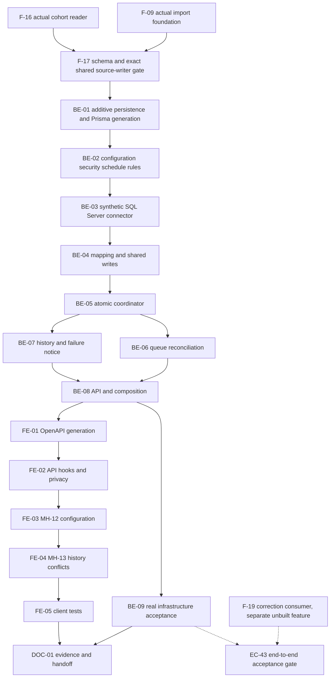

# F-22 School Database Synchronization — Backend + Frontend Implementation Plan

This plan builds EP-22 (US-102..104; FR-98..100; UC-76..78): an optional, read-only SQL Server connector, scheduled atomic ingestion, explicit mapping, official-source conflict handling and MH-12/13. It builds on the **written but unbuilt F-17 shared source writers**, not a second student/results implementation. Excel-only operation remains supported. Only synthetic school data is permitted; access to the real DUT data trees, dotenv files and actual school systems is not part of implementation or verification.

> **Companion documents**
> - Answers, in precedence order: `docs/planning/feature-questions.md:318` (F22-01..03, blank = A); `docs/planning/epics.md:205` (EP-22, B6 acceptance and Q-09); `docs/planning/user-stories.md:1245`, `:1256`, `:1268`.
> - Requirements: `docs/requirement/REQUIREMENTS.md:588`, `:966` (sources), `:977` (priority), `:1160` (DEC-10), `:1269` (EC-48/49); EC-43, NFR-09/18/19/20/24. No feature-specific BR is assigned by these stories; inherited student/enrollment rules remain F-17-owned.
> - Design: `docs/design/data-dictionary.md:670`, `:702`, `:780`, `:834`; `docs/design/erd.md:147`, `:165`; `docs/design/state-diagrams.md:311`, `:464`; `docs/design/sequence-diagrams.md:801`; `docs/design/screen-inventory.md:68`, `:251`, `:782`.
> - Work/deferred scope: `docs/planning/task-breakdown.md:461` (CV-246..255), `docs/planning/deferred-scope.md:43`; CV-249/250 belong to F-27, not this connector.
> - Binding prerequisite: `docs/implementation/f-17-student-records-results-import-implementation-plan.md`, read in full, especially D10, BE-04/07, U3/U5. F-09 and F-16 are also unbuilt dependency contracts; F-18/19 are unfinished parallel plans and are not inputs.
> - Conventions/evidence: `docs/implementation/README.md`, F-15/F-09 exemplar plans, `docs/architecture/general_architecture.md`, `docs/architecture/features_architecture.md`, `docs/architecture/database_and_models.md`; F-02/04/06/14/15 implement reports. Inspected source, not an earlier plan, establishes what is built.
> - Technology: `docs/design/tech-stack.md:42` explicitly names **mssql**; BullMQ is named at `:43`. No additional runtime library is authorized.
> - Verification: `docs/planning/test-plan.md` B6/EC-48/49; future `docs/testing/feature__f-22-school-db-sync.md`; UI follows `source/frontend/src/shared/design-system/DESIGN_SYSTEM.md:1` in full.

**Status**: Not started — source inspected 2026-10-26. Plan complete; prerequisite integrations and Faculty acceptance remain gated below. This planning run creates this file only.

## 0. Plan at a glance

Everything below in one table. Read this; the rest is detail for whoever builds it.

| What | Why | How and where |
|---|---|---|
| **Excel remains usable; SQL Server is optional** | F22-01 A / Q-09 / US-102 AC4 | Default EXCEL_ONLY/disabled, SCHOOL_DB with a synthetic SQL Server profile; no real data/access assumed |
| **R1 can configure, test and schedule the source** | US-102 AC1..3, MH-12 | New school-db-sync feature; encrypted write-only password, exact operator host allowlist, saved-connection verification, DAILY/WEEKLY at school time, server next-run display |
| **Map codes, never guess academic identities** | Students/results/classes must resolve against local reference data | Fixed cms_sync_v1 synthetic views, four reference mapping kinds, stable source links; unknown/ambiguous keys fail the entire run |
| **Reuse the F-17 source writers exactly** | D10 reserves official-over-Excel semantics for shared writers | Supplied tx with SCHOOL_DB; F-22 owns connector/mapping/run state, not Student/AcademicResult upserts, accounts or grade rules |
| **All local changes commit together** | EC-49 / US-103 AC2 | Complete consistent source snapshot first; one local transaction for profiles, attempts, admission/status effects, change feed, links, class mirror, conflicts and successful checkpoint |
| **No overlapping or late writes** | F22-02 A / DB-01..04 / US-103 AC3 | PostgreSQL reservation + unique RUNNING index, absolute deadline/token/final commit fence, separate minute-tick and run queues; Redis transports IDs only |
| **Official values and both conflict values remain visible** | F22-03 A / US-104 | School wins whole student/result record; conflict count/evidence in R1 history; later Excel HIGH warning/skip remains F-17-owned; CMS training definitions untouched |
| **History, explicit retry and failure notices** | US-103 AC4/5, MH-13 | Immutable three-state runs, paged filters/conflicts, retry creates a new linked log, failure transition and R1 notices commit together |
| **Synthetic classes and corrections have honest limits** | No supplied class academic model; graduation consumer unbuilt | Isolated class mirror only; F-17 produces durable result changes, future F-19 owns EC-43 re-audit. No fake roster, account distribution or historical repair |

**Key behaviours worth knowing**

| Behaviour | Why it is this way |
|---|---|
| A 202 response reserves a RUNNING log; it is not synchronization success | Queue dispatch/source/application may still fail; failed committed counters remain zero |
| Duplicate jobs cannot steal a claimed run; crash recovery waits for its deadline | Prevents two live owners. Next reconciliation fails stale work and later slots/manual retry create a new log |
| Full snapshots do not delete absent records or skip unchanged manifests blindly | No supplied deletion/CDC contract, and backdated grade changes must remain visible |
| Identical Excel values still become SCHOOL_DB, without a false conflict | Official ownership must stop a later Excel overwrite; meaningful provenance change belongs to F-17 |
| Synchronized new profiles may exist without a local User | Model permits it; secure automatic sync-account distribution/null-actor writer behavior needs the explicit prerequisite gate |
| A passing synthetic test is not actual school compatibility or Faculty acceptance | Official source shape/rights/codes/privacy remain unknown |

**Not included**

| Excluded | Why |
|---|---|
| Real school connection/fixtures, arbitrary SQL, source writes and reverse training synchronization | Neither approved nor needed; synthetic SQL Server + Excel satisfies the A-default shape |
| New runtime libraries beyond the documented mssql/installed stack | An unlisted package is STOP AND REPORT, not a builder preference |
| Graduation consumer, academic class/roster subsystem and automatic sync-login delivery | Separate unbuilt/undefined contracts; no substitutes are fabricated |
| Behavioral migrations to built release/calendar/notification tables | Additive source-owned tables, relation back-fields and notification enum only; preserve built meanings |
| Caller-owned index/progress/git work | This planning run creates exactly one document |

**Open questions**

| Question | Resolved when | Default if unanswered |
|---|---|---|
| What is the actual school schema/access/privacy contract? | Faculty/source owner provides sanitized approval | Support both modes; synthetic SQL Server, external disabled, Excel-only operational |
| Does F-17 support scheduled null actor and unlinked school profiles? | Owner verifies actual shared writer branch/account policy | Do not fork writer or invent a user; stop affected integration until verified |
| Do class rows have academic meaning beyond a source mirror? | Faculty/owner supplies a class/roster contract | Mirror only, no calculation/enrollment side effects |
| Are pre-correction historical entitlements and re-audits certified? | Release/calendar decision and actual F-19 consumer | Preserve built behavior, retain admission/change facts, stop those acceptance claims |

## 1. Scope

| In scope | Why |
|---|---|
| EXCEL_ONLY and SCHOOL_DB modes; simulated SQL Server first | F22-01 A, Q-09, DEC-10 |
| R1 configuration, encrypted write-only password, connection probe, schedule/next run | US-102 AC1..4; MH-12 |
| Fixed versioned source views, code mappings and stable source identities | Connector must translate, not guess academic identities |
| Students/results via F-17; school class mirror owned by F-22 | US-103 AC1; SRS §8.1 |
| Atomic local write, durable run state, no overlap, stale fencing and replay safety | US-103 AC2/3; DB-01..04; EC-49 |
| Paged history, conflict before/after evidence, manual run/retry, R1 failure notice | US-103 AC4/5; US-104 AC1; MH-13 |
| School-over-Excel priority in both directions; source labels remain F-17 UI | US-104 AC1..4; F-17 D10 |

| Out of scope | Deferred until |
|---|---|
| Actual school access, real schema inference, real student fixtures | Faculty supplies a sanitized contract and approved access; E1 |
| Writing to source; synchronizing CMS courses/curriculum/syllabi/PLO/CLO | Never in F-22; CMS remains authoritative |
| Incremental CDC, deletes, arbitrary SQL editor, multiple connectors, automatic identity merges | A later explicit design, not needed for these ACs |
| Local account/password generation for synchronized students | E2; nullable account link and existing F-17 Excel account path remain |
| Eligibility, graduation calculations and automatic re-audit consumer | F-18/19; F-22 produces the F-17 durable result-change feed |
| General AuditLog, email, deployment/load/uptime project | Deferred audit decision; F-25 and F-27 respectively |
| README/index/progress or other concurrently edited files in this run | Caller-owned |

| AC / task | Covered by |
|---|---|
| US-102 AC1: read-only probe and actionable sanitized failures | BE-02/03/08/09; FE-03/05; CV-247 |
| US-102 AC2: never redisplay password | BE-02/08/09; FE-02/03/05; CV-246/248 |
| US-102 AC3: frequency/time and next run | BE-02/06/08/09; FE-03/05; CV-248 |
| US-102 AC4: no connection, Excel still works | BE-02/09; FE-03/05; U1/U2 |
| US-103 AC1: students/results/classes and terminal counters | BE-01/03/04/05/06/08/09; FE-04; CV-251 |
| US-103 AC2: lost connection, all local data rolled back, next schedule retries | BE-03/05/06/09; CV-253 |
| US-103 AC3: no overlapping runs; stale failure at next reconciliation | BE-01/05/06/09; CV-251 |
| US-103 AC4: filter runs and manually retry | BE-07/08/09; FE-04/05; CV-252 |
| US-103 AC5: failure notice to R1 | BE-07/09; FE-05; existing MH-04 |
| US-104 AC1: official values win, conflict count and both values retained | BE-04/05/07/09; FE-04/05; CV-254/255 |
| US-104 AC2: CMS course/curriculum unchanged | BE-03/04/09; CV-255 |
| US-104 AC3: later Excel conflict warns and skips whole official row | U1 F-17 D10, BE-04/09; regression of F-17 import flow |
| US-104 AC4: source on every student/result | U1 F-17 BE-09/FE-03/04; BE-04/09 asserts EXCEL / SCHOOL_DB serialization |
| B6 acceptance 1..3 | BE-09 and FE-05 synthetic walkthrough; no real-data sign-off |
| CV-246..248, 251..255 | BE-01..09, FE-01..05, DOC-01 |
| CV-249/250 | Explicit F-27 dependency, not counted as F-22 completed work |

## 2. Contract verification

Completed before designing §5. **Verified** means opened source at the stated line. **NEW / UNVERIFIED** means an endpoint to build or an unbuilt prerequisite, never a claim about a shipped API. All paths are repository-relative. Response tables below distinguish wire types from Prisma storage types.

### 2a. Existing endpoints and internal foundations

| Endpoint / boundary | Verified at | Request | Response / behavior | Use |
|---|---|---|---|---|
| GET `/api/semesters`, GET `/api/cohorts` | `source/backend/src/features/semesters/semesters.controller.ts:19`, `:44`; service `source/backend/src/features/semesters/semesters.service.ts:32`, `:39` | Authenticated session | Arrays, semesters year-desc/term-asc; cohorts intake-desc/code-asc | Existing pickers only; NEW sync reference endpoint avoids assuming those arrays are chronology |
| Semester/Cohort serialization | `source/backend/src/shared/releases/semester.dto.ts:20`, `:30` | Prisma rows | startDate nullable ISO day; code/year fields explicit | Preserve unknown-date errors, never infer dates |
| SYNC_CONFIGURE permission | `source/backend/src/shared/authz/permission-codes.ts:10`; `source/backend/prisma/seed-data/permission-catalog.ts:96` | Current access | `sync.configure`, seeded R1 DIRECT/ALL | Reuse permission, no new grant or permissive reseed |
| Scope check | `source/backend/src/shared/authz/access-context.ts:32`, `:74`; `source/backend/src/shared/authz/edit-path.ts:66` | AccessContext | Mode/scope per assignment | NEW R1 guard must require R1 and DIRECT/ALL on the same assignment |
| Global module/guards | `source/backend/src/app.module.ts:32`, `:60` | Every protected request | Session, CSRF, permission guards; releases/semesters wired | Add one feature module, not another app |
| Queue infrastructure | `source/backend/src/shared/queue/queue.module.ts:6` | ConfigService | Shared Redis connection/prefix | Register queues using this infrastructure only |
| Scheduler/worker | `source/backend/src/features/releases/release-activation.scheduler.ts:21`, `:41`; `source/backend/src/features/releases/release-activation.processor.ts:72` | Boot/daily jobs | Nonblocking bootstrap, rebuild scheduler, bounded forced close | Mirror lifecycle, NOT release-specific partial-success semantics |
| Calendar/locks | `source/backend/prisma/schema.prisma:403`, `:428`; `source/backend/src/shared/releases/release-locks.ts:5`; `source/backend/src/shared/time/today.ts:1` | tx, IDs, dates | Nullable semester start; sorted Program locks; Asia/Ho_Chi_Minh | Reuse F-17 chronology/order; do not modify built calendars |
| Existing correction behavior | `source/backend/src/features/releases/corrections.service.ts:143`; `source/backend/src/features/semesters/semesters.service.ts:87` | Release/calendar command | Correction retargets mappings; date freeze only certain issued effective dates | Inherit F-17 E1/E2 limits, not repair them here |
| Student/result/source writers | **UNVERIFIED U1**, F-17 BE-07 | Supplied tx, canonical plans, SourceWriteContext | Stable IDs, official priority, result revision/change feed | Hard contract gate; source not built |
| Independent User create | `source/backend/src/features/users/users.service.ts:67` | CreateUserDto, actor | Writes immediately and returns temporary password | Deliberately NOT called from sync |
| Notification storage/writer | `source/backend/prisma/schema.prisma:892`; `source/backend/src/shared/notifications/notification.service.ts:19` | tx, typed notice, actor | Nullable changeRequestId; existing helper suppresses actor | F-22-specific failure fan-out includes initiating R1; do not change helper |
| Notification display | `source/frontend/src/shared/notifications/NotificationItem.tsx:24` | Notification DTO | Marks read; navigates only with changeRequestId | New failure notice has null request, plain text pointing to MH-13 |
| JSON client, permission wrapper, menu | `source/frontend/src/shared/api/client.ts:70`, `:77`; `source/frontend/src/shared/auth/RequirePermission.tsx:11`; `source/frontend/src/shared/layout/menuItems.tsx:6` | Typed path/body/code | JSON helpers, permission presence check, menu leaf conventions | No shared API replacement; feature-local R1 gate |
| GET `/api/auth/me` through existing useMe | `source/backend/src/features/auth/auth.service.ts:65`; serializer `source/backend/src/features/auth/me.dto.ts:38`; client `source/frontend/src/shared/auth/useMe.ts:4` | Session | Existing MeDto unchanged; roles derived from current assignments, permissions from held grants | Reuse existing auth model/helper only; F-22 reads roleCode and sync.configure presence, not a new Me mapping |
| Decimal wire helper | `source/backend/src/shared/decimal/decimal.ts:9` | Prisma.Decimal | Exact string, not JS number | Conflict/result scores use canonical strings |

**Endpoints to build — all NEW / UNVERIFIED, source BE-08.** Prefix `/api/school-db-sync`. Every route requires session + `sync.configure` + same-assignment current R1 DIRECT/ALL. Mutations require the existing CSRF header. Unauthorized non-R1 access fails even if another role was granted that permission.

| Method / suffix | Request | Response / status | Behavior |
|---|---|---|---|
| GET `/configuration` | none | SyncConfigurationDto, 200 | No probe or ingestion on GET |
| PUT `/configuration` | SaveSyncConfigurationDto | SyncConfigurationDto, 200 | Revision-CAS; secret absent=preserve, nonempty=replace; active run=409 |
| POST `/connection-test` | TestSyncConnectionDto | SyncConnectionTestDto, 200 | Bounded read-only probe; only testing saved settings may mark them verified; invalid DTO/permission still 4xx |
| GET `/mappings` | none | SyncMappingSetDto, 200 | Bounded complete four-kind map |
| PUT `/mappings` | SaveSyncMappingsDto | SyncMappingSetDto, 200 | Whole-set CAS, no active run; referenced targets verified |
| GET `/reference-options` | kind, q?, page?, pageSize? | SyncReferencePageDto, 200 | R1-scoped SQL lookup, no source reads or catalog writes |
| POST `/runs` | StartSyncRunDto {requestId: UUID} | SyncRunDto, 202 | Durable reservation; repeat UUID returns same log; competing run=409 |
| GET `/runs` | status?, startedFrom?, startedTo?, page?, pageSize? | SyncRunPageDto, 200 | Inclusive lower/exclusive upper timestamps; start-desc/id-desc |
| GET `/runs/:runId` | path ID | SyncRunDto, 200 | PII-free counters/status; canRetry derived at read time |
| GET `/runs/:runId/conflicts` | page?, pageSize? | SyncConflictPageDto, 200 | R1-only approved value projections; failed runs have none |
| POST `/runs/:runId/retry` | StartSyncRunDto | SyncRunDto, 202 | FAILED only; new run uses CURRENT verified config/mapping, retryOfId preserved |

There is no cancel, delete-history, result edit, priority edit, raw-SQL, password-read or raw-source-row endpoint. A disabled schedule may still be run manually when mode is SCHOOL_DB and the saved connection is verified. EXCEL_ONLY cannot start runs.

### 2b. Consumed response fields

**Existing SemesterDto / CohortDto** — if the existing selectors are reused internally, all fields remain accounted for; the new sync UI consumes SyncReferenceOptionDto instead.

| DTO.field | Wire type | Nullable | Source | Modeled as / note |
|---|---|---|---|---|
| Semester.id | string | no | `source/backend/src/shared/releases/semester.dto.ts:22` | Reference ID |
| Semester.semesterCode | string | no | same file `:23` | Display code |
| Semester.academicYear | string | no | same file `:24` | Display only, not chronology |
| Semester.termInYear | number | no | same file `:25` | Display only |
| Semester.startDate | YYYY-MM-DD string | yes | same file `:26` | Known-start validation |
| Cohort.id | string | no | same file `:32` | Reference ID |
| Cohort.cohortCode | string | no | same file `:33` | Display code |
| Cohort.intakeYear | number | no | same file `:34` | Display only |

**F-17 provenance DTOs — UNVERIFIED U1.** F-22 does not copy the complete student UI DTO. It requires F-17's existing planned `StudentSummaryDto.dataSource` and `AcademicResultDto.dataSource` to serialize the literal union `EXCEL | SCHOOL_DB` (non-null), generated into the F-17 pages. The other F-17 fields remain F-17-owned and are not remapped by this feature. Its internal writer types are restated verbatim in BE-04.

**NEW response contracts — every row is UNVERIFIED until BE-08 implements the mapper.** Source for every row is **NEW BE-08**, not a fabricated source line. FE-01 replaces this label with inspected serializer references before client wiring. Every listed field is modeled by the same generated DTO field; no secret or raw source row is returned.

| SyncConfigurationDto field | Wire type | Nullable | Client use |
|---|---|---|---|
| id | string | no | Singleton identity |
| revision | number | no | Optimistic concurrency |
| mode | EXCEL_ONLY / SCHOOL_DB | no | Mode select |
| profile | SIMULATED_SQL_SERVER / EXTERNAL_SQL_SERVER | no | Explicit simulation label |
| enabled | boolean | no | Scheduled sync switch |
| sourceIdentity | string | no | Dataset namespace; immutable after first success |
| host | string | yes | Server name, not a URL |
| port | number | yes | SQL Server port |
| database | string | yes | Database name |
| username | string | yes | Read-only principal name |
| passwordConfigured | boolean | no | Preserve/replace instruction only |
| connectionRevision | number | no | Probe binding |
| verifiedConnectionRevision | number | yes | Null means test saved connection |
| cadence | DAILY / WEEKLY | no | Frequency |
| localTime | HH:mm string | no | Local school time |
| weekday | number 1..7, Monday=1 | yes | Required only WEEKLY |
| timeZone | literal Asia/Ho_Chi_Minh | no | Schedule label |
| nextRunAt | ISO timestamp string | yes | Null when disabled/Excel-only |
| lastSuccessfulRunId | string | yes | History link |
| lastSnapshotVersion | string | yes | Informational, not incremental cutoff |
| activeRunId | string | yes | Running/disable controls |
| externalAllowed | boolean | no | Operator gate, not Faculty approval |
| updatedAt | ISO timestamp string | no | Display |

| SyncConnectionTestDto field | Wire type | Nullable | Client use |
|---|---|---|---|
| success | boolean | no | Probe outcome |
| code | CONNECTED / CONNECTION_FAILED / READ_ONLY_REQUIRED / SOURCE_CONTRACT_INVALID / CONNECTOR_UNAVAILABLE | no | Vietnamese result handling |
| message | string | no | Sanitized, no driver text |
| testedAt | ISO timestamp string | no | Display |
| configurationRevision | number | no | Prevent accepting stale test |

| SyncRunDto field | Wire type | Nullable | Client use |
|---|---|---|---|
| id | string | no | Detail route |
| dataSource | literal SCHOOL_DB | no | Source label |
| profile | SIMULATED_SQL_SERVER / EXTERNAL_SQL_SERVER | no | Immutable run origin label |
| trigger | SCHEDULED / MANUAL / RETRY | no | Origin |
| retryOfId | string | yes | Previous failure link |
| status | RUNNING / SUCCEEDED / FAILED | no | Đang chạy / Thành công / Thất bại |
| startedAt | ISO timestamp string | no | Reservation time, includes dispatch delay |
| finishedAt | ISO timestamp string | yes | Null only RUNNING |
| expiresAt | ISO timestamp string | no | Absolute fence |
| configurationRevision | number | no | Run snapshot revision |
| snapshotVersion | string | yes | Null until successful application |
| recordCount | number | no | Committed students + attempts + classes |
| studentCount | number | no | Committed processed student rows |
| resultCount | number | no | Committed processed attempts |
| classCount | number | no | Committed processed classes |
| changedCount | number | no | Value/provenance/mirror changes, not processed count |
| conflictCount | number | no | Cross-source differing student/result records |
| errorCode | string | yes | Safe machine code |
| errorMessage | string | yes | Vietnamese summary, not source payload |
| canRetry | boolean | no | Current authorization/config/no-running state; never trusted by server |

SyncRunPageDto contains exactly `items: SyncRunDto[]`, `total: number`, `page: number`, `pageSize: number`, all non-null. A run mutation returns **SyncRunDto only**, not the configuration, conflicts or a promise that ingestion completed.

| SyncConflictDto field | Wire type | Nullable | Client use |
|---|---|---|---|
| id | string | no | Stable row key |
| entityType | STUDENT / ACADEMIC_RESULT | no | Record type |
| recordKey | string | no | Canonical student code or serialized triple; R1-only PII |
| previousSource | literal EXCEL | no | Losing source |
| selectedSource | literal SCHOOL_DB | no | Winning source |
| fields | string[] | no | Sorted changed canonical field names |
| before | SyncConflictValueDto[] | no | Approved field/value projection |
| after | SyncConflictValueDto[] | no | Same field set, selected source values |

SyncConflictValueDto contains `field: string` (non-null) and `value: string | null` (explicitly nullable). Values are canonical text/decimal strings; no arbitrary JSON viewer. SyncConflictPageDto has the same four non-null pagination fields as SyncRunPageDto with `items: SyncConflictDto[]`.

| Other DTO.field | Wire type | Nullable | Client use |
|---|---|---|---|
| SyncMapping.kind | COHORT / PROGRAM / SEMESTER / COURSE | no | Reference category |
| SyncMapping.sourceCode | string | no | Exact source code |
| SyncMapping.targetId | string | no | Local ID |
| SyncMapping.targetCode | string | no | Display, not a second key |
| SyncMappingSet.revision | number | no | Same configuration revision |
| SyncMappingSet.items | SyncMappingDto[] | no | Small bounded editable set |
| SyncReferenceOption.id | string | no | Target ID |
| SyncReferenceOption.code | string | no | Local code |
| SyncReferenceOption.label | string | no | Course name or code; not version entitlement |
| SyncReferenceOption.startDate | YYYY-MM-DD string | yes | Only SEMESTER has a date; null is not eligible |
| SyncReferencePage.items | SyncReferenceOptionDto[] | no | Search results for one kind |
| SyncReferencePage.total | number | no | Scoped count |
| SyncReferencePage.page | number | no | Paging |
| SyncReferencePage.pageSize | number | no | Paging |

No F-22 page consumes NotificationDto directly: the built shared bell/MH-04 remains its consumer. Its mapper is `source/backend/src/features/notifications/notification.dto.ts:52`; F-22 only adds a new type through generation and verifies null-request display.

### 2c. Mismatch log and gates

| Deliverable | Earlier/design assumption | Verified disposition | Found at |
|---|---|---|---|
| BE-03 | SQL Server requires an unapproved runtime driver | mssql is explicitly named, although not installed in current dependency list; install only that runtime package | `docs/design/tech-stack.md:42`; `source/backend/package.json:40` |
| BE-05/06 | Redis is sync history/lock/checkpoint storage | PostgreSQL owns those facts; Redis transports jobs only | `source/backend/src/shared/queue/queue.module.ts:6`; CLAUDE stack deviation |
| BE-04 | Student/result services already exist | U1 is unbuilt; use F-17's exact shared source writers after source verification | `source/backend/src/app.module.ts:32`; F-17 Status/BE-07 |
| BE-01/04 | A local class/roster academic model is specified | SRS/stories require pulling classes, but no class model appears in supplied DD/ERD; isolate a mirror, no academic roster meaning | `docs/design/sequence-diagrams.md:847`; E3 |
| BE-07 | Shared notify can emit a system event to every R1 | Its required actorId suppresses that actor; F-22-specific transactional fan-out avoids a breaking helper change | `source/backend/src/shared/notifications/notification.service.ts:7`, `:23` |
| BE-04 | Worker may provision through UsersService | Independent write/plaintext return would violate atomic ingestion; leave new school profiles unlinked pending E2 | `source/backend/src/features/users/users.service.ts:67`; U1 |
| BE-04 | All historical cohort answers can be certified | Built correction/calendar limitations remain F-17 E1/E2; no F-22 behavioral migration | `source/backend/src/features/releases/corrections.service.ts:143`; `source/backend/src/features/semesters/semesters.service.ts:87` |

## 3. Decisions

| ID | Decision | Why | Rejected alternative |
|---|---|---|---|
| D1 | One optional connector, default EXCEL_ONLY/disabled; SCHOOL_DB has simulated/external profiles | F22-01 A supports both sources without requiring real access | Excel replacement or fake real connector |
| D2 | Only mssql plus built-in Node crypto/Intl; no cron-parser, ORM for SQL Server or extra retry library | Approved technology boundary | Silent runtime dependency additions |
| D3 | Fixed `cms_sync_v1` views and exact status tokens; R1 maps four reference-code categories | Prevent SQL injection and guessed academic identity | Arbitrary SQL/column editor, fuzzy name matching |
| D4 | Full bounded source snapshot on each run; no deletion/incremental cutoff | Retry-safe corrections without undocumented change timestamps | Timestamp watermark that loses backdated results |
| D5 | PostgreSQL reservation/state + partial unique running index; minute reconciliation jobs | Multiple replicas, queue loss, stale runs | Redis lock/cache as business truth |
| D6 | DAILY/WEEKLY at school local time; persisted nextDueAt; coalesce missed slots | Meets frequency/time/next-run requirement, no cron package | Arbitrary cron UI or one job per missed historical slot |
| D7 | Read whole consistent source snapshot before one local Serializable apply transaction | EC-49; no distributed commit promise | Per-page/per-entity commits |
| D8 | F-17 writers with SCHOOL_DB and actorId null; no new sync account/password channel | Exact source boundary; scheduled work is not an invented R1 | Parallel student upserts, matching usernames, plaintext credentials |
| D9 | Record-level official priority; record one conflict with approved before/after values | F-17 D10; US-104 AC1 | Last-write-wins or manual per-field adjudication |
| D10 | F-22-owned class mirror and source links; never change Course/curriculum/enrollment meaning | Pull classes while keeping absent academic contract isolated | Invent a teaching/registration subsystem |
| D11 | Failure marks terminal once and emits notices in that same short transaction | Replay and timeout notice deduplication | Reusing approval event types or modifying notify's actor behavior |
| D12 | Request UUID deduplicates manual/retry; retry creates a new log linked to failure | Stable history and honest at-least-once delivery | Reset FAILED back to RUNNING |
| D13 | No in-run BullMQ retries after a worker has claimed a run; crash waits for expiry/reconciliation | Avoid two live owners applying one run | Steal a live worker's token on every duplicate job |
| D14 | Config/mapping changes rejected while RUNNING; connection changes invalidate saved probe | Stable run inputs and secret rotation | Mutate a live connector underneath a worker |
| D15 | New school-only profiles have userId null; synchronized results still emit F-17 change feed | Safe ingestion without inventing account distribution or graduation services | Assume unbuilt F-19 is available or silently create unusable passwords |

## 4. Integration boundaries and deliberate divergences

No shipped sibling school-sync implementation is supplied. These are explicit elaborations, not changes to built business behavior:

| Boundary | Disposition |
|---|---|
| DD SyncLog lacks connector/config/mapping/detail models | Add F-22-owned tables and counters; retain RUNNING / SUCCEEDED / FAILED and all-or-nothing meaning |
| Sequence draws read/write operations in one flow | SQL Server snapshot completes before local apply. A read failure causes zero domain writes; local apply failure rolls back all. There is no claimed cross-database transaction |
| Sequence suggests configurable priority | F22-03 A and F-17 D10 fix the policy; show it read-only, no priority dropdown |
| Data-source classes have no supplied academic model | Read-only F-22 mirror only; no effect on enrollment, eligibility, grades or frozen training definitions; E3 |
| F-17 auto-account default belongs to Excel imports | Sync does not add a credential batch/distribution workflow. Preserve existing links, leave new profiles unlinked; E2/U1 must be acknowledged before institutional rollout |
| Existing notify excludes actor | Do not replace it or migrate its callers; create sync-specific recipient fan-out. Existing approval notifications stay unchanged |
| Global AuditLog references in old sequences | Follow deferred-scope decision: SyncLog/SyncConflict are domain history, not a revived audit project |

## 5. Deliverables

All code/files below are **to build**. NEW paths use inspected parents `source/backend/prisma/migrations`, `src/features`, `src/shared`, `scripts`, `test/fixtures`; frontend `src/features`, `src/shared`; `docs/testing` and `docs/implement-report`. U1 paths do not exist yet and are explicitly prerequisite-owned. Do not edit unfinished F-18/19 plans. No deletion or shared-function replacement is required.

### BE-01 — Additive persistence, migration and Prisma generation

**What / why:** Persist connector, mapping, identity bridges, class mirror and terminal history independently of queues; change no existing table behavior.

**Files**

| Action | Path | Mirror / rationale |
|---|---|---|
| MODIFY | `source/backend/prisma/schema.prisma:1` | Explicit Restrict relations at `:428`; F-17 owns Student/AcademicResult |
| NEW | `source/backend/prisma/migrations/<timestamp>_school_db_sync/migration.sql` | Additive migration/check pattern `source/backend/prisma/migrations/20261019131021_release_versions/migration.sql:1` |
| GENERATE / MODIFY | `source/backend/src/generated/prisma/` | Existing generator `source/backend/prisma/schema.prisma:1`; honor current generated-file tracking policy |

**Shape — complete new model shape**

```prisma
enum SchoolSyncMode {
  EXCEL_ONLY
  SCHOOL_DB
}
enum SchoolSyncProfile {
  SIMULATED_SQL_SERVER
  EXTERNAL_SQL_SERVER
}
enum SchoolSyncCadence {
  DAILY
  WEEKLY
}
enum SchoolSyncStatus {
  RUNNING
  SUCCEEDED
  FAILED
}
enum SchoolSyncTrigger {
  SCHEDULED
  MANUAL
  RETRY
}
enum SchoolMappingKind {
  COHORT
  PROGRAM
  SEMESTER
  COURSE
}
enum SchoolConflictEntity {
  STUDENT
  ACADEMIC_RESULT
}

model SchoolSyncConfiguration {
  id                         String @id @default(cuid(2))
  singletonKey               String @unique @default(SCHOOL_DB)
  revision                   Int @default(1)
  mode                       SchoolSyncMode @default(EXCEL_ONLY)
  profile                    SchoolSyncProfile @default(SIMULATED_SQL_SERVER)
  enabled                    Boolean @default(false)
  sourceIdentity             String @default(SYNTHETIC-SCHOOL-V1)
  host                       String?
  port                       Int?
  database                   String?
  username                   String?
  passwordCiphertext         Bytes?
  passwordIv                 Bytes?
  passwordTag                Bytes?
  passwordKeyId              String?
  connectionRevision         Int @default(1)
  verifiedConnectionRevision Int?
  cadence                    SchoolSyncCadence @default(DAILY)
  localTime                  String @default(02:00)
  weekday                    Int?
  nextDueAt                  DateTime?
  lastSuccessfulRunId        String?
  lastSnapshotVersion        String?
  mappings                   SchoolReferenceMapping[]
  students                   SchoolStudentLink[]
  results                    SchoolResultLink[]
  classes                    SchoolClassMirror[]
  runs                       SyncLog[]
  createdAt                  DateTime @default(now())
  updatedAt                  DateTime @updatedAt
}

model SchoolReferenceMapping {
  id              String @id @default(cuid(2))
  configurationId String
  configuration   SchoolSyncConfiguration @relation(fields: [configurationId], references: [id], onDelete: Restrict)
  kind            SchoolMappingKind
  sourceCode      String
  cohortId        String?
  cohort          Cohort? @relation(fields: [cohortId], references: [id], onDelete: Restrict)
  programId       String?
  program         Program? @relation(fields: [programId], references: [id], onDelete: Restrict)
  semesterId      String?
  semester        Semester? @relation(fields: [semesterId], references: [id], onDelete: Restrict)
  courseId        String?
  course          Course? @relation(fields: [courseId], references: [id], onDelete: Restrict)
  createdAt       DateTime @default(now())
  updatedAt       DateTime @updatedAt
  @@unique([configurationId, kind, sourceCode])
}

model SchoolStudentLink {
  id              String @id @default(cuid(2))
  configurationId String
  configuration   SchoolSyncConfiguration @relation(fields: [configurationId], references: [id], onDelete: Restrict)
  sourceId        String
  studentCode     String
  studentId       String
  student         Student @relation(fields: [studentId], references: [id], onDelete: Restrict)
  createdAt       DateTime @default(now())
  updatedAt       DateTime @updatedAt
  @@unique([configurationId, sourceId])
  @@unique([configurationId, studentId])
}

model SchoolResultLink {
  id               String @id @default(cuid(2))
  configurationId  String
  configuration    SchoolSyncConfiguration @relation(fields: [configurationId], references: [id], onDelete: Restrict)
  sourceId         String
  academicResultId String
  academicResult   AcademicResult @relation(fields: [academicResultId], references: [id], onDelete: Restrict)
  createdAt        DateTime @default(now())
  updatedAt        DateTime @updatedAt
  @@unique([configurationId, sourceId])
  @@unique([configurationId, academicResultId])
}

model SchoolClassMirror {
  id                  String @id @default(cuid(2))
  configurationId     String
  configuration       SchoolSyncConfiguration @relation(fields: [configurationId], references: [id], onDelete: Restrict)
  sourceId            String
  classCode           String
  courseId            String
  course              Course @relation(fields: [courseId], references: [id], onDelete: Restrict)
  semesterId          String
  semester            Semester @relation(fields: [semesterId], references: [id], onDelete: Restrict)
  lastSnapshotVersion String
  createdAt           DateTime @default(now())
  updatedAt           DateTime @updatedAt
  @@unique([configurationId, sourceId])
  @@index([courseId, semesterId])
}

model SyncLog {
  id                    String @id @default(cuid(2))
  configurationId       String
  configuration         SchoolSyncConfiguration @relation(fields: [configurationId], references: [id], onDelete: Restrict)
  requestKey            String @unique
  dataSource            String @default(SCHOOL_DB)
  profile               SchoolSyncProfile
  trigger               SchoolSyncTrigger
  requestedById         String?
  requestedBy           User? @relation(SchoolSyncRequester, fields: [requestedById], references: [id], onDelete: Restrict)
  retryOfId             String?
  retryOf               SyncLog? @relation(SchoolSyncRetry, fields: [retryOfId], references: [id], onDelete: Restrict)
  retries               SyncLog[] @relation(SchoolSyncRetry)
  configurationRevision Int
  status                SchoolSyncStatus @default(RUNNING)
  workerToken           String?
  startedAt             DateTime @default(now())
  expiresAt             DateTime
  finishedAt            DateTime?
  snapshotVersion       String?
  recordCount           Int @default(0)
  studentCount          Int @default(0)
  resultCount           Int @default(0)
  classCount            Int @default(0)
  changedCount          Int @default(0)
  conflictCount         Int @default(0)
  errorCode             String?
  errorMessage          String?
  conflicts             SyncConflict[]
  createdAt             DateTime @default(now())
  updatedAt             DateTime @updatedAt
  @@index([startedAt, id])
  @@index([status, startedAt, id])
}

model SyncConflict {
  id             String @id @default(cuid(2))
  syncLogId      String
  syncLog        SyncLog @relation(fields: [syncLogId], references: [id], onDelete: Restrict)
  entityType     SchoolConflictEntity
  recordKey      String
  previousSource StudentDataSource
  selectedSource StudentDataSource
  fields         String[]
  before         Json
  after          Json
  createdAt      DateTime @default(now())
  updatedAt      DateTime @updatedAt
  @@unique([syncLogId, entityType, recordKey])
}
```

`lastSuccessfulRunId` is an internal opaque pointer, not an additional relation cycle: only the success transaction sets it to its own log; no HTTP input may set it. Validate the referenced log belongs to this configuration when mapping output. All other reference IDs above have actual FKs.

Add reverse relations only: User.requestedSchoolSyncRuns; Cohort/Program/Course/Semester.schoolReferenceMappings; Course/Semester.schoolClasses; F-17 Student.schoolLinks and AcademicResult.schoolLinks. These are additive back-fields, not built-table uniqueness/delete-policy/status changes. Add **NotificationType.SCHOOL_SYNC_FAILED** only; do not add fields to Notification or change old enum meanings.

```sql
CREATE UNIQUE INDEX SyncLog_one_running_configuration
  ON SyncLog (configurationId) WHERE status = 'RUNNING';
ALTER TABLE SchoolSyncConfiguration ADD CONSTRAINT SchoolSync_singleton
  CHECK (singletonKey = 'SCHOOL_DB' AND revision > 0 AND connectionRevision > 0);
ALTER TABLE SchoolSyncConfiguration ADD CONSTRAINT SchoolSync_schedule_shape
  CHECK ((cadence = 'DAILY' AND weekday IS NULL)
    OR (cadence = 'WEEKLY' AND weekday IS NOT NULL AND weekday BETWEEN 1 AND 7));
ALTER TABLE SchoolSyncConfiguration ADD CONSTRAINT SchoolSync_mode_shape
  CHECK ((mode = 'SCHOOL_DB' OR NOT enabled)
    AND ((enabled AND mode = 'SCHOOL_DB') = (nextDueAt IS NOT NULL)));
ALTER TABLE SyncLog ADD CONSTRAINT SyncLog_terminal_shape
  CHECK ((status = 'RUNNING') = (finishedAt IS NULL));
ALTER TABLE SyncLog ADD CONSTRAINT SyncLog_nonnegative_counts
  CHECK (recordCount >= 0 AND studentCount >= 0 AND resultCount >= 0
    AND classCount >= 0 AND changedCount >= 0 AND conflictCount >= 0
    AND recordCount = studentCount + resultCount + classCount);
ALTER TABLE SyncLog ADD CONSTRAINT SyncLog_failed_has_no_domain_counts
  CHECK (status <> 'FAILED' OR
    (recordCount = 0 AND changedCount = 0 AND conflictCount = 0));
```

Also hand-add checks for a complete-or-empty password envelope; port range; `localTime` strict 24-hour HH:mm; exactly the kind-matching non-null FK on SchoolReferenceMapping; positive expiresAt interval; FAILED requires errorCode/errorMessage while SUCCEEDED has neither; SyncConflict previousSource EXCEL/selectedSource SCHOOL_DB. Name each constraint. No query of Semester/Student from a CHECK: code validates those cross-table facts inside tx.

**Rationale:** Mirrors explicit F-15 schema/SQL constraints and restrictive reference ownership at `source/backend/prisma/schema.prisma:428`. F-17 types/rows are prerequisite-owned; none is redefined here. Generated client ordering follows the generator at `schema.prisma:1`.

**Gotchas:** Generate against a disposable synthetic database only; keep all previous partial indexes/checks. Source identity cannot be changed after any successful run or established source link. Do not delete/re-key old links to make a conflicting mapping pass. The new notification enum is additive, not permission to alter the built table's behavior.

**Verify:** In backend: `pnpm exec prisma migrate dev --create-only --name school_db_sync`; inspect additive DDL; `pnpm exec prisma migrate dev`; `pnpm prisma:generate`. BE-09 applies the entire chain on an empty disposable database, probes running uniqueness, checks, Restrict FKs and old release/notification regressions. A behavioral built-table change is a STOP item.

**Depends on:** U1 F-17 schema/writers; its U1/U2 prerequisites already built and verified.

### BE-02 — Configuration, authorization, encryption and pure schedule rules

**What / why:** Make absence of school access harmless while protecting connection secrets and making schedules reproducible.

**Files**

| Action | Path | Mirror / rationale |
|---|---|---|
| NEW | `source/backend/src/features/school-db-sync/school-sync.constants.ts` | Named limits like `source/backend/src/shared/pagination/page-query.dto.ts:5` |
| NEW | `source/backend/src/features/school-db-sync/school-sync.errors.ts` | Typed errors like `source/backend/src/shared/releases/release.errors.ts:1` |
| NEW | `source/backend/src/features/school-db-sync/school-sync-access.ts` | Assignment-specific access at `source/backend/src/shared/authz/access-context.ts:32` |
| NEW | `source/backend/src/features/school-db-sync/school-sync-cipher.ts` | Node crypto boundary; F-17 credential cipher is an unbuilt conceptual mirror, not imported |
| NEW | `source/backend/src/features/school-db-sync/school-sync-schedule.ts` | Pure date functions like `source/backend/src/shared/time/today.ts:4` |
| NEW | `source/backend/src/features/school-db-sync/school-sync-configuration.service.ts` | Revision-checked mutation pattern `source/backend/src/features/semesters/semesters.service.ts:82` |
| NEW | `source/backend/src/features/school-db-sync/school-sync-access.spec.ts` | `source/backend/src/shared/authz/access-context.spec.ts:1` |
| NEW | `source/backend/src/features/school-db-sync/school-sync-cipher.spec.ts` | `source/backend/src/shared/password/temporary-password.spec.ts:1` |
| NEW | `source/backend/src/features/school-db-sync/school-sync-schedule.spec.ts` | `source/backend/src/shared/time/today.spec.ts:1` |
| NEW | `source/backend/src/features/school-db-sync/school-sync-configuration.service.spec.ts` | `source/backend/src/features/semesters/semesters.service.spec.ts:1` |
| MODIFY | `source/backend/src/shared/config/env.validation.ts:1` | Optional validated settings at `:23`, `:62`, not dotenv edits |

**Shape**

```ts
export const SCHOOL_SYNC = {
  CONFIGURATION_KEY: 'SCHOOL_DB', ROLE_CODE: 'R1',
  DEFAULT_SOURCE_IDENTITY: 'SYNTHETIC-SCHOOL-V1', DEFAULT_LOCAL_TIME: '02:00',
  TICK_SCHEDULER_ID: 'school-sync-minute', TICK_PATTERN: '* * * * *',
  PAGE_ROWS: 500, MAX_ROWS: 10_000, MAX_MAPPINGS: 5_000,
  MAX_SOURCE_ID: 64, MAX_SOURCE_CODE: 64, MAX_HOST: 253,
  MAX_DATABASE: 128, MAX_USERNAME: 128, MAX_PASSWORD: 1024,
  CONNECT_TIMEOUT_MS: 5_000, REQUEST_TIMEOUT_MS: 15_000,
  RUN_TIMEOUT_SECONDS: 300, MAX_WAIT_MS: 10_000, APPLY_TIMEOUT_MS: 60_000,
  SHUTDOWN_GRACE_MS: 10_000, FINISHED_JOBS_KEPT: 20,
  SQL_TRANSACTION_RETRIES: 3, DATABASE_CLOCK_QUERY: 'SELECT clock_timestamp()',
} as const;
export const SCHOOL_SYNC_CIPHER = {
  ALGORITHM: 'aes-256-gcm', KEY_BYTES: 32, IV_BYTES: 12, TAG_BYTES: 16,
} as const;
export interface PasswordEnvelope {
  ciphertext: Uint8Array; iv: Uint8Array; tag: Uint8Array; keyId: string;
}
export function assertSchoolSyncAdmin(access: AccessContext): void;
export function nextSyncDue(
  schedule: { cadence: 'DAILY' | 'WEEKLY'; localTime: string; weekday: number | null },
  after: Date,
): Date;
export function encryptSchoolPassword(
  password: string, key: Uint8Array, configurationId: string, connectionRevision: number,
): PasswordEnvelope;
export function decryptSchoolPassword(
  envelope: PasswordEnvelope, key: Uint8Array,
  configurationId: string, connectionRevision: number,
): string;
@Injectable()
export class SchoolSyncConfigurationService implements OnModuleInit {
  onModuleInit(): Promise<void>;
  get(access: AccessContext): Promise<SyncConfigurationDto>;
  save(input: SaveSyncConfigurationDto, access: AccessContext): Promise<SyncConfigurationDto>;
  test(input: TestSyncConnectionDto, access: AccessContext): Promise<SyncConnectionTestDto>;
}
```

Add typed Env fields: optional base64 `SCHOOL_DB_PASSWORD_ENCRYPTION_KEY`; `SCHOOL_DB_ALLOWED_HOSTS` default empty; boolean-string `SCHOOL_DB_EXTERNAL_ENABLED` default false; bounded integer `SCHOOL_DB_RUN_TIMEOUT_SECONDS` default SCHOOL_SYNC.RUN_TIMEOUT_SECONDS; bounded integer `SCHOOL_DB_MAX_ROWS` default SCHOOL_SYNC.MAX_ROWS. Introduce named CONFIG_LIMITS for allowed timeout/row ranges in the constants file: timeout 30..3600 seconds, rows 1..100000. Parse the operator host list once, trim/deduplicate case-insensitively and require exact DNS-name/IP membership; no URL, userinfo, slash, wildcard or port embedded in host. Port is a distinct 1..65535 integer. Disallow server/instance syntax, named-pipe/socket options and arbitrary mssql connection strings. Do not fetch DNS names or network targets from source rows.

`assertSchoolSyncAdmin` requires an assignment whose roleCode is R1 AND whose own sync.configure grant is DIRECT/ALL; do not combine an R1 role from one assignment with a broad unrelated grant. Recheck active User/role validity/current RolePermission from tx facts for mutations, mirroring the U1 F-17 queued-grant policy. Background scheduled work uses service-owned authorization, not a fabricated user AccessContext. A manually queued run must still be authorized when claimed/applied; revocation yields FAILED/SYNC_PERMISSION_REVOKED with no domain writes.

Module init upserts only the default disabled EXCEL_ONLY singleton using Prisma-generated ID; no probe/network/key is required. GET never creates a connection or probes it. All PUTs take configuration row FOR UPDATE, check expectedRevision, reject a RUNNING log, validate cross-field rules, increment revision and return the whitelist DTO. Switching to EXCEL_ONLY forces enabled=false and nextDueAt=null without changing existing student/result provenance. `clearConnection=true` clears host/port/database/username/envelope/verification; it cannot be combined with a new connection/password. Otherwise omitted password preserves the envelope; empty/null password is invalid, nonempty replaces it. Any host/port/database/username/profile/password change increments connectionRevision and clears verification. If only connectionRevision changes while preserving a password, re-encrypt with the new AAD atomically. A different dataset sourceIdentity is refused once links or a success exist; no reset/rekey endpoint.

Use fresh GCM IV and AAD `configurationId + connectionRevision` in an unambiguous serialization. KeyId is a non-secret fingerprint. Missing key does not break auth/Excel startup, but saving/testing/running SCHOOL_DB returns 503 `SCHOOL_SYNC_SECRET_UNAVAILABLE`. Invalid provided key fails env validation without echoing it. Never reuse SESSION_SECRET/F-17 credential key or store plaintext in logs, API DTOs, Redis or browser persistence. Operator rotation requires preserved decryptability/re-encryption during maintenance; no silent fallback to another key.

Only a successful test of the **saved** connection at the same connectionRevision stamps verifiedConnectionRevision; a test with unsaved overrides does not. Failed/stale probes cannot stamp. Enabling or manually running requires complete saved connection, verification match, mode SCHOOL_DB and host/profile operator gates. Schedule-only changes retain connection verification. A fixed-connector sourceIdentity is descriptive namespace, not proof of institutional approval.

`nextSyncDue` returns the first strictly-future DAILY/WEEKLY slot in APP_TIME_ZONE using built-in Date/Intl, no cron/date runtime dependency. Persist UTC instants; render the school time zone. Default schedule is DAILY 02:00, disabled. Changing a schedule recomputes nextDueAt from DB time, not browser time. A due tick processes at most one missed slot, then advances to the next future slot; it never launches one run per missed minute. Use named time unit constants inside the implementation. Test week rollover, exact equality, midnight/UTC conversion and no host-time-zone dependence.

**Rationale:** Reuses the current env validation/ConfigService boundary (`source/backend/src/shared/config/env.validation.ts:23`), explicit school time zone (`source/backend/src/shared/time/today.ts:1`) and service-owned checks, without changing session/role derivation.

**Gotchas:** Do not use `@IsOptional()` to accidentally accept null for write-only password; service and DTO distinguish absence from explicit null. No envelope spreading into responses. SCHOOL_DB disabled still permits a manual probe/run; EXCEL_ONLY never does. Host allowlisting is operator-owned; R1 cannot widen it through the API.

**Verify:** Backend `pnpm exec vitest run src/features/school-db-sync/school-sync-access.spec.ts src/features/school-db-sync/school-sync-cipher.spec.ts src/features/school-db-sync/school-sync-schedule.spec.ts src/features/school-db-sync/school-sync-configuration.service.spec.ts`; verify startup in Excel-only mode with no new env settings. Test tampered envelopes/wrong AAD/key, omitted/empty/null passwords, stale revisions, role/grant intersection, active-run guards, disallowed hosts and unchanged built auth behavior.

**Depends on:** BE-01; BE-03 supplies the injected connector for probe implementation.

### BE-03 — Synthetic SQL Server contract and read-only connector

**What / why:** Exercise a real SQL Server read path using synthetic fixtures, with a replaceable external boundary but no inferred institutional schema.

**Files**

| Action | Path | Mirror / rationale |
|---|---|---|
| MODIFY | `source/backend/package.json:1` | Independent dependency/scripts project already defined at `:1` |
| MODIFY | `source/backend/pnpm-lock.yaml:1` | Generated by pnpm for mssql only, not hand-edited |
| NEW | `source/backend/compose.school-db.yaml` | Optional isolated infrastructure like existing `source/backend/compose.yaml:1`; default services unchanged |
| NEW | `source/backend/scripts/school-db-sim.ts` | Script parent exists; CLI shape like `source/backend/scripts/with-env.ts:1`, without reading dotenv |
| NEW | `source/backend/test/fixtures/synthetic-school-db.ts` | Synthetic fixture pattern `source/backend/test/fixtures/syllabi.ts:1` |
| NEW | `source/backend/src/features/school-db-sync/connector/school-db-source.ts` | Domain interface like `source/backend/src/shared/releases/semester-start.ts:1` |
| NEW | `source/backend/src/features/school-db-sync/connector/sql-server-driver.ts` | Narrow adapter around the approved driver; no source ORM |
| NEW | `source/backend/src/features/school-db-sync/connector/sql-server-source.ts` | Injected infrastructure like `source/backend/src/shared/prisma/prisma.service.ts:1` |
| NEW | `source/backend/src/features/school-db-sync/connector/source-decode.ts` | Pure parsing/Decimal boundary like `source/backend/src/shared/decimal/decimal.ts:9` |
| NEW | `source/backend/src/features/school-db-sync/connector/sql-server-source.spec.ts` | Injected-client tests like `source/backend/src/features/health/health.controller.spec.ts:1` |
| NEW | `source/backend/src/features/school-db-sync/connector/source-decode.spec.ts` | Pure tests like `source/backend/src/shared/decimal/decimal.spec.ts:1` |

**Shape**

```ts
export interface SchoolStudentRow {
  sourceId: string; studentCode: string; fullName: string;
  cohortCode: string; major: string; programCode: string;
  admissionSemesterCode: string; statusSemesterCode: string;
  status: 'STUDYING' | 'ON_LEAVE' | 'WITHDRAWN' | 'GRADUATED';
}
export interface SchoolResultRow {
  sourceId: string; studentSourceId: string; courseCode: string; semesterCode: string;
  score10: string | null; score4: string | null; letterGrade: string | null;
  status: 'PASSED' | 'FAILED' | 'IN_PROGRESS' | 'EXEMPT';
  classSourceId: string | null;
}
export interface SchoolClassRow {
  sourceId: string; classCode: string; courseCode: string; semesterCode: string;
}
export interface SchoolSnapshot {
  sourceIdentity: string; version: string;
  students: readonly SchoolStudentRow[];
  results: readonly SchoolResultRow[];
  classes: readonly SchoolClassRow[];
}
export interface SchoolReadConnection {
  profile: 'SIMULATED_SQL_SERVER' | 'EXTERNAL_SQL_SERVER';
  host: string; port: number; database: string; username: string; password: string;
}
export const SCHOOL_DB_SOURCE = Symbol('SCHOOL_DB_SOURCE');
export interface SchoolDbSource {
  probe(connection: SchoolReadConnection, signal: AbortSignal): Promise<SchoolProbeResult>;
  readSnapshot(connection: SchoolReadConnection, signal: AbortSignal): Promise<SchoolSnapshot>;
}
export type SchoolProbeResult = {
  success: boolean;
  code: SyncConnectionTestDto['code'];
};
```

`SchoolDbSource` is internal, not a Swagger/HTTP contract; no feature import is made from shared/. Connection values stay in short-lived worker memory. The adapter must release pool/transaction/requests in finally on success, failure, timeout and shutdown.

Install **mssql only** with `pnpm add mssql` in backend; record resolved compatible version/engines and lockfile in the implement report. It is allowed by `docs/design/tech-stack.md:42`, not an unapproved driver. No `@nestjs/schedule`, cron-parser, new SQL ORM, secret manager SDK, MSW or specialized SQL Server Testcontainers runtime is required. If TypeScript needs declarations, define the exact narrow adapter interface in sql-server-driver.ts and load the package through Node `createRequire(import.meta.url)` as unknown, validate required exports and narrow once. Do not spread `any` or install an unnamed package to bypass the dependency gate. A requested extra runtime library is E4, not implicitly approved by this plan.

The synthetic database exposes exactly these fixed views under `cms_sync_v1`: `Snapshot`, `Students`, `Results`, `Classes`. `Snapshot` has contractVersion=`cms-sync-v1`, sourceIdentity, snapshotVersion and expectedStudentCount/expectedResultCount/expectedClassCount. Other columns are the camelCase source interfaces above; score columns are SQL Server decimal, projected by fixed SQL to nvarchar so exact values reach the decoder as strings. Strings use Unicode and identity columns are text; sourceId is stable case-sensitive ASCII with deterministic binary ordering. NULLs have the explicit meanings above. Do not derive grades/status or use source display names as keys.

The simulator script creates its **dedicated synthetic database only**, enables snapshot isolation, creates base tables/views, and fills them from synthetic-school-db.ts in one administrator transaction with a new snapshotVersion. Fixture examples: SYN-STU-0001, `Sinh viên giả lập 001`, SYN-COURSE-A, SYN-COHORT-A, SYN-PROG-A and known-date synthetic semesters. It creates a separate SELECT-only principal for the views, denies DML/DDL privileges and never grants db_owner/db_datawriter/sysadmin. Existing CMS references must be seeded separately through synthetic local fixtures; source initialization cannot update the CMS database. Both normal and fault-injection data come from generators, never from real source trees or copied exports.

Compose is opt-in (`school-db-sim` profile), uses the SQL Server 2022 development image through named SQL_SERVER_SIM_IMAGE (default development tag `mcr.microsoft.com/mssql/server:2022-latest`); record the resolved digest before acceptance. Expose only a loopback port, isolated volume/database and bounded resource settings named in the compose file. Administrator setup secrets and image acceptance are supplied by the operator through the process environment, not committed/read dotenv. Backend receives only the SELECT-only principal through MH-12. Add `school-db:sim:start` and `school-db:sim:seed` scripts; start delegates to Docker Compose with automatic dotenv loading disabled (PowerShell host: `--env-file NUL`). No default-app dependency on the simulator and no volume removal/reset command in the ordinary workflow. If image/runtime cannot run on the machine, report an environment limitation; do not substitute SQLite/PostgreSQL and call it SQL Server.

Probe performs bounded SELECT-only connectivity, contract-version/sourceIdentity/view checks and effective-privilege metadata checks; it rejects administrative/write-capable principals without attempting a write. External profile requires operator enablement, exact allowlisted host and validated TLS with certificate checking; synthetic self-signed trust is allowed only in the simulated profile on its isolated allowlisted target, never a user-controlled general bypass. `applicationIntent=ReadOnly` supplements, not replaces, server-enforced privileges. Source metadata/rights still require Faculty validation for real deployment (E1).

Read all three feeds inside one SQL Server SNAPSHOT transaction with a consistent manifest. Fixed parameterized SELECTs page by sourceId with the same binary ordering in WHERE and ORDER BY; page size comes from SCHOOL_SYNC.PAGE_ROWS. Use parameters for boundaries/limits, never interpolate identifiers supplied by R1/source. Decode every row, reject duplicates/incomplete manifest/unsupported contract or maximum-row limit; sum the three row counts against the total configured bound and check manifest counts. Only return SchoolSnapshot after every page and source transaction completion succeeds. A disconnected/partial transaction returns no snapshot. `AbortSignal` cancels active mssql requests and rolls back/releases resources; deadlines use remaining run time. No source network operation is deferred until after local commit.

**Rationale:** The read-only driver is the documented stack choice, whereas the existing application database stays Prisma/PostgreSQL (`source/backend/prisma/schema.prisma:8`). Driver isolation mirrors injected infrastructure, and the fixture parent is an existing test convention. The source view schema is explicitly **synthetic**, not attributed to DUT.

**Gotchas:** Dynamic import/require is adapter-local; the rest of the feature depends on SchoolDbSource. Metadata failure cannot be interpreted as proof of read-only access. Never log raw mssql exceptions/connection strings; map them to named safe codes before they reach generic handlers. Default failure message: `Không thể đọc cơ sở dữ liệu Trường; dữ liệu hệ thống chưa thay đổi.`

**Verify:** Backend `pnpm exec vitest run src/features/school-db-sync/connector/source-decode.spec.ts src/features/school-db-sync/connector/sql-server-source.spec.ts`; `pnpm exec tsc --noEmit -p tsconfig.json`. BE-09 must also run a real SQL Server synthetic snapshot, prove the application principal cannot write using isolated test-admin assertions, exercise Unicode/leading zeroes/decimals, cancel mid-page and count open-resource cleanup. Stub tests alone do not satisfy SQL Server acceptance.

**Depends on:** BE-01/02 constants and config; E1 does not block synthetic-only implementation. E4 blocks any unlisted runtime dependency.

### BE-04 — Mapping and exact F-17 shared-writer integration

**What / why:** Translate source facts without owning Student/AcademicResult rules, inferencing identities or bypassing school-over-Excel precedence.

**Files**

| Action | Path | Mirror / rationale |
|---|---|---|
| NEW | `source/backend/src/features/school-db-sync/school-sync-mappings.service.ts` | Scoped lookup/mutation like `source/backend/src/features/semesters/semesters.service.ts:32` |
| NEW | `source/backend/src/features/school-db-sync/mapping/school-sync-plan.ts` | Pure domain preparation like `source/backend/src/shared/releases/version-number.ts:1` |
| NEW | `source/backend/src/features/school-db-sync/mapping/school-sync-apply.ts` | Supplied-tx writer boundary `source/backend/src/shared/programs/director.writer.ts:1` |
| NEW | `source/backend/src/features/school-db-sync/mapping/school-sync-conflicts.ts` | Explicit Decimal transport at `source/backend/src/shared/decimal/decimal.ts:9` |
| NEW | `source/backend/src/features/school-db-sync/mapping/school-sync-plan.spec.ts` | Pure rules like `source/backend/src/shared/releases/version-number.spec.ts:1` |
| NEW | `source/backend/src/features/school-db-sync/mapping/school-sync-apply.spec.ts` | Writer tests like `source/backend/src/shared/programs/director.writer.spec.ts:1` |
| NEW | `source/backend/src/features/school-db-sync/school-sync-mappings.service.spec.ts` | `source/backend/src/features/semesters/semesters.service.spec.ts:1` |

**Shape — existing planned F-17 API, copied without renaming**

```ts
export interface SourceWriteContext {
  source: StudentDataSource;
  actorId: string | null;
}
export async function writeStudentSource(
  tx: Prisma.TransactionClient, plan: StudentImportPlan,
  context: SourceWriteContext, accounts: readonly PreparedStudentAccount[],
): Promise<{ studentIds: string[]; createdAccountCodes: string[] }>;
export async function writeAcademicResultSource(
  tx: Prisma.TransactionClient, plan: AcademicResultImportPlan,
  context: SourceWriteContext,
): Promise<AcademicResultWriteOutcome>;
```

These declarations identify **UNVERIFIED U1 dependencies** under `source/backend/src/shared/students/`, not duplicate declarations/files to create in F-22. Import their actual types/functions once built. StudentImportPlanRow is `{rowNumber, action, existingId, expectedUpdatedAt, profile, programId, admissionAssignment}`; AcademicResultPlanRow is `{rowNumber, action, existingId, expectedRevision, value}`. Actions are exactly CREATE / UPDATE / UNCHANGED / PRESERVE_SOURCE. StudentProfileValue includes studentCode/fullName/cohortId/major/admissionSemesterId/statusSemesterId/status. AcademicResultValue includes studentId/courseId/semesterId/score10/score4/letterGrade/status. F-22 maps to them; it does not add fields to their wire DTOs or call the imports feature.

```ts
export interface SchoolApplyCounts {
  students: number; results: number; classes: number;
  changed: number; conflicts: number;
}
export interface MappedSchoolSnapshot {
  snapshot: SchoolSnapshot;
  mappings: readonly SchoolReferenceMapping[];
  configurationRevision: number;
}
export async function applySchoolSnapshot(
  tx: Prisma.TransactionClient, logId: string, input: MappedSchoolSnapshot,
  cohortReader: AppliedProgramVersionReader,
): Promise<SchoolApplyCounts>;
export function compareSourceValues(
  before: Readonly<Record<string, string | null>>,
  after: Readonly<Record<string, string | null>>,
): { fields: string[]; before: SyncConflictValueDto[]; after: SyncConflictValueDto[] };
@Injectable()
export class SchoolSyncMappingsService {
  list(access: AccessContext): Promise<SyncMappingSetDto>;
  replace(input: SaveSyncMappingsDto, access: AccessContext): Promise<SyncMappingSetDto>;
  references(query: SyncReferenceQueryDto, access: AccessContext): Promise<SyncReferencePageDto>;
}
```

Implementation domain helpers must use a feature-internal value type equivalent to `{field:string,value:string|null}`, **not import the DTO into shared/F-17 code**. The signature above documents the wire-compatible projection; BE-08 maps it explicitly.

Mapping policy:

1. Fixed source columns/status enums are versioned in the connector. R1 maps source cohort/program/semester/course codes to existing local IDs; source codes are exact trimmed NFC text (case-sensitive), while studentCode uses F-17 normalizeStudentCode. Do not conflate source-code normalization with F-17 canonical identifiers. No automatic name match, implicit code creation or silent identity fallback. Before enabling the synthetic demo, the setup walkthrough explicitly enters its four reference kinds.
2. Whole-set replacement is bounded by MAX_MAPPINGS, rejects duplicate `(kind,sourceCode)`, checks exactly one matching target FK, current configuration revision and no RUNNING log. Unknown/null-start semesters are rejected. Reverse many-to-one aliases may exist, but two source students/results collapsing to one natural key in a snapshot are errors, never first/last wins. Mapping edits increment configuration revision and leave connection verification intact; old run evidence never changes.
3. Reference search uses direct Prisma queries for Course.courseCode/courseName (`source/backend/prisma/schema.prisma:243`), Program.programCode (`:326`), Cohort.cohortCode (`:420`), Semester.semesterCode/startDate (`:405`). Program label is its code, not an invented live programName column. Use identical predicates for count/items and deterministic code/id order; unknown-start semesters may be shown disabled but not saved. No Course/Program service import or global catalog exposure to R6.
4. Validate **the complete snapshot** before any writer: identities unique; sourceId stable; all source student/result/class references resolve; all mappings exist; source identity/manifest match; no impossible grade/status/date combination. A result's optional class must exist and have the same mapped course/semester. Reuse F-17 canonical normalization, source-writer invariants and three-scale rules; do not import its `features/imports/*` validators into this feature. Missing mapping/unknown local target/ambiguous identity is a single failed run, not a skipped row.
5. Load existing local profiles/attempts/source links in bounded groups inside supplied tx. Resolve admissions with U3 AppliedProgramVersionReader.forCohorts grouped by program/admission semester. Missing cohort assignment retains F-17's HIGH-equivalent behavior: profile is accepted without enrollment; log a sanitized warning count in application diagnostics and preserve F-17 profile warning. A nonexisting program/cohort/semester is an error, not a missing-assignment warning. Never infer ACTIVE/currentVersion.
6. Lock all involved Program IDs in F-17 order, then existing Student rows sorted, and use the same natural-key/Serializable discipline for not-yet-created students. Source links bind immutable source IDs to canonical keys. Existing sourceId pointing to a different code/student/triple, or a new sourceId trying to claim an already linked local identity, fails `SCHOOL_SYNC_IDENTITY_CONFLICT`. Initial sourceId may bind an existing EXCEL record by its exact canonical natural key only; never link an existing User by username/name/email.
7. Build fresh StudentImportPlan with expectedUpdatedAt and call writeStudentSource using `{source:'SCHOOL_DB', actorId:null}` and `accounts:[]`. Preserve already linked user IDs; new synchronized students remain nullable/unlinked, no User/RoleAssignment/password writes. U1 must actually support that SCHOOL_DB/null-actor branch (E2/U1); do not invent an actor or fork the writer if it does not. Requery canonical student IDs in the same tx after student writes, then construct AcademicResultImportPlan for writeAcademicResultSource with expectedRevision. Do not trust output array ordering to identify students.
8. A fresh source value supersedes an EXCEL profile/result **as a whole record**. Same values but EXCEL provenance still become SCHOOL_DB, so future Excel cannot take ownership back. Student business guards still reject implicit enrolled cohort/program/admission conversion, terminal reactivation or unknown chronology: official priority does not authorize an undocumented academic transition. Failure rolls back the run; no partial profile merge bypasses those guards.
9. Cross-source differences produce one SyncConflict per canonical student or attempt, with sorted field names and approved before/after projections. Student projections: studentCode/fullName/cohortId/major/admissionSemesterId/statusSemesterId/status; result projections: studentId/courseId/semesterId/score10/score4/letterGrade/status. No User/credential/source transport fields. Compare Decimal values canonically (2.50 equals 2.5); grade strings are stored unchanged after F-17 normalization. Equal values with only a provenance promotion are not a conflict. Changes SCHOOL_DB→SCHOOL_DB are result/profile updates, not cross-source conflicts. Count records, not differing fields.
10. Insert/update SchoolStudentLink/SchoolResultLink after shared writes. Upsert SchoolClassMirror by sourceId with existing mapped course/semester only. Absent rows on later snapshots are **not deleted** or converted to failed/withdrawn; lastSnapshotVersion shows last observation. Class mirrors do not create enrollment/roster facts. Shared writer status closure, retakes and exception protection remain authoritative. No direct Student/AcademicResult upsert anywhere in F-22.
11. F-17 owns AcademicResultChange insertion for actual value/source changes. F-22 must neither create a second change event nor call F-19. A no-op replay emits no new revision/change feed. Existing EXCEL import of a differing SCHOOL_DB record must still return HIGH/SCHOOL_DB_PRESERVED and skip the entire row, including accounts/enrollments; BE-09 tests this reverse direction through the actual U1 import pipeline.

**Rationale:** F-17 D10/BE-07/U5 explicitly reserve connector/mapping/state for F-22 and source writes/grade history for F-17. The tx writer mirrors the supplied-tx pattern at `source/backend/src/shared/programs/director.writer.ts:1`, not a cross-feature service or independent transaction.

**Gotchas:** `rowNumber` is a deterministic synthetic ordinal for the shared plan only, never an Excel coordinate exposed as actual source position. Map duplicate source triples before writing any student. An actual F-17 mismatch (nullable actor/accounts/source precedence) is a prerequisite STOP gate, not permission to modify a built owner or silently alter account policy. All new references/links roll back with domain writes.

**Verify:** Backend `pnpm exec vitest run src/features/school-db-sync/mapping/school-sync-plan.spec.ts src/features/school-db-sync/mapping/school-sync-apply.spec.ts src/features/school-db-sync/school-sync-mappings.service.spec.ts`; BE-09 exercises actual shared writers, admission/no-assignment/terminal rules, exact decimals, both priority directions, same-value provenance promotion, canonical-key collisions and unchanged CMS training rows.

**Depends on:** BE-01..03; U1 F-17 source writers and U3 F-16 cohort reader. E2/E3 limit institutional semantics, not synthetic ingestion of approved canonical facts.

### BE-05 — Atomic coordinator, run reservation and fencing

**What / why:** Ensure every run is either fully applied or a durable failed log, including late workers, duplicate jobs and source disconnects.

**Files**

| Action | Path | Mirror / rationale |
|---|---|---|
| NEW | `source/backend/src/features/school-db-sync/school-sync-coordinator.ts` | Transactional orchestration like `source/backend/src/features/releases/corrections.service.ts:82`, with no release imports |
| NEW | `source/backend/src/features/school-db-sync/school-sync-locks.ts` | Parameterized sorted locks at `source/backend/src/shared/releases/release-locks.ts:5` |
| NEW | `source/backend/src/features/school-db-sync/school-sync-coordinator.spec.ts` | Race/idempotence style `source/backend/src/shared/releases/version.activator.spec.ts:1` |

**Shape**

```ts
export interface SyncRunReservation {
  trigger: 'SCHEDULED' | 'MANUAL' | 'RETRY';
  requestKey: string;
  requestedById: string | null;
  retryOfId: string | null;
}
@Injectable()
export class SchoolSyncCoordinator {
  reserveManual(input: StartSyncRunDto, access: AccessContext): Promise<SyncRunDto>;
  reserveRetry(runId: string, input: StartSyncRunDto, access: AccessContext): Promise<SyncRunDto>;
  reconcileDue(): Promise<{ reserved: string[]; dispatchable: string[]; expired: number }>;
  execute(runId: string, signal: AbortSignal): Promise<void>;
  fail(runId: string, token: string | null, reason: SchoolSyncFailure): Promise<boolean>;
}
export interface SchoolSyncFailure { code: string; message: string }
export async function lockSyncConfiguration(tx: Prisma.TransactionClient): Promise<SchoolSyncConfiguration>;
export async function lockSyncLog(tx: Prisma.TransactionClient, runId: string): Promise<SyncLog>;
```

State/transaction protocol:

| Stage | Required implementation |
|---|---|
| Reserve | Short tx locks configuration then relevant log rows. Recheck current authorization and config. Find requestKey first; same UUID/slot returns the existing run. Enforce no other RUNNING via row lock plus partial unique index. Insert RUNNING with DB clock startedAt/expiresAt, revision/profile and zero counters. No secret/row snapshot goes into this log |
| Schedule slot | Unique requestKey uses cadence/config revision/original due instant. In the same tx advance nextDueAt to the next future slot after DB now, even when a nonexpired running run causes that slot to be skipped. No overlapping replacement; next normal slot will retry |
| Dispatch gap | Commit reservation before enqueue. Missing queue acknowledgement leaves RUNNING/workerToken=null, which reconciliation re-enqueues by stable log ID. HTTP 202 means accepted, not successful sync |
| Claim | Short tx locks config then log. Terminal = no-op. Expired = fail via BE-07. Non-null workerToken = already owned, no-op on duplicate delivery. Otherwise set randomUUID token once. Check current manual requester permission again and snapshot matching revision; scheduled runs have requestedById=null |
| Source read | Release local locks; decrypt connection in memory; fetch complete SQL Server snapshot with an absolute abort deadline. No local business/mirror/link/conflict writes yet |
| Apply | One local Serializable tx, timeout min(APPLY_TIMEOUT_MS, remaining run deadline), then config/log locks, token/status/revision/deadline checks, current manual-actor grant check, sorted Program/Student locks, fresh mapping/domain validation, both F-17 writers, links/classes/conflicts, run SUCCEEDED and configuration checkpoint |
| Success fence | Final update matches RUNNING + workerToken + expiresAt > PostgreSQL clock_timestamp(). Zero matching rows throws and rolls back ALL domain/link/class/conflict/feed writes. Persist counts, snapshotVersion, finishedAt and lastSuccessfulRunId/lastSnapshotVersion in that same tx |
| Failure | Source/read/decode/mapping/write errors map to SchoolSyncFailure; after any failed apply tx has rolled back, a separate short tx CASes RUNNING→FAILED, sets finishedAt/error and keeps counters zero. BE-07 notice is in that tx; duplicate failure attempts do nothing |
| Timeout | Every reconciliation first checks RUNNING expiresAt against DB clock, even if schedule is disabled. Expire it atomically with notification; old worker token can no longer commit. Then evaluate the next due slot. Active-source cancellation is best effort, database fencing is authoritative |

Global F-22 order is **configuration → run → sorted Programs → sorted Students → enrollment/result rows in F-17 order**. F-17 imports never acquire configuration/run locks, so they do not invert this prefix. Config/mapping writers use configuration first and reject RUNNING. Do not hold a local transaction open while doing external I/O. No global advisory-key magic or Redis lock is introduced.

If a worker crashes after claim, do not steal the token on redelivery. Leave the log RUNNING until its fixed deadline, then next reconciliation marks it FAILED and later schedules/manual retry create a new log. If it crashes after the success commit but before queue acknowledgement, redelivery sees SUCCEEDED and writes nothing. A local serialization conflict may retry the **entire apply transaction** at most SQL_TRANSACTION_RETRIES, refreshing local contexts each time, while the same complete source snapshot/token is valid and within deadline. Do not retry validation/identity errors or weaken expectedRevision checks.

`recordCount` is processed committed students + results + classes (including unchanged rows); `changedCount` is rows whose canonical value/provenance or class content actually changed; `conflictCount` is cross-source differing student/result records. A failed run has all committed counts zero, even if many source rows were read. No-op repeated successful snapshot retains IDs/revisions and may report processed>0/changed=0. Do not use lastSnapshotVersion to skip reads/writes without revalidating local state.

**Rationale:** The existing worker demonstrates re-run-safe reconciliation (`source/backend/src/features/releases/release-activation.processor.ts:36`), but EC-49 requires **one transaction per whole sync run**, not the release worker's per-version partial progress. The new prefix lock and terminal CAS are the root of timeout safety.

**Gotchas:** A JavaScript timeout alone does not roll back a pending DB transaction; use Prisma's bounded transaction plus final SQL fence. Do not write FAILED while the apply tx is still active on another connection and assume rollback occurred; lock ordering/CAS determines the winner. Terminal SUCCEEDED can never be downgraded by a late catch, and FAILED can never return to RUNNING.

**Verify:** Backend `pnpm exec vitest run src/features/school-db-sync/school-sync-coordinator.spec.ts`; BE-09 covers simultaneous manual/scheduled reservation, duplicate request UUID, duplicate delivery, missing enqueue ack, expiry during source read and final write, lost success ack, conflict/outbox rollback and a stale worker resuming after another log succeeds.

**Depends on:** BE-01..04; BE-07 failure transaction hook is implemented before composition is finalized.

### BE-06 — Queue dispatch, schedule reconciliation and bounded lifecycle

**What / why:** Make saved schedules survive restart/Redis loss without making queue state authoritative.

**Files**

| Action | Path | Mirror / rationale |
|---|---|---|
| NEW | `source/backend/src/features/school-db-sync/school-sync.scheduler.ts` | Nonblocking bootstrap `source/backend/src/features/releases/release-activation.scheduler.ts:21` |
| NEW | `source/backend/src/features/school-db-sync/school-sync.processor.ts` | Worker/forced-close lifecycle `source/backend/src/features/releases/release-activation.processor.ts:72` |
| NEW | `source/backend/src/features/school-db-sync/school-sync.scheduler.spec.ts` | Scheduler assertions alongside existing `source/backend/src/features/releases/release-activation.processor.spec.ts:1` |
| NEW | `source/backend/src/features/school-db-sync/school-sync.processor.spec.ts` | Existing release worker tests, no copied release domain algorithm |

**Shape**

```ts
export const SCHOOL_SYNC_TICK_QUEUE = 'school-sync-ticks';
export const SCHOOL_SYNC_RUN_QUEUE = 'school-sync-runs';
export const SCHOOL_SYNC_TICK_JOB = 'reconcile-school-sync';
export const SCHOOL_SYNC_RUN_JOB = 'execute-school-sync';
export type SyncTickJob = Record<string, never>;
export interface SyncRunJob { runId: string }
@Injectable()
export class SchoolSyncScheduler implements OnApplicationBootstrap, OnModuleDestroy {
  onApplicationBootstrap(): void;
  ensureSchedule(): Promise<void>;
  dispatch(runIds: readonly string[]): Promise<void>;
  onModuleDestroy(): Promise<void>;
}
@Processor(SCHOOL_SYNC_TICK_QUEUE)
export class SchoolSyncTickProcessor extends WorkerHost {
  process(job: Job<SyncTickJob>): Promise<void>;
}
@Processor(SCHOOL_SYNC_RUN_QUEUE)
export class SchoolSyncRunProcessor extends WorkerHost implements OnModuleDestroy {
  process(job: Job<SyncRunJob>): Promise<void>;
  onModuleDestroy(): Promise<void>;
}
```

Register **separate tick/run queues** with the existing QueueModule prefix (`source/backend/src/shared/queue/queue.module.ts:6`), so a long source read cannot block the tick that expires it. Global DB running uniqueness still matters across workers/replicas; local worker concurrency is not a lock.

Bootstrap does not await Redis connectivity: schedule a minute `upsertJobScheduler` with stable SCHOOL_SYNC.TICK_SCHEDULER_ID, SCHOOL_SYNC.TICK_PATTERN and APP_TIME_ZONE, plus a unique boot tick. It catches/logs only sanitized infrastructure codes and retries registration on the queue connection's ready/reconnect event; remove listeners at shutdown. After Redis reconnect/restart, a ready event ensures scheduler and enqueues a boot-style reconciliation again. PostgreSQL nextDueAt and RUNNING logs reconstruct work after a queue wipe; do not assume Redis persistence is a checkpoint. Tick jobs contain `{}`; run jobs contain `{runId}` only.

Each tick calls coordinator.reconcileDue(), which first expires stale work and then reserves a due slot if enabled; it also finds unclaimed RUNNING rows for dispatch. Dispatch uses a stable queue job ID derived from the log CUID (no colon-bearing source codes), `attempts:1`, removeOnComplete=true, failed retention SCHOOL_SYNC.FINISHED_JOBS_KEPT. Reconciliation may remove/replace a **failed queue job** for an unclaimed database log before its deadline, but never remove a live worker's ownership or alter terminal logs. Reservation and dispatch are not one distributed transaction; re-enqueue recovery is intentional.

Run worker wraps execute(runId, signal) in an AbortController, using the persisted absolute deadline and aborting its active source requests on shutdown/expiry. Replayed terminal jobs or already-claimed jobs are no-ops; a crash after claim is recovered by the timeout/next-slot protocol, not same-run token stealing. Unexpected job names/payload fields reject with a safe error and never trigger an arbitrary default run.

Track in-flight work; on destroy stop accepting work, abort source requests, wait at most SHUTDOWN_GRACE_MS, then force-close workers with `close(true)` and close owned queue handles/listeners. Apply-transaction final fences remain authoritative if cancellation races. Avoid a graceful close waiting forever on Redis, following the built release worker lifecycle at `source/backend/src/features/releases/release-activation.processor.ts:72`.

**Rationale:** Boot/reconnect reconciliation extends the built release scheduler pattern while keeping queue-only Redis. Separate queues are needed so timeout handling remains runnable during an active import.

**Gotchas:** Schedule disable must not disable stale-run cleanup. Reconnection is not permission to run every missed cadence slot. HTTP/UI must not report a dispatch gap as synchronization success. No new setInterval business scheduler or second cron engine is introduced.

**Verify:** Backend `pnpm exec vitest run src/features/school-db-sync/school-sync.scheduler.spec.ts src/features/school-db-sync/school-sync.processor.spec.ts`; BE-09 real Redis tests restart/wipe isolated queue state, reconnect, unclaimed dispatch recovery, long-run timeout on tick queue, duplicate job acknowledgements and bounded app.close with Redis down.

**Depends on:** BE-01/02/05; module/queue registrations in BE-08.

### BE-07 — Scoped history, conflict projections and failure notifications

**What / why:** Provide durable inspectable outcomes and exactly-once-per-failure R1 notifications without changing built approval behavior.

**Files**

| Action | Path | Mirror / rationale |
|---|---|---|
| NEW | `source/backend/src/features/school-db-sync/school-sync-history.service.ts` | Scoped page/count pattern `source/backend/src/features/notifications/notifications.service.ts:22` |
| NEW | `source/backend/src/features/school-db-sync/school-sync-notifier.ts` | Caller-tx notification insertion `source/backend/src/shared/notifications/notification.service.ts:19` |
| NEW | `source/backend/src/features/school-db-sync/school-sync-history.service.spec.ts` | `source/backend/src/features/notifications/notifications.service.spec.ts:1` |
| NEW | `source/backend/src/features/school-db-sync/school-sync-notifier.spec.ts` | `source/backend/src/shared/notifications/notification.service.spec.ts:1` |

**Shape**

```ts
@Injectable()
export class SchoolSyncHistoryService {
  list(query: SyncRunQueryDto, access: AccessContext): Promise<SyncRunPageDto>;
  get(runId: string, access: AccessContext): Promise<SyncRunDto>;
  conflicts(runId: string, query: PageQueryDto, access: AccessContext): Promise<SyncConflictPageDto>;
}
export async function notifySchoolSyncFailure(
  tx: Prisma.TransactionClient, run: Pick<SyncLog, 'id' | 'errorCode'>,
): Promise<number>;
```

List uses status + validated timestamp range, one predicate for count/items in one read transaction, order startedAt desc/id desc. Conflict pages use entityType/recordKey/id order and read only rows belonging to the authorized run. Permission/role is checked on detail and conflict routes, not merely list/menu. Return 404 for absent run; do not expose generic unscoped source/link queries. Count fields are derived from stored successful outcomes, never recalculated from today's Student rows. canRetry is derived from current access, FAILED status, verified current connection, no active run and mode SCHOOL_DB; it is informational and rechecked on POST.

When fail CAS transitions RUNNING→FAILED, in **that same tx**, select distinct current ACTIVE users with an unrevoked date-valid SYSTEM R1 assignment and that R1 role's DIRECT/ALL sync.configure cell. Reuse the active-role date semantics, not stale cached Me state (pattern `source/backend/src/shared/change-requests/academic-office.ts:11`). Include initiating R1 too; scheduled work has no actor. Insert Notification with SCHOOL_SYNC_FAILED, changeRequestId=null and content `Đồng bộ cơ sở dữ liệu Trường thất bại. Xem Nhật ký đồng bộ để biết chi tiết.` Safe opaque run ID may be appended for correlation, never names/marks/passwords. Do not reuse REQUEST_REJECTED/REQUEST_EFFECTIVE for a different domain.

If there are no current recipients, preserve the failed run with zero notices; application diagnostics record only run ID/code. If notice insertion fails, the failure tx rolls back and reconciliation retries the RUNNING→FAILED transition; never persist FAILED and separately hope a later best-effort notification arrives. The CAS means duplicate failure calls cannot duplicate notices. A later legitimate retry is a new log and may emit its own failure notice. Existing notification list/bell displays the text and marks it read, but no new history link is encoded in changeRequestId.

**Rationale:** The built Notification table allows null request references (`source/backend/prisma/schema.prisma:898`) and its display conditionally navigates (`source/frontend/src/shared/notifications/NotificationItem.tsx:28`). Using feature-owned insertion preserves the shared notify actor-suppression contract and all existing callers.

**Gotchas:** Conflict before/after contains personal data even though password-free: R1-only, no-cache/private response, no raw SQL error echo and no browser persistence. Do not truncate retained evidence silently. No automatic purge of logs/conflicts is introduced before Faculty retention approval; synthetic-only operation is the default (E1).

**Verify:** Backend `pnpm exec vitest run src/features/school-db-sync/school-sync-history.service.spec.ts src/features/school-db-sync/school-sync-notifier.spec.ts`; BE-09 verifies filters/counts/pagination, 403 to all other roles, actor included, revoked/expired/disabled R1 excluded, CAS notification deduplication and rollback if insertion fails.

**Depends on:** BE-01/02/05; existing Notification infrastructure. No F-25 dependency.

### BE-08 — Decorated API, explicit serializers and module composition

**What / why:** Implement exactly §2's request/response boundary and wire shared prerequisites without feature-to-feature imports.

**Files**

| Action | Path | Mirror / rationale |
|---|---|---|
| NEW | `source/backend/src/features/school-db-sync/dto/school-sync-configuration.dto.ts` | Validated nested DTOs like `source/backend/src/features/releases/dto/release-version.dto.ts:1` |
| NEW | `source/backend/src/features/school-db-sync/dto/school-sync-mapping.dto.ts` | Pagination `source/backend/src/shared/pagination/page-query.dto.ts:11` |
| NEW | `source/backend/src/features/school-db-sync/dto/school-sync-run.dto.ts` | Explicit nullable DTO fields `source/backend/src/features/notifications/notification.dto.ts:25` |
| NEW | `source/backend/src/features/school-db-sync/school-sync.mapper.ts` | Whitelist serializers `source/backend/src/features/notifications/notification.dto.ts:52` |
| NEW | `source/backend/src/features/school-db-sync/school-db-sync.controller.ts` | Cookie/Swagger/HTTP decorators `source/backend/src/features/notifications/notifications.controller.ts:23` |
| NEW | `source/backend/src/features/school-db-sync/school-db-sync.module.ts` | Composition `source/backend/src/features/releases/releases.module.ts:1` |
| NEW | `source/backend/src/features/school-db-sync/school-sync.mapper.spec.ts` | Exact serialization tests `source/backend/src/shared/decimal/decimal.spec.ts:1` |
| NEW | `source/backend/src/features/school-db-sync/school-db-sync.controller.spec.ts` | Route delegation `source/backend/src/features/health/health.controller.spec.ts:1` |
| MODIFY | `source/backend/src/app.module.ts:1` | Add SchoolDbSyncModule beside current feature imports at `:32` |

**Shape — complete request fields**

```ts
export class SchoolConnectionInputDto {
  @ApiProperty() @IsString() @IsNotEmpty() @MaxLength(SCHOOL_SYNC.MAX_HOST)
  host!: string;
  @ApiProperty() @IsInt() @Min(1) @Max(65535) port!: number;
  @ApiProperty() @IsString() @IsNotEmpty() @MaxLength(SCHOOL_SYNC.MAX_DATABASE)
  database!: string;
  @ApiProperty() @IsString() @IsNotEmpty() @MaxLength(SCHOOL_SYNC.MAX_USERNAME)
  username!: string;
  @ApiPropertyOptional({ writeOnly: true })
  @ValidateIf((_input, value: unknown) => value !== undefined)
  @IsString() @IsNotEmpty() @MaxLength(SCHOOL_SYNC.MAX_PASSWORD)
  password?: string;
}
export class SaveSyncConfigurationDto {
  @ApiProperty() @IsInt() @Min(1) expectedRevision!: number;
  @ApiProperty({ enum: SchoolSyncMode }) @IsEnum(SchoolSyncMode)
  mode!: SchoolSyncMode;
  @ApiProperty({ enum: SchoolSyncProfile }) @IsEnum(SchoolSyncProfile)
  profile!: SchoolSyncProfile;
  @ApiProperty() @IsBoolean() enabled!: boolean;
  @ApiProperty() @IsString() @IsNotEmpty() @MaxLength(SCHOOL_SYNC.MAX_SOURCE_CODE)
  sourceIdentity!: string;
  @ApiProperty({ enum: SchoolSyncCadence }) @IsEnum(SchoolSyncCadence)
  cadence!: SchoolSyncCadence;
  @ApiProperty() @Matches(/^(?:[01]\d|2[0-3]):[0-5]\d$/) localTime!: string;
  @ApiProperty({ nullable: true, type: Number })
  @ValidateIf((_input, value: unknown) => value !== null)
  @IsInt() @Min(1) @Max(7) weekday!: number | null;
  @ApiPropertyOptional({ type: SchoolConnectionInputDto })
  @IsOptional() @ValidateNested() @Type(() => SchoolConnectionInputDto)
  connection?: SchoolConnectionInputDto;
  @ApiPropertyOptional() @IsOptional() @IsBoolean() clearConnection?: boolean;
}
export class TestSyncConnectionDto {
  @ApiProperty() @IsInt() @Min(1) expectedRevision!: number;
  @ApiPropertyOptional({ type: SchoolConnectionInputDto })
  @IsOptional() @ValidateNested() @Type(() => SchoolConnectionInputDto)
  connection?: SchoolConnectionInputDto;
}
export class StartSyncRunDto {
  @ApiProperty() @IsUUID('4') requestId!: string;
}
export class SaveSyncMappingRowDto {
  @ApiProperty({ enum: SchoolMappingKind }) @IsEnum(SchoolMappingKind)
  kind!: SchoolMappingKind;
  @ApiProperty() @IsString() @IsNotEmpty() @MaxLength(SCHOOL_SYNC.MAX_SOURCE_CODE)
  sourceCode!: string;
  @ApiProperty() @IsString() @IsNotEmpty() targetId!: string;
}
export class SaveSyncMappingsDto {
  @ApiProperty() @IsInt() @Min(1) expectedRevision!: number;
  @ApiProperty({ type: [SaveSyncMappingRowDto] })
  @IsArray() @ArrayMaxSize(SCHOOL_SYNC.MAX_MAPPINGS)
  @ValidateNested({ each: true }) @Type(() => SaveSyncMappingRowDto)
  items!: SaveSyncMappingRowDto[];
}
export class SyncRunQueryDto extends PageQueryDto {
  @ApiPropertyOptional({ enum: SchoolSyncStatus }) @IsOptional() @IsEnum(SchoolSyncStatus)
  status?: SchoolSyncStatus;
  @ApiPropertyOptional() @IsOptional() @IsISO8601() startedFrom?: string;
  @ApiPropertyOptional() @IsOptional() @IsISO8601() startedTo?: string;
}
export class SyncReferenceQueryDto extends PageQueryDto {
  @ApiProperty({ enum: SchoolMappingKind }) @IsEnum(SchoolMappingKind)
  kind!: SchoolMappingKind;
  @ApiPropertyOptional() @IsOptional() @IsString() @MaxLength(SCHOOL_SYNC.MAX_SOURCE_CODE)
  q?: string;
}
```

Use named MAX_PORT instead of repeating 65535 when transcribing the skeleton; add it to SCHOOL_SYNC. String normalizers trim non-secret identifiers, not password contents. Reject unexpected null connection/clearConnection and explicit wrong weekday shape in the service even when decorators mark optional. Enforce DAILY→weekday=null, WEEKLY→weekday present, startedFrom<startedTo, complete SCHOOL_DB connection, active-run/revision gates and profile host/TLS gates. Never accept internal revision verification, dataSource, workerToken, lastSuccessfulRunId, counts or secrets through response-shaped PUT input.

Every §2b response class has explicit @ApiProperty fields, enumName, required/nullable flags, `type:String` for nullable values and nested DTO types. Exact score/value strings are never `number`. SyncRunPageDto/SyncConflictPageDto/SyncReferencePageDto are concrete classes (not generic Swagger-erased Page<T>). The mapper constructs keys explicitly; `passwordConfigured` uses presence of the complete envelope, not a decrypted value. `activeRunId` and canRetry are derived in the service; no mapper hidden probe/write. Add key-whitelist tests that inject extra sensitive row properties and assert they cannot appear.

```ts
@ApiTags('school-db-sync')
@ApiCookieAuth()
@RequirePermission(PERMISSIONS.SYNC_CONFIGURE)
@Controller('school-db-sync')
export class SchoolDbSyncController {
  @Get('configuration') @ApiOkResponse({ type: SyncConfigurationDto })
  configuration(@CurrentAccess() access: AccessContext): Promise<SyncConfigurationDto>;
  @Post('runs') @HttpCode(HttpStatus.ACCEPTED)
  @ApiAcceptedResponse({ type: SyncRunDto })
  run(@Body() input: StartSyncRunDto, @CurrentAccess() access: AccessContext): Promise<SyncRunDto>;
  @Get('runs/:runId') @PassiveRequest() @ApiOkResponse({ type: SyncRunDto })
  detail(@Param('runId') runId: string, @CurrentAccess() access: AccessContext): Promise<SyncRunDto>;
}
```

Transcribe **every route in §2a's NEW endpoint table**, not just this representative skeleton. PUTs and connection probe return 200; manual/retry POSTs 202, overriding Nest's default 201. Set Cache-Control `no-store, private` on all configuration/probe/mapping/conflict responses and polled detail. Use the existing PassiveRequest decorator (`source/backend/src/features/notifications/notifications.controller.ts:41`) on automatic poll endpoints, so an open sync page does not renew idle sessions. No GET triggers a run/retry/probe.

Module imports StudentsSharedModule and ReleasesSharedModule from **shared** U1/U3 exports, existing Prisma/config infrastructure and BullModule.registerQueue for the two named queues. Bind SCHOOL_DB_SOURCE to SqlServerSource. Provide configuration/mappings/coordinator/history/notifier/scheduler/tick processor/run processor. Keep domain helpers free of HTTP/feature imports into shared. Configuration's connector dependency and coordinator's failure hook use DI with no circular feature-module dependency. Root imports SchoolDbSyncModule once; no changes to AuthzModule/ScopeService/session behavior or releases worker.

**Rationale:** Mirrors explicit controller metadata at `source/backend/src/features/notifications/notifications.controller.ts:23`, whitelist mapper at `notification.dto.ts:52` and pagination at `source/backend/src/shared/pagination/page.ts:10`. New module wiring fits the current app composition rather than introducing a separate worker application.

**Gotchas:** Shared APIs are not replaced: NotificationService.notify, ScopeService.loadAccess, client getJson/sendJson, release locks and F-17 writers keep their call signatures. The new F-22 call sites are mapping/school-sync-apply.ts only for the two source writers. Search their actual callers when U1 lands; if modification is required, enumerate imports adapter/direct tests/F-22 before any owner-approved change. A hypothetical planned filename is not evidence that a provider is exported.

**Verify:** Backend `pnpm exec vitest run src/features/school-db-sync/school-sync.mapper.spec.ts src/features/school-db-sync/school-db-sync.controller.spec.ts`; `pnpm exec tsc --noEmit -p tsconfig.json`; `pnpm build`. Inspect actual `/api/docs-json` for all eleven routes, literal enums, nullability, no password response property, POST statuses, pagination and retry body. Record mismatches in §2c before FE-01.

**Depends on:** BE-01..07; U1/U3 actual module exports. Integration gate includes both BE-02/03 mutual type/provider definitions, not a circular build-order requirement.

### BE-09 — Real infrastructure, security and replay acceptance

**What / why:** Prove SQL Server reads and PostgreSQL atomicity against actual prerequisite implementations, not mocked source-writer promises.

**Files**

| Action | Path | Mirror / rationale |
|---|---|---|
| NEW | `source/backend/test/fixtures/school-db-sync.ts` | Existing release/API fixture setup `source/backend/test/fixtures/releases.ts:1` |
| NEW | `source/backend/test/school-db-sync.e2e-spec.ts` | `source/backend/test/notifications.e2e-spec.ts:1`; session/DB checks |
| NEW | `source/backend/test/school-db-sync-atomicity.e2e-spec.ts` | Existing DB/queue fixture style `source/backend/test/activation.e2e-spec.ts:1` |
| NEW | `source/backend/test/school-db-sync-sql-server.e2e-spec.ts` | Real container lifecycle at `source/backend/test/containers.ts:26` |
| MODIFY | `source/backend/test/permission-table.ts:1` | Authorization inventory at `:18`; add all protected mutations/reads |
| MODIFY | `source/backend/test/permission-table.e2e-spec.ts:1` | Include sync-owned rows in denied-write assertions |
| MODIFY | `source/backend/test/test-env.ts:1` | Per-spec queue prefix at `:15`; generate test cipher key in memory |

**Shape**

```ts
export interface SyntheticSyncFixture {
  configurationId: string;
  sourceIdentity: string;
  studentCode: string;
  courseId: string;
  semesterId: string;
}
export async function createSyntheticSyncFixture(
  app: NestExpressApplication, suffix: string,
): Promise<SyntheticSyncFixture>;
export async function waitForSyncTerminal(
  agent: TestAgent, runId: string,
): Promise<SyncRunDto>;
export async function startSyntheticSchoolSqlServer(): Promise<{
  readConnection: SchoolReadConnection;
  stop(): Promise<void>;
  disconnectReaders(): Promise<void>;
}>;
```

Use generic **existing** testcontainers support, not a new SQL Server container library. The helper starts an isolated SQL Server container, initializes only synthetic-school-db.ts through its test-admin connection, returns SELECT-only connection settings, closes all clients and stops only the container it created. Do not alter the shared Postgres/Redis container owner or run any real-data/seed-dut scripts. Set per-file BULLMQ_PREFIX using `source/backend/test/test-env.ts:15`, and a random encryption key in memory; do not write a credential file. Reuse createTestApp (`source/backend/test/test-app.ts:5`) and actual F-17 imports/source writers/cohort reader. Pure coordinator fault tests may stub SchoolDbSource; source read-only/disconnect acceptance must use real SQL Server.

| Area | Required assertions |
|---|---|
| Schema/prerequisites | Full migration chain; partial running uniqueness; typed mapping FKs/checks; old built releases/notifications unchanged; no Student/result parallel writer |
| Excel-only fallback | No connector/key/simulator means startup and actual F-17 student/result dry-run/commit still work; existing school-owned rows are never downgraded after disconnect/disable |
| Configuration/security | No session 401; R2/R3/R4/R5/R6 denied every route; crafted R1-scoped grant denied; unrelated broad grant cannot satisfy R1 check; passwords never returned; omitted preserves, null/empty fails; stale revision 409 |
| Connection | Successful SELECT-only probe; credentials fail safely; missing contract/version/source identity fails; write-capable principal rejected; app principal cannot write source; host allowlist/TLS profile gates enforced |
| Mapping/identity | Unknown code fails entire run; duplicate canonical student/triple rejected; sourceId rekey/username auto-link rejected; degree/program/cohort/admission references explicit; known-start requirement; classes verified/mirrored only |
| Shared student semantics | Admission pin/no-assignment profile, exception protection, leave retention, terminal source closure and no unsupported reversal; new school profile stays unlinked; old linked account untouched |
| Priority | Existing EXCEL profile and result differing from source become official, one conflict each with both values; identical EXCEL value promotes provenance without conflict; SCHOOL_DB update increments result revision; later Excel dry-run HIGH and commit preserves entire official row |
| Training isolation | Synthetic source course labels/credits deliberately disagree with CMS; Course, CourseRelation, ProgramVersion, CurriculumItem and published snapshots unchanged after success/failure |
| EC-49 source failure | Disconnect actual SQL Server after student pages but before results complete: no Student/AcademicResult/AcademicResultChange/source-link/class/conflict write survives; FAILED zero counters/error/one notice; next real slot succeeds after recovery |
| EC-49 apply failure | Inject error after final result, link/class/conflict, outbox or SUCCEEDED/checkpoint update: all local domain/evidence/checkpoint writes rollback; old successful checkpoint remains |
| Replay/races | Two replicas reserve one RUNNING; same request UUID one log; duplicate unclaimed dispatch one claim; crash after success ack is no-op; claimed crash waits for deadline; no duplicate AcademicResultChange/notice |
| Timeout fencing | Source read delayed beyond expiry; tick runs on separate queue, marks failed; old worker resumes and cannot commit. Expiry during apply hits final DB-clock CAS and rolls back. Terminal states cannot be reversed |
| Schedule/restart | DAILY/WEEKLY next time under school zone; exact boundary/missed-slot coalescing; schedule disable prevents new due runs but permits cleanup/manual runs; isolated Redis queue loss/reconnect reconstructs persisted due/log state |
| History/privacy | Filters/date range/count/page stable; before/after exact strings/nulls; canRetry current not stored; no raw driver errors/PII/credentials in job payloads/log output; no-store responses; revoked queued manual actor fails |
| Failure notice | All current R1 grant holders including initiator notified; no disabled/expired/revoked recipient; same failure CAS one notice each; notice failure rolls back terminal mark and later reconciliation recovers |
| EC-43 producer | A corrected grade creates exactly one F-17 change record per meaningful revision in same tx; rollback creates none; do not assert F-19 re-audit until U4 is actually built |

Named tests use SYN-only fixtures and known semester dates; no real data directories. Stop/disconnect resources **only in their own fixture scope**, never an operator's development DB. Inject source disconnect through the test helper, not a public fault endpoint. Poll terminal state with named TEST_POLL_INTERVAL_MS/TEST_DEADLINE_MS, not arbitrary sleeps, and never equate HTTP 202 with success. Include a bounded representative full-snapshot dataset below the configured limit and a limit+1 failure; no new unapproved production performance SLA is invented.

**Rationale:** Current Testcontainers split shares infrastructure while cloning per-file databases (`source/backend/test/containers.ts:72`) and uses independent queue prefixes (`source/backend/test/test-env.ts:15`). F-17 source semantics must be proved through actual code before sync integration can be declared complete.

**Gotchas:** Docker/SQL Server image failure, process spawn restrictions, absent external access or missing prerequisites are environment/dependency outcomes, not a code verdict. Do not silently skip the real-SQL acceptance suite and claim green. Any network/system alteration outside isolated test fixtures requires the operator's explicit action.

**Verify:** Backend `pnpm test:e2e -- test/school-db-sync.e2e-spec.ts test/school-db-sync-atomicity.e2e-spec.ts test/school-db-sync-sql-server.e2e-spec.ts test/permission-table.e2e-spec.ts`; then `pnpm test`, `pnpm test:e2e`, `pnpm lint`, `pnpm exec tsc --noEmit -p tsconfig.json`, `pnpm build`. Preserve actual test outputs separately from institutional/browser gates.

**Depends on:** BE-01..08, U1/U2/U3 actual implementations; Docker SQL Server/PostgreSQL/Redis for integration acceptance. U4 limits EC-43 end-to-end acceptance only.

### FE-01 — Generate and verify the actual OpenAPI boundary

**What / why:** Freeze real DTO enums/nullability before the client maps any sync response.

**Files**

| Action | Path | Mirror / rationale |
|---|---|---|
| GENERATE / MODIFY | `source/frontend/src/shared/api/schema.d.ts:1` | Current generated aliases `source/frontend/src/features/releases/api/releases.ts:2` |

**Shape**

```powershell
Set-Location source/backend
pnpm build
pnpm start
```

In a second PowerShell terminal against that intended synthetic/development API:

```powershell
Set-Location source/frontend
pnpm api:types
pnpm exec tsc -b
```

Re-read actual serializers/controllers and update §2 UNVERIFIED labels with their source file:line before accepting generation. Check all eleven routes, explicit 202 mutations, config password absent, nullable timestamps/value strings, concrete page schemas, enum literals and SCHOOL_SYNC_FAILED. Save expectedRevision/connection password is a **request** DTO, never a response alias. Do not hand-edit schema.d.ts or cast generated disagreement away. Use a clean backend build; a server-start failure is not successful codegen.

**Rationale:** The generator script is `source/frontend/package.json:15`; generated-only aliases already establish the pattern at `source/frontend/src/features/releases/api/releases.ts:4`. This is a numbered deliverable, not an implied final action.

**Gotchas:** Existing approval notification fixture typing may become exhaustive after the new enum; update only required test/label handling without changing existing event meanings. No new frontend runtime dependency.

**Verify:** `pnpm api:types`, `pnpm exec tsc -b` in frontend; compare generated required/nullable keys to §2b and ensure no password-shaped response field exists.

**Depends on:** BE-08; BE-09 wire/permission tests preferred before client integration.

### FE-02 — Generated API aliases, queries, forms and safe invalidation

**What / why:** Keep all server state in TanStack Query without retaining passwords or leaking private conflict data between contexts.

**Files**

| Action | Path | Mirror / rationale |
|---|---|---|
| NEW | `source/frontend/src/features/school-db-sync/api/schoolDbSync.ts` | JSON wrappers/generated aliases `source/frontend/src/features/releases/api/releases.ts:4` |
| NEW | `source/frontend/src/features/school-db-sync/hooks/useSchoolDbSync.ts` | Query keys/invalidations `source/frontend/src/features/users/hooks/useUsers.ts:18` |
| NEW | `source/frontend/src/features/school-db-sync/constants/schoolSyncLabels.ts` | Label maps like `source/frontend/src/features/users/constants/userLabels.ts:1` |
| NEW | `source/frontend/src/features/school-db-sync/schema/schoolSyncRules.ts` | AntD rules like `source/frontend/src/features/users/schema/userRules.ts:1` |
| NEW | `source/frontend/src/features/school-db-sync/components/RequireSchoolSyncAdmin.tsx` | Composes `source/frontend/src/shared/auth/RequirePermission.tsx:11` with existing useMe |
| MODIFY | `source/frontend/src/shared/auth/permissions.ts:1` | Add `syncConfigure: 'sync.configure'`; backend code already exists at `source/backend/src/shared/authz/permission-codes.ts:10` |

**Shape**

```ts
type Schemas = components['schemas'];
export type SyncConfiguration = Schemas['SyncConfigurationDto'];
export type SyncRun = Schemas['SyncRunDto'];
export type SyncRunQuery = Schemas['SyncRunQueryDto'];
export type SaveSyncConfiguration = Schemas['SaveSyncConfigurationDto'];
export type SyncConflict = Schemas['SyncConflictDto'];
export const schoolSyncKeys = {
  all: ['school-db-sync'] as const,
  configuration: ['school-db-sync', 'configuration'] as const,
  mappings: ['school-db-sync', 'mappings'] as const,
  runs: (query: SyncRunQuery) => ['school-db-sync', 'runs', query] as const,
  run: (runId: string) => ['school-db-sync', 'run', runId] as const,
  conflicts: (runId: string, page: number, pageSize: number) =>
    ['school-db-sync', 'conflicts', runId, page, pageSize] as const,
  references: (kind: string, q: string, page: number, pageSize: number) =>
    ['school-db-sync', 'references', kind, q, page, pageSize] as const,
};
export function fetchSyncConfiguration(): Promise<SyncConfiguration>;
export function saveSyncConfiguration(input: SaveSyncConfiguration): Promise<SyncConfiguration>;
export function testSyncConnection(input: Schemas['TestSyncConnectionDto']): Promise<Schemas['SyncConnectionTestDto']>;
export function fetchSyncRuns(query: SyncRunQuery): Promise<Schemas['SyncRunPageDto']>;
export function fetchSyncRun(runId: string): Promise<SyncRun>;
export function startSyncRun(input: Schemas['StartSyncRunDto']): Promise<SyncRun>;
export function retrySyncRun(runId: string, input: Schemas['StartSyncRunDto']): Promise<SyncRun>;
```

Add all mapping/reference/conflict fetch/save functions for §2a using generated DTO aliases, encoded path IDs, URLSearchParams and current getJson/sendJson (`source/frontend/src/shared/api/client.ts:70`, `:77`). Do not import a sibling feature's API/hooks. Reference-kind input uses the generated enum union, not an arbitrary runtime string in the final typed API.

`RequireSchoolSyncAdmin` reuses useMe/hasPermission and checks `me.roles.some(role => role.roleCode === SCHOOL_SYNC_ROLE_CODE)` with named R1 constant; no new auth model, no inferred scope from role labels. Actual Me serialization is `source/backend/src/features/auth/me.dto.ts:51`, `:58`. Backend remains authoritative on same-assignment DIRECT/ALL; Me does not expose those grants. Avoid making the global RequirePermission wrapper silently role-aware.

Set named UI constants SYNC_POLL_MS=2000 and SYNC_REFERENCE_DEBOUNCE_MS=300. Poll only an active run while RUNNING and the document is visible; stop on terminal/401/403 or unmount; polling does not renew the session on the server. keepPreviousData is acceptable for same-list pagination, not while changing runId/permissions. Conflict query keys include runId/page/pageSize; private query cache is removed on lost authorization/logout via current auth lifecycle.

Config and password submission use hooks but **do not keep secrets in mutation variables/cache**: place pending sensitive input in a one-shot closure/ref, call a no-variable mutationFn, clear the ref/form password in finally and reset mutation state. Disable automatic retry for probe/save/run/retry mutations. Password never appears in query keys, mutation keys, dev logs, URL, localStorage/sessionStorage or persisted form drafts. Probe can show sanitized result only, not submitted values. Same request UUID is retained for a network-retry confirmation of the **same** run intent; a deliberate new run/retry generates crypto.randomUUID once, not on every render.

On save/mapping change invalidate config/mappings; on run reservation invalidate config/history and navigate using returned run.id, not an assumed completion. On each observed SUCCEEDED transition once per run ID, invalidate sync roots and U1 shared STUDENT_QUERY_ROOT, never import student feature hooks; this refreshes F-17 source labels/results. U4 graduation caches are not guessed. A FAILED run does not invalidate domain data as if it changed. Notification bell polling remains its existing shared consumer.

Labels: `Chỉ dùng Excel`, `Đồng bộ cơ sở dữ liệu Trường`, `SQL Server giả lập (dữ liệu tổng hợp)`, `Đang chạy`, `Thành công`, `Thất bại`, `Chạy theo lịch`, `Chạy thủ công`, `Chạy lại`; fixed policy `Dữ liệu sinh viên và kết quả học tập từ Trường được ưu tiên; danh mục và khung chương trình không bị ghi đè.` Use StatusTag maps, not new badge wrappers. Form rules reflect server limits and strict HH:mm; errors use existing field-error helpers without echoing raw passwords.

**Rationale:** Mirrors existing generated aliases and invalidation pattern at `source/frontend/src/features/users/hooks/useUsers.ts:18`; reuses auth/client boundaries rather than replacing signatures or creating another session store.

**Gotchas:** A generic useMutation(body) retains submitted variables even when the response excludes secrets; explicitly avoid that for connection/password operations. A returned SyncRunDto is a partial mutation resource; refetch configuration/history rather than casting it to SyncConfiguration. Terminal result observation deduplicates invalidation without storing PII.

**Verify:** Frontend `pnpm exec tsc -b`; FE-05 fetch/query-client tests prove exact method/path/body, revision/UUID behavior, password absent from query/mutation state, stop-on-terminal polling, no automatic retry and correct SUCCEEDED-only root invalidation.

**Depends on:** FE-01; BE-08; U1 shared frontend student query root. No F-19/F-25 runtime dependency.

### FE-03 — MH-12 connection, mapping and schedule page

**What / why:** Let R1 configure the optional source without exposing saved passwords or implying access to real school data.

**Files**

| Action | Path | Mirror / rationale |
|---|---|---|
| NEW | `source/frontend/src/features/school-db-sync/pages/SchoolDbSyncConfigurationPage.tsx` | Form/page composition `source/frontend/src/features/releases/pages/SemestersPage.tsx:1` |
| NEW | `source/frontend/src/features/school-db-sync/components/SchoolConnectionForm.tsx` | AntD Form conventions `source/frontend/src/features/users/components/AssignRoleModal.tsx:1` |
| NEW | `source/frontend/src/features/school-db-sync/components/SchoolSyncScheduleForm.tsx` | Explicit school calendar selection pattern `source/frontend/src/features/releases/pages/InitialReleasePage.tsx:1` |
| NEW | `source/frontend/src/features/school-db-sync/components/SchoolSyncMappingsEditor.tsx` | Form/list mechanics `source/frontend/src/features/users/pages/UserDetailPage.tsx:1`; uses direct AntD controls |
| MODIFY | `source/frontend/src/routes.ts:1` | Central route constants at `:1` |
| MODIFY | `source/frontend/src/router.tsx:1` | Lazy route/guard composition at `:10` |
| MODIFY | `source/frontend/src/shared/layout/menuItems.tsx:1` | Leaf permission/hideForRoles at `:6` |
| MODIFY | `source/frontend/src/shared/layout/menuItems.test.tsx:1` | Existing visibility tests |

**Shape**

```ts
schoolDbSync: '/admin/school-db-sync',
schoolDbSyncHistory: '/admin/school-db-sync/history',
schoolDbSyncRun: '/admin/school-db-sync/history/:runId',
```

```tsx
interface SchoolConnectionFormProps {
  configuration: SyncConfiguration;
  disabled: boolean;
  onSaved: () => void;
}
export function SchoolDbSyncConfigurationPage(): ReactElement;
export function SchoolConnectionForm(props: SchoolConnectionFormProps): ReactElement;
export function SchoolSyncScheduleForm(props: { configuration: SyncConfiguration }): ReactElement;
export function SchoolSyncMappingsEditor(props: { revision: number; disabled: boolean }): ReactElement;
```

Register **only the configuration lazy page** in this step; reserve history/detail constants, then register those pages after FE-04 creates them. Wrap with RequireAuth/current AppLayout and feature-local RequireSchoolSyncAdmin, plus PERMISSIONS.syncConfigure; add a `Đồng bộ dữ liệu` leaf consistent with the existing flat administration leaves (`source/frontend/src/shared/layout/menuItems.tsx:20`). hideForRoles lists known non-R1 role codes in a named constant so R1+other-role users still see it; direct route guard/server remain authoritative. Do not restructure every existing admin menu to reproduce screen-inventory grouping.

PageHeader `Đồng bộ cơ sở dữ liệu Trường`, DetailPageLayout with purposeful sections: mode/policy banner, connection form, compact mapping editor, schedule summary/actions. Initial loading Skeleton; permission loss Result 403; specific recoverable fetch error with retry; no fake successful connection state. Initial EXCEL_ONLY banner: `Chưa kết nối cơ sở dữ liệu Trường. Hệ thống tiếp tục dùng dữ liệu nhập từ Excel.` No configuration is needed for current F-17 import pages to work.

Connection uses vertical AntD Form, mode/profile Select, sourceIdentity, host, port, database, username, Input.Password for replacement only. Show `Đã lưu mật khẩu; để trống để giữ nguyên.` from passwordConfigured; never prefill stars or returned password. Empty UI input is **omitted**, not submitted as an empty replacement. Existing password presence is not evidence the saved connection is tested. Keep replacement input in form/one-shot pending ref only, clear after save/probe completion and on unmount; no form draft persistence.

Buttons `Lưu cấu hình`, `Kiểm tra kết nối đã lưu`, optional `Kiểm tra thông tin đang nhập`, and explicit `Xóa thông tin kết nối` confirmation. Distinguish unsaved probe from saved verification. After changing host/profile/credentials: save disabled schedule, test saved connection, then enable; show `Cần kiểm tra lại kết nối đã lưu` until verifiedConnectionRevision matches. External profile is unavailable unless externalAllowed=true and still shows `Chưa xác nhận tương thích với dữ liệu thật`; simulation is visibly labeled on every summary. No source-schema discovery or arbitrary SQL textarea.

Mappings editor uses four kind tabs/segments; row sourceCode text and paged/searchable local target Select. Add/remove mapping rows locally, validate duplicates/required target, show known-date warning for semesters, save whole bounded set with displayed revision and explain unknown source codes abort the run. No local target creation or automatic fuzzy match. Synthetic setup instructions in DOC-01 provide exact test codes; the editor does not read real source data to guess mappings. Changing maps while a run is active is disabled and still server-rejected.

Schedule form offers DAILY/WEEKLY, strict HH:mm, weekday only weekly, enabled switch and a non-editable `Asia/Ho_Chi_Minh` label. Display server nextRunAt as `Lần chạy kế tiếp`, null as `Chưa lên lịch`; browser does not compute an authoritative next run. Show a fixed policy Alert, not an editable source priority. `Chạy ngay` is enabled only for verified SCHOOL_DB/no active run; independent of the enabled switch. A confirm summary names simulation/external profile and warns official values may supersede Excel. Start through the typed hook and navigate to returned run ID only after 202.

During an active run, show history link and `Đang đồng bộ; chưa thể thay đổi cấu hình.` Config/mapping/schedule controls are disabled; active source work cannot be silently cancelled by switching mode. A 409 preserves non-secret form input, clears any password, refetches config and asks reload/reconfirm; no silent overwrite with fresh revision. A failed probe displays its sanitized code/message, not raw connection exception. Use tokens/StatusTag/PageHeader, direct AntD Form/Card/Alert and motion already provided by the design system; no new wrapper or UI dependency.

**Rationale:** Fits existing lazy route/menu patterns (`source/frontend/src/router.tsx:10`, `menuItems.tsx:6`) and the required shared design-system anatomy. UI mode and password affordances are driven by server fields, not assumptions from previously entered values.

**Gotchas:** Input.Password hides visual text but is not secret storage protection; do not put its value in TanStack variables. A successful unsaved probe cannot enable an unverified saved connection. Clearing secrets needs explicit confirmation; setting Excel-only alone does not rewrite stored provenance or delete domain/history rows.

**Verify:** Frontend `pnpm exec tsc -b`; FE-05 tests R1-only page/menu, mode fallback, no password rehydration/cache, saved-vs-unsaved verification, strict schedule rules, mapping duplicate/date handling, 409 recovery and active-run disable. Browser pause demonstrates MH-12 against synthetic infrastructure before history UI is built.

**Depends on:** FE-01/02; BE-02/03/04/08; FE-04 supplies history/detail navigation targets before the whole user flow is declared complete.

### FE-04 — MH-13 run history, detail and conflict evidence

**What / why:** Make asynchronous status, rollback outcomes and official-source conflicts inspectable and support explicit manual retries.

**Files**

| Action | Path | Mirror / rationale |
|---|---|---|
| NEW | `source/frontend/src/features/school-db-sync/pages/SchoolDbSyncHistoryPage.tsx` | Server list/filter pattern `source/frontend/src/features/users/pages/UserListPage.tsx:1` |
| NEW | `source/frontend/src/features/school-db-sync/pages/SchoolDbSyncRunPage.tsx` | Read-only history/detail `source/frontend/src/features/releases/pages/VersionDetailPage.tsx:1` |
| NEW | `source/frontend/src/features/school-db-sync/components/SyncRunFilters.tsx` | Existing ListPageLayout/DataTable `source/frontend/src/shared/design-system/DataTable.tsx:43` |
| NEW | `source/frontend/src/features/school-db-sync/components/SyncConflictsTable.tsx` | Explicit read-only history composition `source/frontend/src/features/releases/pages/VersionHistoryPage.tsx:19` |
| MODIFY | `source/frontend/src/router.tsx:1` | Register both reserved lazy pages after their files exist |

**Shape**

```tsx
export function SchoolDbSyncHistoryPage(): ReactElement;
export function SchoolDbSyncRunPage(): ReactElement;
export function SyncRunFilters(props: {
  value: SyncRunQuery;
  onChange: (query: SyncRunQuery) => void;
}): ReactElement;
export function SyncConflictsTable(props: { runId: string }): ReactElement;
```

History uses ListPageLayout/PageHeader `Nhật ký đồng bộ`, DataTable<SyncRun>, status Select, started-time range, explicit `Làm mới` and `Cấu hình đồng bộ` link. Filters/pages live in URL search params and use server predicates; reset page on filter change. Date filters become ISO instants with explicit displayed school zone and lower-inclusive/upper-exclusive semantics; tests cover time-zone boundary conversion. Columns: `Bắt đầu`, `Kết thúc`, `Nguồn`, `Cách chạy`, `Trạng thái`, `Số bản ghi`, `Đã thay đổi`, `Mâu thuẫn`, detail link. Use server pagination/order, not sorting/filtering a fetched page in browser. Empty: `Chưa có lần đồng bộ nào.` with authorized configuration action.

Detail PageHeader `Chi tiết lần đồng bộ` with back/context link, StatusTag and simulation/external label. Descriptions shows start/end/deadline, configuration revision, snapshotVersion, processed/changed/conflict counters and separate student/result/class counts. RUNNING: `Đang chờ hoặc đang xử lý dữ liệu. Chưa có thay đổi nào được xác nhận.` No fabricated percent/progress bar. Terminal SUCCEEDED: committed totals; FAILED: safe errorMessage and `Lần chạy này không ghi thay đổi nào vào hệ thống.` Show zero committed counters, not partially read source counts. Dates/nulls render explicitly; snapshot null never becomes string 'undefined'.

Poll active run only while visible through FE-02; terminal observation refetches config/history and, on success only, the F-17 shared query root. Permission/session errors stop polling and remove/hide stale private detail/conflicts. No fake completion from accepting a run request. Keyboard/screen-reader status text uses an appropriate polite live region, not color alone.

Conflict section pages SyncConflictDto, shows recordKey/type, `Nguồn trước: Excel`, `Nguồn được giữ: Cơ sở dữ liệu Trường`, changed field labels and a compact before/after table for approved fields only. Decimal strings display without arithmetic; null is `—`. Field-name labels map all approved student/result projection keys. Do not expose raw JSON/source records/credentials, and do not provide per-field override/merge buttons. A successful log with no conflicts says `Không có mâu thuẫn giữa hai nguồn.` A failed log has no retained committed conflicts.

`Chạy lại` appears for FAILED only when server canRetry, with a confirm summary: `Chạy lại bằng cấu hình và ánh xạ hiện tại? Lần chạy trước được giữ nguyên trong nhật ký.` One new UUID per intent; navigate to new returned log, show retryOfId history link. 409 explains active work/config changed, preserves current detail and offers refresh, not an automatic retry loop. No retry button for SUCCEEDED/RUNNING or cancel/delete action. A connection repair leads back to MH-12; never asks users to reset a history row.

Shared MH-04 already renders plain text when changeRequestId is null (`source/frontend/src/shared/notifications/NotificationItem.tsx:28`); no production change to that component is required. Its notice directs R1 to the visible history menu. Source badges on student/profile/result pages remain U1's F-17 implementation; do not add parallel result tables or hand-written student DTOs here.

**Rationale:** Reuses server-side table/pagination patterns and read-only release-detail composition while distinguishing queued/running, processed and committed facts. This is the explicit MH-13 drill-down, not a new audit-log screen.

**Gotchas:** Conflict evidence is private even after a run is terminal. Old failed errors are immutable history; retry uses current settings and does not retroactively relabel old profile/revision. Preserve browser back/filter context and support horizontal table scrolling at 360px without hiding identifiers.

**Verify:** Frontend `pnpm exec tsc -b`; FE-05 tests filter URL/paging, state/null/counter rendering, conflict values, RUNNING→terminal polling, permission loss, no source-priority controls and new-log retry links. Manual NT-B6-01..03 walkthrough uses synthetic source only.

**Depends on:** FE-01..03; BE-05..08; U1 provenance UI for cross-feature source visibility.

### FE-05 — Client contract, privacy and interaction regression tests

**What / why:** Verify the real API-shaped user flows and prevent saved/source secrets from entering the UI state model.

**Files**

| Action | Path | Mirror / rationale |
|---|---|---|
| NEW | `source/frontend/src/features/school-db-sync/testRender.tsx` | Fetch/QueryClient fixture pattern `source/frontend/src/features/releases/testRender.tsx:44` |
| NEW | `source/frontend/src/features/school-db-sync/api/schoolDbSync.test.ts` | Existing fetch assertions `source/frontend/src/shared/api/client.test.ts:1` |
| NEW | `source/frontend/src/features/school-db-sync/hooks/useSchoolDbSync.test.tsx` | Query lifecycle `source/frontend/src/shared/notifications/useNotifications.test.tsx:1` |
| NEW | `source/frontend/src/features/school-db-sync/pages/SchoolDbSyncConfigurationPage.test.tsx` | `source/frontend/src/features/releases/pages/SemestersPage.test.tsx:1` |
| NEW | `source/frontend/src/features/school-db-sync/pages/SchoolDbSyncHistoryPage.test.tsx` | `source/frontend/src/features/users/pages/UserListPage.test.tsx:1` |
| NEW | `source/frontend/src/features/school-db-sync/pages/SchoolDbSyncRunPage.test.tsx` | `source/frontend/src/features/releases/pages/VersionDetailPage.test.tsx:1` |
| MODIFY | `source/frontend/src/shared/notifications/NotificationBell.test.tsx:1` | Existing shared bell test; add null-request sync-failure fixture |
| MODIFY | `source/frontend/src/shared/layout/menuItems.test.tsx:1` | Menu access and multi-role regressions |

**Shape**

```ts
export interface SyncTestWrite { method: string; path: string; body: unknown }
export function renderSchoolSyncPage(options: {
  entry: string;
  permissions: string[];
  roleCodes: string[];
  responses: ReadonlyMap<string, unknown>;
}): { writes: SyncTestWrite[]; queryClient: QueryClient };
```

Fixtures use `satisfies` generated DTOs, explicit nulls, all supported enum states and synthetic identities only; no `as unknown as` to hide schema drift. Use Vitest fetch spies/Testing Library, not a new mocking library. Test R1, R2..R6, R1+other-role, stale grants, direct-route navigation and no accidental permission-based role inference. Existing auth helpers remain unmodified.

Configuration tests cover Excel-only without server source/key, secretConfigured with no password value, omitted replacement, secret cleared after error/success, mutation variables/query keys/cache never holding the test password, stale revision recovery, saved-vs-unsaved probe, external gate, schedule/weekday/nextRunAt, active-run controls, mapping duplicates and missing known-date target. Inspect QueryClient's mutation cache as well as response objects; no secret-bearing mutation variables may be retained.

History/detail tests cover filter range/paging/context, 202 then RUNNING then SUCCEEDED/FAILED, stopping polls at terminal/hidden tab/auth failure, one-time successful invalidation, all counters/nulls, exact conflict before/after strings, no control for manual adjudication, same-intent request UUID reuse and new-intent UUID generation. Retry produces a new row/link; it never rewrites failed fixture data. Null-request SCHOOL_SYNC_FAILED notice can be read through the existing bell without navigation to a fake change request. No student/result row is locally fabricated after sync reservation.

Restore timers/fetch/visibility/crypto spies between tests. Screen tests use accessible labels/roles and shared App/QueryClient providers. Add a manual responsive/keyboard walkthrough to DOC-01; unit tests alone do not certify browser behavior or actual SQL Server compatibility.

**Rationale:** Mirrors existing release test rendering and notification hooks (`source/frontend/src/features/releases/testRender.tsx:44`, `source/frontend/src/shared/notifications/useNotifications.test.tsx:1`), with actual generated DTOs as the shape check.

**Gotchas:** Fake timers must not make unresolved network work look terminal. Tests should assert disabled/hidden controls but still rely on BE-09 to prove backend authorization and rollback. Do not change unrelated old fixtures just to remove failed regression coverage.

**Verify:** Frontend `pnpm test -- src/features/school-db-sync src/shared/notifications src/shared/layout/menuItems.test.tsx`; then `pnpm test`, `pnpm lint`, `pnpm exec tsc -b`, `pnpm build`. Report environment failures separately from code findings.

**Depends on:** FE-01..04; actual BE-08 contract from generation.

### DOC-01 — Implementation evidence and synthetic-only handoff

**What / why:** Document what actually shipped, the exact source contract and the acceptance gates that remain outside the implementation team's knowledge.

**Files**

| Action | Path | Mirror / rationale |
|---|---|---|
| MODIFY | `docs/architecture/database_and_models.md` | Record actually migrated F-22 tables/checks and additive enum |
| MODIFY | `docs/architecture/features_architecture.md` | Module/screens/provider/queue ownership, not plans as shipped fact |
| MODIFY | `docs/architecture/general_architecture.md` | Actual two-queue lifecycle and shared-writer wiring |
| MODIFY | `docs/design/data-dictionary.md` | Agreed configuration/mapping/source-link/class-mirror/history fields |
| MODIFY | `docs/design/erd.md` | New relations only, no invented academic class model |
| MODIFY | `docs/design/state-diagrams.md` | DB-01..04 claim/deadline/terminal fences while retaining three states |
| NEW | `docs/implement-report/f-22-school-db-sync-implement-report.md` | Evidence/deviations like `docs/implement-report/f-15-release-version-snapshots-implement-report.md` |
| NEW | `docs/testing/feature__f-22-school-db-sync.md` | `docs/testing/_TEMPLATE.md` |
| MODIFY | `docs/implementation/f-22-school-db-sync-implementation-plan.md` | Builder updates Status/§2c from actual implementation evidence |

**Shape:** Implement report includes implemented step IDs, exact exported/imported U1/U3 contracts and call sites, resolved mssql/image versions, actual migration, tests/outputs/environment limitations, before/after conflict/replay/disconnect evidence, browser actions owed and E1..E4 unresolved gates. Manual doc maps automated specs and walks NT-B6-01..03/KB-085/086 plus stale-run handling, permission loss and reverse Excel priority. State clearly that EC-43 producer is done only when the feed is committed, not when re-audit has happened.

Document the `cms_sync_v1` view schema, synthetic-code mapping setup, optional simulator start/seed process, SELECT-only principal separation, operator host/TLS/profile configuration and externally supplied encryption key backup/rotation. No passwords, connection strings with credentials, real identifiers, dotenv instructions or real-data seed commands. Explain full snapshots/no deletes/row cap, replay protocol, FAILED zero counts, immutable retry links, class mirror limits and no sync-created login. New private DB/connection-secret artifacts must be covered by the deployment/backup owner's future F-26/F-27 runbook without reading their secrets here.

**Rationale:** The F-15 report distinguishes actual built behavior and owed browser checks (`docs/implement-report/f-15-release-version-snapshots-implement-report.md:5`). Architecture records what exists; this plan records the build path. Keep that separation.

**Gotchas:** These are **future builder deliverables only**. This plan-writing task must not edit those files; README/index/progress remain caller-owned now and after handoff. Do not overwrite concurrently written plans. No branch/create/commit/push/publication step is part of this plan.

**Verify:** Cross-check shipped source/serializers/schema/queue behavior against report and manual doc; ensure every E/U gate is still visible and no unrun browser/SQL/Faculty acceptance is marked passed.

**Depends on:** BE-09, FE-05 and actual implementation evidence.

## 6. Sequencing



Ordered build list (9 BE + 5 FE + DOC-01 = **15 deliverables**):

1. **P0 prerequisite pause:** F-09/F-16/F-17 actually implemented; re-read serializers/shared exports and record U1/U2/U3 verification. In particular prove F-17 SCHOOL_DB/null-actor/empty-accounts support without a parallel writer. If that contract is not supported, stop the integration slice under E2, not the whole planning/design exercise. Pure connector/types may be prepared, but cannot be advertised as integrated.
2. BE-01 → BE-02 → BE-03. Define BE-02/03 interfaces together and finish their providers before composition. **P1 connector/config pause:** synthetic SQL Server is demonstrably read-only, Excel-only startup works with no connector/key, encrypted config/probe and next-run calculations pass. No actual school access required or authorized.
3. BE-04 → BE-05. Implement the BE-07 terminal-failure transaction hook before calling the coordinator complete. **P2 atomic-domain pause:** direct synthetic tests demonstrate official-over-Excel, source links/class mirror, durable F-17 change feed and late-error rollback; a resumed expired worker cannot commit. No HTTP/UI success claim yet.
4. BE-06 → BE-07 → BE-08 → BE-09. **P3 backend demo pause:** R1 configures/maps/probes, a real due/manual run commits, history/conflicts/notices are readable, actual source disconnection rolls back and the next schedule recovers. SQL Server unavailable is an unresolved acceptance gate, not a pass from source stubs.
5. FE-01 → FE-02 → FE-03. **P4 MH-12 pause:** generated API, saved-password handling, source mode, mappings and schedule are demoable. Only the configuration page is routed until the next step supplies its targets; do not import nonexistent pages for a premature complete route tree.
6. FE-04 → FE-05. **P5 MH-13/user walkthrough:** NT-B6-01..03 against synthetic DB, both conflict directions through actual F-17, timeout/no-overlap, retry-new-log and R1 failure notice. Check keyboard/narrow viewport and actual permission revocation.
7. DOC-01 records actual outcomes and remaining E/U gates. Faculty compatibility, class academic meaning, account policy and historical-correction certification are not inferred from successful synthetic tests. Caller owns README/index/progress/git work.

Pause points are reviewable, independently demoable slices. An unattended builder follows the documented safe defaults and stops only the affected acceptance/integration slice when an escalation is hit; it does not wait for an answer mid-run or silently decide Faculty policy.

## 7. Verification strategy

| Layer | Evidence |
|---|---|
| Pure parsing/rules | Source shape/status/three scales/duplicates; strict schedule/time zone; canonical identity; mapping conflict comparison; named BE-02/03/04 specs |
| API/wire/security | All eleven endpoints, role+same-assignment grant, stale config, password absent, no-store, nullable strings/enums/pages, current canRetry, exact serializer key whitelist |
| Source connector | Real synthetic SQL Server, SELECT-only principal, fixed contract/manifest, consistent snapshot, Unicode/decimals/leading zeroes and forced disconnect/resource cleanup |
| Transactions | Real PostgreSQL/Redis + actual F-17/F-16; final-row/link/conflict/feed/checkpoint failure rolls back every domain change; zero failed committed counts |
| Concurrency/replay | Partial running index, DB-clock deadline, no token stealing, duplicate UUID/job, queue-loss/reconnect dispatch recovery, stale-worker final fence and bounded shutdown |
| Conflict ownership | Official overwrites Excel; identical row provenance promotion; changed SCHOOL_DB result gets one feed revision; later Excel warns/skips whole official record; CMS training definitions remain unchanged |
| UI/state/privacy | Generated fixtures, no secrets in QueryClient variables/cache, proper schedule/probe distinction, current-role guard, active-run controls, terminal polling/invalidation and immutable retry history |
| Manual acceptance | `docs/planning/test-plan.md` NT-B6-01..03, KB-085/086; future `docs/testing/feature__f-22-school-db-sync.md`; no fabricated real-data or Faculty acceptance |
| Build gate | Backend `pnpm exec tsc --noEmit -p tsconfig.json`, `pnpm lint`, `pnpm test`, `pnpm test:e2e`, `pnpm build`; frontend `pnpm api:types`, `pnpm exec tsc -b`, `pnpm lint`, `pnpm test`, `pnpm build`, each within its independent project |
| Formatting | Existing Prettier scoped to changed implementation files; no new formatter or package to make this plan pass |
| Downstream acceptance | EC-43 feed producer is testable here; automatic re-audit/notification requires actual U4 consumer and its own integration evidence |

Start with named unit specs, then targeted integration, then existing broader suites. Unavailable Docker/SQL Server/Redis, restricted process spawn, missing keys or unbuilt prerequisite code are separately reported environmental/dependency outcomes, never a verdict that application code passed or failed. No application tests, migration, package installation, simulator startup, codegen, browser automation or external connection is run by producing this **plan-only** document. This planning run verifies only the requested line-count and section-list commands.

## 8. Risks and open items

### Risks and safe defaults

| Risk | Impact | Mitigation |
|---|---|---|
| 🏫 **F22-01 / Q-09:** actual school ownership, access and source schema unknown | Cannot claim compatibility/real-data operation | A-default support both Excel and optional connector; simulate SQL Server with synthetic data. E1 gates real rollout |
| F22-02 stale-worker timeout is not a cancel guarantee | A delayed source call could resume after failure | Absolute DB-clock fence + fixed worker token + terminal CAS; abort is supplementary; test old worker resumption |
| F22-03 school-over-Excel policy must stay shared | Parallel writers could undo official data or duplicate events | Exact F-17 functions; reverse-priority import regression; no direct student/result upserts |
| F-17/F-09/F-16 are written, not built | Planned paths/types/module exports may drift | P0 gate verifies actual source and records §2c; do not create placeholder substitutes |
| F-17 nullable actor/no-account source contract | Sync must preserve provenance without fabricated identities | Decided 2026-10-26 (user), E2: SCHOOL_DB uses nullable actor with source recorded for admission/closure; new profiles unlinked, existing links preserved, no automatic account or parallel writer |
| Classes appear in SRS/stories, not a defined academic model | Invented teaching/roster meaning could change later calculations | E3; F-22-only source mirror with course/semester references, no academic side effects |
| Built correction/calendar guarantees differ from immutable historical entitlement | Student admissions/history may not reproduce old answers | Inherit F-17 E1/E2 limits and E4 here; do not change built release/calendar behavior |
| Source credentials are sensitive and must remain usable after restart | Plaintext exposure/key loss/unsafe rotation | Separate optional externally supplied key, GCM/AAD, no password response/cache/job, operator backup/rotation gate |
| R1-configurable target can become a network access proxy | Source probes might reach unauthorized internal endpoints | Operator exact host allowlist and external opt-in; no URLs/instances/user SQL; strict TLS profile |
| Full source fetch grows beyond memory/time bounds | Partial snapshot could otherwise commit or service could stall | Total row cap/deadline/manifest validation; fail safely and keep previous checkpoint; no silent truncation/incremental guess |
| Source deletion or semantic identity changes | Missing rows could be mistaken for withdrawn/failed or a new person | No delete inference; source links/canonical keys immutable; explicit conflict failure |
| Separate source/local transactions | Cannot promise distributed atomic commit or future source stability | Complete consistent source snapshot first; all local changes one tx; read-only source has no write to undo |
| Queue lost/Redis disconnected | Reserved work could be stranded | PostgreSQL truth, reconnect/bootstrap tick reconstruction, unclaimed stable-ID dispatch, timeout recovery |
| Failure notices themselves fail | FAILED without a notice would violate US-103 AC5 | Terminal transition and recipient notices one tx; retry through reconciliation, no best-effort post-commit gap |
| Conflict evidence is personal data | History/cache could disclose names/marks | R1 on every route, approved projections/no-store, no public raw source routes; synthetic-only until retention approved |
| F-19 consumer not built / its plan unfinished | A committed grade correction does not itself re-audit graduation | U4; durable F-17 producer and explicit downstream acceptance gate; no invented service/signature |
| Concurrent planners edit this tree | Existing docs could be overwritten | This run creates exactly this file; builder/ caller reconciles actual owner docs before future implementation updates |

### Decision register — accepted 2026-10-26; Faculty defaults remain provisional

| ID / what was hit | Options | Recommendation | Default / stop boundary |
|---|---|---|---|
| **E1 — Faculty knowledge / F22-01 🏫 / Q-09.** No approved real source schema, privileges, TLS contract, official codes/grade scales, volume, privacy retention or access is supplied | Obtain a sanitized interface/read-only access contract; or remain synthetic/Excel-only | Alternatives closed by the dated disposition; build with the recorded decision/default. | Default in effect 2026-10-26; Faculty input owed. Build with the stated default; institutional compatibility/production certification is not a Faculty answer. |
| **E2 — School-sync identity/account policy and F-17 internal assumption.** F-17 SourceWriteContext and AdmissionEnrollmentInput carry nullable actor and source; SCHOOL_DB creates no automatic account | Confirmed SCHOOL_DB null-actor/no-account ingestion; no system User or alternative writer | Alternatives closed by the dated disposition; build with the recorded decision/default. | Decided 2026-10-26 (user): SCHOOL_DB writes use SourceWriteContext with actorId: string &#124; null and source recorded, including admission; new sync profiles have no automatic account, existing links are preserved. F-17 owns all writes. |
| **E3 — Meaning of class records.** US-103/SRS include classes, while supplied DD/ERD define no academic class/registration/roster contract | Approve the isolated source mirror; or supply a separate academic class model/story | Alternatives closed by the dated disposition; build with the recorded decision/default. | Decided 2026-10-26 (user): school classes are an isolated F-22 mirror only, with no academic side effects. |
| **E4 — Inherited built correction/calendar mismatch.** Existing correction retargets CohortVersion rows, and calendar freeze does not cover every assignment-used start | Explicitly accept current authoritative administrative correction; or approve owner-managed history/calendar changes | Alternatives closed by the dated disposition; build with the recorded decision/default. | Decided 2026-10-26 (user): keep built administrative retroactivity and the current calendar; no immutable pre-correction history is promised and no history/freeze work is planned. F-19 audits snapshot their exact inputs so past decisions remain readable. |

No new unlisted runtime dependency was required while writing this plan: **mssql is already named in tech-stack §2**. If actual integration requires another SQL driver/ORM/date/queue/secret/runtime package, STOP AND REPORT its options before adding it. Similarly stop for any built-table behavioral migration, new source/grade/identity assumption, or newly discovered design/code contradiction that changes the feature shape. Do not treat this plan as blanket approval for those changes.

### Unbuilt dependencies and exact assumed contracts

| ID / feature | Assumed contract — UNVERIFIED until actual source | Gate / owner |
|---|---|---|
| **U1 — F-17** | Student/AcademicResult/ProgramEnrollment/StudentDataSource EXCEL/SCHOOL_DB; canonical natural keys; exact writeStudentSource(tx, StudentImportPlan, SourceWriteContext, accounts) and writeAcademicResultSource(tx, AcademicResultImportPlan, SourceWriteContext); fresh source/revision checks; supplied-tx admission/status rules; meaningful provenance promotion; durable AcademicResultChange; no-op replay; exported StudentsSharedModule | Hard integration prerequisite. Re-read actual shared files/exports/serializers/tests. Require confirmed SCHOOL_DB with actorId:null/accounts:[] leaving User untouched; E2 stops this slice if unavailable. F-22 does not reinterpret or bypass the shared source writer |
| **U1 — F-17 frontend** | Generated student/result DTOs show EXCEL/SCHOOL_DB provenance; shared `source/frontend/src/shared/students/studentQueryRoot.ts` exports STUDENT_QUERY_ROOT; profile warning for unresolved admission; actual import surfaces preserve official records | FE-02 invalidation and US-104 AC3/4 need actual F-17 UI/import code. Do not import sibling feature APIs or create substitute source badges/result screens |
| **U2 — F-09** | The F-17 dependency's two wave-2 Excel types, atomic import commit, HIGH/SCHOOL_DB_PRESERVED dry-run warning and whole-row preservation, no student/result editing API, authorized history/files and source labels | Transitive prerequisite of U1 and direct **reverse-priority regression** path. Its plan exists but pipeline is not built; do not claim Excel fallback/US-104 AC3 acceptance from a mock source writer |
| **U3 — F-16** | Export AppliedProgramVersionReader.forCohort/forCohorts(input, tx?) from ReleasesSharedModule; explicit program/cohort/admission semester, nullable assignment, known-date CohortAssignmentFact, no ACTIVE/currentVersion fallback | Transitive U1 prerequisite and shared mapping validation dependency. Verify actual exported types from the F-16 plan's BE-04 before wiring; F-22 does not copy schedule selection |
| **U4 — F-19** | Independently consume F-17 AcademicResultChange idempotently by `(academicResultId, revision)`; re-audit affected program/semester contexts and notify R1 under EC-43; source Student.status never set by audit | Not required to ingest/log/conflict or emit the feed. Its unfinished parallel plan is not read/assumed. Exact consumer/export/delivery/ack implementation is deliberately unspecified; end-to-end re-audit acceptance waits for its owner |
| **F-18 / F-20 / F-21** | Later read source-owned canonical facts through F-17 and explicit program/semester applied-version boundary; no F-22-specific result model | Not required providers here; no unfinished F-18/19 content is assumed, no fake consumer imports |
| **F-26 / F-27** | Deployment/backup owner will protect application DB/config envelope, separately supplied encryption key and restore order; F-27 owns CV-249/250 rollout/load/uptime | Operational handoff, not a runtime import or permission to edit those plans. Demo remains isolated/synthetic; keys do not enter source control/docs |
| **F-12 / F-25** | No runtime prerequisite. F-22 imports supplied scales/status rather than calculating marks; in-app failure notices do not require email/delegation | Do not install formula/email libraries or wait for those features |

**Required U1 integration proof before building around the assumption:** verify source precedence is inside both shared writers (not only an Excel validator); explicit SCHOOL_DB provenance promotion happens even on identical EXCEL values; scheduled actor may be null all the way to nullable createdById; empty prepared-account list is valid for SCHOOL_DB; existing links/accounts are never relinked/reset; rollback includes enrollment closure and AcademicResultChange. Search actual call sites and record any required owner-approved signature changes plus their disposition in §2c. Do not silently change the F-17 written contract to fit F-22.

### Remaining open questions and defaults

| Question | Resolved when | Default if unanswered |
|---|---|---|
| Is the actual school database external, what is its sanitized schema/read-only/TLS contract, and who grants access? | E1 written Faculty/source-owner answer | Default in effect 2026-10-26; Faculty input owed. F22-01 A: support both; synthetic SQL Server and Excel-only operation; external profile disabled |
| How are official codes/status/grade scales/dates represented, and how large is a complete snapshot? | E1 approved interface/volume specification | Default in effect 2026-10-26; Faculty input owed. Fixed cms_sync_v1 synthetic contract, exact supplied three scales/known dates, explicit maps, bounded full snapshot and no deletion inference |
| Do synchronized profiles require automatic local accounts, and who securely distributes them? | Decided 2026-10-26 (user), E2 | No automatic SCHOOL_DB account; preserve existing links and leave new userId null, no inferred merges/password channel |
| Are source classes merely a mirrored feed or an academic teaching/registration entity? | E3 owner/Faculty answer | Default in effect 2026-10-26; Faculty input owed. F-22 mirror only, zero academic side effects |
| Must answers before release correction/calendar edits be reproducible? | Decided 2026-10-26 (user), E4 | Accept administrative retroactivity/current calendar; no immutable pre-correction history or history/freeze work; F-19 snapshots exact inputs |
| What is approved conflict/history retention and encryption-key rotation/backup procedure? | E1 privacy/operator acceptance plus deployment owners | Default in effect 2026-10-26; Faculty input owed. No automatic evidence purge and synthetic-only demo; externally supplied dedicated key retained safely, no secret capture in repo |
| When is EC-43 consumer integration ready, and how does it acknowledge the durable feed? | U4 owner ships and proves its consumer contract | Keep F-17 feed records; do not fake re-audit, notifications or a consumed marker |

The plan does not authorize access changes, real school connectivity, data import from protected trees, package additions outside the documented stack, schema behavior changes to built owners, or git/publication actions.
