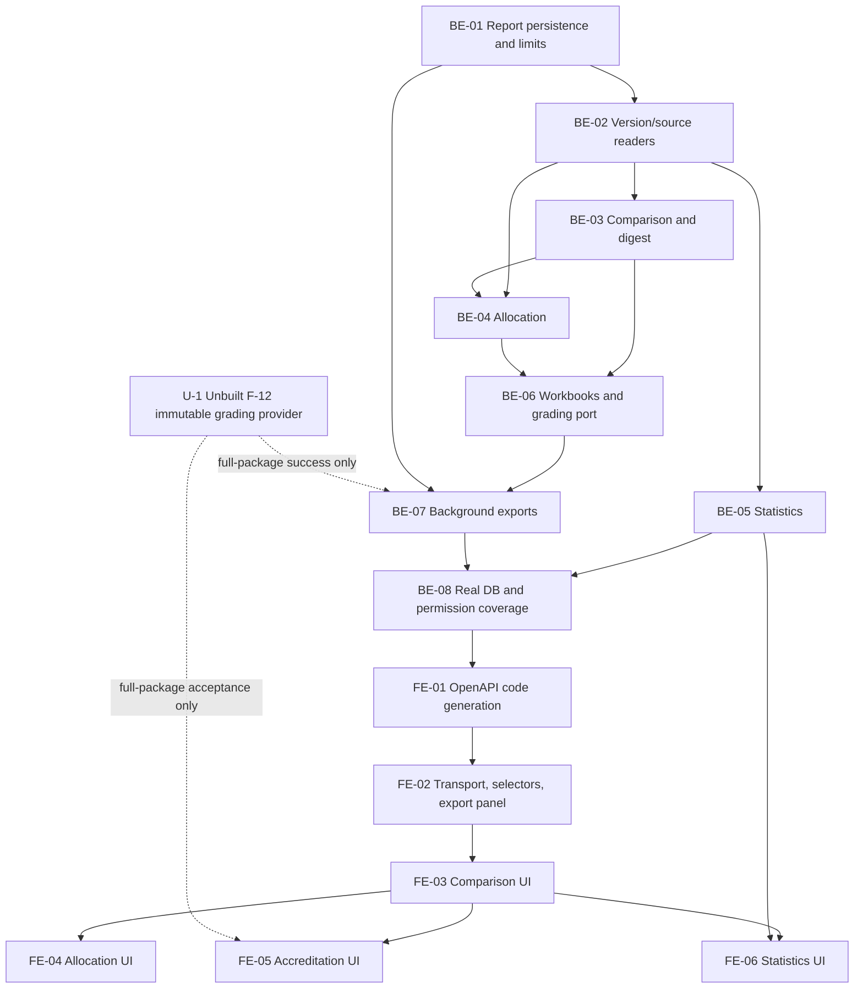

# F-23 Accreditation Reports and Data Export — Backend + Frontend Implementation Plan

This plan builds EP-23 over the curriculum, outcome and approval data already shipped: cross-program comparison, credit-distribution tables and charts, generic Excel matrix exports, a version-scoped accreditation workbook, and proposal-processing statistics (FR-43, FR-102..104, FR-107). It covers both independent applications and their API contract. It does not implement new-regulation reporting (F23-01 A), institutional AUN-QA/MOET forms, student attainment, PDF publication, import workflows, or a general audit subsystem. The full accreditation workbook has an explicit F-12 grading-data dependency; unavailable data must never become an apparently complete workbook.

> **Companion documents**
> - Scope and defaults: `docs/planning/feature-questions.md:326` (F23-01/F23-02; blank answer = A), `docs/planning/epics.md:212` (EP-23 and B6 scenarios 4–6), `docs/planning/user-stories.md:1279` (US-105..109).
> - Requirements: `docs/requirement/REQUIREMENTS.md:489`, `docs/requirement/REQUIREMENTS.md:596`, BR-01..05, BR-09, BR-17..21, EC-18 and EC-41. Requirements override stale story/test wording about matrix derivation.
> - Design: `docs/design/data-dictionary.md`, `docs/design/erd.md` (M-5/M-6 and E-2/E-5), `docs/design/state-diagrams.md`, `docs/design/sequence-diagrams.md` (submission, approval and release sequences; no dedicated reporting sequence), `docs/design/screen-inventory.md` (MH-44/60/61/62).
> - Work breakdown: `docs/planning/task-breakdown.md:476` (CV-256..263); deferrals: `docs/planning/deferred-scope.md` §1 and §2.1.
> - Implementation conventions: `docs/implementation/README.md`; exemplars `docs/implementation/f-15-release-version-snapshots-implementation-plan.md` and `docs/implementation/f-09-excel-import-export-implementation-plan.md`.
> - Shipped deviations reviewed: reports for F-05/06/07/08/10/11/13/14/15 under `docs/implement-report/`. Source evidence is recorded below; old implement-report future-hook wording is not an implementation contract.
> - Acceptance tests: `docs/planning/test-plan.md:265` (KB-091..094), NT-B6-04/05/06. KB-093's I–R–M/override premise is an escalation, not a requirement to retrofit storage.

**Status**: Not started. Plan accepted 2026-10-26 (user); E-1/E-2/E-3 decided in §8, Faculty defaults remain provisional and U-1 remains an implementation prerequisite.

## 0. Plan at a glance

Everything below in one table. Read this; the rest is detail for whoever builds it.

| What | Why | How and where |
|---|---|---|
| **Compare two selected versions of different programs** | US-105 needs shared, exclusive and equivalent courses without hiding semester/elective differences | A report-local reader and deterministic matcher in `source/backend/src/features/reports/`; MH-60 at `/reports/program-comparison` (BE-02/03, FE-03) |
| **Show credit composition without inflating elective requirements** | US-106 requires reconciled distributions; BR-04 distinguishes offered choices from required credits | Distribute all curriculum-row credits; show the existing group-minimum calculation separately, never allocate an elective minimum arbitrarily to semesters (BE-04, FE-04) |
| **Export two matrices using the stored numerical weights** | FR-43/BR-21 require Excel parity with the shipped matrix | Generic `HocPhan_PLO` and `CLO_PLO` sheets, pinned CLO revisions, blank missing cells and boolean CLO links (BE-02/06, FE-05); override provenance is unresolved, not invented |
| **Prepare a single accreditation workbook** | US-108 needs curriculum, PLOs, matrices, credits, syllabi, grading and gaps | One `.xlsx`, no ZIP/PDF; immutable version facts and pinned syllabi; F-12 port must supply grading before this kind can complete (BE-06/07, FE-05) |
| **Count proposals and measure actual level visits** | US-109 needs scoped counts and average processing time, not time since all steps were pre-created | Filter by request creation interval; group historical decisions by request/round/level; exclude skipped/incomplete visits (BE-05, FE-06) |
| **Keep heavy Excel generation off HTTP requests** | Workbook serialization is bounded background work | Dedicated BullMQ queue; new report-owned `ReportExport` table stores snapshot, artifact and completion record; Redis carries only IDs (BE-01/07) |
| **Use existing permissions, not role-name branches** | R3 accreditation and R3/R4 statistics must remain scoped | `report.benchmark`, `report.exportAccreditation`, `changeRequest.statistics`; verify again at capture and download (BE-02/05/07/08) |
| **Ship one coherent report area** | Four screens need discoverable navigation and consistent job feedback | Generated API types, a report-local version selector, shared export-status panel and AntD token-based bar charts (FE-01..06) |

**Key behaviours worth knowing**

| Behaviour | Why it is this way |
|---|---|
| Comparison/credit reports may read a normal Draft; accreditation packages require PENDING/ACTIVE/HISTORICAL | Draft inspection is useful, but a package must identify a released version. Request copies and unissued corrections are never report candidates. |
| Exporting a stale comparison/distribution fails with `REPORT_SOURCE_CHANGED` | The workbook must not silently differ from the result the user reviewed; refresh and submit a new export. |
| Historical names, credits, PLO/CLO links and syllabus content use the selected version, not the latest course/syllabus | These are the available frozen facts; see source evidence in §2. Mutable classification/thresholds have a separate limitation. |
| Coverage gaps do not block exports | A `LoHong` sheet documents them; missing required grading is different and does block a complete package. |
| A finished export retains its domain completion record after its bytes expire | US-108 AC4 needs a completion record; this does not reintroduce deferred FR-105/106. |
| Statistics never use `updatedAt` as a completion timestamp or each step's `createdAt` as its level-entry timestamp | Both would produce misleading historical durations. |

**Not included**

| Excluded | Why |
|---|---|
| PI, program objectives, review-cycle deadlines and new-regulation reports | F23-01 A; deferred R-1/R-2/R-4. No new domain tables for these. |
| Certified AUN-QA/MOET layout | F23-02 A authorizes a generic workbook only; official samples remain a Faculty risk. |
| Reconstructed override cells or historical course classifications | The shipped source cannot establish these facts; E-1/E-2 must not be solved by changing built tables here. |
| Import, F-16 version diff, F-24 PDF and F-25 delegation/reminders | Different owners; F-23 does not assume their parallel plans exist. |
| Apparently complete dossiers without grading | Unbuildable against the present F-10 schema; U-1 explicitly gates completion. Other report kinds remain usable. |

**Open questions**

| Question | Resolved when | Default if unanswered |
|---|---|---|
| What official workbook must the Faculty receive? | A sample and field mapping are supplied | Generic Vietnamese workbook; label it `Mẫu tổng quát — chưa phải biểu mẫu chính thức`. |
| Does US-107 AC2 require an override model? | Decided 2026-10-26 (user), E-1 | No; reconciled AC2/CV-260/KB-093 use direct numeric weights, without fake comments/provenance |
| Must historic packages reproduce mutable classification/threshold labels too? | Decided 2026-10-26 (user), E-2 | Frozen-core dossier; explicitly label current enrichments or their omission, no invented release-time values |
| Which F-12 provider supplies immutable grading? | U-1 port is implemented and contract-tested | Reject full package generation with `REPORT_GRADING_UNAVAILABLE`; do not insert fake weights/formulas. |
| Which screen-inventory scope markers should be reconciled? | Decided 2026-10-26 (user), E-3 | MH-62 R2 X; MH-44 R3/R4 P; preserve seed and permission policy |

## 1. Scope

| In scope | Why |
|---|---|
| US-105 comparison of two explicit version IDs, grouped results and Excel | FR-102, BR-09, EC-18; CV-256/257 |
| US-106 distributions by knowledge block, planned semester, course type and compulsory/elective nature | FR-103, BR-03/04; CV-258/259 |
| US-107 two-sheet matrix workbook with the actual numeric/boolean model | FR-43, BR-21; CV-260; E-1 reconciled 2026-10-26: direct numeric weights |
| US-108 version dossier and one successful-completion record | FR-104, BR-20, EC-41; CV-261; grading is gated by U-1 |
| US-109 status/type/origin counts and level averages in the caller's reporting scope | FR-107; CV-262/263 |
| Export job lifecycle, permission checks, binary delivery, expiration, tests and API generation | Necessary enablers of reliable end-to-end reporting |

| Out of scope | Deferred until |
|---|---|
| Editing curriculum, outcomes, approvals, releases or grading | Their owning features; F-23 reads them only |
| New regulatory PI/objective/cycle features and Faculty-specific formats | Explicit later approval and actual Faculty inputs |
| General audit browsing or immutable audit infrastructure | F01-07 is reversed explicitly; `deferred-scope.md` §2.1 |
| Historical snapshot/backfill changes to built tables | E-2 decision and a separately approved owning-feature change |
| Saved report definitions, scheduled emails, CSV, PDF, ZIP, imported templates and arbitrary SQL | Separate requirements; no runtime package for any of them |

| AC | Covered by |
|---|---|
| US-105 AC1 shared/left-only/right-only with credits | BE-03, FE-03, BE-08 |
| US-105 AC2 semester/elective differences | BE-03, FE-03 |
| US-105 AC3 equivalence pairing | BE-03, BE-08; KB-091 |
| US-105 AC4 Excel | BE-06/07, FE-02/03 |
| US-106 AC1 all four dimensions/percentages | BE-04, FE-04 |
| US-106 AC2 required-block mismatch | BE-04, FE-04; current catalog context labeled |
| US-106 AC3 each dimension reconciles | BE-04, BE-08; KB-092; offered-versus-required policy D3 |
| US-106 AC4 Excel | BE-06/07, FE-02/04 |
| US-107 AC1 both matrices match stored display semantics | BE-02/06/08, FE-05 |
| US-107 AC2 direct numeric weights | BE-06/08 exports unchanged numeric values per reconciled AC2/KB-093; no override metadata, decided 2026-10-26 |
| US-107 AC3 out-of-scope R3 refused | BE-02/07/08; selector, create, capture, status and download |
| US-108 AC1 complete dossier including grading | BE-06/07, FE-05; **full acceptance requires U-1** |
| US-108 AC2 historical data | BE-02/06/08; frozen core only; E-2 accepted 2026-10-26: label current enrichment |
| US-108 AC3 gap page, export still allowed | BE-02/06/08, FE-05; KB-094 |
| US-108 AC4 one record on successful export | BE-01/07/08; retained `completedAt` and one state-transition log |
| US-109 AC1 counts by status/type/origin and interval | BE-05, FE-06 |
| US-109 AC2 average at each level for finished requests | BE-05/08, FE-06; incomplete/skipped sample counts visible |
| US-109 AC3 R3/R4 scope | BE-05/08, FE-06; no own-request/previous-approver bypass |
| B6 scenarios 4/5/6 | The above; scenario 5 uses the decided E-1/E-2 boundaries and still requires U-1 integration |

## 2. Contract verification

Paths in evidence tables are repository-relative and line anchors refer to the inspected source, not earlier plans. New contracts below are **TO BUILD / UNVERIFIED** until their listed deliverable lands. The report UI will consume its own small DTOs, not remap whole existing program/curriculum/outcome DTOs. Existing endpoints in the baseline table are parity references, not new dependencies on another feature's controller/service.

### 2a. Endpoints and source behaviour

| Endpoint / existing surface | Verified at | Request | Response / behaviour | Notes |
|---|---|---|---|---|
| Existing `GET /api/programs/:programId/versions` | `source/backend/src/features/releases/version-history.controller.ts:16`; `source/backend/src/features/releases/version-history.reader.ts:73` | Program ID | `VersionListDto`; excludes working copies and unissued corrections; Draft visibility depends on program-view scope | Report selector is new, permission-specific; do not widen this endpoint. Existing DTO is not mapped by F-23. |
| Existing `GET /api/program-versions/:versionId/course-plo-matrix` | `source/backend/src/features/outcomes/outcomes.controller.ts:113`; serializer `source/backend/src/features/outcomes/course-plo-matrix.service.ts:97`; cell mapper `source/backend/src/features/outcomes/course-plo-matrix.dto.ts:57` | Version ID | Sparse cells, decimal weight **strings**, frozen row name/credits, ordered PLOs/rows | No override fields. Used for workbook parity tests, not imported as a feature service. |
| Existing `GET /api/program-versions/:versionId/clo-plo-matrix` | `source/backend/src/features/outcomes/clo-plo-matrix.service.ts:178`; serializer `source/backend/src/features/outcomes/clo-plo-matrix.service.ts:230` | Version ID | Rows have pinned-revision CLOs and `(cloId, ploId)` links, not contribution levels | `revisionForItems` pins first; compare by natural labels when testing exported sheets. |
| Existing binary client | `source/frontend/src/shared/api/client.ts:115` | GET path, fallback filename | Fetches binary, parses errors, creates/revokes object URL | Already shipped; F-09 FE-02's proposed addition must not be repeated. |
| Existing error envelope | `source/backend/src/shared/dtos/error-response.dto.ts:11`; `source/frontend/src/shared/api/client.ts:31` | Any error | `ErrorResponseDto` / `ApiError` | JSON failures must remain JSON, never an error `.xlsx`. |
| NEW `GET /api/reports/program-versions` | UNVERIFIED — BE-02 | `purpose=BENCHMARK|ACCREDITATION`, optional `q`, `page`, `pageSize` | `ReportVersionOptionsDto` | Assert the purpose's report permission; SQL-scope/filter before count/pagination. |
| NEW `GET /api/reports/program-comparison` | UNVERIFIED — BE-03 | `leftVersionId`, `rightVersionId` | `ProgramComparisonReportDto` | Distinct programs, explicit versions; deterministic pairing; read-only. |
| NEW `GET /api/reports/program-versions/:versionId/credit-allocation` | UNVERIFIED — BE-04 | Version ID | `CreditAllocationReportDto` | All four partitions reconcile to offered credits; required credits separate. |
| NEW `GET /api/reports/change-requests/statistics` | UNVERIFIED — BE-05 | `from`, `to` ISO instants, inclusive/exclusive | `RequestStatisticsReportDto` | Request-created cohort; current status counts; historical round/level durations for finished requests. |
| NEW `POST /api/reports/exports` | UNVERIFIED — BE-07 | `CreateReportExportDto` | **202** `ReportExportDto`, including on identical idempotent replay | CSRF required; permission determined by kind; preflight before persisting. |
| NEW `GET /api/reports/exports/:exportId` | UNVERIFIED — BE-07 | Export ID | `ReportExportDto` | Owner only, current required permission/scope; polling is passive. |
| NEW `GET /api/reports/exports/:exportId/file` | UNVERIFIED — BE-07 | Export ID | 200 XLSX bytes | Owner + reauthorization; 409 unfinished, 410 expired, JSON failures. `Cache-Control: private, no-store`. |

### 2b. Wire fields and model mapping

Every field below is required unless its nullable column says otherwise; nullable fields must be present as `null`, not disappear. All new response field sources are the corresponding **UNVERIFIED / TO BUILD** DTO and mapper named in the table heading. They are not claims about shipped serializers. Frontend aliases must reference `components['schemas'][...]`, with no copied interfaces. §5 defines the implementations after this contract.

**`ReportVersionDto`** — NEW source `source/backend/src/features/reports/dto/report-version.dto.ts`, mapper in `report-version.reader.ts` (BE-02).

| Field | Wire type | Nullable | Source | Modeled as | Note |
|---|---|---|---|---|---|
| `id` | string | no | NEW BE-02 version mapper | selected version value | CUID string, not UUID validation |
| `programId` | string | no | NEW BE-02 version mapper | option grouping and comparison validation | Identity, not version number |
| `programCode` | string | no | NEW BE-02 version mapper | visible option label | Stable catalog identity |
| `programName` | string | no | NEW BE-02 version mapper | visible option label | Selected version's name |
| `versionNumber` | string | yes | NEW BE-02 version mapper | label `Nháp` when null | Do not infer state from number |
| `status` | `DRAFT` / `PENDING` / `ACTIVE` / `HISTORICAL` | no | NEW BE-02; literals verified `source/backend/prisma/schema.prisma:63` | status tag | Request copies are excluded separately |

**`ReportVersionOptionsDto`** — NEW source `dto/report-version.dto.ts` (BE-02).

| Field | Wire type | Nullable | Source | Modeled as | Note |
|---|---|---|---|---|---|
| `items` | ReportVersionDto[] | no | NEW BE-02 options mapper | select options | Exact fields above |
| `total` | integer | no | NEW BE-02 scoped count | option count | Count uses the same predicate |
| `page` | integer | no | NEW BE-02 options mapper | current search page | Starts at 1 |
| `pageSize` | integer | no | NEW BE-02 options mapper | search page size | Existing pagination limits |

**`ReportCourseDto`** — NEW source `dto/program-comparison-report.dto.ts` (BE-03).

| Field | Wire type | Nullable | Source | Modeled as | Note |
|---|---|---|---|---|---|
| `itemId` | string | no | NEW BE-03 course mapper | row side identity | Not a course ID |
| `courseId` | string | no | NEW BE-03 course mapper | exact-match key | Compare this before equivalence |
| `courseCode` | string | no | NEW BE-03 course mapper | visible code | Preserve leading zeroes |
| `courseName` | string | no | NEW BE-03 course mapper | visible name | `rowCourse` semantics |
| `credits` | decimal string | no | NEW BE-03 course mapper | visible/exported credit value | Never float-sum in FE |
| `plannedSemester` | integer | no | NEW BE-03 course mapper | difference/display | Version-local semester |
| `isElective` | boolean | no | NEW BE-03 course mapper | `Bắt buộc` / `Tự chọn` | No role inference |
| `electiveGroupCode` | string | yes | NEW BE-03 course mapper | visible elective group | Version-local group code |

**`ComparisonPairDto`** — NEW source `dto/program-comparison-report.dto.ts` (BE-03).

| Field | Wire type | Nullable | Source | Modeled as | Note |
|---|---|---|---|---|---|
| `key` | string | no | NEW BE-03 matcher | React row key | Derived from both item IDs, with an explicit absent-side marker |
| `matchKind` | `IDENTICAL` / `EQUIVALENT` / `LEFT_ONLY` / `RIGHT_ONLY` | no | NEW BE-03 matcher | three UI groups and badge | Common = first two literals |
| `left` | ReportCourseDto | yes | NEW BE-03 matcher | left cells | Null only for RIGHT_ONLY |
| `right` | ReportCourseDto | yes | NEW BE-03 matcher | right cells | Null only for LEFT_ONLY |
| `equivalenceGroupId` | string | yes | NEW BE-03 matcher | matching explanation | Present only for EQUIVALENT |
| `semesterChanged` | boolean | no | NEW BE-03 matcher | difference tag | False on one-sided rows |
| `electiveChanged` | boolean | no | NEW BE-03 matcher | difference tag | False on one-sided rows |
| `creditsChanged` | boolean | no | NEW BE-03 matcher | difference tag | Decimal comparison, not text comparison |

**`ComparisonCreditsDto`** — NEW source `dto/program-comparison-report.dto.ts` (BE-03).

| Field | Wire type | Nullable | Source | Modeled as | Note |
|---|---|---|---|---|---|
| `sharedLeft` | decimal string | no | NEW BE-03 totals | common credits, left | Equivalent courses may have different credits |
| `sharedRight` | decimal string | no | NEW BE-03 totals | common credits, right | Never collapse to a misleading single common total |
| `leftOnly` | decimal string | no | NEW BE-03 totals | exclusive credits, left | Offered row credits |
| `rightOnly` | decimal string | no | NEW BE-03 totals | exclusive credits, right | Offered row credits |
| `leftTotal` | decimal string | no | NEW BE-03 totals | total, left | sharedLeft + leftOnly |
| `rightTotal` | decimal string | no | NEW BE-03 totals | total, right | sharedRight + rightOnly |

**`ProgramComparisonReportDto`** — NEW source `dto/program-comparison-report.dto.ts` (BE-03).

| Field | Wire type | Nullable | Source | Modeled as | Note |
|---|---|---|---|---|---|
| `left` | ReportVersionDto | no | NEW BE-03 report mapper | left heading | Exact version selected |
| `right` | ReportVersionDto | no | NEW BE-03 report mapper | right heading | Different program from left |
| `pairs` | ComparisonPairDto[] | no | NEW BE-03 report mapper | grouped tables | Sorted deterministically |
| `credits` | ComparisonCreditsDto | no | NEW BE-03 report mapper | summary | No FE recomputation |
| `sourceDigest` | lowercase SHA-256 hex string | no | NEW BE-03 canonical digest | export precondition | Not an authorization token |
| `notes` | string[] | no | NEW BE-03 report mapper | alerts and workbook notes | Includes current equivalence policy/ambiguous pair tie-break |

**`CreditBucketDto`** — NEW source `dto/credit-allocation-report.dto.ts` (BE-04).

| Field | Wire type | Nullable | Source | Modeled as | Note |
|---|---|---|---|---|---|
| `key` | string | yes | NEW BE-04 bucket mapper | row identity | Null = unclassified block only |
| `label` | string | no | NEW BE-04 bucket mapper | table/chart label | Vietnamese fallback for null/unknown blocks |
| `credits` | decimal string | no | NEW BE-04 bucket mapper | total offered credits | Every row belongs to exactly one bucket per dimension |
| `compulsoryCredits` | decimal string | no | NEW BE-04 bucket mapper | compulsory column | Sum of non-elective rows |
| `electiveCredits` | decimal string | no | NEW BE-04 bucket mapper | elective-offer column | Not group minimum |
| `percent` | decimal string | no | NEW BE-04 bucket mapper | displayed percentage/bar | Zero denominator => `0`; display rounding only |
| `itemCount` | integer | no | NEW BE-04 bucket mapper | count column | Includes zero-credit courses |
| `requiredCredits` | decimal string | yes | NEW BE-04 bucket mapper | required column | Only known blocks with a catalog requirement |
| `delta` | signed decimal string | yes | NEW BE-04 bucket mapper | mismatch explanation | credits − requiredCredits |
| `isMismatch` | boolean | no | NEW BE-04 bucket mapper | row warning | False if requirement unknown |

**`CreditAllocationReportDto`** — NEW source `dto/credit-allocation-report.dto.ts` (BE-04).

| Field | Wire type | Nullable | Source | Modeled as | Note |
|---|---|---|---|---|---|
| `version` | ReportVersionDto | no | NEW BE-04 report mapper | heading | Version context |
| `offeredCredits` | decimal string | no | NEW BE-04 report mapper | `Tổng tín chỉ trong khung` | Sum of all offered rows |
| `requiredCredits` | decimal string | no | NEW BE-04 report mapper | `Tín chỉ tối thiểu tính được` | Shared `programCredits` result |
| `declaredCredits` | decimal string | no | NEW BE-04 report mapper | `Tín chỉ khai báo` | Version.totalCredits |
| `byBlock` | CreditBucketDto[] | no | NEW BE-04 report mapper | block table/chart | Null/unknown symbols retained |
| `bySemester` | CreditBucketDto[] | no | NEW BE-04 report mapper | semester table/chart | Includes empty planned semesters |
| `byCourseType` | CreditBucketDto[] | no | NEW BE-04 report mapper | course-type table/chart | Keys: THEORY/PRACTICE/LAB/PROJECT/CAPSTONE/INTERNSHIP/CONDITIONAL; schema literals `source/backend/prisma/schema.prisma:37` |
| `byNature` | CreditBucketDto[] | no | NEW BE-04 report mapper | nature table/chart | Keys COMPULSORY/ELECTIVE, including zero totals |
| `sourceDigest` | lowercase SHA-256 hex string | no | NEW BE-04 report mapper | export precondition | Includes live enrichment actually shown |
| `notes` | string[] | no | NEW BE-04 report mapper | denominator/history warnings | No regulatory-compliance claim |

**`ReportCountDto`** — NEW source `dto/request-statistics-report.dto.ts` (BE-05).

| Field | Wire type | Nullable | Source | Modeled as | Note |
|---|---|---|---|---|---|
| `key` | string | no | NEW BE-05 counts mapper | enum-specific label map | Status literals DRAFT/PENDING_COORDINATOR/PENDING_DIRECTOR/PENDING_ACADEMIC_OFFICE/APPROVED/EFFECTIVE/REJECTED/WITHDRAWN (`source/backend/prisma/schema.prisma:122`); type literals GRADING_FORMULA/OUTCOME/SYLLABUS_CONTENT/CURRICULUM/COURSE_RELATION/PROGRAM_INFO/ORGANIZATION (`source/backend/prisma/schema.prisma:106`); origin UNIVERSITY/FACULTY (`source/backend/prisma/schema.prisma:133`) |
| `count` | integer | no | NEW BE-05 counts mapper | table/chart count | Include zero-valued enum buckets |

**`LevelTimingDto`** — NEW source `dto/request-statistics-report.dto.ts` (BE-05).

| Field | Wire type | Nullable | Source | Modeled as | Note |
|---|---|---|---|---|---|
| `level` | 1 / 2 / 3 | no | NEW BE-05 timing mapper | Vietnamese level label | Exactly three rows |
| `sampleCount` | integer | no | NEW BE-05 timing mapper | denominator | Request-round-level visits, not approver rows |
| `meanMilliseconds` | nonnegative decimal string | yes | NEW BE-05 timing mapper | duration formatter | Null when no eligible sample; zero is genuine instantaneous completion |
| `excludedCount` | integer | no | NEW BE-05 timing mapper | caveat count | Skipped, incomplete or invalid-history visits |

**`RequestStatisticsReportDto`** — NEW source `dto/request-statistics-report.dto.ts` (BE-05).

| Field | Wire type | Nullable | Source | Modeled as | Note |
|---|---|---|---|---|---|
| `from` | ISO instant string | no | NEW BE-05 report mapper | interval heading | Inclusive creation timestamp |
| `to` | ISO instant string | no | NEW BE-05 report mapper | interval heading | Exclusive creation timestamp |
| `total` | integer | no | NEW BE-05 report mapper | total count | Scoped cohort, not all requests |
| `byStatus` | ReportCountDto[] | no | NEW BE-05 report mapper | status table | Each partition sums to total |
| `byType` | ReportCountDto[] | no | NEW BE-05 report mapper | type table | Same cohort |
| `byOrigin` | ReportCountDto[] | no | NEW BE-05 report mapper | origin table | Same cohort |
| `levels` | LevelTimingDto[] | no | NEW BE-05 report mapper | timing table | Finished requests only |
| `timingPolicy` | `FINISHED_REQUEST_ROUND_LEVEL_WALL_TIME` | no | NEW BE-05 report mapper | help text selection | Explicit stable semantics, not a free-form formula |

**`ReportExportDto`** — NEW source `dto/report-export.dto.ts` (BE-07).

| Field | Wire type | Nullable | Source | Modeled as | Note |
|---|---|---|---|---|---|
| `id` | string | no | NEW BE-07 `toReportExportDto` | polling/download ID | Opaque, never a file path |
| `kind` | `PROGRAM_COMPARISON` / `CREDIT_ALLOCATION` / `OUTCOME_MATRICES` / `ACCREDITATION` | no | NEW BE-01 enum / BE-07 mapper | export-kind label | No statistics export added implicitly |
| `status` | `QUEUED` / `RUNNING` / `READY` / `FAILED` / `EXPIRED` | no | NEW BE-01 enum / BE-07 mapper | job status | READY may become EXPIRED, not QUEUED |
| `versionIds` | string[] | no | NEW BE-07 mapper | context confirmation | Comparison order is left then right |
| `createdAt` | ISO instant string | no | NEW BE-07 mapper | request time | Stored domain history |
| `capturedAt` | ISO instant string | yes | NEW BE-07 mapper | data-as-of time | First persisted capture only |
| `completedAt` | ISO instant string | yes | NEW BE-07 mapper | completion time | Preserved after expiration |
| `expiresAt` | ISO instant string | yes | NEW BE-07 mapper | download expiry | Set when completed |
| `fileName` | string | yes | NEW BE-07 mapper | download label | Generated safe filename |
| `sizeBytes` | integer | yes | NEW BE-07 mapper | file-size hint | Retain after bytes removed |
| `sourceDigest` | lowercase SHA-256 hex string | yes | NEW BE-07 mapper | context diagnostic | No raw captured data in response |
| `errorCode` | string | yes | NEW BE-07 mapper | error handling | Only allowlisted public error code |
| `errorMessage` | string | yes | NEW BE-07 mapper | Vietnamese action feedback | No stack/SQL/private contents |

**Existing `ErrorResponseDto` / `FieldErrorDto`** — consumed through the unchanged `ApiError` mapper, verified at `source/frontend/src/shared/api/client.ts:31` and `source/backend/src/shared/dtos/error-response.dto.ts:3`.

| Field | Wire type | Nullable | Source | Modeled as | Note |
|---|---|---|---|---|---|
| `statusCode` | number | no | `source/backend/src/shared/dtos/error-response.dto.ts:13` | ApiError.status from HTTP | Not separately stored |
| `code` | string | no | `source/backend/src/shared/dtos/error-response.dto.ts:16` | ApiError.code | Use for refresh/expiry/dependency messages |
| `message` | string | no | `source/backend/src/shared/dtos/error-response.dto.ts:19` | Error.message | Vietnamese server text |
| `details` | FieldErrorDto[] | optional, not nullable | `source/backend/src/shared/dtos/error-response.dto.ts:22` | ApiError.details | Not every error has fields |
| `path` | string | no | `source/backend/src/shared/dtos/error-response.dto.ts:25` | not modeled | Shared client deliberately ignores diagnostic URL |
| `timestamp` | string | no | `source/backend/src/shared/dtos/error-response.dto.ts:28` | not modeled | Shared client deliberately ignores diagnostic time |
| `FieldErrorDto.field` | string | no | `source/backend/src/shared/dtos/error-response.dto.ts:5` | field error key | Existing form-error path |
| `FieldErrorDto.constraints` | string[] | no | `source/backend/src/shared/dtos/error-response.dto.ts:8` | field messages | Do not convert array into one error object |

### 2c. Mismatch log and own-repository evidence

| Deliverable | What an upstream/earlier plan suggests | What the source actually does | Found at |
|---|---|---|---|
| BE-06 | US-107 AC2 / KB-093 mention override cells and I–R–M | Direct decimal weight in (0,1]; CLO links have no contribution level or override flag | `source/backend/prisma/schema.prisma:741`; `source/backend/src/features/outcomes/course-plo-matrix.dto.ts:23`; E-1 |
| BE-04 | One ambiguous “total calculated credits” | Curriculum totals count every row; program minimum counts compulsory plus group minima, excluding ungrouped electives | `source/backend/src/features/curriculum/curriculum-totals.ts:18`; `source/backend/src/shared/curriculum/program-credits.ts:29`; D3 |
| BE-02/06 | Historical enrichment may be assumed fully frozen | Only row name/credits and syllabus ID are frozen; type/equivalence remain Course fields and KnowledgeBlock remains global | `source/backend/src/shared/releases/version.publisher.ts:147`; `source/backend/prisma/schema.prisma:247`; `source/backend/prisma/schema.prisma:537`; E-2 |
| BE-05 | Every step's creation time is its level-entry time | Submit creates all routing rows together; advancement only overwrites current `levelEnteredAt`, and closing clears it | `source/backend/src/features/change-requests/submission.service.ts:164`; `source/backend/src/shared/change-requests/approval-recorder.ts:123`; `source/backend/src/shared/change-requests/approval-recorder.ts:135` |
| BE-05 | Existing request visibility is safe for statistics | `visibleWhere` includes own requests/previous approver participation and uses CHANGE_REQUEST_VIEW, not the statistics permission | `source/backend/src/features/change-requests/request-visibility.ts:13`; do not reuse it |
| BE-06 | F-10 “assessmentMethods” might be a grading formula | It is nullable narrative text; no assessment component/formula model exists in the inspected schema | `source/backend/prisma/schema.prisma:631`; U-1 |
| FE-02 | F-09 would add a binary download helper | That helper already exists from shipped attachment work | `source/frontend/src/shared/api/client.ts:115`; reuse, do not replace |
| BE-01/07 | “Log each export” could imply AuditLog | General audit is deferred; a feature-owned completion record and structured application log satisfy the provisional domain-history path | `docs/planning/deferred-scope.md` §2.1; no built audit model appears after the schema's final model at `source/backend/prisma/schema.prisma:909` |

Additional verified foundations: decimal serialization is `toString()` (`source/backend/src/shared/decimal/decimal.ts:10`); pinned syllabus selection accepts a historical revision and excludes request-copy fallbacks (`source/backend/src/shared/syllabi/revision-for-items.ts:30`); gap calculation is pure and distinguishes four gap lists (`source/backend/src/shared/outcomes/outcome-gaps.ts:38`, `source/backend/src/shared/outcomes/outcome-gaps.ts:49`); report permission codes and role cells already exist (`source/backend/src/shared/authz/permission-codes.ts:32`, `source/backend/prisma/seed-data/permission-catalog.ts:250`, `source/backend/prisma/seed-data/permission-catalog.ts:299`). None of these shared functions is replaced by this plan; no old call-site migration is required.

## 3. Decisions

| ID | Decision | Why | Rejected alternative |
|---|---|---|---|
| D1 | Use a report-local read model with Prisma and existing shared pure helpers; no feature-to-feature imports | Preserve module boundaries and perform one repeatable-read capture | Calling other features' HTTP endpoints/services, which would inherit unrelated permissions and inconsistent reads |
| D2 | Match exact course IDs first, then deterministic one-to-one pairs within current equivalence groups | Satisfy BR-09 without quadratic matching or double-counting | A Cartesian product, fuzzy name matching, or treating replacement relations as equivalence |
| D3 | All distribution dimensions count offered curriculum rows; show minimum required and declared totals separately | Matches shipped curriculum totals while keeping BR-03/04 visible; no justified way to apportion a choice minimum across semesters | Pretending all offered elective credits are graduation requirements, or arbitrary proportional allocation of a minimum |
| D4 | A generic dossier is one multi-sheet `.xlsx`; no official-form compliance claim | F23-02 A, ExcelJS named in `docs/design/tech-stack.md:44` | ZIP/Word/PDF, new chart/export libraries or official layouts guessed from memory |
| D5 | Add report-owned export metadata and binary storage in PostgreSQL; heavy build in BullMQ | Idempotent jobs and completion history without altering existing feature tables or using Redis as artifact cache | Reusing unbuilt ImportBatch, disk-path lifecycle complexity, synchronous serialization on controllers |
| D6 | Capture once, persist canonical source JSON, then build outside the read transaction; digest-check reviewed reports | Consistency under concurrent edits and deterministic retries | Live re-read per sheet, long transaction during XLSX compression, or silently changing data on retry |
| D7 | Statistics use request-created `[from,to)` cohorts and finished-request round/level wall-time samples | Reconstructible from existing history; makes date and denominator semantics explicit | Calling `updatedAt` completion time, mixing active waits into finished means, weighting by number of approvers |
| D8 | Use statistics-specific scope predicates, not general request visibility | US-109 AC3 must not leak out-of-scope owned/previously-approved work | Filtering chart totals in the client or branching on R1/R3/R4 strings |
| D9 | Keep exports owner-private and reauthorize purpose/scope at creation, capture, status and download | Permission changes must revoke access to queued or completed files | Possession of an opaque ID as authorization or a public/static download URL |
| D10 | Reuse existing permissions; add only missing FE aliases | Permission catalog already carries the report/statistics cells (`source/backend/prisma/seed-data/permission-catalog.ts:250`, `source/backend/prisma/seed-data/permission-catalog.ts:299`) | Seed edits that reset customized grants or introducing per-chart permissions |
| D11 | AntD Progress-based horizontal bars with equivalent data tables; no chart dependency | Meets table/chart FR-103 with accessible, token-based UI | Adding an unnamed runtime dependency or requiring canvas to interpret the figures |
| D12 | F-12 is a fail-closed integration port for full dossiers; standalone reports need neither F-09 nor F-16/F-25 | Do not pretend parallel/unbuilt code exists | Reading another pending plan as if it were shipped or treating narrative assessment methods as formulas |
| D13 | Direct weights and frozen-core dossiers are the accepted build scope; label any current enrichment | Decided 2026-10-26 (user), E-1/E-2 | Override/snapshot columns, historical backfill or an immutable-enrichment promise |

## 4. Deliberate divergences

No shipped sibling reporting implementation was supplied or found in the inspected feature directories. No sibling behaviour is assumed. This section records deliberate boundaries, not authorization to resolve E-1/E-2:

- The F-09 workbook plan is an **unbuilt exemplar**, not a reusable runtime module. F-23 gets its own generic report writer and does not modify curriculum round-trip Excel specifications.
- F-23 comparison is cross-program composition, not F-16's version-change diff. Both use explicit IDs and shared frozen readers; no F-16 endpoint is assumed.
- Override comments and complete historical catalog metadata remain escalations. The conservative baseline is direct numeric weights and the actual frozen content, with the acceptance qualifications documented rather than hidden.

## 5. Deliverables

All paths below are repository-relative. `NEW` means to be built, not already present. Exact new child paths are deliberate decisions under the inspected `src/features/`, `src/shared/`, `prisma/migrations/`, and `test/fixtures/` parents. No deliverable deletes or replaces a shared function. Keep unit specs adjacent and all application strings Vietnamese.

### BE-01 — Report-owned export persistence, enums and limits

What/Why: establish a durable export/completion record without changing the behaviour or schema of existing curriculum, outcome or approval tables.

**Files**

| Action | Path |
|---|---|
| MODIFY | `source/backend/prisma/schema.prisma` — append report-only enums/model |
| NEW | `source/backend/prisma/migrations/20261025170000_accreditation_reports/migration.sql` |
| MODIFY | `source/backend/package.json` — ExcelJS only, if still absent at build time |
| MODIFY | `source/backend/pnpm-lock.yaml` — generated by pnpm, never edited manually |
| NEW | `source/backend/src/features/reports/report.constants.ts` |
| NEW | `source/backend/src/features/reports/report.errors.ts` |
| NEW | `source/backend/src/features/reports/report.errors.spec.ts` |

**Shape**

```prisma
enum ReportExportKind {
  PROGRAM_COMPARISON
  CREDIT_ALLOCATION
  OUTCOME_MATRICES
  ACCREDITATION
}

enum ReportExportStatus {
  QUEUED
  RUNNING
  READY
  FAILED
  EXPIRED
}

model ReportExport {
  id               String             @id @default(cuid(2))
  createdById      String
  clientRequestId  String
  kind             ReportExportKind
  status           ReportExportStatus @default(QUEUED)
  versionIds       String[]
  requestJson      Json
  capturedJson     Json?
  sourceDigest     String?
  capturedAt       DateTime?
  completedAt      DateTime?
  expiresAt        DateTime?
  fileName         String?
  sizeBytes        Int?
  content          Bytes?
  errorCode        String?
  errorMessage     String?
  createdAt        DateTime           @default(now())
  updatedAt        DateTime           @updatedAt

  @@unique([createdById, clientRequestId])
  @@index([createdById, createdAt])
  @@index([status, expiresAt])
}
```

`createdById` is a logical reference to the authenticated user's ID, deliberately without adding an inverse field or FK behaviour to built `User`. Exports never join user names; account deletion/disable must make reauthorization fail. Domain history stores the actor ID, export kind, version IDs, capture/completion times and outcome, not credentials.

Generate the migration using `pnpm exec prisma migrate dev --create-only --name accreditation_reports`, then give the unapplied generated directory the planned identifier above. If an intervening migration makes that identifier inappropriate, use Prisma's generated timestamp and update this plan's single migration path before applying; do not modify already-applied migrations. Inspect that SQL creates only the two enums, one new table, its indexes and these report-only CHECKs:

```sql
ALTER TABLE ReportExport ADD CONSTRAINT ReportExport_ready_content
CHECK ((status = 'READY') = (content IS NOT NULL));
ALTER TABLE ReportExport ADD CONSTRAINT ReportExport_completion
CHECK ((status IN ('READY', 'EXPIRED')) =
       (completedAt IS NOT NULL AND expiresAt IS NOT NULL
        AND fileName IS NOT NULL AND sizeBytes IS NOT NULL));
ALTER TABLE ReportExport ADD CONSTRAINT ReportExport_capture_pair
CHECK ((capturedAt IS NULL) = (sourceDigest IS NULL));
ALTER TABLE ReportExport ADD CONSTRAINT ReportExport_positive_size
CHECK (sizeBytes IS NULL OR sizeBytes > 0);
```

Expiration may clear `capturedJson` while retaining the capture timestamp/digest. Do not require non-null capture JSON forever. `requestJson` is the validated export input, not the user session or a Prisma object. `content` is `Uint8Array` at the Prisma boundary.

```ts
export const REPORT_LIMITS = {
  MAX_ITEMS_PER_VERSION: 1_000,
  MAX_PLOS_PER_VERSION: 100,
  MAX_CLOS_PER_ITEM: 100,
  MAX_WORKBOOK_CELLS: 500_000,
  MAX_CAPTURE_BYTES: 20 * 1024 * 1024,
  MAX_FILE_BYTES: 20 * 1024 * 1024,
  MAX_CELL_TEXT_LENGTH: 32_767,
  EXPORT_RETENTION_HOURS: 24,
  STATISTICS_MAX_RANGE_DAYS: 366,
  MAX_STATISTICS_REQUESTS: 10_000,
  SEARCH_MAX_LENGTH: 200,
  DIGEST_HEX_LENGTH: 64,
} as const;
export const REPORT_EXPORT_QUEUE = 'report-exports';
export const REPORT_EXPORT_JOB = 'build-report-export';
export const REPORT_SWEEP_JOB = 'reconcile-report-exports';
export const REPORT_JOB_OPTIONS = {
  attempts: 3,
  backoff: { type: 'exponential', delay: 10_000 },
  removeOnComplete: true,
  removeOnFail: 20,
} as const;
export const REPORT_SWEEP_CRON = '*/10 * * * *';
export const REPORT_SNAPSHOT_FORMAT_VERSION = 1;
export const REPORT_XLSX_MIME =
  'application/vnd.openxmlformats-officedocument.spreadsheetml.sheet';
```

These are bounded operational defaults, not Faculty business rules. Put milliseconds/hour and milliseconds/day conversion constants beside the limits rather than scattering numeric factors. Count cells before allocating a workbook; refuse excessive data rather than truncate rows or rich text. Expose 413 `REPORT_TOO_LARGE` with `Báo cáo vượt giới hạn xử lý. Vui lòng chọn phạm vi nhỏ hơn.`

Define typed `ErrorDefinition` entries for 400 `REPORT_SELECTION_INVALID`, `REPORT_INTERVAL_INVALID`; 404 `REPORT_VERSION_NOT_FOUND`, `REPORT_EXPORT_NOT_FOUND`; 409 `REPORT_SOURCE_CHANGED`, `REPORT_EXPORT_NOT_READY`, `REPORT_IDEMPOTENCY_CONFLICT`, `REPORT_GRADING_UNAVAILABLE`, `REPORT_DATA_INCOMPLETE`; 410 `REPORT_EXPORT_EXPIRED`; 413 `REPORT_TOO_LARGE`; 503 `REPORT_BUILD_UNAVAILABLE`. Use common 401/403 errors unchanged. `REPORT_GRADING_UNAVAILABLE`: `Chưa có dữ liệu công thức điểm để xuất bộ kiểm định đầy đủ.` `REPORT_SOURCE_CHANGED`: `Dữ liệu đã thay đổi. Vui lòng tải lại báo cáo trước khi xuất.` No stack or raw database failure is a public error message.

**Rationale**: model/enums mirror the feature-owned persistence style at `source/backend/prisma/schema.prisma:773`; decimal/byte serialization remains explicit. Error entries mirror `source/backend/src/shared/exception/error-codes.ts:4`. Queue retry defaults mirror `source/backend/src/features/releases/release-activation.scheduler.ts:16`. ExcelJS is approved in `docs/design/tech-stack.md:44`, not a new stack choice; the inspected dependencies lack it (`source/backend/package.json:35`).

**Gotchas**
- Never add override, assessment, completion-time or taxonomy snapshot columns to built tables to make this feature easier. Those are E-1/E-2/U-1, not permission to migrate another owner.
- Existing partial version indexes remain untouched; their purpose is documented and reflected in selectors (`source/backend/prisma/schema.prisma:343`).
- Use `pnpm add exceljs` only if the builder still needs it; a merged F-09 may already install it. Do not add `xlsx`, `archiver`, chart libraries or another sanitizer.
- Additive report-row storage intentionally duplicates bounded capture/bytes until expiry. Monitor database size; no infinite artifact retention.

**Verify**: in `source/backend`, run the numbered generation operation `pnpm prisma:generate`, then `pnpm exec tsc --noEmit -p tsconfig.json`; apply the new migration on disposable PostgreSQL through BE-08 and assert all CHECKs and the idempotency unique index. Error spec verifies the public codes/messages/statuses.

**Depends on**: —

### BE-02 — Permission-specific version selection and frozen source capture

What/Why: create one bounded report read model and prevent working-copy, scope and latest-syllabus leaks before any aggregation/export is implemented.

**Files**

| Action | Path |
|---|---|
| NEW | `source/backend/src/features/reports/dto/report-version.dto.ts` |
| NEW | `source/backend/src/features/reports/dto/report-version-query.dto.ts` |
| NEW | `source/backend/src/features/reports/report-source.types.ts` |
| NEW | `source/backend/src/features/reports/report-access.ts` |
| NEW | `source/backend/src/features/reports/report-access.spec.ts` |
| NEW | `source/backend/src/features/reports/report-version.reader.ts` |
| NEW | `source/backend/src/features/reports/report-version.reader.spec.ts` |
| NEW | `source/backend/src/features/reports/report-source.reader.ts` |
| NEW | `source/backend/src/features/reports/report-source.reader.spec.ts` |
| NEW | `source/backend/src/features/reports/report-versions.controller.ts` |
| NEW | `source/backend/src/features/reports/reports.module.ts` |
| MODIFY | `source/backend/src/app.module.ts` — import `ReportsModule` |

**Shape**

```ts
export enum ReportPurpose {
  BENCHMARK = 'BENCHMARK',
  ACCREDITATION = 'ACCREDITATION',
}
export class ReportVersionQueryDto extends PageQueryDto {
  @ApiProperty({ enum: ReportPurpose, enumName: 'ReportPurpose' })
  @IsEnum(ReportPurpose)
  purpose!: ReportPurpose;

  @ApiPropertyOptional()
  @IsOptional()
  @IsString()
  @MaxLength(REPORT_LIMITS.SEARCH_MAX_LENGTH)
  q?: string;
}

export const REPORT_VERSION_WHERE = {
  sourceRequestId: null,
  NOT: { status: ProgramVersionStatus.DRAFT, correctionOfId: { not: null } },
} satisfies Prisma.ProgramVersionWhereInput;

export function permissionForPurpose(purpose: ReportPurpose): PermissionCode;
export function permissionForExportKind(kind: ReportExportKind): PermissionCode;
export function reportVersionScopeWhere(
  access: AccessContext,
  permission: PermissionCode,
): Prisma.ProgramVersionWhereInput;

@Injectable()
export class ReportVersionReader {
  constructor(private readonly prisma: PrismaService) {}
  list(query: ReportVersionQueryDto, access: AccessContext): Promise<ReportVersionOptionsDto>;
  assertReadable(
    db: Prisma.TransactionClient,
    versionId: string,
    access: AccessContext,
    purpose: ReportPurpose,
  ): Promise<ReportVersionDto>;
}
```

Emit the six `ReportVersionDto` fields and all four options-wrapper fields from §2b with `@ApiProperty` annotations, explicit nullable Swagger types and enums. Reuse `PageQueryDto`, whose limits are verified at `source/backend/src/shared/pagination/page-query.dto.ts:5`. `purpose` is mandatory even when the guard accepts either report permission. A caller with benchmark only cannot query `purpose=ACCREDITATION` to learn scoped export candidates.

List filtering order: normal-version predicate → report-specific scope → case-insensitive program code/version name search → order by program code, then createdAt descending, then ID → count and page in one transaction. Include inactive programs' issued versions for historic reporting; current assignments still control access. For single-ID reads, return the report 404 for nonexistent/hidden working copies; an existing normal version outside the caller's purpose scope returns common `OUT_OF_SCOPE`. A purpose with no grant returns `PERMISSION_DENIED`. `report.benchmark` has ALL cells for R1..R4 in the seed; do not artificially scope that permission by their editing assignment.

Scope predicate for a version is `{ programId in scope.programIds } OR { program.facultyId in scope.orgUnitIds }` unless `scope.all`; no subject-group fallback grants accreditation to R4. Use `access.assertCan(code, programTarget(program))` again on loaded versions, with `programTarget` from `source/backend/src/shared/programs/program-target.ts`. Use named permission constants, never role-code checks.

The internal capture is not a response DTO and must remain server-only. Define the following complete logical record shapes; preserve all decimal values as strings and dates as ISO strings before JSON persistence:

```ts
export interface ReportSourceItem {
  itemId: string;
  courseId: string;
  courseCode: string;
  courseName: string;
  credits: string;
  plannedSemester: number;
  isElective: boolean;
  electiveGroupCode: string | null;
  sortOrder: number;
  blockSymbol: string | null;
  htDa: boolean;
  tqDa: boolean;
  minStudiedScore: string | null;
  minTransferScore: string | null;
  note: string | null;
  requisites: { sourceCourseId: string; sourceCourseCode: string;
    relationType: CourseRelationType; minScore: string | null }[];
  electiveGroupId: string | null;
  courseType: CourseType;
  ownerGroupId: string | null;
  equivalenceGroupId: string | null;
  syllabusId: string | null;
  hasFrozenName: boolean;
  hasFrozenCredits: boolean;
}
export interface ReportSourcePlo {
  id: string;
  ploCode: string;
  description: string;
  englishDescription: string | null;
  competencyGroup: string | null;
  sortOrder: number;
}
export interface ReportSourceClo {
  id: string;
  cloCode: string;
  description: string;
  englishDescription: string | null;
  cognitiveLevel: string | null;
  sortOrder: number;
}
export interface ReportSourceSyllabus {
  id: string;
  courseId: string;
  revisionNumber: number;
  courseDescription: string | null;
  englishDescription: string | null;
  objectives: string | null;
  teachingMethods: string | null;
  assessmentMethods: string | null;
  references: string | null;
  clos: ReportSourceClo[];
  weeks: {
    weekLabel: string;
    sortOrder: number;
    content: string;
    teachingActivities: string | null;
    cloIds: string[];
  }[];
}
export interface ReportSourceVersion {
  version: ReportVersionDto;
  semesterCount: number;
  majorCode: string;
  majorName: string;
  declaredTotal: string;
  declaredCompulsory: string;
  declaredElective: string;
  decisionNumber: string | null;
  signedDate: string | null;
  publishedAt: string | null;
  items: ReportSourceItem[];
  groups: { id: string; groupCode: string; groupName: string;
    minCredits: string | null; minCourses: number | null }[];
  plos: ReportSourcePlo[];
  syllabi: ReportSourceSyllabus[];
  courseCells: { itemId: string; ploId: string; weight: string }[];
  cloLinks: { itemId: string; cloId: string; ploId: string }[];
}
export interface ReportSourceSnapshot {
  formatVersion: typeof REPORT_SNAPSHOT_FORMAT_VERSION;
  capturedAt: string;
  versions: ReportSourceVersion[];
  knowledgeBlocks: { blockCode: string; blockName: string; requiredCredits: string | null }[];
}

@Injectable()
export class ReportSourceReader {
  constructor(private readonly prisma: PrismaService, private readonly versions: ReportVersionReader) {}
  capture(
    db: Prisma.TransactionClient,
    versionIds: readonly string[],
    purpose: ReportPurpose,
    access: AccessContext,
  ): Promise<ReportSourceSnapshot>;
}
```

Implementation mechanics:

1. Authorize all IDs **before** reading detailed content. Read related tables through the supplied transaction only; no hidden `this.prisma` read inside capture.
2. Batch curriculum, groups, PLOs, cells and links per version. Sort curriculum by plannedSemester/sortOrder/ID, PLO/CLO by sortOrder/ID, groups by groupCode/ID and link arrays by natural tuple. Never fetch per matrix cell.
3. Resolve names/credits with `rowCourse`/`rowCredits`; resolve CLO revisions with `revisionForItems(db, items)`, then batch-load those exact revision IDs. Historical status is not a reason to pick today's PUBLISHED syllabus.
4. For a released version, missing frozen name/credits/pin or unresolved pin is `REPORT_DATA_INCOMPLETE`; do not silently backfill from live catalog. Draft capture may use the shared Published-else-Draft fallback, which already excludes request copies.
5. Include all four gap categories through shared pure `outcomeGaps`, using these captured arrays. Do not call `OutcomeGapsReader.forVersion` separately because its current signature cannot take this transaction (`source/backend/src/shared/outcomes/outcome-gaps.reader.ts:13`).
6. Keep `courseType`, equivalence and knowledge-block enrichment explicitly **current at capture**. Historic dossiers must omit that enrichment instead of representing it as frozen; E-2 remains open. Do not include mutable attachment lists/files in the dossier's frozen-content promise.
7. Enforce source item/PLO/CLO and capture-byte bounds before returning/persisting. Request copies, correction drafts and any later addition to version states must fail the normal-version predicate unless explicitly integrated.

`ReportVersionsController` uses `@Controller('reports/program-versions')`, `@ApiTags('reports')`, `@ApiCookieAuth()`, `@Get()`, `@RequirePermission(PERMISSIONS.REPORT_BENCHMARK, PERMISSIONS.REPORT_EXPORT_ACCREDITATION)`, `@ApiOkResponse({ type: ReportVersionOptionsDto })`, and `@CurrentAccess()`. Build `ReportsModule` initially with the version controller/readers; import it into `AppModule`. Later deliverables extend this module rather than importing sibling feature modules.

**Rationale**: the selection/mapper shape mirrors `source/backend/src/features/releases/version-history.reader.ts:73`, not its permission choice. Frozen reading mirrors `source/backend/src/shared/curriculum/row-course.ts:4` and `source/backend/src/shared/syllabi/revision-for-items.ts:30`. Controller/module wiring mirrors `source/backend/src/features/releases/version-history.controller.ts:13` and `source/backend/src/features/releases/releases.module.ts:16`. Each NEW DTO mirrors explicit Swagger properties in `source/backend/src/features/releases/dto/version-detail.dto.ts:11`; each adjacent spec mirrors the corresponding existing reader spec layout.

**Gotchas**: metadata exclusion must test `status=DRAFT AND correctionOfId != null`, not all corrections (issued corrections are valid). Never use `sourceRequestId` as release provenance: published versions use `originRequestId` (`source/backend/prisma/schema.prisma:385`). `revisionForItems` returns a map keyed by **item ID**, not course ID (`source/backend/src/shared/syllabi/revision-for-items.ts:30`). FE dropdowns are hints, not proof of scope.

**Verify**: `pnpm exec vitest run src/features/reports/report-access.spec.ts src/features/reports/report-version.reader.spec.ts src/features/reports/report-source.reader.spec.ts`; tests cover both purposes, scoped R3, copied/correction Draft exclusions, released correction inclusion, pinned historical content, missing pin failure, Decimal serialization, bounded batch reads and stable ordering. GET the selector as R1/R3/R4 and verify no unsupported-purpose leakage.

**Depends on**: BE-01

### BE-03 — Cross-program comparison and reviewed-result digest

What/Why: deliver the three comparison groups, all structural differences and deterministic equivalence matching independently of export generation.

**Files**

| Action | Path |
|---|---|
| NEW | `source/backend/src/features/reports/dto/program-comparison-query.dto.ts` |
| NEW | `source/backend/src/features/reports/dto/program-comparison-report.dto.ts` |
| NEW | `source/backend/src/features/reports/program-comparison.ts` |
| NEW | `source/backend/src/features/reports/program-comparison.spec.ts` |
| NEW | `source/backend/src/features/reports/report-digest.ts` |
| NEW | `source/backend/src/features/reports/report-digest.spec.ts` |
| NEW | `source/backend/src/features/reports/program-reports.service.ts` |
| NEW | `source/backend/src/features/reports/program-reports.service.spec.ts` |
| NEW | `source/backend/src/features/reports/program-reports.controller.ts` |
| MODIFY | `source/backend/src/features/reports/reports.module.ts` |

**Shape**

```ts
export class ProgramComparisonQueryDto {
  @ApiProperty() @IsString() @IsNotEmpty() leftVersionId!: string;
  @ApiProperty() @IsString() @IsNotEmpty() rightVersionId!: string;
}
export type ComparisonContent = Omit<ProgramComparisonReportDto, 'sourceDigest'>;

export function compareProgramVersions(
  left: ReportSourceVersion,
  right: ReportSourceVersion,
): ComparisonContent;

export function reportDigest(value: Prisma.InputJsonValue): string;

@Injectable()
export class ProgramReportsService {
  constructor(private readonly prisma: PrismaService, private readonly source: ReportSourceReader) {}
  comparison(query: ProgramComparisonQueryDto, access: AccessContext): Promise<ProgramComparisonReportDto>;
}

@ApiTags('reports')
@ApiCookieAuth()
@Controller('reports')
export class ProgramReportsController {
  constructor(private readonly reports: ProgramReportsService) {}

  @Get('program-comparison')
  @RequirePermission(PERMISSIONS.REPORT_BENCHMARK)
  @ApiOkResponse({ type: ProgramComparisonReportDto })
  comparison(@Query() query: ProgramComparisonQueryDto, @CurrentAccess() access: AccessContext) {
    return this.reports.comparison(query, access);
  }
}
```

Create all comparison DTO classes from §2b, including nested `@ApiProperty({ type: ... })` arrays and nullable sides. A query must reject identical version IDs and two versions of the same program with 400 `REPORT_SELECTION_INVALID`: `Vui lòng chọn hai chương trình khác nhau.` Do not guess the “active” version, require the selected version on both sides; no same-major restriction is imposed by the FR's example.

`comparison` runs `source.capture` for both versions in one `Prisma.TransactionIsolationLevel.RepeatableRead` transaction. Build the JSON report from that capture. `reportDigest` must canonicalize object keys recursively, preserve already-stable array order and hash with Node `createHash('sha256')`; hash the complete exported comparison content and policy version, **excluding** timestamps and the digest itself. Do not hash JSON object insertion order or a transient `capturedAt`.

Matching algorithm:

1. Index both sides by course ID; exact-ID pairs consume both items first, regardless of equivalence membership.
2. Group only still-unmatched items by non-null `equivalenceGroupId`; null never forms a shared equivalence group. A group is already the transitive/symmetric representation; do not traverse `CourseRelation` edges or invent credit normalization.
3. Sort each unmatched group by courseCode then courseId, zip up to the shorter length and consume one item per side. If either side had multiple candidates, append the explanatory Vietnamese note `Nhóm tương đương có nhiều học phần; các cặp được ghép theo mã học phần.` Leftover items remain exclusive.
4. Exact/equivalent pairs are the common group. Compute `semesterChanged`, `electiveChanged` and `creditsChanged` independently. Comparing weights or syllabus contents is not part of this feature.
5. Sort common pairs by left plannedSemester/sortOrder/courseCode/ID, then exclusive groups by their own side's order. Stable pair keys must include item IDs and side presence, not row indexes.
6. Sum side-specific Decimal credits. `sharedLeft + leftOnly = leftTotal`; likewise right. Do not apply BR-10's graduation credit-recognition algorithm to a descriptive comparison.

Use notes to state `Quan hệ tương đương được lấy theo danh mục tại thời điểm lập báo cáo.` This is intentional even when selected curriculum versions are historical: equivalence is not frozen in the current model (`source/backend/prisma/schema.prisma:253`). Exact-ID matches still take precedence if an equivalence group changes later.

**Rationale**: pure algorithm/spec files mirror `source/backend/src/shared/curriculum/program-credits.ts:40` and its adjacent spec; DTO serialization mirrors `source/backend/src/features/outcomes/course-plo-matrix.dto.ts:23`; service/controller separation mirrors `source/backend/src/features/releases/version-history.controller.ts:13`. `reportDigest` is report-local because it protects reviewed report content, not a replacement for another feature's concurrency token.

**Gotchas**: one-to-many equivalence must not duplicate credits; zero-credit courses still match and appear; IDs are strings, not automatically UUIDs. Do not compare decimal strings lexically (`3` and `3.00` are equal). Never include private request-copy PLO/CLO content in a comparison digest.

**Verify**: `pnpm exec vitest run src/features/reports/program-comparison.spec.ts src/features/reports/report-digest.spec.ts src/features/reports/program-reports.service.spec.ts`. Cover exact-match-before-equivalence, null groups, asymmetric group cardinality, cross-faculty equivalents, decimal/zero credits, semester/nature/credit changes, side totals, stable digests and same-program rejection. JSON GET is the first backend demo pause point.

**Depends on**: BE-02

### BE-04 — Credit allocation with honest denominators and threshold context

What/Why: deliver reconciled tables/charts data without silently treating all elective offers as minimum graduation requirements.

**Files**

| Action | Path |
|---|---|
| NEW | `source/backend/src/features/reports/dto/credit-allocation-report.dto.ts` |
| NEW | `source/backend/src/features/reports/credit-allocation.ts` |
| NEW | `source/backend/src/features/reports/credit-allocation.spec.ts` |
| MODIFY | `source/backend/src/features/reports/program-reports.service.ts` |
| MODIFY | `source/backend/src/features/reports/program-reports.service.spec.ts` |
| MODIFY | `source/backend/src/features/reports/program-reports.controller.ts` |

**Shape**

```ts
export type AllocationContent = Omit<CreditAllocationReportDto, 'sourceDigest'>;
export function creditAllocation(
  source: ReportSourceVersion,
  blocks: ReportSourceSnapshot['knowledgeBlocks'],
): AllocationContent;

export function creditBucket(
  key: string | null,
  label: string,
  items: readonly ReportSourceItem[],
  denominator: Prisma.Decimal,
  requiredCredits: Prisma.Decimal | null,
): CreditBucketDto;
```

Add `ProgramReportsService.allocation(versionId: string, access: AccessContext): Promise<CreditAllocationReportDto>` and controller method:

```ts
@Get('program-versions/:versionId/credit-allocation')
@RequirePermission(PERMISSIONS.REPORT_BENCHMARK)
@ApiOkResponse({ type: CreditAllocationReportDto })
allocation(@Param('versionId') versionId: string, @CurrentAccess() access: AccessContext) {
  return this.reports.allocation(versionId, access);
}
```

Build the §2b DTO classes fully; their fields are the contract, not raw Prisma results. Use one repeatable-read source capture. `offeredCredits = sum(all row credits)`. `requiredCredits = programCredits(items, groups).total` after constructing Decimal inputs from serialized source values. `declaredCredits = selected version.totalCredits`. Never change the existing shared credit calculation.

Four exhaustive partitions:

- **Block**: preserve exact `blockSymbol` as typed; null => `Chưa phân khối`; unknown non-null => `Khối chưa có trong danh mục: <symbol>`. Match the global catalog on exact code, not FK/trimmed guesses. Include catalog blocks with requiredCredits even if no row maps to them, so a missing required block can be a zero-credit mismatch. Never count catalog-only rows as courses. Sort null first, then code, deterministic tie-break.
- **Semester**: enumerate 1..semesterCount including empty semesters; label `Học kỳ <n>`; invalid out-of-range captured rows fail `REPORT_DATA_INCOMPLETE`, never disappear from totals.
- **Course type**: enumerate the seven literal schema values in a fixed named order with Vietnamese labels; sum all offered rows once. For historic interactive allocation this is explicitly current catalog classification, not a snapshot claim.
- **Nature**: exactly COMPULSORY and ELECTIVE; label `Bắt buộc` / `Tự chọn được mở trong khung`. Never bucket by group minimum here.

Use Decimal for all sums/deltas and `percent = denominator.isZero() ? 0 : credits.div(denominator).mul(100)`. Define `REPORT_PERCENT_DECIMAL_PLACES = 2`; round only displayed percentages, not credit sums. It is acceptable for displayed percentages to sum to 99.99 or 100.01 due to rounding; do not falsify underlying values to force 100. Unknown thresholds produce null required/delta and `isMismatch=false`, not a “meets regulation” badge. A configured requirement of zero is known, not absent.

The source includes current knowledge-block names/thresholds because their storage is global (`source/backend/prisma/schema.prisma:537`). For historical interactive/standalone allocation, display and export the note `Tên khối, mức tín chỉ yêu cầu và loại học phần lấy theo danh mục tại thời điểm lập báo cáo.` The package's historical variant must instead omit those unsnapshotted enrichments (BE-06/E-2). Keep E-2 explicit rather than creating an illicit historical backfill.

Digest the full allocation content including notes and the enrichment actually displayed, excluding capture time. The UI's reviewed report and its standalone export will use that same digest and same captured values.

**Rationale**: bucket arithmetic mirrors `source/backend/src/features/curriculum/curriculum-totals.ts:19` and `source/backend/src/features/curriculum/curriculum-totals.ts:41`; graduation minimum uses `source/backend/src/shared/curriculum/program-credits.ts:29`. The new pure file stays feature-local rather than replacing or importing the existing feature-local totals implementation.

**Gotchas**: an ungrouped elective contributes to offered totals but not the minimum total; explain that distinction. Preserve half credits and zero-credit rows. Do not bind unknown free-form block symbols to a made-up “other” required block. Mismatch markings are descriptive warnings, never release blockers.

**Verify**: `pnpm exec vitest run src/features/reports/credit-allocation.spec.ts src/features/reports/program-reports.service.spec.ts`. Assert every partition sums exactly to offeredCredits; compulsory+elective bucket totals agree; minCredits/minCourses groups use the unchanged shared rule; include unknown/null blocks, empty semesters, zero denominator, decimal credits, zero thresholds, catalog-only required blocks and rounded percentages.

**Depends on**: BE-02, BE-03 (digest/controller groundwork)

### BE-05 — Scoped proposal counts and reconstructible level timings

What/Why: implement FR-107 from persisted approval history without changing workflow timestamps or exposing out-of-scope work.

**Files**

| Action | Path |
|---|---|
| NEW | `source/backend/src/features/reports/dto/request-statistics-query.dto.ts` |
| NEW | `source/backend/src/features/reports/dto/request-statistics-report.dto.ts` |
| NEW | `source/backend/src/features/reports/request-statistics-scope.ts` |
| NEW | `source/backend/src/features/reports/request-statistics-scope.spec.ts` |
| NEW | `source/backend/src/features/reports/request-level-timings.ts` |
| NEW | `source/backend/src/features/reports/request-level-timings.spec.ts` |
| NEW | `source/backend/src/features/reports/request-statistics.reader.ts` |
| NEW | `source/backend/src/features/reports/request-statistics.reader.spec.ts` |
| NEW | `source/backend/src/features/reports/request-statistics.controller.ts` |
| MODIFY | `source/backend/src/features/reports/reports.module.ts` |

**Shape**

```ts
export class RequestStatisticsQueryDto {
  @ApiProperty({ format: 'date-time' }) @IsISO8601({ strict: true }) from!: string;
  @ApiProperty({ format: 'date-time' }) @IsISO8601({ strict: true }) to!: string;
}
export function statisticsScopeWhere(access: AccessContext): Prisma.ChangeRequestWhereInput;
export interface TimingStep {
  submissionRound: number;
  approvalLevel: number;
  action: ApprovalAction;
  isSkipped: boolean;
  createdAt: Date;
  recordedAt: Date | null;
}
export interface TimingRequest {
  id: string;
  status: ChangeRequestStatus;
  steps: TimingStep[];
}
export function requestLevelTimings(requests: readonly TimingRequest[]): LevelTimingDto[];

@Injectable()
export class RequestStatisticsReader {
  constructor(private readonly prisma: PrismaService) {}
  read(query: RequestStatisticsQueryDto, access: AccessContext): Promise<RequestStatisticsReportDto>;
}

@ApiTags('reports')
@ApiCookieAuth()
@Controller('reports/change-requests')
export class RequestStatisticsController {
  constructor(private readonly statistics: RequestStatisticsReader) {}
  @Get('statistics')
  @RequirePermission(PERMISSIONS.CHANGE_REQUEST_STATISTICS)
  @ApiOkResponse({ type: RequestStatisticsReportDto })
  read(@Query() query: RequestStatisticsQueryDto, @CurrentAccess() access: AccessContext) {
    return this.statistics.read(query, access);
  }
}
```

**Cohort and scope**

1. Require timezone-bearing ISO instants, valid `from < to`, and at most `REPORT_LIMITS.STATISTICS_MAX_RANGE_DAYS`. Reject rather than silently clipping. Select `createdAt >= from AND createdAt < to`; counts describe the **current** statuses of that request-created cohort, not an invented historical as-of view.
2. Count submitted requests only (`submissionRound > 0`); returned-to-Draft rows remain included, never-submitted private drafts do not. Show `Đề xuất đã gửi, theo ngày tạo` and the `[from,to)` interpretation. No draft data leak through aggregate counts.
3. Resolve `access.scopeFor(PERMISSIONS.CHANGE_REQUEST_STATISTICS)`, not CHANGE_REQUEST_VIEW. ALL grants see the whole submitted cohort. Scoped predicates OR these **scope associations**: direct target program/faculty; target course owner group/faculty or its issued-version program usage; target subject group/faculty; persisted step `forProgramId` / `forSubjectGroupId` matching the held scope. Use `some` relations, so a request is counted once even when several groups/programs match. Only issued `PENDING/ACTIVE/HISTORICAL`, `sourceRequestId=null` version usage may establish a program association.
4. Never include a request merely because `createdById === access.userId`, `approverId === access.userId` or `performedById === access.userId`; those are not a scope association. No scope target IDs => no rows, not an omitted SQL predicate. Multiple grants union naturally through `AccessContext`.
5. In one repeatable-read transaction, count bounded candidates then fetch the necessary scalar fields and steps. If the scoped cohort exceeds `MAX_STATISTICS_REQUESTS`, return `REPORT_TOO_LARGE`; do not fetch everything or provide partial averages. Each status/type/origin partition includes all known enum keys with zero counts and must sum to the same `total`.

**Level-time algorithm**

Use finished status literals `EFFECTIVE`, `REJECTED`, `WITHDRAWN`, matching the shipped predicate (`source/backend/src/features/change-requests/request-visibility.ts:97`). `APPROVED` still awaits effect and is excluded from timing, but not from counts. Return the policy literal from §2b and explain this in MH-44.

- Group **all** persisted steps of each finished request by submissionRound, then level; old returned rounds are legitimate visits, not overwritten by the final round.
- Round submission time is the minimum step `createdAt` for that round. Submit creates all routing steps at once (`source/backend/src/features/change-requests/submission.service.ts:164`), so later levels must **not** start at their own row creation time.
- Walk levels in ascending order. The first reached non-skipped level starts at submission time. A later reached level starts at the latest `recordedAt` of the preceding reached level whose non-skipped rows all approved; entirely skipped levels neither contribute samples nor reset the clock.
- A level ends at the sole RETURN/REJECT action time, even if peer rows remain PENDING; otherwise it ends at the latest recordedAt only when all its non-skipped rows APPROVE. Parallel approvers contribute **one** visit, not one sample per approver. Override/performedBy fields do not change this elapsed-time definition.
- After RETURN/REJECT, higher levels in that round were not entered; exclude their dormant rows. WITHDRAWN with a pending level has no durable withdrawal timestamp in this schema: exclude that unresolved visit, but keep earlier completed visits. Never substitute request.updatedAt or current levelEnteredAt.
- All-skipped, incomplete, invalid-level, missing-recordedAt and negative-duration groups contribute to per-level `excludedCount`, never a zero-duration sample. A genuinely completed zero-ms visit is valid. Reject internally inconsistent terminal/approval histories from the timing sample and log only IDs/reasons.
- Use Decimal milliseconds for sum/division; `meanMilliseconds=null` when `sampleCount=0`, else serialize the arithmetic mean with a named two-decimal display precision. Exactly three LevelTimingDto rows are returned. The average is per completed round-level visit of a finished request, **not** total end-to-end processing time or average per request.

**Rationale**: scope construction mirrors the relation-predicate style of `source/backend/src/features/change-requests/request-visibility.ts:13` but deliberately excludes its own-request/approver exceptions. Timing follows the actual recorder (`source/backend/src/shared/change-requests/approval-recorder.ts:89`, `source/backend/src/shared/change-requests/approval-recorder.ts:104`), not design assumptions. Controller/readers and adjacent specs mirror `source/backend/src/features/change-requests/approval-queue.reader.ts:58` and its spec. DTOs mirror explicit response metadata in `source/backend/src/features/change-requests/approval-queue.dto.ts`.

**Gotchas**: never add enteredAt/completedAt to built ApprovalStep/ChangeRequest here. R3's current program assignment and R4's current group assignment determine present reporting scope; the statistics are not historical permission reconstruction. An inactive assignment may remove scope even for old requests. Retried rounds must not be collapsed or counted as multiple requests in counts.

**Verify**: `pnpm exec vitest run src/features/reports/request-statistics-scope.spec.ts src/features/reports/request-level-timings.spec.ts src/features/reports/request-statistics.reader.spec.ts`. Fixtures must prove exact interval boundaries, private-Draft exclusion, R3/R4 cross-scope refusal despite ownership/approval, multi-scope deduplication, skipped first/middle levels, parallel approvals, return/resubmit, terminal rejection with pending peers, withdrawal without endpoint time, zero samples, APPROVED exclusion and precise known means.

**Depends on**: BE-01 (limits/errors), BE-02 (module and permission conventions)

### BE-06 — Generic workbook writer and explicit grading integration port

What/Why: define and test every exported sheet, preserve the selected version, and fail closed rather than manufacture F-12 data.

**Files**

| Action | Path |
|---|---|
| NEW | `source/backend/src/shared/syllabi/accreditation-grading.port.ts` |
| NEW | `source/backend/src/features/reports/report-grading.reader.ts` |
| NEW | `source/backend/src/features/reports/report-grading.reader.spec.ts` |
| NEW | `source/backend/src/features/reports/report-export-capture.types.ts` |
| NEW | `source/backend/src/features/reports/report-workbook.specification.ts` |
| NEW | `source/backend/src/features/reports/report-workbook.writer.ts` |
| NEW | `source/backend/src/features/reports/report-workbook.writer.spec.ts` |
| MODIFY | `source/backend/src/features/reports/reports.module.ts` — providers |

**Shape**

```ts
export const ACCREDITATION_GRADING_READER = Symbol('ACCREDITATION_GRADING_READER');
export interface AccreditationGradingSnapshot {
  syllabusRevisionId: string;
  formulaText: string;
  components: {
    componentCode: string;
    componentName: string;
    weight: string;
    maxScore: string;
    isCondition: boolean;
    threshold: string | null;
    cloCodes: string[];
  }[];
}
export type AccreditationGradingResult =
  | { status: 'UNAVAILABLE' }
  | { status: 'INCOMPLETE'; syllabusRevisionIds: string[] }
  | { status: 'READY'; revisions: AccreditationGradingSnapshot[] };
export interface AccreditationGradingReader {
  readForRevisions(
    db: Prisma.TransactionClient,
    syllabusRevisionIds: readonly string[],
  ): Promise<AccreditationGradingResult>;
}

@Injectable()
export class ReportGradingReader {
  constructor(
    @Optional() @Inject(ACCREDITATION_GRADING_READER)
    private readonly reader?: AccreditationGradingReader,
  ) {}
  available(): boolean;
  read(db: Prisma.TransactionClient, ids: readonly string[]): Promise<AccreditationGradingSnapshot[]>;
}

export interface ReportExportCapture {
  formatVersion: typeof REPORT_SNAPSHOT_FORMAT_VERSION;
  kind: ReportExportKind;
  source: ReportSourceSnapshot;
  grading: AccreditationGradingSnapshot[];
  content: ComparisonContent | AllocationContent | null;
}
export interface ReportWorkbookResult {
  content: Uint8Array;
  fileName: string;
  sizeBytes: number;
}
@Injectable()
export class ReportWorkbookWriter {
  write(capture: ReportExportCapture, exportId: string, sourceDigest: string): Promise<ReportWorkbookResult>;
}
```

The shared grading port is an **assumed outbound contract**, not an existing F-12 API. Default missing injection => `REPORT_GRADING_UNAVAILABLE`. `INCOMPLETE` or a READY result missing/duplicating any requested revision => `REPORT_DATA_INCOMPLETE`; do not fill with an empty formula or the newest formula. F-12's adapter must guarantee that every returned expression/component belongs to the requested **immutable Syllabus revision**, is validated by F-12 and is read through `db` in this same snapshot. It owns expression syntax, weight rules and condition semantics; F-23 exports strings/numbers without evaluating them. No runtime import from an unbuilt feature, no speculative assessment schema, no synthetic production implementation. U-1 states how to integrate when the owner exists.

Use `import ExcelJS from 'exceljs'`. Instantiate a new workbook per request, set creator to the application name, created/modified to the persisted source capture instant, and use one specification file for stable Vietnamese sheet names, column keys, headers, formats and note text. Freeze header rows, use autofilters on rectangular data tables and bounded column widths. Every worksheet name must be unique and within Excel's 31-character bound; put this bound in a named constant. Build only outside the source-read transaction. Return `new Uint8Array(await workbook.xlsx.writeBuffer())`; bytes go to PostgreSQL, never into BullMQ return values.

**Workbook specification**

| Kind / sheet | Exact columns or grid | Contents and ordering |
|---|---|---|
| All / `TongQuan` | `Mục`, `Giá trị` | Generic-template disclaimer; export ID/kind; capture time in school timezone; selected program/version IDs/numbers/statuses; decision and signed date when present; digest; offered/minimum/declared-total definitions; relevant history/equivalence/rounding limitations. Never say “đạt chuẩn kiểm định”. |
| PROGRAM_COMPARISON / `DoiSanh` | `Nhóm`, `Mã HP trái`, `Tên HP trái`, `TC trái`, `HK trái`, `Tính chất trái`, `Nhóm TC trái`, the same seven right-side fields, `Khác học kỳ`, `Khác tính chất`, `Khác tín chỉ`, `Nhóm tương đương` | Same pair ordering/values as JSON; three groups with two side-specific shared-credit totals in summary. Empty side cells are empty, not zero-credit courses. |
| CREDIT_ALLOCATION / `TheoKhoi`, `TheoHocKy`, `TheoLoaiHP`, `BatBuocTuChon` | `Mã`, `Tên`, `Số học phần`, `TC bắt buộc`, `TC tự chọn mở`, `Tổng TC`, `Tỷ lệ (%)`, `TC yêu cầu`, `Chênh lệch`, `Lệch` | Four exhaustive partitions from reviewed AllocationContent; unknown thresholds blank; mismatch warning style. Add authoritative offered/minimum/declared summary and rounding note to TongQuan. |
| OUTCOME_MATRICES and ACCREDITATION / `HocPhan_PLO` | `TT`, `Học kỳ`, `Mã HP`, `Tên học phần`, `Tín chỉ`, then one column per ordered PLO code | Sparse direct weights as numeric values with `0.00` format; absent cells blank. PLO descriptions in header notes. No formula, I–R–M or inferred override marker. |
| OUTCOME_MATRICES and ACCREDITATION / `CLO_PLO` | `Học kỳ`, `Mã HP`, `Tên học phần`, `Bản đề cương`, `Mã CLO`, `Mô tả CLO`, then one column per ordered PLO code | One row per item/CLO of its pinned/fallback revision; linked cell text `X`, absent blank. Preserve course context when the same syllabus serves different curricula. A course without CLOs gets one clearly labeled placeholder row, not fictitious links. |
| ACCREDITATION / `KhungCTDT` | `TT`, `Học kỳ`, `Mã HP`, `Tên học phần`, `Ký hiệu khối`, `Tín chỉ`, `Tự chọn`, `Nhóm tự chọn`, `HT ĐA`, `TQ ĐA`, `Điểm học`, `Điểm chuyển`, `Ghi chú`, `Mã bản đề cương` | Version-order rows, all core framework fields; no F-09 template/round-trip promise. Add the group's minimum credit/course requirements in a second labeled table. |
| ACCREDITATION / `DieuKienHP` | `Mã HP`, `Mã HP nguồn`, `Loại quan hệ`, `Ngưỡng điểm` | Version-owned CurriculumRequisite rows, deterministically sorted; not live catalog relations. Source fields verified at `source/backend/prisma/schema.prisma:601`. |
| ACCREDITATION / `PLO` | `Mã PLO`, `Mô tả`, `Mô tả tiếng Anh`, `Nhóm năng lực` | Selected version's PLO order; null English/group cells blank. |
| ACCREDITATION / `PhanBoTinChi` | `Cách phân bổ`, `Mã`, `Số học phần`, `TC bắt buộc`, `TC tự chọn mở`, `Tổng TC`, `Tỷ lệ (%)` | Frozen-only distributions by raw blockSymbol, semester and nature. No live block names/requirements or course types in a historic dossier; include the E-2 caveat on TongQuan. Each partition reconciles. |
| ACCREDITATION / `DeCuong` | `Mã HP`, `Tên học phần`, `Mã bản đề cương`, `Số bản`, `Mô tả`, `Mô tả tiếng Anh`, `Mục tiêu`, `Phương pháp dạy`, `Phương pháp đánh giá`, `Tài liệu tham khảo` | Pinned revision data, rich text converted using shared `richTextToPlain`; never today's latest revision. Narrative assessmentMethods remains narrative, separate from formula. |
| ACCREDITATION / `NoiDungTuan` | `Mã HP`, `Mã bản đề cương`, `Tuần`, `Nội dung`, `Hoạt động giảng dạy`, `CLO liên quan` | Exact captured weekly order/content and stable CLO labels. |
| ACCREDITATION / `CLO` | `Mã HP`, `Mã bản đề cương`, `Mã CLO`, `Mô tả`, `Mô tả tiếng Anh`, `Mức nhận thức` | Pinned revision CLOs, not live course-wide substitutes. |
| ACCREDITATION / `CongThucDiem` | `Mã HP`, `Mã bản đề cương`, `Công thức` | Formula text returned by the READY U-1 adapter; always text, never an executable Excel formula. |
| ACCREDITATION / `ThanhPhanDiem` | `Mã HP`, `Mã bản đề cương`, `Mã thành phần`, `Tên thành phần`, `Trọng số`, `Điểm tối đa`, `Điều kiện`, `Ngưỡng đạt`, `CLO đo lường` | F-12's immutable component facts; no recalculation or guessed default thresholds. |
| ACCREDITATION / `LoHong` | `Loại lỗ hổng`, `Học kỳ`, `Mã HP`, `Mã PLO`, `Mã CLO`, `Mô tả` | All four shared gap categories; an empty sheet retains headers and `Chưa ghi nhận lỗ hổng chuẩn đầu ra`. Gaps never block export. |

A dossier has all ACCREDITATION sheets plus TongQuan and the two matrices. For a frozen-only distribution, use captured version row fields and group minima; do not call the interactive allocation function with today's catalog and label the result historical. Standalone allocation intentionally includes current taxonomy/thresholds with the stated note; the distinction is visible, not hidden behind a shared DTO pretending otherwise.

**Data safety and precision**

- Treat all user-originated codes, names, descriptions, notes and formulaText as explicit **string** cells. Do not assign ExcelJS formula/hyperlink objects, infer formulas from `=`, `+`, `-`, `@`, or dereference external links. Test that hostile examples remain text with no formula field.
- Convert validated bounded Decimal credit/weight values to numbers only at the Excel cell boundary. Two-decimal source precision must survive display; percentage values are 0..100 numbers, not Excel fractions accidentally multiplied twice. Keep zero as a visible numeric 0 and missing as blank.
- Count all matrix cells (including CLO expansion) before workbook allocation and check every text-cell length. If a rich-text field would exceed Excel's cell limit, fail with a Vietnamese size error; no silent truncation in an accreditation artifact.
- `richTextToPlain` is already implemented with the approved sanitizer (`source/backend/src/shared/rich-text/rich-text-to-plain.ts:17`). Reuse it; never include HTML markup, attachment paths, private comments or individual approver remarks.
- Generate the filename from kind + export ID, e.g. `bo-kiem-dinh-<id>.xlsx`; user-controlled names must not become paths. Use the existing UTF-8 content-disposition helper later at download, not handcrafted headers.

**Rationale**: NEW writer/specification files are modeled on the explicit report-output mappers at `source/backend/src/features/outcomes/course-plo-matrix.dto.ts:51` and the planned spec-driven Excel organization of F-09 BE-03, **not** an assumed existing Excel module. NEW grading port follows the shared reader boundary exemplified by `source/backend/src/shared/outcomes/outcome-gaps.reader.ts:10`; its absence is explicit. Adjacent tests mirror the existing pure gap/credit tests, with ExcelJS reopening generated bytes for semantic assertions.

**Gotchas**: E-1 means no invented override field/comment; test the reconciled direct-weight AC, not obsolete override acceptance. A released syllabus with HISTORICAL status remains valid when pinned. Rich-text/worksheet limits must fail before declaring READY. Gaps, unknown block metadata and unavailable grading are different classes of condition and must not share one generic warning fallback.

**Verify**: `pnpm exec vitest run src/features/reports/report-grading.reader.spec.ts src/features/reports/report-workbook.writer.spec.ts`. Reopen bytes with ExcelJS and assert exact sheet sets, ordered headers/rows, sparse matrix blanks versus zero, numeric weights, boolean links, frozen metadata exclusion, all gap categories, rich-text conversion, formula-injection safety, size rejection and unavailable/incomplete grading failures. Provide synthetic READY grading only in tests; no production fake.

**Depends on**: BE-01, BE-02, BE-03, BE-04; complete ACCREDITATION acceptance also requires U-1, not a speculative F-12 implementation.

### BE-07 — Export API, bounded background processing, retention and completion journal

What/Why: make workbook production retry-safe, owner-private and recoverable while keeping large work off HTTP requests.

**Files**

| Action | Path |
|---|---|
| NEW | `source/backend/src/features/reports/dto/create-report-export.dto.ts` |
| NEW | `source/backend/src/features/reports/dto/create-report-export.dto.spec.ts` |
| NEW | `source/backend/src/features/reports/dto/report-export.dto.ts` |
| NEW | `source/backend/src/features/reports/report-exports.controller.ts` |
| NEW | `source/backend/src/features/reports/report-exports.service.ts` |
| NEW | `source/backend/src/features/reports/report-exports.service.spec.ts` |
| NEW | `source/backend/src/features/reports/report-export.processor.ts` |
| NEW | `source/backend/src/features/reports/report-export.processor.spec.ts` |
| NEW | `source/backend/src/features/reports/report-export.scheduler.ts` |
| NEW | `source/backend/src/features/reports/report-export.scheduler.spec.ts` |
| MODIFY | `source/backend/src/features/reports/reports.module.ts` |

**Shape**

```ts
export class CreateReportExportDto {
  @ApiProperty({ format: 'uuid' }) @IsUUID() clientRequestId!: string;
  @ApiProperty({ enum: ReportExportKind, enumName: 'ReportExportKind' })
  @IsEnum(ReportExportKind) kind!: ReportExportKind;
  @ApiPropertyOptional() @IsOptional() @IsString() @IsNotEmpty() versionId?: string;
  @ApiPropertyOptional() @IsOptional() @IsString() @IsNotEmpty() leftVersionId?: string;
  @ApiPropertyOptional() @IsOptional() @IsString() @IsNotEmpty() rightVersionId?: string;
  @ApiPropertyOptional({ pattern: '^[a-f0-9]{64}$' })
  @IsOptional() @Matches(/^[a-f0-9]{64}$/) expectedDigest?: string;
}

export interface ReportExportJob { exportId: string; }
@Injectable()
export class ReportExportsService {
  constructor(
    private readonly prisma: PrismaService,
    private readonly scopes: ScopeService,
    private readonly source: ReportSourceReader,
    private readonly grading: ReportGradingReader,
    private readonly writer: ReportWorkbookWriter,
    @InjectQueue(REPORT_EXPORT_QUEUE) private readonly queue: Queue,
  ) {}
  create(dto: CreateReportExportDto, access: AccessContext): Promise<ReportExportDto>;
  status(exportId: string, access: AccessContext): Promise<ReportExportDto>;
  file(exportId: string, access: AccessContext): Promise<ReportWorkbookResult>;
  build(exportId: string): Promise<void>;
  reconcile(now?: Date): Promise<void>;
}

@Processor(REPORT_EXPORT_QUEUE, { concurrency: 1 })
export class ReportExportProcessor extends WorkerHost implements OnModuleDestroy {
  constructor(private readonly exports: ReportExportsService) { super(); }
  process(job: Job<ReportExportJob | Record<string, never>>): Promise<void>;
  onModuleDestroy(): Promise<void>;
}
```

Generate `ReportExportDto` with every §2b property and explicit nullable annotations. Its mapper returns strings/integers only, never `requestJson`, `capturedJson`, actor IDs, raw bytes or Prisma Date objects.

Controller routes use the BE-07 URLs from §2a, `@ApiTags('reports')`, `@ApiCookieAuth()`, `@CurrentAccess()`, coarse `@RequirePermission(PERMISSIONS.REPORT_BENCHMARK, PERMISSIONS.REPORT_EXPORT_ACCREDITATION)` on each route, and exact service checks afterward. POST uses `@HttpCode(HttpStatus.ACCEPTED)` / `@ApiAcceptedResponse({ type: ReportExportDto })`; status uses `@PassiveRequest()` and `@ApiOkResponse`; file uses binary Swagger content, `@Res({ passthrough: true })` and shared `sendFile`. Always apply `private, no-store` headers to status/file. No static route exposes artifacts.

**Request validation and permissions**

| Kind | Required shape | Required permission / extra checks |
|---|---|---|
| PROGRAM_COMPARISON | leftVersionId + rightVersionId + expectedDigest; versionId absent | REPORT_BENCHMARK on both normal versions; distinct programs |
| CREDIT_ALLOCATION | versionId + expectedDigest; left/right absent | REPORT_BENCHMARK on normal version |
| OUTCOME_MATRICES | versionId; left/right/expectedDigest absent | REPORT_EXPORT_ACCREDITATION on normal version; Draft allowed, no request copy |
| ACCREDITATION | versionId; left/right/expectedDigest absent | REPORT_EXPORT_ACCREDITATION; selected status PENDING/ACTIVE/HISTORICAL; grading provider available |

Implement the union checks explicitly in a named `validateExportSelection` function; reject irrelevant fields rather than ignore them. Query/DTO errors remain standard 400 field errors. `clientRequestId` is a browser-generated UUID for idempotency, **not** a version/user ID. Create validates permissions and normal-version membership before returning a replayed export. An identical `(createdById, clientRequestId)` and normalized request returns the same 202 DTO; a different normalized request with that key returns `REPORT_IDEMPOTENCY_CONFLICT`. Handle the unique-index race by loading the winning row and comparing the full canonical request.

**Durable lifecycle**

1. Preflight permission, kind selection, released-state rule and grading-provider availability. Persist a QUEUED domain row first, then enqueue `{ exportId }` with stable `jobId = exportId`. Return 202 without waiting for workbook generation or an indefinitely disconnected Redis command. Enqueue is supervised fire-and-forget with an error log; a durable QUEUED row is recovered by the scheduler. Do not return a failure that makes the client unknowingly create a second export while the first is queued.
2. Worker loads the row, verifies the actor still exists/is ACTIVE and not pending a mandatory password change, calls `ScopeService.loadAccess(actorId)` and checks the kind-specific scope again. This explicitly supplements `ScopeService`, which resolves grants but is not an account-status guard (`source/backend/src/shared/authz/scope.service.ts:42`). No HTTP session is serialized into the job.
3. Terminal READY/EXPIRED/FAILED is a no-op. Otherwise set RUNNING conditionally. If `capturedJson` is absent, use one repeatable-read transaction to capture/authorize all version facts, read U-1 grading for ACCREDITATION, calculate relevant reviewed-report content and digest, and persist the capture only if no other attempt already did so. If another attempt won, reload its capture. Do not build from an unpersisted losing capture.
4. For reviewed comparison/allocation, recompute the **same** public-content digest and require equality to expectedDigest. A mismatch is a permanent `REPORT_SOURCE_CHANGED`, not a retryable export with different values. Matrix/package digests cover the relevant captured source/grade content, excluding ephemeral timestamps.
5. Validate stored snapshot formatVersion/shape before reuse. Build from this captured JSON outside the transaction; every retry uses the same capture, not changed live data. Before promoting to READY, reload current actor access and reauthorize version IDs once more. Revocation must prevent new public artifacts, even after CPU work finished.
6. In a single conditional update/transaction, store bytes, safe fileName, sizeBytes, completedAt and `expiresAt = completedAt + REPORT_LIMITS.EXPORT_RETENTION_HOURS`, clear error fields and change RUNNING to READY. Include status/digest predicates so only one attempt wins. A late/duplicate attempt must not overwrite READY or create a second completion event.
7. The row's successful completion fields are the authoritative **one per export** domain journal entry (US-108 AC4). The winning attempt also emits a structured application log containing export ID, actor ID, kind, version IDs and capture/completion times; no report content/remarks. A crash between database commit and diagnostic logging does not undo the completion record. Retries that see READY emit no second successful-completion log.
8. Permanent business/data errors immediately mark a nonterminal row FAILED with allowlisted public error fields and throw an appropriate unrecoverable job error. Infrastructure failures use BullMQ's bounded retry options. Only after the final failed attempt mark FAILED, using a conditional update that cannot demote READY. No raw exception string goes to the browser. A new user-requested retry uses a new clientRequestId/export row.
9. Status/download require row.createdById === access.userId (foreign IDs => 404), and current kind-specific permission/scope. Expiration is checked against wall clock at both status and download, not just the sweep. At expiry transition READY→EXPIRED and clear content/capturedJson atomically; retain completion metadata/digest. Not READY => 409, EXPIRED => 410, disappeared bytes before expiry => explicit failure, not empty 200.

**Scheduler and recovery**

`ReportExportScheduler implements OnApplicationBootstrap, OnModuleDestroy` registers the named sweep cron using `APP_TIME_ZONE`, submits a boot reconciliation and closes its queue. Mirror the non-blocking startup and bounded processor shutdown of the release scheduler; define `REPORT_SHUTDOWN_GRACE_MS = 10_000`. Queue job names are dispatched explicitly; unknown names must fail, not accidentally build an empty-ID export.

Reconciliation clears expired READY bytes/captures, clears retained failed captures after the same retention period, and examines QUEUED/RUNNING rows in bounded pages. If a corresponding live/delayed/stalled job exists, let BullMQ own it; if no job exists, re-add the stable ID. An exhausted failed queue job must reconcile the DB row to FAILED, not loop forever. Redis carries only IDs/scheduling; return no capture/workbook bytes from jobs. Persisted failed/expired metadata remains available only through owner-authorized status, not a new general history browser.

Register `BullModule.registerQueue({ name: REPORT_EXPORT_QUEUE })` in ReportsModule; add controller/service/processor/scheduler/writer/source/grade providers. Global Prisma/Authz/Queue foundations are reused; do not modify release queue names or import ReleasesModule/OutcomesModule/CurriculumModule.

**Rationale**: queue module registration mirrors `source/backend/src/features/releases/releases.module.ts:16`; startup scheduling mirrors `source/backend/src/features/releases/release-activation.scheduler.ts:37`; processor teardown mirrors `source/backend/src/features/releases/release-activation.processor.ts:78`. NEW binary controller mirrors `source/backend/src/shared/files/send-file.ts:9`. New DTO tests mirror existing validator/spec placement such as `source/backend/src/features/change-requests/decision.dto.spec.ts`; service/processor/scheduler specs mirror the release counterparts, not an unbuilt F-09 job service.

**Gotchas**: account status must be checked in workers as well as guards; `@PassiveRequest` prevents polling from extending an abandoned session (`source/backend/src/shared/auth/authenticated.guard.ts:14`). Report state CAS must protect stalled/duplicate jobs; BullMQ's stable ID alone is not exactly-once persistence. One diagnostic log is best-effort; the persistent completion row is the journal guarantee. `Uint8Array` must not be JSON-encoded into Redis or an API DTO.

**Verify**: `pnpm exec vitest run src/features/reports/dto/create-report-export.dto.spec.ts src/features/reports/report-exports.service.spec.ts src/features/reports/report-export.processor.spec.ts src/features/reports/report-export.scheduler.spec.ts`. Prove normalized union validation, key replay/conflict/race, capture reuse, stale digest failure, job retry/final failure, account disable/scope revocation, duplicate completion, expired bytes cleared but metadata retained, Redis-unavailable enqueue recovery, passive polling and JSON failure envelopes.

**Depends on**: BE-01..04, BE-06; BE-05 is independent. Full dossier success requires U-1.

### BE-08 — Database, permission and exported-artifact integration coverage

What/Why: prove the feature against real persistence/HTTP boundaries, especially historical data, scope and background completion.

**Files**

| Action | Path |
|---|---|
| NEW | `source/backend/test/fixtures/reports.ts` |
| NEW | `source/backend/test/reports.e2e-spec.ts` |
| NEW | `source/backend/test/report-exports.e2e-spec.ts` |
| NEW | `source/backend/test/report-statistics.e2e-spec.ts` |
| MODIFY | `source/backend/test/permission-table.ts` — all seven new HTTP route patterns, expanded by purpose/kind |

**Shape**

```ts
export interface ReportsFixture {
  leftProgramId: string;
  rightProgramId: string;
  leftVersionId: string;
  rightVersionId: string;
  exactCourseId: string;
  leftEquivalentCourseId: string;
  rightEquivalentCourseId: string;
  historicalSyllabusId: string;
}
export async function createReportsFixture(app: NestExpressApplication): Promise<ReportsFixture>;
export async function createReportsTestApp(
  gradingReader?: AccreditationGradingReader,
): Promise<NestExpressApplication>;
export async function awaitReportExport(
  agent: ReturnType<typeof request.agent>,
  exportId: string,
): Promise<ReportExportDto>;
export async function readReportWorkbook(content: Uint8Array): Promise<ExcelJS.Workbook>;
```

Build fixtures through the existing APIs for programs/courses/curriculum/outcomes and `releaseViaApi`; do not directly forge released statuses or copy real Faculty data. The helper may update history timestamps directly only in the controlled statistics fixture, documenting the exact synthetic interval in test setup. A tiny `@Global()` test module can export the grading token when testing READY dossiers; construct the test app with `configureApp`, not a production fake adapter or a modified shared test-app signature. Default integration tests must also run without that module and prove fail-closed grading behaviour.

Test files have these executable suite boundaries:

```ts
describe('F-23 normal-version reporting and equivalence', () => {});
describe('F-23 owner-private asynchronous Excel exports', () => {});
describe('F-23 submitted-request cohort and level timing', () => {});
```

Fill them with the following concrete assertions; empty suites above are file-shape declarations, not deliverables to leave empty:

| Suite | Required assertions |
|---|---|
| reports | Two different programs with common, left-only, right-only and equivalent courses; exact matches consumed first; paired credit differences; 0/2.5 credits; four allocation partitions reconcile; unknown/null blocks and required zero/missing blocks; query boundaries and DTO serialization. |
| exports | Create202 → QUEUED/RUNNING → READY → binary200; correct MIME/disposition/no-store; reopen XLSX and assert sheet values, not only ZIP magic; stale digest fails; duplicate key replays once; repeated worker cannot duplicate completion; different request under same key conflicts; queued work survives enqueue failure/reconciliation. |
| historical export | Release version A, later publish different syllabus and catalog name/credits, then export A; assert A's frozen names/credits, PLOs, CLOs and pinned syllabus/formula stay unchanged. Mutate current type/block metadata and prove the historic dossier excludes it, while standalone allocation labels its current enrichment. Keep E-2 acceptance qualification visible. |
| grading/gaps | No provider =>409 before dossier job creation; incomplete provider =>FAILED/no bytes; synthetic immutable READY provider =>full package; PLO/CLO/course gaps still produce READY and a LoHong sheet. |
| scope | R1/R2 benchmark and accreditation; R3 benchmark may select all programs under the seeded ALL cell, but accreditation only assigned program; R4 benchmark/statistics but no matrix/package permission; R5/R6 denied; same coarse guard cannot widen a kind-specific operation. Custom grants and multiple scopes tested without role-name logic. |
| ownership/revocation | Another user's export ID =>404 for status and file; revoke program assignment or disable actor after enqueue/before download =>no artifact leak; polling does not advance passive idle clock; missing/expired session remains401. |
| retention/history | Expiry clears bytes/capture while retaining completedAt/file metadata; download410 even before sweep; failed/incomplete jobs never leave downloadable content. Report migration CHECKs reject illegal state/content combinations. |
| statistics | Current scope despite ownership/old approval; submitted-only cohort; inclusive/exclusive dates; multi-route association counts once; all enum partitions sum; known multi-approver/return/resubmit/skip/rejection/withdrawal timing means; null mean versus actual zero. |

Permission-table entries must cover the selector, comparison, allocation, statistics, create-export, export-status and export-file routes (seven route patterns, with selector purpose and export kinds expanded into separate permission cases). Do not test a generic POST only with OUTCOME_MATRICES and assume comparison permission is covered. Account for 202/409/410 as specified rather than treating every non-403 response as successful behaviour.

**Rationale**: test fixtures mirror `source/backend/test/fixtures/releases.ts:124`; container/app setup mirrors `source/backend/test/releases.e2e-spec.ts:30` and `source/backend/test/test-app.ts:5`; permission cases extend `source/backend/test/permission-table.ts:18`. Workbook parsing is new test-only inspection of the report writer, not a runtime import feature.

**Gotchas**: never use legacy direct-release fixtures removed by F-15. Give tests bounded wait constants and poll for terminal state, not arbitrary sleeps; use actual Redis/PostgreSQL and isolated test prefixes. A Docker/Redis failure is an environment failure, not a code verdict. Do not assert legacy override success or silently omit the missing-grading case.

**Verify**: from `source/backend`, `pnpm exec vitest run --config ./vitest.config.e2e.ts test/reports.e2e-spec.ts test/report-exports.e2e-spec.ts test/report-statistics.e2e-spec.ts test/permission-table.e2e-spec.ts`. Then run targeted released-reader regressions `test/releases.e2e-spec.ts`, `test/outcomes.e2e-spec.ts`, `test/approvals.e2e-spec.ts` through the same config, before the broad suite. Do not use `pnpm test:e2e -- <file>` and assume it isolates the file.

**Depends on**: BE-01..07; U-1 is replaced only by a clearly synthetic test adapter until the real provider is integrated.

### FE-01 — OpenAPI generation and report vocabulary

What/Why: establish generated wire types and Vietnamese labels before implementing consumers; do not introduce another hand-written API model layer.

**Files**

| Action | Path |
|---|---|
| MODIFY | `source/frontend/src/shared/api/schema.d.ts` — generated only |
| MODIFY | `source/frontend/src/shared/auth/permissions.ts` — three report aliases |
| NEW | `source/frontend/src/features/reports/api/types.ts` |
| NEW | `source/frontend/src/features/reports/constants/reportLabels.ts` |
| NEW | `source/frontend/src/features/reports/constants/reportLimits.ts` |
| NEW | `source/frontend/src/features/reports/constants/reportLabels.test.ts` |

**Shape**

1. Start the backend with all report controllers/DTOs registered; in `source/frontend` run the numbered code-generation step `pnpm api:types`. Inspect the generated NEW schemas/operations for all §2b fields, especially nullable sides/means and 202/binary responses. Never patch the generated file manually.
2. Add aliases without changing existing permission constants:

```ts
reportBenchmark: 'report.benchmark',
reportExportAccreditation: 'report.exportAccreditation',
changeRequestStatistics: 'changeRequest.statistics',
```

3. Define thin generated aliases and no copied response interface:

```ts
import type { components } from '../../../shared/api/schema';
export type ReportPurpose = components['schemas']['ReportPurpose'];
export type ReportVersion = components['schemas']['ReportVersionDto'];
export type ReportVersionOptions = components['schemas']['ReportVersionOptionsDto'];
export type ComparisonReport = components['schemas']['ProgramComparisonReportDto'];
export type ComparisonPair = components['schemas']['ComparisonPairDto'];
export type CreditAllocationReport = components['schemas']['CreditAllocationReportDto'];
export type CreditBucket = components['schemas']['CreditBucketDto'];
export type RequestStatisticsReport = components['schemas']['RequestStatisticsReportDto'];
export type LevelTiming = components['schemas']['LevelTimingDto'];
export type ReportExport = components['schemas']['ReportExportDto'];
export type ReportExportKind = components['schemas']['ReportExportKind'];
export type ReportExportStatus = components['schemas']['ReportExportStatus'];
export type CreateReportExport = components['schemas']['CreateReportExportDto'];
```

4. `reportLabels.ts` defines typed `Record<ReportExportKind,string>`, `Record<ReportExportStatus,string>` and status-color maps: `Đối sánh chương trình`, `Phân bổ tín chỉ`, `Ma trận chuẩn đầu ra`, `Bộ hồ sơ kiểm định`; `Đang chờ xử lý`, `Đang lập tệp`, `Sẵn sàng tải`, `Không lập được tệp`, `Tệp đã hết hạn`. Use shared version labels, not another version-status definition (`source/frontend/src/shared/constants/versionLabels.ts:4`). Add report-local typed status/type/origin labels for statistics using the exact schema literals in §2b; do not import another feature's label module.
5. `reportLimits.ts` names `REPORT_SEARCH_DEBOUNCE_MS=300`, `REPORT_EXPORT_POLL_MS=1_500`, `REPORT_PERCENT_PRECISION=2`, `REPORT_DEFAULT_RANGE_DAYS=30`, `REPORT_MAX_RANGE_DAYS=366`, `REPORT_TIME_ZONE='Asia/Ho_Chi_Minh'`. The backend owns enforcement; these are UI hints/defaults and formatting, not trusted validation.

**Rationale**: permission aliases mirror `source/frontend/src/shared/auth/permissions.ts:6`; aliases/labels mirror `source/frontend/src/features/releases/api/releases.ts:1` and the exhaustive enum labels at `source/frontend/src/features/change-requests/constants/changeRequestLabels.ts:9`. NEW label tests should use the adjacent `*.test.ts` style, checking every generated literal has a Vietnamese label.

**Gotchas**: backend enum names must have stable Swagger enumName declarations; generated numeric strings remain strings. `PermissionCode` already includes these backend-defined literals; no backend permission-catalog/seed change is needed (`source/backend/src/shared/authz/permission-codes.ts:32`). This step adds no lazy imports of pages that do not exist yet; routes land alongside their pages.

**Verify**: `pnpm api:types`, `pnpm exec tsc -b`, `pnpm exec vitest run src/features/reports/constants/reportLabels.test.ts`. Verify the generated `meanMilliseconds` is nullable and `clientRequestId` is required; do not weaken them locally to satisfy compilation.

**Depends on**: BE-03/04/05/07 (complete OpenAPI surface)

### FE-02 — Report API/hooks, version selector and export-status panel

What/Why: centralize transport, selection and asynchronous download states used by the three exporting screens.

**Files**

| Action | Path |
|---|---|
| NEW | `source/frontend/src/features/reports/api/reports.ts` |
| NEW | `source/frontend/src/features/reports/api/reports.test.ts` |
| NEW | `source/frontend/src/features/reports/hooks/useReports.ts` |
| NEW | `source/frontend/src/features/reports/hooks/useReports.test.tsx` |
| NEW | `source/frontend/src/features/reports/components/ReportVersionSelect.tsx` |
| NEW | `source/frontend/src/features/reports/components/ReportVersionSelect.test.tsx` |
| NEW | `source/frontend/src/features/reports/components/ReportExportPanel.tsx` |
| NEW | `source/frontend/src/features/reports/components/ReportExportPanel.test.tsx` |
| NEW | `source/frontend/src/features/reports/testFixtures.ts` |
| NEW | `source/frontend/src/features/reports/testRender.tsx` |

**Shape**

```ts
export function fetchReportVersions(purpose: ReportPurpose, q: string, page: number): Promise<ReportVersionOptions>;
export function fetchProgramComparison(leftVersionId: string, rightVersionId: string): Promise<ComparisonReport>;
export function fetchCreditAllocation(versionId: string): Promise<CreditAllocationReport>;
export function fetchRequestStatistics(from: string, to: string): Promise<RequestStatisticsReport>;
export function createReportExport(input: CreateReportExport): Promise<ReportExport>;
export function fetchReportExport(exportId: string): Promise<ReportExport>;
export function downloadReportExport(exportId: string): Promise<void>;

export const REPORT_QUERY_ROOT = ['reports'] as const;
export const REPORT_QUERY_KEYS = {
  versions: (purpose: ReportPurpose, q: string, page: number) =>
    [...REPORT_QUERY_ROOT, 'versions', purpose, q, page] as const,
  comparison: (leftId: string, rightId: string) =>
    [...REPORT_QUERY_ROOT, 'comparison', leftId, rightId] as const,
  allocation: (versionId: string) =>
    [...REPORT_QUERY_ROOT, 'allocation', versionId] as const,
  statistics: (from: string, to: string) =>
    [...REPORT_QUERY_ROOT, 'statistics', from, to] as const,
  export: (exportId: string) => [...REPORT_QUERY_ROOT, 'export', exportId] as const,
};

interface ReportVersionSelectProps {
  id?: string;
  purpose: ReportPurpose;
  value?: string;
  onChange?: (value: string | undefined) => void;
  onPick?: (version: ReportVersion) => void;
  releasedOnly?: boolean;
  excludeProgramId?: string;
  initialVersion?: ReportVersion;
}
export function ReportVersionSelect(props: ReportVersionSelectProps): ReactElement;

interface ReportExportPanelProps {
  exportId: string | null;
  onRefreshSource?: () => void;
  onStartAgain: () => void;
}
export function ReportExportPanel(props: ReportExportPanelProps): ReactElement | null;
```

Use existing `getJson`, `sendJson`, `withQuery`, `downloadFile` from `shared/api/client`. Encode every path ID. Requests use exactly §2a routes; download calls `downloadFile('/reports/exports/<encoded>/file', 'bao-cao-<id>.xlsx')`. No shared client modification or new file-saver package is needed; binary error handling and URL revocation are already shipped (`source/frontend/src/shared/api/client.ts:115`). `reports.test.ts` asserts exact paths/query encoding, POST fields/202 parsing and that the download helper is called, not a JSON decoder for binary.

`useReports.ts` defines `useReportVersions`, `useProgramComparison`, `useCreditAllocation`, `useRequestStatistics`, `useCreateReportExport` and `useReportExport`. Keys include all inputs/purpose; report fetches are enabled only for submitted/valid selections. Do not use prior-query data as the newly selected report or enable export while refetching. Set report `staleTime:0` and provide explicit refresh controls; these read-only screens do not invalidate another feature's cache. The next fetch/digest check is authoritative.

The creation mutation uses `retry:false`; keep one `crypto.randomUUID()` token per deliberate export attempt, and reuse it on an ambiguous network retry of **the same** normalized request. A changed selection/digest or explicit start-new action creates a new token. Disable duplicate submissions while pending. Preserve the returned export ID in report-page search params so a reload can resume status, but never store captured content or permissions in localStorage.

`useReportExport` polls only QUEUED/RUNNING at the named interval, foreground only; stop on READY/FAILED/EXPIRED and on auth/permission/not-found errors. The panel renders a `StatusTag`, captured/completed/expiry times, public error text, `Tải tệp Excel` only when READY, `Lập lại tệp` for terminal failure/expiry, and `Tải lại báo cáo` for SOURCE_CHANGED. Download is an explicit button, not a READY useEffect that fires twice under StrictMode. Download failure410 transitions/reloads status and shows an actionable expiry message; 401/403 stops polling and does not leave a stale download button.

The selector mirrors remote-search/remembered-label behaviour, not another feature's component import: AntD Select with debounced search, scoped/paginated version results, stable selected label `CODE — Tên (Phiên bản / Trạng thái)`, `id` propagation for Form labels, loading/no-result states, and a load-more mechanism. Clear results when purpose changes. `releasedOnly` disables DRAFT options rather than treating a page of filtered options as the entire catalog. `excludeProgramId` is UI guidance only; server rechecks. Selected labels survive a different search page.

`testRender.tsx` provides QueryClientProvider with retries disabled, AntD App and memory router; GET auth/me has its own stub and missing URLs fail tests. `testFixtures.ts` returns fully typed generated report/export objects, including zero/null examples. Tests must not stub every GET with one report object and mask wrong URLs.

**Rationale**: API/hooks mirror `source/frontend/src/features/outcomes/api/outcomes.ts:1` and `source/frontend/src/features/outcomes/hooks/useOutcomes.ts:22`; selectors mirror `source/frontend/src/shared/courses/CourseSelect.tsx:15`; fixture/render utilities mirror `source/frontend/src/features/outcomes/testRender.tsx:20`. New export-status UI uses the public design-system exports (`source/frontend/src/shared/design-system/index.ts:4`) rather than inventing a PageContainer or error wrapper.

**Gotchas**: server scope, not hidden options, is security. A status query must not keep the session alive; backend passive annotation is essential. Do not automatically retry a 409 source-change or reset its digest to make the export succeed. No frontend arithmetic should reconstruct report credit totals.

**Verify**: `pnpm exec vitest run src/features/reports/api/reports.test.ts src/features/reports/hooks/useReports.test.tsx src/features/reports/components/ReportVersionSelect.test.tsx src/features/reports/components/ReportExportPanel.test.tsx`. Assert remembered labels, purpose isolation, correct keys, no premature fetch, idempotency-token reuse, finite polling, explicit download once, expiry/source-change/permission states and query resumption after reload.

**Depends on**: FE-01
### FE-03 — MH-60 comparison page, grouped differences and Excel action

What/Why: make the backend comparison understandable side by side and export exactly the reviewed selection.

**Files**

| Action | Path |
|---|---|
| NEW | `source/frontend/src/features/reports/pages/ProgramComparisonPage.tsx` |
| NEW | `source/frontend/src/features/reports/pages/ProgramComparisonPage.test.tsx` |
| NEW | `source/frontend/src/features/reports/components/ComparisonTables.tsx` |
| NEW | `source/frontend/src/features/reports/components/ComparisonTables.test.tsx` |
| MODIFY | `source/frontend/src/routes.ts` |
| MODIFY | `source/frontend/src/router.tsx` |
| MODIFY | `source/frontend/src/shared/layout/menuItems.tsx` |
| MODIFY | `source/frontend/src/shared/layout/menuItems.test.tsx` |

**Shape**

```tsx
export function ProgramComparisonPage(): ReactElement;
export function ComparisonTables({ report }: { report: ComparisonReport }): ReactElement;
```

Add `ROUTES.reportComparison = '/reports/program-comparison'`; lazy-load the named function using the existing router module-selection pattern, then add this route:

```tsx
{
  path: ROUTES.reportComparison,
  element: (
    <RequirePermission code={PERMISSIONS.reportBenchmark}>
      <ProgramComparisonPage />
    </RequirePermission>
  ),
}
```

Add a `Báo cáo` APP_MENU group with its initial leaf `Đối sánh chương trình`, guarded by reportBenchmark. FE-04/05/06 append their leaves to this **same** group; do not create competing groups or move existing menus. Use a report-local `Form` with `layout="vertical"`, required fields labeled `Phiên bản chương trình thứ nhất` and `Phiên bản chương trình thứ hai`, two BENCHMARK selectors and the primary action `Đối sánh chương trình`.

On pick, remember the selected ReportVersion for labels/program ID; the second selector excludes the first program as a hint. On submit, capture the two IDs as submitted query state. On any selection change, clear submitted result/export context, so a stale result cannot be exported under new field values. Show no query skeleton until a valid submit; use `EmptyState` with `Chọn hai chương trình để bắt đầu đối sánh`. A pending query uses Skeleton, a failed one uses an actionable Alert/Result without falling back to an unrelated cached result.

Result anatomy:

- `PageHeader title="Đối sánh chương trình"`, two program/version headings with shared StatusTag/version labels, backend notes and a compact summary showing common credits **for each side**, exclusive credits and both totals.
- `ComparisonTables` renders three Tabs/sections: `Học phần chung`, `Chỉ có ở chương trình thứ nhất`, `Chỉ có ở chương trình thứ hai`. Filter pairs by matchKind without recomputing totals or rematching courses.
- Common table columns: code/name/credits/semester/nature/group for left and right; a text `Tương đương` tag for EQUIVALENT; individual `Khác học kỳ`, `Khác tính chất`, `Khác tín chỉ` tags using token colors plus text. Exclusive tables show their present side only. Missing and zero credits must be visibly distinct.
- Use `rowKey="key"`, horizontal scroll with a named report-table width constant and responsive stacked summary; AntD Table is appropriate because these are bounded report rows, not a server-paginated CRUD list. No client search may silently change the exported report scope; if a display-only filter is later added it must be labeled as display-only.
- `Xuất Excel` is enabled only for a fully loaded current report, not during selection/refetch. POST kind PROGRAM_COMPARISON with both exact IDs, report.sourceDigest and the attempt's clientRequestId; render the shared export panel. A SOURCE_CHANGED failure offers refresh, never silently substitutes another digest.

**Rationale**: page/error anatomy mirrors `source/frontend/src/features/outcomes/pages/CoursePloMatrixPage.tsx:11`, but headers use the prescribed `PageHeader` (`source/frontend/src/shared/design-system/PageHeader.tsx:20`) rather than copying its legacy raw title. Router lazy imports mirror `source/frontend/src/router.tsx:10`; menu group shape mirrors `source/frontend/src/shared/layout/menuItems.tsx:36`. Table/component tests mirror `source/frontend/src/features/outcomes/pages/CoursePloMatrixPage.test.tsx:24` with the new report test harness.

**Gotchas**: captions must not claim equivalent courses have equal credits; paired totals intentionally differ. Do not expose matrix/package buttons under reportBenchmark. R4's comparison access is school-wide under the seeded benchmark cell; do not make an accidental client-only editing-scope restriction.

**Verify**: `pnpm exec vitest run src/features/reports/pages/ProgramComparisonPage.test.tsx src/features/reports/components/ComparisonTables.test.tsx src/shared/layout/menuItems.test.tsx`. Verify three groups, both credit totals, each difference tag, exact export body/digest, selection-change reset, invalid same-program choice, empty/error/loading/permission states and one report menu group. This is the first complete UI/export demo pause point.

**Depends on**: FE-02, BE-08 for a verified real backend

### FE-04 — MH-61 allocation tables and accessible bar charts

What/Why: present all four credit dimensions with the correct denominator and honest current-versus-historical context.

**Files**

| Action | Path |
|---|---|
| NEW | `source/frontend/src/features/reports/pages/CreditAllocationPage.tsx` |
| NEW | `source/frontend/src/features/reports/pages/CreditAllocationPage.test.tsx` |
| NEW | `source/frontend/src/features/reports/components/CreditAllocationChart.tsx` |
| NEW | `source/frontend/src/features/reports/components/CreditAllocationChart.test.tsx` |
| MODIFY | `source/frontend/src/routes.ts` |
| MODIFY | `source/frontend/src/router.tsx` |
| MODIFY | `source/frontend/src/shared/layout/menuItems.tsx` |
| MODIFY | `source/frontend/src/shared/layout/menuItems.test.tsx` |

**Shape**

```tsx
export function CreditAllocationPage(): ReactElement;
interface CreditAllocationChartProps {
  title: string;
  buckets: readonly CreditBucket[];
}
export function CreditAllocationChart(props: CreditAllocationChartProps): ReactElement;
```

Add `ROUTES.reportCreditAllocation = '/reports/credit-allocation'`, lazy route guarded by reportBenchmark, and the `Phân bổ tín chỉ` leaf in the existing report group. Use PageHeader, a required BENCHMARK version selector and explicit `Xem phân bổ`/`Tải lại báo cáo` actions. Selection changes clear submitted result/digest and old export ID, as in FE-03.

Render the authoritative three-number summary `Tổng tín chỉ trong khung`, `Tín chỉ tối thiểu tính được`, `Tín chỉ khai báo`. Immediately explain `Tín chỉ tự chọn mở trong khung không đồng nghĩa với số tín chỉ tự chọn tối thiểu.` Then four tabs: `Theo khối kiến thức`, `Theo học kỳ`, `Theo loại học phần`, `Bắt buộc và tự chọn`.

Each tab has the bar chart and a table of label/itemCount/compulsoryCredits/electiveCredits/credits/percent. The block table additionally shows requiredCredits/delta/mismatch, with `Chưa khai báo` for null threshold and a textual `Lệch <delta> tín chỉ` marker; never turn null into zero. Include backend history/rounding notes before charts, not hidden in a tooltip.

Implement `CreditAllocationChart` with `Flex` rows, a visible category label, formatted decimal credits/percentage and AntD `Progress percent={Number(bucket.percent)}`. `Number` is only the chart's visual percent boundary, never used for credit calculations. Use `theme.useToken()` for stroke colors, no fixed hex colors; do not encode mismatch by color alone. Each bar has an accessible label naming its bucket/value; the adjacent table is the complete textual alternative. Use a stable key with a named null-bucket marker, not a random index. Empty/zero-credit data has a clear `Khung chưa có tín chỉ để phân bổ` state and still displays zero/unknown cells correctly.

`Xuất Excel` submits CREDIT_ALLOCATION with the selected ID and loaded sourceDigest. The workbook's current classification/threshold note must be visible on this screen too, particularly for historical versions. No frontend total/percentage calculations or regulatory thresholds are introduced.

**Rationale**: summary/warning layout mirrors `source/frontend/src/features/consistency/pages/ConsistencyPage.tsx:19`; charts use direct AntD components following `source/frontend/src/shared/design-system/DESIGN_SYSTEM.md:26`. New chart tests use the same report render harness; no existing chart file is assumed.

**Gotchas**: tables are bounded report tables, so do not force DataTable's server-pagination contract. Unknown block names and zero requirements must remain distinguishable. Use a named horizontal-scroll width if needed; do not animate width manually or add chart/motion libraries.

**Verify**: `pnpm exec vitest run src/features/reports/pages/CreditAllocationPage.test.tsx src/features/reports/components/CreditAllocationChart.test.tsx src/shared/layout/menuItems.test.tsx`. Assert all four partitions, offered/minimum distinction, null versus zero requirement, mismatch text, decimal/zero displays, chart accessible labels, historical note and exact export digest/body.

**Depends on**: FE-02, FE-03 (navigation group)

### FE-05 — MH-62 matrix and accreditation export workspace

What/Why: let authorized users select a version and document set, understand the generic template, and download successful exports without pretending unavailable grading exists.

**Files**

| Action | Path |
|---|---|
| NEW | `source/frontend/src/features/reports/pages/AccreditationExportPage.tsx` |
| NEW | `source/frontend/src/features/reports/pages/AccreditationExportPage.test.tsx` |
| MODIFY | `source/frontend/src/routes.ts` |
| MODIFY | `source/frontend/src/router.tsx` |
| MODIFY | `source/frontend/src/shared/layout/menuItems.tsx` |
| MODIFY | `source/frontend/src/shared/layout/menuItems.test.tsx` |

**Shape**

```tsx
export function AccreditationExportPage(): ReactElement;
```

Add `ROUTES.reportAccreditation = '/reports/accreditation'`, a lazy route guarded by reportExportAccreditation, and `Xuất kiểm định` in the report menu. One Form has `Loại tệp` Radio.Group with OUTCOME_MATRICES (`Hai ma trận chuẩn đầu ra`) and ACCREDITATION (`Bộ hồ sơ kiểm định`), plus `Phiên bản chương trình` using purpose ACCREDITATION. Default to the standalone matrices, which do not need U-1. Package mode sets releasedOnly; switching from matrices with a Draft selected clears the invalid selection instead of submitting it.

Page anatomy:

- PageHeader `Xuất hồ sơ kiểm định` and a persistent informational Alert: `Mẫu tổng quát — chưa phải biểu mẫu AUN-QA hoặc Bộ Giáo dục và Đào tạo chính thức.`
- Selected program/version/status and release identity, all from the authorized option DTO. Do not infer R3 scope from auth/me's role names. The selector's DTO does not contain decision metadata: show only its six fields here; the completed workbook's TongQuan carries the full release identity.
- A compact document-list preview of the selected kind, driven by a local typed map of the sheets described in BE-06. This is a content manifest, **not** a claim that the browser has already read/validated the actual workbook data.
- Matrix help: `Ma trận học phần–PLO dùng trọng số số thực; ma trận CLO–PLO dùng dấu X.` No I–R–M selector or invented override checkbox/comment editor.
- Package help: `Bộ đầy đủ cần công thức điểm của từng bản đề cương đã ghim. Lỗ hổng chuẩn đầu ra được liệt kê trong tệp và không chặn xuất.` Historical caveat: `Dữ liệu danh mục chưa có ảnh chụp lịch sử không được dùng thay cho dữ liệu tại thời điểm ban hành.`
- Primary `Lập tệp Excel` submits exact kind/version/clientRequestId, never left/right/digest fields for these kinds, then renders ReportExportPanel. Server dependency errors appear inline, leave selection intact, and do not create a fake downloadable file. Show REPORT_GRADING_UNAVAILABLE as a specific integration limitation, not “thử lại” indefinitely.

The same page implements both US-107 and US-108; do not modify the existing outcome feature pages solely to add a second export flow. Optional links to matrix screens must use existing route helpers and outcomeView visibility; they are not required to generate an export. Changing kind/version clears current export context; an export ID retained in a separately opened URL can be explicitly reopened, never treated as the new selection's result.

**Rationale**: function-page/state/error conventions mirror `source/frontend/src/features/releases/pages/VersionDetailPage.tsx:1` and generated aliases from FE-01; shared status rendering mirrors `source/frontend/src/shared/constants/versionLabels.ts:4`. The new form uses the mandated direct AntD Form/Radio/Alert elements and PageHeader, not another design-system wrapper. Tests mirror `source/frontend/src/features/releases/pages/VersionDetailPage.test.tsx:1` with typed report fixtures.

**Gotchas**: a permitted menu/selector entry does not guarantee scope at export time. Full package success remains U-1-gated; do not hide its absence by exporting an empty CongThucDiem sheet and declaring success. E-1 decided 2026-10-26: verify the reconciled direct numeric-weight AC instead of obsolete override tests. No official accreditation branding/guarantee should be implied.

**Verify**: `pnpm exec vitest run src/features/reports/pages/AccreditationExportPage.test.tsx src/shared/layout/menuItems.test.tsx`. Cover R4 denied route/menu, R3 scope403, Draft matrices allowed/Draft package disallowed, kind-switch reset, manifest/caveat copy, unavailable grading, gap-success job states, historical version selection and exact union request bodies.

**Depends on**: FE-02, FE-03 (navigation group); full package demo also requires U-1

### FE-06 — MH-44 proposal statistics and explicit time-policy UI

What/Why: expose proposal volume and level processing times without disguising sample exclusions, timezone boundaries or scope.

**Files**

| Action | Path |
|---|---|
| NEW | `source/frontend/src/features/reports/pages/RequestStatisticsPage.tsx` |
| NEW | `source/frontend/src/features/reports/pages/RequestStatisticsPage.test.tsx` |
| NEW | `source/frontend/src/features/reports/dateRange.ts` |
| NEW | `source/frontend/src/features/reports/dateRange.test.ts` |
| NEW | `source/frontend/src/features/reports/formatDuration.ts` |
| NEW | `source/frontend/src/features/reports/formatDuration.test.ts` |
| MODIFY | `source/frontend/src/routes.ts` |
| MODIFY | `source/frontend/src/router.tsx` |
| MODIFY | `source/frontend/src/shared/layout/menuItems.tsx` |
| MODIFY | `source/frontend/src/shared/layout/menuItems.test.tsx` |

**Shape**

```ts
export function reportDateInterval(
  fromDay: string,
  throughDay: string,
): { from: string; to: string };
export function defaultReportDays(now?: Date): readonly [string, string];
export function formatMeanDuration(milliseconds: string | null): string;
```

```tsx
export function RequestStatisticsPage(): ReactElement;
```

Add `ROUTES.reportRequestStatistics = '/reports/request-statistics'`, lazy route guarded by changeRequestStatistics, and `Thống kê đề xuất` under the existing report group. Do not add statistics under the approval queue's broader changeRequestView permission.

`dateRange.ts` uses the installed dayjs package's `utc` and `timezone` plugins with REPORT_TIME_ZONE, not the browser's local midnight. For displayed inclusive days, convert the first day's school midnight to `from` and midnight after the final day to `to`; send UTC ISO instants to the backend. Default to REPORT_DEFAULT_RANGE_DAYS ending today in the school timezone. Validate the inclusive span against REPORT_MAX_RANGE_DAYS in the form; backend validation remains authoritative. Date tests fix `now` near a UTC/school-day boundary and prove the exclusive upper bound.

Render PageHeader `Thống kê đề xuất`, Form RangePicker `Khoảng ngày tạo đề xuất`, explicit `Xem thống kê` and refresh actions. On first valid default submit/fetch, show a Skeleton; changing an unapplied date field must not relabel old results as the new interval. The loaded report heading uses returned `from/to` and the Vietnamese note `Chỉ tính đề xuất đã gửi trong phạm vi được phân công; trạng thái là trạng thái hiện tại.`

Three count sections/tabs show `Theo trạng thái`, `Theo loại`, `Theo nguồn phát sinh`, using the server counts and exhaustive Vietnamese label maps. Include zero categories and a total; no frontend summation is authoritative. Add a table `Thời gian xử lý trung bình từng cấp` with level label, sampleCount, formatted mean and excludedCount. Keep exactly three rows, including no-sample levels.

`formatMeanDuration(null)` returns `Chưa có lượt hoàn tất`; a real zero returns `0 phút` (or a named zero-duration label), never the no-sample message. Convert the decimal millisecond string only at the display formatter, using named minute/hour/day constants and Vietnamese number formatting. Do not round source timing before averaging; the server already supplied the mean.

Explain beside the timing table: `Trung bình theo lượt gửi–cấp duyệt của đề xuất đã kết thúc. Không tính cấp bỏ qua hoặc lượt chưa có thời điểm hoàn tất; đề xuất đã duyệt đang chờ hiệu lực chưa nằm trong mẫu thời gian.` No link or drill-down may expose raw out-of-scope request details from aggregate results. Zero cohort => `Chưa có đề xuất đã gửi trong khoảng thời gian này`, with a date-change action, not three blank charts.

**Rationale**: page/query patterns mirror `source/frontend/src/features/consistency/pages/ConsistencyPage.tsx:19` and the report hooks; typed label content mirrors `source/frontend/src/features/change-requests/constants/changeRequestLabels.ts:9` without cross-feature imports. Date/duration pure helpers follow the adjacent pure helper/spec layout at `source/frontend/src/shared/decimal/decimal.ts:1`. The existing dependency is declared at `source/frontend/package.json:31`; no new runtime package is needed.

**Gotchas**: the chosen date range filters creation, not decision time; text must say so. Returned-to-Draft counts are submitted history, not all private drafts. Multiple roles may widen effective scope; do not artificially force a single-role dropdown. A server403 is a scope/permission error, not an empty-data success.

**Verify**: `pnpm exec vitest run src/features/reports/pages/RequestStatisticsPage.test.tsx src/features/reports/dateRange.test.ts src/features/reports/formatDuration.test.ts src/shared/layout/menuItems.test.tsx`; `pnpm exec tsc -b`. Verify exact timezone interval query, pending/submitted labels, zero buckets, null versus zero duration, excluded samples, 403 versus empty cohort and report menu visibility for mixed grants.

**Depends on**: FE-02, FE-03 (navigation group), BE-05

## 6. Sequencing

There are **14 build deliverables: BE-01..BE-08 and FE-01..FE-06**. The graph expresses dependencies, not authorization to delegate or to modify files in parallel. Shared composition files are edited sequentially. Git workflow and publication remain entirely outside this plan.



| Order | Work | Independently observable result / pause point |
|---|---|---|
| 1 | BE-01 schema/migration, then explicit Prisma generation | New report-only table/indexes; no built-domain table alterations. |
| 2 | BE-02 reader/selector and BE-03 comparison | **Pause A:** authorized JSON comparison; both version choices and equivalence pairing can be inspected before Excel work. |
| 3 | BE-04 allocation and BE-05 statistics | JSON reports with exact denominator/scope/time-policy fixtures. These algorithms are independent of grading. |
| 4 | BE-06 workbook and port | Reopened unit-test workbooks; full package deliberately unavailable without U-1. |
| 5 | BE-07 lifecycle and BE-08 integration gates | **Pause B:** real POST202/status/binary download for comparison/allocation/matrices, durable completion and revocation/expiry demonstrated. |
| 6 | FE-01 generated types, FE-02 common report controls | Transport and status/select components tested without unresolved page imports. |
| 7 | FE-03 comparison screen | **Pause C:** complete MH-60 comparison→Excel flow; check side totals and equivalents before adding more screens. |
| 8 | FE-04 allocation screen | **Pause D:** MH-61 tables/chart parity and offered/minimum explanation verified by a reviewer. |
| 9 | FE-05 matrix/package workspace | Matrix flow demo; full dossier success only after U-1. No fake package is offered for acceptance. |
| 10 | FE-06 statistics, broad checks and manual B6 walk | Four-screen report area; sign-off against decided E-1/E-2/E-3 boundaries, with U-1 integration verified. |

At a pause, record actual observed behavior and stop dependent work only if an owning-feature contract has changed. E-1/E-2/E-3 were decided 2026-10-26; they are accepted boundaries, not open acceptance gates. Faculty inputs remain owed; do not invent Faculty answers.

## 7. Verification strategy

Commands in this section are **builder verification instructions**, not checks executed while writing this plan. Run each inside its own independent pnpm project. Do not report Docker/network/startup failures as test failures in the code. No broad formatter write over unrelated concurrent edits.

| Layer | Coverage / gate |
|---|---|
| Pure backend algorithms | Deterministic exact/equivalent pairing, side-specific credits, four exhaustive distributions, nullable thresholds, canonical digest and round/level timing arithmetic. |
| Backend boundary/unit | Query/union validators, purpose/scope filtering, frozen source reader, absent F-12 port, workbook round-trip assertions, atomic export completion/retry/expiration and supervised recovery. |
| Backend real DB/HTTP | New migration CHECKs/indexes, seven route patterns expanded by purpose/kind, owner privacy, current-scope revocation, passive polling, HTTP202/409/410/binary boundaries and historical pin integrity. |
| Frontend unit/components | Remote selector label/page/purpose state, query identity, no stale export actions, job lifecycle, all four screens, accessible chart/table parity, interval timezone conversion, null-versus-zero timings and permission/menu states. |
| Automated baseline | KB-091/092/093/094 and NT-B6-04/05/06; all US-105..109 AC rows from §1. Reconciled KB-093 checks direct numeric weights; US-108 AC2 checks frozen core plus explicit enrichment labels. U-1 still requires actual F-12 integration. |
| Data safety | Synthetic fixtures only, no raw Faculty data, no secrets/dotenv reads, no workbook formula execution/external links, no silent truncation, no background/public artifact leak. |

**Backend build gate** — after the targeted step commands:

```powershell
Set-Location E:\PBL6\curriculum-management\source\backend
pnpm prisma:generate
pnpm exec tsc --noEmit -p tsconfig.json
pnpm lint
pnpm test
pnpm exec vitest run --config ./vitest.config.e2e.ts
pnpm build
pnpm exec prettier --check src/features/reports src/shared/syllabi/accreditation-grading.port.ts test/fixtures/reports.ts test/reports.e2e-spec.ts test/report-exports.e2e-spec.ts test/report-statistics.e2e-spec.ts
```

**Frontend build gate** — with the new backend OpenAPI endpoint available:

```powershell
Set-Location E:\PBL6\curriculum-management\source\frontend
pnpm api:types
pnpm exec tsc -b
pnpm lint
pnpm test
pnpm build
pnpm exec prettier --check src/features/reports src/routes.ts src/router.tsx src/shared/auth/permissions.ts src/shared/layout/menuItems.tsx src/shared/layout/menuItems.test.tsx
```

**Manual acceptance** — link the existing test plan above; this is the feature-specific execution order, not a replacement QA document:

1. As R1, select explicit Engineer/Bachelor versions with one exact common course, one equivalent pair of different codes/credits and exclusive courses; verify three groups and both common-credit totals; export and compare displayed rows/values.
2. Include 0 and 2.5 credits, an elective group whose offered choices exceed its minimum, an ungrouped elective, unknown/null block symbols and an empty semester. Check each partition against offered credits, while minimum/declared remain separately visible. Read the chart using its table alternative and keyboard controls.
3. Export matrices as assigned R3, then try an unassigned version via a direct POST and file URL; verify server refusal, not only hidden options. Try R4/R5/R6 and verify the seeded permission distinctions. Use a custom mixed-grant account to detect role-string assumptions.
4. Change reviewed Draft data before a comparison/allocation export; observe SOURCE_CHANGED and explicit refresh. Revoke assignment/disable actor after enqueue and before download; verify no artifact leak.
5. Export an older released version after changing current course name/credits, publishing another syllabus revision, and changing live block/type metadata. Verify frozen core remains old, standalone live enrichment is labeled current and the historic package does not silently incorporate current taxonomy. Record E-2 qualification.
6. With no grading provider, package request must explain unavailability and produce no pretend-complete workbook. With the real U-1 provider, verify formula/component facts for the pinned historical revision, all required sheets and LoHong output despite gaps. A synthetic test adapter is not production acceptance.
7. Inspect a known proposal cohort with parallel reviewers, return/resubmit, skipped levels, rejection and withdrawal. Compare backend fixture means with UI; zero-sample means must remain absent. As R3/R4 verify out-of-scope owned/previously-approved requests are not added to totals.
8. Resume a job by URL, try another user's export ID, wait/advance test clock past expiry, and simulate worker/Redis recovery. Check one persistent completion record, no duplicated success on retry, JSON error responses and expired bytes removed.

**Documentation handoff**: after application implementation, the caller coordinates synchronization of architecture, data dictionary/ERD (new report-owned table), technical reference (ExcelJS and limits), screen inventory, test-plan qualifications, implement-report and progress/index docs. This plan-writing run creates only this plan; it must not update existing README/index/progress files or concurrently edited documents. The implementation report must distinguish working standalone reports, unavailable U-1 integration, and the dated accepted boundaries and Faculty inputs still owed.

## 8. Risks and open items

### 8a. Risks and defaults

| Risk | Impact | Mitigation |
|---|---|---|
| **F23-02 🏫 official template is not supplied** | Generic output may not be the Faculty's final submission format | Apply A: generic Vietnamese Excel; one specification file controls sheet/column layouts. Record the disclaimer; replace layout only after a sample and field mapping exist. This does not block generic reporting. |
| F23-01 / deferred R-1/R-2/R-4 | PI, objectives and cycle deadlines could creep into “accreditation” | Explicitly excluded; do not add their tables or claim new-regulation completeness. |
| E-1 obsolete override/I–R–M AC | Builder could invent fields, misleading comments or an unauthorized migration | Decided 2026-10-26 (user): reconcile US-107 AC2, CV-260 and KB-093 to direct numeric weights (FR-41/BR-21); no override provenance, I/R/M conversion or invented comments. |
| E-2 incomplete historical catalog snapshots | Historical exports could silently change when live classification/thresholds change | Decided 2026-10-26 (user): frozen-core dossier; only release-frozen name, credits and syllabus pin are historical. Label any current-value enrichments explicitly; no historical backfill or new snapshots. |
| E-3 screen-inventory scope markers differ from permission catalog | Implementer might silently widen/narrow R2/R3/R4 report access | Decided 2026-10-26 (user): align MH-62 R2 to X (all), MH-44 R3/R4 to P (scoped), preserving the permission matrix/seed and US-109 AC3; no permission migration. |
| U-1 unbuilt F-12 grading | Full US-108 AC1 cannot pass against current built data | Explicit immutable-revision port; fail closed without it; standalone comparison/allocation/matrices/statistics are independently buildable. |
| Two credit concepts share an ambiguous label | Elective offerings could be mistaken for minimum graduation requirements | D3 uses two named totals, exact additive offered partitions and unchanged shared group-minimum computation; make reviewer confirm the wording at Pause D. |
| Multi-candidate equivalence group | Arbitrary pairing could be mistaken for a curricular recommendation | Exact IDs first, sorted one-to-one pairing with visible explanation; preserve both credit amounts. Descriptive only, not registration/graduation credit recognition. |
| Approval history lacks historic enteredAt/withdrawnAt | Naive averages are inflated or fabricated | Reconstruct only reached/completed round-level visits; expose excluded samples; never change built workflow tables to fill gaps. |
| Current-scope associations change after historical processing | A user's present report cohort can change with assignments/catalog ownership | Reporting is authorized using present effective scope, explicitly not historical authorization reconstruction. Persisted route associations assist scope without an approver-identity bypass. |
| Worker loss/Redis downtime/duplicate jobs | Stuck QUEUED rows or duplicate completion/artifacts | Durable metadata, stable job IDs, capture-once/conditional READY transition, boot/periodic recovery and real restart tests. |
| Account/scope revoked while bytes are built | A queued request might leak newly unauthorized data | Verify actor/status/grants at capture, immediately before READY and at status/file delivery. Artifact IDs confer no access. |
| Large matrix/HTML fields | CPU/memory pressure, workbook corruption or silent content loss | Named row/cell/text/capture/file bounds; serialization in worker, no silent truncation, artifact expiry and explicit size failures. |
| Snapshot/byte storage grows in PostgreSQL | Report artifacts consume transactional storage | Short byte/capture retention, bounded generation and retained metadata only; monitor size. Do not store results in Redis or retain bytes forever. |
| Concurrent parallel feature work changes shared contracts | A plan written today may no longer match merged source | Re-read all §2 evidence before implementing; log mismatches in §2c. Do not consume F-12/F-16/F-25 plan files as runtime truth. |

### 8b. Unbuilt feature contracts and gates

| ID / feature | Dependency status | Assumed contract, explicitly UNVERIFIED | Build behaviour until satisfied |
|---|---|---|---|
| **U-1 / F-12 assessments and grading** | **Hard dependency only for complete ACCREDITATION output** | F-12 supplies an exported provider for `ACCREDITATION_GRADING_READER` implementing `readForRevisions(tx, syllabusRevisionIds)` from BE-06. It returns READY only for validated immutable data of every exact revision requested; formulaText is a faithful representation, components include weights/conditions/max scores/CLO codes. No latest-revision substitution. Exported module/provider path is not assumed: confirm it in merged source and record the adapter/module import in §2c before wiring. | Missing provider =>409 GRADING_UNAVAILABLE; incomplete revision coverage =>DATA_INCOMPLETE; no fake formula or incomplete-success workbook. Contract tests can use a synthetic test-only provider; full acceptance cannot. |
| **U-2 / F-09 Excel import/export** | **Not a runtime prerequisite** despite CV-261's generic Excel dependency | The only shared assumption is `.xlsx` generated with the already selected ExcelJS library; F-09's ImportBatch model, queue, sheet specs and planned endpoints are not available contracts. This plan's writer is report-local and exports the report-owned `ReportExport` lifecycle. | Build F-23 independently. If F-09 lands first, reuse an installed ExcelJS dependency but do not import its feature internals or overwrite its round-trip curriculum template. Shared extraction later requires a separate explicit call-site inventory. |
| **U-3 / F-16 version comparison/cohort work** | **No dependency** | F-23 takes explicit normal version IDs and existing frozen row/pin helpers, not a future diff API or cohort selector. | Cross-program composition remains independent of same-program version diff; do not assume parallel plan contents. |
| **U-4 / F-25 approval utilities** | **No dependency for baseline statistics** | Statistics consumes existing submissionRound/approvalLevel/action/recordedAt/isSkipped/createdAt and persisted scope associations. It does not infer delegation duration from an unbuilt provider. | Count original request/round/level visits regardless of performer identity; reverify any new step-history semantics after F-25 merges, but do not implement its delegation/reminder behaviour here. |

U-1 acceptance checklist: owner module path verified; provider wired without feature-to-feature imports; READY completeness checked; requested historical revision remains unchanged after later grading publication; missing/incomplete cases still fail closed; full-package e2e uses the real adapter; then update plan status and replace the UNVERIFIED port-source entry with actual file:line. Never mark the entire feature complete solely because synthetic grading tests passed.

### Decision register — accepted 2026-10-26; Faculty defaults remain provisional

| ID | What was hit / evidence | Options | Recommendation and provisional A-default build boundary |
|---|---|---|---|
| **E-1: matrix override requirement contradicts the shipped model and updated FRs** | US-107 AC2, CV-260 and KB-093 previously required override/comment/I–R–M behavior; wording reconciled 2026-10-26; FR-41/BR-21 now define direct real weights. The actual cell DTO emits only ploId/weight/cloLinkCount (`source/backend/src/features/outcomes/course-plo-matrix.dto.ts:23`); the stored model has weight and CLO links, no override provenance (`source/backend/prisma/schema.prisma:742`). | Alternatives closed by the dated disposition; build with the recorded decision/default. | Decided 2026-10-26 (user): reconcile US-107 AC2, CV-260 and KB-093 to direct numeric weights (FR-41/BR-21); no override provenance, I/R/M conversion or invented comments. |
| **E-2: “historical at release” exceeds the available catalog snapshots** | VersionPublisher freezes only name/credits and syllabus pin (`source/backend/src/shared/releases/version.publisher.ts:147`); course type/equivalence and global KnowledgeBlock requirements are mutable (`source/backend/prisma/schema.prisma:247`, `source/backend/prisma/schema.prisma:537`). US-108 AC2 cannot honestly promise release-time values for those enrichments. | Alternatives closed by the dated disposition; build with the recorded decision/default. | Decided 2026-10-26 (user): frozen-core dossier; only release-frozen name, credits and syllabus pin are historical. Label any current-value enrichments explicitly; no historical backfill or new snapshots. |
| **E-3: screen-scope markers conflict with explicit reporting permission/story scope** | Screen inventory previously listed MH-62 R2 as P and MH-44 R3/R4 as X; corrected 2026-10-26 (`docs/design/screen-inventory.md:211`, `docs/design/screen-inventory.md:229`), while the shipped seed has accreditation R2 ALL and statistics R3/R4 SCOPED (`source/backend/prisma/seed-data/permission-catalog.ts:250`, `source/backend/prisma/seed-data/permission-catalog.ts:299`), and US-109 AC3 explicitly limits R3/R4. | Alternatives closed by the dated disposition; build with the recorded decision/default. | Decided 2026-10-26 (user): align MH-62 R2 to X (all), MH-44 R3/R4 to P (scoped), preserving the permission matrix/seed and US-109 AC3; no permission migration. |

### 8d. Open questions requiring external input

| Question | Owner / resolved when | Default and release consequence |
|---|---|---|
| Official AUN-QA/MOET workbook/branding/column mapping | Faculty supplies actual sample and mandatory fields | F23-02 A generic workbook; no institutional-compliance claim. No Faculty knowledge is guessed. |
| Acceptance disposition for obsolete override AC | Decided 2026-10-26 (user), E-1 | US-107 AC2, CV-260 and KB-093 reconciled to direct numeric weights |
| Acceptance boundary for historic catalog classifications/thresholds | Decided 2026-10-26 (user), E-2 | Frozen-core dossier with explicit current-value enrichment/omission labels; no broader historical promise |
| Which screen-inventory scope markers should be corrected | Decided 2026-10-26 (user), E-3 | MH-62 R2 X, MH-44 R3/R4 P, aligned to seed/story; no policy migration |
| Concrete F-12 exported provider and immutable grading representation | F-12 owner lands/verifies source contract U-1 | Complete dossiers remain unavailable; no input is fabricated and no missing provider is a successful empty response. |

No schema change to a built feature, new unapproved runtime dependency, Faculty-specific rule, or disputed acceptance resolution is authorized by this document. The plan-writing task is complete when this single file and its requested structural verification are delivered; application implementation and the decisions above remain separate work.
