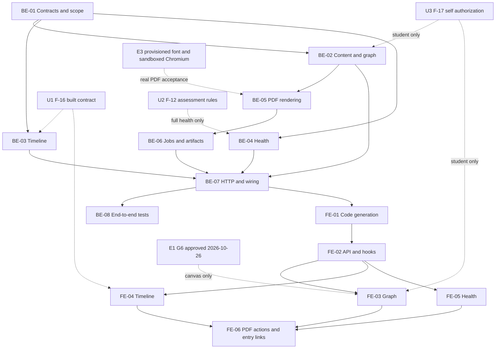

# F-24 Graphs, PDF, Timeline and Program Health — Backend + Frontend Implementation Plan

This plan builds EP-24 (US-110..US-113; CV-264..CV-268): semester-positioned course-requisite graphs, asynchronous curriculum PDF publication, a released-version timeline and a consolidated program health board. These are read-only projections of curriculum, release, outcome and syllabus data. No business table, migration, release transition, cohort-assignment write or new public publishing website is included.

> **Companion documents**
> - Decisions: `docs/planning/feature-questions.md`, F24-01..04; blank answers mean A. Faculty-marked answers remain risks, not institutional approval.
> - Requirements: `docs/requirement/REQUIREMENTS.md`, FR-22/37/76/82, BR-05/20, NFR-01/09/16/19/21/24/26, EC-07/12/13/40/41/44 and Q-14.
> - Acceptance: `docs/planning/epics.md`, EP-24 and B6 scenario 7; `docs/planning/user-stories.md`, US-110..113; `docs/planning/task-breakdown.md`, CV-264..268.
> - Design: `docs/design/{data-dictionary,erd,state-diagrams,sequence-diagrams,screen-inventory,tech-stack}.md`; MH-20/28/46/47; `docs/planning/deferred-scope.md`.
> - Built dependencies: F-05/07/08/10/11/15 implementation reports in `docs/implement-report/`; actual source contracts are verified in §2. F-06 supplies program identity and director scope.
> - Assumed, **not built**: `docs/implementation/f-16-version-compare-cohort-assignment-implementation-plan.md`; `docs/implementation/f-12-grade-formula-assessment-clo-implementation-plan.md`. F-17's unfinished plan is deliberately not consumed.
> - Conventions/exemplars: `docs/implementation/README.md`, `f-15-release-version-snapshots-implementation-plan.md`, `f-09-excel-import-export-implementation-plan.md`; frontend `source/frontend/src/shared/design-system/DESIGN_SYSTEM.md`.
> - Test-case source: `docs/planning/test-plan.md`, graph/PDF/timeline/health cases and NT-B6-07. No separate F-24 test-case document exists among the inspected `docs/testing/` entries; the builder must not invent a completed test report.

**Status**: Not started — plan only, verified against source on 2026-10-25. Graph-library approval, F-12 assessment integration, F-16 schedule/comparison integration and F-17 student authorization are explicit gates; see §8. This document does not authorize installing an unnamed dependency.

## 0. Plan at a glance

Everything below in one table. Read this; the rest is detail for whoever builds it.

| What | Why | How and where |
|---|---|---|
| **Read-only visualizations, no new academic storage** | EP-24 presents already-built data | Add `features/publication/` on both sides; derive projections from version-owned rows; no Prisma schema change (BE-01..04, FE-01..05). |
| **Graph positioned by planned semester** | US-110 AC1/2 | Read `CurriculumRequisite`, not today's catalog edges; deterministic layout and iterative dependency highlighting; approved `@antv/g6` renderer (BE-02, FE-03). |
| **Student graph uses the student's applied version** | US-110 AC3 | Separate own-context endpoint, server-resolved enrollment and semester; fail closed until F-17 supplies authorization/resolution (BE-02/07, FE-03). |
| **PDF captures one explicit version** | US-111 AC1 | Capture general information, decision, semester frame, elective groups and PLOs; Puppeteer in BullMQ, never in the HTTP request (BE-02/05/06, FE-06). |
| **Vietnamese print output and draft marking** | US-111 AC2/3; F24-01/03 | Generic HTML template, embedded provisioned Vietnamese font, repeatable table headers and every-page `BẢN NHÁP` marking; official template remains a Faculty risk (BE-05). |
| **Timeline uses release and cohort schedule facts** | US-112 AC1..3 | Add a read projection matching F-16's issued-version/assignment contract; show effective semesters, assignment starting semesters and correction links; preserve MH-47 (BE-03, FE-04). |
| **Health board consolidates, rather than redefines, checks** | US-113 AC1..3 | Reuse the consistency checker and outcome-gap reader, add batched replacement and assessment checks, normalize stable issue targets (BE-04, FE-05). |
| **Partial coverage is never a clean bill of health** | F-12 is not built; R6 scope is not built | Expose unavailable assessment checks explicitly; never display `Không có cảnh báo` for an incomplete report; student graph stays unavailable until its dependency is real (§8). |

### Key behaviours worth knowing

| Behaviour | Why it is this way |
|---|---|
| A graph is a curriculum graph, not the global catalog DAG | Private per-version edges must survive subsequent catalog edits. External requisite nodes are explicitly outside the frame, not silently dropped. |
| Corequisites are displayed but do not recursively expand the temporal ancestor/descendant chain | Bidirectional corequisites are valid; highlighting must terminate and must not imply a mandatory earlier semester. |
| A PDF is a temporary artifact, not a release or signed institutional decision | Export does not publish, activate, correct, assign cohorts or satisfy Q-14 approval. |
| Draft PDF data and watermark are captured together when the export is accepted | A queued Draft must not become an unmarked final document because it was released while waiting for the worker. |
| Timeline cohort labels mean stored schedule assignments, not current student counts | F-16 separates assignment start from version effective semester; student exceptions and historical enrollment reconstruction belong to F-17. |
| Historical health can include current replacement availability and catalog-cycle diagnostics | Preserve the checker and live course-status policies; do not promise that a historical diagnostic report itself is an immutable snapshot. |

### Not included

| Excluded | Why |
|---|---|
| New tables, graph persistence, stored health counters, export history tables | All academic output is derived; BullMQ metadata and TTL files are temporary operational artifacts. |
| Global catalog graph editing; equivalence/replacement edges in the temporal graph | US-110 covers PRIOR, PREREQUISITE and COREQUISITE in a program; replacement is a health diagnostic. |
| Official Faculty PDF certification, signatures, seals or guessed branding | Q-14 and F24-01 need a real approved template. |
| Comparison engine, cohort-management UI, student tables, assessment writes | F-16, F-17 and F-12 own those capabilities; no shadow implementations. |
| Syllabus PDF export, Excel, accreditation analytics, public anonymous download | Not US-111; F-09/F-23/publication-policy work remains separate. |
| F-25 notifications and F-26/F-27 operations implementation | No dependency on their runtime services or unfinished plans. PDF deployment requirements are specified here for later integration. |

### Open questions

| Question | Resolved when | Default if unanswered |
|---|---|---|
| May the builder install `@antv/g6`? | Decided 2026-10-26 (user); inventory updated | Approved; build pins and verifies version/API, no alternate graph library |
| What is the official PDF template? | Faculty supplies and approves Q-14 material | F24-01 A: generic layout, explicitly not certified as the official decision template. |
| What provides a self-authorized student version? | F-17 exports and tests the adapter specified in §8 | No student graph; never fall back to ACTIVE or a caller-supplied version. |
| Can all eight health categories be certified before F-12? | Assessment rules exist and the integration tests pass | Partial report with an explicit unavailable assessment check, not zero uncovered CLOs. |
| When are timeline schedule and comparison integrations available? | F-16 contract is built and re-verified | Staff graph/PDF/basic health can land independently; integrated timeline acceptance remains gated. |

> Verification corrections are recorded in §2c: existing history is not an issued timeline, outcome gaps are not assessment gaps, MH-47 already exists, and the program entry page/test are named ProgramOverviewPage rather than ProgramDetailPage. The scope and paths below use the verified source.

## 1. Scope

### In, out and deferred

| Scope | Content |
|---|---|
| In | MH-20 course graph, MH-28 health board, MH-46 alternate timeline route, reuse of MH-47, version-addressed PDF create/status/download, permissions and tests. |
| In | Draft and issued PDF; issued timeline including PENDING/ACTIVE/HISTORICAL; staff version-addressed graph/health; own-context student graph after F-17. |
| Out | Any write to ProgramVersion, CurriculumItem, CurriculumRequisite, PLO, Syllabus or CohortVersion; mutation-based repair from a visualization. |
| Deferred | Faculty-specific print layout; completed student integration until F-17; full assessment coverage until F-12; F-16 comparison/schedule integration until shipped. |

### Acceptance coverage

| AC / task | Deliverables and observable result |
|---|---|
| US-110 AC1; CV-264 | BE-02/07, FE-03: each frame course is a semester-positioned node; three requisite types have distinct labeled styles. |
| US-110 AC2 | FE-03: selecting a node highlights complete PRIOR/PREREQUISITE ancestors and descendants, with direct corequisites separately distinguished. |
| US-110 AC3 | BE-02/07/08, FE-03: a student cannot inject another program/version; U3 integration gate. |
| US-111 AC1; CV-265 | BE-02/05/06/07/08, FE-06: exact released version, frozen course facts, decision, semester frame, elective-group minima/members and PLO list. |
| US-111 AC2 | BE-05/08, FE-06: Vietnamese glyphs verified in an actual PDF; normal rows stay together across pages and headers repeat. |
| US-111 AC3 | BE-05/06/08: every Draft page says `BẢN NHÁP`, including after queued source data changes. |
| US-112 AC1; CV-266 | BE-03/07/08, FE-04: released events ordered by effective semester, displaying decisions and assignment starting semesters via F-16 facts. |
| US-112 AC2 | FE-04: open MH-47; compare against explicit previousVersion using F-16's route/query contract, not a guessed neighbor. |
| US-112 AC3 | BE-03, FE-04: correction event carries correctionOf and links to that release; no inference from version numbers. |
| US-113 AC1; CV-267 | BE-04/07/08, FE-05: all eight required categories, plus built consistency/outcome diagnostics; missing assessment capability is visible. |
| US-113 AC2; CV-268 | BE-04, FE-05/06: target includes item/group/PLO/CLO/syllabus context; appropriate read/edit screen opens without bypassing its authorization. |
| US-113 AC3 | BE-04, FE-05: `Không có cảnh báo` only when all checks completed and ERROR/HIGH counts are zero. |
| B6 scenario 7 | BE-08 and FE-03..06 combined walkthrough; report each dependency-gated branch separately. |

## 2. Contract verification

**Existing** below means source opened during planning. **NEW / UNVERIFIED** means proposed code or a written-but-unbuilt dependency. Paths are repository-relative. No sensitive data tree, dotenv, credential file or unfinished F-17/F-23/F-26/F-27 plan was used. This verification precedes the deliverable shapes.

### 2a. Existing endpoints and service boundaries

| Contract | Verified source | Behaviour and F-24 disposition |
|---|---|---|
| `GET /api/programs/:programId/versions` → VersionListDto | `source/backend/src/features/releases/version-history.controller.ts:16`; serializer `source/backend/src/features/releases/version-history.reader.ts:198` | Permission alternatives are declared at controller line 17; service asserts PROGRAM_VIEW at reader line 123. Created-desc order; ALL-scope readers can see plain Draft; request copies/correction Drafts excluded at line 79. Keep existing table/API unchanged; do not treat it as a released-only chronological timeline. |
| `GET /api/programs/:programId/versions/:versionId` → VersionDetailDto | `source/backend/src/features/releases/version-history.controller.ts:26`; mapper `source/backend/src/features/releases/version-history.reader.ts:169` | Checks program membership; ordinary Draft refused at line 106; permitted correction Draft is exceptional. Existing MH-47 destination, not a PDF capture API. |
| `GET /api/program-versions/:versionId/curriculum` | `source/backend/src/features/curriculum/program-versions-curriculum.controller.ts:43`; reader `source/backend/src/features/curriculum/curriculum-read.service.ts:65` | Existing editing/read screen remains target. F-24 does not deserialize this large DTO; its projections query owned data instead. No assumption that this endpoint enforces student's exact applied version. |
| `GET /api/program-versions/:versionId/consistency` | `source/backend/src/features/consistency/consistency.controller.ts:17`; service `source/backend/src/features/consistency/consistency.service.ts:54` | Existing report performs its own authorization after checking. Health calls the shared checker only after F-24 authorizes; no internal HTTP call or response-model copy. |
| `ConsistencyChecker.check(versionId, db?)` → ConsistencyResult | `source/backend/src/shared/curriculum/consistency-checker.ts:168`, `:203`; result type `:103` | Read-only, transaction-capable; includes accepted gaps, cycles and missing syllabi. `assertPasses` at line 221 is a write lifecycle gate and must not be called by F-24. |
| `OutcomeGapsReader.forVersion(versionId)` → OutcomeGaps | `source/backend/src/shared/outcomes/outcome-gaps.reader.ts:13`, `:66`; result `source/backend/src/shared/outcomes/outcome-gaps.ts:36` | Full-version read with pin-aware revision lookup; no transaction parameter. Do not pretend several independent reader calls share an atomic snapshot. |
| `GET /api/program-versions/:versionId/outcome-coverage` | `source/backend/src/features/outcomes/outcomes.controller.ts:178`; mapper `source/backend/src/features/outcomes/outcome-coverage.service.ts:47` | Includes three outcome-gap lists, not assessment coverage; course lists may be group-filtered at line 40. Health uses the shared full-version reader, not this feature service or its filtered HTTP response. |
| `rowCourse`, `rowCredits`, `revisionForItems` | `source/backend/src/shared/curriculum/row-course.ts:4`, `:11`; `source/backend/src/shared/syllabi/revision-for-items.ts:30` | Frozen name/credits where present; pinned syllabus else Published-else-Draft, excluding request copies at revision reader line 76. Reuse for graph/PDF/health; do not write pins during a read. |
| `CourseUsageReader.hasActiveReplacement(courseId, client?)` | `source/backend/src/shared/courses/course-usage.reader.ts:80` | QH5 exists from discontinued source to ACTIVE target. Health applies the identical predicate in one batch, not one call per course. |
| Session/access, worker permission reload | `source/backend/src/shared/authz/scope.service.ts:42`; `source/backend/src/shared/authz/scope-source.reader.ts:23` | loadAccess exists; OWN_ENROLLMENT currently returns an empty target. Students are not safely implemented by adding a role check or granting ALL. |
| Multiple RequirePermission arguments | `source/backend/src/shared/authz/permission.guard.ts:35` | The guard accepts any declared permission via some(); AND requirements must be asserted explicitly in the service. |
| Queues, file transport, downloads | `source/backend/src/shared/queue/queue.module.ts:8`; `source/backend/src/shared/files/send-file.ts:9`; `source/frontend/src/shared/api/client.ts:117` | Reuse BullMQ root configuration, RFC-5987 sendFile and authenticated downloadFile. No F-09 imports/export runtime exists to reuse. |

### 2b. Complete field accounting for reused wire references

The new timeline uses its own explicit DTO in BE-01. Existing release list/detail DTOs remain unchanged and are handed to the existing release pages wholesale, not mapped into a new client domain model. Every inherited field is accounted for below; source means the serializer as well as the declaration.

| Field | Wire type / nullability | Source | F-24 mapping / disposition |
|---|---|---|---|
| VersionListDto.versions | VersionRefDto[], non-null | `source/backend/src/features/releases/dto/version-detail.dto.ts:46`; mapper `source/backend/src/features/releases/version-history.reader.ts:93` | Existing history table retained; not reused as timeline order. |
| VersionRefDto.id | string, non-null | DTO `source/backend/src/features/releases/dto/version-detail.dto.ts:24`; mapper `source/backend/src/features/releases/version-history.reader.ts:204` | Existing detail route ID. |
| versionNumber | string or null | DTO `source/backend/src/features/releases/dto/version-detail.dto.ts:25`; mapper `source/backend/src/features/releases/version-history.reader.ts:205` | Existing versionLabel; never lexical-sort it. |
| status | `DRAFT`, `PENDING`, `ACTIVE`, `HISTORICAL`; non-null | DTO `source/backend/src/features/releases/dto/version-detail.dto.ts:26`; mapper `source/backend/src/features/releases/version-history.reader.ts:206`; literals `source/backend/prisma/schema.prisma:63` | Existing display; timeline will exclude Draft. |
| decisionNumber | string or null | DTO `source/backend/src/features/releases/dto/version-detail.dto.ts:28`; mapper `source/backend/src/features/releases/version-history.reader.ts:207` | Existing header/table; PDF uses separately captured facts. |
| signedDate | ISO day or null | DTO `source/backend/src/features/releases/dto/version-detail.dto.ts:29`; mapper `source/backend/src/features/releases/version-history.reader.ts:208` | Existing formatDay, no local-time day shift. |
| publishedAt | ISO instant or null | DTO `source/backend/src/features/releases/dto/version-detail.dto.ts:31`; mapper `source/backend/src/features/releases/version-history.reader.ts:209` | Existing display; issued predicate must require publication facts. |
| effectiveSemester | SemesterDto or null | DTO `source/backend/src/features/releases/dto/version-detail.dto.ts:32`; mapper `source/backend/src/features/releases/version-history.reader.ts:210` | Display metadata, not proof of cohort entitlement. |
| cohorts | CohortDto[], non-null | DTO `source/backend/src/features/releases/dto/version-detail.dto.ts:34`; mapper `source/backend/src/features/releases/version-history.reader.ts:213` | Existing coarse membership, not assignment intervals; do not use for new timeline's schedule. |
| originRequest | `{id: string, requestCode: string}` or null | DTO `source/backend/src/features/releases/dto/version-detail.dto.ts:17`, `:35`; mapper `source/backend/src/features/releases/version-history.reader.ts:214` | Existing request link retained; no request content mapping. |
| correctedBy | `{id: string, versionNumber: string or null}` or null | DTO `source/backend/src/features/releases/dto/version-detail.dto.ts:12`, `:37`; mapper `source/backend/src/features/releases/version-history.reader.ts:215` | Only issued correction; not inverse correctionOf. |
| SemesterDto.id, semesterCode, academicYear | strings, non-null | Declaration `source/backend/src/shared/releases/semester.dto.ts:6`; mapper `:22` | Same fields reused by new generated DTOs. |
| SemesterDto.termInYear; startDate | number; ISO day or null | Declaration `source/backend/src/shared/releases/semester.dto.ts:9`; mapper `:25` | Never infer missing start dates from labels. |
| CohortDto.id, cohortCode, intakeYear | string, string, number; non-null | Declaration `source/backend/src/shared/releases/semester.dto.ts:14`; mapper `:30` | Labels only; no student counts. |
| VersionDetailDto.programId, programCode, programName, majorCode, majorName | strings, non-null | DTO `source/backend/src/features/releases/dto/version-detail.dto.ts:69`; mapper `source/backend/src/features/releases/version-history.reader.ts:170` | Existing MH-47 unchanged; PDF button receives only route IDs. |
| semesterCount | number, non-null | DTO `source/backend/src/features/releases/dto/version-detail.dto.ts:74`; mapper `source/backend/src/features/releases/version-history.reader.ts:175` | Existing detail only. |
| totalCredits, compulsoryCredits, electiveCredits | decimal strings, non-null | DTO `source/backend/src/features/releases/dto/version-detail.dto.ts:75`; mapper `source/backend/src/features/releases/version-history.reader.ts:176` | Never JS floating-point arithmetic. |
| publishedBy | `{id: string, fullName: string}` or null | DTO `source/backend/src/features/releases/dto/version-detail.dto.ts:78`; mapper `source/backend/src/features/releases/version-history.reader.ts:179`; user selection `source/backend/src/shared/dtos/ref.dto.ts:10` | Existing header only; not serialized into export metadata unless explicitly in the PDF projection. |
| previousVersion, correctionOf | VersionLinkDto or null; both fields nullable | DTO `source/backend/src/features/releases/dto/version-detail.dto.ts:80`; mapper `source/backend/src/features/releases/version-history.reader.ts:180` | New timeline obtains the same FK facts directly, no detail-fetch waterfall. |
| correctionReason | string or null | DTO `source/backend/src/features/releases/dto/version-detail.dto.ts:84`; mapper `source/backend/src/features/releases/version-history.reader.ts:182` | Existing detail only; timeline uses correctionOf link and badge. |
| isCorrectionDraft, canCorrect | booleans, non-null | DTO `source/backend/src/features/releases/dto/version-detail.dto.ts:86`, `:95`; mapper `source/backend/src/features/releases/version-history.reader.ts:183`, `:192` | Preserve existing correction workflow; no new correction action. |
| openCorrection | VersionLinkDto or null | DTO `source/backend/src/features/releases/dto/version-detail.dto.ts:88`; mapper `source/backend/src/features/releases/version-history.reader.ts:184` | Existing action only. |
| rows | VersionRowDto[], non-null | DTO `source/backend/src/features/releases/dto/version-detail.dto.ts:99`; mapper `source/backend/src/features/releases/version-history.reader.ts:140` | Existing FrozenRowsTable remains owner. |
| VersionRowDto.itemId, plannedSemester, courseId, courseCode, courseName, credits | string, number, string, string, string, decimal string; non-null | DTO `source/backend/src/features/releases/dto/version-detail.dto.ts:58`; mapper `source/backend/src/features/releases/version-history.reader.ts:144` | Existing frozen table; graph/PDF have a narrower independent projection. |
| VersionRowDto.syllabus | SyllabusPinDto or null | DTO `source/backend/src/features/releases/dto/version-detail.dto.ts:64`; mapper `source/backend/src/features/releases/version-history.reader.ts:150` | Existing revision navigation; no latest-syllabus fallback in timeline links. |
| SyllabusPinDto.id, revisionNumber, status | string, number, `DRAFT`/`PUBLISHED`/`HISTORICAL`; non-null | DTO `source/backend/src/features/releases/dto/version-detail.dto.ts:49`; mapper `source/backend/src/features/releases/version-history.reader.ts:152`; literals `source/backend/prisma/schema.prisma:615` | Not remodeled; preserve pin context. |

### Internal result and storage accounting

| Input | Every field and disposition | Verified source |
|---|---|---|
| ConsistencyResult | `version` supplies authorized context; `credits` supplies declared/computed/gap/mismatch/acceptance/acceptanceCurrent; `groups` retains id/groupCode/groupName/minCredits/minCourses/requiredCredits/listedCredits/itemCount but is **not modeled** by the new health DTO; `issues` is normalized without changing severity. | `source/backend/src/shared/curriculum/consistency-checker.ts:75`, `:83`, `:94`, `:103`, `:203` |
| CurriculumWarning | `code`, `severity`, `message`, nullable `semester`, `itemId`, `groupId` all map to HealthIssueDto; literals are `EMPTY_SEMESTER`, `REQUISITE_NOT_EARLIER`, `REQUISITE_OUTSIDE`, `ELECTIVE_WITHOUT_GROUP`, `DUPLICATE_COURSE`, `GROUP_MINIMUM_UNREACHABLE`, `REQUISITE_CYCLE`, `CREDIT_MISMATCH`, `CREDIT_MISMATCH_ACCEPTED`, `MISSING_SYLLABUS`; severities `ERROR`, `HIGH`, `INFO`. | `source/backend/src/shared/curriculum/curriculum-warnings.ts:5`, `:22`, `:51`; checker serializer `source/backend/src/shared/curriculum/consistency-checker.ts:203` |
| CreditCheck | declared/computed/gap each `{total, compulsory, elective}` Decimal values become strings; mismatch and acceptanceCurrent are booleans. Acceptance is null or reason/compulsoryGap/electiveGap/acceptedBy `{id, fullName}`/acceptedAt. Only acceptanceCurrent and the checker's accepted-gap issue are modeled in health; other values remain on the linked consistency page. | `source/backend/src/shared/curriculum/consistency-checker.ts:75`, `:94`; wire mirror `source/backend/src/features/consistency/consistency.dto.ts:113` |
| OutcomeGaps | `plosWithoutCourse`: `{id, ploCode, description}`; `closWithoutPlo`: CourseGap plus `{cloId, cloCode, cloDescription}`; `coursesWithoutPlo` and `coursesWithoutSyllabus`: `{itemId, plannedSemester, courseCode, courseName, ownerGroupId}`. Map all gap identities/labels; ownerGroupId is **not modeled**, because health is program-wide. Missing-syllabus entries already covered by consistency are not duplicated. | `source/backend/src/shared/outcomes/outcome-gaps.ts:1`, `:23`, `:31`, `:36`; mapper `source/backend/src/shared/outcomes/outcome-gaps.reader.ts:66` |
| Version-owned frame/requisites | Unique version/course; plannedSemester/sortOrder; nullable name/credit snapshots and syllabus pin; requisite uniqueness item/source/type, nullable minScore. Graph uses three non-replacement relation literals, never global catalog replacement/equivalence. | `source/backend/prisma/schema.prisma:565`, `:601`; mapping helpers `source/backend/src/shared/curriculum/row-course.ts:11` |
| Release and assignment storage | ProgramVersion release/provenance/correction fields, nullable semester.startDate, CohortVersion cohortId/programVersionId/fromSemesterId/createdAt, unique cohort/version pair. No interval end or student count exists in these rows. | `source/backend/prisma/schema.prisma:346`, `:403`, `:428` |

### 2c. Verification corrections / mismatch log

| Deliverable | Tempting earlier assumption | What the source actually does | Found at |
|---|---|---|---|
| BE-03 / FE-04 | Existing history is released-only and chronologically sorted | It may include a plain Draft and sorts by createdAt descending | `source/backend/src/features/releases/version-history.reader.ts:79`, `:90` |
| BE-03 | History `cohorts` expresses the start of each assignment | It maps only CohortDto and omits fromSemester/assignment identity | `source/backend/src/features/releases/version-history.reader.ts:213` |
| FE-04 | A correction event can be inferred from correctedBy | correctedBy is the inverse issued-correction link; correctionOf exists on detail | `source/backend/src/features/releases/version-history.reader.ts:181`, `:198` |
| BE-04 | Outcome CLO gaps mean unassessed CLOs | They mean CLOs without PLO links; assessment storage/rules are not built | `source/backend/src/shared/outcomes/outcome-gaps.ts:59`; unbuilt F-12 plan §5 BE-02 |
| BE-02 | R6's existing program permission resolves enrollment | OWN_ENROLLMENT currently returns an empty object | `source/backend/src/shared/authz/scope-source.reader.ts:23` |
| BE-06 | FileStorageService.write is an overwrite-safe retry primitive | It creates a `.part` file with `wx` before rename; a crash may leave that temporary path | `source/backend/src/shared/files/file-storage.service.ts:29` |
| FE-06 | MH-47 is missing and must be built here | Dedicated detail page, links and frozen rows already exist | `source/frontend/src/features/releases/pages/VersionDetailPage.tsx:88`, `:107` |
| FE-06 | The program entry test is ProgramDetailPage.test.tsx | Its actual page/test are ProgramOverviewPage/ProgramOverviewPage.test.tsx | `source/frontend/src/features/programs/pages/ProgramOverviewPage.tsx:14`; `source/frontend/src/features/programs/pages/ProgramOverviewPage.test.tsx:12` |

These are planning corrections, not declarations of out-of-scope defects. Preserve the owning features' behaviour.

### 2d. Proposed API contract — NEW / UNVERIFIED

All routes use the existing `/api` prefix. JSON uses explicit Swagger DTOs and generated FE types. Opaque IDs are strings, not UUID-validated CUIDs; only F-24 export IDs are generated UUIDs. Path membership is checked in services before returning version data.

| Method / endpoint | Request | Response / status | Authorization and errors |
|---|---|---|---|
| GET `/programs/:programId/versions/:versionId/course-graph` | Path IDs | CourseGraphDto, 200 | PROGRAM_VIEW after removing own-enrollment-only grants for this staff-addressed route; exact program/version membership. Plain Draft or issued version; exclude request copies and unissued corrections. |
| GET `/me/programs/:programId/course-graph` | Required `semesterId` query | CourseGraphDto, 200 | PROGRAM_VIEW plus U3 self authorization; student ID and version come from server, never query/body. No ACTIVE fallback. Do not register until U3 is implemented. |
| GET `/programs/:programId/version-timeline` | Path ID | ProgramTimelineDto, 200 | VERSION_VIEW_HISTORY plus PROGRAM_VIEW scope. Read-only assignment projection; never call F-16's R1-only schedule-management HTTP route as R2..R5. |
| GET `/programs/:programId/versions/:versionId/health` | Path IDs | ProgramHealthDto, 200, possibly `complete: false` | New PROGRAM_VIEW_HEALTH plus PROGRAM_VIEW scope; default R1/R2/R3 only. No request-copy or unissued correction contents. |
| POST `/programs/:programId/versions/:versionId/pdf-exports` | Empty body; path IDs only | ProgramPdfExportDto, 202 | New PROGRAM_EXPORT_PDF plus PROGRAM_VIEW scope; default R1 and directing R3. Captures snapshot after access check; does not accept HTML/URLs/file paths/template overrides. |
| GET `/program-pdf-exports/:exportId` | Export UUID | ProgramPdfExportDto, 200 | Same current export permission and exact owner; cross-owner or unknown 404. Metadata can say EXPIRED until cleaned; deleted jobs 404. |
| GET `/program-pdf-exports/:exportId/file` | Export UUID | StreamableFile, 200, `application/pdf` | Recheck owner and current source-program scope; pending/failed 409 PDF_NOT_READY; expired 410 PDF_EXPORT_EXPIRED; missing artifact 410 PDF_EXPORT_GONE. Private/no-store headers. |

Common errors: existing unauthenticated/session/CSRF/permission errors; 404 PROGRAM_VERSION_NOT_FOUND for wrong-program or absent version; 409 PUBLICATION_VERSION_UNAVAILABLE for request copies/unissued corrections; 503 PDF_QUEUE_UNAVAILABLE/PDF_FONT_UNAVAILABLE/PDF_RENDERER_UNAVAILABLE; sanitized PDF_RENDER_FAILED status details, never a Chromium stack, local path or raw failedReason. Malformed F-16 schedule data must propagate its typed error, not silently drop assignments. All new error messages are Vietnamese.

### Assumed dependency response/fact accounting — UNVERIFIED

| Contract | Fields and use | Source / matching risk |
|---|---|---|
| F-16 IssuedVersionFact | id/programId/versionNumber/status/decisionNumber/effectiveSemester/publishedAt; versionNumber and decisionNumber required; status `PENDING`/`ACTIVE`/`HISTORICAL`; effectiveSemester includes a known Date start. | F-16 plan §5 BE-04, `IssuedVersionFact`; U1 in §8. No current implementation claimed. |
| F-16 CohortAssignmentFact | id; cohort `{id, cohortCode, intakeYear}`; version IssuedVersionFact; fromSemester StartedSemester; createdAt Date. Every field maps to event or assignment metadata; no student population/exception inference. | F-16 plan §5 BE-04, `CohortAssignmentFact`; U1. |
| F-16 CohortVersionListDto | programId/revision/assignments; each assignment has id/cohort/version/fromSemester/createdAt. ProgramId supplies context; revision is **not modeled** by F-24 because F-24 does no assignment writes. | F-16 plan §5 BE-01/05; U1. Its R1-only HTTP endpoint is not consumed. |
| F-16 chronology | Known start dates; latest fromSemester not after lookup semester, then createdAt and opaque id descending; no ACTIVE/current-date predicate, no fallback when unassigned. | F-16 plan §5 BE-04, `compareAssignmentsNewestFirst`, `pickAppliedAssignment`, `readCohortResolutions`; U1. |
| F-16 comparison navigation | UI route `versionCompare`, query beforeVersionId/afterVersionId; comparison GET `/programs/:programId/version-comparison`. The timeline links to the UI; it does not deserialize the comparison response or call it merely to show a link. | F-16 plan §5 FE-01..04; U1. Re-verify route literal/key when built. |
| F-12 assessment rules | loadAssessmentRules(db, syllabusId) returns failingScore/clos/assessmentComponents; uncoveredClos(input) returns uncovered CLO identities. Only uncovered identities and the selected revision are projected; no rule engine duplication or grade computation. | F-12 plan §5 BE-02, `shared/syllabi/grade-formula.rules.ts`; U2. |
| F-17 self-version boundary | Authenticated user + program + required semester → owned student/enrollment and explicit programVersionId, or typed denial/unassigned/configuration error. No endpoint/provider name from its unfinished plan is assumed. | Brief and F-16 plan's StudentAppliedVersionLookup/Result boundary; U3. |

## 3. Decisions

| ID | Decision | Why | Rejected alternative |
|---|---|---|---|
| D1 | No schema or academic state changes | EP-24 is visualization/publication over built data | Graph tables, cached health rows, export history model. |
| D2 | Feature module `publication`; cross-feature shared access/PDF UI seams only where reused | Keep controllers thin and avoid importing another feature's service/component | Wiring outcomes/curriculum/release feature modules into each other. |
| D3 | Graph edges come from CurriculumRequisite; outside-frame sources are labeled external nodes | Preserve version edges and explain EC-13 | Reconstructing from current CourseRelation or hiding broken dependencies. |
| D4 | Fixed semester columns; stable node order; iterative ancestor/descendant walks over PRIOR/PREREQUISITE | Semester position must not be overridden by a DAG layout or cycle | Force-directed layout, recursive traversal without visited sets. |
| D5 | Use F24-04 A: `@antv/g6`, approved 2026-10-26 and named in tech-stack.md | User decision; pin/verify during F-24 build | Switching libraries or treating a fallback as the final graph |
| D6 | Staff explicit-version routes exclude own-enrollment-only grants; student graph uses server self-resolution | Program membership alone is not version entitlement | Allowing arbitrary historical/Draft versions for R6 or trusting studentId from URL. |
| D7 | Add `program.exportPdf` and `program.viewHealth` permissions, without changing old permission cells | Required audiences differ from general program viewing | Reusing Excel, publish, or accreditation permissions. |
| D8 | Timeline query normalizes F-16 schedule facts directly behind staff authorization | R2..R5 need read access, while F-16 management endpoints stay R1-only | Widening management authorization, copying its write service, relying on history.cohorts. |
| D9 | Compare link follows previousVersionId, not sorted visual neighbor | Same-semester correction and non-linear origins make adjacency ambiguous | Number-minus-one arithmetic or comparing to an arbitrary event. |
| D10 | Health is diagnostic only; retain all built severities, accepted-gap INFO and extra existing issue codes | Do not change release/submit gates or hide useful warnings | Treating all warnings as release errors or converting missing assessments to CLO–PLO gaps. |
| D11 | Partial health is explicit; complete requires U2 | Correct uncertainty is preferable to a false green dashboard | Synthetic zero assessment gaps or unbuilt-model imports. |
| D12 | PDF snapshot captured in an authorized RepeatableRead transaction before queueing | Stable Draft content/marking and coherent released output; no long rendering transaction | Worker reading a moving Draft or holding locks during Chromium rendering. |
| D13 | Generic escaped HTML + Puppeteer; local embedded font; no remote resources or raw rich text | F24-01/03 A; Vietnamese output without SSRF/script execution | pdfmake, remote template URLs, CDN fonts or unaudited HTML. |
| D14 | BullMQ jobs and scoped temporary artifacts, owner-only retrieval, fixed TTL and bounded renderer concurrency | Heavy work leaves HTTP; no new canonical export persistence | Synchronous rendering, public file URLs, storing PDF bytes in PostgreSQL or session. |
| D15 | Independent MH-46 timeline route, existing MH-47 preserved | Avoid rebuilding F-15 detail or overwriting F-16 history selection | Separate competing version-detail implementation. |
| D16 | Existing readers stay unchanged; no shared function replacement | Smallest additive feature with no built-behaviour migration | Refactoring consistency/outcome readers solely to make one atomic health snapshot. |

## 4. Deliberate divergences

No shipped sibling implementation is an input. These are explicit reconciliations, not permission to change built behaviour:

| Input difference | Planned handling |
|---|---|
| F24-04 names G6, now included in tech-stack.md | Decided 2026-10-26 (user): dependency approved; implement/pin the real renderer in FE-03 |
| F24-02 asks for dedicated MH-47, already shipped | Reuse the existing route/page and frozen-row display; add navigation/export controls only (`source/frontend/src/features/releases/pages/VersionDetailPage.tsx:88`). |
| Older designs describe version history as an issued timeline | Keep built list ordering/shape; add an independent derived timeline (`source/backend/src/features/releases/version-history.reader.ts:90`). |
| Deferred-scope audit/public website/objectives/PI work | No AuditLog, anonymous portal, objectives, PI or official signature model is added. |
| Built health name refers to infrastructure health | Do not alter `/api/health` or its public infrastructure semantics (`source/backend/src/features/health/health.controller.ts:1`). Name new feature endpoints explicitly program/version health. |

## 5. Deliverables

All paths below are repository-relative. `NEW` describes intended builder work, not files already present. No deletions or replacements are required. DTO examples specify the complete field contract; builders must put concrete `@ApiProperty`/`@ApiPropertyOptional`, nested types, enum literals, nullability and validation decorators on every corresponding class field. Do not implement ambient declarations as runtime stubs.

### BE-01 — Publication contracts, permissions, constants and access policy

**What / why:** Establish exact wire contracts and read authorization before implementing queries.

**Files**

| Action | Path |
|---|---|
| NEW | `source/backend/src/features/publication/publication.dto.ts` |
| NEW | `source/backend/src/features/publication/publication.constants.ts` |
| NEW | `source/backend/src/features/publication/publication.errors.ts` |
| NEW | `source/backend/src/features/publication/publication-access.service.ts` |
| NEW | `source/backend/src/features/publication/publication-access.service.spec.ts` |
| MODIFY | `source/backend/src/shared/authz/permission-codes.ts` |
| MODIFY | `source/backend/prisma/seed-data/permission-catalog.ts` |
| MODIFY | `source/backend/prisma/seed-data/permission-catalog.spec.ts` |

**Shape**

```ts
export const PUBLICATION_RELATIONS = ['PRIOR', 'PREREQUISITE', 'COREQUISITE'] as const;
export const PDF_EXPORT_STATES = ['QUEUED', 'RUNNING', 'READY', 'FAILED', 'EXPIRED'] as const;
export const HEALTH_TARGETS = ['CURRICULUM', 'ELECTIVE_GROUPS', 'VERSION_INFO',
  'COURSE_PLO_MATRIX', 'ITEM_CLO_PLO', 'SYLLABUS', 'COURSE'] as const;
export const HEALTH_CATEGORIES = ['CREDIT', 'REQUISITE_ORDER', 'REQUISITE_OUTSIDE',
  'EMPTY_SEMESTER', 'PLO_COVERAGE', 'ASSESSMENT_CLO', 'SYLLABUS', 'REPLACEMENT', 'OTHER'] as const;

export class PublicationVersionDto {
  @ApiProperty() id!: string;
  @ApiProperty() programId!: string;
  @ApiProperty() programCode!: string;
  @ApiProperty() programName!: string;
  @ApiProperty({ type: String, nullable: true }) versionNumber!: string | null;
  @ApiProperty({ enum: ProgramVersionStatus, enumName: 'ProgramVersionStatus' })
  status!: ProgramVersionStatus;
  @ApiProperty() semesterCount!: number;
}

export class GraphNodeDto {
  id!: string;
  itemId!: string | null;
  courseId!: string;
  courseCode!: string;
  courseName!: string;
  credits!: string | null;
  semester!: number | null;
  sortOrder!: number | null;
  external!: boolean;
}
export class GraphEdgeDto {
  id!: string;
  source!: string;
  target!: string;
  relationType!: (typeof PUBLICATION_RELATIONS)[number];
  minScore!: string | null;
}
export class CourseGraphDto {
  version!: PublicationVersionDto;
  nodes!: GraphNodeDto[];
  edges!: GraphEdgeDto[];
}

export class TimelineAssignmentDto {
  id!: string;
  cohort!: CohortDto;
  fromSemester!: SemesterDto;
  createdAt!: string;
}
export class TimelineEventDto {
  id!: string;
  versionNumber!: string;
  status!: 'PENDING' | 'ACTIVE' | 'HISTORICAL';
  decisionNumber!: string;
  signedDate!: string;
  publishedAt!: string;
  effectiveSemester!: SemesterDto;
  previousVersionId!: string | null;
  correctionOfId!: string | null;
  assignments!: TimelineAssignmentDto[];
}
export class ProgramTimelineDto {
  programId!: string;
  programCode!: string;
  events!: TimelineEventDto[];
}

export class HealthTargetDto {
  kind!: (typeof HEALTH_TARGETS)[number];
  itemId!: string | null;
  groupId!: string | null;
  courseId!: string | null;
  ploId!: string | null;
  cloId!: string | null;
  syllabusId!: string | null;
  semester!: number | null;
}
export class HealthIssueDto {
  id!: string;
  code!: string;
  category!: (typeof HEALTH_CATEGORIES)[number];
  severity!: 'ERROR' | 'HIGH' | 'INFO';
  message!: string;
  target!: HealthTargetDto;
}
export class HealthCategoryCountDto {
  category!: (typeof HEALTH_CATEGORIES)[number];
  count!: number;
}
export class ProgramHealthDto {
  version!: PublicationVersionDto;
  checkedAt!: string;
  complete!: boolean;
  unavailableChecks!: ('ASSESSMENT_CLO')[];
  categories!: HealthCategoryCountDto[];
  issues!: HealthIssueDto[];
  errorCount!: number;
  warningCount!: number;
  infoCount!: number;
}

export class PdfExportFailureDto {
  code!: string;
  message!: string;
}
export class ProgramPdfExportDto {
  exportId!: string;
  programId!: string;
  versionId!: string;
  status!: (typeof PDF_EXPORT_STATES)[number];
  createdAt!: string;
  expiresAt!: string;
  fileName!: string | null;
  error!: PdfExportFailureDto | null;
}
export class StudentGraphQueryDto {
  @IsString() @IsNotEmpty() semesterId!: string;
}

@Injectable()
export class PublicationAccessService {
  constructor(private readonly prisma: PrismaService) {}
  version(programId: string, versionId: string, access: AccessContext,
    intent: 'GRAPH' | 'HEALTH' | 'PDF'): Promise<PublicationVersionRow>;
  timeline(programId: string, access: AccessContext): Promise<PublicationProgramRow>;
}
```

`PublicationVersionRow` is an explicit Prisma payload selected with program identity, status, sourceRequestId, correctionOfId, publication facts and descriptive fields; `PublicationProgramRow` selects id/programCode/facultyId. Read-only ordinary Draft and issued rows are eligible; unissued request/correction copies return PUBLICATION_VERSION_UNAVAILABLE. Published request-origin rows are ordinary releases because originRequestId is not sourceRequestId. Check program membership first and use a single not-found shape for wrong-program IDs.

For GRAPH's staff-addressed method, construct a restricted AccessContext from assignments whose scopeSource is not OWN_ENROLLMENT, then assert PROGRAM_VIEW against programTarget. Mixed-role accounts retain their genuine staff grant. Do not infer staff identity from `.all`, hard-code role names or grant students wider scope. HEALTH and PDF assert their respective new permission **and** PROGRAM_VIEW against the same target. Timeline asserts VERSION_VIEW_HISTORY and PROGRAM_VIEW.

Append PERMISSIONS.PROGRAM_EXPORT_PDF = `program.exportPdf` and PROGRAM_VIEW_HEALTH = `program.viewHealth`. Seed export cells `{R1: X, R3: P}`, health `{R1: X, R2: X, R3: P}`, FunctionGroup.PROGRAM; Vietnamese names `Xuất chương trình ra PDF` / `Xem bảng sức khỏe chương trình`. Preserve every old permission cell and seed upsert behaviour. Health's all-program R2 default matches the MH-28 read audience, while unit-limited assignments remain bounded by access resolution.

Define HEALTH_CODE by composing the existing curriculum-warning values with `PLO_WITHOUT_COURSE`, `CLO_WITHOUT_PLO`, `COURSE_WITHOUT_PLO`, `ASSESSMENT_CLO_UNCOVERED`, `DISCONTINUED_WITHOUT_REPLACEMENT`. Decorate code as that closed enum, not an unconstrained Swagger string. Named technical defaults in publication.constants.ts: PDF_QUEUE=`program-pdf`, PDF_JOB=`render-program`, PDF_CLEANUP_JOB=`sweep-program-pdf`, PDF_TTL_SECONDS=86400, PDF_RENDER_TIMEOUT_MS=60000, PDF_QUEUE_READY_TIMEOUT_MS=5000, PDF_WORKER_CONCURRENCY=1, PDF_MAX_ROWS=2000, PDF_MAX_HTML_BYTES=2097152, PDF_SWEEP_CRON=`0 * * * *`, PDF_MIME=`application/pdf`, PDF_DRAFT_LABEL=`BẢN NHÁP`, HEALTH_ID_HASH=`sha256`. These are bounded technical defaults, not inferred business limits; oversized exports return an actionable 413, never truncate content.

**Rationale:** Mirror permission rows at `source/backend/prisma/seed-data/permission-catalog.ts:131`, `:159`, explicit response DTOs at `source/backend/src/features/releases/dto/version-detail.dto.ts:23`, and service-side scope at `source/backend/src/features/releases/version-history.reader.ts:117`.

**Gotchas:** No migration or Prisma regeneration. Do not make release numbers non-null for a Draft graph. Nullable DTO properties must advertise their concrete type. R6 limitations are a service boundary, not merely hidden links. A health row uses a stable opaque issue ID; message text must not become HTML.

**Verify:** Backend `pnpm exec vitest run prisma/seed-data/permission-catalog.spec.ts src/features/publication/publication-access.service.spec.ts`; test R1/R2/R3 audiences, R3 wrong program, staff/student mixed grants, own-only explicit version rejection, wrong-program IDs, request copies, plain Draft, issued corrections and all issued status literals.

**Depends on:** —. No approval gate blocks the contracts or permissions design.

### BE-02 — Version content projection and requisite graph

**What / why:** Read version-owned facts once into narrow projections; keep graph semantics independent of the eventual graph renderer.

**Files**

| Action | Path |
|---|---|
| NEW | `source/backend/src/features/publication/program-publication.reader.ts` |
| NEW | `source/backend/src/features/publication/program-publication.reader.spec.ts` |
| NEW | `source/backend/src/features/publication/course-graph.mapper.ts` |
| NEW | `source/backend/src/features/publication/course-graph.mapper.spec.ts` |
| NEW, U3-gated | `source/backend/src/features/publication/student-graph.adapter.ts` |
| NEW, U3-gated | `source/backend/src/features/publication/student-graph.adapter.spec.ts` |

**Shape**

```ts
export interface ProgramPrintSnapshot {
  schemaVersion: 1;
  capturedAt: string;
  version: PublicationVersionDto;
  majorCode: string;
  majorName: string;
  totalCredits: string;
  compulsoryCredits: string;
  electiveCredits: string;
  decisionNumber: string | null;
  signedDate: string | null;
  effectiveSemester: SemesterDto | null;
  groups: {
    id: string; groupCode: string; groupName: string;
    minCredits: string | null; minCourses: number | null;
  }[];
  rows: {
    id: string; courseId: string; courseCode: string; courseName: string;
    credits: string; plannedSemester: number; sortOrder: number;
    blockSymbol: string | null; isElective: boolean;
    electiveGroupId: string | null; note: string | null;
    requisites: {
      sourceCourseId: string; sourceCourseCode: string;
      relationType: (typeof PUBLICATION_RELATIONS)[number];
      minScore: string | null;
    }[];
  }[];
  plos: { id: string; ploCode: string; description: string;
    englishDescription: string | null; sortOrder: number }[];
}

@Injectable()
export class ProgramPublicationReader {
  constructor(private readonly prisma: PrismaService,
    private readonly accessPolicy: PublicationAccessService) {}
  graph(programId: string, versionId: string,
    access: AccessContext): Promise<CourseGraphDto>;
  capturePdf(programId: string, versionId: string,
    access: AccessContext): Promise<ProgramPrintSnapshot>;
}

export function toCourseGraph(input: GraphProjectionInput): CourseGraphDto;

export interface OwnStudentGraphContext {
  studentId: string;
  programId: string;
  programVersionId: string;
  semesterId: string;
}
export interface StudentGraphContextPort {
  resolveOwn(userId: string, programId: string,
    semesterId: string): Promise<OwnStudentGraphContext>;
}
```

Implement GraphProjectionInput as the selected version plus ordered frame rows and each row's requisite id/sourceCourseId/relationType/minScore/sourceCourse `{courseCode, courseName}`. Use `rowCourse` for frame courseName/credits. Iterate rows ordered `(plannedSemester asc, sortOrder asc, id asc)`, then requisites `(relationType asc, sourceCourseId asc, id asc)`. Each frame node uses `course:<courseId>`; each outside source gets exactly one node with itemId/credits/semester/sortOrder null and external true. Never manufacture a semester for an outside prerequisite. Edges use the stored requisite id, source node → target row node. Filter to PUBLICATION_RELATIONS; a stored REPLACEMENT in CurriculumRequisite is an integrity error, not a graph edge to reinterpret.

Select frame rows with requisites from this version only. Do not join current CourseRelation into the graph, even for recursive neighbors: the complete graph is the selected curriculum's stored edge set. Off-frame nodes are boundary nodes; do not expand their current catalog neighbors, reveal other programs or imply historical source names were snapshotted. Their labels are live catalog identifiers, marked `Ngoài khung`.

capturePdf authorizes before reading content, then opens a short Prisma RepeatableRead transaction. Re-read/re-authorize the selected version inside that transaction and select all print fields, frame rows/requisites, elective groups and PLOs using **only tx**. Snapshot strings and nulls are serialized explicitly with toWireDecimal/toIsoDay. Reject rows over PDF_MAX_ROWS and invalid stored relation data; do not slice. Return pure JSON data, not Prisma Decimal/Date instances or arbitrary database records. No browser, file I/O or queue call occurs inside this transaction. Capture status once; DRAFT remains a draft artifact even if publication follows immediately.

PLO text is version-owned; preserve plain text and escape at rendering. Do not include raw syllabus rich text, assessment formulas, users' email addresses, comments or change-request working copies. PDF export accepts plain Draft and all valid issued versions, not unissued corrections. Opening/saving a Draft is not necessary to export it.

For U3, implement StudentGraphContextPort only after a real F-17 self-authorization/resolution provider exists. The adapter must verify returned program and semester, load the exact owned issued version, and call a private graph projection path that does not reapply the staff-only grant filter. It must not expose that private trusted path as a controller endpoint. Resolve student identity from authenticated access.userId. U3 errors propagate; never query the latest ACTIVE version as recovery. Do not add a fake resolver or import a guessed F-17 module before integration.

**Rationale:** Mirror explicit frozen projection/ordering at `source/backend/src/features/releases/version-history.reader.ts:47`, `:140`, snapshot fallback at `source/backend/src/shared/curriculum/row-course.ts:11`, and immutable per-version constraints at `source/backend/prisma/schema.prisma:565`, `:601`. U3 is a new port, not a claim about existing student code.

**Gotchas:** A course may be external in one version and internal in another; never cache by courseId alone. Credits are strings. No recursive server graph traversal is needed. The print projection is not the existing VersionDetailDto: that DTO omits elective groups/PLO content. A read-only projection must not silently repair missing release snapshots.

**Verify:** Backend `pnpm exec vitest run src/features/publication/program-publication.reader.spec.ts src/features/publication/course-graph.mapper.spec.ts`; cover empty frame, all three edge types, duplicated external source, two versions with different edges, snapshot-vs-live names/credits, deterministic ordering, tx-only PDF reads, request-copy refusal and zero writes. U3-gated test separately proves spoofed user/program/version denial after its provider is real.

**Depends on:** BE-01; U3 only for student adapter/endpoint acceptance. Staff projection and PDF capture are independent of U3/E1.

### BE-03 — Timeline over F-16's issued-version and cohort-assignment contract

**What / why:** Add a staff-readable, version-effective timeline without granting access to cohort-management writes.

**Files**

| Action | Path |
|---|---|
| NEW | `source/backend/src/features/publication/program-timeline.reader.ts` |
| NEW | `source/backend/src/features/publication/program-timeline.reader.spec.ts` |
| NEW | `source/backend/src/features/publication/program-timeline.mapper.ts` |
| NEW | `source/backend/src/features/publication/program-timeline.mapper.spec.ts` |

**Shape**

```ts
export interface TimelineProjection {
  program: { id: string; programCode: string };
  versions: {
    fact: IssuedVersionFact;
    signedDate: Date;
    previousVersionId: string | null;
    correctionOfId: string | null;
  }[];
  assignments: CohortAssignmentFact[];
}
@Injectable()
export class ProgramTimelineReader {
  constructor(private readonly prisma: PrismaService,
    private readonly accessPolicy: PublicationAccessService) {}
  read(programId: string, access: AccessContext): Promise<ProgramTimelineDto>;
}
export function toProgramTimeline(input: TimelineProjection): ProgramTimelineDto;
```

**U1 contract gate:** F-16 BE-04 plans IssuedVersionFact/CohortAssignmentFact in `source/backend/src/shared/releases/applied-version.types.ts`, schedule helpers in `source/backend/src/shared/releases/cohort-version-schedule.ts`, and its resolver in `source/backend/src/shared/releases/applied-program-version.reader.ts`. These are dependency-contract paths, not existing source claims. Re-verify their actual exported paths/signatures before compiling the integration. Until then, keep this as a specified integration deliverable, not a duplicate local definition claimed compatible by assertion.

After timeline authorization, use one short RepeatableRead transaction for the full projection. Select ProgramVersion with `{programId, sourceRequestId: null, status: {in: ['PENDING','ACTIVE','HISTORICAL']}}`, effectiveSemester, previousVersionId, correctionOfId, signedDate and publication facts. Read CohortVersion through `programVersion: {programId}` with cohort/fromSemester/programVersion.effectiveSemester as specified by F-16's `readCohortResolutions` persistence contract. Normalize all links into F-16 CohortAssignmentFact using its issued-fact/date invariants. If its normalizer is private, add a local **adapter** using that same public fact contract and explicit tests; do not change its resolver, schema or R1 management permissions. Avoid importing from F-16's feature service: only its shared release facts/helpers may cross this boundary.

Keep all schedule rows, including superseded and future ones. Match by assignment.version.id; map id/cohort/fromSemester/createdAt into TimelineAssignmentDto. Validate same-program version, known start dates, issued facts, and fromSemester not before effectiveSemester. Null/invalid dates or Draft assignments are a typed error, not omitted events or guessed ordering. An event with no assignments has `assignments: []` and `Chưa gán khóa`; that is distinct from an unassigned student's entitlement.

Order events ascending by effectiveSemester.startDate, then publishedAt, then opaque id; group same-semester events visually. Within event assignments, use deterministic cohort code plus F-16's compareAssignmentsNewestFirst for intervals of the same cohort. Both effective and from semesters remain visible if different. No comparison of version strings, no current-date/ACTIVE filter, no synthetic assignment end dates or inferred student transitions. Project previousVersionId/correctionOfId explicitly; verify a non-null target is an issued event in this same program, otherwise report invalid release provenance rather than constructing a foreign-program link.

Show stored correction provenance exactly. F-15 correction may have moved cohort rows; this is a current schedule projection, **not an immutable record of every pre-correction assignment**. U1/E3 explain that limitation; F-24 must not rewrite the correction policy to invent history.

**Rationale:** Mirror program scoping/read-only projection at `source/backend/src/features/releases/version-history.reader.ts:117`, `:169`, but replace its created-desc presentation with the explicit F-16 schedule contract. Storage fields are verified at `source/backend/prisma/schema.prisma:403`, `:428`.

**Gotchas:** Do not call the R1-only `/cohort-versions` endpoint from R2..R5, widen it, or treat its revision token as a timeline event. No actor/student details are exposed. A previousVersion may not be the preceding visual event. F-16 is written, not built; this step is not independently certifiable before U1.

**Verify:** After U1, backend `pnpm exec vitest run src/features/publication/program-timeline.reader.spec.ts src/features/publication/program-timeline.mapper.spec.ts`; cover future PENDING, multiple same-semester releases, correction links, shifted assignment start, empty schedule, two cohorts with different versions, malformed link, wrong-program ancestry, null dates and unchanged database contents. Add a consistency test comparing the displayed schedule facts against F-16's resolver for explicit semesters without changing either policy.

**Depends on:** BE-01 and U1. No F-17 or student-count dependency.

### BE-04 — Derived health aggregation and truthful assessment integration

**What / why:** Consolidate existing diagnostics with precise identities and actionable targets; never change a release gate.

**Files**

| Action | Path |
|---|---|
| NEW | `source/backend/src/features/publication/program-health.reader.ts` |
| NEW | `source/backend/src/features/publication/program-health.reader.spec.ts` |
| NEW | `source/backend/src/features/publication/program-health.mapper.ts` |
| NEW | `source/backend/src/features/publication/program-health.mapper.spec.ts` |
| NEW | `source/backend/src/features/publication/assessment-health.port.ts` |
| NEW, U2-gated | `source/backend/src/features/publication/assessment-health.adapter.ts` |
| NEW, U2-gated | `source/backend/src/features/publication/assessment-health.adapter.spec.ts` |

**Shape**

```ts
export const ASSESSMENT_HEALTH_READER = Symbol('ASSESSMENT_HEALTH_READER');
export interface AssessmentHealthGap {
  itemId: string; courseId: string; courseCode: string;
  syllabusId: string; cloId: string; cloCode: string;
}
export interface AssessmentHealthPort {
  forVersion(versionId: string): Promise<AssessmentHealthGap[]>;
}
@Injectable()
export class ProgramHealthReader {
  constructor(private readonly prisma: PrismaService,
    private readonly accessPolicy: PublicationAccessService,
    private readonly checker: ConsistencyChecker,
    private readonly outcomes: OutcomeGapsReader,
    @Optional() @Inject(ASSESSMENT_HEALTH_READER)
    private readonly assessment: AssessmentHealthPort | undefined) {}
  read(programId: string, versionId: string,
    access: AccessContext): Promise<ProgramHealthDto>;
}
export function toHealthReport(input: HealthProjectionInput): ProgramHealthDto;
```

Authorize **before** invoking any diagnostic reader. Run the existing checker, full-version OutcomeGapsReader, one frame/requisite course-context query and batched replacement query; use Promise.all where independent. Existing OutcomeGapsReader has no transaction parameter, so health is explicitly a refresh-time composite; checkedAt is completion time, not a database snapshot certificate. Do not modify it or wrap calls in a transaction that they do not actually use. If a required built reader fails, return an actionable request error; do not turn failures into empty issue lists.

Normalize the checker's ten codes unchanged. For each code create a target: item → CURRICULUM; group → ELECTIVE_GROUPS; credit mismatch/accepted mismatch → VERSION_INFO; empty semester → CURRICULUM with semester; MISSING_SYLLABUS → SYLLABUS with courseId and version context. Preserve ERROR/HIGH/INFO as emitted. Add PLO_WITHOUT_COURSE (HIGH, COURSE_PLO_MATRIX with ploId), CLO_WITHOUT_PLO (HIGH, ITEM_CLO_PLO with itemId/cloId), COURSE_WITHOUT_PLO (HIGH, COURSE_PLO_MATRIX with itemId). Keep these extra outcome issues even though the acceptance criterion names only PLO gaps; they are built diagnostics, not new blocking rules.

Gather frame course IDs **and external requisite source IDs** once. For discontinued courses, query all matching CourseRelation rows with sourceCourseId in that set, relationType REPLACEMENT and targetCourse.status ACTIVE. Emit exactly one DISCONTINUED_WITHOUT_REPLACEMENT (HIGH) for each discontinued course without a match, targeting COURSE with its courseId; include owning frame item where present. Do not substitute equivalence groups for the QH5 predicate or call hasActiveReplacement per row. This warning can occur when a previously active replacement is later discontinued; do not weaken the built transition guard to create a fixture.

U2 integration: after F-12 ships, implement AssessmentHealthPort using the shared `loadAssessmentRules` and `uncoveredClos` contract from that plan. Resolve each row's pinned/Published-else-Draft revision through revisionForItems. Load/check each distinct revision once, then fan uncovered CLOs back to each affected curriculum row. For scale, batch-select assessment content into the same AssessmentRuleInput shape where needed; use F-12's pure checker, not a second coverage definition. Each gap is ASSESSMENT_CLO_UNCOVERED (HIGH diagnostic), SYLLABUS target with exact syllabusId/cloId/itemId/courseId. Do not reinterpret it as a grading result or alter F-12's ERROR lifecycle enforcement. Missing syllabi remain the consistency issue, not an assessment-zero result.

Without U2's real provider, no adapter file/import/binding is installed; optional injection is explicit and the report says `complete: false, unavailableChecks: ['ASSESSMENT_CLO']`. The ASSESSMENT_CLO category count is zero **with an unavailable marker**, not a certified zero. All other reader failures remain errors. With the provider, complete is true only after every check succeeded; no catch-and-return-empty path is permitted.

HealthProjectionInput contains authorized PublicationVersionDto, raw checker issues, all OutcomeGaps lists, context rows, unavailable-check state and assessment/replacement gaps. Map raw codes into the nine named categories, including OTHER for additional structural consistency/outcome gaps. Return every category with its count and every issue sorted by severity, category, semester/null-last and stable opaque ID. `errorCount` counts ERROR, `warningCount` counts HIGH, `infoCount` counts INFO; totals must equal the number of issues. Stable IDs hash a canonical tuple of source/code/target identities/semester/message; deduplicate exact tuples only. Do not collapse different prerequisites on the same row. Suppress duplicate missing-syllabus output from OutcomeGaps when the checker already owns it.

**Rationale:** Mirror the pure normalizer style at `source/backend/src/shared/outcomes/outcome-gaps.ts:49`, reuse actual checker output at `source/backend/src/shared/curriculum/consistency-checker.ts:203`, and the built replacement predicate at `source/backend/src/shared/courses/course-usage.reader.ts:80`. Do not import `features/outcomes/outcome-coverage.service.ts` into this module.

**Gotchas:** Accepted credit mismatch remains INFO and visible. A healthy result means complete and zero ERROR/HIGH, not `issues.length === 0`. Historical diagnostics are not immutable; frame snapshot facts/pins remain respected. No endpoint offers acceptMismatch or repair writes. Restrict health to its permission even when general program viewing is allowed.

**Verify:** Backend `pnpm exec vitest run src/features/publication/program-health.reader.spec.ts src/features/publication/program-health.mapper.spec.ts`; cover every required category, all old checker codes, accepted-gap INFO, valid/unavailable assessment distinction, duplicate suppression, multiple prerequisites, external discontinued source, replacement becoming inactive, exact targets, counts and no writes. U2-gated adapter test covers shared pin reuse, distinct curriculum-row fan-out and assessment deletion reopening a gap.

**Depends on:** BE-01; U2 for complete assessment coverage only. Basic/partial health does not depend on graph, PDF, F-16 or student features.

### BE-05 — Generic Vietnamese PDF template and isolated Puppeteer renderer

**What / why:** Produce print-safe PDF from the captured JSON projection, not from live UI HTML.

**Files**

| Action | Path |
|---|---|
| MODIFY | `source/backend/package.json` |
| MODIFY | `source/backend/pnpm-lock.yaml` |
| MODIFY | `source/backend/src/shared/config/env.validation.ts` |
| NEW | `source/backend/src/features/publication/program-pdf.template.ts` |
| NEW | `source/backend/src/features/publication/program-pdf.template.spec.ts` |
| NEW | `source/backend/src/features/publication/program-pdf.renderer.ts` |
| NEW | `source/backend/src/features/publication/program-pdf.renderer.spec.ts` |
| NEW | `source/backend/src/features/publication/program-pdf.browser.spec.ts` |
| MODIFY | `source/backend/src/features/publication/publication.constants.ts` |

**Shape**

```ts
export interface ProgramPdfDocument {
  html: string;
  headerTemplate: string;
  footerTemplate: string;
  fileName: string;
}
export function escapePrintText(value: string): string;
export function buildProgramPdfDocument(
  snapshot: ProgramPrintSnapshot,
  fontDataUrl: string,
): ProgramPdfDocument;

@Injectable()
export class ProgramPdfRenderer {
  constructor(private readonly config: ConfigService<Env, true>) {}
  assertAvailable(): Promise<void>;
  render(snapshot: ProgramPrintSnapshot): Promise<{
    bytes: Uint8Array; fileName: string;
  }>;
}
```

Install only the **already named** Puppeteer runtime dependency: from backend, `pnpm add --save-exact puppeteer`; commit/branch operations are not part of this build. Let pnpm record the actually selected compatible version/lockfile; do not invent a version in this plan. No PDF parser, templating engine, graph library or image-processing dependency is implicitly approved by this step. Puppeteer is explicitly listed in `docs/design/tech-stack.md` §2.

Add optional validated configuration PDF_FONT_PATH and PDF_EXECUTABLE_PATH to the existing Env class. Paths must be absolute, operator-provisioned local paths; never receive them from a request. Keep them optional for whole-app startup so an unconfigured PDF capability does not break unrelated features. assertAvailable checks a readable font and an available sandbox-capable Chromium executable with a bounded timeout and clear 503 errors. The operator must provision a redistributable TTF/OTF with Vietnamese glyphs and its license; do not download an arbitrary font or copy an unknown proprietary asset. Missing font/browser configuration is a deployment gate, not a reason to emit missing-glyph PDFs. Tests may use an approved locally provisioned font path; missing prerequisites must be reported as unverified, not a green PDF verdict.

Build the HTML in TypeScript string templates, with static CSS and escapePrintText for **every** inserted string, including program name, decision, group labels, notes and PLO descriptions. This feature prints plain text; it does not inject rich syllabus HTML. Embed the local font as a validated MIME data URL via @font-face, including a self-contained copy of the font style in header/footer templates. Use regular weight consistently if only one font file is provisioned; do not claim an unprovided bold face is embedded. Do not load logos, remote URLs, external CSS, attachments or scripts. Reject oversized generated HTML before browser work.

Sections, in order: generic heading `CHƯƠNG TRÌNH ĐÀO TẠO`; program code/name and major; version/status, captured-at timestamp, decision/signing/effective semester; declared total/compulsory/elective credits; frame tables for **every** planned semester including explicit empty semesters; elective groups with minimum credits/course count and member rows; PLO code/description list. Table columns: course code/name, credits, block, compulsory/elective/group, three requisite lists and note. Sort the same way as BE-02. Display null Draft decision/date as `Chưa ban hành`, not a fabricated official number. Do not sum all elective alternatives as the required elective credits. Show declared totals and group minima, using existing Decimal semantics if an additional computed subtotal is displayed.

Add named PDF_PRINT constants for A4 portrait, top/bottom margins 18mm, left/right margins 12mm, and page height 297mm. Template CSS uses `@page`, repeated `thead`, `tr { break-inside: avoid; page-break-inside: avoid; }`, wrapped text and no clipped overflow. Measure row heights after font loading against the named printable height; reject a single row taller than a printable page with `PDF_ROW_TOO_TALL` and a Vietnamese remediation message. Never truncate text or silently split an impossible oversized row. This makes the no-row-split promise truthful for generated files rather than relying on CSS to solve a physically impossible layout.

For a captured DRAFT, use fixed watermark `BẢN NHÁP` and the same label in the repeating header/footer. Header/footer templates are self-contained and escape all metadata; footer includes Puppeteer's pageNumber/totalPages spans. Issued PDFs have no draft label. Capture status controls this even if the source version changes while queued. Generic output carries `Mẫu tổng quát — chưa phải mẫu quyết định chính thức của Trường`; no seals, signatures or institutional claim.

Launch Puppeteer with normal Chromium sandboxing; do not prescribe `--no-sandbox` to bypass hosting constraints. Create a fresh page/browser context per render, disable page JavaScript, intercept and abort network requests other than required embedded data resources, set content to the generated HTML, wait for document.fonts.ready and verify the chosen face loaded, set print media, run row-height checks, then call page.pdf with printBackground/displayHeaderFooter/headerTemplate/footerTemplate and the named margins. Enforce PDF_RENDER_TIMEOUT_MS over the **whole** operation, close page/context/browser in finally, and close even on timeout. A bounded worker concurrency controls browser processes; shutdown does not leak them. Return Uint8Array, not a stringified Buffer.

File name: `CTDT-<safe programCode>-<safe versionNumber or nhap>-<captured ISO day>.pdf`; normalize filename tokens, strip separators/control characters and retain Unicode through sendFile's RFC-5987 encoding. Do not put a server path into fileName or return raw programName in a header without escaping.

**Rationale:** Mirrors pure serialization at `source/backend/src/features/releases/version-history.reader.ts:140`, local validation configuration at `source/backend/src/shared/config/env.validation.ts:22`, and existing safe download headers at `source/backend/src/shared/files/send-file.ts:9`. There is no existing PDF renderer to claim as a mirror; Puppeteer is a deliberate approved-stack addition.

**Gotchas:** Header/footer have isolated styles; embedding a font only in the document body is insufficient. A Chromium launch failure is operational, not evidence that Vietnamese layout is correct. Print tests must include long wrapped names, not just ASCII placeholders. Never store full rendered HTML or font bytes in an error response/log.

**Verify:** Backend `pnpm exec vitest run src/features/publication/program-pdf.template.spec.ts src/features/publication/program-pdf.renderer.spec.ts`; then, with provisioned Chromium/font, `pnpm exec vitest run src/features/publication/program-pdf.browser.spec.ts`. Unit-test escaping, zero remote URLs, required sections, Draft marking, page options and cleanup. Browser test checks loaded font, malicious text not executed/fetched, printable-row preflight and nonempty `%PDF-` bytes. Actual multipage glyphs/repeated marks/no-split rows require the §7 PDF visual walkthrough; do not claim a byte-prefix assertion proves typography.

**Depends on:** BE-01/02; Q-14 generic A-default does not block the generic template. E2/operational font/browser prerequisites gate institutional/real-PDF acceptance, not unrelated endpoints.

### BE-06 — Owner-bound PDF jobs, retry-safe artifacts and expiry

**What / why:** Move expensive rendering into BullMQ and provide a private, bounded artifact lifecycle without a new table.

**Files**

| Action | Path |
|---|---|
| NEW | `source/backend/src/features/publication/program-pdf.jobs.ts` |
| NEW | `source/backend/src/features/publication/program-pdf.jobs.spec.ts` |
| NEW | `source/backend/src/features/publication/program-pdf.processor.ts` |
| NEW | `source/backend/src/features/publication/program-pdf.processor.spec.ts` |
| NEW | `source/backend/src/features/publication/program-pdf-artifact.store.ts` |
| NEW | `source/backend/src/features/publication/program-pdf-artifact.store.spec.ts` |
| NEW | `source/backend/src/features/publication/program-pdf-cleanup.scheduler.ts` |
| NEW | `source/backend/src/features/publication/program-pdf-cleanup.scheduler.spec.ts` |

**Shape**

```ts
export interface ProgramPdfJobData {
  ownerUserId: string;
  programId: string;
  versionId: string;
  createdAt: string;
  expiresAt: string;
  snapshot: ProgramPrintSnapshot;
}
export interface ProgramPdfJobResult { fileName: string; sizeBytes: number }

@Injectable()
export class ProgramPdfJobs {
  constructor(@InjectQueue(PDF_QUEUE) private readonly queue: Queue,
    private readonly reader: ProgramPublicationReader,
    private readonly accessPolicy: PublicationAccessService,
    private readonly renderer: ProgramPdfRenderer,
    private readonly store: ProgramPdfArtifactStore) {}
  create(programId: string, versionId: string,
    access: AccessContext): Promise<ProgramPdfExportDto>;
  status(exportId: string, access: AccessContext): Promise<ProgramPdfExportDto>;
  file(exportId: string, access: AccessContext): Promise<{
    stream: Readable; sizeBytes: number; fileName: string;
  }>;
}

@Processor(PDF_QUEUE, { concurrency: PDF_WORKER_CONCURRENCY })
export class ProgramPdfProcessor extends WorkerHost {
  process(job: Job<ProgramPdfJobData | Record<string, never>,
    ProgramPdfJobResult | number>): Promise<ProgramPdfJobResult | number>;
  onModuleDestroy(): Promise<void>;
}

@Injectable()
export class ProgramPdfArtifactStore {
  constructor(private readonly config: ConfigService<Env, true>) {}
  write(exportId: string, bytes: Uint8Array, expiresAt: string): Promise<number>;
  open(exportId: string): Promise<{ stream: Readable; sizeBytes: number }>;
  sweep(now: Date): Promise<number>;
}
```

create checks current scope, renderer configuration, queue readiness bounded by PDF_QUEUE_READY_TIMEOUT_MS, then captures BE-02 snapshot. Generate an opaque randomUUID job ID; owner and requested IDs come from access/path, not arbitrary submitted job data. Enqueue PDF_JOB with attempts=1, fixed expiry, bounded age retention for complete/failed jobs using named constants. BullMQ stalled-job redelivery must still be safe; this is not a notification or academic write. Return 202 with QUEUED and expiration metadata; no file URL token, local path or snapshot content is exposed. Queue failure returns 503, not a permanent export row or a success toast.

Store JSON snapshot in the queue payload only for its TTL. PostgreSQL remains the academic source of truth; Redis here is job state, not a canonical version cache. A lost queue job is regenerable through a new request. Use no new DB tables, ImportBatch or attachment rows. Do not borrow unbuilt F-09 job/file classes.

Before rendering, the processor verifies unexpired job, existing ACTIVE user, fresh ScopeService.loadAccess(ownerUserId), and current PDF permission/program scope. Recheck source-program/version identity, but render the captured snapshot/status, not newly read Draft fields. Revocation/disabled owner fails the job without output. It may reuse a previously completed artifact for a redelivered identical job after authorization; never let that short-circuit the access check. Sanitize all failed job information through a closed error mapper. Throw operational failures so BullMQ records failure; do not swallow an error as a successful empty file.

ProgramPdfArtifactStore owns **only** `<FILES_ROOT>/program-pdf/<validated export UUID>/document.pdf` and a tiny `manifest.json` in that same job directory containing the trusted exportId/expiresAt, never snapshot/owner data. Resolve absolute paths and verify containment before all cleanup. Write to a uniquely named temporary sibling, flush/close, then atomically rename; remove only that writer's temporary file in finally. Publish the validated expiry manifest before making the final artifact available. On retry, verify and reuse a complete final artifact or replace it deterministically, never append, publish a partial PDF or collide with FileStorageService's `.part` protocol. Unknown files and any sibling attachment directories are outside this store's ownership. Use native Node fs operations; no shell-built recursive deletes. File names/IDs supplied through routes cannot become arbitrary path segments.

status/file load only the exact job, check owner first, then freshly authorized permission/scope. Map waiting/delayed → QUEUED, active → RUNNING, completed with artifact → READY, failed → FAILED, and age beyond expiresAt → EXPIRED. A completed job whose file disappeared produces PDF_EXPORT_GONE, not READY followed by a broken download. Missing/cross-owner ID is 404; avoid existence leaks. Set `Cache-Control: private, no-store`, `X-Content-Type-Options: nosniff` and Content-Length on file responses; sendFile sets PDF MIME and disposition. Download authorization is checked again, never trusted because polling succeeded earlier.

Register a separate cleanup job name in the same queue; dispatch by job.name before casting payload. A startup sweep plus PDF_SWEEP_CRON sweep removes expired job-owned artifact directories and crash-left temporary files under that exact root. Persist no content outside that root. Read fixed expiresAt from the validated local manifest, not artifact access time or render-completion time; redelivery/download never extends retention. A crash-left directory without a manifest is eligible only after a named orphan grace greater than PDF_RENDER_TIMEOUT_MS and only when no active render owns it. Clean expired queue metadata in bounded batches via named batch/grace constants, without cleaning active renders. Retention defaults to 24h; metadata may be absent after purge and then returns 404. Cleanup skips active/unexpired render directories; restarting processes must not make abandoned files immortal. Log counts/errors without curriculum text/paths. Reuse the queue lifecycle/shutdown pattern, but don't silently catch failures: cleanup failures are logged and rethrown for observability.

**Rationale:** Queue registration/shutdown mirrors `source/backend/src/features/releases/releases.module.ts:23`, `source/backend/src/features/releases/release-activation.processor.ts:14`, `:72`, and scheduler lifecycle at `source/backend/src/features/releases/release-activation.scheduler.ts:30`. File access mirrors `source/backend/src/shared/files/file-storage.service.ts:36`, but a new scoped store avoids changing its existing crash semantics. Permission reload uses `source/backend/src/shared/authz/scope.service.ts:42`.

**Gotchas:** UUID ownership is not authorization. No export job may change status/credits/pins in academic tables. TTL is measured from accepted capture, not processing completion. Keep failedReason, snapshot and Redis connection details off the wire. Queue timeout may leave an orphaned accepted command; its fixed TTL/sweep still bounds it, and a retry gets a distinct private artifact rather than changing academic data.

**Verify:** Backend `pnpm exec vitest run src/features/publication/program-pdf.jobs.spec.ts src/features/publication/program-pdf.processor.spec.ts src/features/publication/program-pdf-artifact.store.spec.ts src/features/publication/program-pdf-cleanup.scheduler.spec.ts`; cover all status mappings, cross-owner/revoked permission, disabled owner, expiry, redelivery, crash-temporary cleanup, traversal attempts, concurrent writer safety, browser failure, queue-down 503, disappearing artifact, and cleanup leaving sibling attachments untouched.

**Depends on:** BE-01/02/05. No F-09/F-25/F-26 runtime dependency.

### BE-07 — HTTP controllers, module wiring and OpenAPI

**What / why:** Publish the complete BE/FE contract with authorization metadata and isolated capability gates.

**Files**

| Action | Path |
|---|---|
| NEW | `source/backend/src/features/publication/publication.controller.ts` |
| NEW | `source/backend/src/features/publication/program-pdf.controller.ts` |
| NEW | `source/backend/src/features/publication/publication.module.ts` |
| NEW | `source/backend/src/features/publication/publication.controller.spec.ts` |
| NEW | `source/backend/src/features/publication/program-pdf.controller.spec.ts` |
| MODIFY | `source/backend/src/app.module.ts` |

**Shape**

```ts
@ApiTags('publication')
@ApiCookieAuth()
@Controller('programs/:programId')
export class PublicationController {
  @Get('versions/:versionId/course-graph')
  @RequirePermission(PERMISSIONS.PROGRAM_VIEW)
  @ApiOkResponse({ type: CourseGraphDto })
  graph(@Param('programId') programId: string, @Param('versionId') versionId: string,
    @CurrentAccess() access: AccessContext): Promise<CourseGraphDto>;

  @Get('version-timeline')
  @RequirePermission(PERMISSIONS.VERSION_VIEW_HISTORY)
  @ApiOkResponse({ type: ProgramTimelineDto })
  timeline(@Param('programId') programId: string,
    @CurrentAccess() access: AccessContext): Promise<ProgramTimelineDto>;

  @Get('versions/:versionId/health')
  @RequirePermission(PERMISSIONS.PROGRAM_VIEW_HEALTH)
  @ApiOkResponse({ type: ProgramHealthDto })
  health(@Param('programId') programId: string, @Param('versionId') versionId: string,
    @CurrentAccess() access: AccessContext): Promise<ProgramHealthDto>;
}

@ApiTags('publication')
@ApiCookieAuth()
@Controller()
export class ProgramPdfController {
  @Post('programs/:programId/versions/:versionId/pdf-exports')
  @HttpCode(HttpStatus.ACCEPTED)
  @RequirePermission(PERMISSIONS.PROGRAM_EXPORT_PDF)
  @ApiAcceptedResponse({ type: ProgramPdfExportDto })
  create(@Param('programId') programId: string, @Param('versionId') versionId: string,
    @CurrentAccess() access: AccessContext): Promise<ProgramPdfExportDto>;

  @Get('program-pdf-exports/:exportId')
  @RequirePermission(PERMISSIONS.PROGRAM_EXPORT_PDF)
  @ApiOkResponse({ type: ProgramPdfExportDto })
  status(@Param('exportId') exportId: string,
    @CurrentAccess() access: AccessContext): Promise<ProgramPdfExportDto>;

  @Get('program-pdf-exports/:exportId/file')
  @RequirePermission(PERMISSIONS.PROGRAM_EXPORT_PDF)
  @ApiProduces(PDF_MIME)
  @ApiOkResponse({ schema: { type: 'string', format: 'binary' } })
  file(@Param('exportId') exportId: string, @CurrentAccess() access: AccessContext,
    @Res({ passthrough: true }) response: Response): Promise<StreamableFile>;
}
```

Use actual constructor injection and method implementations delegating to readers/jobs. Empty POST body is deliberately not an HTML/template DTO. Guard permission alternatives do **not** express logical AND; the service asserts both named permissions/scopes as BE-01 specifies. Controller file delegates stream/header handling to jobs/sendFile with no Prisma call.

PublicationModule imports CurriculumSharedModule, OutcomesSharedModule and BullModule.registerQueue({name: PDF_QUEUE}); Prisma/auth/config are wired through their existing shared modules. Register access, reader, mapper-dependent services, renderer, jobs, store, processor and cleanup scheduler. Add PublicationModule to AppModule imports. A completed build registers the U1 timeline provider and U2 adapter. Before U1 exists, keep timeline provider/controller route unregistered rather than importing nonexistent shared files; FE generation for that route is an integration gate. Before U2 exists, health returns the explicit partial contract. Do not add empty services to make these compile.

After U3, add a NEW `source/backend/src/features/publication/student-graph.controller.ts` to the same module with GET `me/programs/:programId/course-graph`, PROGRAM_VIEW, StudentGraphQueryDto and CourseGraphDto. It injects only the real adapter and reader. Until then, do not register/advertise that route as working. E1 does not gate staff graph JSON: the backend has no G6 dependency.

Include ApiExtraModels for nested DTOs as necessary, concrete enumName values and operation IDs stable enough for generated types. Check the exported JSON includes all response properties/nullability, 202 PDF creation and binary download. Preserve existing `/health`, history/detail and cohort-management paths/guards.

**Rationale:** Controller decorators/signatures mirror `source/backend/src/features/releases/version-history.controller.ts:10`, feature registration mirrors `source/backend/src/features/releases/releases.module.ts:18` and root wiring at `source/backend/src/app.module.ts:33`; sendFile is verified at `source/backend/src/shared/files/send-file.ts:9`.

**Gotchas:** Do not return 201 for queued work. Protect create/status/file separately. Never use @Public for PDFs. Every conditional integration must be recorded as incomplete, not silently omitted from final acceptance. Static/new paths must not alter existing version-detail route matching.

**Verify:** Backend `pnpm exec vitest run src/features/publication/publication.controller.spec.ts src/features/publication/program-pdf.controller.spec.ts`; `pnpm exec tsc --noEmit -p tsconfig.json`. Inspect `/api/docs-json` for actual enum literals/nullability, 202/binary schema and absence of private snapshot/owner/path fields. Exercise startup with no PDF configuration: unrelated reads work and export reports a specific 503.

**Depends on:** BE-01/02/04/05/06; BE-03/U1 for timeline registration; U3 for own-context controller. All HTTP service assertions remain mandatory even when guards pass.

### BE-08 — Synthetic end-to-end coverage and security matrix

**What / why:** Prove projections and downloads against real PostgreSQL/Redis without sensitive datasets or manually corrupted academic states.

**Files**

| Action | Path |
|---|---|
| NEW | `source/backend/test/publication.e2e-spec.ts` |
| NEW | `source/backend/test/program-pdf.e2e-spec.ts` |
| NEW | `source/backend/test/fixtures/publication.ts` |
| MODIFY | `source/backend/test/permission-table.ts` |

**Shape**

```ts
export interface PublicationFixture {
  programId: string;
  draftVersionId: string;
  issuedVersionIds: string[];
  itemIds: string[];
  courseIds: string[];
}
export function createPublicationFixture(
  app: NestExpressApplication,
  academicOffice: ReturnType<typeof request.agent>,
): Promise<PublicationFixture>;
```

Use existing public creation/release fixtures and synthetic Vietnamese names. Build released content through releaseViaApi, not direct status updates. Add two same-program versions, a second program for scope denial, known-start semesters, cohorts, one external prerequisite, corequisite pair, elective group and PLO gaps. U1-specific scenario adds actual F-16 schedule changes/comparison links; U2-specific scenario adds actual assessment components/mappings; U3-specific scenario uses actual F-17 enrollment data. Keep their absence explicit and do not count skipped branches as passing.

Extend PERMISSION_TABLE with every registered new route/method: graph permit R5/deny NO_ROLE, timeline permit R5/deny R6, health permit R2/deny R4, PDF create/status/file permit R1/deny R2; U3 route permit R6/deny NO_ROLE when registered. These guard tests complement, not replace, resource-level service tests. Add real owner/staff user agents to prove R3's out-of-program denial and same-permission cross-owner file denial.

Assert academic row counts/updatedAt/content unchanged after graph/timeline/health/PDF reads. Snapshot stability: create Draft export, modify or release the Draft before a paused worker runs, then assert the job uses captured content and Draft label; release source export then edit catalog name/credits and verify original output. Simulate two pollers/retries and ensure no academic write or duplicate public artifact exposure. Use a renderer test double for queue-state/security cases and a separately labeled real Chromium/font integration for actual bytes. Never claim the stubbed renderer validates print layout.

**Rationale:** Fixture style mirrors `source/backend/test/fixtures/releases.ts:25` and the real release helper in that file; permission cases mirror `source/backend/test/permission-table.ts:17`. No real-data folders, .env.real scripts or F-09 import setup are required.

**Gotchas:** API-created released fixtures must satisfy built consistency/syllabus gates. Do not weaken them to create broken historical data. Missing-replacement warning can be reached by discontinuing a previously ACTIVE replacement with a new valid replacement of its own. Keep Testcontainers/environment failures distinct from code verdicts.

**Verify:** Backend `pnpm exec vitest run --config ./vitest.config.e2e.ts test/publication.e2e-spec.ts test/program-pdf.e2e-spec.ts test/permission-table.e2e-spec.ts`; then the broader backend build gate in §7. Report U1/U2/U3 gated cases and browser/font prerequisites separately.

**Depends on:** BE-07 and relevant integration gates. Synthetic core tests run without F-09/F-23/F-25/F-26/F-27.

### FE-01 — Generated API types, permission aliases and route groundwork

**What / why:** Make the backend's actual OpenAPI schema the frontend type source before implementing adapters/UI.

**Files**

| Action | Path |
|---|---|
| MODIFY, generated | `source/frontend/src/shared/api/schema.d.ts` |
| MODIFY | `source/frontend/src/shared/auth/permissions.ts` |
| MODIFY | `source/frontend/src/routes.ts` |

**Shape**

```ts
programExportPdf: 'program.exportPdf',
programViewHealth: 'program.viewHealth',

courseGraph: '/programs/:programId/versions/:versionId/course-graph',
programHealth: '/programs/:programId/versions/:versionId/health',
versionTimeline: '/programs/:programId/versions/timeline',
ownCourseGraph: '/me/programs/:programId/course-graph',
```

Add these entries to the existing typed PERMISSIONS/ROUTES objects, not parallel objects. ownCourseGraph is U3-gated. Backend `/version-timeline` and frontend `/versions/timeline` are deliberately distinct transport/UI paths. Use generatePath/URLSearchParams, never interpolate unescaped IDs. Keep the F-16-owned `versionCompare` key and its exact beforeVersionId/afterVersionId query names when U1 ships; do not rename or redefine it here.

After BE-07's registered contract is running locally, from frontend execute `pnpm api:types`, then `pnpm exec prettier --write src/shared/api/schema.d.ts`. Review the generated diff for the seven proposed operations, all nested fields, closed enums, nullability, PermissionCode additions and PDF 202/binary responses. For a deliberately partial build, generate only actually registered routes and do not write adapters importing absent types. U1/U3-specific codegen is rerun when those integrations register; this is an explicit build step, not handwritten declaration repair.

**Rationale:** Mirrors generated aliases at `source/frontend/src/features/releases/api/releases.ts:4`, typed permission map at `source/frontend/src/shared/auth/permissions.ts:6`, and existing route vocabulary at `source/frontend/src/routes.ts:23`; generation command is declared in `source/frontend/package.json:16`.

**Gotchas:** Never hand-edit schema.d.ts to make an unbuilt endpoint appear present. No Prisma/client import into FE. A 202 response is not a PDF Blob. New routes are not advertised as ready merely because constants exist; FE-06 performs registration after pages exist.

**Verify:** Frontend `pnpm exec tsc -b`; inspect generated operation response codes/types against `/api/docs-json`. Existing release/curriculum pages must still type-check. Record which dependency-gated operations remain absent rather than claiming complete generation.

**Depends on:** BE-07; U1/U3 for their specific route schemas. No E1 graph dependency needed for API types.

### FE-02 — Typed reads, query keys and reusable PDF transport

**What / why:** Separate feature data reads from the cross-feature export action; preserve authenticated JSON/file helpers.

**Files**

| Action | Path |
|---|---|
| NEW | `source/frontend/src/features/publication/api/publication.ts` |
| NEW | `source/frontend/src/features/publication/api/publication.test.ts` |
| NEW | `source/frontend/src/features/publication/hooks/usePublication.ts` |
| NEW | `source/frontend/src/features/publication/hooks/usePublication.test.tsx` |
| NEW | `source/frontend/src/features/publication/constants/publicationLabels.ts` |
| NEW | `source/frontend/src/shared/publication/programPdfApi.ts` |
| NEW | `source/frontend/src/shared/publication/programPdfApi.test.ts` |
| NEW | `source/frontend/src/shared/publication/useProgramPdfExport.ts` |
| NEW | `source/frontend/src/shared/publication/useProgramPdfExport.test.tsx` |

**Shape**

```ts
type Schemas = components['schemas'];
export type CourseGraph = Schemas['CourseGraphDto'];
export type ProgramTimeline = Schemas['ProgramTimelineDto'];
export type ProgramHealth = Schemas['ProgramHealthDto'];
export type HealthIssue = Schemas['HealthIssueDto'];

export function fetchCourseGraph(programId: string,
  versionId: string): Promise<CourseGraph>;
export function fetchProgramTimeline(programId: string): Promise<ProgramTimeline>;
export function fetchProgramHealth(programId: string,
  versionId: string): Promise<ProgramHealth>;
export function fetchOwnCourseGraph(programId: string,
  semesterId: string): Promise<CourseGraph>;

export const PUBLICATION_QUERY_KEYS = {
  graph: (programId: string, versionId: string) =>
    ['publication', 'graph', programId, versionId] as const,
  timeline: (programId: string) => ['publication', 'timeline', programId] as const,
  health: (programId: string, versionId: string) =>
    ['publication', 'health', programId, versionId] as const,
  ownGraph: (programId: string, semesterId: string) =>
    ['publication', 'own-graph', programId, semesterId] as const,
};

export type ProgramPdfExport = components['schemas']['ProgramPdfExportDto'];
export function createProgramPdfExport(programId: string,
  versionId: string): Promise<ProgramPdfExport>;
export function fetchProgramPdfExport(exportId: string): Promise<ProgramPdfExport>;
export function downloadProgramPdf(exportId: string,
  fileName: string): Promise<void>;
```

Implement feature reads with getJson/withQuery and encoded path segments; PDF create with sendJson POST and file retrieval with the existing downloadFile helper. No raw fetch clone, tokens, absolute server URLs or imports from another feature's API file. PDF modules live under shared/publication because curriculum and releases both consume the same action; shared code must not import features/publication.

Hooks use exact keys above, enabled only for all required IDs, staleTime=0, refetchOnMount=`always`, and ordinary focus refetch. Display background refresh separately; health is a live diagnostic, not a version cache. Add a named user-visible refresh action on graph/timeline/health. This avoids touching every owning-feature mutation solely to maintain a derived feature's cache. Do not poll academic reads continuously or mirror server rows into local state.

useProgramPdfExport uses a create mutation and a status query keyed `['program-pdf-export', exportId]`. Keep returned exportId in component lifecycle state only; no persistence in localStorage or session DTO. PDF_POLL_INTERVAL_MS=1000 is a named technical constant. Poll only QUEUED/RUNNING, disable automatic create retries, stop on READY/FAILED/EXPIRED, 401/403/404 or unmount/context change. A user-triggered download is separate from creation; READY enables `Tải PDF`, preventing silent repeated browser downloads. Reset exportId when programId/versionId changes and never show a different version's READY state. A status/network error shows an explicit retry-status control; it must not automatically create another export. Do not pretend the job was canceled merely because the component unmounted.

Labels/severity/category/edge style maps are closed over generated enum types. Use Vietnamese: `Đồ thị học phần`, `Dòng thời gian phiên bản`, `Sức khỏe chương trình`, `Đang tạo PDF`, `Tạo lại PDF`, `Tải PDF`, `Tệp PDF đã hết hạn`. Plain errors use the shared ApiError message mapping; technical stacks are never user copy. Own graph adapters/hooks are compiled only after U3 schemas exist.

**Rationale:** API pattern mirrors `source/frontend/src/features/releases/api/releases.ts:20`, hooks `source/frontend/src/features/releases/hooks/useReleases.ts:53`, keys/enabling `source/frontend/src/features/curriculum/hooks/useCurriculum.ts:25`, and file helper `source/frontend/src/shared/api/client.ts:117`.

**Gotchas:** Same course/version across two programs must not collide in keys. Keep semester in student keys. No hardcoded enum duplication or generated types for unregistered operations. Do not classify transport failure as an empty healthy result.

**Verify:** Frontend `pnpm exec vitest run src/features/publication/api/publication.test.ts src/features/publication/hooks/usePublication.test.tsx src/shared/publication/programPdfApi.test.ts src/shared/publication/useProgramPdfExport.test.tsx`; cover encoded IDs, CSRF helper reuse, 202 JSON, terminal polling, context changes, ownership errors, no create retry, file-name fallback and URL cleanup delegated to downloadFile.

**Depends on:** FE-01; U1/U3 for corresponding adapters only. PDF transport does not need graph approval.

### FE-03 — Semester graph and accessible dependency exploration

**What / why:** Deliver MH-20 without mixing academic dependency rules into a visualization library.

**Files**

| Action | Path |
|---|---|
| MODIFY | `source/frontend/package.json` |
| MODIFY | `source/frontend/pnpm-lock.yaml` |
| NEW | `source/frontend/src/features/publication/pages/CourseGraphPage.tsx` |
| NEW | `source/frontend/src/features/publication/pages/CourseGraphPage.test.tsx` |
| NEW, U3-gated | `source/frontend/src/features/publication/pages/OwnCourseGraphPage.tsx` |
| NEW | `source/frontend/src/features/publication/components/CourseGraphExplorer.tsx` |
| NEW | `source/frontend/src/features/publication/components/RequisiteGraphCanvas.tsx` |
| NEW | `source/frontend/src/features/publication/components/GraphCourseList.tsx` |
| NEW | `source/frontend/src/features/publication/utils/courseGraph.ts` |
| NEW | `source/frontend/src/features/publication/utils/courseGraph.test.ts` |
| NEW | `source/frontend/src/features/publication/utils/graphCanvas.ts` |

**Shape**

```ts
export interface GraphSelection {
  selected: string;
  ancestors: ReadonlySet<string>;
  descendants: ReadonlySet<string>;
  corequisites: ReadonlySet<string>;
}
export function graphSelection(graph: CourseGraph,
  selectedNodeId: string): GraphSelection;
export function graphPositions(graph: CourseGraph): Map<string, { x: number; y: number }>;

export interface GraphCanvasPort {
  render(graph: CourseGraph, positions: ReadonlyMap<string, { x: number; y: number }>): Promise<void>;
  select(selection: GraphSelection | null): Promise<void>;
  resize(width: number, height: number): void;
  fit(): void;
  destroy(): void;
}
export function createGraphCanvas(container: HTMLElement,
  theme: GraphTheme, onSelect: (nodeId: string) => void): GraphCanvasPort;
export function CourseGraphExplorer({ graph }: { graph: CourseGraph }): ReactElement;
export function CourseGraphPage(): ReactElement;
```

GraphTheme is a narrow token projection, not a dependency on a second design system. Named layout constants: GRAPH_COLUMN_GAP=280, GRAPH_ROW_GAP=104, GRAPH_PADDING=32, GRAPH_MIN_HEIGHT=480; an outside-frame column precedes semester 1. Within a semester use server sortOrder/courseCode/id deterministically. Never let a force/DAG engine move a semester-3 course into semester 2. All semester headers including empty ones are visible; external nodes say `Ngoài khung`. Canvas may pan/zoom, but no dragging/editing/edge creation writes are offered.

Build forward/reverse adjacency over PRIOR/PREREQUISITE only, then iterative visited-set walks for ancestors/descendants. Exclude the selected node from both results even if malformed data contains a cycle. Add direct COREQUISITE neighbors to their own set. Relation toggles affect drawn edges/highlights but do not remove isolated frame nodes. A selected-node summary names upstream/downstream/corequisite counts and lists course codes so semantics are accessible without color. Search by code/name selects/focuses a node rather than dropping dependencies. Reset selection when version/semester context changes.

**E1 decided 2026-10-26 (user):** G6 is approved and named in tech-stack.md. During this build, pin `@antv/g6` with `pnpm add --save-exact @antv/g6`, verify that selected version's official API and implement GraphCanvasPort with that version's concrete Graph lifecycle. This plan intentionally does not assert unverified G6-version method signatures. No React Flow, dagre, layout add-on or other runtime package is authorized. If G6 needs another explicit runtime library, stop/report that dependency separately rather than smuggling it as part of this approval.

Canvas adapter maps existing coordinates, relation types and selected-state sets into library elements. PRIOR uses a solid line and label `Học trước`; PREREQUISITE uses a distinct dashed/bold style and label `Tiên quyết`, including minScore when present; COREQUISITE uses dotted/distinct style and label `Song hành`. Use AntD theme colors and widths/dashes, not color alone. Read explicit minScore only; null means no explicit threshold, not a fabricated default. Tooltips show escaped text, never HTML from labels.

Create/destroy the adapter in React effects, handle StrictMode's mount/unmount, disconnect ResizeObserver/listeners, ignore settled async render work after unmount and rebuild on theme/context change. Respect reduced motion; use no decorative layout animation. Provide keyboard-accessible GraphCourseList and dependency summary alongside the canvas. They are an accessibility view, **not** a substitute satisfying graph acceptance while E1 remains blocked.

CourseGraphPage uses route IDs and the staff hook. OwnCourseGraphPage, after U3, takes required semesterId plus programId and uses only the own-context hook; it never falls back to the staff hook or exposes a version selector. Reuse the existing shared SemesterSelect rather than assume a portal; if semesterId is absent, show `Chọn học kỳ để xem đồ thị` and make no graph request. Selecting a semester updates the query parameter explicitly. Render loading Skeleton, explicit 403/404/error/retry and `Khung chương trình chưa có học phần` for an empty frame. Both compose PageHeader and DetailPageLayout. The shared selector is the built release selector, not a new student data model (`source/frontend/src/shared/releases/SemesterSelect.tsx:1`).

**Rationale:** Page/error/query composition mirrors `source/frontend/src/features/outcomes/pages/OutcomeCoveragePage.tsx:16`; design-system exports are verified at `source/frontend/src/shared/design-system/index.ts:5`. There is no built canvas to mirror; pure deterministic helpers isolate the new E1-gated adapter.

**Gotchas:** No one-request-per-node calls. Do not expand off-frame catalog edges or equate bidirectional corequisites with an illegal cycle. Resize must not reset selection. Student query scope is enforced on the server, not by hiding version selectors.

**Verify:** Frontend `pnpm exec vitest run src/features/publication/utils/courseGraph.test.ts src/features/publication/pages/CourseGraphPage.test.tsx`; test semester coordinates, repeated outside node, multi-hop ancestors/descendants, cycles, corequisite handling, relation toggles, search, empty/error states and cleanup through a mocked GraphCanvasPort. With E1 approved, manually verify actual G6 rendering, keyboard summary, reduced motion and responsive resizing in supported browsers; after U3, verify own-context access and spoof denial with real accounts.

**Depends on:** FE-02/BE-02; E1 approved for canvas/install; U3 for student acceptance.

### FE-04 — Released timeline with assignment and correction navigation

**What / why:** Add MH-46's alternate timeline without replacing F-16's history/comparison controls or rebuilding MH-47.

**Files**

| Action | Path |
|---|---|
| NEW | `source/frontend/src/features/publication/pages/VersionTimelinePage.tsx` |
| NEW | `source/frontend/src/features/publication/pages/VersionTimelinePage.test.tsx` |
| NEW | `source/frontend/src/features/publication/components/VersionTimeline.tsx` |
| NEW | `source/frontend/src/features/publication/utils/versionTimeline.ts` |
| NEW | `source/frontend/src/features/publication/utils/versionTimeline.test.ts` |
| MODIFY | `source/frontend/src/features/releases/pages/VersionHistoryPage.tsx` |
| MODIFY | `source/frontend/src/features/releases/pages/VersionHistoryPage.test.tsx` |

**Shape**

```ts
export function previousComparisonTarget(
  programId: string,
  event: ProgramTimeline['events'][number],
  events: ProgramTimeline['events'],
): string | null;
export function VersionTimeline({ timeline }: {
  timeline: ProgramTimeline;
}): ReactElement;
export function VersionTimelinePage(): ReactElement;
```

Use AntD Timeline directly, grouped/labeled by effectiveSemester, with event number/status, decision/signed date, publication date and every cohort assignment's fromSemester. Keep server ordering; do not re-sort version strings. Show `Khóa K2023 — từ học kỳ ...` for assignment intervals and `Chưa gán khóa` for none. Do not label these as current student counts or manufacture end-semester dates. Show a stable anchor for every event. A correction event has a `Đính chính` badge and `Đính chính cho phiên bản ...` link to the target event/MH-47, visually connecting the two without requiring another graph library.

`Mở phiên bản` uses the existing ROUTES.versionDetail. previousComparisonTarget returns a F-16 ROUTES.versionCompare URL only if previousVersionId is non-null, same-program event exists and the viewer holds version.compare. Query beforeVersionId=previousVersionId and afterVersionId=event.id using URLSearchParams; the UI must not assume the previous event in the sorted list is the parent. First release says `Chưa có phiên bản trước để so sánh`. U1 is required before wiring this action; no placeholder compare screen or guessed route is built.

Add `Xem dòng thời gian` to the existing history page and `Xem dạng bảng` back to ROUTES.versionHistory. Preserve all existing table columns, plain-Draft navigation, F-16 selection and comparison controls. Do not import this feature's component into releases; use route links only. Do not change the old history response or its Draft visibility. Use PageHeader/DetailPageLayout, EmptyState `Chương trình chưa có phiên bản đã ban hành`, and explicit 403/configuration-error/retry states.

**Rationale:** Existing history table/navigation is verified at `source/frontend/src/features/releases/pages/VersionHistoryPage.tsx:35`; existing detail route links at `source/frontend/src/features/releases/pages/VersionDetailPage.tsx:52`. F-16 comparison route is an assumed contract, not source already on disk.

**Gotchas:** Neither the comparison engine nor cohort reassignment is implemented here. Do not fetch detail for every event to obtain correctionOf. Do not silently omit malformed assignments when the backend rejects the timeline; show its actionable error. R6 receives no timeline navigation.

**Verify:** Frontend `pnpm exec vitest run src/features/publication/utils/versionTimeline.test.ts src/features/publication/pages/VersionTimelinePage.test.tsx src/features/releases/pages/VersionHistoryPage.test.tsx`; test same-semester correction ordering, explicit previous-version comparison URL, missing parent, future PENDING, multiple assignment starts, no Draft, no cohort, table-link preservation and denied permission.

**Depends on:** FE-02, BE-03 and U1. This page is not advertised as complete before its real schedule/comparison contract exists.

### FE-05 — Health categories, complete/partial states and repair links

**What / why:** Deliver MH-28 as a diagnostic entry point, not another editor or a false green status tile.

**Files**

| Action | Path |
|---|---|
| NEW | `source/frontend/src/features/publication/pages/ProgramHealthPage.tsx` |
| NEW | `source/frontend/src/features/publication/pages/ProgramHealthPage.test.tsx` |
| NEW | `source/frontend/src/features/publication/components/ProgramHealthSummary.tsx` |
| NEW | `source/frontend/src/features/publication/components/ProgramHealthIssueList.tsx` |
| NEW | `source/frontend/src/features/publication/utils/healthTarget.ts` |
| NEW | `source/frontend/src/features/publication/utils/healthTarget.test.ts` |

**Shape**

```ts
export function healthTarget(issue: HealthIssue, ids: {
  programId: string; versionId: string;
}): string;
export function ProgramHealthSummary({ report }: {
  report: ProgramHealth;
}): ReactElement;
export function ProgramHealthIssueList({ issues, programId, versionId }: {
  issues: HealthIssue[]; programId: string; versionId: string;
}): ReactElement;
export function ProgramHealthPage(): ReactElement;
```

Use PageHeader `Sức khỏe chương trình`, version label, checkedAt and `Kiểm tra lại` action. Show compact counts for the eight required categories plus other diagnostics, then category/severity filters and one structured issue list. Do not use a repeated card for every category. Keep server totals separate from filtered-list totals. Use token-driven severity icons plus text, not color alone, and responsive wrapping. No client recalculation of academic rules or hidden issue pagination that changes headline totals.

Map targets with exact program/version context: CURRICULUM → ROUTES.curriculum with supported FOCUS_PARAM for itemId; ELECTIVE_GROUPS → ROUTES.electiveGroups with focus groupId; VERSION_INFO → ROUTES.programVersionInfo; COURSE_PLO_MATRIX → ROUTES.coursePloMatrix; ITEM_CLO_PLO → ROUTES.itemCloPlo with itemId; COURSE → ROUTES.courseDetail with courseId; SYLLABUS → ROUTES.syllabus with courseId and the existing shared VERSION_ID_PARAM=versionId. Do not drop version context and accidentally open today's syllabus. PLO/CLO IDs remain in issue text/typed targets; do not claim unsupported focus parameters are handled by existing matrix pages. The criterion is the correct resolution screen, not a newly implemented matrix-highlighting subsystem.

For missing syllabi, link to the course's syllabus screen with version context; its existing ownership/editor flow offers creation where permitted. For uncovered assessments, after U2, the same exact pinned-context syllabus screen exposes its real grading/mapping navigation; verify F-12's actual tab contract before adding a direct tab link. Do not assume an editor accepts a revision ID or can mutate a released pin. Existing read-only/request-entry rules decide how an authorized owner fixes released data. When no editor permission exists, label the action `Xem chi tiết`; never bypass guard decisions or start a mutation from this board.

Use `Không có cảnh báo` only for complete=true and errorCount=warningCount=0. INFO rows, including accepted credit mismatch, remain visible in a separate informational section. With unavailableChecks, show `Chưa kiểm tra đầy đủ: CLO chưa được đánh giá` and a neutral/partial state even if all available counts are zero. With any reader error, show specific error/retry, not a success empty state. During background refetch indicate `Đang kiểm tra lại`; do not assert a freshly verified timestamp until the response arrives.

**Rationale:** Existing issue navigation mirrors `source/frontend/src/features/consistency/utils/issueTarget.ts:8`, curriculum focus is verified at `source/frontend/src/features/curriculum/pages/CurriculumPage.tsx:50`, and pinned syllabus navigation at `source/frontend/src/features/releases/components/FrozenRowsTable.tsx:30`. Category/copy/state presentation follows the inspected design system.

**Gotchas:** `complete: false` is not a successful clean report. Do not call accepting a credit mismatch a repair made by F-24. Do not require the viewer to have every editor permission just to read the board; destination authorization remains independent. No frontend import from consistency/outcomes feature components.

**Verify:** Frontend `pnpm exec vitest run src/features/publication/utils/healthTarget.test.ts src/features/publication/pages/ProgramHealthPage.test.tsx`; cover all target kinds, exact program/version URL, nullable target fields, known focus conventions, all eight categories, extra old issues, totals/filter separation, accepted INFO, genuine clean, incomplete zero and failed reads.

**Depends on:** FE-02/BE-04. U2 gates full health acceptance, not honest partial display.

### FE-06 — Reusable PDF action, discoverability and integrated UI checks

**What / why:** Make the four read features discoverable from existing program/version workspaces without feature-to-feature component imports.

**Files**

| Action | Path |
|---|---|
| NEW | `source/frontend/src/shared/publication/ProgramPdfExportButton.tsx` |
| NEW | `source/frontend/src/shared/publication/ProgramPdfExportButton.test.tsx` |
| NEW | `source/frontend/src/features/publication/testRender.tsx` |
| MODIFY | `source/frontend/src/router.tsx` |
| MODIFY | `source/frontend/src/features/programs/components/ProgramSectionLinks.tsx` |
| MODIFY | `source/frontend/src/features/programs/pages/ProgramOverviewPage.test.tsx` |
| MODIFY | `source/frontend/src/features/curriculum/pages/CurriculumPage.tsx` |
| MODIFY | `source/frontend/src/features/curriculum/pages/CurriculumPage.test.tsx` |
| MODIFY | `source/frontend/src/features/releases/pages/VersionDetailPage.tsx` |
| MODIFY | `source/frontend/src/features/releases/pages/VersionDetailPage.test.tsx` |

**Shape**

```tsx
export interface ProgramPdfExportButtonProps {
  programId: string;
  versionId: string;
  disabled?: boolean;
}
export function ProgramPdfExportButton({ programId, versionId,
  disabled = false }: ProgramPdfExportButtonProps): ReactElement | null;
```

The shared button calls only shared/publication transport/hooks and shared permission helpers. Hide when no program.exportPdf grant exists. Scope remains server-authoritative: a global FE permission cannot prove that R3 directs this program. Initial button `Xuất PDF`; while QUEUED/RUNNING show status and disable duplicate create; READY shows `Tải PDF` and optional `Tạo lại PDF`; FAILED/EXPIRED shows the safe message and explicit retry. Use App.useApp().message for actionable errors, never global Modal/message APIs. Downloads are user actions and do not open a public URL or a new window. Changing route context resets the previous artifact state.

Register lazy page routes in router.tsx after existing auth/layout wrappers: courseGraph under programView, programHealth under programViewHealth, versionTimeline under versionViewHistory, and ownCourseGraph under programView only after U3. Keep the static timeline route distinct from versionDetail and F-16 versionCompare. The server is authoritative for all AND/scope checks. No new global menu category is necessary for version-addressed tools.

ProgramSectionLinks gains graph and health cards tied to its existing explicit workingVersion selection; timeline is program-addressed. Health card is permission-gated; timeline uses versionViewHistory. Staff graph links use explicit program/version IDs. For own-enrollment-only viewers, expose only the U3 own-context entry with required semester supplied by their portal/context selector; never use program.draftVersion or currentVersion as a student version. Because F-20 is not built, provide the own graph URL/semester selector in its own page after U3 rather than assuming a portal component exists.

CurriculumPage gets graph/health links and the shared export button for eligible ordinary version workspaces; suppress known request-copy export controls using its existing sourceRequest context. Keep backend refusal for unissued correction Drafts; do not invent an export capability flag on an existing DTO. VersionDetailPage gains graph/health links, shared export action, and timeline navigation; preserve existing frozen rows, pins, correction controls and origin/history links. Ordinary Draft PDF is discoverable from curriculum, not through MH-47, which currently rejects plain Drafts. These changes must not make released curriculum editable.

Use a publication-local testRender helper modeled on the existing release helper, with QueryClientProvider, AntD App, memory router and typed synthetic responses. Do not import releases/testRender into publication production code or couple tests to another feature's fixtures. Add tests to the touched owners for entry links/button permission/context, not a giant integration component.

**Rationale:** Working-version selection is verified at `source/frontend/src/features/programs/components/ProgramSectionLinks.tsx:17`; curriculum header actions at `source/frontend/src/features/curriculum/pages/CurriculumPage.tsx:84`; detail actions/read-only rows at `source/frontend/src/features/releases/pages/VersionDetailPage.tsx:60`, `:107`; test harness at `source/frontend/src/features/releases/testRender.tsx:25`; router permission wrappers at `source/frontend/src/router.tsx:472`.

**Gotchas:** Do not import a publication feature component into programs/curriculum/releases; shared PDF UI is specifically factored to avoid that. F-16 may have extended history/detail by implementation time: preserve those controls and rebase the additive links, not overwrite its pages. This plan requires no deletion. Existing helpers/functions are extended additively, not replaced, so no old-call-site migration is proposed.

**Verify:** Frontend `pnpm exec vitest run src/shared/publication/ProgramPdfExportButton.test.tsx src/features/programs/pages/ProgramOverviewPage.test.tsx src/features/curriculum/pages/CurriculumPage.test.tsx src/features/releases/pages/VersionDetailPage.test.tsx`; run full frontend build gates in §7. Walk graph → version → health issue → correct resolution screen; table ↔ timeline → predecessor compare; Draft/issued PDF create/poll/download, failures and expired/revoked artifact paths.

**Depends on:** FE-01/02/03/04/05 and BE-07; route/action integrations observe E1/U1/U2/U3 independently. No unavailable feature is represented by a fake successful page.

## 6. Sequencing



1. BE-01 first: exact DTOs, permissions and service-level program/version access. No schema work. Re-run contract verification against current source before implementing, especially any F-16/F-12 files newly landed since this plan.
2. BE-02 staff graph/content projection and BE-04 partial health. **Pause P1:** unit-level/synthetic-service demo of stored version edges, snapshot fallback and truthful partial health; no graph dependency or student schema required. Temporary HTTP endpoints are not needed solely for this pause.
3. BE-05/06 renderer, owner-bound queue and artifact lifecycle. **Pause P2:** service-level real-PDF demo with a provisioned font/browser: create Draft/issued artifacts, show repeated Draft mark and private retention. Missing environment prerequisites are recorded, not treated as code failure or passed typography tests.
4. Integrate BE-03 after U1. Wire BE-07 core routes; timeline and student controller registration follow their actual dependencies. U2 upgrades partial health to complete without changing DTO meaning. Run BE-08 core plus each available gated branch.
5. FE-01 code generation follows real registered Swagger routes; then FE-02 transport/hooks. **Pause P3:** inspect network contracts and an authenticated create/status/download cycle before building canvas/visual presentation.
6. FE-03 pure graph helpers/accessibility list can be prepared independently; E1 is approved for install/canvas; U3 gates own-student page. FE-04 follows U1; FE-05 can truthfully show partial coverage before U2.
7. FE-06 shared PDF controls and route/entry links are integrated incrementally with real available pages. **Pause P4:** staff walkthrough graph → timeline → historical view → health target → PDF; mark any gated branch incomplete rather than route to a fake screen.
8. Integrate U1/U2/U3 (E1 already approved) and required PDF provisioning, run full §7 gates, complete NT-B6-07 including R6, then record implementation-time documentation/test evidence. Q-14 generic-template risk can remain open without claiming Faculty certification.

The numbering defines 14 build deliverables: BE-01..BE-08 and FE-01..FE-06. Independent work may be sequenced concurrently by the caller; this plan does not require delegation. No step creates a branch, stages files, commits, pushes, publishes or changes external systems. The planning run creates this file only; index/README/progress updates belong to its caller.

## 7. Verification strategy

### Automated coverage

| Layer | Required evidence |
|---|---|
| Query/authorization unit tests | Explicit version/program pairing, staff vs own-enrollment grants, new permission cells, no academic writes, frozen field preference, stable graph serialization. |
| Graph pure functions | Semester columns, exact source→target direction, multi-hop ancestor/descendant reachability, cycles, direct corequisites, relation/search state and external boundaries. |
| Timeline | F-16 fact normalization, future/superseded links, effective vs assignment start, ties, invalid/missing start, correction provenance, explicit predecessor comparison URLs. |
| Health | Eight required categories plus old issues, preservation of severities/INFO, dedup identities, replacement batch predicate, pinned assessment semantics, incomplete/clean/error distinctions and complete count invariants. |
| PDF template/renderer | Escaping, no arbitrary HTML/URL injection, font prerequisite, full required sections, A4 margins/row preflight, capture-time Draft mark, timeout/finally cleanup and byte output. |
| Queue/files/security | Owner binding, reloaded permissions/disabled user, every status, CSRF create, revoke-after-create, no public URL/path, TTL, crash/redelivery safety, missing artifacts and scoped cleanup. |
| Frontend | Generated transport types, encoded paths/query context, isolated keys, terminal polling/no create retry, per-version reset, read-only navigation, loading/empty/partial/denied/error states. |
| End-to-end | Real PostgreSQL/Redis synthetic fixtures and public release APIs; renderer stub security tests separated from real font/Chromium print tests; dependency-gated branches explicitly labeled. |

Use `docs/planning/test-plan.md` KB-090 and NT-B6-07 as the linked QA source, along with US-110..113 ACs. Do not duplicate the whole formal QA catalog here. No sensitive real curriculum or student datasets are needed; long Vietnamese strings and semester/cohort fixtures are synthetic.

### Manual acceptance and PDF evidence

1. As staff, open the graph for two versions with different stored prerequisites; confirm semester columns, three line styles/labels, external-node label, selection/search/keyboard equivalent and no edit interactions. Repeat on an empty frame and after resizing/reduced-motion selection.
2. After U3, use R6 for an owned program/semester; verify resolved applied version, a future assignment boundary, an exception supplied by F-17 and denial for another program. Direct staff-addressed arbitrary version/Draft URLs must not bypass this boundary. No ACTIVE fallback when unassigned.
3. After U1, open timeline with future PENDING, same-semester correction and later cohort start. Open MH-47 and compare the explicit previousVersion. Confirm ordinary Draft stays only in the preserved history/workspace flow and that F-16 assignment controls still work under their original permission.
4. Open health with all required warnings represented across synthetic fixtures, including live replacement loss. Click every target kind and confirm program/version/pinned syllabus context. Resolve an owner-side issue, return/refresh and see the diagnostic disappear; F-24 itself performs no write. R4/R5 cannot open health by a handcrafted URL. Complete zero shows `Không có cảnh báo`; missing U2 shows a partial banner instead.
5. Export both ordinary Draft and issued versions as R1 and directing R3. Open multipage PDFs in an actual PDF viewer; inspect accented Vietnamese (`Chương trình đào tạo`, `Đề cương`, `Điều phối`), text selection, embedded font, complete PLO/group/frame sections, repeated headers, page numbers and no normal row split. Every Draft page has `BẢN NHÁP`; no issued page has that mark. Confirm no clipped columns/long names and oversized-row error is actionable. This is **not** covered merely by HTML unit tests.
6. Queue a Draft export, change/release the source before processing and verify captured content and watermark remain a Draft. Export historical content after catalog changes and verify stored name/credit snapshots. Check pending, failed, expired, missing-file and revoked permission states; a second user with the same role cannot retrieve the artifact. After TTL/sweep, inspect only the store-owned output root for cleanup, leaving attachments intact.
7. Walk the four tools together as NT-B6-07 on Chrome, Firefox and Edge; verify mobile/zoom text remains readable. Actual G6 canvas and actual PDF typography require real-browser/environment evidence, not mocked adapter tests.

### Build gate for the implementation, not this planning run

Run each step's focused checks first, then, from the indicated independent project directory:

```powershell
Set-Location E:\PBL6\curriculum-management\source\backend
pnpm exec tsc --noEmit -p tsconfig.json
pnpm lint
pnpm test
pnpm test:e2e
pnpm build

Set-Location E:\PBL6\curriculum-management\source\frontend
pnpm api:types
pnpm exec tsc -b
pnpm lint
pnpm test
pnpm build
```

Use configured Prettier on changed files only (`pnpm exec prettier --check <changed-paths>`); do not format unrelated concurrent edits. Real PDF browser tests require a permitted local font and Chromium; Testcontainers needs Docker/PostgreSQL/Redis availability. Report missing prerequisites, skipped/blocked integration branches and unrelated failures explicitly; never transform environment failure into a feature correctness verdict. No browser/font package beyond the approved Puppeteer stack is automatically installed to bypass a failure.

### Implementation-time documentation handoff

The builder, after behaviour actually exists, should synchronize `docs/architecture/general_architecture.md`, `docs/architecture/features_architecture.md`, `docs/technical/technical_reference.md`, the F-24 implementation report, testing evidence and this plan's Status. Document that no migration was required. The caller owns README/progress/index coordination; the current planning task must not update those files. An official template adoption requires Faculty-approved input and an explicitly scoped follow-up change, not a claim that the generic sample already satisfies Q-14.

## 8. Risks and open items

### Risk register

| Risk | Impact | Mitigation |
|---|---|---|
| E1: F24-04 A selects G6; dependency approval is now recorded in tech-stack.md | G6 installation/rendering approved 2026-10-26; actual version/API still verified during build | Decided 2026-10-26 (user): @antv/g6 approved and named in docs/design/tech-stack.md; F-24 build pins and verifies the version/API. Install/canvas approval gate removed. |
| E2: Faculty Q-14 template unanswered | Generic PDF cannot be called an official decision-format publication | Default in effect 2026-10-26; Faculty input owed. Build with the stated default; institutional compatibility/production certification is not a Faculty answer. |
| E3: Faculty hosting/browser/font facts are unknown | Chromium may not run sandboxed, font may be absent/unlicensed or Vietnamese layout may be unverified | Default in effect 2026-10-26; Faculty input owed. Build with the stated default; institutional compatibility/production certification is not a Faculty answer. |
| U1: F-16 is written, not built | Schedule-fact imports, comparison routes and chronology have no runtime evidence yet | Treat its named facts/persistence/date/tie rules as an assumed contract; re-verify serializers/shared exports on landing. Gate timeline integration and comparisons. |
| U2: F-12 assessment models/rules are not built | Full eight-category health cannot be certified | Explicit partial DTO/banner until real shared rule adapter exists; never substitute CLO–PLO coverage. |
| U3: F-17 self-authorization/enrollment resolver is unavailable | R6 graph can expose wrong versions if built from program scope alone | Own-context port/endpoint only after identity, semester and exception handling are real; no guessed student schema or broad scope grants. |
| Built correction mutates assignment linkage; semester calendar is editable under its existing policy | Timeline cannot reconstruct immutable pre-correction assignments or promise permanent historical student entitlement | Preserve owner behaviour; show current stored schedule facts and provenance. F-16's inherited E1/E3 policy risks remain with its owner, not silently fixed here. |
| Checker includes current catalog cycle diagnostics and health uses current replacement status | Historical health result may change without version content changing | Label as current diagnostic with checkedAt; use frame snapshots/pins for content, do not claim immutable diagnostic history. |
| Health composes readers without a shared transaction | Concurrent owner edits may be reflected at slightly different instants | Honest refresh-time composite; no false atomic snapshot claim. Manual refresh/refetch on remount; no invasive shared-reader refactor. |
| Catalog labels on external graph nodes are not snapshotted by built frame storage | Exact historical outside-source name cannot be guaranteed | Mark boundary nodes `Ngoài khung`; do not add snapshot columns to built tables. Internal frame names/credits use existing snapshots. |
| Large PDF row cannot fit a physical page | CSS avoidance alone can split/truncate content | Font-loaded measured preflight with explicit PDF_ROW_TOO_TALL; never silently truncate. Faculty can later approve a different layout. |
| Large graphs/files or repeated exports consume resources | UI/browser/worker pressure and queue backlog | Deterministic non-force layout, renderer concurrency=1, named row/HTML/time/TTL limits and cleanup. Benchmark a synthetic full curriculum; tune technical limits with evidence. |
| Draft/correction/request-copy privacy differs from ordinary published views | New endpoint could become a back door into workflow content | Explicit eligibility checks, no request-copy/unissued-correction export, own-context student route, fresh owner authorization on all PDF retrievals. |
| Concurrent F-16/doc runs alter surrounding files | Wrong assumptions or accidental overwrite | This planning run changes only the named new plan. Builder re-verifies current source, preserves existing edits and stops on unexpected overlapping code changes. |
| Redis/filesystem loss removes temporary exports | Polling/download may find an artifact gone | Specific expired/gone/not-found states; recreate from an explicit version. Academic data stays in PostgreSQL; temporary exports are not archival evidence. |

### Decision register — accepted 2026-10-26; Faculty defaults remain provisional

| ID / what was hit | Options | Recommendation / A-default plan behaviour |
|---|---|---|
| **E1 — Runtime dependency approval, now decided:** @antv/g6 is named in docs/design/tech-stack.md | G6 approved and added to the tech inventory; no alternate library authorized | Decided 2026-10-26 (user): @antv/g6 approved and named in docs/design/tech-stack.md; F-24 build pins and verifies the version/API. Install/canvas approval gate removed. |
| **E2 — Faculty-owned Q-14:** Official decision PDF template/sample and approval are absent | Faculty supplies a sanitized official sample; or generic publication remains explicitly non-certified | Default in effect 2026-10-26; Faculty input owed. Build with the stated default; institutional compatibility/production certification is not a Faculty answer. |
| **E3 — Faculty/operator deployment inputs:** Actual host capability, licensed Vietnamese font and permitted Chromium provisioning are not known | Operator supplies a sandbox-capable runtime plus licensed font path; or owner approves another deployment arrangement within the named stack | Default in effect 2026-10-26; Faculty input owed. Build with the stated default; institutional compatibility/production certification is not a Faculty answer. |

No schema change to a built table is proposed. No unresolved design-vs-built-code contradiction requiring a shape change was found beyond the named technology-inventory mismatch; the history/MH-47/coverage differences are reconciled additively in §2c/§4. Inherited F-16 cohort-history/calendar policy questions remain its owner's escalations; F-24 does not decide or modify them.

### Unbuilt-feature dependencies and assumed contracts

| ID / feature | Assumed contract, explicitly UNVERIFIED | Gate / disposition |
|---|---|---|
| **U1 — F-16 (written, not built)** | Use IssuedVersionFact/CohortAssignmentFact/StartedSemester semantics, known-start validation, program isolation, fromSemester ≥ effectiveSemester and schedule tie order from its BE-04. Timeline may project all assignment facts through that documented persistence contract, behind its own staff read scope; it must not call/widen the R1-only cohort-management endpoint. Comparisons navigate its versionCompare route using beforeVersionId/afterVersionId. | Hard dependency for BE-03/FE-04/full US-112. Re-verify real shared exports/serializers/routes when built; no current HTTP implementation or test pass is asserted. No new CohortVersion columns or assignment-write policy is required. |
| **U2 — F-12 (written, not built)** | Shared `loadAssessmentRules(db, syllabusId)` + `uncoveredClos(input)` reflect revision-owned components/mappings; pin selection through revisionForItems. F-24 provides a diagnostic adapter only after this runtime contract exists. | Hard dependency for complete assessment category/full US-113 AC1; partial health can ship with unavailableChecks. No new AssessmentComponent table or grade rule is built by F-24. |
| **U3 — F-17 (unfinished parallel plan, not consumed)** | Server-side self authorization maps authenticated user to owned student/enrollment for explicit program/semester, applies individual exception precedence and returns one explicit issued programVersionId, using F-16 for ordinary cohort cases. Exposes a real provider adaptable to StudentGraphContextPort; typed denial/unassigned errors, no ACTIVE fallback. | Hard dependency for own-context endpoint/US-110 AC3. Exact F-17 paths/signatures remain intentionally unspecified until its contract lands; no stub or student schema guess. |
| F-09 | No dependency. Its plan is an asynchronous/export style exemplar only, not installed imports services, DTOs, sendXlsx or storage classes. | Use built BullMQ/sendFile/downloadFile plus F-24-owned temporary job/artifact code. No Excel setup needed. |
| F-20 | Not required for the graph endpoint/page. Future portal may link the U3-authorized own graph route carrying explicit program/semester context. | Do not invent an existing portal component or widen staff routes for a missing entry point. |
| F-23 | No dependency; no assumptions about its parallel report/analytics/PDF code. | This plan owns only curriculum PDF and current program health, not accreditation analytics. |
| F-25 (written plan), F-26/F-27 (unfinished parallel plans) | No runtime dependency assumed. Future deployment may provision the documented font/browser/files/queue retention inputs; no notification, backup or monitoring provider is imported. | Record operational prerequisites without treating unfinished infrastructure plans as built functionality. |

### Open questions and defaults

| Question | Resolved when | Default if unanswered |
|---|---|---|
| Is G6 approved as a new named runtime dependency? | Decided 2026-10-26 (user); inventory updated | Yes; pin and verify version/API during F-24 build |
| Which official decision layout, branding and institutional font rules apply? | E2 Faculty-approved Q-14 sample | Default in effect 2026-10-26; Faculty input owed. Generic, non-certified Vietnamese template; no guessed branding. |
| Which licensed local font and host/browser setup are permitted? | E3 operator/Faculty deployment handoff | Default in effect 2026-10-26; Faculty input owed. PDF capability reports explicit unavailable configuration until provisioned; unrelated features keep working. |
| Does F-16 expose the planned shared facts/normalizers and compare route unchanged? | U1 runtime source/serializer verification | Keep the documented fact/persistence contract as an assumption; no fabricated import or success endpoint. |
| Is complete revision-aware assessment coverage available? | U2 provider and actual tests | Explicit incomplete health; no false clean result. |
| What exact F-17 provider supplies authorized historical self-context? | U3 finalized and built | Do not register/advertise own-context graph; never infer from cohort code/currentVersion. |
| Must immutable pre-correction schedule/history be added? | F-16 owner resolves its inherited history/calendar policy risks | Current built correction/calendar behaviour is preserved; timeline is current stored schedule, not a new historical ledger. |

### Completion boundary

The plan is ready for the caller's dependency/Faculty follow-up and implementation sequencing. Core staff graph JSON, generic PDF and truthful partial health have concrete independent steps. **Full EP-24 acceptance is not complete** until E1/U1/U2/U3 and real PDF environment/visual checks are satisfied. This is a build plan, not a declaration that any feature code, tests, migration, Faculty sign-off or external deployment was executed by the planning run.
