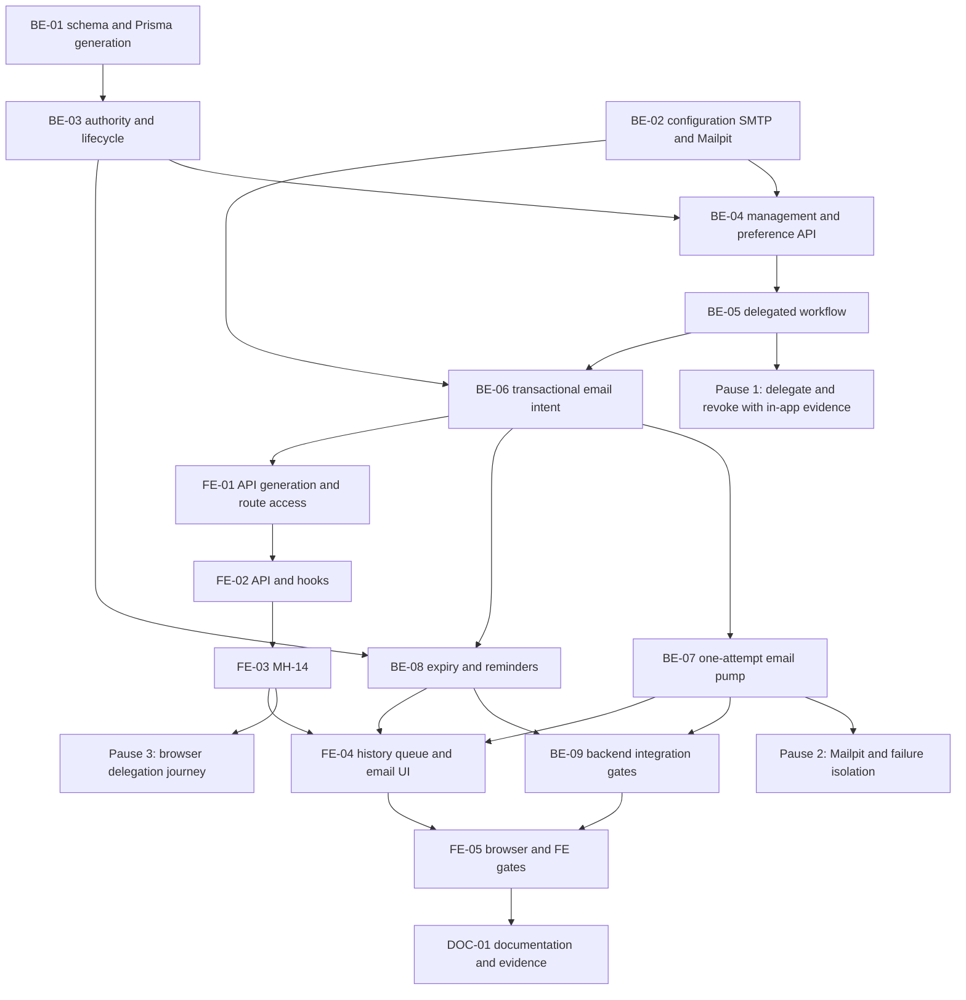

# F-25 Approval Delegation, Email and Deadline Reminders — Backend + Frontend Implementation Plan

This plan builds EP-25 (US-114..US-116; CV-269..CV-276): time-limited approval delegation, supplementary email delivery and configurable reminders on top of shipped F-14/F-15 behavior. It covers MH-14 and additions to MH-03/04/41/42. In-app notifications remain the primary channel. It excludes routing/publication redesign, other post-MVP features, and the deferred audit log.

> **Companion documents**
> - Decisions: `docs/planning/feature-questions.md:342` (F25-01..04; blank answers mean A).
> - Epic/stories: `docs/planning/epics.md:214`, B6 acceptance scenarios 8–9; `docs/planning/user-stories.md:1378` (US-114..116).
> - Requirements: `docs/requirement/REQUIREMENTS.md:423`, `:524`, `:526`, `:958`, `:962`, `:1058` (FR-09/64/66, BR-27/31, NFR-24).
> - Design: `docs/design/data-dictionary.md` (ApprovalDelegation, ApprovalStep, Notification); `docs/design/erd.md`; `docs/design/state-diagrams.md:264` (UQ-01..04, S-11); `docs/design/sequence-diagrams.md:395` (delegation/reminders, L-6); `docs/design/screen-inventory.md` (MH-03/04/14/41/42).
> - Work/deferred scope: `docs/planning/task-breakdown.md:503` (CV-269..276, K-5/K-7); `docs/planning/deferred-scope.md` §2.1; `docs/design/tech-stack.md:43`, `:46` (BullMQ, Nodemailer).
> - Baseline: all three `docs/architecture/*.md` documents and F-02/03/06/13/14/15 reports in `docs/implement-report/`; source anchors below settle what exists now.
> - Tests: `docs/planning/test-plan.md` (NT-B6-08/09, T-11); planned `docs/testing/feature__f-25-delegation-email-reminders.md` (NEW, DOC-01).
> - UI/conventions: `source/frontend/src/shared/design-system/DESIGN_SYSTEM.md`; implementation exemplars F-15 and F-09.

**Status**: Not started — plan only, source inspected on 2026-10-25. E-1/E-2 in §8 need caller follow-up; the bounded default build is specified below.

---

## 0. Plan at a glance

Everything below in one table. Read this; the rest is detail for whoever builds it.

| What | Why | How and where |
|---|---|---|
| **Delegate work, not a role** | US-114 AC1/5; BR-27 | New delegation rows and a shared resolver; preserve original approval rows and block actual-actor self-approval (BE-01/03/05). |
| **Manage dated delegations** | US-114 AC3/4/6; F25-03 | ACTIVE on creation, usable only inside inclusive Vietnam-calendar dates; immediate account-disable revocation, scheduled expiry, MH-14 (BE-03/04/08, FE-02/03). |
| **Show who acted for whom** | US-114 AC2 | Add nullable delegation evidence to ApprovalStep; retain performedBy and render DELEGATED history/queue provenance (BE-01/05, FE-04). |
| **Commit notifications before email** | US-115 AC1/2; F25-02 | Durable outbox on the notification transaction; independent BullMQ pump/Nodemailer SMTP (BE-06/07). |
| **Opt out and see delivery results** | US-115 AC3/4 | Separate user preference, derived emailSent/status, MH-03 toggle and MH-04 status (BE-04/06/07, FE-04). |
| **Remind current actors** | US-116 AC1..4 | Configured threshold/repeat, existing waiting clock, generation/cycle/recipient ledger, repeat escalation to R1 (BE-08). |
| **Develop without school SMTP** | F25-04 A | Loopback Mailpit service; production email off until approved SMTP configuration (BE-02; E-1). |
| **Preserve final approval** | Built F-14/F-15 boundary | Default delegates only named levels 1/2; keep anonymous R1 final approval and override intact pending E-2 (BE-05). |

| Behaviour | Why it is this way |
|---|---|
| Delegation is non-exclusive; direct authority wins over delegated authority. | Requirements do not transfer row ownership; the request lock and PENDING predicate resolve concurrent decisions. |
| Any active different account may receive a grant, without gaining a role or global permission. | UQ-01 requires active/different, not an existing recipient role; access stays request-bound. |
| ACTIVE does not mean usable today. Date/account checks happen on reads and again under decision locks. | Future grants and scheduler/Redis outages cannot extend authority. |
| SMTP is attempted at most once per delivery row. Crash-after-claim becomes UNKNOWN, not resend. | SMTP cannot guarantee exactly-once delivery; F25-02 rejects automatic retries. |
| Redis/SMTP failure delays supplementary delivery, not approval. A database failure can fail the primary transaction. | In-app notification and outbox are durable database writes, not external transaction participants. |
| First reminder is strictly after the maximum waiting days; waiting uses calendar days in Vietnam. | US-116 says “quá”; preserve the queue's clock rather than invent elapsed-hour/business-day rules. |

| Excluded | Why |
|---|---|
| Delegation of the anonymous final R1 slot | E-2: do not invent a named owner or redesign F-15. R1 still manages named-level grants and overrides. |
| Retry/resend controls, delivery receipts, email verification, template engine | F25-02 and bounded FR-64 scope; SMTP acceptance is not inbox receipt. |
| Admin parameter UI, holiday calendar, automatic approval | K-5/G-7 specify deployment configuration; no supplied business rules authorize these. |
| Other post-MVP features and AuditLog | None is needed here; audit logging remains deferred. |

| Question | Resolved when | Default if unanswered |
|---|---|---|
| Which SMTP sender/host/TLS policy is authorized? | Faculty supplies E-1 settings | Mailpit in dev; production email off, in-app on. |
| Should R1 delegate its final-level authority? | Caller resolves E-2 | No level-3 grant or normalization of existing approval rows. |
| Which reminder timings should operations enable? | Operations reviews configuration | Off by default; configurable example defaults: 7 calendar days maximum, 3 days repeat. |

## 1. Scope

| In scope | Why |
|---|---|
| Delegation create/list/revoke, eligible-level and account selectors, inclusive dates, no self-delegation/chaining | FR-09, UQ-01..04; R3/R4 self, R1 on behalf. |
| Current delegated queue/detail/diff/history/document reads and approve/return/reject | A delegate must inspect and decide work, not merely see a queue entry. |
| Immediate account-disable revocation and persistent expiry reconciliation | US-114 AC3/4/6. |
| Important-event emails, personal preference and delivery-state projection | FR-64, US-115; in-app stays primary. |
| Configurable daily/boot reminders, repeat R1 escalation, durable deduplication | FR-66, US-116, K-7. |
| Additive migration, Mailpit, generated API contract, tests/operations documentation | NFR-09/24, CV-269..276. |

| Out of scope | Deferred until |
|---|---|
| Changing existing role assignments, approval-level representation, skipped rows or publication semantics | Separate approved change; E-2 for final delegation. |
| Email retry or manual resend endpoints | Explicit revision to F25-02. |
| Generic audit-log storage/search or retention-policy invention | Deferred-scope decision is revisited; business history remains on ApprovalStep. |
| All B6 acceptance CV-277 / release 1.0 sign-off | Other B6 features ship; this plan owns scenarios 8–9 only. |

| AC | Covered by |
|---|---|
| US-114 AC1 — recipient/scope/dates and effective queue work | BE-01/03/04/05, FE-02/03/04 |
| US-114 AC2 — actor and delegator in history | BE-05, FE-04 |
| US-114 AC3 — expired rows show Hết hạn and lose access | BE-03/08/09, FE-03 |
| US-114 AC4 — immediate revoke | BE-03/04/05, FE-03 |
| US-114 AC5 — actual creator refused | BE-03/05/09, FE-04 |
| US-114 AC6 — either account disabled revokes | BE-03/09 |
| US-115 AC1 — same content and request link when enabled | BE-02/06/07, FE-04 |
| US-115 AC2 — SMTP failure isolated and recorded | BE-06/07/09 |
| US-115 AC3 — personal opt-out | BE-04/06/07, FE-04 |
| US-115 AC4 — sent/not-sent visible | BE-06/07, FE-04 |
| US-116 AC1 — threshold/current recipients | BE-02/08/09 |
| US-116 AC2 — repeat and R1 escalation | BE-08/09 |
| US-116 AC3 — no reminders after processing | BE-08/09 |
| US-116 AC4 — off means no notifications; daysWaiting remains | BE-08/09, FE-04 |
| B6 scenario 8 — timed delegation expires | BE-03/05/08/09, FE-03/05 |
| B6 scenario 9 — transfer email and deadline reminder | BE-06/07/08/09, FE-04/05 |

## 2. Contract verification

Existing claims below are source-backed. NEW contracts are **UNBUILT/UNVERIFIED until implemented**, with their exact assumed shapes specified here and corresponding risks in §8. Responses are direct JSON, not BaseResponse envelopes. The existing detail/diff renderers remain consumers of generated DTOs, not new hand-written models.

### 2a. Existing endpoints and internal seams

| Endpoint / seam | Verified source | Actual behavior and planned use |
|---|---|---|
| GET `/api/approval-queue?requestType=` | `source/backend/src/features/change-requests/approval-queue.controller.ts:16`; `source/backend/src/features/change-requests/approval-queue.reader.ts:61` | ApprovalQueueItemDto[]; current-round/current-level filtering; oldest daysWaiting then requestCode. Add delegated candidates and dedupe by request. No minDaysWaiting parameter here. |
| GET `/api/change-requests/:id` | `source/backend/src/features/change-requests/change-requests.controller.ts:110`; `source/backend/src/features/change-requests/change-request-detail.reader.ts:66` | Full detail, 404 outside visibility; current-round steps and server-derived action flags. |
| GET `/api/change-requests/:id/diff` | `source/backend/src/features/change-requests/change-requests.controller.ts:149`; `source/backend/src/features/change-requests/request-items.service.ts:81` | Existing diff DTO/renderer reused unchanged, with bounded delegated read access. |
| POST `/api/change-requests/:id/approve` | `source/backend/src/features/change-requests/approval.controller.ts:50`; `source/backend/src/features/change-requests/approval.service.ts:50` | HTTP 200/full detail; actual creator refused; data final-level approval still uses F-15. |
| POST `/api/change-requests/:id/return` | `source/backend/src/features/change-requests/approval.controller.ts:82`; `source/backend/src/features/change-requests/approval.service.ts:94` | HTTP 200/full detail; BR-28 reason retained. |
| POST `/api/change-requests/:id/reject` | `source/backend/src/features/change-requests/approval.controller.ts:93`; `source/backend/src/features/change-requests/approval.service.ts:108` | HTTP 200/full detail; same close/discard behavior for delegated actions. |
| POST `/api/change-requests/:id/override` | `source/backend/src/features/change-requests/approval.controller.ts:105` | Existing changeRequest.override only; never enable via delegation fallback. |
| GET `/api/change-requests/:id/history` | `source/backend/src/features/change-requests/approval.controller.ts:117`; `source/backend/src/features/change-requests/approval-history.reader.ts:14` | Newest round first, shared toStepDto mapper. |
| GET `/api/change-requests/:id/comments` | `source/backend/src/features/change-requests/approval.controller.ts:123` | Existing read contract only; comment POST keeps its independent permission. |
| GET `/api/change-request-documents/:documentId/file` | `source/backend/src/features/change-requests/change-request-documents.controller.ts:27`; `source/backend/src/features/change-requests/change-request-documents.service.ts:114` | Read/download only, resolve document's request before delegated authorization. |
| GET `.../:id/final-approval`, POST `.../:id/final-approve` | `source/backend/src/features/change-requests/approval.controller.ts:62`, `:71`; `source/backend/src/features/change-requests/final-approval.service.ts:174` | Direct R1 behavior unchanged; no delegation fallback in default build. |
| GET `/api/notifications`, GET `/unread-count`, POST `/read-all`, POST `/:id/read` | `source/backend/src/features/notifications/notifications.controller.ts:30`, `:40`, `:47`, `:54` | Own rows; list newest createdAt/id first, full page; count polling passive. Read mutation returns full NotificationDto. |
| GET `/api/auth/me` | `source/backend/src/features/auth/auth.controller.ts:73`; `source/backend/src/features/auth/me.dto.ts:38` | Roles/permissions remain genuine; no synthetic changeRequest.view or role copying. |
| NotificationService.notify(tx,input) | `source/backend/src/shared/notifications/notification.service.ts:19` | Promise<number>, transactional, dedupes recipients/excludes actor. Preserve return; widen actorId to nullable for system events. |
| ApprovalRecorder claim/actionableRows/record/advance/close | `source/backend/src/shared/change-requests/approval-recorder.ts:47`, `:65`, `:89`, `:104`, `:135` | Request CAS, named level-1/2 rows, anonymous active-R1 level 3; keep direct semantics. |
| AccessContext / default-deny guard / request visibility | `source/backend/src/shared/authz/access-context.ts:52`; `source/backend/src/shared/authz/permission.guard.ts:24`; `source/backend/src/features/change-requests/request-visibility.ts:13` | Add separate request-bound capability, never ALL scope or editing authority. |
| Waiting clock | `source/backend/src/shared/time/days-since.ts:10`; `source/backend/src/features/change-requests/approval-queue.reader.ts:123`; `source/backend/src/shared/change-requests/approval-recorder.ts:128`, `:142` | Vietnam calendar days; entry/exit owns levelEnteredAt. Reuse this clock. |
| Scheduler / Redis prefix | `source/backend/src/features/releases/release-activation.scheduler.ts:36`, `:48`; `source/backend/src/shared/queue/queue.module.ts:8` | Non-blocking bootstrap and upsertJobScheduler; mirror lifecycle, not its retry policy for SMTP. |

### 2b. Response-field verification and proposed BE/FE contract

**NotificationDto**, existing serializer `source/backend/src/features/notifications/notification.dto.ts:52`. Each existing field is retained; additions are explicitly NEW.

| Field | Wire type | Nullable | Source | Modeled as / note |
|---|---|---|---|---|
| id | string | no | `source/backend/src/features/notifications/notification.dto.ts:54` | Generated Notification.id. |
| notificationType | REQUEST_AWAITING_YOU, REQUEST_RETURNED, REQUEST_REJECTED, REQUEST_APPROVED, REQUEST_OVERRIDDEN, REQUEST_COMMENTED, REQUEST_EFFECTIVE | no | `source/backend/prisma/schema.prisma:145`; serializer `source/backend/src/features/notifications/notification.dto.ts:55` | Add DELEGATION_RECEIVED and REQUEST_DEADLINE_REMINDER; never rename old literals. |
| content | string | no | `source/backend/src/features/notifications/notification.dto.ts:56` | Existing Vietnamese sentence. |
| changeRequestId | string | yes | `source/backend/src/features/notifications/notification.dto.ts:57` | Existing request navigation. |
| readStatus | UNREAD, READ | no | `source/backend/prisma/schema.prisma:155`; serializer `source/backend/src/features/notifications/notification.dto.ts:58` | Unchanged read behavior. |
| createdAt | ISO timestamp string | no | `source/backend/src/features/notifications/notification.dto.ts:59` | Existing item time. |
| readAt | ISO timestamp string | yes | `source/backend/src/features/notifications/notification.dto.ts:60` | Existing nullable read time. |
| emailSent | boolean | no | NEW, BE-06 mapper in notification.dto.ts | Exactly delivery.status === SENT; false for all other states/no row. |
| emailStatus | NOT_REQUESTED, PENDING, SENDING, SENT, FAILED, SKIPPED, UNKNOWN | no | NEW, BE-06 mapper in notification.dto.ts | No row = NOT_REQUESTED; old notifications never backfilled. |
| link | relative application path string | yes | NEW, BE-06 mapper in notification.dto.ts | Request detail, delegation route, or null; never user-provided URL. |

**Page/count wrappers**, retained rather than replaced by partial responses.

| DTO.field | Wire type | Nullable | Source | Modeled as |
|---|---|---|---|---|
| NotificationPageDto.items | NotificationDto[] | no | `source/backend/src/features/notifications/notification.dto.ts:42` | Generated page.items. |
| NotificationPageDto.total | number | no | `source/backend/src/features/notifications/notification.dto.ts:43` | Page total. |
| NotificationPageDto.page | number | no | `source/backend/src/features/notifications/notification.dto.ts:44` | Page index. |
| NotificationPageDto.pageSize | number | no | `source/backend/src/features/notifications/notification.dto.ts:45` | Page size. |
| UnreadCountDto.count | number | no | `source/backend/src/features/notifications/notification.dto.ts:49` | Existing unread count. |

**ApprovalQueueItemDto**, serializer `source/backend/src/features/change-requests/approval-queue.reader.ts:115`, `:130`.

| Field | Wire type | Nullable | Source | Modeled as / note |
|---|---|---|---|---|
| requestId | string | no | `source/backend/src/features/change-requests/approval-queue.dto.ts:20` | Existing link identity. |
| requestCode | string | no | `source/backend/src/features/change-requests/approval-queue.dto.ts:21` | Existing code. |
| title | string | no | `source/backend/src/features/change-requests/approval-queue.dto.ts:22` | Existing title. |
| requestType | GRADING_FORMULA, OUTCOME, SYLLABUS_CONTENT, CURRICULUM, COURSE_RELATION, PROGRAM_INFO, ORGANIZATION | no | `source/backend/prisma/schema.prisma:106`; `source/backend/src/features/change-requests/approval-queue.dto.ts:23` | Generated enum, not a guessed feature-name enum. |
| status | DRAFT, PENDING_COORDINATOR, PENDING_DIRECTOR, PENDING_ACADEMIC_OFFICE, APPROVED, EFFECTIVE, REJECTED, WITHDRAWN | no | `source/backend/prisma/schema.prisma:122`; `source/backend/src/features/change-requests/approval-queue.dto.ts:25` | Actual queue subset is pending. |
| approvalLevel | number: 1, 2, 3 | no | `source/backend/src/features/change-requests/approval-queue.dto.ts:27` | Existing level. |
| standsFor | string | yes | `source/backend/src/features/change-requests/approval-queue.dto.ts:34` | Group/program codes, not a delegator name. |
| createdBy | UserRefDto | no | `source/backend/src/features/change-requests/approval-queue.dto.ts:35` | Existing creator. |
| submittedAt | ISO timestamp string | no | `source/backend/src/features/change-requests/approval-queue.dto.ts:37` | Round submit time, not levelEnteredAt. |
| daysWaiting | number | no | `source/backend/src/features/change-requests/approval-queue.dto.ts:41` | Existing calendar-day count. |
| delegatedFor | DelegatedQueueRefDto[] | no | NEW, BE-05 queue mapper | Empty for direct-only work; distinct delegationId/delegator pairs. |

**Shared identity/provenance DTOs.**

| DTO.field | Wire type | Nullable | Source | Modeled as / note |
|---|---|---|---|---|
| UserRefDto.id | string | no | `source/backend/src/shared/dtos/ref.dto.ts:11`; selected by `:42` | Identity. |
| UserRefDto.fullName | string | no | `source/backend/src/shared/dtos/ref.dto.ts:12`; selected by `:42` | Display name. |
| DelegatedQueueRefDto.delegationId | string | no | NEW, BE-05 approval-queue.dto.ts | Provenance only; client cannot select authority. |
| DelegatedQueueRefDto.delegator | UserRefDto | no | NEW, BE-05 approval-queue.dto.ts | “Duyệt thay …”. |
| StepDelegationRefDto.id | string | no | NEW, BE-05 change-request-response.dto.ts | Historical grant identity. |
| StepDelegationRefDto.delegator | UserRefDto | no | NEW, BE-05 change-request-response.dto.ts | Retained after expiry/revocation. |

**ApprovalStepDto**, serializer `source/backend/src/features/change-requests/change-request.mapper.ts:158`.

| Field | Wire type | Nullable | Source | Modeled as / note |
|---|---|---|---|---|
| id | string | no | `source/backend/src/features/change-requests/change-request-response.dto.ts:120` | Original step identity. |
| approvalLevel | number: 1, 2, 3 | no | `source/backend/src/features/change-requests/change-request-response.dto.ts:121` | Existing scalar. |
| levelName | string | no | `source/backend/src/features/change-requests/change-request.mapper.ts:162` | From existing level constants. |
| approver | UserRefDto | yes | `source/backend/src/features/change-requests/change-request-response.dto.ts:123` | Original required reviewer, never rewritten to delegate. |
| forSubjectGroup | {id:string,groupCode:string,groupName:string} | yes | `source/backend/src/features/change-requests/change-request-response.dto.ts:108`, `:125` | Existing scope ref, not modeled anew. |
| forProgram | {id:string,programCode:string} | yes | `source/backend/src/features/change-requests/change-request-response.dto.ts:114`, `:127` | Existing scope ref, not modeled anew. |
| action | PENDING, APPROVE, RETURN, REJECT | no | `source/backend/prisma/schema.prisma:138`; `source/backend/src/features/change-requests/change-request-response.dto.ts:129` | Existing enum. |
| isSkipped | boolean | no | `source/backend/src/features/change-requests/change-request-response.dto.ts:131` | Preserved. |
| skipReason | string | yes | `source/backend/src/features/change-requests/change-request-response.dto.ts:132` | Preserved. |
| remark | string | yes | `source/backend/src/features/change-requests/change-request-response.dto.ts:133` | Preserved. |
| recordedAt | ISO timestamp string | yes | `source/backend/src/features/change-requests/change-request.mapper.ts:170` | Null while pending. |
| performedBy | UserRefDto | yes | `source/backend/src/features/change-requests/change-request-response.dto.ts:135` | Actual actor. |
| isOverride | boolean | no | `source/backend/src/features/change-requests/change-request-response.dto.ts:141` | Delegation does not set it. |
| kind | NORMAL, SKIPPED, OVERRIDE | no | `source/backend/src/shared/change-requests/approval.constants.ts:44`; serializer `source/backend/src/features/change-requests/change-request.mapper.ts:173` | Add DELEGATED after existing skip/override precedence. |
| delegation | StepDelegationRefDto | yes | NEW, BE-05 step mapper/include | Null for all pre-F25/direct/override rows. |

**History and action projections.**

| DTO.field | Wire type | Nullable | Source | Modeled as / note |
|---|---|---|---|---|
| ApprovalHistoryDto.rounds | ApprovalRoundDto[] | no | `source/backend/src/features/change-requests/approval-history.dto.ts:13`; serializer `approval-history.reader.ts:31` in that directory | Existing round renderer. |
| ApprovalRoundDto.submissionRound | number | no | `source/backend/src/features/change-requests/approval-history.dto.ts:5` | Existing round. |
| ApprovalRoundDto.submittedAt | ISO timestamp string | no | `source/backend/src/features/change-requests/approval-history.dto.ts:7` | Existing round time. |
| ApprovalRoundDto.steps | ApprovalStepDto[] | no | `source/backend/src/features/change-requests/approval-history.dto.ts:8` | Enriched step renderer. |
| RequestActionsDto.canEdit | boolean | no | `source/backend/src/features/change-requests/change-request-response.dto.ts:156` | Unchanged. |
| RequestActionsDto.canDelete | boolean | no | `source/backend/src/features/change-requests/change-request-response.dto.ts:157` | Unchanged. |
| RequestActionsDto.canSubmit | boolean | no | `source/backend/src/features/change-requests/change-request-response.dto.ts:158` | Unchanged. |
| RequestActionsDto.canWithdraw | boolean | no | `source/backend/src/features/change-requests/change-request-response.dto.ts:159` | Unchanged. |
| RequestActionsDto.canUpload | boolean | no | `source/backend/src/features/change-requests/change-request-response.dto.ts:160` | Unchanged. |
| RequestActionsDto.canApprove | boolean | no | `source/backend/src/features/change-requests/change-request-response.dto.ts:161` | Includes valid named delegation. |
| RequestActionsDto.canFinalApprove | boolean | no | `source/backend/src/features/change-requests/change-request-response.dto.ts:166` | Unchanged direct R1. |
| RequestActionsDto.canReturn | boolean | no | `source/backend/src/features/change-requests/change-request-response.dto.ts:167` | Includes valid named delegation. |
| RequestActionsDto.canReject | boolean | no | `source/backend/src/features/change-requests/change-request-response.dto.ts:168` | Includes valid named delegation. |
| RequestActionsDto.canOverride | boolean | no | `source/backend/src/features/change-requests/change-request-response.dto.ts:169` | Unchanged. |
| RequestActionsDto.canComment | boolean | no | `source/backend/src/features/change-requests/change-request-response.dto.ts:170` | Unchanged. |

The action serializer is `source/backend/src/features/change-requests/change-request-detail.reader.ts:206`. F-25 does not remap ChangeRequestDetailDto: all its remaining fields are **not modeled**, passed to existing components through generated types. Complete disposition: inherited id/requestCode/requestType/target/title/status/origin/submissionRound/levelEnteredAt/daysWaiting/createdBy/createdAt/updatedAt use `source/backend/src/features/change-requests/change-request.mapper.ts:87`; reason, nullable basisDocumentNumber, nullable workspace, authoredItems, documents, conflicts and nullable release use `source/backend/src/features/change-requests/change-request-detail.reader.ts:126`. Only steps and permissions acquire the fields/authority above. Mutations continue returning the full object, not just changed flags.

**NEW endpoint contract — UNBUILT; BE-04/06 own the Swagger definitions.** Session/CSRF protections remain enabled.

| Method / path | Authorization and input | Output |
|---|---|---|
| GET `/api/approval-delegations` | AnyAuthenticated; page/pageSize, status?, direction? OUTGOING/INCOMING, delegatorId? R1-only | DelegationPageDto; R1 all, others own outgoing/incoming; createdAt desc, id desc. |
| GET `/api/approval-delegations/access` | AnyAuthenticated + PassiveRequest | DelegationAccessDto, no permission mutation. |
| GET `/api/approval-delegations/recipients?q=` | delegation.manage; bounded active accounts | DelegationUserOptionDto[]. |
| GET `/api/approval-delegations/delegators?q=` | delegation.manage and live R1 | Same array, only current direct named-level approvers. |
| GET `/api/approval-delegations/levels?delegatorId=` | delegation.manage; self unless live R1 | DelegationLevelDto[] for actually held named levels. |
| POST `/api/approval-delegations` | delegation.manage + service self/R1 check; CreateDelegationDto | Full DelegationDto, 201. |
| POST `/api/approval-delegations/:id/revoke` | delegation.manage + delegator/live R1 | Full DelegationDto, 200; repeated revoke idempotent, expired remains expired. |
| GET `/api/notifications/preferences` | AnyAuthenticated, own account | NotificationPreferenceDto. |
| PATCH `/api/notifications/preferences` | AnyAuthenticated, own account; {emailEnabled:boolean} | Full NotificationPreferenceDto. |

**DelegationDto — NEW**, intended source `source/backend/src/features/approval-delegations/delegation.dto.ts` (BE-04). All fields use the generated DTO directly.

| Field | Wire type | Nullable | Mapping |
|---|---|---|---|
| id | string | no | row.id. |
| delegator | DelegationUserOptionDto | no | Three-field user selector. |
| delegate | DelegationUserOptionDto | no | Same selector. |
| scope | DelegationLevelDto | yes | Configuration relation; null = eligible named levels. |
| validFrom | YYYY-MM-DD string | no | toIsoDay. |
| validTo | YYYY-MM-DD string | no | toIsoDay, inclusive. |
| status | ACTIVE, EXPIRED, REVOKED | no | Stored revocation first; otherwise expiry derived from today's date if reconciliation is late. |
| isEffectiveNow | boolean | no | ACTIVE + inclusive range + both accounts active + at least one directly held level matching scope today. Target-specific authority is checked separately. |
| createdAt | ISO timestamp string | no | row.createdAt. |
| revokedAt | ISO timestamp string | yes | null unless revoked. |
| canRevoke | boolean | no | Real manage permission + self/live R1 + not expired/revoked. |

**Other NEW DTOs**, same intended source unless a path is named. No hand-written FE duplicates.

| DTO.field | Wire type | Nullable | Mapping |
|---|---|---|---|
| DelegationPageDto.items | DelegationDto[] | no | Standard toPage helper. |
| DelegationPageDto.total | number | no | Filtered count. |
| DelegationPageDto.page | number | no | Page query. |
| DelegationPageDto.pageSize | number | no | Page query. |
| DelegationUserOptionDto.id | string | no | User identity only. |
| DelegationUserOptionDto.userCode | string | no | Display/search. |
| DelegationUserOptionDto.fullName | string | no | Display/search. |
| DelegationLevelDto.id | string | no | ApprovalLevelConfig.id. |
| DelegationLevelDto.approvalLevel | number: 1, 2 | no | Existing named level. |
| DelegationLevelDto.levelName | string | no | Existing APPROVAL_LEVEL_NAMES value. |
| DelegationAccessDto.canManage | boolean | no | Real delegation.manage plus eligible role; no synthetic role. |
| DelegationAccessDto.hasIncomingDelegation | boolean | no | A currently usable incoming grant, independent of whether it currently has work. |
| NotificationPreferenceDto.emailEnabled | boolean | no | NEW `source/backend/src/features/notifications/notification-preference.dto.ts`: absent preference row means true. |
| NotificationPreferenceDto.emailAvailable | boolean | no | Same source: global email enabled and own nonempty address, not an SMTP probe. |

CreateDelegationDto inputs are delegateId:string and validFrom/validTo:YYYY-MM-DD (required), delegatorId:string (optional, defaults to self), scopeId:string|null (optional/null = all eligible named levels). Reject invalid calendar dates, inverted ranges, inactive/same accounts and levels not directly held. There is no patch/extend endpoint. Notification preference PATCH returns both preference fields, not a partial boolean.

Use AppException and the current envelope (`source/backend/src/shared/dtos/error-response.dto.ts:11`). New codes: 400 DELEGATION_INVALID_RANGE “Ngày kết thúc không được trước ngày bắt đầu”; 400 DELEGATION_SELF “Không thể ủy quyền cho chính mình”; 403 DELEGATION_OUT_OF_SCOPE “Bạn không thể ủy quyền phần việc này”; 404 DELEGATION_NOT_FOUND “Không tìm thấy ủy quyền”; 409 DELEGATION_ACCOUNT_INACTIVE “Tài khoản ủy quyền hoặc nhận ủy quyền không còn hoạt động”; 409 DELEGATION_SCOPE_UNAVAILABLE “Cấp duyệt này chưa hỗ trợ ủy quyền”. Existing SELF_APPROVAL/NOT_YOUR_STEP/REQUEST_STATE_CHANGED remain decision errors. SMTP failures are delivery states, not approval HTTP errors.

### 2c. Mismatch log

| Deliverable | What design/earlier material suggests | What source does | Found at |
|---|---|---|---|
| BE-01/03/05 | Configuration relation for step level; mandatory approver; delegation scope can identify a configured level | Integer step level, nullable approver and anonymous final R1 slot. Keep storage; add grant scope FK only. Final delegation remains E-2. | `source/backend/prisma/schema.prisma:840`, `:857`, `:858`; `source/backend/src/shared/change-requests/approval-recorder.ts:73` |
| BE-06 | Stored Notification.emailSent/link | Neither column exists; mapper emits changeRequestId, FE constructs navigation. Add derived response fields from delivery data, not a notification-table rewrite. | `source/backend/prisma/schema.prisma:892`; `source/backend/src/features/notifications/notification.dto.ts:52`; `source/frontend/src/shared/notifications/NotificationItem.tsx:24` |
| BE-08 | Feature architecture mentions queue minDaysWaiting | Query DTO only accepts requestType; daysWaiting is still emitted. No new queue filter required for reminders. | `source/backend/src/features/change-requests/approval-queue.dto.ts:9`; `source/backend/src/features/change-requests/approval-queue.reader.ts:123` |
| BE-05 | Old plans may suggest keeping rejected working copies | Rejection discards them; 2026-10-25 user decision in F-14 report accepts this. Delegation must use the same path. | `source/backend/src/features/change-requests/approval.service.ts:228`; F-14 implement report final decision section |

## 3. Decisions

| ID | Decision | Why | Rejected alternative |
|---|---|---|---|
| D1 | Default scope is named levels 1/2; R1 manages on behalf of actual R3/R4 approvers. Null covers eligible named levels. | Meets explicit US-114 AC1 without inventing final-slot ownership; E-2. | Normalize final rows or silently delegate override/publication. |
| D2 | Any active different account may receive; bounded route exception, never copied roles/permissions. | UQ-01 does not mandate a recipient role. | Restrict to current reviewers or grant the full delegator scope. |
| D3 | Non-exclusive, no chaining; direct authority wins; otherwise explicit scope then oldest createdAt/id selects evidence per row. | Keeps original rows and deterministic overlap handling. | Reassign approverId, duplicate required steps, client-selected authority. |
| D4 | Inclusive calendar dates, ACTIVE immediately, no edit/extend endpoint. | F25-03/S-11; revoke/create retains evidence. | New PENDING state or UTC-instant boundaries. |
| D5 | Nullable ApprovalStep.delegationId; separate preference/delivery/reminder tables; additive notification enum values. | Old rows/defaults/constraints remain meaningful. | Delivery-state rewrite of Notification or account model. |
| D6 | Transactional outbox; scan committed PENDING deliveries. | Survives DB-commit/Redis-enqueue gap. | Queue.add/SMTP in approval transaction or volatile events. |
| D7 | Atomic PENDING→SENDING before one SMTP call; FAILED/UNKNOWN terminal, no automatic resend. | F25-02 A/L-6; at-most-once attempts, not guaranteed delivery. | Three retries, stalled-job resend, exactly-once claims. |
| D8 | Global email/reminders default off; absent personal preference true; configurable example defaults 7 maximum calendar days, 3 repeat days. | Safe unchanged baseline; numbers are not Faculty policy. | Hardcoded SLA or an admin settings screen. |
| D9 | First warning at threshold + 1; repeat at that age + multiples of repeatDays. Only latest eligible cycle after downtime. | Strict “quá”; avoid catch-up floods. | >= threshold or replay of every missed cycle. |
| D10 | Current original approvers + active delegates; repeats also active R1. Exclude creator/disabled accounts, dedupe per recipient/generation/cycle. | Current actionable responsibility; BR-27/US-116 AC2. | Historic reviewers or every R1 on the first warning. |
| D11 | Email awaiting/returned/rejected/approved/overridden/effective/delegation/reminder events; comments stay in-app. | Important-event scope, avoid discussion-email noise. | Email every comment. |
| D12 | Nodemailer + type declarations, Mailpit, existing BullMQ; no scheduler/mailer/template framework. | Nodemailer is named at `docs/design/tech-stack.md:46`. | New runtime dependencies not approved in tech-stack. |

## 4. Deliberate divergences

No shipped sibling implementation was supplied. Adapt the conceptual design to shipped F-14/F-15: preserve integer levels and the anonymous final slot; E-2 is an escalation, not an implicit migration. emailSent/link will be projections; AuditLog remains deferred. English plan prose overrides the general documentation-language default for this task; user-facing strings remain Vietnamese. Do not create branches, commit, publish, or contact production services as part of this plan.

## 5. Deliverables

All paths are repository-relative. MODIFY anchors identify existing entry points. NEW subdirectories are intentional, under inspected parent directories. No DELETE deliverables are needed.

### BE-01 — Additive persistence and Prisma generation

**What/why.** Persist grants, immutable decision evidence, personal preferences, one-attempt delivery and reminder deduplication without changing existing row ownership.

**Files**

| Action | Path |
|---|---|
| MODIFY | `source/backend/prisma/schema.prisma:188` (inverse relations), `:840`, `:852`, `:892`, `:773` (inverse relations only on built tables) |
| NEW | `source/backend/prisma/migrations/<generated_timestamp>_delegation_email_reminders/migration.sql` (timestamp assigned by Prisma, not an invented historical migration) |

**Shape** — complete new model columns; relation back-fields listed below are required.

```prisma
enum ApprovalDelegationStatus {
  ACTIVE
  EXPIRED
  REVOKED
}

enum EmailDeliveryStatus {
  PENDING
  SENDING
  SENT
  FAILED
  SKIPPED
  UNKNOWN
}

model ApprovalDelegation {
  id          String                   @id @default(cuid(2))
  delegatorId String
  delegator   User                     @relation(DelegationGrantor, fields: [delegatorId], references: [id], onDelete: Restrict)
  delegateId  String
  delegate    User                     @relation(DelegationRecipient, fields: [delegateId], references: [id], onDelete: Restrict)
  scopeId     String?
  scope       ApprovalLevelConfig?     @relation(fields: [scopeId], references: [id], onDelete: Restrict)
  validFrom   DateTime                 @db.Date
  validTo     DateTime                 @db.Date
  status      ApprovalDelegationStatus @default(ACTIVE)
  createdById String
  createdBy   User                     @relation(DelegationCreator, fields: [createdById], references: [id], onDelete: Restrict)
  revokedAt   DateTime?
  revokedById String?
  revokedBy   User?                    @relation(DelegationRevoker, fields: [revokedById], references: [id], onDelete: Restrict)
  revokeReason String?
  steps       ApprovalStep[]
  createdAt   DateTime                 @default(now())
  updatedAt   DateTime                 @updatedAt

  @@index([delegateId, status, validFrom, validTo])
  @@index([delegatorId, status])
  @@index([status, validTo])
}

model NotificationPreference {
  userId       String   @id
  user         User     @relation(fields: [userId], references: [id], onDelete: Cascade)
  emailEnabled Boolean  @default(true)
  updatedAt    DateTime @updatedAt
}

model NotificationEmailDelivery {
  notificationId String              @id
  notification   Notification        @relation(fields: [notificationId], references: [id], onDelete: Cascade)
  status         EmailDeliveryStatus @default(PENDING)
  attemptedAt    DateTime?
  sentAt         DateTime?
  finishedAt     DateTime?
  failureCode    String?
  createdAt      DateTime            @default(now())
  updatedAt      DateTime            @updatedAt

  @@index([status, createdAt])
}

model ApprovalReminderDispatch {
  id              String        @id @default(cuid(2))
  changeRequestId String
  changeRequest   ChangeRequest @relation(fields: [changeRequestId], references: [id], onDelete: Cascade)
  submissionRound Int
  approvalLevel   Int
  levelEnteredAt  DateTime
  cycleIndex      Int
  recipientId     String
  recipient       User          @relation(fields: [recipientId], references: [id], onDelete: Restrict)
  createdAt       DateTime      @default(now())

  @@unique([changeRequestId, submissionRound, approvalLevel, levelEnteredAt, cycleIndex, recipientId], map: ApprovalReminderDispatch_cycle_recipient_key)
  @@index([recipientId, createdAt])
}
```

Add `ApprovalStep.delegationId String?` and `delegation ApprovalDelegation? @relation(fields: [delegationId], references: [id], onDelete: Restrict)` plus index `[delegationId]`. Add inverse arrays to User (`delegationsGranted`, `delegationsReceived`, `delegationsCreated`, `delegationsRevoked`, `reminderDispatches`) with matching relation names, User.notificationPreference?, ApprovalLevelConfig.delegations[], Notification.emailDelivery?, ChangeRequest.reminderDispatches[]. Add enum values DELEGATION_RECEIVED and REQUEST_DEADLINE_REMINDER to NotificationType. Existing notifications require no backfill.

Append these explicit migration checks after generated SQL:

```sql
ALTER TABLE ApprovalDelegation
  ADD CONSTRAINT ApprovalDelegation_different_users
  CHECK (delegatorId <> delegateId),
  ADD CONSTRAINT ApprovalDelegation_valid_range
  CHECK (validTo >= validFrom);
ALTER TABLE ApprovalReminderDispatch
  ADD CONSTRAINT ApprovalReminderDispatch_cycle_nonnegative
  CHECK (cycleIndex >= 0);
ALTER TABLE ApprovalStep
  ADD CONSTRAINT ApprovalStep_delegation_evidence
  CHECK (delegationId IS NULL OR
    (performedById IS NOT NULL AND NOT isOverride AND NOT isSkipped
      AND action <> 'PENDING'));
```

**Rationale/mirror.** Mirror cuid/date/relation style in `source/backend/prisma/schema.prisma:188`, `:852`; mirror the generated-plus-handwritten migration pattern documented for F-13/F-15, with the current migration parent `source/backend/prisma/migrations/` inspected. No extension or runtime dependency is required.

**Gotchas.** Preserve every existing User/Notification/ApprovalStep default, FK action, row and enum literal. New nullable proof is not a replacement for approverId. No updatedAt is added to old immutable history. The composite unique key uses an explicit short PostgreSQL constraint name. No destructive reset or applied-migration edits. If implementation requires a behavior-changing alteration to a built table, stop and escalate rather than broadening this step.

**Verify.** From `source/backend`: `pnpm exec prisma migrate dev --create-only --name delegation_email_reminders`, inspect the additive SQL, then `pnpm prisma:migrate` on the approved dev database and `pnpm prisma:generate`. Fresh Testcontainers migration must retain a pre-F25 notification/decision with no new relation and unchanged read behavior. Generation is an explicit part of this step, before TS code consumes the models.

**Depends on:** —.

### BE-02 — Configuration, SMTP adapter and development Mailpit

**What/why.** Give deployment one validated switch/parameter set and an injectable SMTP boundary; dev must not need institutional access.

**Files**

| Action | Path |
|---|---|
| MODIFY | `source/backend/package.json:36`, `source/backend/pnpm-lock.yaml` |
| MODIFY | `source/backend/compose.yaml:1` |
| MODIFY | `source/backend/src/shared/config/env.validation.ts:23`, `source/backend/src/shared/config/env.validation.spec.ts:1` |
| NEW | `source/backend/src/shared/notifications/email.constants.ts` |
| NEW | `source/backend/src/shared/notifications/email.transport.ts`, `source/backend/src/shared/notifications/email.transport.spec.ts` |

**Shape**

```ts
export const EMAIL_DEFAULTS = {
  ENABLED: 'false',
  SMTP_PORT: 1025,
  SMTP_SECURE: 'false',
  CONNECT_TIMEOUT_MS: 5000,
  GREETING_TIMEOUT_MS: 5000,
  SOCKET_TIMEOUT_MS: 10000,
  STALE_CLAIM_MS: 120000,
  BATCH_SIZE: 20,
  RETAINED_FAILURES: 20,
} as const;
export const REMINDER_DEFAULTS = {
  ENABLED: 'false',
  MAX_WAITING_DAYS: 7,
  REPEAT_DAYS: 3,
  SCAN_BATCH_SIZE: 100,
} as const;
export const EMAIL_TRANSPORT = Symbol('EMAIL_TRANSPORT');
export interface EmailMessage {
  to: string;
  subject: string;
  text: string;
}
export interface EmailTransport {
  send(message: EmailMessage): Promise<void>;
}
```

Add Env fields EMAIL_ENABLED, SMTP_HOST, SMTP_PORT, SMTP_SECURE, SMTP_USER?, SMTP_PASSWORD?, SMTP_FROM, PUBLIC_APP_URL, SMTP_CONNECT_TIMEOUT_MS, SMTP_GREETING_TIMEOUT_MS, SMTP_SOCKET_TIMEOUT_MS, APPROVAL_REMINDERS_ENABLED, APPROVAL_REMINDER_MAX_WAITING_DAYS, APPROVAL_REMINDER_REPEAT_DAYS. Boolean-like env values must be string literals validated with `@IsIn(['true','false'])` and read by equality with 'true'; do not use implicit Boolean conversion of the string 'false'. Numbers use explicit numeric property types plus IsInt/Min(1); SMTP_PORT also Max(65535). APP URL must be an absolute http(s) URL. Require SMTP_HOST/FROM/PUBLIC_APP_URL only when EMAIL_ENABLED is true, and SMTP_USER/PASSWORD together if either is supplied. Never echo credential values in validation errors.

Nodemailer transport implements EmailTransport with `createTransport`, validated host/port/secure, optional auth, from and the configured timeouts. Resolve only if the recipient is in accepted and rejected is empty; SMTP acceptance alone maps SENT, not “delivered/read”. Do not call verify() at application bootstrap. Do not add built-in resend logic. TEXT-only messages contain the primary notification sentence and a trusted absolute app URL, never raw SMTP diagnostic text.

From `source/backend`, install only `pnpm add nodemailer` and `pnpm add -D @types/nodemailer`; commit neither command's output nor credentials to the plan. The library is already approved in tech-stack; dependency selection is locked by pnpm-lock, not a new mailer framework.

Add a dev-only Mailpit service in compose, no credentials in the file, binding SMTP `127.0.0.1:1025:1025` and UI `127.0.0.1:8025:8025`; use SMTP host localhost for the host-run BE. At implementation, resolve the public `axllent/mailpit:latest` dev image once and pin its returned repository digest in compose; record the digest in DOC-01. This is dev test tooling, never a production email endpoint. Do not expose Mailpit beyond loopback or change existing PostgreSQL/Redis services/volumes. Production SMTP defaults stay disabled pending E-1.

**Rationale/mirror.** Mirror configuration validation at `source/backend/src/shared/config/env.validation.ts:23` and injected infrastructure at `source/backend/src/shared/queue/queue.module.ts:8`. New adapter tests mirror config unit-test style in `source/backend/src/shared/config/env.validation.spec.ts:1`. Existing package/runtime entry is `source/backend/package.json:36`; Nodemailer approval is `docs/design/tech-stack.md:46`.

**Gotchas.** A transport timeout/rejection must remain local to the email worker. Do not read dotenv files to implement or test this step; set synthetic test config. Do not add @nestjs/schedule, Nest mailer, a template engine, cloud SDK, or SMTP credentials. Redact transport errors to a bounded machine-code allowlist.

**Verify.** Backend `pnpm test -- src/shared/config/env.validation.spec.ts src/shared/notifications/email.transport.spec.ts`; prove 'false' is false, invalid intervals rejected, no-auth Mailpit accepted, production settings conditionally required, and rejected/timeout SMTP cannot resolve send. Observable dev check after explicit enablement: a synthetic non-sensitive message appears in Mailpit UI.

**Depends on:** —.

### BE-03 — Shared delegation authority, lifecycle and disabled-account hook

**What/why.** One reader/writer boundary owns grant validity; permission, queue and decisions must not invent different meanings of an effective delegation.

**Files**

| Action | Path |
|---|---|
| NEW | `source/backend/src/shared/delegations/delegation.constants.ts`, `delegation.errors.ts`, `delegation.types.ts` in that directory |
| NEW | `source/backend/src/shared/delegations/delegation-authority.service.ts`, `delegation-authority.service.spec.ts` |
| NEW | `source/backend/src/shared/delegations/delegation-lifecycle.service.ts`, `delegation-lifecycle.service.spec.ts` |
| NEW | `source/backend/src/shared/delegations/delegations-shared.module.ts` |
| MODIFY | `source/backend/src/features/users/users.service.ts:200`, `source/backend/src/features/users/users.service.spec.ts:1`, `source/backend/src/features/users/users.module.ts:1` |

**Shape** — signatures are the build contract; service methods require implementations of the rules immediately below.

```ts
export interface DelegatedStepAccess {
  requestId: string;
  stepId: string;
  delegationId: string;
  delegator: { id: string; fullName: string };
  approvalLevel: 1 | 2;
}
export interface StepAuthority {
  step: ApprovalStep;
  delegationId: string | null;
}
export abstract class DelegationAuthorityContract {
  abstract eligibleLevels(db: DelegationDb, userId: string, today: Date): Promise<readonly (1 | 2)[]>;
  abstract incoming(db: DelegationDb, userId: string, today: Date): Promise<DelegatedStepAccess[]>;
  abstract hasIncomingGrant(db: DelegationDb, userId: string, today: Date): Promise<boolean>;
  abstract resolve(tx: Prisma.TransactionClient, request: DecisionSubject, actorId: string, today: Date, lock: boolean): Promise<StepAuthority[]>;
}
export abstract class DelegationLifecycleContract {
  abstract revokeForDisabledUser(tx: Prisma.TransactionClient, userId: string, actorId: string): Promise<number>;
  abstract reconcile(today: Date): Promise<{ expired: number; revoked: number }>;
}
```

Define DelegationDb as PrismaService | Prisma.TransactionClient; actual implementations are injectable concrete services with these signatures. Mirror active predicate helpers at `source/backend/src/shared/subject-groups/active-membership.ts:15`, `source/backend/src/shared/programs/active-director.ts:7`, and date helpers at `source/backend/src/shared/time/today.ts:1`.

Pin the authority algorithm:

1. eligibleLevels reads active coordinator memberships/director assignments and active parent groups/programs; incoming grants never count as direct eligibility. In the default contract no level 3 is eligible, including for R1.
2. An effective grant has stored ACTIVE, validFrom <= today <= validTo, both users ACTIVE, and scope null or the matching configured named level. Current direct authority of the delegator must still cover the row's forSubjectGroupId/forProgramId. A role/membership loss makes it unusable; it does not rewrite historical evidence or auto-reassign frozen rows.
3. incoming loads grants/eligible assignments and pending rows in bounded database batches, filters with isActionable for current round/current level, and excludes requests created by the recipient. Return step/request bindings, not the delegator's entire program/group scope. Avoid one query per grant/request.
4. resolve returns direct rows with null proof first. For remaining rows choose effective grants whose delegator is the original approver and whose current assignment covers that row. Direct and delegated work may coexist. Sort explicit-level grants before null-scope grants, then createdAt/id. Reject actual actor == request creator even if the grantor differs. Skip isSkipped rows, old rounds and noncurrent levels. Do not recursively traverse delegation edges.
5. For writes, lock both participating User rows in stable id order, then relevant ApprovalDelegation rows in stable id order, re-read account/status/date/assignment validity, then claim the ChangeRequest. Use parameterized Prisma SQL, not string-built SQL. Creation, explicit revoke and account-disable use the same user→grant lock ordering; concurrent decisions cannot use a grant after a completed revoke. A decision that acquired the locks first may finish before revoke returns.
6. In UsersService.setStatus, retain the existing self-disable protection, then move user update + revokeForDisabledUser into one transaction. Disabling revokes all stored ACTIVE grants where either side matches, including future grants, with revokedAt, revokedById and reason ACCOUNT_DISABLED. Enabling never revives them. Existing nondelegation status behavior remains unchanged.
7. reconcile repairs ACTIVE rows involving disabled users and expires ACTIVE rows with validTo < today; dates are inclusive. Run disabled-user repair before expiry. Reads derive EXPIRED when the clock has passed even if persistence is behind; never authorize from stored ACTIVE alone.

**Rationale/mirror.** The new shared module mirrors `source/backend/src/shared/change-requests/change-requests-shared.module.ts:8`, not a feature-to-feature import. Live authority sources are demonstrated at `source/backend/src/shared/authz/scope-source.reader.ts:43`, `:59`. Disabled-user integration sits at the actual status writer `source/backend/src/features/users/users.service.ts:200` rather than the controller.

**Gotchas.** Default eligibility uses current row-target coverage, not just “has R3 somewhere”. Snapshot original approval rows must stay intact when authority changes. Do not give R1's override permission to a delegate. Day-boundary checks and DB account revocation must work with Redis completely unavailable. The persistence side of expiry is maintenance, not a prerequisite for safe reads.

**Verify.** `pnpm test -- src/shared/delegations src/features/users/users.service.spec.ts` from backend. Cover future start, inclusive end, next-day expiry, both disabled sides, disable/re-enable, lost current target assignment, old round, author-as-delegate, overlaps/direct-wins, no chaining and no level-3 authority. Concurrent races are added in BE-09.

**Depends on:** BE-01.

### BE-04 — Delegation management and notification preference API

**What/why.** Ship the exact contract needed by MH-14/MH-03 without exposing R1-only user administration or adding an admin parameter screen.

**Files**

| Action | Path |
|---|---|
| NEW | `source/backend/src/features/approval-delegations/delegation.dto.ts`, `create-delegation.dto.ts`, `delegation-query.dto.ts` |
| NEW | `source/backend/src/features/approval-delegations/approval-delegations.controller.ts`, `approval-delegations.service.ts`, `approval-delegations.service.spec.ts`, `approval-delegations.module.ts` |
| NEW | `source/backend/src/features/notifications/notification-preference.dto.ts`, `notification-preferences.controller.ts`, `notification-preferences.service.ts`, `notification-preferences.service.spec.ts` |
| MODIFY | `source/backend/src/features/notifications/notifications.module.ts:1` |
| MODIFY | `source/backend/src/app.module.ts:33` |

**Shape**

```ts
export class CreateDelegationDto {
  @ApiPropertyOptional()
  @IsOptional()
  @IsString()
  @IsNotEmpty()
  delegatorId?: string;

  @ApiProperty()
  @IsString()
  @IsNotEmpty()
  delegateId!: string;

  @ApiPropertyOptional({ nullable: true, type: String })
  @IsOptional()
  @IsString()
  scopeId?: string | null;

  @ApiProperty({ format: 'date' })
  @IsDateString({ strict: true })
  @Matches(/^\d{4}-\d{2}-\d{2}$/)
  validFrom!: string;

  @ApiProperty({ format: 'date' })
  @IsDateString({ strict: true })
  @Matches(/^\d{4}-\d{2}-\d{2}$/)
  validTo!: string;
}

export class UpdateNotificationPreferenceDto {
  @ApiProperty()
  @IsBoolean()
  emailEnabled!: boolean;
}

export abstract class ApprovalDelegationsContract {
  abstract list(query: DelegationQueryDto, access: AccessContext): Promise<DelegationPageDto>;
  abstract access(access: AccessContext): Promise<DelegationAccessDto>;
  abstract recipients(q: string, access: AccessContext): Promise<DelegationUserOptionDto[]>;
  abstract delegators(q: string, access: AccessContext): Promise<DelegationUserOptionDto[]>;
  abstract levels(delegatorId: string | undefined, access: AccessContext): Promise<DelegationLevelDto[]>;
  abstract create(dto: CreateDelegationDto, access: AccessContext): Promise<DelegationDto>;
  abstract revoke(id: string, access: AccessContext): Promise<DelegationDto>;
}
```

Implement concrete injectable services and all response DTOs from §2b with ApiProperty/ApiPropertyOptional, explicit nested types, enumName, date format and nullable declarations. DelegationQueryDto extends PageQueryDto and validates status/direction; q search uses trimmed bounded strings and DELEGATION_OPTIONS_LIMIT = 20. Use stable fullName/id sorting on selector arrays. Static subroutes must precede parameter routes. Controllers declare ApiCookieAuth, ApiTags, response type and status; new write routes are not Public or AllowPendingPasswordChange.

Creation transaction: assert real delegation.manage; use live R1 status for acting on behalf, not only a wide permission scope. Otherwise delegatorId must be self and currently eligible. Lock users, re-read accounts/eligibility, validate selected config level is 1/2 and held directly, validate dates via fromIsoDay + round-trip toIsoDay. Create ACTIVE even with a future start. Reject ranges wholly in the past with DELEGATION_INVALID_RANGE rather than inserting an already expired new ACTIVE grant. No arbitrary maximum interval is invented. Permit overlaps per D3. Store createdById. In this same transaction emit one DELEGATION_RECEIVED in-app notification to the recipient with null changeRequestId and Vietnamese content naming the delegator and interval. Use NotificationService; before BE-06 it remains in-app only.

List: R1 may inspect/filter all; other callers only `delegatorId == self OR delegateId == self`, with optional direction further narrowing that predicate. Compute status filter in SQL using dates/status (do not filter after pagination), matching the effective DTO status; disabled ACTIVE rows project REVOKED until lifecycle repair catches up. The disabled-user transaction normally persists revocation immediately. Do not leak unrelated grant IDs through revoke: 404 for rows outside self/R1 visibility, then 403 if an incoming-only recipient attempts revoke. Recipient cannot revoke a grant they did not issue. Preserve an expired state on an attempted revoke, not EXPIRED→REVOKED.

Preference service GET reads only the authenticated user's row/email. Absence means emailEnabled true. PATCH upserts only that user's preference; emailAvailable derives global EMAIL_ENABLED and nonempty own email, not SMTP availability. The identity email itself remains managed through the existing account flow; no new email-edit endpoint. Global disabled state does not overwrite personal preference. GET/PATCH operate independently from MeDto and must not refresh a must-change-password account past its existing guard.

**Rationale/mirror.** New delegation module/controller/service mirror `source/backend/src/features/programs/program-directors.service.ts:22`, its DTO mapper `source/backend/src/features/programs/program-director.dto.ts:29`, and the current approval controller style `source/backend/src/features/change-requests/approval.controller.ts:38`. Preferences mirror own-row access at `source/backend/src/features/notifications/notifications.service.ts:17`. New tests mirror program-director/user service unit tests in those inspected feature folders.

**Gotchas.** delegation.manage is already seeded R1 X/R3 P/R4 P (`source/backend/prisma/seed-data/permission-catalog.ts:82`); do not recreate permission rows. Scope means configured approval level, not program/group ID. Active recipients are not restricted to preexisting R3/R4 roles. R1-only delegator lookup must remain separate from the bounded recipient lookup. Never read account hashes/credential fields for these selectors. A future delegation notification conveys the dates, not immediate authority.

**Verify.** Backend `pnpm test -- src/features/approval-delegations src/features/notifications/notification-preferences.service.spec.ts`; verify static paths and full response shapes in Swagger; test R4 self/R1 behalf, cross-owner rejection, expired status pagination, unauthorized revoke, future create, date-only validation and own-only preference upsert.

**Depends on:** BE-01/02/03; NotificationService baseline.

### BE-05 — Bounded delegated access, decision evidence, queue and history

**What/why.** Make management usable end to end, with the same authority on guard/read/queue/decision paths and no synthetic permissions.

**Files**

| Action | Path |
|---|---|
| NEW | `source/backend/src/shared/authz/allow-approval-delegation.decorator.ts` |
| MODIFY | `source/backend/src/shared/authz/access-context.ts:52`, `scope.service.ts:1`, `scope.service.spec.ts:1`, `permission.guard.ts:24`, `permission.guard.spec.ts:1`, `authz.module.ts:1` in that directory |
| MODIFY | `source/backend/src/shared/change-requests/approval-recorder.ts:45`, `approval-recorder.spec.ts:1`, `approval-rules.ts:36`, `approval-rules.spec.ts:1`, `approval.constants.ts:44`, `change-requests-shared.module.ts:8` in that directory |
| MODIFY | `source/backend/src/features/change-requests/request-visibility.ts:13`, `request-visibility.spec.ts:1` |
| MODIFY | `source/backend/src/features/change-requests/approval.service.ts:250`, `approval.service.spec.ts:1` |
| MODIFY | `source/backend/src/features/change-requests/change-request-detail.reader.ts:183`, `change-request.mapper.ts:146`, `change-request-response.dto.ts:119` in that directory |
| MODIFY | `source/backend/src/features/change-requests/approval-queue.reader.ts:61`, `approval-queue.reader.spec.ts:1`, `approval-queue.dto.ts:19`, `approval-queue.controller.ts:21` in that directory |
| MODIFY | `source/backend/src/features/change-requests/change-requests.controller.ts:110`, `approval.controller.ts:50`, `change-request-documents.controller.ts:27` in that directory |

**Shape**

```ts
export type DelegationRouteTarget = 'QUEUE' | 'REQUEST' | 'DOCUMENT';
export const APPROVAL_DELEGATION_ROUTE = 'approval-delegation-route';
export const AllowApprovalDelegation = (target: DelegationRouteTarget) =>
  SetMetadata(APPROVAL_DELEGATION_ROUTE, target);

export class AccessContext {
  constructor(
    readonly userId: string,
    readonly assignments: readonly ActiveAssignment[],
    readonly delegatedApprovals: readonly DelegatedStepAccess[] = [],
  ) {}
}
```

Keep all current AccessContext methods; the skeleton shows only the additive constructor property. In ScopeService.loadAccess, resolve current incoming bindings once after real assignments, and pass the third argument. DelegationsSharedModule must depend only on Prisma/time/assignment predicate helpers, not ScopeService or ChangeRequestsSharedModule; import/export it through AuthzModule and ChangeRequestsSharedModule without a DI cycle.

Keep visibleWhere(access) and findVisibleRequest(db,id,access) signatures. In visibleWhere add a submitted-request OR arm `id in distinct access.delegatedApprovals.requestId`; do not replace any existing owner/scope/ALL predicates. All uses of that shared predicate therefore get the same request-bound visibility. Use the immutable request-entry capability for the full mutation response after a successful delegated decision, even though the step is no longer pending. This avoids “commit succeeded, response 404”. The next HTTP request reloads capabilities: no permanent visibility grant is implied.

PermissionGuard still checks actual required permissions first. Only a route carrying AllowApprovalDelegation may fall back when those permissions are absent:

- QUEUE: an effective incoming grant may access the queue (possibly empty); no request-wide privilege.
- REQUEST: request.params.id must have a current delegated step binding in the loaded AccessContext.
- DOCUMENT: resolve documentId to changeRequestId with a minimal selector and require that exact delegated request binding; missing/out-of-scope yields the existing non-disclosing error.
- Everything unmarked remains default-deny. The annotation does not disable service visibility or decision checks and never supplies a permission grant.

Annotate only queue GET, request detail GET, diff GET, history GET, comments GET, document file GET, and approve/return/reject POST. Do not annotate request list/create/edit/delete/submit/withdraw/upload/rebase/items, comment POST, override, final-approval or final-approve. Existing callers with the genuine permission keep their existing path.

Recorder: keep actionableRows(db,request,userId,today):Promise<ApprovalStep[]> for existing consumers, backed by a new authority resolver for named levels. Keep existing direct level-3 branch exactly as-is. Add `decisionAuthorities(tx,request,userId,today):Promise<StepAuthority[]>`; delegate to BE-03 locking/revalidation before claim, then re-read actionable rows under the request lock. No stale preflight binding is sufficient to decide. Change record's signature only additively:

```ts
async record(
  tx: Prisma.TransactionClient,
  rowIds: readonly string[],
  decision: Decision,
  delegationByStep: ReadonlyMap<string, string> = new Map(),
): Promise<void>
```

Group rowIds by selected delegationId (null for direct/override) and update each group with the current PENDING predicate, actual performedById, correct isOverride and that proof in the same write. Sum counts and preserve STEP_ALREADY_DECIDED. Invalid map keys or proof for an override/skip are rejected before writes. All mutated rows still belong to the current round/level; claim/advance/close remain the single state-transition writers.

ApprovalService.ownRows becomes an internal authority-bearing result, used by approve/return/reject to pass a proof map to record. The override path passes no proof and retains its bypassed-row semantics. Do not create a second delegated decision endpoint or route around stale/consistency/application checks. For BR-27 actual actor == createdBy is refused before resolving rows. Named original creator-skipped rows do not become pending again via delegation.

Queue reader unions direct rows and current delegated step IDs, filters isActionable, groups by request ID, retains daysWaiting/submittedAt/standsFor/order, and adds distinct delegatedFor references. A row direct to the caller does not also count as delegated to that caller. Include all actual represented group/program codes without duplication. Level-3 direct R1 queue is unchanged. Details' canApprove/canReturn/canReject use the same actionableRows check; canFinalApprove/canOverride and all edit flags stay unchanged.

Extend STEP_INCLUDE with delegation → delegator USER_REF_SELECT. Add nullable StepDelegationRefDto to the step mapper. Extend stepKind input with optional nullable delegationId; keep SKIPPED, then OVERRIDE, then DELEGATED if proof, otherwise NORMAL. All old mock rows without the new optional property remain NORMAL. Original approver/performedBy remain independent. History uses the enriched mapper, not a new parallel history service.

**Existing-call disposition (required when extending shared helpers)**

Production visibility call-site inventory: `source/backend/src/features/change-requests/approval-history.reader.ts:15`; `source/backend/src/features/change-requests/approval.service.ts:243`; `source/backend/src/features/change-requests/change-request-detail.reader.ts:71`; `source/backend/src/features/change-requests/change-request-documents.service.ts:47`, `:114`, `:131`; `source/backend/src/features/change-requests/change-requests.service.ts:74`, `:238`; `source/backend/src/features/change-requests/comments.service.ts:37`, `:52`; `source/backend/src/features/change-requests/request-items.service.ts:81`; `source/backend/src/features/change-requests/final-approval.service.ts:159`; `source/backend/src/features/change-requests/submission.service.ts:204`; internal call at `source/backend/src/features/change-requests/request-visibility.ts:88`. Every one retains its signature and receives the same additive access-context predicate; no caller is deleted or moved to a parallel visibility implementation.

| Existing call sites | Disposition |
|---|---|
| visibleWhere in detail reader and ChangeRequestsService.list; findVisibleRequest in approval/history/docs/comments/request-items/final-approval/submission/own-draft; internal findVisibleRequest→visibleWhere | Signatures remain intact; additive request bindings apply automatically. No direct caller silently replaced. Anchors: `source/backend/src/features/change-requests/change-request-detail.reader.ts:71`, `change-requests.service.ts:74`, `request-visibility.ts:82` in that directory. Existing test request-visibility.spec.ts is updated. |
| actionableRows in detail action flags, ApprovalService.ownRows, FinalApprovalService.actionableRows | Detail delegates through same resolver; ownRows gains proof-bearing write helper; final service remains direct/level 3. Anchors: `source/backend/src/features/change-requests/change-request-detail.reader.ts:236`, `approval.service.ts:256`, `final-approval.service.ts:179` in that directory. |
| record in approve, override, close(return/reject), final-approve | Approve/close pass proof map; override/final calls keep existing three arguments/default empty map. Anchors: `source/backend/src/features/change-requests/approval.service.ts:70`, `:146`, `:200`; `source/backend/src/features/change-requests/final-approval.service.ts:97`. |
| stepKind called by toStepDto | Extend that single production call/input, preserving old branches; both current steps and history share it. `source/backend/src/features/change-requests/change-request.mapper.ts:173`. |

**Rationale/mirror.** Mirror request-bound visibility at `source/backend/src/features/change-requests/request-visibility.ts:13`, metadata/default-deny guard at `source/backend/src/shared/authz/permission.guard.ts:24`, and recorder CAS at `source/backend/src/shared/change-requests/approval-recorder.ts:47`. New decorator mirrors `source/backend/src/shared/authz/require-permission.decorator.ts:1`. Read/action testing mirrors approval queue/recorder unit tests already named above.

**Gotchas.** Giving the delegate group/program scope would leak unrelated drafts and write rights: use exact request IDs. The response immediately after deciding uses this request's validated entry capability; subsequent delegate-only read can legitimately be 404 once work ends. FE must return to queue after a delegate-only action rather than eagerly refetch an inaccessible detail. Revocation/expiry never erases historical delegation FK/name. Do not normalize ApprovalLevelConfig or implement E-2 implicitly.

**Verify.** Backend `pnpm test -- src/shared/authz src/shared/change-requests/approval-recorder.spec.ts src/shared/change-requests/approval-rules.spec.ts src/features/change-requests/approval.service.spec.ts src/features/change-requests/approval-queue.reader.spec.ts src/features/change-requests/request-visibility.spec.ts`. Demonstrate an active recipient with no changeRequest.view can read only its current delegated request/diff/history/file and decide it, cannot edit/comment/override/final-approve, gets one queue item, then loses access on revoke/expiry. Verify successful mutation returns 200/full detail rather than post-commit 404.

**Depends on:** BE-01/03/04.

### BE-06 — Transactional notification/email intent and delivery projection

**What/why.** Every important event must first have its in-app notification; email intent is durable but never calls Redis or SMTP from that transaction.

**Files**

| Action | Path |
|---|---|
| MODIFY | `source/backend/src/shared/notifications/notification.service.ts:7`, `notification.service.spec.ts:1`, `notifications-shared.module.ts:4` in that directory |
| NEW | `source/backend/src/shared/notifications/email-policy.ts`, `email-policy.spec.ts`, `notification-link.ts`, `notification-link.spec.ts` |
| MODIFY | `source/backend/src/shared/change-requests/request-notifier.ts:160`, `notification-content.ts:1`, `change-requests-shared.module.ts:8` in that directory |
| MODIFY | `source/backend/src/features/notifications/notification.dto.ts:25`, `notifications.service.ts:30`, `notifications.service.spec.ts:1` in that directory |

**Shape**

```ts
export const EMAIL_EVENT_TYPES: ReadonlySet<NotificationType> = new Set([
  NotificationType.REQUEST_AWAITING_YOU,
  NotificationType.REQUEST_RETURNED,
  NotificationType.REQUEST_REJECTED,
  NotificationType.REQUEST_APPROVED,
  NotificationType.REQUEST_OVERRIDDEN,
  NotificationType.REQUEST_EFFECTIVE,
  NotificationType.DELEGATION_RECEIVED,
  NotificationType.REQUEST_DEADLINE_REMINDER,
]);
export interface NotifyInput {
  recipientIds: readonly string[];
  type: NotificationType;
  content: string;
  changeRequestId: string | null;
  actorId: string | null;
}
export declare function notificationLink(notification: {
  notificationType: NotificationType;
  changeRequestId: string | null;
}): string | null;
```

Keep notify(tx,input):Promise<number>. Deduplicate and exclude a non-null actor exactly as before. For each distinct recipient create the Notification through the supplied tx and retain its ID (replace current createMany with per-row create, not a precommit queue call). For important types, read recipient email/preference in one batched selector, then create a NotificationEmailDelivery with that notificationId. Initial state is PENDING only if global enabled, user active, nonempty email and preference not false; otherwise SKIPPED with a bounded reason GLOBAL_DISABLED, USER_DISABLED, NO_ADDRESS or OPTED_OUT. Do not create an outbox row for in-app-only comment events. Return only the number of primary notifications created, preserving all callers. Never catch-and-ignore primary database failures; a rollback leaves neither in-app nor outbox rows.

NotificationService remains shared database/config-only infrastructure. Register the email policy helpers there, but SMTP workers/queue scheduling belong to the feature delivery module in BE-07. No circular dependency back into RequestNotifier or a feature module.

RequestNotifier.approversAt keeps its existing direct recipients and adds eligible current delegates for named-level pending rows only, excluding the request creator and duplicates. Use DelegationAuthorityService's batching/target checks, not a second definition of valid dates. This affects arrived and current-approver comment audiences through that one helper; decided/approved/effective/override keep their existing business recipients. A DELEGATION_RECEIVED primary notification is emitted by BE-04; reminder recipients are explicitly supplied by BE-08.

Use the existing Vietnamese content as the email text, not a reconstructed event summary. Add deterministic content builders:

```ts
export const DELEGATION_RECEIVED_TEXT = (name: string, from: string, to: string) =>
  `${name} đã ủy quyền phê duyệt cho bạn từ ${from} đến ${to}.`;
export const REMINDER_TEXT = (code: string, title: string, days: number, level: string) =>
  `Đề xuất ${code} — ${title} đã chờ ${days} ngày ở cấp ${level}. Vui lòng kiểm tra và xử lý.`;
```

notificationLink returns `/change-requests/${encodeURIComponent(changeRequestId)}` for request notifications, `/approval-delegations` for delegation received, else null. The existing route is verified at `source/frontend/src/routes.ts:42`. No endpoint accepts link input. BE-07 joins only these server-owned relative paths to PUBLIC_APP_URL, preserving any configured deployment base path; strip the leading slash before resolving against a normalized trailing-slash app base rather than letting URL resolution discard its base path.

Extend notification reads with a minimal emailDelivery status include. All list/markRead paths use the enriched row mapper, including the already-read shortcut, and retain own-row filters. Expose only emailSent, emailStatus and link, never SMTP diagnostics, address, job payload or failureCode. Existing rows without a delivery relation map NOT_REQUESTED/false. Unread count/read-all shapes do not change. PENDING is not called a send failure; UNKNOWN is explicitly uncertain.

**Existing-call disposition.** The only current production caller of NotificationService.notify is `source/backend/src/shared/change-requests/request-notifier.ts:189`; it retains its string actorId and Promise<number> result. New BE-04/08 callers use the same API (system reminders pass null). RequestNotifier's current production callers remain submission arrival (`source/backend/src/features/change-requests/submission.service.ts:186`), approve/override/decided (`source/backend/src/features/change-requests/approval.service.ts:77`, `:85`, `:159`, `:170`, `:229`), comment (`comments.service.ts:62` in that directory), final approval/effective (`final-approval.service.ts:125`, `:127` in that directory), activation (`source/backend/src/shared/releases/version.activator.ts:81`). No caller gets an SMTP dependency or a new queue argument.

**Rationale/mirror.** Extend the actual transactional writer `source/backend/src/shared/notifications/notification.service.ts:19` and serializer `source/backend/src/features/notifications/notification.dto.ts:52`; do not introduce an event bus alongside them. Content mirrors `source/backend/src/shared/change-requests/notification-content.ts:1`. New helper tests mirror `source/backend/src/shared/notifications/notification.service.spec.ts:1`.

**Gotchas.** Email off at event creation produces terminal SKIPPED, not a future backlog when enabled. Preference is checked again at send time, because opt-out may happen after commit. Do not add emailSent to old notifications by migration backfill. New DTO fields must appear on markRead as well as list. Keep passive unread polling untouched.

**Verify.** Backend `pnpm test -- src/shared/notifications src/features/notifications`; transaction rollback creates zero rows in both stores; deduped recipients each receive exactly one primary and at most one delivery; actor excluded; comments remain in-app; old rows serialize NOT_REQUESTED; read mutations preserve new fields. Assert no queue/transport mock is called by notify or any approval transaction.

**Depends on:** BE-01/02/03/04/05.

### BE-07 — One-attempt email pump and safe delivery-state reconciliation

**What/why.** Dispatch committed delivery intents even after a Redis outage, without automatic SMTP retry or blocking application bootstrap.

**Files**

| Action | Path |
|---|---|
| NEW | `source/backend/src/features/notification-email/notification-email.module.ts` |
| NEW | `source/backend/src/features/notification-email/email-delivery.scheduler.ts`, `email-delivery.scheduler.spec.ts` |
| NEW | `source/backend/src/features/notification-email/email-delivery.processor.ts`, `email-delivery.processor.spec.ts` |
| NEW | `source/backend/src/features/notification-email/email-delivery.service.ts`, `email-delivery.service.spec.ts` |
| MODIFY | `source/backend/src/app.module.ts:33` |

**Shape**

```ts
export const NOTIFICATION_EMAIL_QUEUE = 'notification-email';
export const EMAIL_PUMP_JOB = 'dispatch-pending-email';
export const EMAIL_PUMP_CRON = '*/2 * * * *';
export const EMAIL_SEND_CONCURRENCY = 5;
export interface EmailPumpResult {
  claimed: number;
  sent: number;
  failed: number;
  skipped: number;
  unknown: number;
}
export abstract class EmailDeliveryContract {
  abstract dispatchPending(now?: Date): Promise<EmailPumpResult>;
  abstract deliver(notificationId: string, now?: Date): Promise<'SENT' | 'FAILED' | 'SKIPPED' | 'NOOP'>;
  abstract markAbandonedClaims(now?: Date): Promise<number>;
}
```

Scheduler implements OnApplicationBootstrap/OnModuleDestroy. Fire-and-log schedule() without awaiting Redis during bootstrap, upsert the stable two-minute scheduler in APP_TIME_ZONE, add a unique boot pump job, close queue on teardown. Job options attempts:1, removeOnComplete:true, removeOnFail:EMAIL_DEFAULTS.RETAINED_FAILURES. Do not copy release activation's three-attempt policy. Worker concurrency is one pump per process; inside the batch process up to EMAIL_SEND_CONCURRENCY deliveries at a time using a small local bounded loop, not a new concurrency package.

The database is authoritative; job payload is empty. Each pump:

1. Mark stale SENDING rows UNKNOWN with failureCode CLAIM_ABANDONED and finishedAt; no requeue/reclaim. Use EMAIL_DEFAULTS.STALE_CLAIM_MS, greater than the sum of configured SMTP timeouts, validated at bootstrap or derived from them.
2. Select at most EMAIL_DEFAULTS.BATCH_SIZE PENDING rows ordered createdAt/notificationId. Multiple app instances may select the same row; claim via updateMany where notificationId + status PENDING, set SENDING/attemptedAt. Count zero means NOOP and **no transport call**.
3. Re-read primary notification, active recipient, global flag and current preference after claiming. If unavailable/off/disabled/no email, transition SKIPPED and finish; never send opted-out pending mail. Use the account's current email rather than snapshotting addresses in queue data.
4. Build subject “Thông báo chương trình đào tạo”; body = the exact primary content, blank line and “Xem chi tiết: <absolute trusted URL>” when a link exists. Set transport's configured sender. Do not expose internal errors or include attachment contents.
5. Make exactly one EmailTransport.send call. Acceptance → SENT/sentAt/finishedAt. SMTP refusal/timeout → FAILED/finishedAt with sanitized failureCode and structured logger event containing notificationId, never password/full transport config/full recipient/content.
6. If the final database status write fails after SMTP acceptance, do not resend. Leave SENDING for UNKNOWN reconciliation and log uncertainty. A retried/stalled BullMQ job sees non-PENDING and must not call SMTP again.

Only the delivery module provides EMAIL_TRANSPORT → Nodemailer adapter. Tests override that token. SMTP outage does not stop unrelated deliveries in the batch; errors are counted and logged. Queue errors are operational logs, not HTTP errors; PENDING rows survive until a later successful schedule/boot pump. Use the existing bounded shutdown pattern: track in-flight work, wait a named grace period, then close the worker forcibly if necessary; do not await indefinitely when Redis/SMTP is unavailable.

**Rationale/mirror.** Scheduler and processor mirror `source/backend/src/features/releases/release-activation.scheduler.ts:24`, `:36`, `:48` and `source/backend/src/features/releases/release-activation.processor.ts:14`, with one-attempt mail policy deliberately different. New service/processor tests mirror their adjacent release counterparts. Queue connection/prefix remains `source/backend/src/shared/queue/queue.module.ts:8`.

**Gotchas.** BullMQ's stalled-job recovery is not permission to resend SMTP. PENDING work may be rediscovered safely; an attempted row may not. SENT means relay accepted, not inbox received. UNKNOWN is unavoidable after a crash/network ambiguity. No resend endpoint, dead-letter auto-replay or transient-error retry. A preference change after SMTP already began cannot retract that attempt; document the race honestly.

**Verify.** Backend `pnpm test -- src/features/notification-email`. Assert two workers racing call transport once, stalled/repeated pump never resends, timeout produces FAILED once, crash-after-claim yields UNKNOWN, database failure after acceptance never causes another send, late opt-out yields SKIPPED, bootstrap returns without Redis, and queue prefix is inherited. Real Mailpit/failure isolation is BE-09.

**Depends on:** BE-01/02/06.

### BE-08 — Shared maintenance cadence, expiry and deduplicated deadline reminders

**What/why.** Reuse K-7's BullMQ mechanism for the two F-25 scheduled concerns while making all effects idempotent and deadline generation-aware.

**Files**

| Action | Path |
|---|---|
| NEW | `source/backend/src/features/approval-reminders/approval-reminders.module.ts` |
| NEW | `source/backend/src/features/approval-reminders/workflow-maintenance.scheduler.ts`, `workflow-maintenance.scheduler.spec.ts` |
| NEW | `source/backend/src/features/approval-reminders/workflow-maintenance.processor.ts`, `workflow-maintenance.processor.spec.ts` |
| NEW | `source/backend/src/features/approval-reminders/approval-reminder.service.ts`, `approval-reminder.service.spec.ts`, `reminder-cycle.ts`, `reminder-cycle.spec.ts` |
| MODIFY | `source/backend/src/app.module.ts:33` |

**Shape**

```ts
export const WORKFLOW_MAINTENANCE_QUEUE = 'workflow-maintenance';
export const WORKFLOW_MAINTENANCE_JOB = 'reconcile-delegations-and-reminders';
export const WORKFLOW_MAINTENANCE_CRON = '10 0 * * *';
export const MAINTENANCE_ATTEMPTS = 3;
export const MAINTENANCE_BACKOFF_MS = 10000;

export function reminderCycle(daysWaiting: number, maximum: number, repeat: number): number | null {
  const firstAge = maximum + 1;
  return daysWaiting < firstAge ? null : Math.floor((daysWaiting - firstAge) / repeat);
}

export abstract class ApprovalReminderContract {
  abstract reconcile(today?: Date): Promise<number>;
  abstract remindRequest(requestId: string, today: Date): Promise<number>;
}
```

Scheduler has non-blocking boot plus a stable daily scheduler at 00:10 APP_TIME_ZONE, after the existing release activation schedule. Use unique boot job IDs and prefix/lifecycle conventions from BE-07. Maintenance retries are allowed because all effects are database-idempotent; they are not SMTP send retries. The worker first runs DelegationLifecycleService.reconcile(today), then ApprovalReminderService.reconcile(today). Expiry always runs, even when reminders are disabled. No @nestjs/schedule/cron runtime dependency is added and no rewrite of F-15's scheduler is required.

Reminder algorithm:

1. Read APPROVAL_REMINDERS_ENABLED; if false return zero before inserting dispatch/notification rows. Waiting-day rendering has no dependency on this flag. Scan only PENDING_COORDINATOR/PENDING_DIRECTOR/PENDING_ACADEMIC_OFFICE requests with non-null levelEnteredAt, in cursor batches of REMINDER_DEFAULTS.SCAN_BATCH_SIZE ordered id. Log malformed pending/null-clock rows rather than inventing an age.
2. For each candidate open a transaction and take the same ChangeRequest row lock as decisions using parameterized SELECT FOR UPDATE; unlike recorder.claim, do not bump updatedAt merely for a reminder scan. Re-read status/submissionRound/levelEnteredAt; if it changed, no-op. After a committed decision, a reminder cannot use the previous generation. A reminder committed just before a concurrent decision reflects the then-pending state.
3. Compute daysWaiting with existing daysSince(levelEnteredAt,today), then reminderCycle. No threshold+1 notification until that day. After downtime choose only the latest cycleIndex; do not replay earlier cycles. The immutable generation is (requestId,submissionRound,currentLevel,levelEnteredAt), so resubmission/re-entry starts anew.
4. Level 1/2 recipients are original current PENDING, non-skipped named rows plus current authorized delegates covering those exact targets. Level 3 recipients are active R1 holders using academicOfficeHolderIds, not an invented named final approver. For cycleIndex > 0 union active R1 holders as escalation. Exclude request creator and disabled accounts, dedupe IDs. No “system user” is created.
5. For each recipient insert one ApprovalReminderDispatch using createMany with a single row and skipDuplicates:true. Retain only recipient IDs where count === 1. This handles competing workers without catching a unique violation inside an aborted PostgreSQL transaction.
6. Call NotificationService.notify once for those inserted recipients, type REQUEST_DEADLINE_REMINDER, actorId:null, current requestId and REMINDER_TEXT with code/title/current waiting age/level name. Ledger, primary notifications and eligible email intents commit together; any failure rolls all three back. No SMTP/queue operation occurs here.
7. A second run in the same cycle inserts nothing. A later cycle can notify again and include newly eligible recipients only once each. Revoke/expiry/target assignment changes are consulted at run time. No reminders for returned/rejected/withdrawn/approved/effective requests or obsolete pending rows from prior rounds.

The state machine's current level-entry clock is reused without new timestamps on ChangeRequest. The ledger deliberately does not depend on deletion of a notification: deleting a primary notification cannot make the same cycle eligible again. Do not clear the ledger on deploy/config edits. Timing changes affect subsequent computed cycles; operations should change them deliberately and retain dedupe history.

**Rationale/mirror.** New scheduler/worker mirrors `source/backend/src/features/releases/release-activation.scheduler.ts:48` and `release-activation.processor.ts:38` in that directory; current-recipient derivation mirrors `source/backend/src/shared/change-requests/request-notifier.ts:160` and `source/backend/src/shared/change-requests/academic-office.ts:63`. Tests mirror the adjacent release scheduler/processor tests and approval-recorder unit tests.

**Gotchas.** Work overdue at several levels must not receive reminders for earlier levels. Threshold is calendar days, not milliseconds/24-hour durations. A reviewer who already approved their row receives no original-row warning while peers are still pending. No notification for an empty actionable-recipient set; R1 repeat escalation can still produce recipients on a later cycle. Maintenance must run safely on multiple processes; Redis job IDs alone do not provide deduplication.

**Verify.** Backend `pnpm test -- src/features/approval-reminders src/shared/delegations`. Fake today explicitly; check threshold day/no mail, threshold+1/first warning, repeat boundary/R1 escalation, same cycle/two workers one dispatch per recipient, downtime/latest cycle, Vietnam midnight, round/level re-entry, processed request, disabled feature, grant expiry and disabled accounts. Exercise reminder-vs-decision races on real PostgreSQL in BE-09.

**Depends on:** BE-01/02/03/05/06.

### BE-09 — Backend integration, permission matrix and failure/race gates

**What/why.** Prove cross-cutting authority/transaction guarantees against real PostgreSQL/Redis and a local test SMTP server, not only service mocks.

**Files**

| Action | Path |
|---|---|
| NEW | `source/backend/test/approval-delegations.e2e-spec.ts`, `notification-email.e2e-spec.ts`, `approval-reminders.e2e-spec.ts` |
| NEW | `source/backend/test/fixtures/delegations.ts`, `source/backend/test/fixtures/mailpit.ts` |
| MODIFY | `source/backend/test/permission-table.ts:1`, `permission-table.e2e-spec.ts:1`, `users.e2e-spec.ts:1`, `notifications.e2e-spec.ts:1`, `approvals.e2e-spec.ts:1` |

**Shape**

```ts
export type TestAgent = ReturnType<typeof request.agent>;
export interface TestMailbox {
  smtpHost: string;
  smtpPort: number;
  apiBaseUrl: string;
  stop(): Promise<void>;
}
export declare function startMailpit(): Promise<TestMailbox>;
export declare function createDelegation(
  agent: TestAgent,
  input: { delegateId: string; delegatorId?: string; scopeId?: string | null; validFrom: string; validTo: string },
): Promise<DelegationDto>;
```

Implement Mailpit fixture with the existing Testcontainers GenericContainer capability and mapped ports, using the digest pinned in BE-02. No fixed-port sleep, new mail parser, or institutional SMTP. Tests invoke email/reminder services directly with injected dates for deterministic scheduling, and separately assert scheduler registration; do not wait days or two minutes. Use fixture accounts with synthetic addresses. Test environment overrides EMAIL_TRANSPORT for timeout/rejection tests; at least one real Mailpit test verifies Unicode content, request URL and accepted-state projection.

Coverage groups: R1 create on behalf/R4 self/R5 denied creation; arbitrary active recipient without base view; scope-specific live target authority; future/inclusive dates; self-approval; disabled either side/re-enable not resurrected; direct+delegate deduplication; proof on approve/return/reject; failed reason/stale request leaves proof/notifications untouched; concurrent revoke-vs-decision/disable-vs-create/two decisions; unauthorized write/read/download; old history preservation; full successful mutation response after delegation ceases. Final-approval and override regression tests prove no delegated level-3 capability.

Email coverage: in-app transaction rollback/no outbox; Redis down/committed PENDING then later pump; SMTP outage still returns approval 200 with primary notification; no attempt repeated across duplicate/stalled pumps; per-user opt-out before event and before send; global off; no address; actor exclusion; comment allowlist; historical NOT_REQUESTED; no raw errors/address/credential in API response. After stopping Mailpit assert FAILED and one attempt, not a retry that happens to succeed after restoration.

Reminder coverage: strict threshold, repeats/R1, suppression/deduplication, current round/current level, processing race, restart latest-cycle/no burst, delegated recipients and future/expired/disabled filtering. For race tests use transaction barriers/promises, not arbitrary sleeps. Database-lock order must not deadlock under parallel tests.

Add every new route to the permission table or the existing authenticated-only route allowlist as appropriate. Add separate positive tests for delegation fallback because permission-table's role-only cases do not prove row-bound exceptions. Retain CSRF/session/idle behavior; new background access polling is passive. All containers/providers close in afterAll even if a test fails. Do not invoke real seed-data extractors or sensitive legacy folders.

**Rationale/mirror.** Mirror Testcontainers lifecycle and fixtures in `source/backend/test/notifications.e2e-spec.ts:1`, `source/backend/test/fixtures/approvals.ts:1`, `source/backend/test/containers.ts:1`, and the existing route matrix `source/backend/test/permission-table.ts:1`. New fixtures share helpers; they do not create alternate production decision writers.

**Gotchas.** A Docker/socket/registry/worker startup failure is an environment-blocked check, not a feature regression. Preserve existing route-matrix behavior for routes that were not annotated. Never inspect real users or dotenv files for integration test credentials. Isolate BULLMQ_PREFIX exactly as the existing test environment does.

**Verify.** From backend: `pnpm test:e2e -- test/approval-delegations.e2e-spec.ts test/notification-email.e2e-spec.ts test/approval-reminders.e2e-spec.ts test/approvals.e2e-spec.ts test/notifications.e2e-spec.ts test/permission-table.e2e-spec.ts`; then `pnpm typecheck`, `pnpm lint`, `pnpm test`, `pnpm test:e2e`, `pnpm build`. Record environment failures separately and rerun only when fixed; do not assert success from mocked SMTP alone.

**Depends on:** BE-04/05/06/07/08.

### FE-01 — OpenAPI codegen, shared delegation access and route composition

**What/why.** Generate the actual contract first, then enable only the intended delegated-review routes without pretending the recipient holds a role.

**Files**

| Action | Path |
|---|---|
| MODIFY | `source/frontend/src/shared/api/schema.d.ts:1` (generated only) |
| MODIFY | `source/frontend/src/shared/auth/permissions.ts:1` (add delegationManage mapping to the existing BE code) |
| NEW | `source/frontend/src/shared/delegations/delegationAccess.ts`, `useDelegationAccess.ts`, `useDelegationAccess.test.tsx`, `RequireApprovalAccess.tsx`, `RequireApprovalAccess.test.tsx` |
| MODIFY | `source/frontend/src/routes.ts:1`, `source/frontend/src/router.tsx:1` |
| MODIFY | `source/frontend/src/shared/layout/menuItems.tsx:6`, `menuItems.test.tsx:1`, `AppLayout.tsx:65` in that directory |

**Shape**

```ts
export const DELEGATION_ACCESS_QUERY_KEY = ['approval-delegations', 'access'] as const;
export type DelegationAccess = components['schemas']['DelegationAccessDto'];
export function fetchDelegationAccess(): Promise<DelegationAccess> {
  return getJson<DelegationAccess>('/approval-delegations/access');
}
```

After BE-04/05/06 are served by the local API, run from frontend `pnpm api:types`. This is an explicit codegen step, not a hand edit or copy of Prisma types. Inspect generated DelegationDto/PreferenceDto, nullable scope/proof, DELEGATED kind, email fields and both new notification literals before any FE API code uses them. The codegen script source is `source/frontend/package.json:16`.

useDelegationAccess uses useQuery, the shared key, and the existing NOTIFICATION_POLL_MS constant; enabled only with a loaded non-mustChangePassword user, no refetchIntervalInBackground. The access endpoint is passive, so polling does not keep a session alive. On 401 use the existing API/session behavior, not an independent auth store. On access-query error fail closed for delegation-only navigation; do not silently report a usable grant.

RequireApprovalAccess accepts children and uses the existing useCan(changeRequestView) or a resolved hasIncomingDelegation. Show Skeleton while delegation-only access is pending, Result 403 otherwise. It is a UI gate, not a substitute for the backend exact-request guard. Keep RequirePermission unchanged for all other pages. Reuse current lazy route style:

```tsx
{
  path: ROUTES.approvalDelegations,
  element: <ApprovalDelegationsPage />,
}
```

Add `approvalDelegations: '/approval-delegations'` to ROUTES, under the existing RequireAuth/AppLayout tree. Replace only approvalQueue and changeRequestDetail wrappers with RequireApprovalAccess; do not wrap finalApproval/edit routes with it. Delegation management page is available to authenticated recipients, but its create/revoke controls use canManage/canRevoke.

Menu adds “Ủy quyền phê duyệt” for authenticated users (recipients may have no management permission). Extend AppMenuItem with `allowApprovalDelegation?: boolean`, true only on “Chờ tôi duyệt”. Extend toMenuItems with optional fourth argument hasIncomingDelegation=false and permit that one marked item if either its real permission is held or the flag is true. Preserve role hiding and recursive behavior. AppLayout passes the access-query boolean, not a synthetic entry added to me.permissions. Existing callers keep the default false. Disposition of all toMenuItems calls: AppLayout at `source/frontend/src/shared/layout/AppLayout.tsx:65` gains argument four; recursive call at `source/frontend/src/shared/layout/menuItems.tsx:120` forwards it; tests in `menuItems.test.tsx` retain defaults and add delegate cases.

**Rationale/mirror.** Generated type use mirrors `source/frontend/src/features/change-requests/api/changeRequests.ts:9`; query style mirrors `source/frontend/src/shared/notifications/useNotifications.ts:26`; new route guard mirrors `source/frontend/src/shared/auth/RequirePermission.tsx:11`. Layout changes attach at the current toMenuItems boundary, not a second menu.

**Gotchas.** No roles in localStorage or extra user session store. Do not use type casts to mask missing Swagger nullability. Empty pending work is a valid queue for a currently effective grant. A new grant from another session becomes visible through the passive access query/focus refetch. Notification links must match the verified detail route `source/frontend/src/routes.ts:42` (`/change-requests/:requestId`).

**Verify.** `pnpm api:types`; `pnpm exec tsc -b`; `pnpm test -- src/shared/delegations src/shared/layout/menuItems.test.tsx` from frontend. Existing role permissions/menu cases stay intact; arbitrary active recipient sees only the delegated review entry points; final/edit routes remain blocked.

**Depends on:** BE-04/05/06.

### FE-02 — Delegation API and query/mutation hooks

**What/why.** Centralize generated types, selectors, page filtering and cache invalidation before building MH-14.

**Files**

| Action | Path |
|---|---|
| NEW | `source/frontend/src/features/approval-delegations/api/approvalDelegations.ts` |
| NEW | `source/frontend/src/features/approval-delegations/hooks/useApprovalDelegations.ts`, `useApprovalDelegations.test.tsx` |
| NEW | `source/frontend/src/features/approval-delegations/constants/delegationLabels.ts` |

**Shape**

```ts
type Schemas = components['schemas'];
export type Delegation = Schemas['DelegationDto'];
export type DelegationPage = Schemas['DelegationPageDto'];
export type CreateDelegationInput = Schemas['CreateDelegationDto'];
export type DelegationLevel = Schemas['DelegationLevelDto'];
export type DelegationQuery = NonNullable<
  operations['ApprovalDelegationsController_list']['parameters']['query']
>;
export const DELEGATION_QUERY_ROOT = ['approval-delegations'] as const;
export function listDelegations(query: DelegationQuery): Promise<DelegationPage> {
  return getJson<DelegationPage>(withQuery('/approval-delegations', query));
}
export function createDelegation(body: CreateDelegationInput): Promise<Delegation> {
  return sendJson<Delegation>('POST', '/approval-delegations', body);
}
export function revokeDelegation(id: string): Promise<Delegation> {
  return sendJson<Delegation>('POST', `/approval-delegations/${encodeURIComponent(id)}/revoke`);
}
export const DELEGATION_STATUS_LABELS = {
  ACTIVE: 'Hiệu lực',
  EXPIRED: 'Hết hạn',
  REVOKED: 'Đã thu hồi',
} as const;
export const DELEGATION_STATUS_COLORS = {
  ACTIVE: 'success',
  EXPIRED: 'default',
  REVOKED: 'warning',
} as const;
```

Add listLevels(delegatorId?) using withQuery and generated DelegationLevelDto[]. List query keys include the complete normalized query; use keepPreviousData and standard pagination constants. Mutations return full DTOs and invalidate DELEGATION_QUERY_ROOT (including shared access), CHANGE_REQUEST_QUERY_ROOT (queue/detail flags) and NOTIFICATION_QUERY_ROOT (creation notification), not the entire QueryClient. No optimistic revoke: authority is server-owned and date-sensitive. Invalidation includes all filter variants, not just page one. Errors propagate to forms/toasts through the existing API error helper; do not convert failures into empty successful arrays.

Use existing UserSelect's custom searchPath for `/approval-delegations/recipients` and, for R1, `/approval-delegations/delegators`. The actual non-/users contract is already an array, not a page (`source/frontend/src/shared/users/userOptions.ts:21`). Do not reimplement debouncing or call the R1-only `/users` endpoint as R3/R4. Use backend operation names exactly as generated; fail codegen acceptance if names differ, rather than guessing them in application code.

**Rationale/mirror.** New API mirrors `source/frontend/src/features/change-requests/api/changeRequests.ts:1`; hooks mirror `source/frontend/src/features/change-requests/hooks/useApprovals.ts:74`, `:100`; selector reuse is grounded in `source/frontend/src/shared/users/UserSelect.tsx:12`, `:29`. Label constants follow `source/frontend/src/features/change-requests/constants/approvalLabels.ts:7`. Hook tests mirror `source/frontend/src/shared/notifications/useNotifications.test.tsx:1`.

**Gotchas.** Undefined scope and null both mean the documented all-eligible-named-level choice; never send group/program IDs as scopeId. Scope changes when the R1-selected delegator changes: clear stale scopeId and refetch levels. New passive access query uses the same root, so revoke refreshes navigation without changing the Me cache.

**Verify.** Frontend `pnpm test -- src/features/approval-delegations/hooks/useApprovalDelegations.test.tsx`; assert exact methods/bodies, full query keys, selector URLs, server error propagation and all three invalidation roots. `pnpm exec tsc -b` must pass with generated types and no hand-written API response interfaces.

**Depends on:** FE-01.

### FE-03 — MH-14 dated delegation list and create/revoke flow

**What/why.** Let reviewers arrange absences and R1 manage on behalf, with honest status/date presentation and no apparent future authority.

**Files**

| Action | Path |
|---|---|
| NEW | `source/frontend/src/features/approval-delegations/pages/ApprovalDelegationsPage.tsx`, `ApprovalDelegationsPage.test.tsx` |
| NEW | `source/frontend/src/features/approval-delegations/components/CreateDelegationModal.tsx`, `CreateDelegationModal.test.tsx` |
| NEW | `source/frontend/src/features/approval-delegations/schema/delegationRules.ts` |

**Shape**

```ts
interface CreateDelegationModalProps {
  open: boolean;
  onClose(): void;
  canChooseDelegator: boolean;
}
interface DelegationFormValues {
  delegatorId?: string;
  delegateId: string;
  scopeId?: string;
  validFrom: Dayjs;
  validTo: Dayjs;
}
export const DELEGATION_DATE_FORMAT = 'DD/MM/YYYY';
export const DELEGATION_WIRE_DATE_FORMAT = 'YYYY-MM-DD';
```

Use ListPageLayout + PageHeader “Ủy quyền phê duyệt”, DataTable<Delegation>, StatusTag and EmptyState from the design system. Columns: “Người ủy quyền”, “Người nhận”, “Cấp duyệt”, “Từ ngày”, “Đến ngày”, “Trạng thái”, actions. Display null scope as “Các cấp đang được phép duyệt”; no misleading “Toàn quyền”. ACTIVE + !isEffectiveNow with validFrom in the future adds “Chưa đến ngày bắt đầu” text while retaining the ACTIVE status label. Expired/revoked rows remain in the list; use status/direction filters and standard controlled pagination. R1 gets a delegator selector filter; others cannot send that filter. Incoming-only empty state says “Bạn chưa nhận được ủy quyền nào”; outgoing says “Bạn chưa tạo ủy quyền nào”. Initial loading, empty, API error/retry and pagination states are explicit.

Only real R1 may choose another delegator; determine this from genuine me.roles with current direct R1 role and the backend capabilities, not canManage alone (R3/R4 also manage). “Tạo ủy quyền” appears only when canManage; incoming-only recipients still see their list. The create modal uses AntD Form layout vertical, UserSelect, Select and two DatePickers. Backend level options are fetched for the selected delegator; include one null-scope option for all eligible named levels. Show “Cấp Phòng Đào tạo chưa hỗ trợ ủy quyền” as explanatory text for R1, not a disabled choice that implies it will work.

Required and cross-field rules: receiver, start/end; receiver different from selected delegator/current user; end >= start; valid calendar dates; wholly past range rejected. Do not derive ISO days with Date.toISOString on a local Dayjs instant; use format(DELEGATION_WIRE_DATE_FORMAT). Use current date only for presentation/defaults; the server decides interval validity. Do not invent a maximum duration. Save sends generated CreateDelegationInput, displays returned field errors with applyFieldErrors, disables duplicate submit, closes/reset form on success “Đã tạo ủy quyền”. The transaction-generated in-app notification names future dates even though no current authority is granted.

Revoke button only if row.canRevoke, with Popconfirm “Thu hồi ủy quyền này?”; backend result updates the list through hooks; success “Đã thu hồi ủy quyền”. No hard delete or inline extension. Double revoke is safe, stale/expired rows refresh cleanly. On failure retain the form/row and show specific server message, never optimistic local success.

**Rationale/mirror.** Modal mirrors `source/frontend/src/features/programs/components/AssignDirectorModal.tsx:21` and shared UserSelect at `source/frontend/src/shared/users/UserSelect.tsx:29`. List anatomy comes from `source/frontend/src/shared/design-system/DESIGN_SYSTEM.md:145`, `:190`, exports at `source/frontend/src/shared/design-system/index.ts:5`. Tests mirror the existing program assignment modal/page tests in the inspected frontend features, using router/query providers as required by the F-03 implement report lessons.

**Gotchas.** Existing StatusTag/ListPageLayout/DataTable are required; do not copy the older F-14 page's raw title/table pattern. All colors use constants/AntD tokens. No custom motion or new dependency. canRevoke/canManage are UX hints only; service authorization must still reject a crafted request. The status ACTIVE is not to be renamed SCHEDULED for future dates.

**Verify.** Frontend `pnpm test -- src/features/approval-delegations`; cover self/R1 forms, unavailable levels, future label, inclusive dates, array selector contract, field errors, create/reset, revoke-confirm/cancel/error, pagination/status filters, incoming-only no management controls. Browser pause point: R4 grants to another account, future grant shows no queue work, current grant shows work, revoke removes it.

**Depends on:** FE-01/02, BE-04/05.

### FE-04 — Queue/history provenance, personal email switch and notification status

**What/why.** Complete the visible approval/email loop in existing screens, preserving server-owned actions and in-app read semantics.

**Files**

| Action | Path |
|---|---|
| MODIFY | `source/frontend/src/features/change-requests/pages/ApprovalQueuePage.tsx:18`, `ApprovalQueuePage.test.tsx:1`, `ChangeRequestDetailPage.tsx:57`, `ChangeRequestDetailPage.test.tsx:1` in that directory |
| MODIFY | `source/frontend/src/features/change-requests/components/StepProgress.tsx:16`, `StepProgress.test.tsx:1`, `ApprovalHistory.test.tsx:1`, `ApprovalPanel.tsx:31`, `ApprovalPanel.test.tsx:1` in that directory |
| MODIFY | `source/frontend/src/features/change-requests/constants/approvalLabels.ts:7`, `source/frontend/src/features/change-requests/testFixtures.ts:1` |
| NEW | `source/frontend/src/shared/notifications/notificationPreferences.ts`, `useNotificationPreferences.ts`, `useNotificationPreferences.test.tsx`, `EmailPreferenceCard.tsx`, `EmailPreferenceCard.test.tsx`, `emailStatusLabels.ts`, `NotificationItem.test.tsx` |
| MODIFY | `source/frontend/src/shared/notifications/NotificationItem.tsx:16`, `NotificationBell.test.tsx:1`, `useNotifications.test.tsx:1` in that directory |
| MODIFY | `source/frontend/src/features/notifications/pages/NotificationsPage.tsx:21`, `NotificationsPage.test.tsx:1` in that directory |
| MODIFY | `source/frontend/src/features/auth/pages/AccountPage.tsx:21`, `AccountPage.test.tsx:1` in that directory |

**Shape**

```ts
export type NotificationPreference = components['schemas']['NotificationPreferenceDto'];
export const NOTIFICATION_PREFERENCE_QUERY_KEY = ['notifications', 'preferences'] as const;
export function getNotificationPreference(): Promise<NotificationPreference> {
  return getJson<NotificationPreference>('/notifications/preferences');
}
export function updateNotificationPreference(emailEnabled: boolean): Promise<NotificationPreference> {
  return sendJson<NotificationPreference>('PATCH', '/notifications/preferences', { emailEnabled });
}
export const EMAIL_STATUS_LABELS = {
  NOT_REQUESTED: 'Không yêu cầu gửi email',
  PENDING: 'Đang chờ gửi email',
  SENDING: 'Đang gửi email',
  SENT: 'Đã gửi email',
  FAILED: 'Gửi email thất bại',
  SKIPPED: 'Không gửi email',
  UNKNOWN: 'Chưa xác định kết quả gửi email',
} as const;
```

Use generated schemas for types and a typed colorMap with neutral/pending, success SENT, warning SKIPPED/UNKNOWN and error FAILED. EmailPreferenceCard belongs in shared/notifications so AccountPage does not import another feature's internals. Query only when the account is not mustChangePassword. AntD Card “Thông báo qua email”, Switch with Form label “Nhận thông báo qua email”, explanatory text “Thông báo trong ứng dụng luôn được giữ lại.” Loading is explicit; while saving disable repeat toggles. PATCH success replaces the preference cache and invalidates notification lists; a failed save leaves the last server-confirmed value visible with “Không lưu được tùy chọn email”. No optimistic preference lies. If emailAvailable false show “Email chưa được bật hoặc tài khoản chưa có địa chỉ email.” Keep the personal preference editable; global disable is not consent withdrawal. Do not add another form for editing the email address.

NotificationItem reads new status/link fields without changing unread/read semantics. Show StatusTag/accessible Vietnamese status text, never a raw SMTP error. A keyboard-activatable text/button opens the notification, marks read through the existing mutation, then navigates only to a server-owned relative path. Reject absolute/protocol-relative/unexpected paths defensively in FE; allowed paths are the request-detail route and approvalDelegations. Maintain the existing requestId fallback for an old cached notification with no link during development, but do not make new API fields optional in generated types. No delivery-status polling of the nonpassive list endpoint: add explicit “Làm mới” to MH-04 to refetch results; existing passive unread polling remains unchanged. A failed mail status does not make the primary item disappear, show an approval error, or disable its link.

Queue adds “Ủy quyền từ” using delegatedFor names; leave standsFor as existing group/program codes and preserve waiting count/order/type filter. No duplicate item when the same caller is both original and delegated reviewer. StepLine adds DELEGATED label “Duyệt theo ủy quyền”, shows “Người duyệt: <approver> · Thực hiện: <performedBy>” plus grantor if needed; keep skip and override rendering distinct. Because ApprovalHistory already reuses StepLine (`source/frontend/src/features/change-requests/components/ApprovalHistory.tsx:62`), avoid adding a parallel history component. Extend typed STEP_KIND_LABELS and default fixture fields delegation:null/delegatedFor:[] so prior tests still describe direct work accurately.

For a recipient without genuine changeRequest.view, ApprovalPanel success routes back to approvalQueue and invalidates the delegation access query. ChangeRequestDetailPage's back link is “Về hàng chờ” for that user, not an inaccessible list; hide unrelated target/workspace edit links they cannot access. Existing server permissions still control all action buttons. If revoke/expiry is observed before an action, handle NOT_YOUR_STEP/404/REQUEST_STATE_CHANGED with “Quyền duyệt đã thay đổi. Vui lòng tải lại hàng chờ.” and a queue link, not a retry that might use stale authority. Retain the existing successful response cache behavior: `source/frontend/src/features/change-requests/hooks/useChangeRequests.ts:126` already stores full detail and excludes that detail from root invalidation. Do not fix a nonexistent eager-detail-refetch bug or replace this shared mutation helper.

**Rationale/mirror.** Account addition mirrors `source/frontend/src/features/auth/pages/AccountPage.tsx:46`; preference hooks mirror `source/frontend/src/shared/notifications/useNotifications.ts:52`. Status/navigation extends `source/frontend/src/shared/notifications/NotificationItem.tsx:24`; provenance extends the actual shared row renderer `source/frontend/src/features/change-requests/components/StepProgress.tsx:16`. Tests use `source/frontend/src/shared/notifications/notificationTestRender.tsx:18` and existing component tests named above.

**Gotchas.** SMTP SENT is not an email read receipt. Never infer emailSent from readStatus or vice versa. Preserve comment/read/unread counts and actor exclusion. Revoke/expiry refreshes capabilities but not the permanent recorded proof. Both grantor and actual actor must be visible in historical delegated decisions even after accounts are disabled. Existing genuine permission holders retain normal detail navigation.

**Verify.** Frontend `pnpm test -- src/shared/notifications src/features/notifications src/features/auth/pages/AccountPage.test.tsx src/features/change-requests/components/StepProgress.test.tsx src/features/change-requests/components/ApprovalHistory.test.tsx src/features/change-requests/components/ApprovalPanel.test.tsx src/features/change-requests/pages/ApprovalQueuePage.test.tsx src/features/change-requests/pages/ChangeRequestDetailPage.test.tsx`. Cover all seven delivery states, primary-item persistence, keyboard navigation, preference failure, absent address/global off, delegated history vs override, one queue item and delegate-only post-action navigation.

**Depends on:** FE-01/02/03, BE-05/06/07/08.

### FE-05 — Browser acceptance and integrated frontend build gate

**What/why.** Prove the actual user journey, route guards and primary-channel failure experience after API/component tests pass.

**Files**

| Action | Path |
|---|---|
| NEW | `source/e2e/specs/f-25-delegation-email-reminders.spec.ts` |
| NEW | `source/e2e/fixtures/delegations.ts` |

**Shape**

```ts
export interface DelegationBrowserInput {
  recipientCode: string;
  validFrom: string;
  validTo: string;
}
export declare function grantFromPage(page: Page, input: DelegationBrowserInput): Promise<void>;
```

Implement the fixture with role/name-based locators and the existing account/organization/request helpers. Use synthetic accounts and a disposable delegated request; do not run a real-data import or query sensitive folders. Reuse existing R1/R3/R4/R5 storage-state conventions, and include an isolated recipient lacking base view authority to exercise the new UI gate. No new browser framework/configuration.

Walk scenarios: R4 creates dated delegation → recipient sees one pending queue entry → opens full request/diff/attachments → acts → original reviewer sees recorded delegator/actual actor; revoke removes incoming work; future grant shows dates but no usable queue; own-request-as-delegate refused via API even if someone crafts a request. Verify normal R1 final approval/override is unchanged. Toggle personal email off/on from MH-03, then open MH-04 and verify delivery status remains independent of unread status.

Browser acceptance for clock jumps, repeat cycles and SMTP failures uses the deterministic backend integration tests from BE-09 as its automated backend proof; do not add a production “advance clock”, “fail SMTP” or “run maintenance” HTTP endpoint just to drive Playwright. The manual checklist uses a synthetic test database, explicitly configured short timings/fake service invocation, and stopped Mailpit to demonstrate approval success with failed supplementary email. Real daily waiting is not a browser automation strategy.

**Rationale/mirror.** New browser spec mirrors `source/e2e/specs/f-14-three-level-approval-notifications.spec.ts:1` and `source/e2e/specs/f-15-release-version-snapshots.spec.ts:1`; helper mirrors `source/e2e/fixtures/change-requests.ts:1`. Existing project configuration is `source/e2e/playwright.config.ts:17`. Run from that independent pnpm project, not a nonexistent monorepo workspace.

**Gotchas.** Do not read dotenv files or print test credentials. Browser infrastructure must be provisioned through the authorized existing test environment. If unavailable, mark the browser walk pending/environment-blocked rather than asserting it passed from component tests. Keep the user-owned git workflow untouched.

**Verify.** Frontend `pnpm exec tsc -b`, `pnpm lint`, `pnpm test`, `pnpm build`. From `source/e2e`: `pnpm typecheck`, `pnpm exec playwright test specs/f-25-delegation-email-reminders.spec.ts --reporter=list`. Record NT-B6-08/09 manual outcomes separately; no full B6 release claim.

**Depends on:** BE-09, FE-03/04.

### DOC-01 — Operations, manual coverage and source-of-truth synchronization

**What/why.** Leave an honest operational contract for no-retry email and time-based permissions, plus the evidence linking coverage to the shipped implementation.

**Files** — these are future builder deliverables; this planning task creates none of them and does not update any existing documentation.

| Action | Path |
|---|---|
| NEW | `docs/technical/f-25-delegation-email-operations.md` |
| NEW | `docs/testing/feature__f-25-delegation-email-reminders.md` |
| NEW | `docs/implement-report/f-25-delegation-email-reminders-implement-report.md` |
| MODIFY | `docs/architecture/general_architecture.md`, `docs/architecture/features_architecture.md`, `docs/architecture/database_and_models.md` |
| MODIFY | `docs/technical/technical_reference.md`, `docs/design/data-dictionary.md`, `docs/design/erd.md`, `docs/design/screen-inventory.md` (additive actual implementation notes only, no silent resolution of E-2) |
| MODIFY | This plan's Status/§2c and caller-owned progress/index records after coordination with the caller |

**Shape.** Operations document sections: configuration table (name/type/default/required-when), Mailpit start/inspect flow with pinned digest, production SMTP enablement prerequisite, one-attempt state diagram, PENDING versus FAILED/UNKNOWN troubleshooting, account-disable/expiry reconciliation, reminder generation/cycle formula, environment/build limitations. No secret values or production SMTP assumptions. Configuration examples use synthetic addresses and PowerShell process-env assignments, not a tracked credential file.

The test document follows `docs/testing/_TEMPLATE.md`, mapping real test files to AC and listing manual action/expected result/evidence/cleanup. Record tests for self-approval, revoke/disable races, no SMTP retry, preference, strict threshold, repeat R1 escalation and feature-off behavior. Link it from this plan and link the actual unit/E2E/browser files rather than claiming unspecified coverage.

Implementation report follows `docs/implement-report/f-14-three-level-approval-notifications-implement-report.md`: status, actual commands/results, plan deviations, source anchors, remaining browser/production actions. Architecture docs describe actual module wiring, additive tables, bounded guard exception and primary-channel guarantees; they do not claim final-level delegation or production SMTP was validated. Keep the audit-log deferral explicit. Any change found while implementing must be corrected in the plan and logged in §2c before declaring completion.

**Rationale/mirror.** Mirrors the existing F-14/F-15 implementation reports and the inspected docs/testing parent/template. This task's index/progress updates are owned by the caller; future implementation should coordinate rather than overwrite concurrent documentation edits.

**Gotchas.** Never turn default 7/3 timings into a statement of Faculty policy. Do not equate queue success with SMTP delivery or SMTP acceptance with inbox receipt. Mark new paths as planned until actually created. Stop on unexpected overlapping edits; no blanket doc rewrites.

**Verify.** Review documented paths against actual implementation, generated Swagger and test files; confirm no secret values, no unbuilt feature claims, no obsolete retry language and no branch/commit instructions. Checklist evidence must distinguish passed, pending and environment-blocked checks.

**Depends on:** BE-09, FE-05.

## 6. Sequencing



Ordered build list (14 BE/FE steps plus DOC-01):

1. BE-01, BE-02: additive SQL/generation and config/SMTP adapter. Neither requires production SMTP. Review migration before applying; do not reset any database.
2. BE-03, BE-04, BE-05: authority, management and complete delegated workflow. **Pause 1:** in-app-only synthetic delegation → queue → decision/history; future/revoke/disable/self-approval checks. Do not layer email onto a broken authorization path.
3. BE-06, BE-07: durable intent and Mailpit worker. **Pause 2:** verify primary notification and 200 approval with SMTP stopped; FAILED/UNKNOWN never auto-resend. Restart/Redis recovery must scan only PENDING work.
4. BE-08, BE-09: expiry/reminder cycles and database race/permission gates. Demonstrate initial/repeat/R1 behavior with fixed dates.
5. FE-01 is the explicit OpenAPI-generation boundary after BE response shapes stabilize; then FE-02, FE-03. **Pause 3:** real MH-14 create/revoke and delegated queue with an active recipient lacking base view rights.
6. FE-04, FE-05: preference/status/provenance and integrated browser/build gate.
7. DOC-01: synchronize actual docs/report/test evidence and unresolved production/final-level items. User/caller owns git and index/progress coordination.

## 7. Verification strategy

Planning verification is limited to the two commands requested by the task; the commands below are instructions for the future builder, not checks claimed to have run while writing this plan.

| Layer | Automated proof | Manual / environment proof |
|---|---|---|
| Authority/state | BE-03/05 units; BE-09 real-DB lock races and permission matrix | MH-14 future/active/expired/revoked, R1 on behalf, no copied roles. |
| Decision evidence | Recorder/approval/queue/history tests; existing final-approval regression | Named original reviewer and actual actor in MH-41 history after expiry/disable. |
| Email | Outbox atomicity, one-attempt transport, duplicate/stalled pump, preference/state projections | Local Mailpit Unicode content/link; SMTP stopped while approval still succeeds; no retry on restoration. |
| Reminder clock/idempotency | Fixed-date strict boundary/repeat/latest-cycle tests; unique-ledger concurrency | DaysWaiting unaffected when feature off; R1 receives repeats, no obsolete-level reminders. |
| UI/session | Generated types, hooks/components, bounded-route/menu cases, passive access polling | Keyboard form/status links, error recovery, idle-session behavior, no management actions for recipients. |
| Full journey | Focused Playwright F-25 spec, existing F-14/F-15 regressions | NT-B6-08/09; actual school SMTP only after E-1 is resolved. |

Detailed cases belong in planned `docs/testing/feature__f-25-delegation-email-reminders.md` and existing `docs/planning/test-plan.md` KB-088/089, NT-B6-08/09, not duplicated as an invented completed QA suite here.

Run targeted commands at each step first. Broad gate, each command from its own independent project:

```powershell
Set-Location E:\PBL6\curriculum-management\source\backend
pnpm prisma:generate
pnpm typecheck
pnpm lint
pnpm test
pnpm test:e2e
pnpm build
Set-Location E:\PBL6\curriculum-management\source\frontend
pnpm api:types
pnpm exec tsc -b
pnpm lint
pnpm test
pnpm build
Set-Location E:\PBL6\curriculum-management\source\e2e
pnpm typecheck
pnpm exec playwright test specs/f-25-delegation-email-reminders.spec.ts --reporter=list
```

Run codegen against the updated local backend, not an arbitrary running older API. Use the configured Prettier check on touched files only, not a repo-wide format rewrite. Docker/registry/port/worker/credential provisioning failures are environment blocks and never a code verdict. Browser checks that cannot run remain pending; do not infer their success from Vitest. No production SMTP or sensitive real-data directory is a prerequisite for local acceptance.

## 8. Risks and open items

### Risks and bounded defaults

| Risk | Impact | Mitigation |
|---|---|---|
| **E-1 / F25-04 🏫: institutional SMTP settings, sender identity and TLS/auth policy unknown** | Cannot validate real E2 delivery or safely enable production mail. | Default in effect 2026-10-26; Faculty input owed. Build with the stated default; institutional compatibility/production certification is not a Faculty answer. |
| **E-2: conceptual configured-level/mandatory-approver model differs from built anonymous level 3** | “All levels” could be misread as delegating R1 final publication/override; normalizing rows would alter a built feature. | Decided 2026-10-26 (user): option A, delegation only at levels 1 and 2; explicitly refuse level 3 (R1 final). No final-slot redesign. |
| NEW API/DTOs are UNBUILT/UNVERIFIED at planning time | FE may drift if the implementation changes names/nullability/operation IDs. | §2 pins assumed contract; BE-04/06 Swagger, FE-01 generation and tests are the contract gate. Log any mismatch in §2c. |
| Threshold/repeat policy is not Faculty-confirmed | Example 7/3 could be treated as official SLA. | Optional feature default off. Use named validated config, state that defaults are technical examples; operations confirms enablement/timing without changing code. |
| SMTP failure/crash ambiguity | At-most-once attempt can lose an email or leave uncertain acceptance. | FAILED/UNKNOWN terminal, no automatic resend; primary notification persists. Document limitation, expose safe status and operational IDs. |
| SMTP sender/network unavailable or Redis unavailable | Delayed supplementary notifications; queue backlogs. | Bounded timeouts/batches/concurrency; durable PENDING scan and boot/daily reconciliation; logs distinguish queue outage from mail refusal. No request-path network dependency. |
| Account/grant/decision races or stale FE tabs | Unauthorized action after revoke, duplicate or misleading history. | User→grant→request lock order; under-lock revalidation; request CAS; exact per-step proof; background jobs never grant authority. |
| Role/assignment loss while grant is still ACTIVE | A naive resolver could authorize unrelated or no-longer-owned work. | Target-specific current assignment checks on every read/action; ACTIVE alone is insufficient. No automatic rescope/role-copying. |
| Post-action delegate-only response/read | A successful decision could otherwise return 404, or stale UI retain a decision button. | Validated request-entry capability permits that response only; new requests reload authority; redirect delegate-only users to queue after success. |
| Multi-instance/reminder retries/restarts | Duplicate reminders or catch-up floods. | Durable generation/cycle/recipient unique key, transactional ledger+notifications, latest-cycle-only catch-up, no ledger clearing. |
| Timing config changes | Recomputed cycle numbers may suppress an already-recorded equivalent cycle or advance a warning. | Keep ledger; document nonretroactive intent and deliberate operational timing changes. No attempt to invent policy-version migration. |
| Mailpit image digest not installed locally | Test/development setup requires image resolution/network. | BE-02 resolves once and pins digest, test fixture reuses it; no assumption about a specific unverified version. Registry failure is environment-blocked. |
| New event enum/DELEGATED kind reaches exhaustive FE maps | Type or rendering failures if one map is missed. | Codegen first; typed map updates plus old direct/skip/override regression tests. |
| Concurrent documentation runs | Stale anchors or accidental overwrite outside the plan. | This task creates only this file. Builder/caller coordinates DOC-01/index/progress updates and stops on overlapping edits. |

### Decision register — accepted 2026-10-26; Faculty defaults remain provisional

| ID | What was hit | Options | Recommendation / default plan behavior |
|---|---|---|---|
| E-1 | F25-04 is Faculty-owned; no approved SMTP connection/sender/TLS policy supplied. | Alternatives closed by the dated disposition; build with the recorded decision/default. | Default in effect 2026-10-26; Faculty input owed. Build with the stated default; institutional compatibility/production certification is not a Faculty answer. |
| E-2 | Design scope can refer to any ApprovalLevelConfig, while current ApprovalStep uses integer level and anonymous final R1 slot (`source/backend/prisma/schema.prisma:857`, `:858`; `source/backend/src/shared/change-requests/approval-recorder.ts:73`). Supporting delegated final approval would change the authority shape. | Alternatives closed by the dated disposition; build with the recorded decision/default. | Decided 2026-10-26 (user): option A, delegation only at levels 1 and 2; explicitly refuse level 3 (R1 final). No final-slot redesign. |

### Dependencies and assumptions about unbuilt features

| Feature / contract | Required here? | Assumed boundary |
|---|---|---|
| F-09 Excel import/export | No | Its plan is a style exemplar, not an implemented API or prerequisite. F-25 needs no import batches/files. |
| F-12 grading formulas | No | Future request types may continue the existing RequestNotifier/NotificationService transaction contract; F-25 does not require formula/CLO checks or its in-flight plan. |
| F-16 version comparison/cohort reassignment | No | F-25 consumes existing F-15 approved/effective events through the current notifier; no comparison/reassignment endpoint assumed. |
| F-23 accreditation reports | No | Reporting may later read immutable actor/delegation proof, but no reporting service/DTO is needed to build F-25. |
| Production SMTP E2 | External prerequisite only for production mail, not local feature build | Approved SMTP transport configuration, one-recipient acceptance result, bounded timeout; no callback/delivery-receipt API assumed. |

There are **no hard dependencies on an unbuilt application feature**. Built prerequisites are the actual F-02 permissions/accounts, F-03/F-06 current assignments, F-13 request/visibility, F-14 recorder/notifier and F-15 BullMQ/release events cited in §2/§5. No plan running in parallel has been treated as source truth. No behavior-changing schema rewrite or new unapproved runtime dependency is authorized; encountering one during implementation is a new escalation, not permission to extend this plan silently.
