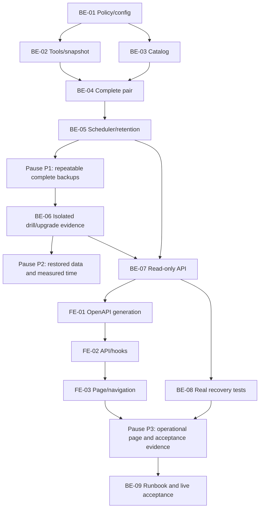

# F-26 Backup and Restore Drill — Backend + Frontend Implementation Plan

This plan builds the post-MVP operational feature labelled F-26 / EP-26 by the task brief: a daily PostgreSQL custom-format dump paired with the complete durable `FILES_ROOT` folder, retention of at least 30 successful pairs, and an isolated restore drill with recorded recovery time. It also builds a permission-controlled, read-only Vietnamese operations page. Restore, drill acceptance and off-machine copying remain operator actions, not HTTP actions. No existing business table, release policy or attachment permission changes.

> **Companion documents**
> - Decisions: `docs/planning/feature-questions.md:257` (§F-26: blank answers mean A); F26-02 is a Faculty risk, not an infrastructure fact.
> - Epic provenance: `docs/planning/epics.md` §0 explicitly postpones F-26 and requires manual database + files backups meanwhile. **There is no EP-26 row or dedicated EP-26 acceptance scenario in that document, and no EP-26 stories in `docs/planning/user-stories.md`.** Do not invent either. Use §0, `docs/progress/todo.md:82`, CV-187 (`docs/planning/task-breakdown.md:363`) and the NFR acceptance rows instead.
> - Requirements: `docs/requirement/REQUIREMENTS.md` §9.3 (NFR-12..14), NFR-09/16/18/19; FR-47/71/73 and BR-23 provide the attachment/history preservation context. US-074 and US-077/079 are existing EP-15/16 context, not reassigned EP-26 stories.
> - Design: `docs/design/tech-stack.md` §§2–3; `docs/design/data-dictionary.md` §5 `SyllabusAttachment` and §6 `ChangeRequestDocument`; `docs/design/erd.md`; `docs/design/state-diagrams.md` §4; `docs/design/sequence-diagrams.md` §10; `docs/design/screen-inventory.md` §2.2. These do not specify a backup entity, lifecycle, sequence or numbered backup screen.
> - Scope: `docs/planning/deferred-scope.md` §2.1 (audit deferred), `docs/planning/task-breakdown.md` K-6 and CV-187; `docs/architecture/general_architecture.md`, `features_architecture.md`, `database_and_models.md`.
> - Built-feature reports read: `docs/implement-report/f-01-auth-session-implement-report.md`, `f-02-accounts-roles-permissions-implement-report.md`, `f-10-syllabus-implement-report.md`, `f-13-change-requests-implement-report.md`, `f-14-three-level-approval-notifications-implement-report.md`, `f-15-release-version-snapshots-implement-report.md`. Source, not earlier plan shapes, controls this plan.
> - Verification: `docs/planning/test-plan.md:391` (seven-day NFR-12 observation), `:392` (clean restore + B4 acceptance + recovery time), `:393` (pre/post-upgrade released-content comparison). Proposed feature manual checklist: `docs/testing/feature__f-26-backup-restore-drill.md` (BE-09; not present yet).

**Status**: Not started

## 0. Plan at a glance

Everything below in one table. Read this; the rest is detail for whoever builds it.

| What | Why | How and where |
|---|---|---|
| **One daily database + attachment backup** | NFR-12; F26-01 A | BullMQ scheduler at 02:00 in `Asia/Ho_Chi_Minh`; custom-format `pg_dump`, complete final-file tree and checksummed manifest in one completed directory (BE-01..05) |
| **A restorable pair, not two unrelated copies** | K-6; FR-47; NFR-13 | One exported PostgreSQL snapshot for dump, attachment references and released-content evidence; validate every referenced file before atomic publication (BE-02..04) |
| **Keep the newest 30 successful sets** | NFR-12; F26-01 A | Prune whole pairs only after successful publication; failures, interrupted staging and Redis loss never consume the retention count (BE-03/05) |
| **Restore into a clean, isolated target** | NFR-13; F26-03 A | Explicit operator CLI restores to an empty drill database and new files folder; never starts the production application or restores through the web (BE-06) |
| **Measured recovery and acceptance evidence** | NFR-13; CV-187 | Record monotonic restore/copy/verification durations, then separate signed-off B4 acceptance; repeat for each delivery tier (BE-06/08/09) |
| **Prove released history survives** | NFR-14; US-074; CV-187 | Persist versioned released-content fingerprints/file hashes; verify after restore and capture a fresh read-only baseline immediately before live upgrades, then compare afterward without F-16 (BE-04/06/08) |
| **Vietnamese operations visibility** | NFR-09/16/18/19 | New `backup.view` permission, R1 by default; three GET endpoints and `/operations/backups` page for status, paged runs and drill evidence (BE-07; FE-01..03) |
| **Faculty-controlled physical storage** | F26-02 A is an assumption, not a decision about an actual disk | Explicit `BACKUP_ROOT` on a different disk on the same host; weekly manual off-machine copy and external ACL/access arrangements remain deployment gates (BE-09; §8) |

**Key behaviours worth knowing**

| Behaviour | Why it is this way |
|---|---|
| Backup identity is the latest due local-calendar slot, not a BullMQ job ID | Replaying jobs or rebuilding Redis cannot create duplicate successful daily sets; catch-up records the actual snapshot time, not fictional historical data |
| Concurrent attachment removal may make an attempt fail and retry | Existing file-first uploads / DB-first removals remain unchanged; a pair with a missing referenced file must never become successful |
| `SUCCEEDED` for a backup means dump structure + pair validation, not a proven restore | Only the drill proves recovery; the dashboard distinguishes these facts |
| A machine-restored drill is `RESTORED`, not accepted | A separate operator acceptance records the B4 walkthrough; automatic checks alone do not close NFR-13 |
| Backups are disabled until explicitly configured; the page says so | No default destination guesses a Faculty disk or causes silent production dumps; disabled mode does not satisfy NFR-12 |
| Raw dumps, attachment trees, DB URLs and absolute storage paths have no web download endpoint | Dumps contain password hashes, sessions and personal data; normal application read permission is not permission to extract a whole database |

**Not included**

| Excluded | Why |
|---|---|
| Automatic production restore, database reset, browser restore/upload, destructive cleanup commands | Operator-owned disaster recovery; runbook and explicit approvals are required |
| Redis backup as application data | Queue/job state is disposable; bootstrap rebuilds the schedule from persistent sets |
| AuditLog, email alerts, deployment manifests, RTO/SLA promises, encrypted backup format or S3 | Audit is deferred; F-25/F-27 are unbuilt; no approved numerical recovery target or remote-storage service |
| Rebuilding F-15 history, F-16 comparison, F-09 import | Built history remains authoritative; those post-MVP features are not prerequisites |

**Open questions**

| Question | Resolved when | Default if unanswered |
|---|---|---|
| Which separate disk, capacity, operator and external weekly destination? | Faculty provisions and tests them | F26-02 A; implementation may use disposable test roots, but production acceptance remains open |
| Is an acceptable recovery-time target or stronger off-site/encryption policy required? | Faculty supplies its operating policy | Measure actual times; no invented pass/fail RTO or cryptography dependency |
| Who signs each delivery-tier drill and supplies the clean drill environment? | Release owner names operator/environment | Required CLI operator label and tier; never fabricate old-tier drill evidence |

## 1. Scope

| In scope | Why |
|---|---|
| Daily 02:00 `pg_dump` + all durable final files under `FILES_ROOT` | F26-01 A; NFR-12; K-6 |
| Checksummed manifest, PostgreSQL-version/migration evidence, replay safety, startup reconciliation | Restore must be possible without Redis or the application's database catalog |
| Minimum 30 most recent successful complete sets, with failed attempts separately visible | NFR-12 counts usable pairs, not jobs or partial directories |
| Isolated restore CLI, timed verification, separate human acceptance, every-tier checklist | F26-03 A; NFR-13; test-plan NFR-13 |
| Released-content verification before/after an upgrade | CV-187; NFR-14; does not implement upgrades |
| Read-only status/list API + operational FE with generated types | A small BE/FE contract; no production credentials or filesystem control enters the browser |
| Runbook, seven-day observation and off-machine copying checklist | F26-02 A; live operational acceptance cannot be replaced by mocked tests |

| Out of scope | Deferred until |
|---|---|
| Real-host disk provisioning, off-site service account, encryption key custody | Faculty answers F26-02 and deployment owner provisions infrastructure |
| Point-in-time recovery, WAL shipping, HA replication, automatic failover | A separate approved operational requirement |
| User-controlled cron/retention changes or backup deletion in FE | A later product request; F26-01 fixes this feature's policy |
| Continuous metrics/email notification and production Compose image work | F-27/F-25 owners integrate the explicit contracts in §8 |
| Modification of built business schemas or release/attachment semantics | Not needed; escalate any implementation proposal that would require it |

No dedicated EP-26 ACs exist in the inputs. The following local acceptance labels make the actual NFR/decision coverage explicit; they are not invented user stories.

| AC / source | Covered by |
|---|---|
| F26-AC1: automatic daily backup at 02:00 including database + attachments (F26-01; NFR-12) | BE-01..05, BE-08/09, FE-03 |
| F26-AC2: keep at least 30 newest successful pairs; failed/replayed runs do not prune good sets (NFR-12) | BE-03/05/08 |
| F26-AC3: clean isolated restore from documentation alone, actual recovery duration recorded (NFR-13; test-plan row :392) | BE-06/08/09, FE-02/03 |
| F26-AC4: compare every released version, pins, PLO and matrices after restore and after each upgrade (CV-187; NFR-14; test-plan row :393) | BE-04/06/08/09 |
| F26-AC5: different-disk destination and weekly manual external copy are documented, not silently assumed deployed (F26-02 A) | BE-01/09; §8 |
| F26-AC6: a recorded drill per delivery tier, no fabricated retroactive records (F26-03 A) | BE-06/09, FE-03 |
| F26-AC7: metadata protected server-side, Vietnamese errors, paging/search/sort (NFR-09/16/18/19) | BE-07/08; FE-01..03 |

## 2. Contract verification

Verified against the working-tree source on 2026-10-25. All F-26 APIs, wire enums and filesystem formats below are **PLANNED / UNBUILT**, not endpoints claimed to exist. There is no existing backup serializer to cite. Implement BE-07 and regenerate FE-01 before any consumer is compiled. Existing foundations are anchored here and reused by reference in the deliverables.

| Existing foundation | Source as it is now | Consequence |
|---|---|---|
| App composition and global guards | `source/backend/src/app.module.ts:34`, `source/backend/src/app.module.ts:59` | Add one feature module; retain session, CSRF and permission guards |
| Redis connection and optional key prefix | `source/backend/src/shared/queue/queue.module.ts:8` | Reuse `BullModule`; do not introduce Redis cache/catalog state |
| Daily + boot job scheduling already exists | `source/backend/src/features/releases/release-activation.scheduler.ts:40` | F-15, not F-09, is the actual queue mirror; `upsertJobScheduler`, timezone, nonblocking bootstrap, bounded retry options |
| Worker retry/shutdown behaviour | `source/backend/src/features/releases/release-activation.processor.ts:29`, `:72` | Backups need bounded child-process cancellation and durable crash reconciliation in addition to this pattern |
| Durable file root, temp-write + rename, read and removal | `source/backend/src/shared/files/file-storage.service.ts:20`, `:29`, `:37`, `:49` | Do not replace this service; copy its root, never raw PostgreSQL data directories |
| Attachment file precedes DB row; insert failure compensates | `source/backend/src/features/syllabi/syllabus-attachments.service.ts:76`, `:95`; `source/backend/src/features/change-requests/change-request-documents.service.ts:74`, `:96` | Extra orphan files are safe; missing DB-referenced files are not |
| Draft removal deletes DB row before disk bytes; signed files lock | `source/backend/src/features/syllabi/syllabus-attachments.service.ts:149`, `:160`; `source/backend/src/features/change-requests/change-request-documents.service.ts:140` | A naive dump-then-copy can race; require snapshot reference verification and retry, not a claim of atomic filesystem snapshots |
| Whole-request deletion also removes files | `source/backend/src/features/change-requests/change-requests.service.ts:210` | Include this race in tests; no call site is replaced |
| Relative paths and stored sizes | `source/backend/prisma/schema.prisma:679`, `:909` | Snapshot references come from both attachment tables; copy every final file, not only these two directories |
| Frozen released rows and pinned syllabus IDs | `source/backend/src/shared/releases/version.publisher.ts:112`, `:147`; `source/backend/prisma/schema.prisma:583` | Fingerprint stored snapshots/pins, not current `Course` values |
| Revision-aware historical reader | `source/backend/src/features/releases/version-history.reader.ts:22` | Manual acceptance opens restored version history; no new F-16 diff dependency |
| Business schema currently has no backup models | `source/backend/prisma/schema.prisma:168`, `:909` | Use operational manifests; no migration, FK or built-table modification |
| Config validation and FILES_ROOT default | `source/backend/src/shared/config/env.validation.ts:23`, `:53`, `:69` | Extend typed `Env`; avoid implicit boolean coercion of the string `false` |
| Permission checking and ALL scope | `source/backend/src/shared/authz/access-context.ts:89`, `:101` | New metadata permission must require DIRECT + ALL, not just a matching scoped code |
| Permissions emitted by serializer | `source/backend/src/features/auth/me.dto.ts:38`, `:58` | New seeded code flows through existing `/auth/me`; no new session shape |
| Existing permission catalog and two locked cells | `source/backend/prisma/seed-data/permission-catalog.ts:25`, `:38`; `source/backend/src/shared/authz/locked-cells.ts:3` | Add one catalog row, leave existing grants/locked cells alone |
| JSON client, error handling and URL query helper | `source/frontend/src/shared/api/client.ts:9`, `:31`, `:44`, `:70` | Bare DTO JSON, no invented success envelope; use `getJson` and `withQuery` |
| Existing GET auth serializer | `source/backend/src/features/auth/auth.controller.ts:74`; `source/backend/src/features/auth/me.dto.ts:38` | Shared auth remains the only session state; backup pages do not create another store |
| Paging shape and bounds | `source/backend/src/shared/pagination/page.ts:3`; `source/backend/src/shared/pagination/page-query.dto.ts:5` | Use `{items,total,page,pageSize}`, default 20, maximum 100 |
| Passive polling | `source/backend/src/features/notifications/notifications.controller.ts:41` | Apply `@PassiveRequest()` to polled operations GETs so polling does not extend idle sessions |
| FE route/menu/permission patterns | `source/frontend/src/routes.ts:38`; `source/frontend/src/router.tsx:323`; `source/frontend/src/shared/layout/menuItems.tsx:56`; `source/frontend/src/shared/auth/permissions.ts:4` | Add a leaf route/menu with a generated permission literal, no new role bypass |
| FE page/query/data-table mirrors | `source/frontend/src/features/releases/pages/VersionHistoryPage.tsx:13`; `source/frontend/src/features/releases/hooks/useReleases.ts:43`; `source/frontend/src/shared/design-system/DataTable.tsx:43` | Reuse loading/error/query patterns, but follow the design system's new-page anatomy |
| Existing pg dependency and real containers | `source/backend/package.json:52`; `source/backend/test/containers.ts:4`, `:9` | Use installed `pg` and PostgreSQL 18 tools, not a new backup/archive library |
| Test app and release fixtures | `source/backend/test/test-app.ts:5`; `source/backend/test/fixtures/releases.ts:65` | Use real release APIs and synthetic files; never read real-data directories |

### 2a. Endpoints

All paths include the existing `/api` prefix. All three new endpoints require a valid session and `@RequirePermission(PERMISSIONS.BACKUP_VIEW)`; the service additionally requires `access.modeFor(code, {}) === 'DIRECT'` and `access.scopeFor(code).all`. `@PassiveRequest()` applies to all three. No backup/restore POST, credentials endpoint or binary download is planned.

| Endpoint | Verified at / planned owner | Request | Response | Notes |
|---|---|---|---|---|
| `GET /api/operations/backups/status` | **UNBUILT** — BE-07 `src/features/backups/backups.controller.ts` | None | `BackupStatusDto`, 200 | Reads cached small manifests/catalog only; no dump, hash scan, queue mutation or repair on GET |
| `GET /api/operations/backups` | **UNBUILT** — BE-07 same controller | `BackupListQueryDto`: page/pageSize, `q?` (max `SEARCH_MAX`), `status?`, `sort?: 'newest' \| 'oldest'` | `BackupRunPageDto`, 200 | Run rows include failed/interrupted/expired slots; search ID/date; stable scheduled-date + ID sorting |
| `GET /api/operations/restore-drills` | **UNBUILT** — BE-07 same controller | `DrillListQueryDto`: page/pageSize, `q?`, `tier?: 'B1'..'B6'`, `status?`, same sort | `RestoreDrillPageDto`, 200 | Search drill/backup ID and operator; stable startedAt + ID sorting; expanded row contains checks/acceptance evidence |
| `GET /api/auth/me` (infrastructure only) | `source/backend/src/features/auth/auth.controller.ts:74`; mapper `source/backend/src/features/auth/me.dto.ts:38` | Existing session | Existing `MeDto` | Already consumed by shared auth; no F-26-specific request or transformation |

Errors use the existing `ErrorResponseDto`, not a new envelope. Missing session is 401; missing/incorrect-scope permission is 403; malformed filters are 400; unreadable catalog is a sanitized 503 `BACKUP_CATALOG_UNAVAILABLE`, not an empty successful list. Disabled mode returns a truthful status and empty lists when no root exists; a previously configured catalog remains readable when scheduling is disabled.

### 2b. DTOs and exact field mapping

New DTO source in every **P** row is **PLANNED** `source/backend/src/features/backups/dto/backups.dto.ts` (BE-07); nullability and literals below are the contract to implement, then verify at its mapper. The FE aliases generated DTOs directly and renders every field; it creates no duplicate domain model. ISO instants are UTC strings, durations are milliseconds, byte totals are decimal strings to avoid unsafe JavaScript integers. A nullable value means not reached/not known, never zero by default.

| `BackupStatusDto` field | Wire type | Nullable | Source | Modeled as / note |
|---|---|---|---|---|
| state | `DISABLED \| READY \| RUNNING \| OVERDUE \| FAILED` | no | P | StatusTag; precedence DISABLED, RUNNING, FAILED, OVERDUE, READY |
| schedule | string | no | P | Cron text; `0 2 * * *` |
| timeZone | string | no | P | `Asia/Ho_Chi_Minh` |
| retentionCount | number | no | P | Fixed policy, 30 |
| retainedCount | number | no | P | Currently complete published sets, not count of run rows |
| dueSlot | string, date | no | P | Latest due calendar date in configured timezone |
| lastSuccessfulAt | string, date-time | yes | P | Backup completion timestamp |
| lastRecoveryMs | number | yes | P | Latest accepted drill's machine recovery time, labelled with boundary in UI |
| lastAcceptedTier | `B1 \| B2 \| B3 \| B4 \| B5 \| B6` | yes | P | Latest accepted drill, not automatic coverage of previous tiers |
| currentRunId | string | yes | P | Active daily slot; stale crash records reconciled by worker/bootstrap |
| lastFailure | `OperationFailureDto` | yes | P | Visible sanitized cause/action |

| `BackupRunDto` field | Wire type | Nullable | Source | Modeled as / note |
|---|---|---|---|---|
| id | string | no | P | `daily-YYYY-MM-DD`; row key |
| scheduledFor | string, date | no | P | Due slot, not snapshot date |
| status | `RUNNING \| SUCCEEDED \| FAILED \| INTERRUPTED \| EXPIRED` | no | P | Tag; EXPIRED means deliberate retention removal |
| startedAt | string, date-time | no | P | Most recent attempt's start |
| completedAt | string, date-time | yes | P | Terminal attempt time |
| attempt | number | no | P | Durable attempt count, independent of BullMQ attemptsMade |
| snapshotAt | string, date-time | yes | P | Real exported-snapshot acquisition time |
| databaseBytes | string | yes | P | Dump bytes |
| fileBytes | string | yes | P | Total durable file bytes |
| fileCount | number | yes | P | Includes harmless unreferenced final files |
| releasedVersionCount | number | yes | P | Number of non-Draft versions at the snapshot |
| durationMs | number | yes | P | Entire backup attempt |
| failure | `OperationFailureDto` | yes | P | No raw subprocess stderr/path/URL |

| `RestoreDrillDto` field | Wire type | Nullable | Source | Modeled as / note |
|---|---|---|---|---|
| id | string | no | P | UUID row key |
| backupId | string | no | P | Immutable source set identity |
| tier | `B1 \| B2 \| B3 \| B4 \| B5 \| B6` | no | P | Required operator input |
| operator | string | no | P | Required non-secret operator label |
| status | `RUNNING \| RESTORED \| SUCCEEDED \| FAILED \| INTERRUPTED` | no | P | RESTORED awaits manual B4 acceptance |
| startedAt | string, date-time | no | P | Restore attempt start |
| completedAt | string, date-time | yes | P | Automated restoration/check end |
| recoveryMs | number | yes | P | Monotonic total: source validation through restored-data verification |
| databaseRestoreMs | number | yes | P | `pg_restore` stage |
| filesRestoreMs | number | yes | P | File restore stage |
| verificationMs | number | yes | P | SQL/content/hash checks |
| releasedVersionCount | number | yes | P | Verified version count |
| checks | `DrillCheckDto[]` | no | P | Empty until first check completes; display every element |
| acceptedAt | string, date-time | yes | P | Human acceptance instant, separate from recovery clock |
| acceptanceNote | string | yes | P | B4 case/evidence reference; no attachment or path dereferencing |
| failure | `OperationFailureDto` | yes | P | Terminal sanitized failure |

| Nested/page field | Wire type | Nullable | Source | Modeled as / note |
|---|---|---|---|---|
| `OperationFailureDto.code` | string | no | P | Stable BACKUP_/DRILL_ failure code |
| `OperationFailureDto.message` | string | no | P | Vietnamese cause + next action |
| `DrillCheckDto.code` | `DUMP_HASH \| DB_RESTORE \| FILE_HASHES \| DB_FILE_REFERENCES \| RELEASED_CONTENT \| LOCALE \| MIGRATIONS` | no | P | Vietnamese label map |
| `DrillCheckDto.passed` | boolean | no | P | Explicit result, not inferred from message |
| `DrillCheckDto.message` | string | no | P | Vietnamese detail |
| `BackupRunPageDto.items` | `BackupRunDto[]` | no | P | Table data |
| `BackupRunPageDto.total` | number | no | P | Filtered total |
| `BackupRunPageDto.page` | number | no | P | Current page |
| `BackupRunPageDto.pageSize` | number | no | P | Current page size |
| `RestoreDrillPageDto.items` | `RestoreDrillDto[]` | no | P | Table data |
| `RestoreDrillPageDto.total` | number | no | P | Filtered total |
| `RestoreDrillPageDto.page` | number | no | P | Current page |
| `RestoreDrillPageDto.pageSize` | number | no | P | Current page size |

Existing infrastructure DTOs are delegated to shared auth/API handling, not reimplemented by F-26:

| Existing field | Wire type | Nullable | Verified source | Modeled as / note |
|---|---|---|---|---|
| `MeDto.id` | string | no | `source/backend/src/features/auth/me.dto.ts:44` | Shared Me; not modeled again |
| `MeDto.username` | string | no | `source/backend/src/features/auth/me.dto.ts:45` | Shared Me |
| `MeDto.userCode` | string | no | `source/backend/src/features/auth/me.dto.ts:46` | Shared Me |
| `MeDto.fullName` | string | no | `source/backend/src/features/auth/me.dto.ts:47` | Shared Me |
| `MeDto.email` | string | yes | `source/backend/src/features/auth/me.dto.ts:48` | Shared Me |
| `MeDto.mustChangePassword` | boolean | no | `source/backend/src/features/auth/me.dto.ts:49` | Existing guard |
| `MeDto.orgUnit` | `{id,unitCode,unitName}` strings | yes | `source/backend/src/features/auth/me.dto.ts:50`; `source/backend/src/shared/dtos/ref.dto.ts:4` | Existing shared auth reference; no F-26 mapping |
| `MeDto.roles` | `MeRoleDto[]` | no | `source/backend/src/features/auth/me.dto.ts:51` | Existing shared auth; no role-name gating |
| `MeRoleDto.roleCode` | string | no | `source/backend/src/features/auth/me.dto.ts:52` | Shared auth only |
| `MeRoleDto.roleName` | string | no | `source/backend/src/features/auth/me.dto.ts:53` | Shared auth only |
| `MeRoleDto.scopeType` | `SYSTEM \| UNIT \| ASSIGNMENT` | no | `source/backend/src/features/auth/me.dto.ts:54`; `source/backend/prisma/schema.prisma:100` | Shared auth only |
| `MeRoleDto.scopeUnit` | `{id,unitCode,unitName}` strings | yes | `source/backend/src/features/auth/me.dto.ts:55` | Shared auth only |
| `MeRoleDto.derived` | boolean | no | `source/backend/src/features/auth/me.dto.ts:56` | Shared auth only |
| `MeDto.permissions` | generated `PermissionCode[]` | no | `source/backend/src/features/auth/me.dto.ts:58` | `useCan` / `RequirePermission`; adds `backup.view` |
| `ErrorResponseDto.statusCode` | number | no | `source/backend/src/shared/dtos/error-response.dto.ts:13` | Existing ApiError.status |
| `ErrorResponseDto.code` | string | no | `source/backend/src/shared/dtos/error-response.dto.ts:16` | Existing ApiError.code |
| `ErrorResponseDto.message` | string | no | `source/backend/src/shared/dtos/error-response.dto.ts:19` | Existing ApiError.message |
| `ErrorResponseDto.details` | `FieldErrorDto[]` | optional, not null | `source/backend/src/shared/dtos/error-response.dto.ts:22` | Existing ApiError.details |
| `FieldErrorDto.field` | string | no | `source/backend/src/shared/dtos/error-response.dto.ts:5` | Existing field-error renderer |
| `FieldErrorDto.constraints` | string[] | no | `source/backend/src/shared/dtos/error-response.dto.ts:8` | Existing field-error renderer |
| `ErrorResponseDto.path` | string | no | `source/backend/src/shared/dtos/error-response.dto.ts:25` | Not modeled: diagnostics stay in existing API layer |
| `ErrorResponseDto.timestamp` | string | no | `source/backend/src/shared/dtos/error-response.dto.ts:28` | Not modeled: no FE requirement |

No existing snapshot/detail DTO is consumed by the new API; verification reads the database at the same snapshot as the dump, not another feature's HTTP DTO. The PostgreSQL and filesystem contracts are specified in BE-02..06.

### 2c. Mismatch log

| Deliverable | What an earlier plan/design might suggest | What the source does | Found at |
|---|---|---|---|
| BE-05 | F-09 would provide the first BullMQ processor | F-09 is unbuilt; F-15 has a boot/daily scheduler and processor | `source/backend/src/features/releases/release-activation.scheduler.ts:48`; `source/backend/src/features/releases/release-activation.processor.ts:14` |
| BE-04 | Sequential DB dump + file copy is automatically consistent | Files can be removed after their rows are deleted | `source/backend/src/features/syllabi/syllabus-attachments.service.ts:160`; `source/backend/src/features/change-requests/change-request-documents.service.ts:140` |
| FE-03 | Older plans mention PageContainer / ApiErrorAlert | Actual release page uses Skeleton/Result; current design system defines PageHeader/DataTable/ListPageLayout | `source/frontend/src/features/releases/pages/VersionHistoryPage.tsx:13`; `source/frontend/src/shared/design-system/DataTable.tsx:43` |

These are resolved by the shapes below, not contradictions requiring changes to built business behaviour. Append any build-time mismatch here before changing a contract.

## 3. Decisions

| ID | Decision | Why | Rejected alternative |
|---|---|---|---|
| D1 | Use F26-01 A: 02:00 local time, 30 complete sets, fixed policy constants | Explicit default; NFR-12 | Configurable business-policy UI |
| D2 | Store immutable successful pairs and operational records on disk, not in new Prisma tables | Catalog must survive loss of the database being restored; no schema/owned-table escalation | DB-only history or Redis-only truth |
| D3 | `pg_dump --format=custom`, exported snapshot, SHA-256 and ordinary directory copy using Node built-ins | PostgreSQL toolchain is already named in tech-stack; no new runtime dependency | Tar/zip library, node-cron, backup package or filesystem snapshot service |
| D4 | Keep attachment writers unchanged; fail/retry if any snapshot-referenced byte is unavailable | Smallest safe pairing design; no cross-feature file lock or new upload failure policy | Blocking all application writes or claiming a cross-resource transaction |
| D5 | Serialize backup/retention/drill using a dedicated source-DB session advisory lock, key `BACKUP_OPERATION_LOCK_KEY = 5002` | Cross-process safety; separate from existing requisite key 5001 (`source/backend/src/shared/courses/requisite-graph.ts:21`) | Worker concurrency alone or stale exclusive lockfiles |
| D6 | Retention counts only fully published sets; run/drill evidence stays outside removable sets | An expired backup must not erase its drill report | Deleting single dumps or counting failed attempts |
| D7 | Isolated CLI restore only; `RESTORED` → explicit human acceptance → `SUCCEEDED` | NFR-13 requires a usable recovered system and B4 walkthrough, not just exit code zero | Production restore endpoint; automatic acceptance of mocked tests |
| D8 | Read-only operational screen with additive `backup.view`, R1 DIRECT/ALL by default | Least-privilege visibility; no existing permission is repurposed | Role hard-coding or giving all `user.manage` holders database metadata access |
| D9 | Keep a versioned, stable released-content projection independent of F-16 | NFR-14 must be demonstrable now | Wait for an unbuilt diff API or fingerprint current course catalog values |
| D10 | Configured-off by default, production enablement is an explicit delivery gate | Actual storage/ACLs are Faculty-owned unknowns | Silently backing up inside the attachment folder or application image |
| D11 | Record measured recovery duration, no invented RTO | NFR-13 and F26-03 require evidence, not a specific number of minutes | Treating the safety timeout as a recovery-time acceptance target |

## 4. Deliberate divergences

| Input / earlier assumption | This plan | Reason |
|---|---|---|
| EP-26 was requested as an epic identifier | Operational F-26 provenance and local NFR acceptance labels; no fabricated EP-26 row/story | `epics.md` §0 and todo contain the feature, but the epic table/stories do not |
| CV-187 is classified as documentation | Deliver automation, timing/evidence tooling, tests and the runbook | NFR-12 requires automatic backups; documentation alone cannot meet it |
| No backup screen appears in the screen inventory | Add an unnumbered operational `/operations/backups` page, not a fabricated MH code | Required BE/FE plan; exposes only metadata and cannot restore anything |
| The target dictionary has wider future entities than the MVP schema | Dump the whole database generically; semantic fingerprints cover only currently built release tables | Never create future tables or assume concurrently drafted plans have landed |
| F26-02 A says another disk and weekly external copy | Validate safe roots, document/observe the copy; leave actual media, operator and transport as Faculty risks | No service/account/toolchain is authorized by that answer |

## 5. Deliverables

Every path below is relative to the repository root. `NEW` paths are proposed outputs under inspected existing parents; they do not claim that files already exist. No deletion or shared-function replacement is planned. Do not create a branch, commit or push as part of these steps.

### BE-01 — Policy, configuration and failure vocabulary

**What / why.** Establish the fixed A-default policy, validated roots/tool paths and Vietnamese failures before any job can touch storage.

**Files**
- `NEW source/backend/src/shared/backups/backup.constants.ts`
- `NEW source/backend/src/shared/backups/backup.errors.ts`
- `NEW source/backend/src/shared/backups/backup-config.ts`
- `NEW source/backend/src/shared/backups/backup-config.spec.ts`
- `MODIFY source/backend/src/shared/config/env.validation.ts`
- `MODIFY source/backend/src/shared/config/env.validation.spec.ts`
- `MODIFY source/backend/.gitignore` — add only anchored `/backups/`; no environment-file changes.

**Shape**

```ts
export const BACKUP_POLICY = {
  CRON: '0 2 * * *',
  RETENTION_COUNT: 30,
  OPERATION_LOCK_KEY: 5002,
  ATTEMPTS: 6,
  BACKOFF_MS: 60_000,
  OPERATION_TIMEOUT_MS: 1_800_000,
  CHILD_TERMINATION_GRACE_MS: 5_000,
  SHUTDOWN_GRACE_MS: 10_000,
  OVERDUE_GRACE_MS: 7_200_000,
  SEARCH_MAX: 100,
  OPERATOR_MAX: 100,
  ACCEPTANCE_NOTE_MAX: 1000,
  STDERR_MAX_BYTES: 16_384,
  QUEUE_FAILED_JOBS_KEPT: 20,
  COPY_CONCURRENCY: 1,
  CATALOG_VERSION: 1,
  PROJECTION_VERSION: 1,
  POSTGRES_MAJOR: 18,
} as const;

export interface BackupConfig {
  enabled: boolean;
  root: string | null;
  filesRoot: string;
  databaseUrl: string;
  pgDumpPath: string;
  pgRestorePath: string;
}

export function backupConfig(config: ConfigService<Env, true>): BackupConfig;
export function assertSafeRoots(root: string, filesRoot: string): Promise<void>;
export function latestDueSlot(now: Date): string;
```

The signatures above identify the required exports; implement functions with bodies, not declaration-only runtime files. `latestDueSlot` returns the calendar day whose 02:00 boundary is the latest one not after `now`, using `APP_TIME_ZONE` (`source/backend/src/shared/time/today.ts:1`). Before 02:00 it returns yesterday. Use `Intl.DateTimeFormat` parts, not the host timezone, a UTC cron or elapsed-24-hour arithmetic presented as local-calendar semantics.

Add `@IsIn(['true', 'false']) BACKUP_ENABLED: string = 'false'`, optional nonempty strings `BACKUP_ROOT`, and nonempty `PG_DUMP_PATH = 'pg_dump'`, `PG_RESTORE_PATH = 'pg_restore'` to `Env`. Convert enabled by exact equality. When enabled, require an explicitly configured absolute root; disabled mode may have no root. Do not require installed PostgreSQL clients in unrelated unit tests or disabled deployments. When configured, realpath both roots and reject equality, either ancestor relationship, symlink/junction roots and roots that are filesystem roots. A missing `FILES_ROOT` in enabled mode is a readiness failure, not permission to silently create an empty backup source. Resolve FILES_ROOT as the existing service does; do not mutate it. Validate root containment again at every destructive staging/trash operation, with case-insensitive path comparisons on Windows and component boundaries, not a naive string prefix.

Failure definitions use `ErrorDefinition` and Vietnamese cause/action messages: `BACKUP_NOT_CONFIGURED`, `BACKUP_ROOT_INVALID`, `BACKUP_TOOL_UNAVAILABLE`, `BACKUP_TOOL_VERSION_MISMATCH`, `BACKUP_DATABASE_OPTIONS_UNSUPPORTED`, `BACKUP_BUSY`, `BACKUP_TIMEOUT`, `BACKUP_DUMP_FAILED`, `BACKUP_SOURCE_CHANGED`, `BACKUP_FILE_MISSING`, `BACKUP_CHECKSUM_MISMATCH`, `BACKUP_CATALOG_INVALID`, `BACKUP_CATALOG_UNAVAILABLE`, `BACKUP_RETENTION_FAILED`, `DRILL_TARGET_UNSAFE`, `DRILL_RESTORE_FAILED`, `DRILL_VERIFICATION_FAILED`, `DRILL_ACCEPTANCE_FAILED`. Internal operational failures are persisted as sanitized `{code,message}`; only catalog HTTP failures need a 503. Permission/validation responses remain the common existing errors. Example: `BACKUP_FILE_MISSING` → `Thiếu tệp được cơ sở dữ liệu tham chiếu. Hãy kiểm tra thư mục tệp và chạy lại sao lưu.`

**Rationale / mirror.** Mirror typed defaults/validation at `source/backend/src/shared/config/env.validation.ts:14`, Vietnamese definitions at `source/backend/src/shared/files/file.errors.ts:4` and timezone handling at `source/backend/src/shared/time/today.ts:4`. The timeout is a safety cap, **not** an RTO promise.

**Gotchas.** Disabled is not compliant; flag that in the runbook/UI. Do not read dotenv or credentials to discover real paths. `stat.dev` is not proof of a different physical disk on every Windows/network mount; Faculty verification is mandatory. No new npm package or runtime service is authorized.

**Verify.** From `source/backend`: `pnpm test -- src/shared/config/env.validation.spec.ts src/shared/backups/backup-config.spec.ts`. Cover false-string coercion, missing/relative/overlapping roots, junctions, timezone boundaries at 01:59:59/02:00 and disabled-without-tools startup.

**Depends on:** —.

### BE-02 — Native PostgreSQL execution and snapshot-session boundary

**What / why.** Make tool execution cancellable and secret-safe, and hold a real PostgreSQL session for the snapshot/operation lock.

**Files**
- `NEW source/backend/src/shared/backups/postgres-tool.runner.ts`
- `NEW source/backend/src/shared/backups/postgres-tool.runner.spec.ts`
- `NEW source/backend/src/shared/backups/backup-session.ts`
- `NEW source/backend/src/shared/backups/backup-session.spec.ts`

**Shape**

```ts
export interface ToolResult {
  exitCode: number;
  durationMs: number;
}
export interface SnapshotSession {
  client: pg.Client;
  snapshotId: string;
  snapshotAt: string;
  sourceDatabaseName: string;
  serverVersionNum: number;
}
export interface PostgresTools {
  assertCompatible(signal: AbortSignal): Promise<void>;
  dump(output: string, snapshotId: string, signal: AbortSignal): Promise<ToolResult>;
  inspect(dump: string, signal: AbortSignal): Promise<ToolResult>;
  restore(dump: string, targetUrl: string, signal: AbortSignal): Promise<ToolResult>;
}
export function withBackupOperation<T>(
  config: BackupConfig,
  signal: AbortSignal,
  run: (client: pg.Client) => Promise<T>,
): Promise<T>;
export function withExportedSnapshot<T>(
  client: pg.Client,
  run: (snapshot: SnapshotSession) => Promise<T>,
): Promise<T>;
```

`withBackupOperation` constructs one dedicated installed-`pg` client, connects using the validated config, and executes parameterized `SELECT pg_try_advisory_lock($1) AS acquired` with the policy key. A false result becomes retryable `BACKUP_BUSY`, not a successful skipped daily slot. Always unlock and close in `finally`; on connection loss abort the callback/child and fail the attempt. The advisory lock is held through publication and retention, or through an isolated restore/verification; no Prisma interactive transaction waits on an external tool.

`withExportedSnapshot` runs `BEGIN ISOLATION LEVEL REPEATABLE READ READ ONLY`, then `SELECT pg_export_snapshot() AS snapshot_id, clock_timestamp() AS snapshot_at`, `current_database()` and `current_setting('server_version_num')`. Run every reference/projection/migration query on that **same client/transaction**. Keep it open until `pg_dump` completes and expected evidence has been read; rollback/read-only completion and session cleanup happen on success and every failure. Do not release the exporter before the dump imports it.

Use `spawn(executable, args, {shell:false, windowsHide:true, env:childEnv, signal})`; wait for `close`, inspect exit code and output existence, handle `error`/abort, cap captured diagnostics and never pass a DB URI/password in argv. Build child libpq environment from the same validated source connection: PGHOST/PGPORT/PGDATABASE/PGUSER/PGPASSWORD and supported TLS options. Preserve percent-encoded values correctly; allowlist supported URL options and reject unsupported ones rather than silently removing SSL or using a different database. Ignore only Prisma's public-schema selector after asserting it is `public`. Capture required OS executable/temp variables through the configuration adapter, not ad hoc `process.env` reads in feature services. Never log environment, credentials, the URL, raw stderr or the full invocation.

Required argument arrays:

```ts
const dumpArgs = [
  '--format=custom', '--no-owner', '--no-acl', '--no-password',
  `--snapshot=${snapshotId}`, `--file=${output}`,
];
const inspectArgs = ['--list', dump];
const restoreArgs = [
  '--exit-on-error', '--single-transaction', '--no-owner', '--no-acl',
  '--no-password', '--dbname', targetDatabaseName, dump,
];
```

For restore the target's host/user/TLS/password environment replaces the source environment; `targetDatabaseName` is non-secret and separately validated. Never use `--clean`, `--create`, `--disable-triggers`, `--inserts`, a shell pipeline or SQL string concatenation from operator input. Compare client and server major with `POSTGRES_MAJOR`; refuse incompatible tools before writing a successful artifact. `pg_restore --list` checks archive readability only, not recoverability. Default stdout/stderr must be piped/drained so tool output cannot block; return only safe structured results. Abort kills the direct executable, waits the named grace interval, force-kills if needed, then waits for close before releasing the source lock.

**Rationale / mirror.** Installed `pg` default import/use is demonstrated at `source/backend/test/containers.ts:4` and `:45`; operational locks follow the database coordination principle at `source/backend/src/shared/courses/requisite-graph.ts:64`, but this session lock is intentionally not a graph lock. Env injection mirrors `source/backend/src/shared/prisma/prisma.service.ts:21`. PostgreSQL `pg_dump` is explicitly named by `docs/design/tech-stack.md:55`; `pg_restore` is the matching PostgreSQL client tool, not a new runtime package.

**Gotchas.** Snapshot strings cannot be reused after their transaction ends. Session locks must never be returned to an arbitrary pool. The source database must be reachable for an online drill's retention/backup exclusion lock; a real disaster restore uses a detached set and the offline runbook, not this online lock helper. URLs and dumped database contents must never appear in error JSON.

**Verify.** `pnpm test -- src/shared/backups/postgres-tool.runner.spec.ts src/shared/backups/backup-session.spec.ts`; fake spawn covers spaces in executable paths, no shell/credential argv, TLS-option rejection, nonzero exit, spawn error, abort/timeout, bounded diagnostics, no publish before close, lock contention and cleanup after callback failure. Real snapshot/tool behaviour is BE-08, not proved by mocks.

**Depends on:** BE-01.

### BE-03 — Versioned manifests, durable catalog and crash reconciliation

**What / why.** Persist the source of truth outside the database/Redis, with one visibility boundary for complete pairs.

**Files**
- `NEW source/backend/src/shared/backups/backup.types.ts`
- `NEW source/backend/src/shared/backups/backup-manifest.ts`
- `NEW source/backend/src/shared/backups/backup-manifest.spec.ts`
- `NEW source/backend/src/shared/backups/backup-store.ts`
- `NEW source/backend/src/shared/backups/backup-store.spec.ts`

**Shape**

```text
BACKUP_ROOT/
  sets/daily-YYYY-MM-DD/
    database.dump
    files/<original relative paths>
    manifest.json
    released-content.json
  runs/daily-YYYY-MM-DD.json
  drills/<uuid>.json
  .staging/<daily-id>-<attempt-uuid>/
  .trash/<daily-id>-<operation-uuid>/
```

```ts
export interface FileEvidence {
  path: string;
  sizeBytes: string;
  sha256: string;
}
export interface AttachmentReference {
  table: 'SyllabusAttachment' | 'ChangeRequestDocument';
  id: string;
  path: string;
  sizeBytes: string;
}
export interface ReleaseEvidence {
  versionId: string;
  sha256: string;
  nodeDigests: Record<string, string>;
  rowCounts: Record<string, number>;
}
export interface BackupManifest {
  catalogVersion: number;
  projectionVersion: number;
  backupId: string;
  scheduledFor: string;
  snapshotAt: string;
  completedAt: string;
  sourceDatabaseName: string;
  serverVersionNum: number;
  dumpClientMajor: number;
  database: FileEvidence;
  files: FileEvidence[];
  references: AttachmentReference[];
  releasedContent: FileEvidence;
  releasedVersions: ReleaseEvidence[];
  migrations: { name: string; checksum: string }[];
}
export interface BackupStore {
  readManifest(backupId: string): Promise<BackupManifest>;
  writeRun(run: BackupRunRecord): Promise<void>;
  writeDrill(drill: RestoreDrillRecord): Promise<void>;
  publish(stage: string, manifest: BackupManifest): Promise<void>;
  listRuns(): Promise<BackupRunRecord[]>;
  listDrills(): Promise<RestoreDrillRecord[]>;
  reconcile(): Promise<void>;
  expire(backupId: string): Promise<void>;
}
```

`BackupRunRecord` and `RestoreDrillRecord` contain every corresponding §2b DTO field plus `catalogVersion`; drill records additionally keep internal non-secret target identity and its allocated files-directory identity for resume/verification. These internal fields never enter HTTP mappers. Use explicit string-literal union arrays in this file for all §2b status/tier/check enums; Swagger must use those same arrays. No Prisma enum is introduced.

Implement runtime validation of every manifest/record field and format version using TypeScript guards and existing validators as appropriate; `JSON.parse` + a type assertion is not validation. Reject unknown versions, duplicate/escaping/absolute/drive-prefixed/UNC paths, separator aliases, nonfinite/negative durations/counts and invalid hashes. Paths persisted in the manifest use `/`; reject symlinks, junctions and special devices at copy/restore boundaries. Accept harmless unreferenced final files but not `.part` transport files. A manifest never stores credentials, absolute roots, URL strings or secret configuration. Record application migration names/checksums, not migration SQL text or environment.

Write each metadata update to a uniquely named temp file in the same directory, flush the file, close and rename; serialize writes to the same record. Keep staging on the same filesystem as `sets`. Write and hash all artifacts before the manifest, flush/close completed files, then rename the whole staging directory to its final `sets/<id>` name while holding the DB operation lock. Directory syncing is used where supported and platform limitations documented; require crash-reconciliation tests rather than assuming rename makes every filesystem power-loss-proof. Published set directories are immutable. If the final set already exists, validate and reuse it; never merge or overwrite it.

Only a validated completed set is restore-eligible. Runs can be RUNNING → SUCCEEDED/FAILED/INTERRUPTED; a successful set becomes EXPIRED only by retention. If a process dies after final rename but before run metadata, reconstruct SUCCEEDED from the validated manifest. After acquiring the operation lock, reconcile leftover RUNNING/staging to INTERRUPTED and safely remove only owned staging; never race a live worker. Catalog corruption is visible, not silently skipped. `.trash` directories represent retention in progress; reconcile them to EXPIRED before retrying deletion. A missing published set without a matching retention marker is corruption, not an invented EXPIRED record. Retain tiny run/drill records independently; automatic report deletion is outside scope.

**Rationale / mirror.** Temp-write/rename and root-bound resolution mirror `source/backend/src/shared/files/file-storage.service.ts:29`, `:53`; synthetic filesystem tests mirror `source/backend/src/shared/files/file-storage.service.spec.ts:10`. This is an operational catalog, not an invented business repository/table.

**Gotchas.** Safe recursive deletion requires verifying the resolved absolute target is under exactly `.staging` or `.trash`, is not either parent itself, is not a symlink/junction and has an expected generated ID. A record update failure after successful publication must recover from the manifest rather than re-dump. Disabling scheduling must not delete retained sets/evidence.

**Verify.** `pnpm test -- src/shared/backups/backup-manifest.spec.ts src/shared/backups/backup-store.spec.ts`. Inject failures before/after each visibility boundary, malformed JSON, wrong versions, path traversal, symlinks, unexpected missing sets, duplicate IDs and recovery after rename-before-run-update. No test uses a production path.

**Depends on:** BE-01.

### BE-04 — Consistent database/files pairs and released-history evidence

**What / why.** Produce a complete pair without changing built attachment writers or relying on a future comparison feature.

**Files**
- `NEW source/backend/src/shared/backups/backup-engine.ts`
- `NEW source/backend/src/shared/backups/backup-engine.spec.ts`
- `NEW source/backend/src/shared/backups/backup-files.ts`
- `NEW source/backend/src/shared/backups/backup-files.spec.ts`
- `NEW source/backend/src/shared/backups/released-content.ts`
- `NEW source/backend/src/shared/backups/released-content.spec.ts`

**Shape**

```ts
export interface BackupEngine {
  runDue(now: Date, signal: AbortSignal): Promise<BackupRunRecord>;
}
export interface ReleasedContentProjection {
  projectionVersion: number;
  versions: ReleaseEvidence[];
}
export interface ReleasedContentRows {
  versions: {
    versionId: string;
    nodes: Record<string, Record<string, string | number | boolean | null>[]>;
  }[];
}
export function readAttachmentReferences(client: pg.Client): Promise<AttachmentReference[]>;
export function readReleasedRows(client: pg.Client): Promise<ReleasedContentRows>;
export function fingerprintReleasedContent(rows: ReleasedContentRows, files: readonly FileEvidence[]): ReleasedContentProjection;
export function copyFiles(
  source: string, target: string, signal: AbortSignal,
): Promise<FileEvidence[]>;
export function assertReferenceCoverage(
  references: readonly AttachmentReference[], files: readonly FileEvidence[],
): void;
```

Required attachment-reference SQL, on the exported snapshot's client:

```sql
SELECT 'SyllabusAttachment' AS "table", id, "filePath" AS path,
       "sizeBytes"::text AS "sizeBytes"
FROM "SyllabusAttachment"
UNION ALL
SELECT 'ChangeRequestDocument' AS "table", id, "filePath" AS path,
       "sizeBytes"::text AS "sizeBytes"
FROM "ChangeRequestDocument"
ORDER BY "table", id;
```

Required operation order:
1. Resolve latest due slot and deterministic ID; acquire the source operation lock, reconcile, and reuse an already validated completed set for that slot. Create a new unique staging directory with exclusive creation and persist RUNNING plus durable attempt count before invoking tools.
2. Validate tools/source PostgreSQL major, start/export the snapshot, read attachment references, canonical release rows and completed `_prisma_migrations` name/checksum values from the same client. Reject unfinished/failed migrations for a new successful set.
3. Run `pg_dump` using that snapshot into staging, await close, inspect it with `pg_restore --list`, then close the snapshot transaction. Its reference/projection evidence is now fixed. A long snapshot must remain inside `OPERATION_TIMEOUT_MS`.
4. Walk the whole FILES_ROOT using lstat/realpath containment, copy every regular durable final file with bounded streaming memory/concurrency, and hash SHA-256 while copying. Exclude only the existing `.part` temporary suffix, not entire feature directories. Reject a source with a symlink/special file or misplaced credential/dotenv file without opening it. If a listed final file disappears, changes size/mtime during the copy, or cannot be read, fail this attempt. Do not silently skip it.
5. Check every snapshot reference against the copied tree, including exact path and size. A post-snapshot addition may leave a harmless extra file. A post-snapshot deletion of a referenced file makes the attempt fail/retry. Existing UUID final-path writers provide no in-place business-file updates (`source/backend/src/features/syllabi/syllabus-attachments.service.ts:76`; `source/backend/src/features/change-requests/change-request-documents.service.ts:68`); future writers must preserve this assumption (§8). Hashes prove copied bytes, not a nonexistent DB-stored original checksum.
6. Finalize release fingerprints by joining the fixed snapshot rows to copied file hashes; write canonical `released-content.json`, hash it and the dump, build/validate the manifest, publish atomically and persist SUCCEEDED. Only now invoke retention (BE-05). Failure before publication records FAILED, removes only owned staging, keeps all prior good sets and throws a retryable failure. If publication already happened, reconcile it instead of marking a good set failed because a subsequent catalog write failed.

Released-content projection version 1 must be deterministic and content-sensitive, not just counts. Read all non-Draft versions (`PENDING`, `ACTIVE`, `HISTORICAL`), ordered by stable IDs, and include the following graph in each version's canonical hash:

| Projection node | Membership / stable ordering | Included content |
|---|---|---|
| ProgramVersion | Every `status <> 'DRAFT'`, order id | Version ID, programId, versionNumber, all stored program-header/credit fields, decisionNumber, signedDate, publishedAt/publisher, effectiveSemesterId, lineage/origin/correction fields; stable Semester values for the effective term |
| CurriculumItem + CurriculumRequisite | versionId / itemId; sort by ID | All stored business fields, frozen courseNameSnapshot, creditsSnapshot, syllabusId, requisite source/type/minScore; no live course-name/credit substitution |
| ElectiveGroup + PLO | versionId; sort by ID | IDs, code/name/description/constraints/weights as actually stored, including nullable bilingual fields |
| CoursePLOMapping + CLOPLOMapping | Reach via curriculum item and PLO; sort by ID | IDs, linked IDs and numeric weight; detect both altered values and lost cells |
| Pinned Syllabus + WeeklyContent + CLO + WeeklyContentCLO | Deduplicate syllabusIds reached from released items; sort by ID | Revision identity, status, text fields, lineage, weekly content fields, CLO content/order and link IDs |
| SyllabusAttachment | For pinned syllabusIds; sort by ID | Revision-specific file IDs/path/size/type/name/uploader/time and copied-byte hash |
| CohortVersion | References to included version; sort by ID | Explicit cohort/version/effective-semester assignments present at snapshot; do not synthesize F-16 assignments |

Implement the projection as fixed, versioned SQL selections of actual scalar columns, explicitly excluding only technical `updatedAt` fields; do not serialize Prisma relation objects, use unbounded `SELECT *`, depend on insertion order or include mutable live `Course` metadata. Enumerate the scalar column lists from the current models in this file, including their null values, and freeze the list under `PROJECTION_VERSION`. `source/backend/prisma/schema.prisma:346`, `:548`, `:565`, `:601`, `:631`, `:665`, `:694`, `:712`, `:730`, `:742`, `:758`, `:428` are the verified model anchors. Canonicalization recursively sorts object keys and orders row arrays by ID; SQL casts Decimal values to text and timestamps/dates to stable UTC/date strings before JSON so Node numeric parsing cannot lose precision. Stream/hash version by version if needed; expose only counts/digests, never full content via the metadata API.

The syllabus-attachment hash in the semantic projection is resolved after file copy by joining the fixed reference path to copied-file evidence. Persist the full canonical projection evidence or per-node canonical digests in `released-content.json`, not just an aggregate count. Restored verification rebuilds the **same versioned** projection and binds to restored file hashes. An empty released-version set is allowed for earlier tiers but must be explicit in evidence; B4 acceptance requires a populated released-history fixture.

Pin the projection-v1 scalar selections below; these are the build list, not a request for the executor to design one. Preserve nulls. Cast Decimal columns to text; serialize dates as dates and instants as UTC. Include `createdAt` where listed, never `updatedAt`. Query each node through the membership predicates above with bound version/syllabus IDs.

| Node | Exact scalar columns |
|---|---|
| ProgramVersion | `id, programId, versionNumber, status, programName, majorCode, majorName, semesterCount, totalCredits, compulsoryCredits, electiveCredits, creditMismatchReason, creditMismatchCompulsoryGap, creditMismatchElectiveGap, creditMismatchAcceptedById, creditMismatchAcceptedAt, sourceRequestId, baseVersionId, decisionNumber, signedDate, effectiveSemesterId, publishedById, publishedAt, previousVersionId, originRequestId, correctionOfId, correctionReason, createdAt` |
| Semester | `id, semesterCode, academicYear, termInYear, startDate, createdAt`; effective and CohortVersion.fromSemester references |
| CurriculumItem | `id, versionId, plannedSemester, sortOrder, courseId, blockSymbol, isElective, electiveGroupId, htDa, tqDa, minStudiedScore, minTransferScore, note, courseNameSnapshot, creditsSnapshot, syllabusId, createdAt` |
| CurriculumRequisite | `id, itemId, sourceCourseId, relationType, minScore, createdAt` |
| ElectiveGroup | `id, versionId, groupCode, groupName, minCredits, minCourses, createdAt` |
| PLO | `id, versionId, ploCode, description, englishDescription, competencyGroup, sortOrder, createdAt` |
| CoursePLOMapping | `id, curriculumItemId, ploId, weight, createdAt` |
| CLOPLOMapping | `id, curriculumItemId, ploId, cloId, createdAt` |
| Syllabus | `id, courseId, revisionNumber, status, courseDescription, englishDescription, objectives, teachingMethods, assessmentMethods, references, previousVersionId, publishedAt, sourceRequestId, baseRevisionId, originRequestId, createdAt` |
| WeeklyContent | `id, syllabusId, weekLabel, sortOrder, content, teachingActivities` |
| CLO | `id, syllabusId, cloCode, description, englishDescription, cognitiveLevel, sortOrder, createdAt` |
| WeeklyContentCLO | `id, weeklyContentId, cloId` |
| SyllabusAttachment | `id, syllabusId, fileName, fileType, filePath, sizeBytes, uploadedById, recordedAt`; append copied/restored SHA-256 by filePath |
| CohortVersion | `id, cohortId, programVersionId, fromSemesterId, createdAt` |

The exact selections are grounded at `source/backend/prisma/schema.prisma:346`, `:403`, `:428`, `:548`, `:565`, `:601`, `:631`, `:665`, `:679`, `:694`, `:712`, `:730`, `:742`, `:758`. Compute per-node digests after binding copied file hashes, then the version digest over those node digests plus counts. Re-check the operation session and abort signal immediately before publication; a known lost lock must never publish.

**Rationale / mirror.** Read frozen fields/pins, matching `source/backend/src/shared/releases/version.publisher.ts:147`, and treat attachments as separate bytes, matching `source/backend/prisma/schema.prisma:678`. Tests use the stream-reading style from `source/backend/src/shared/files/file-storage.service.spec.ts:17`. The stable SQL projection is new infrastructure because no F-26 helper exists; it is not an implementation of F-16's user-facing diff.

**Gotchas.** The source transaction and dump must share the exact snapshot; independent Prisma queries outside it are wrong. `pg_restore --list`, dump exit zero and matching row counts alone do not prove restoration. Do not omit signed syllabus files, change-request documents, orphan final files or future FILES_ROOT subdirectories. Missing referenced bytes must never be converted to an empty attachment. No shared function is replaced, so all FileStorageService call sites listed in §2 retain their current signatures/behaviour.

**Verify.** `pnpm test -- src/shared/backups/backup-engine.spec.ts src/shared/backups/backup-files.spec.ts src/shared/backups/released-content.spec.ts`. Cover orphan inclusion, .part exclusion, vanished file, wrong size, traversal/junction, content changed without count changes, Decimal stability, pinned-not-latest syllabus and no publish/prune on any partial failure. Real dump/restore parity is BE-08.

**Depends on:** BE-01, BE-02, BE-03.

### BE-05 — Whole-pair retention, repeatable scheduling and worker wiring

**What / why.** Run the validated backup engine daily and on catch-up; make Redis disposable and pruning safe to replay.

**Files**
- `NEW source/backend/src/shared/backups/backup-retention.ts`
- `NEW source/backend/src/shared/backups/backup-retention.spec.ts`
- `NEW source/backend/src/shared/backups/backups-shared.module.ts`
- `NEW source/backend/src/features/backups/backups.module.ts`
- `NEW source/backend/src/features/backups/backup.scheduler.ts`
- `NEW source/backend/src/features/backups/backup.scheduler.spec.ts`
- `NEW source/backend/src/features/backups/backup.processor.ts`
- `NEW source/backend/src/features/backups/backup.processor.spec.ts`
- `MODIFY source/backend/src/app.module.ts` — import `BackupsModule`; no changes to release activation.

**Shape**

```ts
export const BACKUP_QUEUE = 'database-backups';
export const BACKUP_JOB = 'reconcile-daily-backup';
export type BackupJobPayload = Record<string, never>;

@Processor(BACKUP_QUEUE, { concurrency: 1 })
export class BackupProcessor extends WorkerHost implements OnModuleDestroy {
  process(job: Job<BackupJobPayload>): Promise<void>;
  onModuleDestroy(): Promise<void>;
}

@Injectable()
export class BackupScheduler implements OnApplicationBootstrap, OnModuleDestroy {
  onApplicationBootstrap(): void;
  schedule(): Promise<void>;
  onModuleDestroy(): Promise<void>;
}

export async function applyRetention(store: BackupStore): Promise<void>;
```

The class excerpts pin signatures/decorators; implement their bodies. `BackupsSharedModule` provides/exports config, tools, store and engine; it has no BullMQ processor, application bootstrap hook or source-Prisma instantiation. `BackupsModule` imports it and `BullModule.registerQueue({name: BACKUP_QUEUE})`, declares scheduler/processor and later controller/service (BE-07). All normal relative BE imports use `.js`.

When enabled, schedule through:

```ts
await queue.upsertJobScheduler(
  BACKUP_JOB,
  { pattern: BACKUP_POLICY.CRON, tz: APP_TIME_ZONE },
  {
    name: BACKUP_JOB,
    data: {},
    opts: {
      attempts: BACKUP_POLICY.ATTEMPTS,
      backoff: { type: 'exponential', delay: BACKUP_POLICY.BACKOFF_MS },
      removeOnComplete: true,
      removeOnFail: BACKUP_POLICY.QUEUE_FAILED_JOBS_KEPT,
    },
  },
);
```

Then enqueue one uniquely identified boot reconciliation with the **same** retry options. Bootstrap does not await Redis and never blocks API startup indefinitely; errors log sanitized failures and keep the page visibly unprotected/overdue. Disabled mode removes only this feature's scheduler and ignores queued backup jobs without touching sets; it never removes F-15's scheduler or Redis namespace. Re-enabling recreates the scheduler and boot reconciliation. Reuse QueueModule's BullMQ prefix.

The payload carries no date/paths/credentials. At execution calculate the latest due slot: boot before 02:00 can catch yesterday, and replay after an outage backs the latest slot with the **actual** snapshot time. Do not manufacture backups for days the server was off. PostgreSQL + manifest, not a completed Redis job ID, deduplicate it. Unknown job names fail explicitly. Six exponential retries cover transient file deletion or a competing bounded online drill; an exhausted run remains visible/overdue, not silently successful.

`applyRetention` runs under the same source operation lock after validating a newly published **or already-existing** successful set. Sort retained sets by `completedAt DESC, backupId DESC`; keep at least `RETENTION_COUNT`. Never include FAILED/INTERRUPTED/staging/trash as good sets, and never prune before a replacement pair is published. For each candidate validate its manifest/owned path, persist an expiry-intent marker in its run record, rename the whole set into `.trash`, record EXPIRED, then delete only that resolved trash directory. Reconciliation resumes interrupted boundaries. Do not delete current/incomplete sets or drill/run reports. Below 30 sets, delete none. More than 30 is allowed after prune failure: persist `BACKUP_RETENTION_FAILED` separately from the successful backup and throw to retry cleanup without re-dumping. Never relabel a good pair FAILED because pruning failed.

Shutdown signals the engine, closes/reaps children and source client, marks INTERRUPTED when possible, and bounds waiting by `SHUTDOWN_GRACE_MS` before worker forced-close. If killed before recording, the next locked reconciliation repairs it. No child may continue writing after the operation lock is knowingly released.

**Rationale / mirror.** Mirror scheduler/worker/module at `source/backend/src/features/releases/release-activation.scheduler.ts:40`, `source/backend/src/features/releases/release-activation.processor.ts:72`, `source/backend/src/features/releases/releases.module.ts:18`; queue wiring at `source/backend/src/shared/queue/queue.module.ts:8`. Retention needs manifest recovery in addition to activation's DB-state pattern.

**Gotchas.** Redis outage is not a successful backup. A newly mounted empty root does not inherit old history. Catch-up at 10:00 is not evidence the host ran at 02:00. Avoid duplicate queue/worker close ownership.

**Verify.** `pnpm test -- src/shared/backups/backup-retention.spec.ts src/features/backups/backup.scheduler.spec.ts src/features/backups/backup.processor.spec.ts`; cover 0/29/30/31 good sets, mixed failures, prune crash phases, boot before/after 02:00, job replay, disabled mode, Redis-down bootstrap and aborted shutdown. Real Redis/parallel-process tests are BE-08.

**Depends on:** BE-02, BE-03, BE-04.

### BE-06 — Isolated restore drill, measured stages and human acceptance

**What / why.** Prove the pair can recover real data without touching production, and distinguish automatic restoration from release acceptance.

**Files**
- `NEW source/backend/src/shared/backups/restore-drill.ts`
- `NEW source/backend/src/shared/backups/restore-drill.spec.ts`
- `NEW source/backend/src/shared/backups/restore-verifier.ts`
- `NEW source/backend/src/shared/backups/restore-verifier.spec.ts`
- `NEW source/backend/src/shared/backups/upgrade-verifier.ts`
- `NEW source/backend/src/shared/backups/upgrade-verifier.spec.ts`
- `NEW source/backend/scripts/backup-restore-drill.ts`
- `NEW source/backend/scripts/backup-restore-drill.spec.ts`
- `MODIFY source/backend/package.json` — add `"backup:drill": "tsx scripts/backup-restore-drill.ts"`; no dependency.
- `MODIFY source/backend/src/shared/backups/backup-config.ts` — shared CLI validation, not dotenv discovery.

**Shape**

```ts
export type DeliveryTier = 'B1' | 'B2' | 'B3' | 'B4' | 'B5' | 'B6';
export interface RestoreDrillInput {
  backupId: string;
  tier: DeliveryTier;
  operator: string;
  targetDatabaseUrl: string;
  targetFilesRoot: string;
}
export interface DrillAcceptance {
  drillId: string;
  operator: string;
  passed: boolean;
  note: string;
}
export interface RestoreDrill {
  restore(input: RestoreDrillInput, signal: AbortSignal): Promise<RestoreDrillRecord>;
  verify(drillId: string, targetDatabaseUrl: string, signal: AbortSignal): Promise<DrillCheckRecord[]>;
  accept(input: DrillAcceptance): Promise<RestoreDrillRecord>;
}
```

CLI interface, from `source/backend` with operator-supplied process environment; passwords never enter command arguments:

```powershell
pnpm backup:drill restore --backup-id daily-2026-10-25 --tier B4 --operator "Người vận hành"
pnpm backup:drill verify --drill-id <drill-id>
pnpm backup:drill accept --drill-id <drill-id> --operator "Người nghiệm thu" --result passed --note "Đã đi thử các kịch bản B4; biên bản nghiệm thu được lưu tại nơi quy định"
```

Required environment keys for restore/verify: source `DATABASE_URL`, `BACKUP_ROOT`, `FILES_ROOT`, tool paths, **`RESTORE_DRILL_DATABASE_URL` and `RESTORE_DRILL_FILES_ROOT`, with no defaults**. Values come from the secure process environment. CLI loads only operational config through a minimal validator and constructs infrastructure: no `AppModule`, automatic Prisma seed/migrate, dotenv reading or queue processor. Only the script entrypoint may read process environment; helpers receive typed config. `restore --help` must work without credentials/tools. Do not require a web SESSION_SECRET for this standalone CLI.

Add three non-restoring CLI subcommands in the same script:
- `inspect --set-directory <detached-set-directory>` validates a completed manifest and all file/dump/content hashes using Node helpers only. It requires no source DB, Redis, application secret or PostgreSQL executable and performs no write. Export `verifyDetachedBundle(directory: string, signal: AbortSignal): Promise<BackupManifest>` from restore-verifier.ts. This is the offline disaster-recovery preflight, not a claim that the live-source drill command works during an outage.
- `capture-upgrade --operator <operator>` captures a fresh read-only released-graph baseline from the live source while application writes/workers are stopped. It is independent of the last daily dump, so an upgrade later the same day does not compare against a stale daily baseline.
- `compare-upgrade --evidence-id <uuid>` recomputes the graph after an approved migration, before workers/writes resume, and compares it to that unchanged baseline. These two commands never restore or mutate any application table.

`upgrade-verifier.ts` implements `capture(operator: string, signal: AbortSignal): Promise<UpgradeVerificationRecord>` and `compare(evidenceId: string, signal: AbortSignal): Promise<UpgradeVerificationRecord>`. Use the same read-only snapshot, reference-byte hashing, versioned projection and operation lock. Each record at `BACKUP_ROOT/upgrades/<uuid>.json` contains exactly `catalogVersion`, `id`, `operator`, `sourceDatabaseName`, `capturedAt`, nullable `comparedAt`, `projectionVersion`, baseline `releasedVersions`, baseline completed `migrations`, `checks`, and state `BASELINE | PASSED | FAILED`. Store immutable baseline fields and a separate comparison result, never replace expected hashes with current data. Completed additional migrations are allowed; changed/missing baseline checksums, unfinished migrations or changed released content fail. No raw row content, DB URL or secret enters this record/API. These records are small, independent of set retention and do not add an HTTP DTO or another build step. Extend BackupStore with `writeUpgrade(record)` / `readUpgrade(id)` using the same runtime parser/atomic-write rules; include their tests in upgrade-verifier.spec.ts.

Persisted internal record extensions are explicit: BackupRunRecord has nullable `retentionIntent` with owned trash ID; RestoreDrillRecord has non-secret target server/database identity, owned target files directory, nullable accepting operator and append-only timestamped verification results. Do not persist a target URL/password. Internal upgrade/target/retention fields never enter the whitelisted §2b DTOs.

Target checks run **before any target write**:
- Parse URLs; target database name must match `DRILL_DATABASE_NAME_PATTERN = /^ctdt_restore_drill_[a-z0-9_]+$/` and differ from source/manifest database names. Resolve source and target identity using connected SQL (`inet_server_addr`, `inet_server_port`, `current_database`) to reject aliases pointing at the same DB. Host-string inequality alone is insufficient.
- Target is operator-provisioned PostgreSQL 18, ICU `vi-VN`, with no user tables/sequences/views/functions/types beyond pristine public schema. No `CREATE DATABASE`, `DROP`, schema reset, `--clean` or automatic overwrite. Restrict its credential to that drill DB; isolation is a deployment prerequisite, not inferred from a web role.
- Files target is an explicitly allocated absolute empty directory, disjoint from live FILES_ROOT, BACKUP_ROOT and their ancestors/descendants. Reject symlinks/junctions/reuse. Exclusively create one UUID child for the drill and persist its identity privately. Never recursively delete the operator-supplied root.
- Validate format/projection versions, source manifest and dump/content/file hashes before restoring. Online restore holds the source operation lock so retention cannot expire the set. It has the same safety timeout as backup, not a promised RTO.

Restore order: allocate/persist RUNNING with UUID/tier/operator → start monotonic timer → validate source evidence → `pg_restore` into empty target in one transaction → stream-copy files to the owned target child → rehash restored bytes → verify through a fresh target pg client → persist RESTORED and timings. `recoveryMs` runs from before source validation until automatic data-ready checks finish. Record DB/files/verification stage times independently and state any tool-preflight exclusion. On failure persist FAILED and available timings with a sanitized error; leave diagnostics in place. Never clear a partly restored database/folder automatically. Interrupted work becomes INTERRUPTED during locked reconciliation, never accepted by default.

Checks are exactly §2b's codes: source dump hash; restore exit success; every restored file's hash/size; both attachment tables' full path/identity/size references; exact versioned released-content hashes/counts/IDs/pinned graph; PostgreSQL major + ICU `vi-VN`; completed migration names/checksums. Detect dangling paths and changed values even when row counts match. Do not substitute current course values for snapshots.

`verify --drill-id` recomputes checks on the stored safe target and appends an internal timestamped verification result; it does not reset the recovery clock. This is the pre/post-upgrade NFR-14 tool. Require every baseline migration/checksum still present/completed; allow extra completed migrations for an upgrade, reject failed/in-progress ones. Compare the unchanged projection version, never regenerate the expected baseline from upgraded data. Unsupported old projection versions require explicit compatibility work. A failed re-verification changes an accepted report to FAILED so its badge cannot lie.

`accept` permits only RESTORED with all checks passing, or an identical already-accepted replay. Require operator, `passed|failed` and bounded nonempty note identifying actual B4 evidence. Passed → SUCCEEDED with `acceptedAt`; failed → FAILED with `DRILL_ACCEPTANCE_FAILED`. Never infer acceptance from exit zero, timings, fixtures or silence. Preserve machine `completedAt`/`recoveryMs`; acceptance has its own instant and operator. Reject conflicting repeated acceptance. Recheck target identity and latest check outcomes. Store accepting operator separately internally if different, and include it in the rendered acceptance note.

Run the B4 walkthrough using an explicitly isolated app environment whose FILES_ROOT is the stored owned child directory (not its allocation parent), pointing only at the restored DB/files, isolated Redis namespace and loopback binding. Keep workers/external side effects quiescent for exact fingerprint comparison. Without a future F-27 worker-disabled profile, verify **before** starting the isolated app, record any expected boot-time PENDING activation separately, and use a fresh restore for exact post-upgrade comparison. Do not compare a deliberately activated instance against its pre-activation status hash and call it data loss. This limitation is explicit in §8.

**Rationale / mirror.** CLI location/package command mirror `source/backend/scripts/with-env.ts:5` and `source/backend/package.json:24`, but do not inherit its dotenv-loading (`source/backend/scripts/with-env.ts:15`) or shell invocation (`source/backend/scripts/with-env.ts:27`). ICU checks mirror `source/backend/src/shared/prisma/prisma.service.ts:41`; release fixture construction mirrors `source/backend/test/fixtures/releases.ts:65`. No application action is repurposed.

**Gotchas.** CLI invocation explicitly authorizes writes only to its clean target. Real disaster recovery uses a detached verified set and the **offline** runbook, never a live source lock/API. `pg_dump` does not supply cluster roles/global config/secrets; provision separately. Restored sessions/password hashes remain sensitive; keep the drill host inaccessible to ordinary users.

**Verify.** `pnpm test -- src/shared/backups/restore-drill.spec.ts src/shared/backups/restore-verifier.spec.ts src/shared/backups/upgrade-verifier.spec.ts scripts/backup-restore-drill.spec.ts` after BE-08 adds script-test inclusion. Cover source aliases, nonempty/wrong-locale targets, overlap/junction, corrupt artifacts, partial failure, stage clocks, RESTORED-not-accepted, acceptance replay, unsupported projections and no AppModule/seed/workers. Inspect must work with no source/Redis/tools. Upgrade tests require fresh baseline capture, unchanged expected hashes, added completed migration accepted and same-count content corruption rejected. Real recovery is BE-08; human acceptance is BE-09.

**Depends on:** BE-02, BE-03, BE-04, BE-05.

### BE-07 — Read-only operations API and additive permission

**What / why.** Expose sanitized evidence through existing session/permission/DTO conventions, without a restore control plane.

**Files**
- `NEW source/backend/src/features/backups/dto/backups.dto.ts`
- `NEW source/backend/src/features/backups/dto/backup-list-query.dto.ts`
- `NEW source/backend/src/features/backups/backups.controller.ts`
- `NEW source/backend/src/features/backups/backups.service.ts`
- `NEW source/backend/src/features/backups/backups.service.spec.ts`
- `NEW source/backend/src/features/backups/backup.mapper.ts`
- `NEW source/backend/src/features/backups/backup.mapper.spec.ts`
- `MODIFY source/backend/src/features/backups/backups.module.ts`
- `MODIFY source/backend/src/shared/authz/permission-codes.ts`
- `MODIFY source/backend/prisma/seed-data/permission-catalog.ts`
- `MODIFY source/backend/prisma/seed-data/permission-catalog.spec.ts`
- `MODIFY source/backend/test/permission-table.ts`

**Shape**

```ts
@ApiTags('backups')
@Controller('operations')
@RequirePermission(PERMISSIONS.BACKUP_VIEW)
export class BackupsController {
  @Get('backups/status')
  @PassiveRequest()
  @ApiOkResponse({ type: BackupStatusDto })
  status(@CurrentAccess() access: AccessContext): Promise<BackupStatusDto>;

  @Get('backups')
  @PassiveRequest()
  @ApiOkResponse({ type: BackupRunPageDto })
  list(@Query() query: BackupListQueryDto, @CurrentAccess() access: AccessContext): Promise<BackupRunPageDto>;

  @Get('restore-drills')
  @PassiveRequest()
  @ApiOkResponse({ type: RestoreDrillPageDto })
  drills(@Query() query: DrillListQueryDto, @CurrentAccess() access: AccessContext): Promise<RestoreDrillPageDto>;
}
```

Implement delegating bodies, `@ApiCookieAuth`, documented 400/401/403/503 `ErrorResponseDto` responses, and explicit `@ApiProperty` for **every** §2b field. Nullable arrays/objects must match the contract; enums use common literal arrays and stable `enumName` values. Concrete page DTO classes must generate typed `items`, not `object[]`.

Query DTOs extend PageQueryDto, with trimmed optional `q` bounded by `SEARCH_MAX`, optional `@IsIn` status/tier and sort literals. Default sort is `newest`; matching is case-insensitive substring, not operator regex. Filter before count/paging. Reject array-for-scalar query fields, invalid enums, excessive pageSize and unknown fields using existing validation. Accept no filesystem path or SQL expression.

Add `BACKUP_VIEW: 'backup.view'` among SYSTEM_ADMIN codes and one catalog entry in the same canonical order:

```ts
{
  code: PERMISSIONS.BACKUP_VIEW,
  name: 'Xem sao lưu và diễn tập phục hồi',
  group: FunctionGroup.SYSTEM_ADMIN,
  source: 'NFR-12, NFR-13, NFR-14, F26-01..03',
  cells: { R1: X },
}
```

Do not lock a third matrix cell, change old grants or add a schema enum. Existing seed grants are created only when the permission is new (`source/backend/prisma/seed-data/seed-access-control.ts:39`, `:50`); reruns must preserve later revocations/customization. Update the current catalog count **43 → 44 only if the tree still has 43** (`source/backend/prisma/seed-data/permission-catalog.spec.ts:9`); accommodate approved additions without reverting them. Add three endpoint permission-table rows: R1 allowed / R2 denied.

Service checks DIRECT/ALL before reading the catalog. Mappers whitelist §2b fields, never spread manifests/records. Use a small metadata-only in-memory index refreshed by writes plus a named `CATALOG_REFRESH_MS = 30_000` reload; never hash dump/files recursively per GET. Cross-process CLI changes become visible within that interval. Filesystem catalog unavailable → sanitized 503; failed job → truthful status/list, not HTTP 500. Precedence: disabled → active bounded run → unresolved failure newer than last success → missing due slot beyond `OVERDUE_GRACE_MS` → READY. No sets plus an overdue slot cannot be READY. A RUNNING record past operation timeout is displayed as interrupted/failed until locked reconciliation; GET itself repairs nothing. Distinguish initial fewer-than-30 retained sets from retention acceptance.

**Rationale / mirror.** Controller/CurrentAccess: `source/backend/src/features/semesters/semesters.controller.ts:25`; explicit serializer: `source/backend/src/shared/releases/semester.dto.ts:20`; direct/all: `source/backend/src/shared/authz/access-context.ts:74`, `:101`; paging: `source/backend/src/shared/pagination/page.ts:3`; passive polling: `source/backend/src/features/notifications/notifications.controller.ts:41`.

**Gotchas.** R1 is a seed default, not an HTTP bypass. A later role with granted DIRECT/ALL backup.view can read metadata. All routes, including status, stay guarded. Do not expose roots, DB URLs, raw diagnostics, dump/file download links or full manifests. GET must not trigger dump/prune/restore/scheduling.

**Verify.** `pnpm test -- src/features/backups/backups.service.spec.ts src/features/backups/backup.mapper.spec.ts prisma/seed-data/permission-catalog.spec.ts`; after BE-08, `pnpm test:e2e -- test/permission-table.e2e-spec.ts test/backups.e2e-spec.ts`. Assert every §2b key/null/enum, private-field exclusion, read-only behavior and seed replay respecting revocations.

**Depends on:** BE-03, BE-05, BE-06.

### BE-08 — Real PostgreSQL/Redis recovery and regression coverage

**What / why.** Prove recovery with PostgreSQL 18 client tools and synthetic released history; mocks are not NFR-13 evidence.

**Files**
- `NEW source/backend/test/backups.e2e-spec.ts`
- `NEW source/backend/test/backup-restore.e2e-spec.ts`
- `NEW source/backend/test/fixtures/backups.ts`
- `MODIFY source/backend/vitest.config.ts` — add `scripts/**/*.spec.ts` to unit-test inclusion.
- `MODIFY source/backend/test/test-env.ts` — explicit backup-disabled default for unrelated suites and per-suite disposable roots; do not alter existing session settings.

**Shape**

```ts
export interface BackupFixture {
  backupRoot: string;
  filesRoot: string;
  releasedVersionIds: string[];
  expectedFiles: { path: string; sha256: string }[];
}
export async function createBackupFixture(app: NestExpressApplication): Promise<BackupFixture>;
export async function createEmptyDrillDatabase(postgres: TestPostgres): Promise<string>;
```

Use existing container fixtures, API account/release fixtures and pg for isolated empty targets. `createEmptyDrillDatabase` uses test-admin connection only, a generated identifier validated against the drill pattern, template0 and ICU `vi-VN`; never a copy of the migrated template (it is not empty). Native `pg_dump`/`pg_restore` 18 must be installed on the test host and point to the actual container-exposed URI. A missing executable/Docker failure is **environment-blocked**, not a green skip or product-code failure. No new runtime dependency, external service or Docker execution adapter is introduced.

Construct at least: a past-term ACTIVE version, a future PENDING version, a HISTORICAL version, a correction link, PLO/course-PLO/CLO-PLO cells, pinned syllabus revisions with different signed synthetic files, and a change-request evidence document. Use real release APIs (`source/backend/test/fixtures/releases.ts:65`) rather than setting statuses to bypass publication. Put a synthetic unreferenced durable file and a `.part` file into FILES_ROOT to check inclusion/exclusion. Do not read `source/current-data-dut/`, `source/ddut-app-api/`, DUT seed extracts, dotenv files or real attachments.

Required assertions:
1. Run backup at an injected due time; validate manifest hashes, both reference tables, correct actual snapshot time, all final files and absence of `.part`. Boot replay/same-slot retry preserves the existing set and attempt identity correctly.
2. Mutate/delete an attachment around exported-snapshot/copy barriers; accept only a valid pair or an explicit retried failure, never a SUCCEEDED set with missing bytes. Include whole-request deletion path (`source/backend/src/features/change-requests/change-requests.service.ts:210`). No production writer changes are allowed to make this test easier.
3. Run two engines with separate pg connections against one root; exactly one publishes at a time. Hold the lock for a drill and verify a scheduled backup retries rather than becoming a fake success.
4. Create 31 complete synthetic sets through the store with explicit dates; retain newest 30 paired directories, preserve evidence, and retain all good sets when a new dump/copy fails. Crash at publication and retention boundaries and reconcile without duplicate/partial restore eligibility.
5. Flush **only this test's isolated BullMQ prefix**, restart/recreate scheduler, and prove persistent successful sets remain authoritative. Do not clear shared Redis or F-15 jobs. Exercise API startup with disabled backup and unavailable tools/Redis.
6. Restore to a genuinely empty drill DB and new owned files directory; compare all release IDs/content hashes, Decimal/string changes, pins, matrices and signed bytes. Verify full migration evidence, ICU and SQL constraints by representative reads/writes on the isolated target. Confirm source DB rows and live files are unchanged.
7. Restore failure, wrong hash, wrong locale, source alias, occupied target and root traversal cannot touch production; partial drill remains unaccepted. A valid restore is RESTORED; explicit acceptance creates SUCCEEDED; acceptance does not change recoveryMs. Repeat verify after simulated added completed migration; a baseline content change must fail despite equal counts.
8. API: R1/permission-granted DIRECT+ALL sees only sanitized DTOs; R2..R6/no-role/unauthenticated denied by default; scoped or VIA_REQUEST grant rejected. Validate filters/order/paging, 503 catalog failure, disabled/overdue/failed state and passive polling idle timeout.

**Rationale / mirror.** Real queue tests mirror `source/backend/test/activation.e2e-spec.ts:1`; test application setup mirrors `source/backend/test/test-app.ts:5`; isolated DB/container fixture mirrors `source/backend/test/containers.ts:59`; table-driven guards mirror `source/backend/test/permission-table.e2e-spec.ts:18`. Current unit config excludes scripts (`source/backend/vitest.config.ts:7`), so its explicit inclusion is required, not an assumed discovered test.

**Gotchas.** Fake-time tests do not prove seven actual daily executions. Test fixture creation may use test-admin privileges but deployed runtime must not gain CREATE/DROP on production. Every teardown must verify resolved disposable paths before recursive deletion; no cleanup command runs on an operator-supplied root. Use one shell and native PowerShell operations in manual instructions.

**Verify.** From `source/backend`: `pnpm test -- src/shared/backups src/features/backups scripts/backup-restore-drill.spec.ts prisma/seed-data/permission-catalog.spec.ts`; `pnpm test:e2e -- test/backups.e2e-spec.ts test/backup-restore.e2e-spec.ts test/permission-table.e2e-spec.ts`. Then targeted regressions: `pnpm test:e2e -- test/syllabi.e2e-spec.ts test/change-requests.e2e-spec.ts test/releases.e2e-spec.ts test/activation.e2e-spec.ts`. Report native-tool/Docker limitations separately, never as a code verdict.

**Depends on:** BE-01..07.

### BE-09 — Operations runbook, delivery-tier drill record and hand-test guide

**What / why.** Make recovery possible from documentation alone and distinguish shipped automation from outstanding Faculty/live acceptance.

**Files**
- `NEW docs/technical/backup-restore-runbook.md`
- `NEW docs/testing/feature__f-26-backup-restore-drill.md`
- `MODIFY docs/architecture/general_architecture.md` — add queue/shared infrastructure, manifest truth and no-browser-restore boundary.
- `MODIFY docs/architecture/features_architecture.md` — operations routes/page, permission, file catalog and acceptance states.
- `MODIFY docs/design/screen-inventory.md` — add the operational page without claiming a pre-existing MH identifier; record any later numbering decision explicitly.
- `MODIFY docs/design/tech-stack.md` — document the already-selected PostgreSQL client pair, backup constants and mount/ACL prerequisites; no new runtime dependency.

**Shape**

The runbook must contain these executable procedures, with named operator-supplied placeholders, PowerShell examples and Vietnamese operator-facing messages:
1. Provision and verify PostgreSQL 18 client tools, durable FILES_ROOT, a different-disk BACKUP_ROOT, restrictive POSIX permissions or Windows ACLs, free-space headroom and working service-account access. Record which physical disk backs each root; do not infer it solely from a path name. Configure process environment securely; never print secrets or include them in a screenshot/example.
2. Enable the scheduler, observe its first completed actual snapshot and manifest, and show how the status page distinguishes disabled, first-fill, overdue, failed and retained sets. No live backup operation is performed merely by opening the page.
3. Diagnose a failed dump, missing file, full disk, corrupt set or prune failure without deleting good sets. Explain replay/catch-up, retention boundaries, local timezone and crash reconciliation.
4. Weekly, copy only a completed immutable set plus its manifest/content evidence and relevant drill records to the Faculty-approved external location. Record date, operator, backup ID, destination label and checksum/restore verification. No assumed robocopy/rsync/cloud dependency, no mirror-delete option and no source removal. Until transport/destination are approved, this remains an explicit Faculty action, not implemented automation.
5. Provision a clean isolated drill DB with ICU vi-VN and an empty disjoint files parent; execute BE-06 restore, read stage/recovery times and RESTORED status, run B4 acceptance in the isolated app, then explicitly accept/fail with evidence. State that measured recoveryMs ends at automatic data-ready verification; the human walkthrough has its separate acceptance time and may be recorded as an additional observed end-to-end duration, not silently mixed into the monotonic metric.
6. For a genuine outage, use a **detached verified complete set** even if source DB, Redis and this API are unavailable. On the separately provisioned replacement host: check manifest/hash/version and copied-file paths using the shared verifier helpers in a credential-free filesystem preflight; provision an empty PostgreSQL 18 ICU DB/least-privilege app role and fresh FILES_ROOT; run `pg_restore` with target libpq environment, no clean/create flags; copy files preserving relative paths; verify all references/releases/migrations; restore external secret/config separately; start only the isolated/replacement app, smoke-test B4, invalidate old sessions under the approved incident procedure and switch traffic only with operator approval. Include actual parameterized PowerShell commands for each tool/copy/check; do not require the old live-source advisory lock. Production replacement is an operator procedure, never executed by this feature automatically.
7. Before/after every tier upgrade, capture/compare the versioned released graph with application writes/workers stopped; run migration only against the intended approved target; keep the baseline unchanged and record exact checksums/result. Preserve the original backup until comparison and smoke acceptance finish. Use BE-06 capture-upgrade/compare-upgrade; do not substitute an old daily snapshot for the immediate pre-upgrade baseline.
8. Record one accepted drill for each delivered tier, starting with a current B4 baseline where applicable and repeating B5/B6. Do not backdate B1/B2/B3 evidence merely because those features already exist. List any unperformed tier drills as release debt with owner. Explain target cleanup is a separate explicit operator action with resolved-path/DB-name checks; include no unattended database-drop or recursive production-delete command.

The manual guide follows `docs/testing/_TEMPLATE.md`: real automated-coverage table with exact BE/FE test paths, remaining gaps, then manual cases naming the exact scheduler/CLI/API action. Link NFR-12/13/14 acceptance rows and existing B4 acceptance scenarios, rather than duplicating their entire story matrix. Include seven consecutive real-day observations, 30-set retention configuration/evidence, one full restore done by an operator using only the runbook, the B4 walkthrough, per-tier report and the weekly external copy receipt.

**Rationale / mirror.** Document structure mirrors `docs/testing/_TEMPLATE.md` and `docs/testing/README.md`; architecture placement mirrors the existing F-15 queue/file boundaries in `docs/architecture/general_architecture.md` and `features_architecture.md`. This step updates operational architecture only after implementation, not during this plan-writing run.

**Gotchas.** A backup-only test is not a drill. A successful drill is not an off-site copy or approved RTO. No audit table is introduced; JSON run/drill/upgrade records and sanitized application logging are this feature's operational evidence. README/index/progress updates remain caller-owned for this planning task and are not authorized edits now.

**Verify.** Observable: a different operator follows the written clean-target procedure without undocumented commands; all checks and B4 walkthrough pass, actual duration/acceptance evidence appears on the page, and seven real nightly executions are recorded. This is a release/operations acceptance gate, not something a unit-test run can close.

**Depends on:** BE-06, BE-07, BE-08, FE-03.

### FE-01 — OpenAPI code generation as an explicit build step

**What / why.** Freeze the BE/FE seam before writing hooks/pages; add the permission only after its generated literal exists.

**Files**
- `MODIFY source/frontend/src/shared/api/schema.d.ts` — generated only.
- `MODIFY source/frontend/src/shared/auth/permissions.ts` — `backupView: 'backup.view'`.

**Shape**

From `source/backend`, run the built API with BE-07 DTOs; from `source/frontend`:

```powershell
pnpm api:types
pnpm exec tsc -b
```

Confirm generated components include every §2b DTO, typed nested items, nullable unions, status/tier/check literal unions and `backup.view` in PermissionCode. Generated paths must expose the three GETs and no F-26 POST/download. If a field becomes `unknown`/`object` or loses nullability, fix BE decorators/mapper and regenerate; do not patch generated definitions by hand. Do not infer new permission types by casting strings to bypass missing codegen.

**Rationale / mirror.** Existing generator command is `source/frontend/package.json:16`; existing generated permission alias is `source/frontend/src/shared/auth/permissions.ts:4`; the real permissions serializer is `source/backend/src/features/auth/me.dto.ts:58`.

**Gotchas.** Separate pnpm projects: do not run the frontend generator from the repo root. API generation must use the intended local server, not a production URL or another concurrent run's unfinished endpoints. F-26 needs no Prisma schema/code generation step because it adds no database model.

**Verify.** `pnpm api:types`; `pnpm exec tsc -b`. Inspect the generated seam against every §2b field before FE-02.

**Depends on:** BE-07.

### FE-02 — Typed API, query hooks and Vietnamese presentation helpers

**What / why.** Read operational metadata through generated types and bounded passive polling, without FE-side backup authority.

**Files**
- `NEW source/frontend/src/features/backups/api/backups.ts`
- `NEW source/frontend/src/features/backups/api/backups.test.ts`
- `NEW source/frontend/src/features/backups/hooks/useBackups.ts`
- `NEW source/frontend/src/features/backups/hooks/useBackups.test.tsx`
- `NEW source/frontend/src/features/backups/constants/backupLabels.ts`
- `NEW source/frontend/src/features/backups/utils/format.ts`
- `NEW source/frontend/src/features/backups/utils/format.test.ts`

**Shape**

```ts
type Schemas = components['schemas'];
export type BackupStatus = Schemas['BackupStatusDto'];
export type BackupRun = Schemas['BackupRunDto'];
export type RestoreDrill = Schemas['RestoreDrillDto'];
export type BackupListParams = NonNullable<
  operations['BackupsController_list']['parameters']['query']
>;
export type DrillListParams = NonNullable<
  operations['BackupsController_drills']['parameters']['query']
>;
export const BACKUP_QUERY_ROOT = ['backups'] as const;
export const BACKUP_POLL_INTERVAL_MS = 30_000;
export const BACKUP_DEFAULT_PAGE = 1;

export function fetchBackupStatus(): Promise<BackupStatus>;
export function fetchBackups(params: BackupListParams): Promise<Schemas['BackupRunPageDto']>;
export function fetchRestoreDrills(params: DrillListParams): Promise<Schemas['RestoreDrillPageDto']>;
export function useBackupStatus();
export function useBackups(params: BackupListParams);
export function useRestoreDrills(params: DrillListParams);
export function formatRecoveryMs(value: number | null): string;
export function formatBackupBytes(value: string | null): string;
```

Implement the declared function bodies with imports from generated schema, `getJson`, `withQuery` and TanStack Query. Pin the three BE-07 operation IDs using `@ApiOperation` as `BackupsController_status`, `BackupsController_list`, `BackupsController_drills`, and verify them after generation rather than inventing handwritten query types. API functions call only §2a paths. Query keys include full filter/page/sort objects; detail is an expanded list row, not an invented endpoint. Poll visible pages at the named interval, stop background-tab polling, disable unmounted/inaccessible queries and let the shared auth layer handle 401/403. Do not invalidate curriculum/release caches or maintain another session store.

Vietnamese label/color maps are exhaustive over generated status unions: `Đã tắt`, `Sẵn sàng`, `Đang sao lưu`, `Quá hạn sao lưu`, `Sao lưu thất bại`, `Đã sao lưu`, `Bị gián đoạn`, `Đã hết thời hạn lưu`; drill `Đang phục hồi`, `Đã phục hồi — chờ nghiệm thu`, `Đã nghiệm thu phục hồi`, `Phục hồi thất bại`. Use token/AntD semantic colors, not raw hex. Helpers distinguish null (`Chưa ghi nhận`) from zero duration/bytes; parse byte strings using BigInt and format with named unit/precision constants. Display timestamps in APP_TIME_ZONE semantics, not an unlabeled browser-local timezone. UI must label recoveryMs as `Thời gian phục hồi dữ liệu và kiểm tra tự động`; show acceptedAt separately.

**Rationale / mirror.** Typed client and aliases mirror `source/frontend/src/features/releases/api/releases.ts:1`; hooks mirror `source/frontend/src/features/releases/hooks/useReleases.ts:43`; query strings/error propagation mirror `source/frontend/src/shared/api/client.ts:9`, `:70`. Existing design-system StatusTag owns status rendering, not new wrappers.

**Gotchas.** Never convert unknown elapsed time to 0, total bytes to an unsafe Number, RESTORED to accepted, or a backup SUCCEEDED to a proven restore. Do not show absolute paths/credentials even if a malformed fixture supplies extra keys. Read only generated fields.

**Verify.** From `source/frontend`: `pnpm test -- src/features/backups/api/backups.test.ts src/features/backups/hooks/useBackups.test.tsx src/features/backups/utils/format.test.ts`; cover query encoding, errors, filters/polling, passive-session behavior through BE tests, exhaustive labels, null/zero and byte strings beyond Number.MAX_SAFE_INTEGER.

**Depends on:** FE-01.

### FE-03 — Read-only operations page, navigation and UI tests

**What / why.** Make protection gaps and drill evidence visible without exposing a browser restore/destructive action.

**Files**
- `NEW source/frontend/src/features/backups/pages/BackupsPage.tsx`
- `NEW source/frontend/src/features/backups/pages/BackupsPage.test.tsx`
- `MODIFY source/frontend/src/routes.ts` — `backups: '/operations/backups'`.
- `MODIFY source/frontend/src/router.tsx` — lazy page behind `RequirePermission`.
- `MODIFY source/frontend/src/shared/layout/menuItems.tsx` — leaf `Sao lưu và phục hồi`, permission backupView.
- `MODIFY source/frontend/src/shared/layout/menuItems.test.tsx`

**Shape**

```tsx
export function BackupsPage() {
  const status = useBackupStatus();
  const [backupParams, setBackupParams] = useState<BackupListParams>({ page: BACKUP_DEFAULT_PAGE, pageSize: DEFAULT_PAGE_SIZE });
  const [drillParams, setDrillParams] = useState<DrillListParams>({ page: BACKUP_DEFAULT_PAGE, pageSize: DEFAULT_PAGE_SIZE });
  const backups = useBackups(backupParams);
  const drills = useRestoreDrills(drillParams);
  return <BackupOperationsView status={status} backups={backups} drills={drills} backupParams={backupParams} drillParams={drillParams} onBackupParamsChange={setBackupParams} onDrillParamsChange={setDrillParams} />;
}
```

`BackupOperationsView` is a private function in the **same** page file, not another shared abstraction. Implement its props from hook return types/generated DTO aliases. Import DEFAULT_PAGE_SIZE from existing `source/frontend/src/shared/api/pagination.ts:1`; put the new page/poll constants in backupLabels.ts. Use PageHeader title `Sao lưu và diễn tập phục hồi`; a compact Descriptions summary of schedule/timezone, retained/required count, last successful backup, last accepted tier and measured recovery; then two tabs (`Bản sao lưu`, `Diễn tập phục hồi`) using ListPageLayout filters + DataTable. Backup table shows slot, state, snapshot/completion time, attempt count, bytes/file/version totals and duration. Expand a row to display the remaining fields/failure message. Drill table shows tier/operator, source backup, state, started/completed times, recoveryMs, stage timings, check results and acceptance evidence. Render every §2b field in summary/table/expanded content.

Filters: Input.Search with explicit Vietnamese placeholder, generated-state/tier Selects, named sort options `Mới nhất trước` / `Cũ nhất trước`. Reset page to the default on filter change. Keep each tab's paging independent. StatusTag and semantic maps render states; all data/error/loading/empty cases are specific. Skeleton only for initial load; keep loaded content visible while polling. Result for 403; retryable Alert with `title` for catalog error and a read-only `Tải lại` action. Empty text: `Chưa có bản sao lưu nào` / `Chưa có biên bản diễn tập phục hồi`. Disabled/overdue/failure banners must explain corrective operator action, not imply the application is protected.

Display a persistent notice: `Phục hồi chỉ được thực hiện bằng quy trình vận hành trên môi trường tách biệt. Trang này không cho phép phục hồi hoặc tải bản sao dữ liệu.` Show the different-disk/weekly-copy arrangement as an operator obligation, never as a verified fact when no receipt exists. Provide no restore/run/prune/upload/download credential form or destructive modal. Responsive wrapping handles long Vietnamese error text and IDs; do not add bespoke animation/CSS or change the app theme.

Route shape mirrors the existing guarded leaf:

```tsx
{
  path: ROUTES.backups,
  element: <RequirePermission code={PERMISSIONS.backupView}><BackupsPage /></RequirePermission>,
}
```

**Rationale / mirror.** Lazy/guarded route mirrors `source/frontend/src/router.tsx:323`; menu mirrors `source/frontend/src/shared/layout/menuItems.tsx:56`; loading/error handling mirrors `source/frontend/src/features/releases/pages/VersionHistoryPage.tsx:13`. Layout/components follow the read design system, with DataTable's actual props at `source/frontend/src/shared/design-system/DataTable.tsx:43`, rather than an older PageContainer plan.

**Gotchas.** Permission hiding is not authorization; BE-07 is authoritative. Never promise accepted recovery based on a backup's status, silently hide missing data, or let passive polling keep a session alive. UI badges must distinguish unaccepted RESTORED, failed verification after acceptance, and EXPIRED backup evidence.

**Verify.** `pnpm test -- src/features/backups/pages/BackupsPage.test.tsx src/shared/layout/menuItems.test.tsx`; test denied menu/direct route, summary + both paged tabs, filter/sort reset, RESTORED vs SUCCEEDED, zero/null, failed/overdue/disabled, long failure text, retryable catalog error and no restore/download controls. Then `pnpm exec tsc -b`; manual R1/R2/permission-revocation walkthrough.

**Depends on:** FE-01, FE-02, BE-07.

## 6. Sequencing



Ordered build list: **BE-01 → BE-02 → BE-03 → BE-04 → BE-05 → pause P1 → BE-06 → pause P2 → BE-07 → FE-01 → FE-02 → FE-03 → BE-08 → pause P3 → BE-09**. BE-08 test design can accompany implementation, but its final real-tool pass follows all BE contracts. There are **12 build steps: BE-01..BE-09 (9 backend/operational), FE-01..FE-03 (3 frontend)**. No deliverable depends on a concurrently unfinished post-MVP plan.

| Pause | Independently demoable | Required check before continuing |
|---|---|---|
| P1 | One synthetic complete database/files set; scheduler policy; replay and retention | Dump list + paired-reference validation; duplicate execution reuses one set; failed attempt never prunes good sets |
| P2 | Clean isolated target recovers exact released content/files with stage timings | RESTORED evidence, source unchanged, bad target rejected; do not claim human acceptance yet |
| P3 | R1 page and guarded GETs show actual runs/drills; real-tool suite passes | Generated DTOs match §2b; R2 denied; accepted vs pending clearly distinguished |
| Delivery gate | Operator follows runbook, signs current tier's B4 walk, observes nightly execution and external-copy arrangement | Faculty storage/ACL/transport confirmed; actual NFR-12/13/14 evidence, not synthetic dates |

The noninteractive planning task does not wait at these future build/demo gates. The builder must not create a git branch or commit; git ownership stays with the user.

## 7. Verification strategy

| Layer | Coverage / evidence |
|---|---|
| Backend unit | Config/timezone, native tool options/redaction/cancellation, snapshot lifetime/lock, runtime manifest parsing, atomic publication/recovery, path containment, streaming copy, reference coverage, canonical content, retention and mapper/permission checks |
| PostgreSQL/Redis integration | Actual PostgreSQL 18 custom dump/restore to empty ICU target; source-snapshot parity under mutation, cross-process locking, actual bytes/pins/Decimals/matrices, migration evidence and lost Redis schedule rebuild |
| Frontend unit | Generated-type API/hook parameters, polling lifecycle, labels/byte/duration formatting, page states, tab paging/search/sort, guarded route/menu and absence of restore/download controls |
| Security | Default-denied three GETs, DIRECT/ALL enforcement, passive-session expiry, no credentials/raw manifests/absolute paths in JSON/logs/argv, traversal/junction/special-file rejection and no production-target writes |
| Manual live acceptance | Seven actual successive daily backups; configured retention at least 30; runbook-only clean restore, recorded machine recovery boundary/time, B4 walkthrough and explicit acceptance; per-tier/upgrade evidence and Faculty external-copy receipt |
| Test documentation | `docs/testing/feature__f-26-backup-restore-drill.md` created by BE-09; requirements traced to `docs/planning/test-plan.md:391`, `:392`, `:393` and CV-187 |

Builder build gate, from each independent project (not the repo root):

```powershell
Set-Location source/backend
pnpm exec tsc --noEmit -p tsconfig.json
pnpm lint
pnpm test
pnpm test:e2e
pnpm build
Set-Location ../frontend
pnpm api:types
pnpm exec tsc -b
pnpm lint
pnpm test
pnpm build
```

Run the per-step targeted commands first, then this broader gate. Use the project's existing formatter only on changed implementation files and check them; do not reformat concurrent/unrelated work. A missing Docker daemon, client executable, filesystem privilege or blocked child process must be reported as environment-blocked, not a code verdict. No build, database operation or live drill is performed by writing this plan.

Release acceptance is still open if any of these are absent: Faculty-approved writable separate disk/ACLs, live daily observations, at least one real accepted current-tier restore and declared remaining-tier drill debt, or the weekly external-copy receipt. Thirty generated files in a test fixture do not prove 30 operational nights; the original requirement counts copies, and the separate seven-day observation has its own evidence. No quantitative RTO is inferred from the safety timeout.

## 8. Risks and open items

| Risk | Impact | Mitigation |
|---|---|---|
| **🏫 F26-02: physical destination/operator/weekly external location unknown** | Same-host disk loss or absent off-machine copy can destroy all local sets; production deployment cannot be declared protected | Default A: another disk on the same server, weekly manual external copy. Faculty must supply disk/mount/capacity, ACL owner, operator and destination/transport; record receipt. Do not choose a real drive/service/account in code |
| **🏫 Faculty recovery objective, confidentiality and custody policy unknown** | No defensible RTO pass/fail or choice of encrypted/off-site format/key custody | Measure actual recovery time and keep restricted storage. Ask Faculty for policy before adding encryption/remote service; that would be a new approved design/dependency, not an implicit plan extension |
| **Operator/drill environment and tier sign-off are not supplied** | A validated implementation cannot manufacture NFR-13 acceptance | Require actual operator/tier inputs and clean target provisioning; record RESTORED pending acceptance. Run current B4 now when implemented; list old-tier debt honestly and schedule every later tier |
| Sustained concurrent attachment deletion during snapshot/copy | Some daily attempts may fail instead of producing a complete pair | Validate reference coverage, retry boundedly at low-traffic 02:00, show failed/overdue state. If deployment repeatedly cannot complete, escalate a maintenance/snapshot strategy; do not silently change attachment behaviour |
| Unknown attachment volume/free space and tool duration | Full disk, long snapshot/vacuum pressure, safety timeout or slow restore | Stream bytes, bounded concurrency, preserve old sets, record stage timings and require a representative-volume drill/headroom check. Faculty capacity facts cannot be guessed |
| `pg_dump` excludes cluster globals and application secrets | A dump alone cannot recreate host roles, locale, network/TLS or secret config | Runbook provisions PostgreSQL/ICU/role/config separately; detached recovery needs no live source/Redis/API. Never put secrets in manifests |
| Source lock connection loss or killed process | Child could outlive its lock; staging/run state could be misleading | Abort/reap child on known connection loss, unique stages, immutable publish, locked recovery and cross-process tests; validate complete artifacts before visibility |
| Power loss, filesystem rename/sync or Windows junction semantics | Partial/corrupt catalog or unsafe deletion if POSIX assumptions are copied blindly | Same-volume stages, file flush, supported directory syncing, crash-injection tests, realpath/component checks, explicit platform caveat and no root recursive deletion |
| Old formats/projections and future schema additions | New verifier might incorrectly reinterpret an old set or miss new immutable content | Versioned formats and stable projection column lists; reject unsupported versions, maintain readers and explicitly extend semantic verification when new features land |
| Operational JSON records are not an audit subsystem | A local administrator can edit evidence; a row is not cryptographic attestation | Restricted OS ACLs, external retained receipt, explicit human acceptance; do not claim NFR-10 or build AuditLog while deferred |
| Seed permissions are intentionally customizable | Existing grant revocation could be overwritten by naive reseeding | Add only new permission; existing seed/new-row behavior remains; test revoke-and-reseed without destroying shared data |
| Normal isolated-app boot can activate PENDING versions | Status hashes after boot may differ legitimately from the restored snapshot | Verify before boot, preserve pre-activation evidence and use a fresh restored target for exact upgrade comparison; document expected activation separately |
| Disabled-by-default or Redis outage | NFR-12 is not actually delivered until configured/running | Obvious disabled/overdue UI, bootstrap schedule reconstruction, operator enablement and seven-day evidence; do not close release gate from source changes alone |
| Whole-DB dumps contain sessions/password hashes/personal data | Leaked backups or exposed restored app could compromise users | Restrictive ACLs, no HTTP artifact endpoint, isolated drill credentials/network, operator-controlled incident session invalidation and Faculty custody decision |

### Explicit dependencies and assumed contracts for unbuilt features

None is a blocking prerequisite to F-26. The following are **UNVERIFIED future integration contracts**, not claims about unfinished plans; this plan did not rely on or merge those parallel drafts.

| Unbuilt feature | Assumed contract / required integration | F-26 works without it |
|---|---|---|
| F-09 Excel import/export | Any new DB-backed import history/file bytes are included automatically by whole-DB dump. If it adds disk files, they live under FILES_ROOT, use immutable final relative paths and temp-rename writes; update reference collection if a new DB path table appears | Yes; do not import an imports module or use its unbuilt worker/cleanup helpers |
| F-12 grading/assessment-CLO | New tables arrive through ordinary migrations, hence whole dump/restore includes them. Once built, add their pinned immutable relations to a new projection version and tests without rewriting projection-v1 baselines | Yes; current semantic proof covers built F-15 release graph, not nonexistent assessment tables |
| F-16 comparison/cohort assignment | No diff API is consumed. Future cohort rows retain version identity; if immutable/read-model shape expands, version the projection and preserve historical support | Yes; use stored F-15 snapshots/pins directly |
| F-23 accreditation reporting | Reports consume restored DB/files through their own APIs; no report endpoint is part of backup validation. New persisted paths, if any, must join the documented FILES_ROOT/reference contract | Yes; no report generation prerequisite |
| F-25 email/reminders | May consume sanitized failure/status metadata through a future explicit notifier boundary; no email dependency or assumed recipient configuration now | Yes; failures are logs/catalog/page, not promised email |
| F-27 deployment/monitoring | Supply durable source/files/backup mounts, PostgreSQL 18 clients, secure environment, ACLs/disk headroom, proper timezone and isolated drill deployment. A future monitor can read the three guarded metadata endpoints with authorized session or a separately approved operational probe; no new auth mechanism assumed. A worker-disabled drill profile must be designed there if needed | Yes locally with host tools and disposable roots; production acceptance still needs these infrastructure facts |

### Escalation register

| Item | Options | Recommendation / default while unresolved |
|---|---|---|
| E1 — F26-02 Faculty storage/custody and responsible operator | A: separate local disk + weekly manual external copy; B: another University host/service | Preserve A exactly as the planning default; do not enable production until Faculty provides mount, access, capacity and external-copy owner/destination. Prefer stronger failure-domain separation later if Faculty approves it |
| E2 — Faculty RTO/security policy and drill sign-off environment | Measure only; or adopt a Faculty-approved numerical target/encrypted remote arrangement | Measure now with explicit timing boundary; require actual clean-target/tier sign-off. Do not invent a target, secret key owner or new runtime service |

No escalation is needed for an existing-table schema change, a shape-changing design/code contradiction or a new unnamed runtime dependency: this plan introduces none. If the builder discovers one, stop that decision and add it here instead of silently broadening scope.
