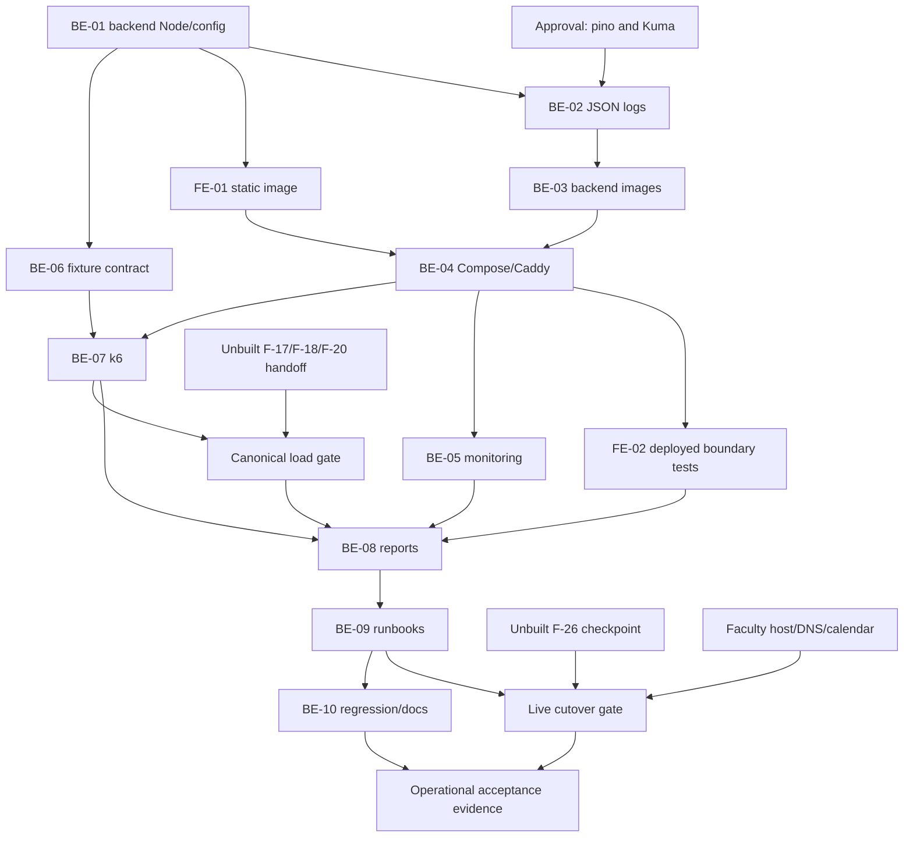

# F-27 Deployment, Load Test and Monitoring — Curriculum Management Implementation Plan

Build a reproducible production installation of the backend and frontend with Docker Compose and Caddy, structured application logs, dependency-aware monitoring, and an evidence-producing k6 read workload. This is an infrastructure feature, not a new business module or administration screen. It does not implement student records, registration eligibility, backup/restore, or email to make its acceptance results look complete.

> **Companion documents:** `docs/planning/feature-questions.md` §F-27 and §F-00; `docs/design/tech-stack.md` §§2–5; `docs/planning/task-breakdown.md` CV-249/CV-250; `docs/planning/test-plan.md` T-6/T-7/T-8; `docs/requirement/REQUIREMENTS.md` §9; `docs/architecture/general_architecture.md`; `docs/architecture/features_architecture.md`; `docs/architecture/database_and_models.md`. There is **no EP-27 row or EP-27-specific acceptance scenario in `docs/planning/epics.md`, and no EP-27 story cluster in `docs/planning/user-stories.md`**. The operational scope comes from the F-27 rows in `feature-questions.md`, `docs/progress/todo.md`, and `tech-stack.md`, supplemented by CV-249/CV-250. Those tasks are attached administratively to US-102, a synchronization story, not a deployment API specification. Planned test companion: `docs/testing/feature__f27_deployment_load_test_monitoring.md` (not an existing input).

**Status:** Not started — plan only, source verified on 2026-10-25. Approvals and Faculty-specific information remain in §8; operational acceptance is not claimed.

> **Quyết định của chủ dự án, 2026-10-31 (ghi đè D3, BE-02, BE-05 và hàng E1 bên dưới):**
> - Không thêm `pino` và Uptime Kuma.
> - BE-02 làm bằng logger JSON tự viết (`source/backend/src/shared/logging/app-logger.ts`, `http-logger.ts`). Bề mặt giữ như §BE-02 nhưng không có `DestinationStream`, và chỉ bật khi `NODE_ENV=production`.
> - BE-05 bỏ hẳn: `scripts/monitoring/collect-health.mjs` là nguồn bằng chứng uptime duy nhất, và `deploy/compose.yaml` không còn service `uptime-kuma`.
> - Bốn chỗ ghi log không an toàn đã đổi thành bản ghi an toàn: `auth.login_failed`, `health.redis_error`, `release.activation_failed`, `release.schedule_failed`.

## 0. Plan at a glance

Everything below in one table. Read this; the rest is detail for whoever builds it.

| What | Why | How and where |
|---|---|---|
| **One production origin over HTTPS** | NFR-07/NFR-25; F00-23 A | Separate `deploy/compose.yaml` and `deploy/Caddyfile`; Caddy serves the built SPA and preserves `/api` to the backend (BE-04, FE-01). |
| **A supported production runtime** | F00-22 A moves to Node 24 before Faculty installation | Move backend/frontend runtime declarations together; use a pinned Debian Node 24 image; verify native Argon2 and Prisma in the final image (BE-01/03, FE-01). |
| **Persistent data and ordered upgrades** | NFR-14; attachment storage; queued activation | PostgreSQL, Redis, files and Caddy state survive image replacement; one-shot migration before API replacement; no destructive schema change (BE-03/04/09). |
| **JSON logs, bounded disk use** | F27-04 A | Direct `pino` LoggerService bridge and allowlisted HTTP summaries; stdout JSON and Docker rotation (BE-02/04). Dependency approval remains pending. |
| **Real dependency monitoring** | F27-03 A; NFR-15 | Kuma checks public HTTPS `/api/health` every 60 seconds; preserve 200/503; capture four weeks of evidence (BE-05). Dependency approval remains pending. |
| **An exact 200-session read test** | F27-01 A; T-7; NFR-04 | 160 student and 40 staff sessions for 15 measured minutes; authentication outside measurement; latency, correctness and data-size evidence (BE-06/07/08). |
| **Honest acceptance gates** | Student features are unbuilt; F27-02 is a Faculty risk | Infrastructure and staff smoke can run first. No substitutes for real student journeys, 500-student data, host equivalence or business-hours measurements (BE-06/08/10). |
| **Repeatable operation** | CV-249; NFR-27 | Operator runbooks, Vietnamese instructions for six roles with unfinished features marked, manual checklist and sanitized evidence (BE-09/10, FE-02). |

| Behaviour | Why it is this way |
|---|---|
| Health remains public; `/health` remains an authenticated SPA route. | A monitor must not be redirected to login; the UI keeps its guard. |
| Measured traffic performs no domain writes. | Login/session touch, monitoring state and logs are technical writes; fixture data contains no due releases for the existing scheduler to activate. |
| 200 sessions is not 200 simultaneous in-flight requests. | Constant VUs model T-7 users with think time. Report achieved throughput, not an invented requests/second target. |
| One API process also runs the existing BullMQ worker. | No duplicate worker service or replica scaling in this feature. |
| Unhealthy does not mean automatically restarted. | Kuma reports failures; an operator diagnoses dependencies. No unapproved auto-heal service. |
| A local monitor cannot prove its own host's reachability. | Observation gaps are unknown/non-up; use the external collector when an observer is available. |

| Not included | Why |
|---|---|
| Student/enrollment/eligibility implementation | F-17/F-18/F-20 own it; full T-7 acceptance is unbuildable until their contracts exist. |
| Backup schedules, restore code or media policy | F-26 owns them; live cutover needs its validated checkpoint contract. |
| SMTP alerts, Prometheus/Grafana/Loki, Terminus, Nginx, `nestjs-pino`, `pino-http`, Kubernetes | Not necessary for A defaults; no extra unapproved runtime dependencies. |
| AuditLog or log-search product screen | Deferred by `docs/planning/deferred-scope.md` §2.1; stdout logging is not immutable audit. |

| Open question | Resolved when | Default if unanswered |
|---|---|---|
| `pino` and Kuma are absent from the named stack | Owner reconciles F27-03/04 with `tech-stack.md` | Keep A in the plan; do not install/activate until approved. |
| Faculty host, DNS, TLS reachability and sizing | Faculty supplies facts | Linux/Compose/Caddy; isolated equivalent-environment verification only. |
| Working hours, holidays and trial dates | Faculty supplies calendar | Collect continuously; report 24/7 separately; business-hours NFR-15 unverified. |
| Student APIs and fixture provisioning | F-17/F-18/F-20 ship and are traced | Fail canonical preflight; only explicitly labelled smoke tests may run. |
| Backup checkpoint | F-26 verifies its handoff | No live cutover/migration of existing production data. |

## 1. Scope

| In scope | Why |
|---|---|
| Production Dockerfiles, context allowlists, Compose, Caddy/TLS, runtime config, Node 24 | NFR-07/25; F00-22/23; CV-249. Development Compose remains independent. |
| JSON stdout for lifecycle, existing service logs, errors, HTTP completion | F27-04; no request/session serialization or business-behaviour change. |
| Health regression, Kuma setup/persistence, four-week evidence procedure | F27-03; NFR-15; T-8. |
| Isolated synthetic 300-course/500-student fixture contract; k6 and result evidence | F27-01/02; T-6/T-7; NFR-01/02/04. |
| FE same-origin deployment, deep links, API/HTML isolation, Vietnamese role guidance | CV-249; NFR-16/26/27. No new product screen. |
| Forward migration, persistent state, restart/upgrade checks and F-26 handoff | NFR-14; not another backup implementation. |

| Out of scope | Deferred until |
|---|---|
| Changes to built-feature tables or permissions | Separate owner approval; none is needed here. |
| F-09 imports, F-12 assessments, F-16 comparison, F-23 reports, F-25 email | Their own implementations; do not depend on concurrent unfinished plans. |
| Graduation and Excel-import throughput (NFR-03/05) | F-19/F-09 acceptance; not the F27-01 read scenario. |
| Privileged R6 accounts or staff routes standing in for student journeys | Never acceptable as a T-7 substitute. |
| Multi-host HA or claimed availability without observations | Separately approved operational design. |

These **local AC IDs decompose the cited operational requirements; they are not invented EP-27 stories**. B6's nine functional acceptance scenarios belong to EP-22..25, not this feature.

| AC / task | Covered by |
|---|---|
| F27-AC01 — repeatable Linux install/upgrade and HTTPS; CV-249/NFR-07/25 | BE-01/03/04/09/10; FE-01/02 |
| F27-AC02 — T-7: 200 sessions, 160/40, 15 measured minutes, reads only; CV-250/NFR-04 | BE-06/07/08/10 |
| F27-AC03 — T-6: record host; approximately 300 courses, 500 synthetic students, 60 curriculum rows | BE-06/08/09; Faculty gate |
| F27-AC04 — NFR-01 lookups <2 s; NFR-02 eligibility <3 s | BE-07/08; student contract gated |
| F27-AC05 — health every minute; four trial weeks or explicitly shorter available interval | BE-05/08/09/10; FE-02 |
| F27-AC06 — 99% business-hours target, confirmed calendar and gaps disclosed | BE-05/08/09; never a fabricated early pass |
| F27-AC07 — pino JSON stdout, bounded logs, no sensitive request logging | BE-02/04/10 |
| F27-AC08 — installation and six-role guidance; CV-249/NFR-27 | BE-09/10; FE-02; unfinished R6 walkthroughs gated |
| F27-AC09 — upgrade preserves published rows and attachment bytes; NFR-14 | BE-03/04/09/10; F-26 checkpoint prerequisite |

## 2. Contract verification

Existing claims are anchored in source read on 2026-10-25. NEW/UNVERIFIED contracts are not shipped endpoints. Source paths below are repository-relative.

### 2a. Endpoints and boundary behaviour

| Endpoint / boundary | Source | Verified contract | Used by |
|---|---|---|---|
| `GET /api/health` | `source/backend/src/app.setup.ts:17`; `source/backend/src/features/health/health.controller.ts:12`; `source/backend/src/features/health/health.service.ts:29` | Public. 200 iff both dependencies up; otherwise 503 with **the same HealthDto**, not ErrorResponseDto. PostgreSQL `SELECT 1` and dedicated Redis `PING` run together. | Kuma, container probe, collector, FE |
| `POST /api/auth/login` | `source/backend/src/features/auth/auth.controller.ts:48`; `source/backend/src/features/auth/login.dto.ts:10`; `source/backend/src/features/auth/auth.service.ts:24` | JSON only `username`, `password`; 200 MeDto and regenerated session. Extra body fields rejected by `source/backend/src/app.setup.ts:29`. Mutations require `X-Requested-With: XMLHttpRequest` (`source/backend/src/shared/auth/csrf.guard.ts:10`). | k6 setup, smoke |
| `GET /api/auth/me` | `source/backend/src/features/auth/auth.controller.ts:73`; `source/backend/src/features/auth/auth.service.ts:65`; `source/backend/src/features/auth/me.dto.ts:38` | Authenticated MeDto. Preflight only, not a replacement business read in the measured workload. | Session/role preflight |
| `GET /api/courses?page=1&pageSize=20&sort=courseCode&order=asc` | `source/backend/src/features/courses/courses.controller.ts:36`; `source/backend/src/features/courses/courses.service.ts:56`; `source/backend/src/features/courses/course.dto.ts:68` | `course.view`; paginated visible catalog, stable code ordering, string credits. CoursePageDto without an additional envelope. | Staff catalog read |
| `GET /api/program-versions/:versionId/curriculum` | `source/backend/src/features/curriculum/program-versions-curriculum.controller.ts:43`; `source/backend/src/features/curriculum/curriculum-read.service.ts:66`; `source/backend/src/features/curriculum/curriculum-read.service.ts:135` | `program.view`; service checks scope. Fixture supplies accessible released version. No guard changes for load tests. | Staff curriculum read |
| FE `/health` and `fetchHealth()` | `source/frontend/src/features/health/api/health.ts:12`; `source/frontend/src/features/health/pages/HealthPage.tsx:23`; `source/frontend/src/router.tsx:217`; `source/frontend/src/router.tsx:225`; `source/frontend/src/shared/auth/RequireAuth.tsx:10` | Explicitly accepts 503 and displays Vietnamese dependency labels. The UI route is protected by RequireAuth and is not Kuma's URL. | FE regression |
| Prefix, proxy and cookie | `source/frontend/src/shared/api/client.ts:3`; `source/frontend/vite.config.ts:4`; `source/backend/src/app.setup.ts:24`; `source/backend/src/shared/session/session.constants.ts:1`; `source/backend/src/shared/session/session-store.service.ts:25` | Relative `/api`; exactly one trusted proxy hop in production. `ctdt.sid`: HttpOnly, SameSite=Lax, Secure in production, rolling, PostgreSQL session store. API stays internal. | Caddy, HTTPS smoke |
| `GET /api/docs-json` | `source/backend/src/app.setup.ts:39`; `source/backend/test/health.e2e-spec.ts:39`; `source/frontend/package.json:16` | Existing local OpenAPI-generation target. Production Caddy denies public `/api/docs*`; local generation unchanged. | FE schema |
| Student curriculum/progress/eligibility GETs | Verified 2026-10-31 from shipped F-18/F-20: `GET /api/portal/curriculum` (`source/backend/src/features/student-portal/student-portal.controller.ts:43`, PortalCurriculumDto `/terms`); `GET /api/portal/plos` (same file :54, array of PortalPloDto); `GET /api/students/:studentId/registration-eligibility?programId=&semesterId=` (`source/backend/src/features/registration-eligibility/registration-eligibility.controller.ts:17`, RegistrationEligibilityDto `/contractVersion`=1, `/items`) | Portal reads are scoped to the signed-in student by `student.view_progress`; eligibility needs the student, program and semester IDs from the fixture. Paths filled in `scripts/load/fixture-contract.example.json`. The 300-course/500-student synthetic fixture itself is still not built (debt). | Canonical load gate |

### 2b. Fields consumed or deliberately not modeled

F-27 adds **no API DTO or endpoint**. These are monitoring/preflight/load assertions, not new FE models. Nested data marked opaque is downloaded but not converted into an F-27 model; existing FE consumers are unchanged.

**HealthDto** — serializer: `source/backend/src/features/health/health.service.ts:36`.

| Field | Wire type | Nullable | Source | Modeled as | Note |
|---|---|---|---|---|---|
| `status` | `'ok' \| 'error'` | no | `source/backend/src/features/health/health.dto.ts:3` | Overall availability | Must agree with HTTP status. |
| `database` | `'up' \| 'down'` | no | `source/backend/src/features/health/health.dto.ts:6` | Dependency status | Present on 503 too. |
| `redis` | `'up' \| 'down'` | no | `source/backend/src/features/health/health.dto.ts:17` | Dependency status | Not proof a queue completed. |

**MeDto** — serializer: `source/backend/src/features/auth/me.dto.ts:43`.

| Field | Wire type | Nullable | Source | Modeled as | Note |
|---|---|---|---|---|---|
| `id` | `string` | no | `source/backend/src/features/auth/me.dto.ts:21` | Expected fixture identity | In-memory assertion. |
| `username` | `string` | no | `source/backend/src/features/auth/me.dto.ts:22` | Not modeled | No identity export. |
| `userCode` | `string` | no | `source/backend/src/features/auth/me.dto.ts:23` | Not modeled | No identity export. |
| `fullName` | `string` | no | `source/backend/src/features/auth/me.dto.ts:24` | Not modeled | No identity export. |
| `email` | `string` | yes | `source/backend/src/features/auth/me.dto.ts:25` | Not modeled | No identity export. |
| `mustChangePassword` | `boolean` | no | `source/backend/src/features/auth/me.dto.ts:26` | Refuse if true | Prepare accounts before load. |
| `orgUnit` | `OrgUnitRefDto` | yes | `source/backend/src/features/auth/me.dto.ts:27` | Not modeled | Home unit is not access scope. |
| `roles` | `MeRoleDto[]` | no | `source/backend/src/features/auth/me.dto.ts:29` | Role-code membership only | Other nested fields opaque. |
| `permissions` | `PermissionCode[]` | no | `source/backend/src/features/auth/me.dto.ts:30`; `source/backend/src/shared/authz/permission-codes.ts:1` | Not modeled | Never infer scope from this array. |

MeRoleDto fields: `roleCode`, `roleName` (non-null strings), `scopeType: 'SYSTEM' | 'UNIT' | 'ASSIGNMENT'`, nullable `scopeUnit: OrgUnitRefDto | null`, `derived: boolean` (`source/backend/src/features/auth/me.dto.ts:11`; `source/backend/prisma/schema.prisma:100`). Only roleCode is modeled. OrgUnitRefDto has non-null strings `id`, `unitCode`, `unitName` (`source/backend/src/shared/dtos/ref.dto.ts:4`); not modeled.

The unmodeled permission array's exact literals are `orgUnit.manage`, `subjectGroup.view`, `user.manage`, `permission.view`, `permission.manage`, `director.assign`, `delegation.manage`, `integrationClient.manage`, `sync.configure`, `auditLog.view`, `course.view`, `course.edit`, `courseRelation.edit`, `program.view`, `program.editInfo`, `program.clone`, `curriculum.edit`, `curriculum.importExportExcel`, `version.assignCohort`, `outcome.view`, `plo.edit`, `clo.edit`, `syllabus.view`, `syllabus.edit`, `gradingFormula.edit`, `changeRequest.view`, `changeRequest.create`, `changeRequest.createOrganizational`, `changeRequest.override`, `changeRequest.comment`, `changeRequest.statistics`, `version.publish`, `version.correct`, `version.viewHistory`, `version.compare`, `semester.manage`, `data.importExcel`, `report.exportAccreditation`, `report.benchmark`, `student.viewProgress`, `student.viewRegistrationEligibility`, `graduation.view`, `graduation.audit` (`source/backend/src/shared/authz/permission-codes.ts:1`).

**CoursePageDto / CourseSummaryDto** — serializers: `source/backend/src/features/courses/courses.service.ts:71`, `source/backend/src/features/courses/course.dto.ts:68`.

| Field | Wire type | Nullable | Source | Modeled as | Note |
|---|---|---|---|---|---|
| `items` | `CourseSummaryDto[]` | no | `source/backend/src/features/courses/course.dto.ts:34` | Nonempty array assertion | Check fixture ID/code, not only 200. |
| `total` | `number` | no | `source/backend/src/features/courses/course.dto.ts:35` | Data-size assertion | Independently verify exact fixture count. |
| `page` | `number` | no | `source/backend/src/features/courses/course.dto.ts:36` | Requested-page assertion | Page 1. |
| `pageSize` | `number` | no | `source/backend/src/features/courses/course.dto.ts:37` | Requested-size assertion | Named workload constant 20. |
| `items[].id` | `string` | no | `source/backend/src/features/courses/course.dto.ts:18` | Fixture assertion | Synthetic dataset. |
| `items[].courseCode` | `string` | no | `source/backend/src/features/courses/course.dto.ts:19` | Fixture assertion | Synthetic prefix. |
| `items[].courseName` | `string` | no | `source/backend/src/features/courses/course.dto.ts:20` | Not modeled | Still downloaded. |
| `items[].englishName` | `string` | yes | `source/backend/src/features/courses/course.dto.ts:21` | Not modeled | Nullable. |
| `items[].credits` | `string` | no | `source/backend/src/features/courses/course.dto.ts:22` | Not modeled | Not an integer. |
| `items[].courseType` | `'THEORY' \| 'PRACTICE' \| 'LAB' \| 'PROJECT' \| 'CAPSTONE' \| 'INTERNSHIP' \| 'CONDITIONAL'` | no | `source/backend/src/features/courses/course.dto.ts:23`; `source/backend/prisma/schema.prisma:37` | Not modeled | Existing enum. |
| `items[].status` | `'ACTIVE' \| 'DISCONTINUED' \| 'CANCELLED'` | no | `source/backend/src/features/courses/course.dto.ts:25`; `source/backend/prisma/schema.prisma:47` | Not modeled | No mutations. |
| `items[].ownerFaculty` | `OrgUnitRefDto` | no | `source/backend/src/features/courses/course.dto.ts:27` | Not modeled | Fields listed above. |
| `items[].ownerGroup` | `SubjectGroupRefDto` | yes | `source/backend/src/features/courses/course.dto.ts:28` | Not modeled | Nested `id`, `groupCode`, `groupName`: strings; `status: 'ACTIVE' | 'INACTIVE'`; `source/backend/src/shared/dtos/ref.dto.ts:21`. |
| `items[].isForeign` | `boolean` | no | `source/backend/src/features/courses/course.dto.ts:30` | Not modeled | Derived by serializer. |

**CurriculumDto** — serializer: `source/backend/src/features/curriculum/curriculum-read.service.ts:135`.

| Field | Wire type | Nullable | Source | Modeled as | Note |
|---|---|---|---|---|---|
| `version` | `CurriculumVersionDto` | no | `source/backend/src/features/curriculum/curriculum.dto.ts:117` | Version-ID assertion | Other nested fields opaque. |
| `editPath` | `'DIRECT' \| 'VIA_REQUEST'` | yes | `source/backend/src/features/curriculum/curriculum.dto.ts:118`; `source/backend/src/shared/authz/edit-path.ts:7` | Not modeled | Not used for writes. |
| `canEditStructure` | `boolean` | no | `source/backend/src/features/curriculum/curriculum.dto.ts:120` | Not modeled | Read only. |
| `canAddItems` | `boolean` | no | `source/backend/src/features/curriculum/curriculum.dto.ts:121` | Not modeled | Read only. |
| `items` | `CurriculumItemDto[]` | no | `source/backend/src/features/curriculum/curriculum.dto.ts:122` | Row-count assertion | Other row fields opaque. |
| `semesters` | `SemesterTotalDto[]` | no | `source/backend/src/features/curriculum/curriculum.dto.ts:123` | Not modeled | No recomputation. |
| `blocks` | `BlockTotalDto[]` | no | `source/backend/src/features/curriculum/curriculum.dto.ts:124` | Not modeled | No recomputation. |
| `knowledgeBlocks` | `KnowledgeBlockDto[]` | no | `source/backend/src/features/curriculum/curriculum.dto.ts:126` | Not modeled | Opaque. |
| `electiveGroups` | `ElectiveGroupDto[]` | no | `source/backend/src/features/curriculum/curriculum.dto.ts:128` | Not modeled | Opaque. |
| `programCredits` | `ProgramCreditsDto` | no | `source/backend/src/features/curriculum/curriculum.dto.ts:129` | Not modeled | Do not reconstruct snapshot facts. |
| `warnings` | `CurriculumWarningDto[]` | no | `source/backend/src/features/curriculum/curriculum.dto.ts:131` | Not modeled | Opaque. |

CurriculumVersionDto contains `id`, `programId`, `programCode`, `programName` (non-null strings), `versionNumber` (nullable string), `status: 'DRAFT' | 'PENDING' | 'ACTIVE' | 'HISTORICAL'`, `semesterCount` (number), nullable `sourceRequest` (`source/backend/src/features/curriculum/curriculum.dto.ts:25`; `source/backend/prisma/schema.prisma:63`). Only id is modeled here. No ErrorResponseDto is modeled: unexpected status fails the test without dumping its body. Student DTO fields remain UNVERIFIED until their producers exist.

### 2c. Corrections and existing-state inventory

| Deliverable | Earlier assumption | Actual source | Found at |
|---|---|---|---|
| BE-04/05, FE-02 | Need a new health/Terminus endpoint. | Public dependency checks, 503 and FE handling already exist. | `source/backend/src/features/health/health.controller.ts:12`; `source/frontend/src/features/health/api/health.ts:12` |
| BE-03/04 | Need a standalone worker. | Nest already includes the release processor/scheduler. | `source/backend/src/features/releases/release-activation.processor.ts:14`; `source/backend/src/features/releases/release-activation.scheduler.ts:24` |
| BE-01/03, FE-01 | Package declarations already permit Node 24. | Both app engines exclude 24; both `.nvmrc` files say 22. Apply F00-22 explicitly. | `source/backend/package.json:7`; `source/frontend/package.json:7`; `source/backend/.nvmrc:1`; `source/frontend/.nvmrc:1` |
| BE-06/07 | Existing R6 means T-7 can run now. | Users/sessions exist, but complete schema model inventory has no Student/enrollment/results. | `source/backend/prisma/schema.prisma:188`; `source/backend/prisma/schema.prisma:527`; inventory through `source/backend/prisma/schema.prisma:909` |

Additional invariants: startup rejects a non-ICU/non-`vi-VN` database (`source/backend/src/shared/prisma/prisma.service.ts:30`). Development Compose uses PostgreSQL 18 at `/var/lib/postgresql`, and Redis 8 with AOF/noeviction (`source/backend/compose.yaml:5`, `source/backend/compose.yaml:15`, `source/backend/compose.yaml:23`). Relative attachment paths resolve beneath FILES_ROOT, with temp-then-rename writes (`source/backend/src/shared/files/file-storage.service.ts:20`, `source/backend/src/shared/files/file-storage.service.ts:29`); published attachment rows retain those paths (`source/backend/prisma/schema.prisma:679`). Preserve storage; never expose it as static content.

Dependency reports read: F-01, F-02, F-04, F-10, F-14 and F-15 in `docs/implement-report/`. In particular, F-15 records removal of fake release helpers and a bounded worker shutdown; code confirms the latter at `source/backend/src/features/releases/release-activation.processor.ts:72`. Reports explain history, not replacement contracts. Relevant `features/auth`, `health`, `courses`, `curriculum`, `releases` and FE health/client code were inspected. No concurrent unfinished plan is an input.

### 2d. Planned operational interfaces

| Interface | Proposed contract | Status |
|---|---|---|
| Deployment configuration | Image digests, release tag, domain, absolute files path and credentials from operator environment; no checked-in dotenv/credentials | NEW, BE-01/04; validate names without printing values. |
| Load manifest | Versioned JSON: actual data counts, 200 distinct synthetic accounts, role assignments, per-account GET journeys, expected IDs/counts | NEW, BE-06; student route/DTO integration UNVERIFIED. |
| F-26 handoff | Database plus complete FILES_ROOT checkpoint, image/release inventory and tested restore destination/procedure before live migration | UNVERIFIED dependency, §8; no assumed script name. |
| Monitoring evidence | Kuma config/timeline captures plus timestamped collector NDJSON; gaps unknown | NEW; no undocumented Kuma API or database queries. |

## 3. Decisions

| ID | Decision | Why | Rejected alternative |
|---|---|---|---|
| D1 | Separate production `deploy/`; independent package installs. | Development Compose is explicitly development-only (`source/backend/compose.yaml:1`). | Reusing dev ports/default passwords in production. |
| D2 | Node 24 for app declarations and both builds; pnpm remains 10.23.0. | F00-22 A; existing pnpm pins (`source/backend/package.json:6`; `source/frontend/package.json:6`). | Bypassing engines or deploying Node 22. |
| D3 | Direct pino bridge and allowlisted HTTP middleware, subject to approval. | F27-04 A, no wrapper dependency. | `nestjs-pino`, `pino-http`, pretty transports or file log writers. |
| D4 | Only Caddy publishes 80/443; Kuma administration binds loopback. | Preserve one trusted proxy; isolate data services. | Public API/database ports, CORS or public monitor administration. |
| D5 | Preserve `/api`; no SPA fallback for API; block public `/api/docs*`. | Existing prefix/client contract in §2a. | Prefix-stripping `handle_path /api/*`, or index.html for API errors. |
| D6 | Persist DB/Redis/Caddy/Kuma volumes; provisioned host directory for FILES_ROOT. | Clear backup boundary and non-root ownership. | Ephemeral files, source mounts or Kuma Docker-socket access. |
| D7 | One-shot forward migration, never automatic seeding/migration in API entrypoint. | A failed migration must stop replacement. | `migrate dev`, reset, `db push`, destructive seed or automatic down migration. |
| D8 | Single 200-VU executor, first 160 identities R6, last 40 staff. | Deterministic role mapping on one generator. | Uncertain cross-scenario VU offsets or 200 staff as T-7. |
| D9 | Zero incorrect reads; lookup max <2 s, eligibility max <3 s; report percentiles too. | Avoid silently weakening NFRs to p95-only. | Counting 403/empty/redirect responses as fast success. |
| D10 | Continuous monitoring; calendar applied only when Faculty confirms it. | Working hours cannot be invented. | Assumed office hours or excluding unknown/maintenance automatically. |
| D11 | Named limits; canonical 200/15-minute parameters fixed and validated. | No weaker environment override retaining acceptance label. | Unrecorded magic numbers or renamed smoke results. |
| D12 | No new DTO/product screen; FE steps package and verify the existing contract. | Existing health page suffices. | An observability dashboard/navigation item. |

## 4. Deliberate divergences

No shipped sibling F-27 implementation was found in the reviewed inputs. These deliberate differences from older summaries are explicit:

- The four components in `tech-stack.md` remain the application topology. Profiled Kuma is an operational addition required by F27-03 A; migration and k6 containers are tools, not business services. Adding Kuma/pino to the approved stack remains an escalation.
- Do not add AuditLog despite logical data-dictionary/sequence-diagram audit writes: `deferred-scope.md` §2.1 explicitly defers them. Pino cannot satisfy NFR-10 by itself.
- Historical F-09/F-15 exemplars determine document depth/structure, not current source truth. This plan does not copy their pre-implementation assumptions or removed test helpers.
- Separate infrastructure readiness from full B6 acceptance; do not implement missing business features to erase load-test gates.

## 5. Deliverables

All paths are repository-relative. NEW parent directories (`deploy/`, `scripts/load/`, `scripts/monitoring/`, `docs/operations/`) belong to their deliverables; existing parents were inspected. MODIFY means a future builder edit. No DELETE is needed. Verification below is planned work, not a report of execution.

### BE-01 — Production configuration and backend Node 24 declaration

**What/Why:** Make production inputs explicit and execute F00-22 without bypassing the current engine restriction.

**Files**
- MODIFY `source/backend/package.json`, `source/backend/pnpm-lock.yaml`, `source/backend/.nvmrc`.
- MODIFY `source/backend/src/shared/config/env.validation.ts`.
- MODIFY `source/backend/src/shared/config/env.validation.spec.ts` (extend existing queue-prefix/numeric-conversion tests, `source/backend/src/shared/config/env.validation.spec.ts:10`).
- NEW `deploy/README.md` (configuration reference; BE-09 completes operations links).

**Shape**

```json
{ "engines": { "node": ">=24.0.0 <25" }, "packageManager": "pnpm@10.23.0" }
```

`.nvmrc` becomes `24`. Preserve existing scripts, dependencies and env fields. Add this to the existing Env class, not a parallel module:

```ts
export const LOG_LEVELS = [
  'fatal', 'error', 'warn', 'info', 'debug', 'trace', 'silent',
] as const;

@IsIn(LOG_LEVELS)
LOG_LEVEL: (typeof LOG_LEVELS)[number] = 'info';
```

Document the proposed Compose input interface:

| Name | Required / default | Handling |
|---|---|---|
| `RELEASE_TAG` | Required immutable release label | Tag both local app images; record image IDs as evidence. |
| `NODE_IMAGE`, `POSTGRES_IMAGE`, `REDIS_IMAGE`, `CADDY_IMAGE` | Required `tag@sha256:digest` | Node 24 Debian slim, PostgreSQL 18 Debian, Redis 8, Caddy 2; no `latest`. Exact digests selected and recorded at build time, never invented here. |
| `KUMA_IMAGE`, `K6_IMAGE` | Required for their profile/tool | Approved Kuma and k6 images; pinned digest and recorded version. |
| `PUBLIC_HOST` | Required hostname, no scheme/path | Faculty DNS/TLS gate; no production localhost fallback. |
| `POSTGRES_USER`, `POSTGRES_DB` | Required identifiers | Newly provisioned deployment database, not a guessed existing database. |
| `POSTGRES_PASSWORD`, `DATABASE_URL`, `SESSION_SECRET` | Required secrets | Operator injects without shell-history literals. DATABASE_URL targets `postgres:5432`; secret length uses existing validator. Never log/archive rendered Compose configuration. |
| `FILES_PATH` | Required absolute provisioned directory | Bind to API `/var/lib/ctdt/files`; refuse missing path. |
| `LOG_LEVEL` | `info` | Validate through Env. |
| `DOCKER_LOG_MAX_SIZE`, `DOCKER_LOG_MAX_FILE` | `10m`, `5` | Named rotation policy on long-lived services; budget total disk usage. |

Production fixes `NODE_ENV=production`, `PORT=3000`, `REDIS_HOST=redis`, `REDIS_PORT=6379`, `FILES_ROOT=/var/lib/ctdt/files`, `SESSION_IDLE_MINUTES=60`. Leave `BULLMQ_PREFIX` unset for dedicated Redis; if an operator sets it, keep it stable across upgrades. Credentials are an operator prerequisite, not a generated repository file. No dotenv template is added.

**Rationale / mirror:** Extend class-validator Env and preserve conversion/defaults (`source/backend/src/shared/config/env.validation.ts:23`, `source/backend/src/shared/config/env.validation.ts:69`); retain package-manager pin (`source/backend/package.json:6`).

**Gotchas:** Never interpolate DATABASE_URL into commands. Do not copy development passwords. `source/e2e/package.json:6` already permits Node 24; no e2e engine change is needed. Node 24 is explicitly named by F00-22 A, not a new unnamed runtime.

**Verify:** On Node 24, from backend: `pnpm install --frozen-lockfile`, `pnpm exec vitest run src/shared/config/env.validation.spec.ts`, `pnpm typecheck`. Cover valid/default/invalid levels and unchanged session/files defaults. Native-module failure is a compatibility gate, not permission to ignore engines.

**Depends on:** —. Pino installation remains BE-02's approval gate.

### BE-02 — Pino JSON bridge and safe HTTP completion records

**What/Why:** Route Nest/application logs to JSON stdout without transports, response changes, or credential serialization.

**Files**
- MODIFY `source/backend/package.json`, `source/backend/pnpm-lock.yaml` (direct runtime `pino`, only after E1 approval).
- NEW `source/backend/src/shared/logging/app-logger.ts`, `source/backend/src/shared/logging/app-logger.spec.ts`.
- NEW `source/backend/src/shared/logging/http-logger.ts`, `source/backend/src/shared/logging/http-logger.spec.ts`.
- MODIFY `source/backend/src/main.ts`, `source/backend/src/app.setup.ts`, `source/backend/test/test-app.ts`.
- MODIFY `source/backend/src/features/auth/auth.service.ts`, `source/backend/src/features/health/health.service.ts`, `source/backend/src/features/releases/release-activation.processor.ts`, `source/backend/src/features/releases/release-activation.scheduler.ts` (log payloads only).
- NEW `source/backend/test/logging.e2e-spec.ts`.

**Shape** — implement this TypeScript public surface; declaration syntax pins signatures, not a claim that implementations exist:

```ts
import type { LoggerService } from '@nestjs/common';
import type { DestinationStream } from 'pino';
import type { RequestHandler } from 'express';

export interface HttpCompletion {
  requestId: string;
  method: string;
  route: string;
  statusCode: number;
  durationMs: number;
}
export interface AppLogger extends LoggerService {
  http(record: HttpCompletion): void;
  flush(): void;
}
export interface AppLoggerOptions {
  level?: string;
  enabled?: boolean;
  destination?: DestinationStream;
}
export declare function createAppLogger(options?: AppLoggerOptions): AppLogger;
export declare function createHttpLogger(logger: AppLogger): RequestHandler;
```

Use `pino(options, destination)`, stdout by default, no pretty output, one JSON object per line. Base service is `ctdt-backend`; retain pino level/time/pid/msg. Map Nest `log→info`, `verbose→trace`, and preserve error/warn/debug/fatal. Support Nest's variadic context/stack overloads; retain final context, not optional argument arrays. Error objects become allowlisted error type and safe code, never raw errors, SQL, connection URLs, request objects or arbitrary message/stack dumps. Structured event inputs retain documented event/object IDs and safe error type/code only. Tests pin all six methods and Error/string overloads.

HTTP middleware uses a server-generated `randomUUID()`, monotonic timing, and one completion record on `finish`; a distinct aborted record on `close` before finish, never both. Ignore incoming request-ID values. Route is a matched Express template; unmatched routes use fixed `unmatched`, not arbitrary paths. Output only method, route, status, duration, request ID and event. Never log queries, bodies, headers, cookies, Authorization, sessions or returned temporary passwords. Disabled logger is for tests only. Ordinary legacy service messages may retain entity identifiers; restrict their access/retention rather than publish them as evidence.

Replace four unsafe free-text interpolations with safe structured events: `auth.login_failed` without supplied username/password; `health.redis_error` without raw error.message; `release.activation_failed` with version ID/error type; `release.schedule_failed` with error type. Existing sites: `source/backend/src/features/auth/auth.service.ts:36`, `source/backend/src/features/health/health.service.ts:24`, `source/backend/src/features/releases/release-activation.processor.ts:60`, `source/backend/src/features/releases/release-activation.scheduler.ts:64`. Do not change outcomes/retries/shutdown.

Production bootstrap shape:

```ts
const logger = createAppLogger({ level: process.env.LOG_LEVEL });
try {
  const { AppModule } = await import('./app.module.js');
  const app = await NestFactory.create<NestExpressApplication>(AppModule, {
    logger,
    abortOnError: false,
  });
  configureApp(app, logger);
  app.enableShutdownHooks();
  const config: ConfigService<Env, true> = app.get(ConfigService);
  await app.listen(config.get('PORT', { infer: true }));
} catch (error) {
  logger.error(error, 'Bootstrap');
  logger.flush();
  process.exitCode = 1;
}
```

Install HTTP middleware **before** sessions in `configureApp(app: NestExpressApplication, logger: AppLogger): void`; preserve validation/filter/Swagger/proxy semantics. Remove main.ts static AppModule import and load it inside the try block as shown; use a safe info-level bootstrap fallback for unknown raw LOG_LEVEL, letting Env validation reject it inside the guarded import. Malformed environment produces sanitized startup failure, not a config dump. Ensure module-load/startup errors use the configured logger where Nest permits; do not claim to intercept failures before JavaScript loads.

**Shared-function call-site disposition:** `configureApp` has two callers: `source/backend/src/main.ts:9` gets the live logger; `source/backend/test/test-app.ts:11` gets a disabled logger by default, with optional destination injection for logging e2e. Declaration is `source/backend/src/app.setup.ts:22`. Search again at implementation and account for added callers. Existing `new Logger(...)` sites stay and use Nest's global logger; no mass rewrite.

**Rationale / mirror:** Preserve bootstrap/setup separation (`source/backend/src/main.ts:8`, `source/backend/test/test-app.ts:5`) and contextual logger usage (`source/backend/src/shared/filter/all-exceptions.filter.ts:15`). New helper/spec pairs belong in shared, not a feature module.

**Gotchas:** Pino key redaction cannot remove secrets embedded in free-text messages. The four payload edits and safe error serialization are required. Exception responses remain unchanged (`source/backend/src/shared/filter/all-exceptions.filter.ts:17`); public health's 503 does not throw. Preserve nonzero bootstrap exit and graceful shutdown.

**Verify:** Backend: `pnpm exec vitest run src/shared/logging`; `pnpm exec vitest run --config vitest.config.e2e.ts test/logging.e2e-spec.ts test/health.e2e-spec.ts`. Capture a Writable destination, parse every line, cover startup/200/401/403/503/500/abort, and assert sentinel password/cookie/query/header/DB-URL strings absent. Compare status/body fixtures before/after. Later `docker compose -f deploy/compose.yaml logs --no-log-prefix api` must show JSON application records, not pnpm banners/ANSI.

**Depends on:** BE-01; E1 approval for direct pino.

### BE-03 — Backend runtime and migration images

**What/Why:** Build actual ESM production artifacts, generated Prisma code and native dependencies without host node_modules or a dev server.

**Files**
- NEW `source/backend/Dockerfile`, `source/backend/.dockerignore`.

**Shape** — context is exactly `source/backend`:

```dockerfile
ARG NODE_IMAGE
FROM ${NODE_IMAGE} AS base
WORKDIR /app
RUN npm install --global pnpm@10.23.0

FROM base AS build
COPY package.json pnpm-lock.yaml prisma.config.ts ./
COPY prisma ./prisma
RUN pnpm install --frozen-lockfile
COPY nest-cli.json tsconfig.json tsconfig.build.json ./
COPY src ./src
RUN pnpm prisma:generate && pnpm build

FROM build AS migration
USER node
CMD ["pnpm", "exec", "prisma", "migrate", "deploy"]

FROM build AS production-deps
RUN pnpm prune --prod

FROM base AS runtime
ENV NODE_ENV=production
COPY --from=production-deps --chown=node:node /app/node_modules ./node_modules
COPY --from=build --chown=node:node /app/package.json ./package.json
COPY --from=build --chown=node:node /app/dist ./dist
USER node
EXPOSE 3000
CMD ["node", "dist/main.js"]
```

Docker-context allowlist: exclude `**`, explicitly re-include package/lock, prisma config/schema/migrations, Nest/TS configs, src parents/files. Exclude dotenv at every depth, node_modules, dist, tests/results, `src/generated/**`, local attachment directories and legacy/private seed data; generated Prisma source must come from the in-image install, never overwrite it from the host. Schema/migrations plus the explicitly reviewed baseline seed are needed: allow `prisma/seed.ts` and exactly its root `seed-data/` imports (`approval-levels.ts`, `knowledge-blocks.ts`, `org-units.ts`, `permission-catalog.ts`, `programs.ts`, `roles.ts`, `seed-access-control.ts`, `semesters.ts`). Exclude demo, DUT/legacy and extract data. The migration image retains the copied source/generated client so the existing baseline seed can run only as the explicit first-install BE-09 action. Do not COPY repository root or invoke any seed during image build or API startup. Client generation must work without DATABASE_URL during build, as intended by `source/backend/prisma.config.ts:4`. If pnpm requires native build-script approval, allow only the already-declared package that needs it, with a recorded reason; never broadly allow arbitrary dependency scripts.

Migration target retains CLI/dev tooling; runtime retains production dependencies and compiled Prisma output under dist, not CLI or TS source. Build/runtime use the same Debian family/architecture for native modules. The API runs as `node`; the host FILES_PATH must already have that image UID/GID's write access. Do not startup-chmod arbitrary host paths.

**Rationale / mirror:** Execute actual scripts `build`, `start`, `postinstall` (`source/backend/package.json:13`, `source/backend/package.json:17`, `source/backend/package.json:31`); preserve ESM and build root/output (`source/backend/tsconfig.build.json:3`). No hand-written generated client.

**Gotchas:** Prisma CLI is dev-only (`source/backend/package.json:76`), so runtime cannot run migrations. Argon2 must load under Node 24. No F-27 schema migration is created. Do not run old/new API workers concurrently during replacement.

**Verify:** Build runtime and migration targets with required NODE_IMAGE and immutable local tags. In runtime assert Node major 24, `import('argon2')` works, and dist entrypoint/generated imports exist. Run migration against a disposable ICU database, then start API. Rebuild once without cache to prove no host-generated artifact is required.

**Depends on:** BE-01/02.

### FE-01 — Node 24 frontend build and Caddy artifact

**What/Why:** Package the SPA under Caddy, without Vite runtime or an API-origin override.

**Files**
- MODIFY `source/frontend/package.json`, `source/frontend/pnpm-lock.yaml`, `source/frontend/.nvmrc` (runtime declaration only).
- NEW `source/frontend/Dockerfile`, `source/frontend/.dockerignore`.

**Shape**

```dockerfile
ARG NODE_IMAGE
ARG CADDY_IMAGE
FROM ${NODE_IMAGE} AS build
WORKDIR /app
RUN npm install --global pnpm@10.23.0
COPY package.json pnpm-lock.yaml ./
RUN pnpm install --frozen-lockfile
COPY index.html tsconfig.json tsconfig.app.json tsconfig.node.json vite.config.ts ./
COPY public ./public
COPY src ./src
RUN pnpm build

FROM ${CADDY_IMAGE} AS runtime
COPY --from=build /app/dist /srv
```

Use engine `>=24.0.0 <25` and `.nvmrc=24`, matching BE-01. Context is `source/frontend`; allowlist only these build inputs, excluding dotenv/node_modules/dist/test reports and private files. Include the existing generated schema as source. Build requires no live API; BE-04 mounts Caddyfile read-only. No `VITE_API_URL`, CORS, router/menu or health-screen changes. Hashed assets get immutable caching and index.html gets revalidation in BE-04.

**Rationale / mirror:** Real build script (`source/frontend/package.json:12`), relative API root (`source/frontend/src/shared/api/client.ts:3`), current health labels (`source/frontend/src/features/health/pages/HealthPage.tsx:13`). The design system was read; no new UI atom is required.

**Gotchas:** Never embed secrets/monitor credentials in Vite arguments. Packaging success does not prove authorization/capacity. E2E engine already permits Node 24 (`source/e2e/package.json:6`); leave it unchanged.

**Verify:** Frontend on Node 24: `pnpm install --frozen-lockfile`, `pnpm build`; build image and inspect `/srv/index.html` plus referenced assets. Confirm bundle has `/api`, no localhost API origin or dotenv content. FE-02 tests runtime routing.

**Depends on:** BE-01's runtime decision; BE-04 supplies runtime configuration.

### BE-04 — Production Compose and Caddy boundary

**What/Why:** Wire the persistent four-component application topology, migration gate and optional monitoring/tool profiles.

**Files**
- NEW `deploy/compose.yaml`, `deploy/Caddyfile`.
- MODIFY `deploy/README.md` (service/volume/config inventory).

**Shape** — core Compose contract (add the healthchecks/logging explicitly described after the snippet):

```yaml
name: ctdt-production
x-logging: &rotated-logging
  driver: json-file
  options:
    max-size: '${DOCKER_LOG_MAX_SIZE:-10m}'
    max-file: '${DOCKER_LOG_MAX_FILE:-5}'
services:
  postgres:
    image: '${POSTGRES_IMAGE:?Set pinned PostgreSQL image}'
    environment:
      POSTGRES_USER: '${POSTGRES_USER:?Set database user}'
      POSTGRES_DB: '${POSTGRES_DB:?Set database name}'
      POSTGRES_PASSWORD: '${POSTGRES_PASSWORD:?Set database password}'
      POSTGRES_INITDB_ARGS: --locale-provider=icu --icu-locale=vi-VN --locale=C.UTF-8
    volumes:
      - postgres-data:/var/lib/postgresql
    restart: unless-stopped
    logging: *rotated-logging
  redis:
    image: '${REDIS_IMAGE:?Set pinned Redis image}'
    command: ['redis-server', '--appendonly', 'yes', '--maxmemory-policy', 'noeviction']
    volumes:
      - redis-data:/data
    restart: unless-stopped
    logging: *rotated-logging
  migrate:
    image: 'ctdt/backend-migrations:${RELEASE_TAG:?Set release tag}'
    build:
      context: ../source/backend
      target: migration
      args:
        NODE_IMAGE: '${NODE_IMAGE:?Set pinned Node image}'
    environment:
      DATABASE_URL: '${DATABASE_URL:?Set database URL}'
    depends_on:
      postgres:
        condition: service_healthy
    restart: 'no'
    logging: *rotated-logging
  api:
    image: 'ctdt/backend:${RELEASE_TAG:?Set release tag}'
    build:
      context: ../source/backend
      target: runtime
      args:
        NODE_IMAGE: '${NODE_IMAGE:?Set pinned Node image}'
    environment:
      NODE_ENV: production
      PORT: '3000'
      DATABASE_URL: '${DATABASE_URL:?Set database URL}'
      SESSION_SECRET: '${SESSION_SECRET:?Set session secret}'
      SESSION_IDLE_MINUTES: '60'
      REDIS_HOST: redis
      REDIS_PORT: '6379'
      FILES_ROOT: /var/lib/ctdt/files
      LOG_LEVEL: '${LOG_LEVEL:-info}'
    volumes:
      - type: bind
        source: '${FILES_PATH:?Set absolute files path}'
        target: /var/lib/ctdt/files
        bind:
          create_host_path: false
    depends_on:
      postgres:
        condition: service_healthy
      redis:
        condition: service_healthy
      migrate:
        condition: service_completed_successfully
    init: true
    read_only: true
    tmpfs:
      - /tmp
    cap_drop: [ALL]
    security_opt: ['no-new-privileges:true']
    stop_grace_period: 30s
    restart: unless-stopped
    logging: *rotated-logging
  caddy:
    image: 'ctdt/frontend:${RELEASE_TAG:?Set release tag}'
    build:
      context: ../source/frontend
      target: runtime
      args:
        NODE_IMAGE: '${NODE_IMAGE:?Set pinned Node image}'
        CADDY_IMAGE: '${CADDY_IMAGE:?Set pinned Caddy image}'
    environment:
      PUBLIC_HOST: '${PUBLIC_HOST:?Set public hostname}'
    ports: ['80:80', '443:443']
    volumes:
      - ./Caddyfile:/etc/caddy/Caddyfile:ro
      - caddy-data:/data
      - caddy-config:/config
    depends_on:
      api:
        condition: service_healthy
    restart: unless-stopped
    logging: *rotated-logging
volumes:
  postgres-data:
  redis-data:
  caddy-data:
  caddy-config:
```

No ports on postgres/redis/api; default Compose network is sufficient. Do not declare that network `internal: true`, because Caddy needs outbound certificate access. Do not publish Caddy's admin API. Add healthchecks named/configured in README: database `pg_isready` with container-side escaped `$${POSTGRES_USER}`/`$${POSTGRES_DB}`; Redis `redis-cli ping`; API direct Node `fetch('http://127.0.0.1:3000/api/health', {signal: AbortSignal.timeout(5000)})`, failing on non-200 or non-ok body. Suggested named defaults: `HEALTH_INTERVAL=10s`, `HEALTH_TIMEOUT=7s`, `HEALTH_RETRIES=6`, `HEALTH_START_PERIOD=30s`. Healthcheck strings/numbers are explicit deployment knobs, not application business constants. API process runs exactly once, including worker; 30-second stop window exceeds existing 10-second processor grace (`source/backend/src/features/releases/release-activation.processor.ts:12`). Verify all shutdown hooks together; this comparison alone is not a shutdown guarantee.

Caddyfile:

```caddyfile
{$PUBLIC_HOST} {
  encode zstd gzip
  @docs path /api/docs /api/docs/* /api/docs-json
  handle @docs {
    respond 404
  }
  @api path /api /api/*
  handle @api {
    reverse_proxy api:3000
  }
  @assets path /assets/*
  handle @assets {
    root * /srv
    header Cache-Control "public, max-age=31536000, immutable"
    file_server
  }
  handle {
    root * /srv
    try_files {path} /index.html
    header Cache-Control "no-cache"
    file_server
  }
}
```

Do not use `handle_path`, custom trusted proxies or forwarded-header overrides. Native Caddy reverse-proxy behaviour must be tested with the Secure cookie; if Faculty adds another proxy/CDN, stop at E2 instead of silently increasing trusted hops. Do not enable access logging with full headers/URLs. Caddy process logs and Docker rotation suffice; BE-02 handles request summaries. Preserve certificate/data volumes across replacement and document TCP 80/443 reachability requirements. No `tls internal` or insecure-client bypass in production; approved local test CA is an explicitly non-production option.

Add BE-05's `uptime-kuma` under `profiles: [monitoring]`, and BE-07's `k6` under `profiles: [load]`; they are operational additions, not a second API/worker. Required profile-image variables must be provided whenever the selected Compose implementation evaluates interpolation; do not rely on inactive profiles hiding missing-variable errors.

**Rationale / mirror:** Mirror PostgreSQL ICU/volume and Redis durability from `source/backend/compose.yaml:4`, while removing dev host ports/default passwords. Preserve production trust-proxy/session setup (`source/backend/src/app.setup.ts:24`; `source/backend/src/shared/session/session-store.service.ts:39`).

**Gotchas:** Do not reuse the development Compose project name or volumes. Compose dependency order does not re-run an already successful migration automatically on every upgrade; BE-09 explicitly recreates it. A failed healthcheck must not be masked by the SPA. Never run `down -v`, reset, prune volumes, or make live-fault tests part of unattended deployment. Existing database privilege/provisioning policy remains an operator responsibility; do not claim immutable audit guarantees.

**Verify:** `docker compose -f deploy/compose.yaml config --quiet`; build all app targets; `caddy validate` inside the frontend image with Caddyfile and a non-secret hostname. Fresh disposable install must migrate then start API/Caddy; failed migration prevents API start. Verify no data/API published ports, correct persisted mounts and rotated logging via targeted inspect fields, not whole environment/config dumps. Run FE-02 before declaring the boundary ready.

**Depends on:** BE-01/02/03, FE-01; Faculty DNS/TLS/host gate for production (E2).

### BE-05 — Uptime Kuma and trustworthy observation evidence

**What/Why:** Implement F27-03's one-minute monitor and a reproducible availability calculation without depending on undocumented Kuma storage/APIs.

**Files**
- MODIFY `deploy/compose.yaml`.
- NEW `scripts/monitoring/collect-health.mjs`, `scripts/monitoring/health-evidence.mjs`, `scripts/monitoring/health-evidence.test.mjs`.
- NEW `docs/operations/monitoring.md`.

**Shape**

```yaml
uptime-kuma:
  profiles: [monitoring]
  image: '${KUMA_IMAGE:?Set approved pinned Kuma image}'
  ports: ['127.0.0.1:3001:3001']
  volumes:
    - kuma-data:/app/data
  restart: unless-stopped
  logging: *rotated-logging
```

Declare `kuma-data` in top-level volumes. Do not mount Docker socket or app files. Confirm `/app/data` and container port against the approved pinned image before build sign-off; image selection is an E1 approval gate, not permission to assume a private API. Initial setup is manual through an authorized loopback connection/tunnel; require a unique admin password and disable public registration/status-page exposure. Never script credentials into Compose or export monitor secrets.

Runbook setup: HTTP(S)/keyword monitor named `CTĐT — Trạng thái hệ thống`, URL `https://<PUBLIC_HOST>/api/health`, GET, heartbeat interval 60 seconds, timeout 10 seconds, accepted status 200 only, keyword `"status":"ok"`, TLS verification enabled, no auth/cookies, no grace retries masking the first failed sample. Preserve screenshots of interval, accepted status, URL and trial dates; redact accounts. Test 503 and recovery on disposable staging, not live production. No SMTP/other notification channel is assumed: operational checking is manual; alert-delivery policy is E2/E3 follow-up, not F-25 integration.

Collector/report interfaces (standalone Node 24, built-ins only):

```ts
export interface HealthSample {
  timestamp: string;
  httpStatus: number | null;
  status: 'ok' | 'error' | null;
  database: 'up' | 'down' | null;
  redis: 'up' | 'down' | null;
  elapsedMs: number;
}
export interface ObservationCalendar {
  confirmed: boolean;
  timeZone: 'Asia/Ho_Chi_Minh';
  intervals: { start: string; end: string }[];
}
export declare function classifySample(sample: HealthSample): 'UP' | 'DOWN';
export declare function summarizeAvailability(input: {
  samples: HealthSample[];
  from: string;
  to: string;
  calendar: ObservationCalendar | null;
}): {
  eligibleMinutes: number;
  upMinutes: number;
  downMinutes: number;
  unknownMinutes: number;
  availability: number | null;
  businessHoursVerified: boolean;
};
```

`.mjs` implementations use exported JavaScript functions with JSDoc-equivalent types; declarations pin the interface, not a new TS build project. Named policy constants: `HEARTBEAT_SECONDS=60`, `PROBE_TIMEOUT_MS=10000`, `TRIAL_DAYS=28`, `TARGET_AVAILABILITY=0.99`. `collect-health.mjs --base-url <https-origin> --output <private-evidence-file>` polls an absolute minute grid without overlapping probes, writes one LF-delimited JSON sample after each attempt, flushes on graceful stop, and never writes response bodies/headers/URLs with query. Timeout/network/invalid JSON produce nullable fields, not crashes or fabricated up samples. Validate HTTPS/base origin and disable redirects to another origin; no insecure TLS override.

Only 200 plus all three fields equal to `ok/up/up` counts UP. Reporting accepts explicit UTC observation boundaries and a Faculty-confirmed list of half-open working intervals; timezone is metadata for presentation, not an invented office schedule. Align eligible UTC minute slots, select at most one valid observation per slot, fill missing slots as UNKNOWN, and reject inconsistent duplicates rather than cherry-pick UP. Unconfirmed/no calendar yields only a labelled 24/7 diagnostic, `businessHoursVerified=false`, no NFR-15 PASS. Availability is `upMinutes / eligibleMinutes`, counting down and unknown in the denominator; zero denominator returns null. Do not silently exclude maintenance, holidays or monitor downtime. Holidays can be excluded only through the confirmed calendar, with provenance.

Kuma remains the required monitor; the collector is supplementary auditable evidence, preferably on a separate operator-controlled host. Compare timeline/incident times to collector samples, explain mismatches, and preserve shorter actual observation windows per T-8. Same-host-only monitoring and collector gaps are limitations, not evidence of host uptime.

**Rationale / mirror:** Reuse exact HealthDto serializer (`source/backend/src/features/health/health.service.ts:36`) and the public 503 path (`source/backend/src/features/health/health.controller.ts:24`). New scripts use Node, already named in the stack; docs follow `docs/testing/_TEMPLATE.md`'s explicit service-action convention rather than adding a dashboard.

**Gotchas:** Health checks dependencies, not every worker queue or student workflow. Do not change its contract to fit Kuma. A 28-day target is not a claim that evidence already exists; a shorter run must disclose both dates and unmet duration. Do not archive Kuma's entire data volume as a public evidence attachment.

**Verify:** `node --test scripts/monitoring/health-evidence.test.mjs` covers exact 200/503 bodies, invalid JSON, network error, zero denominator, missing slots, duplicate slots, calendar boundaries and no-calendar status. After E1 approval start monitoring profile; staging dependency outage must produce DOWN and later recovery. Restart Kuma and confirm configuration/history persistence. Preserve config/timeline captures and actual collector samples; four weeks and Faculty calendar remain separate acceptance gates.

**Depends on:** BE-04; E1 image approval; E2/E3 for real observer/calendar/trial information.

### BE-06 — Synthetic fixture and fail-closed workload manifest

**What/Why:** Ensure fast failures, privileged accounts or tiny datasets cannot masquerade as F27-01/02 acceptance.

**Files**
- NEW `scripts/load/manifest.mjs`, `scripts/load/manifest.test.mjs`.
- NEW `scripts/load/fixture-contract.example.json` (structural example, no credentials or real person data).
- NEW `docs/operations/load-test.md` (fixture/preflight section; BE-07/08 complete it).

**Shape**

```ts
export interface LoadRead {
  name: 'catalog' | 'curriculum' | 'progress' | 'eligibility';
  path: string;
  kind: 'lookup' | 'eligibility';
  equals: { pointer: string; value: string | number | boolean }[];
  arrays: { pointer: string; minimumLength: number }[];
}
export interface LoadAccount {
  fixtureKey: string;
  userId: string;
  roleCode: 'R1' | 'R2' | 'R3' | 'R4' | 'R5' | 'R6';
  reads: LoadRead[];
}
export interface LoadManifest {
  schemaVersion: 1;
  dataset: {
    fixtureId: string;
    synthetic: true;
    environment: 'isolated-load-test';
    courseCount: 300;
    studentCount: 500;
    curriculumRows: 60;
    sourceRevision: string;
  };
  contractVerified: boolean;
  contractSources: { name: string; source: string }[];
  students: LoadAccount[];
  staff: LoadAccount[];
}
export interface LoadCredential {
  fixtureKey: string;
  username: string;
  password: string;
}
export declare function validateManifest(value: unknown, mode: 'canonical' | 'staff-smoke'): LoadManifest;
export declare function validateCredentials(value: unknown, manifest: LoadManifest): LoadCredential[];
```

Implement in `.mjs` with Node built-ins and pure exports testable by `node --test`; never add a validation-library dependency. Define named workload policy constants in `manifest.mjs`: 300 courses, 500 students, 60 rows, 160 student accounts, 40 staff accounts, page size 20. Counts are exact for the reproducible canonical fixture even though T-6 describes them approximately. The example JSON carries an empty account list and `contractVerified=false`, so it is intentionally **not runnable as acceptance**. Runtime manifest and credential JSON are separate operator-created private files, never repository fixtures or artifacts.

Validation requires 200 distinct users/fixture keys and 200 distinct credentials, students exactly 160 with only role R6, staff exactly 40 with roles R1..R5 and both `course.view`/`program.view` reads actually accessible. Do not invent a 5-role staff distribution: record the chosen mix and use valid authorized assignments, without editing production permission cells. Every student journey contains curriculum, progress and eligibility; every staff journey contains catalog and curriculum. All paths are relative `/api/` GET targets, no scheme, authority, traversal, fragment, health/auth/docs routes or placeholder. Every read has meaningful fixture-bound equality/nonempty-array assertions; minimums cannot be zero for canonical data. Validate assertion pointers without evaluating code. Never accept a student account with extra staff privileges as an R6 substitute.

Staff routes are the verified endpoints in §2a. For students, actual path/pointers and corresponding response DTO tables remain **UNVERIFIED** until F-17/F-18/F-20 ship. Their owners must provide synthetic provisioning of 500 records, results/enrollments and 160 usable R6 identities; F-27 consumes that fixture, it does not create missing tables. Required integration handoff: a repeatable isolated provisioning command, source-backed count/identity assertions, own-enrollment refusal checks, a released 60-row version, representative results enabling nonempty progress/eligibility payloads, and before/after domain-state hashes. Fill `contractSources` with the actual endpoint/serializer `file:line` anchors, then permit `contractVerified=true`. A boolean without source/fixture evidence is insufficient.

Do not reuse a legacy real-data seed, connect to either excluded data tree, or require F-09 Excel import to provision this dataset. On the current MVP, operators may prepare a separate staff fixture using built APIs and run `staff-smoke`; it is not canonical and cannot satisfy CV-250. Canonical fixture provisioning remains owned by the student features, not an invented F-27 script name. Use existing real release APIs rather than removed F-15 fake helpers; source-backed release behaviour is at `source/backend/src/features/releases/release-activation.processor.ts:38` and recorded in the F-15 implement report.

**Rationale / mirror:** Existing login fixtures separate seed fields from the two-field LoginDto (`source/backend/src/features/auth/login.dto.ts:10`); current pagination defaults/bounds are `source/backend/src/shared/pagination/page-query.dto.ts:5`. Reuse the verified catalog/curriculum payloads, not a mock `/health` throughput endpoint. New manifest tooling has no existing infrastructure sibling; its JSON contract is explicitly new.

**Gotchas:** Session creation/touch is allowed technical traffic; business counts/hashes must stay unchanged. A scheduled activation can legitimately mutate a due version, so the isolated fixture contains no pending/due releases. Never reset or seed production. Student data generation is a hard prerequisite, not a task to approximate with privileged Users.

**Verify:** `node --test scripts/load/manifest.test.mjs` covers counts, duplicate IDs/credentials, extra/missing journey types, placeholder/absolute/mutating paths, empty assertions, false contract flag and canonical-vs-smoke labels. Canonical validation against the structural example must fail with `Thiếu dữ liệu thử tải sinh viên; chưa thể nghiệm thu F-27.` Run source-backed fixture count/authorization checks only after the student handoff; retain sanitized metadata, never credentials.

**Depends on:** BE-01; BE-04 for live preflight; unbuilt F-17/F-18/F-20 integration contract (D-LOAD in §8).

### BE-07 — k6 session workload and guarded runner

**What/Why:** Execute the exact T-7 read mix and preserve a nonzero exit for incomplete, incorrect or slow runs.

**Files**
- NEW `scripts/load/f27-read-only.js`, `scripts/load/workload.mjs`, `scripts/load/workload.test.mjs`.
- NEW `scripts/load/preflight.mjs`, `scripts/load/Invoke-LoadTest.ps1`.
- MODIFY `deploy/compose.yaml`, `docs/operations/load-test.md`.

**Shape** — keep `manifest.mjs` and `workload.mjs` pure/portable: no Node imports, filesystem calls, k6 imports or command-line side effects. Node preflight owns filesystem/CLI checks; k6 entry owns HTTP/metrics. Workload policy:

```js
export const LOAD_POLICY = Object.freeze({
  studentVus: 160,
  staffVus: 40,
  duration: '15m',
  setupTimeout: '10m',
  thinkSeconds: 1,
  lookupLimitMs: 2000,
  eligibilityLimitMs: 3000,
  smokeVus: 10,
  smokeDuration: '30s',
});
```

Canonical options in the k6 entry (the smoke profile is a separately labelled branch):

```js
export const options = {
  scenarios: {
    reads: {
      executor: 'constant-vus',
      vus: LOAD_POLICY.studentVus + LOAD_POLICY.staffVus,
      duration: LOAD_POLICY.duration,
      gracefulStop: '0s',
      exec: 'readJourney',
    },
  },
  setupTimeout: LOAD_POLICY.setupTimeout,
  noCookiesReset: true,
  maxRedirects: 0,
  thresholds: {
    'read_duration{kind:lookup}': ['max<2000'],
    'read_duration{kind:eligibility}': ['max<3000'],
    'http_req_failed{phase:read}': ['rate==0'],
    read_errors: ['rate==0'],
    checks: ['rate==1'],
    'participating_vus{cohort:student}': ['count==160'],
    'participating_vus{cohort:staff}': ['count==40'],
    domain_write_requests: ['count==0'],
  },
};
```

Build latency threshold strings from LOAD_POLICY in the implementation rather than duplicate the numeric literals illustrated above. Timeout constants must exceed the acceptance limits so slow responses fail latency instead of disappearing into success counts. Add explicit `read_duration` Trend with time units, `read_errors` Rate, `participating_vus` Counter, `domain_write_requests` Counter and `journey_reads` Counter tagged by cohort/read name/kind. For `staff-smoke`, omit student-only/eligibility thresholds, set 10 staff VUs/30 seconds, and force result label `SMOKE_ONLY`. No third arbitrary profile or canonical count/duration overrides.

Algorithm is fixed:

1. Init reads private manifest and separate credentials using mounted absolute paths; validate schema/counts and HTTPS target. Capture only approved workload metadata for summary. `staff-smoke` selects the first 10 validated staff accounts; canonical uses `students.concat(staff)`.
2. `setup()` serially logs in every selected account through POST login with exactly username/password and CSRF header. Tag all setup calls `phase=setup`; do not include them in read latency thresholds. Use normal TLS validation and no redirects. Require 200, expected user ID/role, `mustChangePassword=false`, and a `ctdt.sid` cookie. Check GET me plus each journey once to fail early on scopes/empty data; ensure other-student denial is already covered by the owner-provided fixture's security tests. Authentication costs are recorded separately, not advertised as 200-user login capacity.
3. Return per-account cookie values in memory only, not credentials or response dumps. Setup cookies do **not** automatically become each VU's cookie jar; install the assigned cookie explicitly in that VU on its first iteration. The single-generator VU index is `exec.vu.idInTest - 1`; validate bounds. Set `noCookiesReset=true` and keep Secure cookie scope. Never reuse one staff session across users.
4. On the first iteration increment participating_vus once for the assigned cohort. For every iteration initialize domain_write_requests with zero, then perform only `http.get` for that account's journey. Use low-cardinality tags `phase=read`, cohort, read name, kind, and a stable request name, never account ID/password/cookie.
5. Download full bodies, require 200 plus JSON and configured fixture-bound assertions. Start/end a wall-clock timer around HTTP to include connection/blocking overhead; add failed/timeout latency too. Do not make faster 401/403/HTML/empty responses a success. Wrong payload increments read_errors and fails checks. Do not retry or relogin during measurement; an expired/broken session is a real failure.
6. Students rotate through curriculum/progress/eligibility; staff through catalog/curriculum every journey. One-second think time is per complete journey, never omitted to manufacture throughput. Populate a per-read counter so the report can reject absent request kinds. The constant-VU duration is **15 steady minutes after setup**, not ramp + setup + 15 combined. At the strict boundary, in-flight request interruption is disclosed; no grace interval is counted as additional steady time.
7. `handleSummary(data)` writes sanitized summary JSON to the mounted output directory, including actual profile/policy, manifest hash and tagged metrics. No raw response, usernames, cookie/session values or credentials. K6's threshold failure exit must propagate through Docker and PowerShell.

Compose tool shape, outside production startup:

```yaml
k6:
  profiles: [load]
  image: '${K6_IMAGE:?Set pinned k6 image}'
  working_dir: /scripts
  volumes:
    - ../scripts/load:/scripts:ro
    - type: bind
      source: '${LOAD_INPUT_PATH:?Set private input directory}'
      target: /input
      read_only: true
    - type: bind
      source: '${LOAD_OUTPUT_PATH:?Set output directory}'
      target: /output
  environment:
    CTDT_BASE_URL: '${CTDT_BASE_URL:?Set authorized HTTPS target}'
    CTDT_LOAD_MANIFEST: /input/manifest.json
    CTDT_LOAD_CREDENTIALS: /input/credentials.json
    CTDT_LOAD_PROFILE: '${CTDT_LOAD_PROFILE:-staff-smoke}'
  entrypoint: ['k6']
  command: ['run', '/scripts/f27-read-only.js']
```

Prefer a **different load-generator host** from the target. `Invoke-LoadTest.ps1` runs the pinned k6 image directly there with only script/input/output mounts, rather than starting the target's app services; the Compose tool is a local/staging convenience. Never install a load agent on the Faculty host without authorization. Runner parameters: mandatory `-BaseUrl`, `-ManifestPath`, `-CredentialsPath`, `-OutputDirectory`, `-K6Image`, `-Profile canonical|staff-smoke`, and mandatory explicit `-AuthorizedTarget` switch. Check paths, distinct private input vs output, allowed target origin, image digest, required approval and isolated-fixture marker. Run Node preflight, then Docker; preserve `$LASTEXITCODE` immediately. No `--http-debug`, insecure TLS, target auto-discovery, credential echo or automatic volume cleanup. Interruptions yield `INCOMPLETE`, not PASS. The switch records intent, not a substitute for actual Faculty/owner authorization.

**Rationale / mirror:** Mirror the real LoginDto/CSRF/session contract (`source/backend/src/features/auth/login.dto.ts:10`, `source/backend/src/shared/auth/csrf.guard.ts:10`, `source/backend/src/shared/session/session-store.service.ts:25`). Follow the repo's exact-read/assertion style from `source/backend/test/health.e2e-spec.ts:32`; no new Node package/test runner is needed for pure helpers.

**Gotchas:** k6 has no Node runtime; do not import fs/crypto/process from shared workload modules. Hash metadata in Node preflight and pass a sanitized value, not a credential hash. Cookie handling must be tested on HTTPS; counting `http_req_duration` alone excludes some connection overhead, hence the explicit wall-clock Trend. A single generator is required for the VU-ID assignment. Domain reads can still touch PostgreSQL sessions. Never run canonical against production by default.

**Verify:** `node --test scripts/load/workload.test.mjs scripts/load/manifest.test.mjs`; test deterministic 160/40 selection, every read category, no writes, cookie setup and threshold construction. Run guarded `staff-smoke` on isolated staging, then canonical only after D-LOAD clears. Deliberately wrong route/credentials must fail preflight; deliberately delayed/incorrect reads must fail k6 with a nonzero runner exit. Preserve both exit code and sanitized result, not just a terminal screenshot.

**Depends on:** BE-04/06; k6 is already selected by F27-01 (test tooling, not a new application runtime dependency); target authorization; D-LOAD for canonical.

### FE-02 — API contract and deployed SPA regression

**What/Why:** Prove the existing frontend continues working through the production boundary without inventing a new monitoring UI.

**Files**
- NEW `source/frontend/src/features/health/api/health.test.ts`.
- MODIFY `source/frontend/src/features/health/pages/HealthPage.test.tsx` (retain current cases; add contract/path assertions only if not already covered).
- NEW `deploy/Test-Deployment.ps1`.
- MODIFY `docs/operations/load-test.md` (link deployment smoke prerequisite).

**Shape**

```powershell
param(
    [Parameter(Mandatory = $true)][uri]$BaseUrl,
    [switch]$AuthorizedTarget
)
$ErrorActionPreference = 'Stop'
```

Script uses .NET HTTP clients available to PowerShell, explicit HTTPS-origin validation, redirects disabled for API checks, certificate validation intact, and finite named request timeout. The script is read-only and must not accept arbitrary service-control commands. Assert `/api/health` 200 exact body, JSON Content-Type, no redirect; `/api/does-not-exist` is JSON/auth/error rather than index.html; `/api/docs` and `/api/docs-json` public 404; `/` and `/health` and `/courses` deep-link document requests return SPA HTML and referenced assets exist. A missing `/assets/does-not-exist.js` must be a real 404, not index.html. Check index/assets cache policy. The script verifies public document serving, not whether protected React routes can be entered unauthenticated.

Health API unit test verifies request URL is exactly `/api/health`; both 200 all-up and 503 dependency-down resolve Health; 502 and malformed/network failures are not treated as healthy. Retain UI's current `Hoạt động`, `Mất kết nối`, `Không kết nối được máy chủ ứng dụng` messages and retry behaviour (`source/frontend/src/features/health/pages/HealthPage.test.tsx:28`). Do not weaken the client globally to accept arbitrary 503 responses.

Manual HTTPS browser walk is separate: unauthenticated `/health` goes through RequireAuth; login using a private staging account succeeds and stores HttpOnly/Secure/SameSite cookie; refresh/deep link keeps login; a mutation without CSRF header is rejected while the app's normal mutation works; logout invalidates session; `/api` errors remain JSON. Repeat in current Chrome/Firefox/Edge when available. Never publish credentials/Set-Cookie captures. Controlled staging dependency outage must show the existing degraded UI while Kuma reports DOWN.

**Codegen disposition:** No wire DTO changed, so no new codegen output is expected. Existing generator remains `source/frontend/package.json:16`; do not regenerate against production, which blocks docs. If a prerequisite changed the schema, run local `pnpm api:types` as an explicit contract-reconciliation gate, inspect drift, and update the affected contract tables before proceeding. F-27 itself must not manufacture schema changes.

**Rationale / mirror:** Mirror `source/frontend/src/features/health/pages/HealthPage.test.tsx:6` fetch mocking and the actual `fetchHealth` accepted-status logic (`source/frontend/src/features/health/api/health.ts:12`). The deployment script is a new infrastructure test, not a replacement for Playwright or the design system.

**Gotchas:** A 200 document deep link does not prove an authenticated business read; verify those separately. Do not add Vite preview/dev to Compose. Do not test Secure cookies by disabling TLS or changing NODE_ENV. Schema file stays untouched unless real upstream drift requires a separately explained generation step.

**Verify:** From frontend: `pnpm exec vitest run src/features/health/api/health.test.ts src/features/health/pages/HealthPage.test.tsx`; from root: `powershell -NoProfile -File deploy/Test-Deployment.ps1 -BaseUrl <authorized-https-origin> -AuthorizedTarget`. The script exits nonzero on mismatch and emits no secrets. Record manual auth/browser results and distinguish unavailable browsers from passes.

**Depends on:** FE-01, BE-02/04. Student browser workflows remain D-LOAD-gated, not mocked as shipped.

### BE-08 — Load/availability report and evidence gates

**What/Why:** Produce reproducible evidence, not a subjective statement that the installation feels fast or has run for four weeks.

**Files**
- NEW `scripts/load/report.mjs`, `scripts/load/report.test.mjs`.
- MODIFY `scripts/load/Invoke-LoadTest.ps1`, `docs/operations/load-test.md`, `docs/operations/monitoring.md`.

**Shape**

```ts
export interface LoadVerdict {
  verdict: 'PASS' | 'FAIL' | 'INCOMPLETE' | 'SMOKE_ONLY';
  profile: 'canonical' | 'staff-smoke';
  reasons: string[];
  startedAt: string;
  finishedAt: string;
  configuredSteadySeconds: number;
  observedReadSpanSeconds: number;
  participants: { students: number; staff: number };
  dataset: { courses: number; students: number; curriculumRows: number };
  latency: Record<string, { count: number; max: number; p50: number; p95: number; p99: number }>;
}
export declare function buildLoadVerdict(input: {
  summary: unknown;
  runMetadata: unknown;
  rawMetrics: AsyncIterable<string>;
  fixtureEvidence: unknown;
}): Promise<LoadVerdict>;
```

Runner captures UTC start/end, actual Docker exit code, authorized target hostname, target hardware/OS/Docker/Compose, load-generator hardware, image IDs/digests, Node/pnpm/k6 versions, source revision supplied by the operator, manifest SHA-256 and canonical policy. Add k6 output `--out json=/output/metrics.ndjson` and restrict built-in system tags to `status,method,name,scenario`; do not include `url`, IP, user identity, cookies or credential paths. Raw metrics are allowed because they contain approved low-cardinality labels, timestamps and timings, not HTTP bodies. Stream this file rather than loading a multi-minute run entirely into memory.

Record VU gauge observations and first/last read timestamps, configured 900-second steady duration, elapsed setup and actual total runtime separately. A complete successful constant-VU scenario is required, with 160/40 participant counters, every journey read category observed, no interruption and no missed expected measurement interval. Raw first/last read timestamps are observations (roughly one sampling interval short of the executor window), not a replacement definition of the 15-minute schedule. Disclose sampling cadence and report the configured/executed schedule alongside observed span; do not round a short/interrupted run up to 15 minutes.

PASS requires canonical mode, verified contract/data handoff, real target-equivalence evidence, successful full scenario, all correctness/latency thresholds, actual 200 distinct sessions, and unchanged before/after domain counts/hashes. Business hashing excludes Session, notification-read timestamps, Kuma/log/queue technical state; the fixture owner enumerates exactly which domain tables and attachment bytes are compared once student models exist. An unresolved gate means INCOMPLETE, never a skipped test counted as PASS. A completed wrong/slow run means FAIL. Staff smoke always means SMOKE_ONLY even if thresholds succeed. A runner interruption writes metadata marking INCOMPLETE and preserves the failing/interrupt exit, not a success code from a later copy/report command.

Evidence directory layout (operator-chosen path, outside repository and private input directory):

```text
<run-id>/
  run-metadata.json
  manifest-public.json
  fixture-before.json
  fixture-after.json
  k6-summary.json
  metrics.ndjson
  load-verdict.json
  load-report.md
  monitoring-samples.ndjson
  availability-report.json
  availability-report.md
  monitor-configuration-redacted.png
```

`manifest-public.json` contains fixture counts, contract anchors and policy only; omit credentials/user lists/cookies. Monitor artifacts can be collected separately over the trial and linked by observation range. Report headings/prose can be English for operators; messages intended for product users remain Vietnamese. Load report includes lookup/eligibility by cohort and route name, count/error/timeout distributions, p50/p95/p99/max, throughput, hardware and all missing-gate reasons. Preserve failures; do not tune limits and overwrite the original run.

Availability report uses BE-05's exact eligible-minute calculation, actual start/end dates, observation coverage, calendar provenance and an explicit `fullTrialComplete` flag. Compare to Kuma timeline. T-8 permits reporting a shorter observed interval when the project ends early; it does not permit claiming four weeks or extrapolating 99% from a short run. Keep 24/7 diagnostic and business-hours verdict separate.

**Rationale / mirror:** Adopt exact status/body assertions from `source/backend/test/health.e2e-spec.ts:32` and the existing manual-test template's unrun/known-issue discipline (`docs/testing/_TEMPLATE.md`). There is no existing load-report file to extend; these are explicitly new operator tooling contracts.

**Gotchas:** Host CPU/memory/disk pressure and generator saturation affect results; record both sides and log rotation pressure. External traffic, due jobs, backup windows and data changes invalidate comparisons unless disclosed and controlled. A local Docker Desktop run is diagnostic, not a Faculty-equivalent host by declaration alone.

**Verify:** `node --test scripts/load/report.test.mjs scripts/monitoring/health-evidence.test.mjs`. Include passing synthetic metric fixtures, missing cohort/category, 199 identities, shortened run, zero/absent samples, k6 nonzero exit, changed business hash, bad data size, unconfirmed host and smoke incorrectly labelled canonical. Published fixtures contain metrics only, no auth material. Real acceptance report remains gated until a full authorized run exists.

**Depends on:** BE-05/06/07, FE-02; D-LOAD and E2/E3 for final evidence.

### BE-09 — Installation, upgrade and six-role runbooks

**What/Why:** Let a different operator deploy safely and give each role an honest guide to available workflows.

**Files**
- NEW `docs/operations/deployment.md`, `docs/operations/user-guide.md`.
- MODIFY `deploy/README.md`, `docs/operations/monitoring.md`, `docs/operations/load-test.md`.

**Shape:** `deployment.md` sections: prerequisites/approval checklist; configuration inventory; image build/pinning; new installation; first administrator; HTTPS/browser verification; persistent-state inventory; forward upgrade; failure recovery/F-26 handoff; restart/fault drills; log collection/rotation; troubleshooting; evidence/sign-off. Use PowerShell command examples and Docker CLI only; no bash, automatic branches/commits, push/publish or destructive cleanup.

Use a single explicit deployment context/project and record it before action. All commands below describe authorized operator actions, not commands to run during plan writing. From repo root, with credentials securely injected and the current Docker context deliberately confirmed:

```powershell
docker compose -f deploy/compose.yaml config --quiet
if ($LASTEXITCODE -ne 0) { throw 'Cấu hình triển khai không hợp lệ.' }
docker compose -f deploy/compose.yaml build migrate api caddy
if ($LASTEXITCODE -ne 0) { throw 'Không dựng được ảnh triển khai.' }
docker compose -f deploy/compose.yaml up -d --wait postgres redis
if ($LASTEXITCODE -ne 0) { throw 'Cơ sở dữ liệu hoặc hàng đợi chưa sẵn sàng.' }
docker compose -f deploy/compose.yaml up --no-deps --force-recreate --exit-code-from migrate migrate
if ($LASTEXITCODE -ne 0) { throw 'Migration thất bại; chưa khởi động bản mới.' }
```

On **first installation only**, after confirming the target is a new deployment database and reviewing the baseline seed contents, run the existing baseline seed using the migration image and separately injected `SEED_ADMIN_USERNAME`/`SEED_ADMIN_PASSWORD`:

```powershell
docker compose -f deploy/compose.yaml run --rm --no-deps -e SEED_ADMIN_USERNAME -e SEED_ADMIN_PASSWORD migrate pnpm prisma:seed
if ($LASTEXITCODE -ne 0) { throw 'Chưa khởi tạo được quản trị viên; dừng triển khai.' }
docker compose -f deploy/compose.yaml up -d --no-deps --wait api caddy
if ($LASTEXITCODE -ne 0) { throw 'Bản triển khai chưa sẵn sàng; kiểm tra nhật ký đã che thông tin nhạy cảm.' }
```

The existing seed requires an environment password and creates a must-change-password administrator (`source/backend/prisma/seed.ts:27`, `source/backend/prisma/seed.ts:43`, `source/backend/prisma/seed.ts:50`); it also calls baseline access/program/semester seeds (`source/backend/prisma/seed.ts:54`, `source/backend/prisma/seed.ts:57`). Explicitly review/replace placeholder program/semester data through supported workflows before Faculty acceptance. This is **not** a demo/legacy/import seed and is never part of an upgrade or API startup. Clear the temporary injected seed-secret variables after use without displaying values. First operator login must change password before business access; load accounts are prepared separately.

For upgrade of existing data: record old image IDs/release/configuration and successful F-26 checkpoint/restore evidence first; schedule and disclose maintenance; stop old API/worker before migration (`docker compose -f deploy/compose.yaml stop api`), run the explicit force-recreated migration, then start new API/Caddy only after success and run FE-02 plus immutable-row/attachment comparisons. Do not seed. Keep previous images for an application rollback **only if schema compatibility is established**; otherwise stop and follow the verified F-26 restore procedure into its authorized destination. Never invent a down migration, overwrite a live database, or replay partially applied changes by hand. A failed upgrade stays stopped/degraded and is reported, not retried forever.

Inventory PostgreSQL/Redis/Caddy/Kuma volumes, absolute FILES_PATH, runtime UID/GID, image tags/digests, secret handling owner, DNS/certificate renewal and disk/log budgets. Keep SESSION_SECRET and existing database/files volumes stable across app replacement; do not rotate a secret merely to redeploy. Files must not be served directly by Caddy; use authenticated backend download endpoints. No `docker compose down -v`, database reset or volume pruning in normal instructions. No actual production fault injection without an approved maintenance window.

`user-guide.md` is **role-facing Vietnamese**, with headings `R1 — Phòng Đào tạo`, `R2 — Ban lãnh đạo khoa`, `R3 — Giám đốc CTĐT`, `R4 — Điều phối nhóm chuyên môn`, `R5 — Giảng viên`, `R6 — Sinh viên`. Include login/password/session help once, then role responsibilities, accessible built screens, read/edit/approval limits, a short workflow and help contacts supplied by Faculty. R2 observes, not approves; R3/R4 approval levels and R5 proposal path must match shipped behaviour. Mark unbuilt features, especially R6 student journeys, `Chưa triển khai — chưa dùng để nghiệm thu vai trò này.` Never document a planned screen as working. All-six-role documentation can be authored now, but complete R6 functional walkthrough/sign-off is D-LOAD-gated. Do not invent Faculty contact details or institutional policy.

**Rationale / mirror:** Follow actual session/first-password flow (`source/backend/src/features/auth/auth.controller.ts:86`; seed source above), storage root (`source/backend/src/shared/files/file-storage.service.ts:20`), and current architecture feature inventory. Link F-15's version/attachment restrictions rather than instruct direct edits to published rows (`source/backend/prisma/schema.prisma:679`; `source/backend/src/features/releases/release-activation.processor.ts:38`).

**Gotchas:** A runbook is not proof of successful deployment or restore. The local monitor cannot provide independent host-down alerts. Do not put credentials in screenshots, terminal transcripts or config output. Windows is the operator shell, not an assumption that the Faculty server is Windows. If the Faculty cannot run Linux/Docker, E2 stops production activation; do not silently design a second deployment.

**Verify:** Another operator follows the new-install path on disposable Linux/Docker, logs in and changes initial password, restarts containers and confirms session/file/version persistence. Repeat upgrade with seeded released rows/attachment hashes; force a staging migration failure and verify new API never starts. Walk built role paths with appropriate accounts; record R6 as blocked until built. Review all six guide headings and every user-facing string for Vietnamese.

**Depends on:** BE-03/04/05/08, FE-02; E2/E3 and D-BACKUP before live cutover; D-LOAD before full R6 acceptance.

### BE-10 — Regression matrix, documentation synchronization and release gate

**What/Why:** Close the feature with explicit automated/manual evidence while keeping infrastructure readiness separate from acceptance not yet observable.

**Files**
- MODIFY `source/backend/test/health.e2e-spec.ts` (add isolated database-down case while preserving existing all-up/Redis-down cases).
- NEW `docs/testing/feature__f27_deployment_load_test_monitoring.md`.
- MODIFY `docs/design/tech-stack.md` (approved pino/Kuma entries, Node 24 production decision, not unapproved additions).
- MODIFY `docs/architecture/general_architecture.md`, `docs/architecture/features_architecture.md`, `docs/technical/technical_reference.md` (only actual deployed/logging/health behaviour).
- MODIFY `docs/progress/todo.md`, `docs/progress/current_work.md`, `docs/progress/progress_log.md`, `docs/implementation/README.md`, `docs/testing/README.md` (builder's completion updates, not this plan-writing run).
- NEW `docs/implement-report/f-27-deployment-load-test-monitoring-implement-report.md` (builder's evidence/status report).

**Shape:** Add a separate health e2e setup owning its own PostgreSQL container for the destructive database-stop test. Do not stop the shared template database used by other specs. Existing Redis-stop case already owns a private container (`source/backend/test/health.e2e-spec.ts:18`, `source/backend/test/health.e2e-spec.ts:46`); mirror its isolation, asserting exact 503 HealthDto and bounded client-observed failure. The production probe/collector timeouts bound observation even if a database query itself remains pending; do not claim an unimplemented database statement deadline.

Manual-test doc follows `docs/testing/_TEMPLATE.md`: actual automated-coverage table, remaining manual gaps, preconditions/steps/expected/service action/result, and known issues. Cases map F27-AC01..09. Exact staged actions include stop/restart Redis, API, database and Kuma; each has restore steps and an isolated-target guard, not an unattended chaos script. Include certificate renewal/persistence, API prefix and HTML isolation, Secure cookie/CSRF, log JSON/secrets/rotation, ownership of files, forward migration failure, version/attachment hashes, canonical load refusal and eventual full run, and availability-calendar/gap evidence.

Implementation report has separate booleans/status rows for `configurationBuilt`, `stagingVerified`, `facultyDeployed`, `canonicalLoadPassed`, `monitoringStarted`, `trialEvidenceComplete`, `businessHoursTargetVerified`, `sixRoleWalkthroughComplete`. Do not compress those into a blanket DONE. List actual commands/exit codes and unavailable environmental prerequisites; link retained sanitized evidence and unresolved §8 items. Architecture docs describe only implemented behaviour; schema/database model docs need no change because F-27 adds no table/migration. Significant behaviour is synchronized after implementation; indexes/progress are updated by the builder/caller only.

**Rationale / mirror:** Mirror current isolated health tests (`source/backend/test/health.e2e-spec.ts:11`) and implement-report separation of built scope/deviations/user actions in `docs/implement-report/f-15-release-version-snapshots-implement-report.md`. Preserve generated API/client boundaries rather than updating schemas gratuitously.

**Gotchas:** Container tests may be environment-blocked by Docker/Testcontainers; report that separately from code verdicts. `pnpm format:check` can expose pre-existing changes; do not format unrelated files. Do not declare a Faculty deployment/four-week trial complete from local tests. No git branch, commit, push or publication is a build step.

**Verify:** Execute §7's focused checks then project build gates on Node 24. Review AC coverage and status booleans; inspect actual source anchors again for any changed prerequisite. Re-run metadata/log-secret checks before sharing evidence. Stop short of live deployment if E1/E2/E3/D-BACKUP remains unresolved.

**Depends on:** All previous steps; acceptance gates remain independent rather than being bypassed to finish this deliverable.

## 6. Sequencing



Ordered build list:

1. BE-01 and FE-01's engine declarations together; freeze Node 24/pnpm/image policy and preserve developer workflow. E1 approval is required before installing either unnamed runtime dependency.
2. BE-02, then BE-03; finish frontend image packaging in FE-01.
3. BE-04, then FE-02. **Pause P1:** independently demonstrate HTTPS login, Secure cookie, SPA deep link, `/api` preservation, real health and JSON logs on isolated staging. A failing migration prevents startup. No Faculty-production claim.
4. BE-05. **Pause P2:** demonstrate one-minute DOWN/recovery, persisted Kuma config/history and a deliberately incomplete availability report. Begin the actual observation period only after approval and record its dates.
5. BE-06, BE-07, BE-08's offline report tests. **Pause P3:** show canonical preflight refusing the current unbuilt student contract, and a working explicitly labelled staff smoke report. The builder can complete tooling without claiming CV-250 passed.
6. After F-17/F-18/F-20 handoff, fill source-backed student contract tables/manifest assertions, provision the synthetic fixture and run canonical on the approved target/generator. **Pause P4:** inspect the untouched raw result and domain-state comparison before tuning anything; failed/incomplete evidence is retained.
7. BE-09 and BE-10. Author honest six-role guidance now; demonstrate final installation/upgrade using F-26's verified checkpoint and Faculty-provided host/DNS information only after those gates clear.
8. Close operational acceptance after the available observation window is reported with the confirmed calendar. Four-week evidence and target verification have separate statuses; documentation/tooling completion does not accelerate calendar time.

Do not wait idly for future features: deterministic validation/report tests, staging boundary smoke, logging, images and monitoring setup are independently buildable after their approval gates. Do not mark the whole feature accepted merely because those parts are complete.

## 7. Verification strategy

The commands here are **for implementation**, not checks performed while authoring this plan. The dedicated manual companion will be `docs/testing/feature__f27_deployment_load_test_monitoring.md`; map its cases to F27-AC01..09 instead of duplicating a second case catalog here.

| Layer / risk | Targeted evidence | Remaining manual/environment gate |
|---|---|---|
| Configuration and log safety | Extended Env spec; logging helper specs; logging e2e with capture/sentinel secrets | Real stdout, Docker rotation and disk capacity |
| Health/API compatibility | Existing health controller specs/e2e; added isolated database-down e2e; health FE API/page tests | Real TLS, public monitor reachability, browser auth and service faults |
| Images/migrations/files | Node 24 image/native import smoke, disposable migrate/start, failed migration, persistent file/hash checks | Authorized host provisioning and F-26 recovery checkpoint |
| Workload identity and correctness | Pure manifest/workload/report tests; canonical fail-closed preflight | Student fixture/DTO handoff, 200-session actual full run |
| Availability math | Pure minute-grid/calendar/gap tests, collector timeout/invalid-body tests | Confirmed calendar and actual trial duration, observer limitations |
| Documentation | Independent installation/upgrade walk and six role-guide sections | Faculty contacts/policies; unbuilt R6 walkthrough |

Focused commands, from the indicated independent project/root:

```powershell
Set-Location source/backend
pnpm exec vitest run src/shared/config/env.validation.spec.ts src/shared/logging src/features/health/health.controller.spec.ts
pnpm exec vitest run --config vitest.config.e2e.ts test/logging.e2e-spec.ts test/health.e2e-spec.ts
Set-Location ../frontend
pnpm exec vitest run src/features/health/api/health.test.ts src/features/health/pages/HealthPage.test.tsx
Set-Location ../..
node --test scripts/load/manifest.test.mjs scripts/load/workload.test.mjs scripts/load/report.test.mjs scripts/monitoring/health-evidence.test.mjs
docker compose -f deploy/compose.yaml config --quiet
```

Then broad build gates, each inside its project: backend `pnpm typecheck`, `pnpm lint`, `pnpm test`, `pnpm test:e2e`, `pnpm build`, `pnpm format:check`; frontend `pnpm exec tsc -b`, `pnpm lint`, `pnpm test`, `pnpm build`, `pnpm format:check`. Root `.mjs` tooling uses built-in Node tests and syntax checks, not a new pnpm workspace. No new formatter or test dependency is introduced. Existing Testcontainers setup is `source/backend/vitest.config.e2e.ts:8`; Docker availability is a prerequisite, not a code result.

Operational checks require separately authorized infrastructure: immutable image builds, Caddy config validation, FE-02 script/browser walk, controlled staging faults, persistence/restart/migration checks, guarded staff smoke, then full canonical run and real monitoring observations. Existing browser test setup is not silently repointed at production. Each non-interactive runner propagates failures/interruptions and records missing prerequisites; do not describe blocked Docker, absent browsers or unavailable Faculty access as passing/failing application code.

Acceptance is a vector, not a single green build: CV-249 needs installation and role documentation/walkthrough; CV-250 needs actual canonical load and monitoring operation; NFR-15 needs the dated calendar-scoped report. Neither a 200 response from health nor a short uptime screenshot proves the whole system correct/available.

## 8. Risks and open items

### 8a. Risk register

| Risk | Impact | Mitigation |
|---|---|---|
| **E1: pino/Kuma are selected in F27-03/04 but not named in `tech-stack.md`.** | Adding them would cross the brief's dependency fence. | Plan around A, but stop dependency installation/activation until the owner approves and updates the stack. No wrapper/transport dependency is implied. |
| **E2: 🏫 F27-02 / F00-23 / T-6 / CN-3: Faculty host and equivalence unknown.** | Docker/Linux/TLS or 200-user performance may not be achievable on the actual server. | Default Linux/Compose/Caddy; record both machines' real configuration; equivalent-host tests remain provisional until Faculty confirms equivalence. No Windows/no-Docker redesign. |
| **🏫 F00-22 / CN-1: production Node 24 compatibility needs a real gate.** | Existing app engine declarations exclude 24; native builds may break. | Explicit BE-01/FE-01 declaration upgrade and Node 24 native/build/e2e verification; do not use engine bypass or assert compatibility from a version label. Faculty installation timing remains E2. |
| **E2: DNS, inbound 80/443, TLS and any upstream proxy are unknown.** | Certificate issuance/cookie forwarding may fail; extra proxy changes trust boundary. | Confirm routing/certificate policy before activation; preserve one trusted hop; escalate extra proxy requirements rather than widening trust. |
| **E3: working hours, holidays, dates and observer owner unknown.** | Cannot verify 99% business-hours availability or promise four trial weeks. | Continuous collection, explicit calendar confirmation and actual dates; unknown slots remain in denominator; report shorter period per T-8 without extrapolation. |
| D-LOAD: student data/read APIs unbuilt | Full 160-student journey and 500-record fixture cannot run now. | Fail canonical preflight; source-backed F-17/F-18/F-20 handoff before integration. Never use staff permissions or health as a proxy. |
| D-BACKUP: F-26 handoff unbuilt | Existing production data cannot be safely migrated/recovered by this feature alone. | Block live cutover until a DB+files checkpoint and tested restore contract exist; staging may proceed. Do not invent a competing backup system. |
| Same-host Kuma and single-host Compose | Entire-host or monitor outage can be invisible; no HA guarantee. | Record observer placement/gaps; external collector where available; do not advertise independent alerts or guaranteed uptime. |
| Credentials and legacy log strings | pino redaction alone cannot remove embedded secrets; raw config/metrics may leak identifiers. | Safe Error serialization, targeted interpolation edits, allowlisted request fields/system tags, private separate credential file, sentinel tests and sanitized evidence. |
| Unbounded database probe or other shutdown hook | A dependency outage can outlast the Redis timeout or worker grace. | Bound client/container/collector observation, test full stop window, record any remaining server-side hang; no false claim that existing probes all have statement deadlines. |
| Host memory/disk/log pressure | Bad capacity results, lost observations, attachment failure. | Record budgets/actual generator and target pressure, disk alerts/manual check cadence, log rotation and data-volume free space. Do not silently choose Faculty resource limits. |
| Mutable image tags, stale generated artifacts or native ABI mismatch | Non-reproducible install or container start failures. | Required image digests, frozen locks, context allowlists excluding host-generated client, same Debian/architecture, native-import smoke. |
| First-install seed includes baseline program/semester data | Placeholder academic setup could be mistaken for Faculty-approved data. | Explicit first-install review, mandatory initial password change, supported replacement/configuration before acceptance; no demo/legacy seed or upgrade seed. |
| Strict max-latency limits and one-second think time are implementation decisions | Environment noise can fail a run others might assess using percentiles. | Preserve maxima and percentiles/raw evidence; do not weaken requirements during execution. Any acceptance-policy change needs an explicit owner decision. |
| Future PDF/SMTP/import workers change runtime footprint | New images/dependencies could be omitted from F-27 capacity evidence. | Version the tested release; feature owners provide their runtime additions. F-27 does not preinstall Chromium/email services or assume parallel plans have shipped. |

### 8b. Dependencies on unbuilt features — assumed contracts

| Dependency | Assumed contract | Required before / default |
|---|---|---|
| **D-LOAD: F-17 student records/results** | Repeatable isolated synthetic provisioning of 500 students with results and enrollments, 160 unique usable R6 login identities, count/ID/domain-hash evidence, no real data | Canonical load. Until shipped, no student seed/table is invented by F-27. |
| **D-LOAD: F-18 eligibility + F-20 student portal** | Same-origin authenticated GETs for own curriculum/progress/eligibility, actual endpoint/serializer anchors and JSON assertions, R6 sees only own assigned released version; 60-row representative curriculum | Canonical load and R6 walkthrough. Paths/DTOs stay UNVERIFIED until source exists; staff smoke does not substitute. |
| **D-BACKUP: F-26** | Versioned database plus complete FILES_ROOT checkpoint, image/config inventory and tested restore into an authorized destination; operator-owned invocation and retention policy | Existing-data/live cutover. No assumed filenames, schedule, backup medium or restore implementation; block activation without handoff. |
| **F-09/F-12/F-16/F-23/F-25 concurrent plans** | No runtime contract is needed for infrastructure, monitoring or the chosen read workload | Not prerequisites. Do not import their prospective DTOs, scripts, migrations, SMTP setup or report services. Reassess the release footprint only after code ships. |

### 8c. Open questions and activation gates

| ID | Question / owner | Options | Recommendation / A default | Until resolved |
|---|---|---|---|---|
| E1 | Owner: approve pino and Uptime Kuma despite absence from named stack? | Explicitly approve/update stack, or revise F27-03/04 scope | Approve exactly direct pino and the pinned Kuma image; no additional wrappers/transports | Planning complete; related dependency installation/monitor activation stops. k6 is F27-01 test tooling, not a new app runtime. |
| E2 | Faculty: host OS/resources/Docker permission, DNS/TLS path, upstream proxy and external load-test authorization? | Confirm A Linux/Compose/Caddy and host/equivalence, or supply a different requirement | Retain A; test isolated equivalent staging and record configuration | No Faculty deployment, public DNS/cert change, live fault test or official capacity claim. A materially different topology returns to design. |
| E3 | Faculty/operator: business-hour calendar, holidays, trial dates, help contacts and observer/checking ownership? | Supply confirmed facts, or retain an explicitly provisional observation report | Collect 24/7 now when authorized; official business-hours verdict only after confirmation | No invented schedule/contacts, guaranteed alerts or four-week/99% sign-off. |

No built-feature schema behaviour change is proposed. No unresolved design-versus-built-code contradiction requires altering the feature's shape: built health/session/storage contracts are reused, audit deferral is explicit, and Node 24 is already an answered upstream direction. If such a contradiction or any additional unnamed runtime dependency appears during implementation, stop that affected step and add it to this table instead of deciding silently.
