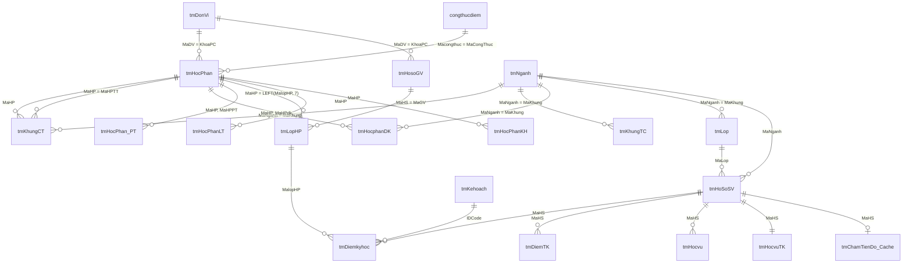

# Khám phá CSDL đào tạo của Trường (SQL Server) — 2026-10-31

Báo cáo này ghi lại những gì đọc được từ SQL Server đào tạo của Trường qua hai tài khoản chỉ đọc mà người dùng cấp, và bản sao cục bộ đã dựng để thiết kế schema. Không chứa địa chỉ máy chủ, tên tài khoản, mật khẩu hay dữ liệu cá nhân. Hai tài khoản được gọi là **A** và **B**.

Đầu vào cho: kế hoạch thiết kế lại schema dữ liệu DUT (người dùng tự lập), hợp đồng nguồn F-22 (C5), nhóm tự chọn theo hướng (C10), F-11/F-12 (đề cương, công thức điểm), F-18..F-20 (điều kiện đăng ký, xét tốt nghiệp, tiến độ).

## 1. Tóm tắt

- Máy chủ có **9 DB nghiệp vụ**; tài khoản A mở được 3, tài khoản B mở được 5, gộp lại **6 DB** (965 bảng, ~63 triệu dòng, ~19,3 GB). Ba DB không tài khoản nào mở được: `DATA_SV1_Login`, `tmProxBck`, `XacMinhBangTN`.
- **`tmProxDUT` là DB đào tạo chính và mới nhất** (sửa gần nhất 2026-10, có khung K2026). `DHBK_CDS` (bản 2025-08, nguồn dump Markdown cũ của seed) và `DATA_SV2` (bản 2026-01) là bản con cũ hơn của cùng schema `tm*`. Seed DUT nên chuyển nguồn sang `tmProxDUT`.
- `DATA_GVien1` = cổng giảng viên (lịch giảng, nội dung giảng dạy theo tuần, giáo trình, khảo sát CĐR); `DATA_SV1` = cổng sinh viên (đăng ký học phần, ràng buộc đăng ký, hồ sơ nhân thân); `DanhGia` = khảo sát đánh giá giảng dạy (29,8 triệu dòng, chỉ lấy metadata).
- **Không có bảng PLO/CLO** trong 6 DB đọc được. Gần nhất: văn bản "chuẩn đầu ra" theo tuần trong `DATA_GVien1.tmHocPhanKH` (235 học phần, chỉ **1** học phần CNTT) và bộ câu hỏi khảo sát CĐR theo khung CDIO (`CDR*`, một form của ngành Cơ điện tử). PLO/CLO thật của Khoa nằm ở hệ `plo-clo-backend` (CSDL riêng), hệ này cũng đọc 13 bảng `tm*` cùng nguồn.
- **Nhóm tự chọn có dữ liệu để dựng lại** (C10): trong `tmKhungCT`, cột `Note` của dòng tự chọn ghi luật nhóm ("Chọn 1 trong 3", "Chọn 2 trong 11") hoặc tên hướng ("ATTT", "HTTT", "Mạng", "KTMT", "Công nghệ PM"); nhóm = (khung, học kỳ, `Note`). Với khung CNTT: 3034 dòng tự chọn, 621 dòng không có `Note`. Ngoài ra Trường còn tách **mỗi chuyên ngành thành một khung riêng** (`..._CNPM`, `..._ATTT`, `..._HTTT`, `..._KTMT`).
- Không bảng nào có PK/FK khai báo; gần như mọi bảng là heap không index. Quan hệ ngầm qua mã (`MaHP`, `MaNganh`/`MaKhung`, `MaHS`, `MaLop`, `MalopHP`, `IDCode`) khớp tốt (§5.2): phần lớn dưới 5% mã mồ côi.
- Đã sao lưu **98 bảng / 2,05 triệu dòng** về SQL Server 2022 cục bộ + CSV, số dòng nguồn = bản sao = CSV ở cả 98 bảng (§11).

## 2. Phương pháp và giới hạn

- Kết nối: SSH tunnel từ máy cục bộ tới SQL Server (không cài, không ghi gì lên host SSH). Máy chủ: SQL Server 2019 Enterprise, collation `SQL_Latin1_General_CP1_CI_AS`.
- Quyền thực tế của cả hai tài khoản: `CONNECT` + `SELECT` (db_datareader). Không đọc được `sys.dm_db_index_usage_stats` (nên không biết bảng nào còn được dùng). Có **DENY cấp cột** trên cột mật khẩu: `DATA_GVien1.tmHosoGV.Account/Pass`, `DATA_SV1.NhanThan.matkhau`; bản sao bỏ qua các cột này.
- Tải lên máy production: metadata đọc từ `sys.*`; số dòng từ `sys.partitions` (không quét bảng); dữ liệu xuất **từng bảng một** bằng `bcp queryout` với `NOLOCK`. Bảng nặng nhất trong danh sách (`tmDiemkyhoc`, 1,1 GB) chỉ lấy dòng của sinh viên Khoa CNTT. Thời gian xuất mỗi bảng đều dưới 30 giây. Mọi thống kê cột và kiểm quan hệ chạy trên **bản sao cục bộ**, không chạy trên máy Trường.
- Giới hạn: đây là ảnh chụp ngày 2026-10-31; dữ liệu Trường sửa liên tục. Không có tài liệu nghĩa cột từ Trường; nghĩa cột trong báo cáo là **suy luận** từ tên và dữ liệu, cần Khoa/Phòng Đào tạo xác nhận (§10).

| DB | Tài khoản A | Tài khoản B |
|---|---|---|
| `tmProxDUT`, `DHBK_CDS` | đọc được | đọc được |
| `DATA_SV2` | đọc được | không |
| `DanhGia`, `DATA_GVien1`, `DATA_SV1` | không | đọc được |
| `DATA_SV1_Login`, `tmProxBck`, `XacMinhBangTN` | không | không |

`tmProxBck` tạo 2026-08-26, theo tên có lẽ là bản sao lưu của `tmProxDUT`. `XacMinhBangTN` (xác minh bằng tốt nghiệp) có thể chứa số hiệu bằng/số quyết định mà `tmHocvuTK` để trống (§5.4) — cần xin quyền nếu đề tài cần.

## 3. Các DB

Số dòng/dung lượng lấy từ catalog (gồm cả bảng sao lưu nội bộ).

| DB | Bảng | View | Thủ tục/hàm | Dòng | MB | Bảng sao lưu (`_luu`, `_2310`…) | Vai trò | Mức liên quan |
|---|---:|---:|---:|---:|---:|---:|---|---|
| `tmProxDUT` | 166 | 87 | 7 | 6,27 tr | 4 608 | 29 | Hệ đào tạo chính: ngành, khung, học phần, lớp, điểm, học vụ, học phí | **Cao — nguồn chính** |
| `DATA_GVien1` | 399 | 76 | 7 | 10,0 tr | 5 038 | 111 | Cổng giảng viên: nội dung giảng dạy, giáo trình, CĐR khảo sát, nhập điểm, thi, phòng | Cao (đề cương), trung bình (còn lại) |
| `DATA_SV1` | 293 | 5 | 0 | 13,9 tr | 2 872 | 118 | Cổng sinh viên: đăng ký học, ràng buộc đăng ký, nhân thân, rèn luyện, lịch sử đăng nhập | Cao (F-18), thấp (còn lại) |
| `DHBK_CDS` | 32 | 3 | 7 | 1,75 tr | 1 262 | 0 | Bản con `tm*` 2025-08 — nguồn dump Markdown seed hiện tại | Thay bằng `tmProxDUT` |
| `DATA_SV2` | 13 | 0 | 0 | 1,18 tr | 144 | 0 | Bản con 2026-01 (đăng ký + điểm) | Thấp |
| `DanhGia` | 62 | 1 | 7 | 29,8 tr | 5 842 | 16 | Khảo sát đánh giá giảng dạy | Ngoài phạm vi (chỉ metadata) |

## 4. Bản đồ miền

Phân loại tự động theo tên bảng/cột (`classify.ts`), rồi soát tay. 220 nhóm bảng trùng cột giữa các DB, chủ yếu là bản sao theo học kỳ trong cùng DB (ví dụ `DKyHoc_LopHP_2310_luu20231126`) và các bảng `tm*` có ở cả `tmProxDUT`, `DHBK_CDS`, `DATA_SV2`, `DATA_GVien1`.

| Miền | Bảng gốc nên dùng | Bản khác/cũ |
|---|---|---|
| Ngành, CTĐT, khung | `tmProxDUT`: `tmNganh`, `tmKhungCT`, `tmKhungTC`, `tmNhomNganh`, `tmNganhQG`, `NganhCuMoi`; `DATA_GVien1.tmNganhTQ` | `DHBK_CDS`/`DATA_SV2`/`DATA_GVien1` `tmNganh`, `tmKhungCT`; `DATA_GVien1.tmKhungCT_Khac` |
| Học phần, quan hệ | `tmProxDUT`: `tmHocPhan`, `tmHocphanDK`, `tmHocPhan_PT`, `DK_HPLogic`; `DATA_SV1.DKyHoc_HPLogic` | `DATA_GVien1.tmHocPhan` (gần trùng, có thêm 3 mã) |
| Đề cương, nội dung, CĐR | `DATA_GVien1`: `tmHocPhanKH`, `tmHocPhanLT`, `tmHocPhanML`, `tmGiaoTrinh*`, `CDR*`, `QLDT_DeCuongHocPhan` (rỗng) | `tmHocPhan.Decuong` (kiểu image, **rỗng** ở mọi dòng) |
| Công thức điểm | `DATA_GVien1.tmHocPhan_congthucdiem`, `DHBK_CDS.congthucdiem`, `tmProxDUT.tmLopHP_congthucdiem` | — |
| Đơn vị | `tmProxDUT.tmDonVi` (Khoa CNTT = `102`) | `DATA_GVien1.tmDonVi` |
| Học kỳ | `tmProxDUT.tmKehoach` (**chỉ tới HK2 2020-2021**), `tmKehoachCT`, `tmKehoachNam` | Mã kỳ thực tế lấy từ `IDCode` trong dữ liệu điểm/lớp (tới `2610`) |
| Lớp sinh hoạt, lớp học phần | `tmProxDUT`: `tmLop`, `tmLopHP`, `tmHocphanGV`; `DATA_GVien1.CVHT_GV` | `DATA_SV1.DKyHoc_LopHP`, `CourseSections` |
| Sinh viên | `tmProxDUT.tmHoSoSV`; `DATA_SV1.DSSV_KhoaWeb`, `NhanThan` | `DHBK_CDS`/`DATA_SV2` `tmHoSoSV` |
| Giảng viên | `tmProxDUT.tmHosoGV` | `DATA_GVien1.tmHosoGV` |
| Kết quả, học vụ | `tmProxDUT`: `tmDiemkyhoc`, `tmDiemTK`, `tmDiemMien`, `tmHocvu`, `tmHocvuTK`, `CanhBao` | `DATA_GVien1.tmDiemkyhoc` (4,6 tr dòng) |
| Tiến độ, xét tốt nghiệp | `tmProxDUT`: `tmChamTienDo_Cache`, `tmHPThieu`, `tmChungChi*`, `tmCNTTChungChi*`, `DoAnTotNghiep`, `tmSoluubang`, `doituanTN`; `DATA_SV1`: `LichXetTotNghiep`, `Ma_DotTotNghiep`, `_THTNTT*` | — |
| Ràng buộc đăng ký | `DATA_SV1`: `DKyHoc_KSoat_CNganh`, `DKyHoc_KSoat_HanCheKLHT`, `DKyHoc_KSoat_HPLock`, `DKyHoc_HPDahoc`, `DKyHoc_HPGhepCap`, `HocPhanDiemMax` | — |
| Ngoài phạm vi (chỉ metadata) | học phí/thu chi, thi/phòng/ca thi, khảo sát `DanhGia`, rèn luyện `RLForm*`, nhật ký đăng nhập, thông báo | — |

## 5. Bảng quan trọng

### 5.1 Ngành, khung, học phần

- **`tmNganh`** (1 836 dòng) — thực chất là **khung CTĐT theo khóa**, không phải ngành: `MaNganh` 7 ký tự = `MaKhung` ở các bảng khác (ví dụ `1024042` = "Công nghệ thông tin K2026"). `Kyhieu` = mã ngành quốc gia (`7480201`). Cột đáng chú ý: `SoTinChi`, `SoHK`, `Sotuchon` (TC tự chọn phải tích lũy), `Sotuchon1..3`, `TCThieu`, `KyBDau`/`KyKThuc` (mã kỳ áp dụng), `LoaiCTDT` (`CN` cử nhân, `KS` kỹ sư), `CapDT`, `YCNN` (yêu cầu ngoại ngữ), `NganhTD`, `MaNganhTQ`, `TenNganh1` (tên tiếng Anh). Khoa CNTT: tiền tố `102`, 201 khung (`1021…`–`1024…`).
- **`tmKhungCT`** (123 600) — dòng khung: `MaKhung`, `MaHP`, `Hocky`, `STT`, `Tuchon` (0/1), `MaHPTT` (học phần thay thế), `Note` (luật nhóm tự chọn/hướng), `TQDA`, `DATN`, `HTDA`, `LoaiKT`, `NhomKT` (rỗng ở khung CNTT). Khung CNTT: 190 khung, 16 110 dòng, 618 học phần.
- **`tmKhungTC`** (3 364) — số TC tự chọn yêu cầu **theo học kỳ** của khung (`MaKhung`, `Hocky`, `SoTC`).
- **`tmHocPhan`** (7 109) — `MaHP` 7 ký tự, `TenHP`, `TenHP1` (Anh), `SoTC`, `LyThuyet`, `ThucHanh`, `DoAn`, `BaiTL`, `ThucTap`, `LoaiHP` (0 thường, 1 điều kiện, 3 thí nghiệm, …), `KhoaPC` (đơn vị phụ trách; `102` = 500 học phần), `MaCongThuc` (công thức điểm), `LoaiKL`, `DATN`, `ChoHocNgoaiNganh`, `MaHPLT`, `TaiLieuTK`. 585 học phần không có `KhoaPC`.
- **`tmHocphanDK`** (98 267) — điều kiện **theo khung**: `MaKhung`, `MaHP`, `MaHPdk`, `LoaiDK` (0 học trước, 1 tiên quyết, 2 song hành — theo `legacy-mapping.ts`), `Hoac` (nhánh "hoặc", phần lớn NULL/0, 2 dòng = 1).
- **`tmHocPhan_PT`** (324) — học phần tương đương/thay thế (`MaHP` ↔ `MaHPPT`).
- **`DK_HPLogic`** (732, theo ngành) và **`DATA_SV1.DKyHoc_HPLogic`** (1 437, theo khung, 165 khung CNTT) — chuỗi mã hóa lộ trình đăng ký: `@` ngăn bước, `$` ngăn lựa chọn thay thế, `MaHP;MaHPdk:LoaiDK` gắn điều kiện tại chỗ. Cần parser nếu muốn dùng.

Ví dụ khung CNTT K2025 Kỹ sư (`1024031`, 180 TC, `Sotuchon` = 23): học kỳ 4–6 có các nhóm "Chọn 1 trong 3/4"; học kỳ 7 tách theo hướng CNPM, HTTT, ATTT, Mạng, KTMT; học kỳ 8 "Chọn 3 trong 6"; học kỳ 9 "Chọn 2 trong 5". Phân bố `Note` trên dòng tự chọn khung CNTT: rỗng 621, "Chọn 1 trong 3" 309, "Chọn 1 trong 5" 246, "Chọn 2 trong 11" 242, "Chọn 3 trong 6" 174, "CNPM,HTTT,Mang,HTN" 165, … và cả giá trị rác như "ko" (87).

### 5.2 Quan hệ suy ra (kiểm trên bản sao)

Không có FK khai báo. Kiểm bao hàm "giá trị con ⊆ khóa cha" sau khi bỏ khoảng trắng; cha đều duy nhất trừ dòng cuối.

| Quan hệ | Mã con khác nhau | Mồ côi |
|---|---:|---:|
| `tmKhungCT.MaKhung → tmNganh.MaNganh` | 1 607 | 0 |
| `tmKhungCT.MaHP → tmHocPhan.MaHP` | 6 660 | 2 |
| `tmKhungCT.MaHPTT → tmHocPhan.MaHP` | 1 489 | 0 |
| `tmHocphanDK.MaKhung → tmNganh.MaNganh` | 1 239 | 48 (4%) |
| `tmHocphanDK.MaHP / MaHPdk → tmHocPhan.MaHP` | 4 375 / 2 447 | 1 / 0 |
| `tmHocPhan.KhoaPC → tmDonVi.MaDV` | 38 | 5 (13%) |
| `tmLop.MaKhung → tmNganh.MaNganh` | 1 031 | 2 |
| `tmHoSoSV.MaLop → tmLop.MaLop` | 1 170 | 28 (2%) |
| `tmHoSoSV.MaNganh → tmNganh.MaNganh` | 933 | 2 |
| `tmLopHP.MaGV → tmHosoGV.MaHS` | 1 185 | 40 (3%) |
| `tmDiemkyhoc.MaHS / MaHP / MalopHP` (dòng CNTT) | 2 119 / 428 / 7 925 | 0 / 1 / 20 |
| `tmDiemkyhoc.IDCode → tmKehoach.IDCode` | 39 | 17 (44%) — bảng kỳ thiếu kỳ mới |
| `tmHocvu.MaHS`, `tmHocvuTK.MaHS → tmHoSoSV` | 22 940 / 22 640 | 877 / 521 — SV đã rời hồ sơ hiện hành |
| `tmChamTienDo_Cache.MaHS → tmHoSoSV` | 21 406 | 1 781 (8%) |
| `tmChungChiSV.MaCC → tmChungChi.MaCC` | 41 | 38 — mã chứng chỉ thuộc bảng khác (`tmChungChiYC`/`tmCNTTChungChi`?) |
| `DATA_GVien1.tmHocPhanKH / tmHocPhanLT → tmHocPhan` | 235 / 822 | 0 / 4 |
| `DATA_SV1.DKyHoc_KSoat_HanCheKLHT.MaHS → DSSV_KhoaWeb.MaHS` | 8 644 | 2 181; `DSSV_KhoaWeb.MaHS` không duy nhất |

### 5.3 Mã và chất lượng dữ liệu

- **Mã kỳ `IDCode`** 4 ký tự `YYSS`: `10` HK1, `20` HK2, `21` hè (khớp `semesterFromLegacyCode`); dữ liệu còn có `11` và `30` (mỗi loại 1 kỳ) mà mapping hiện tại sẽ từ chối. `tmKehoach` chỉ có 46 kỳ, tới `2020`; kỳ 2021–2026 chỉ xuất hiện trong dữ liệu điểm/lớp.
- **Mã sinh viên `MaHS`** bắt đầu bằng mã khoa (`102…` cho CNTT). `tmProxDUT.tmHoSoSV` chỉ có 22 262 hồ sơ (2 286 của CNTT, nhập học 2013–2026) — có vẻ là hồ sơ hiện hành, không phải toàn bộ lịch sử.
- **Mã lớp học phần `MalopHP`** = `MaHP` (7) + `IDCode` (4) + phần đuôi nhóm/lớp (ví dụ `2090140` + `2610` + `52NA`); `tmLopHP` không có cột `MaHP`, 111 897/111 980 lớp khớp `tmHocPhan` theo 7 ký tự đầu.
- **`MaHP`** đều 7 ký tự trong `tmProxDUT`; nhiều bảng lưu dạng `nvarchar` có khoảng trắng đuôi — so khớp phải `TRIM`.
- Cột "xóa mềm/đổi mã": `MaHPxoa`, `MaBPxoa`, `MaHPTTxoa` — dấu vết đổi mã học phần, cần hỏi nghĩa trước khi bỏ.
- `tmHocvuTK` (tổng kết học vụ/tốt nghiệp, 22 640): cột `SoQD`, `NgayQD`, `sohieubang` **rỗng ở mọi dòng** — số quyết định và số hiệu bằng không có ở DB đọc được (có thể ở `XacMinhBangTN`).
- `tmHocPhan.Decuong` (kiểu image) rỗng ở mọi dòng trong cả hai DB; `QLDT_DeCuongHocPhan` (theo dõi nộp đề cương) 0 dòng.
- Cột kiểu bảng rộng: `tmHocvuTK` có 20 nhóm cột lặp theo kỳ (`HPDangky1..20`, `DiemTBHT1..20`…); `tmDiemkyhoc` có ~120 cột điểm thành phần `CUSxx`, `CUSxx_K`, `CUSxx_KFix` (BT, CC, DA, GK, BV, CK, LT, TH, …).

### 5.4 Kết quả, tiến độ, tốt nghiệp

- `tmDiemkyhoc` — điểm theo lớp học phần: `IDCode`, `MaHS`, `MaHP`, `MalopHP`, `MaHPTT`, `Diem`/`DiemC`/`Diem4` (thang 10, chữ, 4), bản thi lại `_K`, điểm thành phần `CUSxx`, `HocLai`, `LockDiem`. Bản sao: 83 659 dòng của SV CNTT.
- `tmDiemTK` (562 751) — điểm tổng kết cuối cùng mỗi học phần/SV, có `MaHPXet` (học phần dùng để xét) — chính là đầu vào xét tốt nghiệp. `tmDiemMien` — điểm miễn/chuyển.
- `tmHocvu` — học vụ theo kỳ (TB kỳ, TB tích lũy, xếp loại, cảnh báo, thôi học, `SoQDThoi`).
- `tmChamTienDo_Cache` — **đã tính sẵn mức chậm tiến độ** theo SV: `MucDoCham` (Bình thường / Chậm nhẹ / Chậm nặng), `DanhSachMonCham`, `HocPhanQuanTrong`, `TC_TuChon_YeuCau/TichLuy/Thieu`. Dùng làm đáp án đối chiếu cho F-20 (tiến độ) và F-19.
- `tmHPThieu` — học phần còn thiếu theo SV/ngành. `tmChungChi*`, `tmCNTTChungChi*` — chuẩn chứng chỉ (ngoại ngữ, tin học, GDTC, QP) và chứng chỉ SV đã có.
- `DATA_SV1.LichXetTotNghiep` (5 đợt) — lịch xét tốt nghiệp: hạn nộp hồ sơ, ngày họp hội đồng dự kiến.

### 5.5 Đăng ký học phần (F-18)

- `DKyHoc_KSoat_CNganh` (250) — kiểm soát theo chuyên ngành/hệ/khóa; `DKyHoc_KSoat_HanCheKLHT` (25 551) — giới hạn khối lượng học tập theo SV/kỳ (`KLHTMax`, `SoTCmax`); `DKyHoc_KSoat_HPLock` — học phần bị khóa; `DKyHoc_HPGhepCap` — học phần ghép cặp; `DKyHoc_HPDahoc` — học phần đã học; `HocPhanDiemMax` (129 204) — điểm cao nhất mỗi học phần/SV (dùng để chặn học lại?).
- `DKyHoc_LopHP` — lớp mở đăng ký (sĩ số, TKB, cờ `DKy_KhongThem`, `DKy_KhongHuy`, `DKy_DuBi`, `CLC`).

### 5.6 Đề cương và chuẩn đầu ra

- `tmHocPhanKH` (1 215 dòng, 235 học phần) — kế hoạch giảng dạy theo tuần: `TuanThu`, `Chuong`, `TenChuong`, `NoiDungTL`/`NoiDungON` (nội dung trên lớp/ôn), `PPGDTL` (phương pháp), `CDRTL`/`CDRON` (chuẩn đầu ra dạng câu văn "Sinh viên hiểu được…"). Khoa CNTT chỉ có **1** học phần.
- `tmHocPhanLT` (10 182 dòng, 822 học phần; 33 của CNTT) — nội dung theo tuần với số tiết LT/BT/TH. Hợp với `WeeklyContent` (F-11).
- `tmHocPhanML` — mục lục đề cương dạng cây (`hpLevel`, `pID`, `TieuDe`), hầu hết rỗng tiêu đề.
- `tmGiaoTrinh*`, `tmNXBan` — giáo trình, tác giả, NXB, số quyết định giáo trình.
- `CDR*` — **khảo sát** ý kiến về CĐR theo khung CDIO (4 phần + phần đề xuất, 162 câu, 484 phản hồi), một form duy nhất cho ngành Cơ điện tử. Không phải định nghĩa PLO.
- Công thức điểm: `congthucdiem` có biểu thức sẵn (ví dụ `[GK]*0.20+[BT]*0.20+[CK]*0.60`), mã ánh xạ qua `tmHocPhan.MaCongThuc` và `tmHocPhan_congthucdiem` (1 307 học phần; CNTT 35). Các mã thành phần (`GK`, `BT`, `CK`, `DA`, `CC`, `BV`, `LT`, `TH`, `LN`, `RD`, …) trùng với cột `CUSxx` của `tmDiemkyhoc` → nối được thẳng vào `AssessmentComponent` (F-12).

## 6. ERD suy luận



## 7. Đối chiếu với schema hiện tại (`prisma/schema.prisma`)

| Thực thể dự án | Nguồn | Ghi chú |
|---|---|---|
| `OrgUnit` | `tmDonVi` | `MaDV`; 5 mã `KhoaPC` không có trong `tmDonVi` |
| `Program` | `tmNganh` gom theo `Kyhieu` (mã ngành QG) + `tmNganhTQ` | Nguồn không có thực thể "ngành" riêng; dự án đang tự gom |
| `ProgramVersion` | `tmNganh` (một dòng = một khung theo khóa) | `KyBDau`/`KyKThuc`, `SoTinChi`, `Sotuchon`, `LoaiCTDT`, `YCNN` chưa có chỗ đầy đủ |
| `Cohort`, `CohortVersion` | `tmLop.MaKhung`, `tmHoSoSV.IDCodeVao`, tên khung "K20xx" | — |
| `Course` | `tmHocPhan` | `LoaiKL`, `MaCongThuc`, `ChoHocNgoaiNganh`, `TenHP1` (Anh) chưa có chỗ |
| `CurriculumItem` | `tmKhungCT` | `MaHPTT` (thay thế), `TQDA/DATN/HTDA` |
| `ElectiveGroup` | `tmKhungCT.Note` + `Hocky` + `tmKhungTC` + `tmNganh.Sotuchon` | **Dựng được nhóm "Chọn k trong n" và nhóm theo hướng**; cần thêm khái niệm "hướng/chuyên ngành" (C10) |
| `KnowledgeBlock` | — | Nguồn không có khối kiến thức (`NhomKT` rỗng ở khung CNTT) |
| `CurriculumRequisite`, `CourseRelation` | `tmHocphanDK` (theo khung), `tmHocPhan_PT` | `Hoac` (nhánh hoặc) chưa có chỗ; `DK_HPLogic` chưa dùng |
| `EquivalentCourseGroup` | `tmHocPhan_PT`, `tmKhungCT.MaHPTT`, `tmDiemTK.MaHPXet` | — |
| `Syllabus`, `WeeklyContent` | `tmHocPhanLT`, `tmHocPhanKH`, `tmGiaoTrinh` | Phủ CNTT rất mỏng (33 học phần có nội dung tuần) |
| `PLO`, `CLO`, mapping | — | Không có trong DB Trường → lấy từ `plo-clo-backend` hoặc Khoa nhập |
| `AssessmentComponent` | `congthucdiem`, `tmHocPhan_congthucdiem`, `tmLopHP_congthucdiem` | Công thức theo lớp học phần có thể khác theo học phần |
| `Semester` | mã `IDCode` trong dữ liệu; `tmKehoach` lỗi thời | Cần nguồn lịch học kỳ (C9) |
| `Student`, `ProgramEnrollment` | `tmHoSoSV` (`MaNganh`, `MaNganh1/2`, `MaCN`, `IDCodeVao/Ra`), `DSSV_KhoaWeb` | Ngành 2 (`MaNganh2`) chưa có chỗ |
| `User` (giảng viên) | `tmHosoGV`, `CVHT_GV` (cố vấn học tập) | Cố vấn học tập chưa có chỗ |
| `AcademicResult` | `tmDiemkyhoc`, `tmDiemTK`, `tmDiemMien` | Điểm thi lại `_K`, `MaHPXet` |
| `GraduationAudit*` | `tmHocvuTK`, `tmHPThieu`, `tmChungChi*`, `tmChamTienDo_Cache`, `LichXetTotNghiep` | Chuẩn chứng chỉ (ngoại ngữ/GDTC/QP) chưa có chỗ |
| `SchoolClassMirror` (F-22) | `tmLop`, `tmLopHP` | — |

Thiếu so với nguồn: hướng/chuyên ngành, giới hạn khối lượng đăng ký theo SV/kỳ, kiểm soát đăng ký theo chuyên ngành, chuẩn chứng chỉ tốt nghiệp, cố vấn học tập, ngành thứ hai.

## 8. PLO/CLO

- Tìm theo từ khóa `cdr|chuandaura|plo|clo|decuong|muctieu|…` trên tên bảng/cột của 6 DB: 114 kết quả liên quan, không có bảng định nghĩa PLO, CLO hay ma trận học phần–PLO.
- Thứ gần nhất: văn bản CĐR theo tuần (`tmHocPhanKH.CDRTL/CDRON`) và bộ khảo sát CDIO (`CDR*`). Không đủ để seed PLO/CLO.
- `plo-clo-backend` (hệ `srms`) đọc cùng nguồn qua `SourceDbContext` (13 bảng: `tmConfig`, `tmDiemkyhoc`, `tmHoSoSV`, `tmHocPhan`, `tmHocPhan_PT`, `tmHosoGV`, `tmKehoach`, `tmKhungCT`, `tmLop`, `tmLopHP`, `tmNganh`, `tmThiCaCT`, `tmThiCaHP`) và **tự lưu PLO/CLO trong CSDL riêng**. Nếu cần PLO/CLO thật của Khoa: lấy từ CSDL đó (hoặc từ Khoa), không phải từ máy chủ này. Xem `docs/reference/plo-clo-backend-reference.md`.

## 9. Gợi ý cho kế hoạch schema và F-22

1. Đổi nguồn seed DUT từ dump Markdown `DHBK_CDS` sang bản sao `tmProxDUT` (mới hơn ~14 tháng, có K2025/K2026). Đọc qua bản sao cục bộ, không đọc thẳng máy Trường khi seed.
2. Coi `tmNganh` là **phiên bản CTĐT theo khóa**; gom thành `Program` theo `Kyhieu` + `LoaiCTDT`. Khung tách theo chuyên ngành (`_CNPM`, `_ATTT`…) là ứng viên cho thực thể "hướng/chuyên ngành" thay vì `ProgramVersion` riêng.
3. Dựng `ElectiveGroup` từ (`MaKhung`, `Hocky`, `Note`): parse "Chọn k trong n" (đã có `parseElectiveNote`), coi `Note` là tên hướng khi không khớp mẫu; `tmKhungTC.SoTC` là số TC tự chọn tối thiểu theo kỳ. 621 dòng tự chọn không có `Note` cần quy tắc mặc định.
4. Thêm `Hoac` vào điều kiện học phần (nhóm "hoặc").
5. `Semester` không lấy từ `tmKehoach`; sinh từ tập `IDCode` thực tế và chấp nhận thêm hậu tố `11`, `30` (hoặc loại có ghi nhận).
6. Hợp đồng F-22 (`cms_sync_v1`, C5): tối thiểu đọc `tmNganh`, `tmKhungCT`, `tmKhungTC`, `tmHocPhan`, `tmHocphanDK`, `tmHocPhan_PT`, `tmDonVi`, `tmLop`, `tmLopHP`, `tmHoSoSV`, `tmDiemTK`, `tmDiemMien`, `tmHocvuTK` của `tmProxDUT`. Vì bảng nguồn là heap không index, đồng bộ nên đọc toàn bảng theo lô và so khác ở phía dự án, không truy vấn theo khóa.
7. Đối chiếu engine tiến độ (F-20) và xét tốt nghiệp (F-19) với `tmChamTienDo_Cache` và `tmHPThieu` như bộ đáp án.

## 10. Câu hỏi mở

1. Nghĩa chính xác của `LoaiDK` (0/1/2), `Hoac`, `LoaiHP`, `LoaiKL`, `TQDA`, `HTDA`, `LoaiKT`, `NhomKT` — Phòng Đào tạo xác nhận.
2. Có xin được quyền đọc `XacMinhBangTN` (số hiệu bằng, số quyết định) và `tmProxBck` không?
3. `Note` rỗng trên dòng tự chọn (621 dòng CNTT) nghĩa là "tự do trong khung" hay thiếu dữ liệu?
4. Mã kỳ hậu tố `11` và `30` là gì?
5. Khoa có PLO/CLO trong `plo-clo-backend` cho khung nào; có dùng làm nguồn chính không?
6. Lịch học kỳ chính thức lấy ở đâu khi `tmKehoach` dừng ở 2020?

## 11. Phụ lục — bản sao lưu cục bộ

Ở `D:\dut-mirror\` (ngoài repo, **không commit**; chứa dữ liệu cá nhân thật). Mật khẩu ở `D:\dut-mirror\.env`.

| Thư mục | Nội dung |
|---|---|
| `catalog/` | Catalog JSON mỗi DB (bảng, cột, index, view, thủ tục, quyền), `index.json`, `classified.json` |
| `mssql` (Docker volume `dut-mirror-mssql`) | SQL Server 2022 container `dut-mirror`, cổng cục bộ 14333, 6 DB cùng tên nguồn |
| `bcp/` | File native `bcp` từng bảng (505 MB) |
| `csv/` | CSV UTF-8 có header từng bảng (293 MB) |
| `profile/` | Thống kê cột từng bảng, `relations.json` |
| `manifest.json` | Bảng đã sao: nhóm, bộ lọc, cột bị DENY, số dòng nguồn/bản sao/CSV |

| Nhóm | DB | Bảng | Dòng |
|---|---|---:|---:|
| CTĐT, học phần | `tmProxDUT` | 31 | 400 755 |
| CTĐT, học phần | `DATA_GVien1` | 12 | 147 410 |
| CTĐT (công thức điểm) | `DHBK_CDS` | 1 | 238 |
| Đề cương, CĐR | `DATA_GVien1` | 19 | 13 370 |
| Người | `tmProxDUT` / `DATA_GVien1` / `DATA_SV1` | 2 / 2 / 2 | 23 927 / 3 752 / 68 665 |
| Kết quả, tốt nghiệp | `tmProxDUT` / `DATA_SV1` | 13 / 5 | 931 762 / 45 535 |
| Đăng ký học | `DATA_SV1` | 11 | 413 918 |
| **Tổng** | | **98** | **2 049 332** |

Lọc: chỉ `tmProxDUT.tmDiemkyhoc` (dòng có `MaHS` thuộc SV ngành `102…`). Không sao: học phí, thi/phòng, khảo sát `DanhGia`, rèn luyện, nhật ký, thông báo, các bảng sao lưu nội bộ của Trường.

Chạy lại (từ `source/backend`, tunnel tới máy Trường đang mở, container `dut-mirror` đang chạy):

```bash
pnpm exec tsx scripts/school-discovery/catalog.ts      # catalog, chỉ đọc sys.*
pnpm exec tsx scripts/school-discovery/classify.ts     # phân loại offline
pnpm exec tsx scripts/school-discovery/mirror.ts       # bcp từng bảng; --only=db.table --force để chép lại
pnpm exec tsx scripts/school-discovery/export-csv.ts   # CSV từ bản sao
pnpm exec tsx scripts/school-discovery/profile.ts      # thống kê + quan hệ trên bản sao
```

Scripts đọc cấu hình từ `D:\dut-mirror\.env` (đổi bằng `DUT_MIRROR_ROOT`/`DUT_MIRROR_ENV`); hướng dẫn bật tunnel/container ở `D:\dut-mirror\README.md`.

## Đính chính 2026-10-31

`tmProxDUT.tmKehoach` dừng ở HK2 2020-2021 như đã nêu, nhưng `DHBK_CDS.tmKehoach` có ngày bắt đầu chính thức tới kỳ 2620. Reseed dùng bảng này; chỉ 5 kỳ hè phải ước lượng (cờ `Semester.startDateEstimated`). Các câu "lịch học kỳ chỉ tới 2020" ở trên chỉ đúng với `tmProxDUT`. Xem [báo cáo reseed](../implement-report/dut-real-reseed-implement-report.md).
